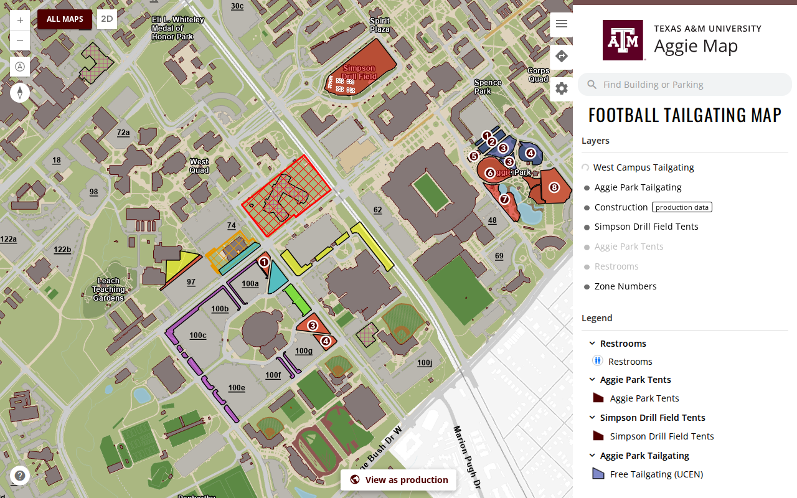
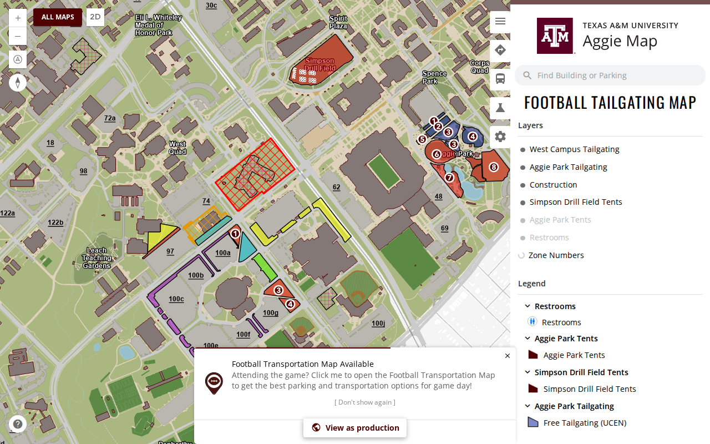
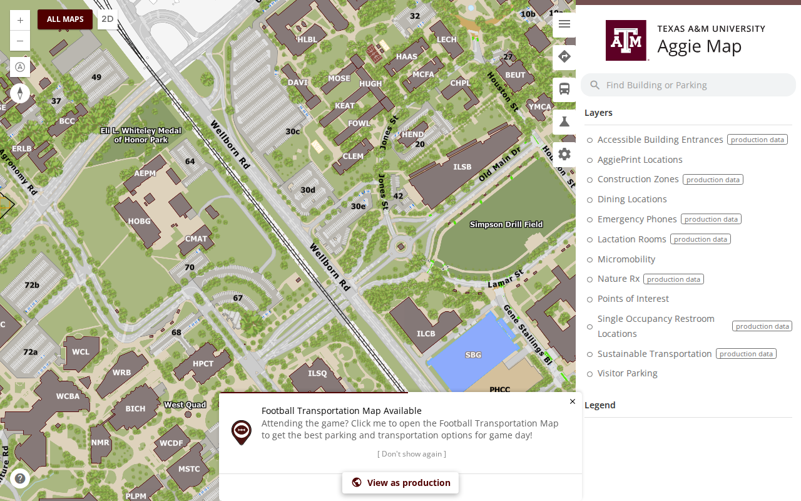
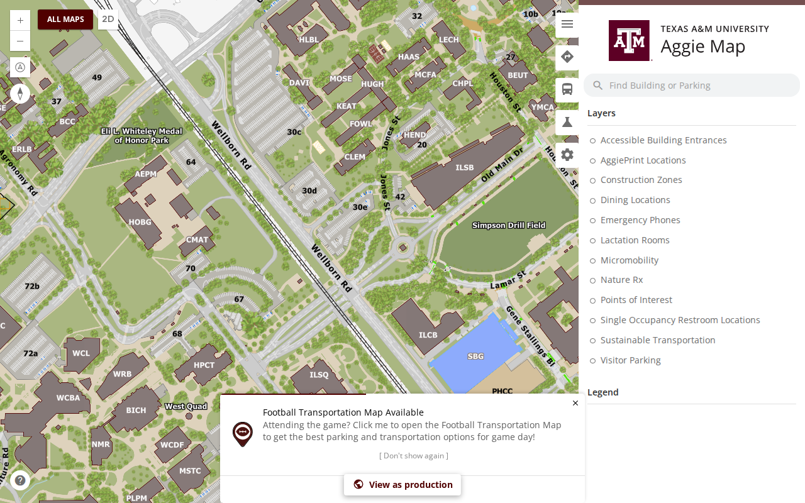
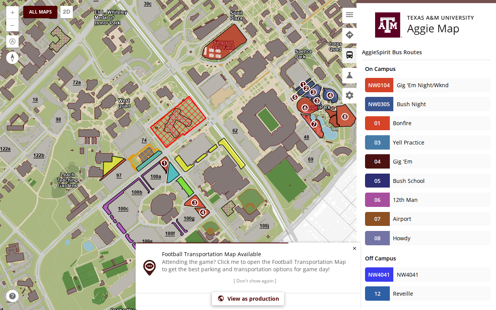

<!--
  Every pull request needs an issue behind it. Work on this project is reported to keep it funded,
  and that reporting is built from issues - a pull request with no issue does not appear in it.

  A CI check looks for one of `Closes #N`, `Fixes #N` or `Resolves #N` below. If there is genuinely
  no issue for this, open one first; it takes a minute and it is the whole point.
-->

Closes #2758

## What this changes

**One side panel for the main map and every event and parking map, with its tabs declared once.**

The event maps had a side panel of their own (`MoveInOutSidebarComponent`), near-identical to the main map's and
maintained apart from it, and Bus Routes and Experiments were only ever added to the main map's. So **Bus Routes was
missing from every event and parking map, on production as well as dev**, and Experiments on dev. The drift was not
only in the templates: the event maps' routes had no `bus` or `experiments` panel at all, and their trip planner
**Options page was never gated** when #2801 gated the main map's.

**Which option, and why: the first - one component.** The event sidebar's only differences were a tab filter
(`sidebarTabs`, for satellite campuses) and a campus branding image. Both are options, not a second component, so:

- **`SIDEBAR_TABS`** (`aggiemap-ngx-ui-desktop`, `sidebar-tabs.ts`) declares the tabs once: title, icon, route, and
  `developmentOnly` for Experiments. Their reasons (#1003, #1090, #2789, #2804) sit beside them.
- **`AggiemapSidebarComponent`** draws them. It is now the side panel of every map; the event sidebar is deleted.
- **`sidebarRoutes(reference)`** gives both maps the same panels behind the tabs; only the landing panel differs (the
  event maps list their own layers and legend). The Options page's `developmentOnlyRoute` gate comes with it.
- **`SIDEBAR_OPTIONS`** is how a map changes its panel: the event maps provide it from their definition (`sidebarTabs`,
  `brandingIconUrl`). `sidebarTabs`' type is now `SidebarTabId[]`, derived from the declaration, so it can name every
  tab - the old hand-written union could not express a bus tab.

**What can still drift:** nothing in the desktop panel. The phone layout was already one shared menu, but its Bus
Routes item is an absolute link to `/map/m/bus`, so on an event map it leaves for the main map - a separate question,
in the report. UES Operations has its own side panel in its own application, and is untouched.

**Gating:** Bus Routes is on every environment since #2789 (the batch that asked for this described it as
development-only, which was true until 9 November). Experiments stays development-only, now by `developmentOnly` in the
declaration, filtered with `TestingService`. The smoke suite's lists agree: `DEVELOPMENT_ONLY_SECTIONS` (Experiments)
and `SECTIONS_ON_EVERY_ENVIRONMENT` (Bus Routes, Directions) are now checked on an event map as well as the main map,
and `DEVELOPMENT_ONLY_PAGES` names the event map's Options page.

Event maps now also report `sidebar_select` to analytics when a tab is clicked, as the main map always has.

## Screenshots

| | Before (dev) | After (this branch) |
| --- | --- | --- |
| Football Tailgating |  |  |
| The main map |  |  |

Bus Routes on the tailgating map, opening the bus list:

<!--
  Required for anything with a visible result - a page, a map, a layer, a legend, a popup. Before and
  after, not just after: a reviewer cannot tell what changed from one image.

  A CI check looks for an image below whenever a template, stylesheet, component or directive
  changes. If the change genuinely has no visible result, apply the `no-visible-change` label rather
  than deleting this section.

  This is not only documentation. The duplicated 150th Anniversary tile (#1055) was found because
  before/after images were being captured for release notes. It read as correct in the diff and was
  obvious in a picture.

  Drag images in here, or commit them and link the raw URL - this repository is public, so raw URLs
  render and do not rot.

  Delete this section if the change has no visible result.
-->

## Release notes

<!--
  Anything with a user-visible result adds its entry to docs/releases/unreleased.md in this pull
  request, with the before/after images above linked from docs/screenshots/<slug>/. Nobody writes
  the notes later. See docs/releases/README.md.
-->

- [x] Entry added to `docs/releases/unreleased/2758-one-sidebar.md`, with screenshots and its *What to test on dev* row (`collate-release-notes.mjs --check`: 44 entries, no problems)
- [ ] Not user-visible (tests, CI, internal docs), so no entry needed

## How it was verified

<!--
  What you actually ran or looked at, and what it said. "Tests pass" is weaker than naming the check
  and its result. If something could not be verified, say so - that is more useful than silence.
-->

- **Red first, on dev** (`run-local.sh development one development-only.spec.ts`, the section checks extended to
  `/events/tailgating/map`): 2 failed every attempt, `the Bus Routes tab is not offered on /events/tailgating/map here`
  and `the Experiments tab should be offered on /events/tailgating/map here`; the other 25 passed.
- **The Options page red on production** (22 October's build): `/events/tailgating/map/d/trip/options` stayed there
  instead of going back to `/events/tailgating/map/d/trip`, 3 of 3 attempts.
- **A production build of this branch** (`--configuration=production`, after merging the latest development), served
  locally: `development-only.spec.ts` **20 of 20 as production** (`local-production`) - on the tailgating map Bus Routes
  and Directions offered, Experiments not, Options back to the trip planner, no development-only service requested -
  and **20 of 20 as development** (`local`).
- **In the app**, on the tailgating map: five tabs, and Bus Routes opens the bus list (23 routes), with no console
  errors. A satellite campus (Galveston) still shows only Features.
- **Unit:** `sidebar-tabs.spec.ts` - the order, Experiments off where development is off, a map's restriction, a panel
  for every tab, and the Options gate.
- `scripts/check-in-volume.sh fix/2758-one-sidebar` (full affected, after merging `origin/development`): exit 0.

🤖 Generated with [Claude Code](https://claude.com/claude-code)
