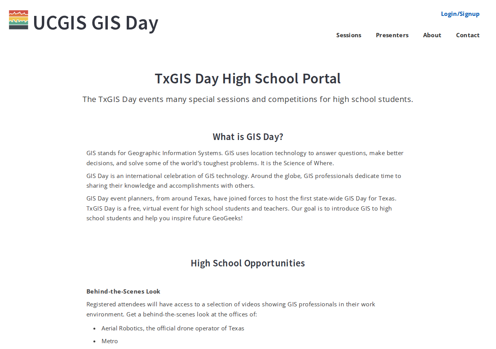
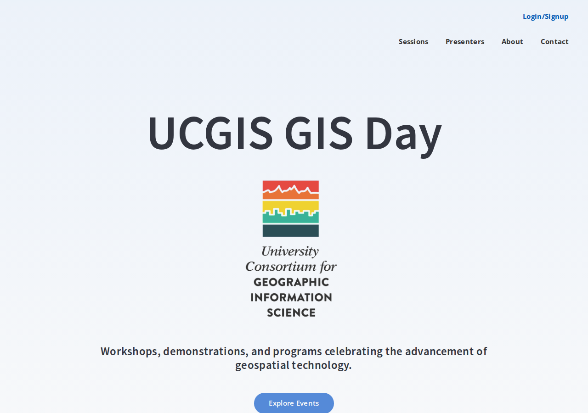
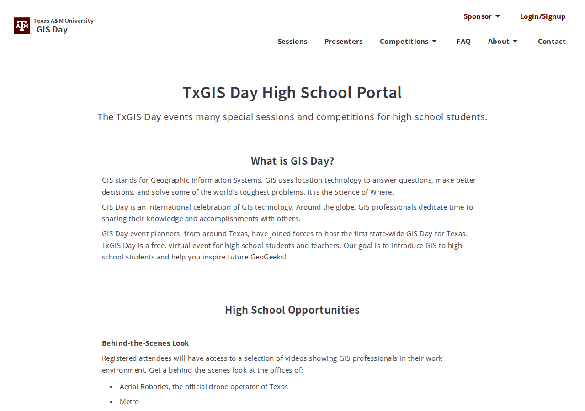

<!--
  Every pull request needs an issue behind it. Work on this project is reported to keep it funded,
  and that reporting is built from issues - a pull request with no issue does not appear in it.

  A CI check looks for one of `Closes #N`, `Fixes #N` or `Resolves #N` below. If there is genuinely
  no issue for this, open one first; it takes a minute and it is the whole point.
-->

Closes #3643

## What this changes

<!-- What a reader needs to know. Why, not only what. -->

On a site that leaves out `tamu`, such as UCGIS's (gisday.ucgis.org), `/highschool` opened Texas A&M's **TxGIS Day High School
Portal**. `libs/gisday/common/src/lib/sites.ts` says `tamu` covers the High School Portal. Every other feature-gated page in
`wrapper.routes.ts` has `canActivate: [siteFeatureGuard(...)]` and sends the visitor to `/`, but `highschool` had none. It now has
`siteFeatureGuard('tamu')`.

Nothing links to the page, so a visitor reached it only by typing the address. Found by #3638's smoke spec.

`test/e2e/gisday/ucgis-site.spec.ts` gains `/highschool` in its list of left-out pages that go to the homepage.

## Screenshots

<!--
  Required for anything with a visible result - a page, a map, a layer, a legend, a popup. Before and
  after, not just after: a reviewer cannot tell what changed from one image.

  A CI check looks for an image below whenever a template, stylesheet, component or directive
  changes. If the change genuinely has no visible result, apply the `no-visible-change` label rather
  than deleting this section.

  This is not only documentation. The duplicated 150th Anniversary tile (#1055) was found because
  before/after images were being captured for release notes. It read as correct in the diff and was
  obvious in a picture.

  Drag images in here, or commit them and link the raw URL - this repository is public, so raw URLs
  render and do not rot.

  Delete this section if the change has no visible result.
-->

UCGIS's site at `/highschool`. Production builds of `development` and this branch, served statically, with the site key set as
`test/e2e/gisday/site.ts` sets it, and the API stubbed:

| Before | After |
| --- | --- |
|  |  |

Texas A&M's site at `/highschool`, unchanged:

| Before | After |
| --- | --- |
|  |  |

## Release notes

<!--
  Anything with a user-visible result adds its entry to docs/releases/unreleased.md in this pull
  request, with the before/after images above linked from docs/screenshots/<slug>/. Nobody writes
  the notes later. See docs/releases/README.md.
-->

- [x] Entry added: `docs/releases/unreleased/3643-highschool-site-guard.md`, with screenshots
- [ ] Not user-visible (tests, CI, internal docs), so no entry needed

## How it was verified

<!--
  What you actually ran or looked at, and what it said. "Tests pass" is weaker than naming the check
  and its result. If something could not be verified, say so - that is more useful than silence.
-->

- **Red first.** `ucgis-site.spec.ts` and `public-routes.spec.ts` run against `development`'s production build: 1 failed, 22 passed. The
  failure was the new test, for the expected reason: `Received: "/highschool"`.
- **Green.** The same two specs against this branch's build: 23 of 23 pass. That includes `public-routes.spec.ts`'s "highschool
  (/highschool) loads", so Texas A&M's portal still opens.
- **In a browser.** On UCGIS's site, `/highschool` ends at `/` with no portal heading. On Texas A&M's, it stays on `/highschool` with
  the portal.
- `node scripts/collate-release-notes.mjs --check`: 23 entries, no problems.
- `scripts/pre-pr-check.sh fix/3643-highschool-site-guard ... gisday-platform-ngx-core,gisday-angular`: `pre-pr-check: Exit 0 (fix/3643-highschool-site-guard): ready to open.`

🤖 Generated with [Claude Code](https://claude.com/claude-code)
