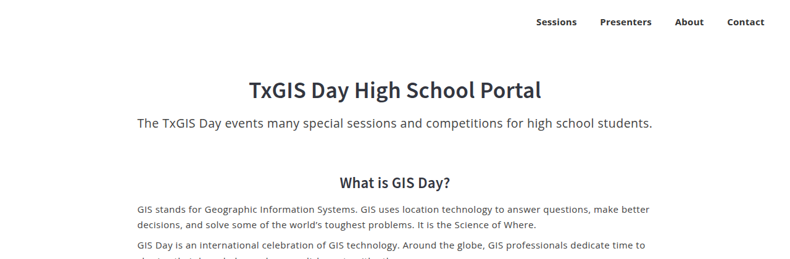
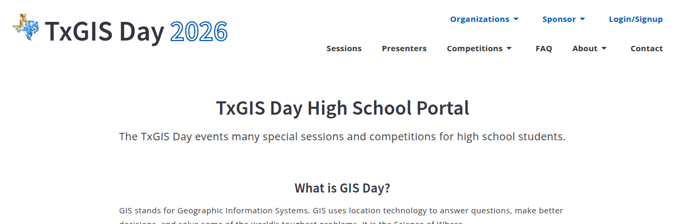

Title: fix(gisday-platform-ngx-core): The High School Portal's header is drawn in full

<!--
  Every pull request needs an issue behind it. Work on this project is reported to keep it funded,
  and that reporting is built from issues - a pull request with no issue does not appear in it.

  A CI check looks for one of `Closes #N`, `Fixes #N` or `Resolves #N` below. If there is genuinely
  no issue for this, open one first; it takes a minute and it is the whole point.
-->

Closes #3889

## What this changes

**The High School Portal's header is drawn in full again.** On `/highschool`, offered on txgisday.org and gisday.tamu.edu, the header lost its logo and its Organizations, Sponsor and Account menus, and the console showed `NG0203: The InjectionToken GISDAY_SITE token injection failed`.

`HighschoolComponent.ngOnInit` set the page title with `inject(GISDAY_SITE)`. `inject()` works only while a class is being constructed, so it threw, and the page's first render was abandoned half done. It is now set in the constructor, as the seven other pages that title themselves the same way (account, admin, competitions, events, people, sponsors, wayback) already do.

Found by g131's sweep of every public GIS Day page, on every site, at 390 and 1280 pixels: the one page of 66 with an error of its own.

## Screenshots

<!--
  Required for anything with a visible result - a page, a map, a layer, a legend, a popup. Before and
  after, not just after: a reviewer cannot tell what changed from one image.

  A CI check looks for an image below whenever a template, stylesheet, component or directive
  changes. If the change genuinely has no visible result, apply the `no-visible-change` label rather
  than deleting this section.

  This is not only documentation. The duplicated 150th Anniversary tile (#1055) was found because
  before/after images were being captured for release notes. It read as correct in the diff and was
  obvious in a picture.

  Drag images in here, or commit them and link the raw URL - this repository is public, so raw URLs
  render and do not rot.

  Delete this section if the change has no visible result.
-->

`/highschool` on txgisday.org's site, 1280 pixels wide:

| Before | After |
| --- | --- |
|  |  |

## Release notes

<!--
  Anything with a user-visible result adds its entry to docs/releases/unreleased.md in this pull
  request, with the before/after images above linked from docs/screenshots/<slug>/. Nobody writes
  the notes later. See docs/releases/README.md.
-->

- [x] Entry added, as `docs/releases/unreleased/3889-highschool-header.md` (`app: gisday`), with screenshots and its *What to test on dev* row
- [ ] Not user-visible (tests, CI, internal docs), so no entry needed

## How it was verified

<!--
  What you actually ran or looked at, and what it said. "Tests pass" is weaker than naming the check
  and its result. If something could not be verified, say so - that is more useful than silence.
-->

- **Reproduced** on the local GIS Day stack (`scripts/gisday-local.sh`, static build of `development` `bd5e9094e`): `NG0203` on `/highschool`, on txgisday and tamu, at 390 and 1280 pixels, with the header half drawn.
- **Red first:** the new `highschool.component.spec.ts` failed with `expected [Function] to not throw an error but 'Error: NG0203: The InjectionToken GISDAY_SITE…' was thrown`.
- **Green:** 1 passed. On a static build of this branch, `/highschool` had no console error and a full header, on both sites at both widths.
- `scripts/check-in-volume.sh fix/3889-highschool-header gisday-platform-ngx-core,gisday-angular`: Exit 0, after merging today's `development`.
- `node scripts/collate-release-notes.mjs --check`: no problems.

🤖 Generated with [Claude Code](https://claude.com/claude-code)
