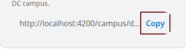
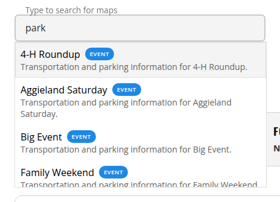
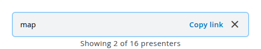
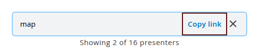

<!-- Title: fix(sass): Keyboard focus is visible on the copy button, sidebar menu and autocomplete items -->
<!--
  Every pull request needs an issue behind it. Work on this project is reported to keep it funded,
  and that reporting is built from issues - a pull request with no issue does not appear in it.

  A CI check looks for one of `Closes #N`, `Fixes #N` or `Resolves #N` below. If there is genuinely
  no issue for this, open one first; it takes a minute and it is the whole point.
-->

Closes #1001

## What this changes

<!-- What a reader needs to know. Why, not only what. -->

`development` has 14 rules with `outline: none` (and 10 files that use `:focus-visible`, as the triage counted). Four of them hide keyboard focus and put nothing in its place. This fixes those four. It adds a `focus-ring` mixin to `libs/sass/_mixins.scss`: a `:focus-visible` outline in the shape the repository already uses (2px Aggie maroon, offset 2px, as on #2588's tiles, the accordion header and the compass), shown for the keyboard only.

| Rule | What it hid | Now |
| --- | --- | --- |
| `libs/sass/components/_copy-button.scss` | The copy field's **Copy**, and GIS Day's **Copy link** (AggieMap, UES Operations, the event maps, GIS Day's presenter and session searches) | Ring drawn inside the button (`-2px`), because the copy field hides what overflows it |
| `libs/ui-kits/ngx/forms/.../autocomplete.component.scss` | A result reached with the arrow keys looked the same as one under the pointer | Ring drawn inside the item (`-2px`), because the results list scrolls and would cut off one outside it |
| `apps/geoservices-angular/src/styles.scss`, `.sidebar-menu .menu-item` | The geoservices sidebar menu, the one actually drawn | Ring |
| `libs/sass/modules/_sidebar_menu.scss` | Nothing today: no stylesheet imports it | Ring, so a future import does not bring the fault back |

**Left as they are, and why:**

- `apps/aggiemap-angular`, `apps/ues-operations-angular` and `libs/ts/sass/events_base.scss`, text inputs: they change their border colour on `:focus`, so focus is visible.
- `range.component.scss`: the thumb gets its own outline on focus.
- `textbox.component.scss`: the container shows focus with `:focus-within`.
- `action-menu.component.scss`: already has a `:focus-visible` ring.
- `_trip_direction_toggle.scss`: applies to the disabled state only.
- `details-panel.component.scss`: the panel is focused by code when it opens, not by the user, and a ring would show on every open.
- `search.component.scss` and `search-mobile.component.scss`: text inputs, where the caret shows focus and a ring would show on every click as well, since `:focus-visible` always matches a text input. Whether they should still get one is a design question.

## Screenshots

Keyboard focus, before and after. Each was captured with the keyboard (Tab, or the down arrow) in the local dev server, from this branch's base and then its fix.

| | Before | After |
| --- | --- | --- |
| AggieMap All Maps, a map's **Copy** |  |  |
| AggieMap All Maps, the search's first result by the down arrow |  |  |
| GIS Day Presenters, the search's **Copy link** (made-up local data) |  |  |

## Release notes

<!--
  Anything with a user-visible result adds its entry to docs/releases/unreleased.md in this pull
  request, with the before/after images above linked from docs/screenshots/<slug>/. Nobody writes
  the notes later. See docs/releases/README.md.
-->

- [x] Entry added to `docs/releases/unreleased.md`, with screenshots: `docs/releases/unreleased/1001-keyboard-focus.md` (AggieMap) and `1001-gisday-keyboard-focus.md` (`app: gisday`), each with its What to test on dev row
- [ ] Not user-visible (tests, CI, internal docs), so no entry needed

## How it was verified

<!--
  What you actually ran or looked at, and what it said. "Tests pass" is weaker than naming the check
  and its result. If something could not be verified, say so - that is more useful than silence.
-->

- **Captured, base then fix**, with Playwright in the dev servers, reading the focused element's computed outline: before, `3px none` on all three (no outline); after, `2px solid rgb(80, 0, 0)`. The first "after" capture showed the ring clipped on Copy and on the result, which is why those two are drawn inside.
- **A mouse click draws no ring.** On GIS Day's Copy link, after a click focus is not left on the control and nothing is outlined.
- `node scripts/collate-release-notes.mjs --check`: 6 entries, no problems.
- **The pre-push check**, `CHECK_PARALLEL=1 scripts/check-in-volume.sh fix/1001-focus-visible ui-kits-ngx-forms,geoservices-angular,aggiemap-angular,ues-operations-angular,ts-events-angular,gisday-platform-ngx-common,gisday-angular`, after merging the latest `development`: **exit 0**. lint and test for all 7, build in production for the 5 with a build and the 4 tasks they depend on, then every `lint.yml` step, `npm audit signatures` included (1689 packages verified).
- `scripts/pre-pr-check.sh fix/1001-focus-visible '<this title>' .pr-body.md <the 7 projects>`: `pre-pr-check: Exit 0 (fix/1001-focus-visible): ready to open.`
- There is no automated test for a focus ring. The smoke suite asks what a map serves, and the unit tests do not compute styles; the images and the computed outlines are the evidence.

🤖 Generated with [Claude Code](https://claude.com/claude-code)
