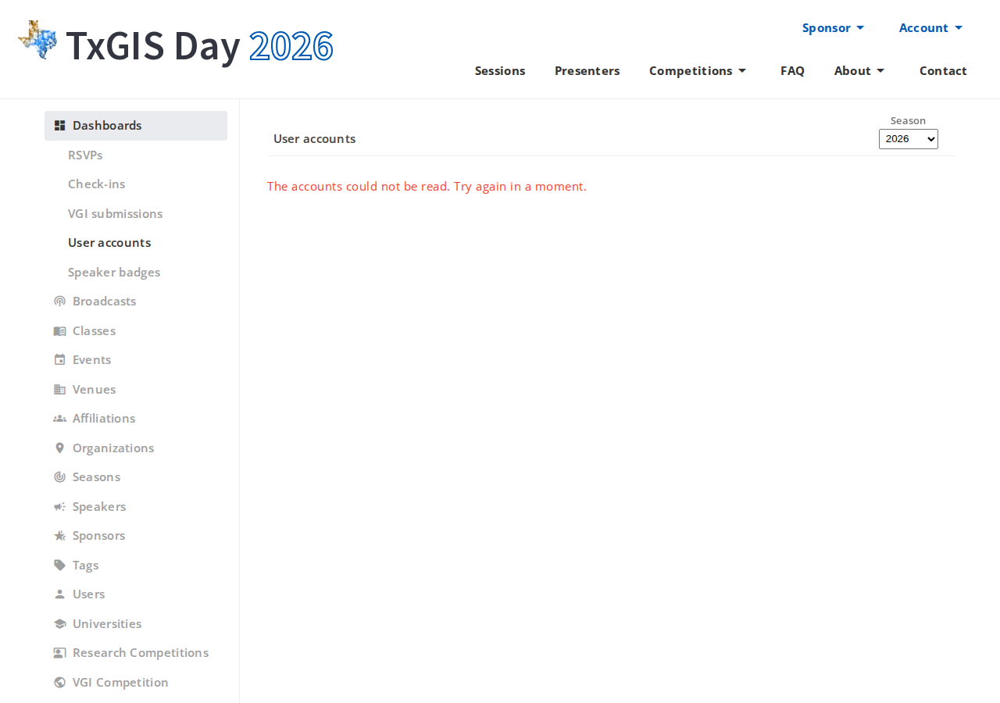
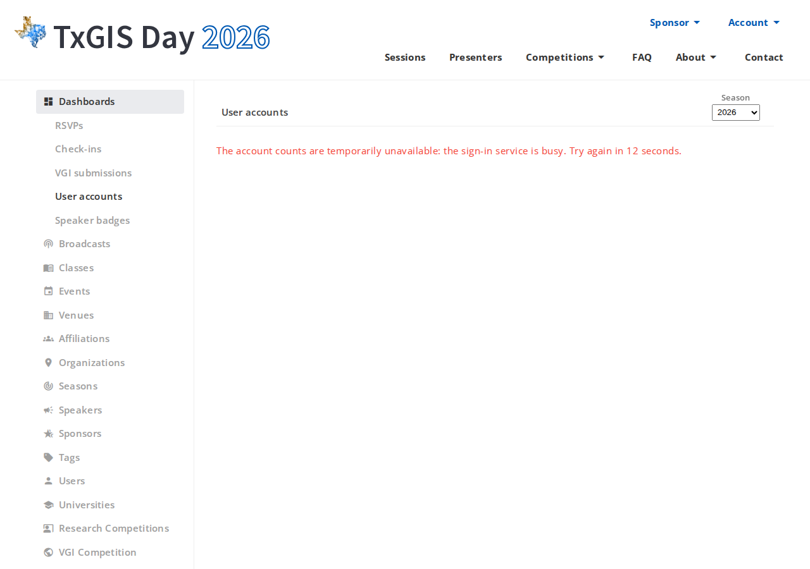
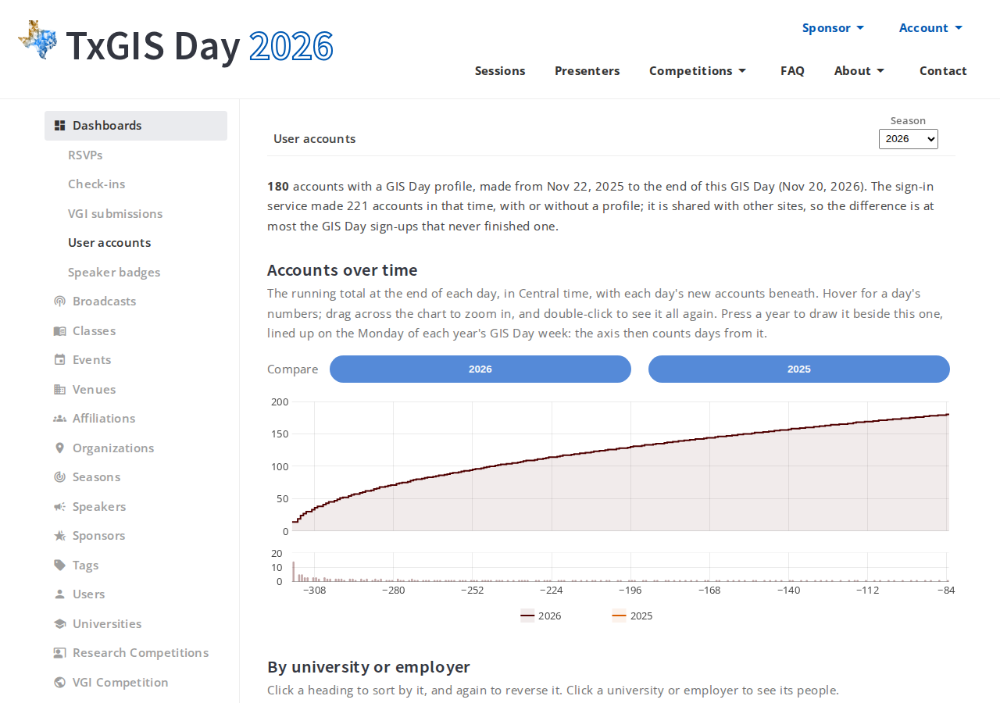

Title: fix(gisday-platform-data-api, gisday-platform-ngx-core): The accounts dashboard says when Auth0 is busy, and for how long

<!--
  Every pull request needs an issue behind it. Work on this project is reported to keep it funded,
  and that reporting is built from issues - a pull request with no issue does not appear in it.

  A CI check looks for one of `Closes #N`, `Fixes #N` or `Resolves #N` below. If there is genuinely
  no issue for this, open one first; it takes a minute and it is the whole point.
-->

Closes #3747

## What this changes

**When Auth0 rate-limits the management API, the accounts dashboard answered 500.** Its two routes (`GET /users/dashboard/season/:guid` and `.../row/:key`) let the SDK's `TooManyRequestsError` through, and **Admin > Dashboards > User accounts** said only that the accounts could not be read.

**A 503 with `Retry-After`, not a retry.**
- `AccountDashboardProvider` turns the SDK's `TooManyRequestsError` into `AccountsRateLimitedException`, a 503 carrying how long to wait.
- The wait is Auth0's own: its `retry-after` header, or else its `x-ratelimit-reset`, bounded to 1 to 60 seconds, and 30 when it gives neither.
- Both routes send that wait as `Retry-After`. Nest's exceptions carry no headers, so each route sets it on a passthrough response.
- Nothing is kept from a refused read, so the next try reads Auth0 again.
- Any other failure is unchanged.

Why not retry: a retry spends more of a limit that has just been reached, and it would hold the admin page for as long as the backoff runs. A 503 with a wait tells the person when to try again, and it is less code.

**The page says what happened and when to try again:** "The account counts are temporarily unavailable: the sign-in service is busy. Try again in 12 seconds." It reads the seconds from `Retry-After`. Before this, it said "The accounts could not be read. Try again in a moment." The issue's "draws nothing" was not quite what happened: the page did show that generic message, but not why or for how long.

<!-- What a reader needs to know. Why, not only what. -->

## Screenshots

| | Before | After |
| --- | --- | --- |
| Auth0 rate-limiting the API |  |  |
| The counts, as usual (byte-identical) |  |  |

**How each image was made** ([README](https://github.com/TamuGeoInnovation/Tamu.GeoInnovation.js.monorepo/blob/4efd52d7f80f0614a2c3517731d717c63b8a8ac9/docs/screenshots/3747-accounts-dashboard-rate-limit/README.md), [capture script](https://github.com/TamuGeoInnovation/Tamu.GeoInnovation.js.monorepo/blob/4efd52d7f80f0614a2c3517731d717c63b8a8ac9/docs/screenshots/3747-accounts-dashboard-rate-limit/capture.mjs)):
- **The builds:** a local build of `gisday-angular` at `development` and one at this branch, served from `dist`, in Playwright.
- **Nobody signed in.** The browser answered Auth0's silent sign-in itself, with unsigned tokens carrying the `GIS Day Admin` role and `read:users`. Nothing reached Auth0.
- **The API was answered by the browser too**, with the same made-up counts for both builds. For the rate limit, each build got what its own API answers, as the specs prove: 500 on `development`, 503 with `Retry-After: 12` here.

## Release notes

<!--
  Anything with a user-visible result adds its entry to docs/releases/unreleased.md in this pull
  request, with the before/after images above linked from docs/screenshots/<slug>/. Nobody writes
  the notes later. See docs/releases/README.md.
-->

- [x] Entry added to `docs/releases/unreleased.md`, with screenshots
- [ ] Not user-visible (tests, CI, internal docs), so no entry needed

## How it was verified

<!--
  What you actually ran or looked at, and what it said. "Tests pass" is weaker than naming the check
  and its result. If something could not be verified, say so - that is more useful than silence.
-->

- Red first: five new tests failed on the unfixed code.
  - The provider rejected with a 500, not a 503 carrying the wait.
  - Both routes answered 500 with no `Retry-After`.
  - The page showed the generic message.
- Green: `gisday-platform-data-api`, 1,284 tests passed; `gisday-platform-ngx-core`, 551 passed.
- `node scripts/collate-release-notes.mjs --check`: 38 entries, no problems.
- `CHECK_PARALLEL=1 scripts/check-in-volume.sh fix/3747-accounts-dashboard-rate-limit gisday-platform-data-api,gisday-platform-ngx-core,gisday-nest,gisday-angular`: lint and test passed for the 4 projects, and build for 2 with the 2 tasks they depend on. **Exit 1 only on `check-parked-code`.** `development` itself fails that step: the tag `parked/season-day-writes` was pushed on 26 November with no row in `docs/parked-code.md` yet. Nothing here touches either.

🤖 Generated with [Claude Code](https://claude.com/claude-code)
