# 13 October 2026

**The release tier cleared this build on dev before production**: 513 passed, 0 failed, 0 flaky, 28 skipped of
541, in 27.1 minutes (6:59 to 7:26 AM Central on 13 October, 6 workers, from a workstation). Azure Release-468
deployed build 20261013.6, from `82e243ec3`, to dev; the commit is tagged `dev-2026-10-13`.

The 28 skips are all by design: eleven date checks on maps that open a chooser before any map, ten
framing checks for routes production has never had, four service checks for retired maps, and three
search sources the main map does not use.

**This is the second build tested for this release.** Build 20261013.2 (`2024d55ff`) reached dev just
after midnight and two defects were seen in it by hand within minutes, both on dev only and both in work
new to this release: the View as production switch still drew from the development GIS server
([#1734](https://github.com/TamuGeoInnovation/Tamu.GeoInnovation.js.monorepo/issues/1734)), and 3D showed no 3D buildings on dev's vector basemap and broke when a raster one was
chosen ([#1735](https://github.com/TamuGeoInnovation/Tamu.GeoInnovation.js.monorepo/issues/1735)). Its suite run was stopped; both were fixed that night, and this build carries the
fixes. Each is now a check the suite makes.

**Nearly all of this release is about dev being a better place to check a release**, after a new basemap
went to production on 12 October without having been seen drawn on dev. Dev can now show every campus
basemap and can be switched to behave as production. What a visitor to production gets is three fixes: a
legend that shows the symbol its map draws, a map that stays where it was when switched between 2D and
3D, and basemap pictures that are there when the panel opens.

The release before this is [12 October 2026, second release](2026-10-12-2.md).

---

## Summary

### 3D works on every campus basemap (dev only)

On dev, switching the main map to 3D on the vector tile basemap tilted it and left every building
flat, and choosing a raster basemap while in 3D turned the view into pale bands
([#1735](https://github.com/TamuGeoInnovation/Tamu.GeoInnovation.js.monorepo/issues/1735)). The vector basemap is in a state plane reference and a 3D scene is a
globe: handed that map, the scene came up in the wrong reference, where the 3D buildings cannot be
drawn, and the basemap panel then moved it to another.

A 3D scene is now always a Web Mercator globe. On a basemap it cannot draw, the raster campus basemap
stands in while the map is in 3D, and the chosen one comes back in 2D. Production, which has one
campus basemap in Web Mercator, was not affected.

| Before, on dev | After |
| --- | --- |
| 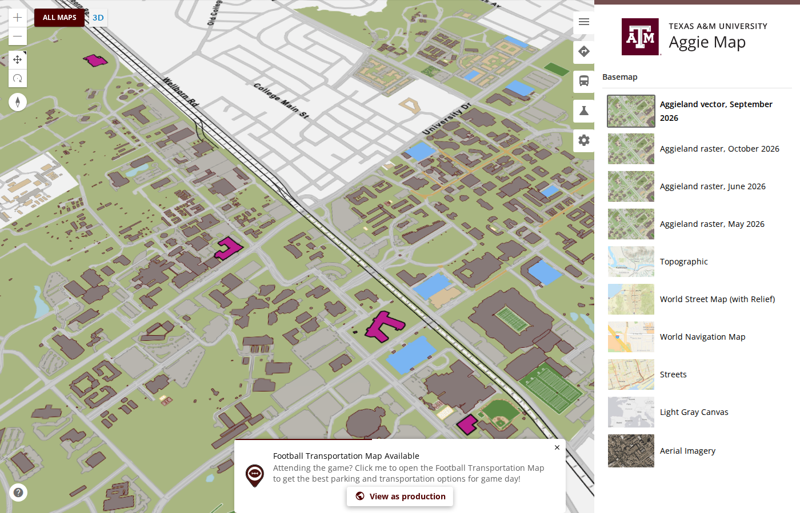 | 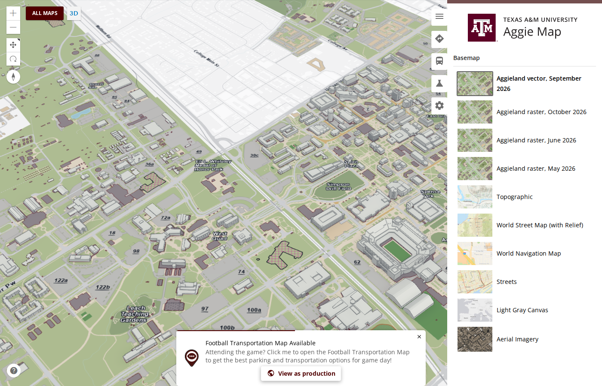 |
| 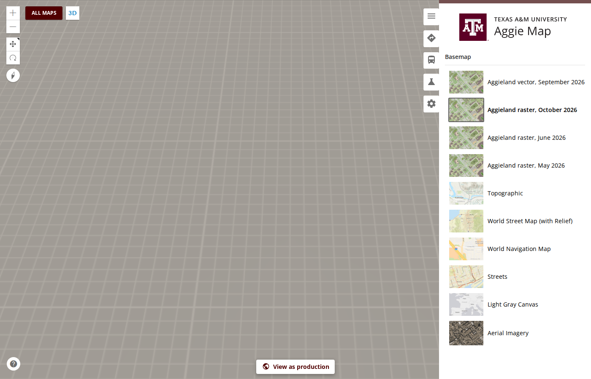 |  |

### Switching between 2D and 3D keeps the map where it was

Switching the main map to 3D moved it about 2.4 km south, and switching back to 2D left it there, so a
visitor looking at the middle of campus ended up over the fields beyond George Bush Drive
([#1724](https://github.com/TamuGeoInnovation/Tamu.GeoInnovation.js.monorepo/issues/1724)).

The 3D view was tilted without being told what to tilt around, so its camera swung and the centre of
the screen landed somewhere else; the 2D view then took the tilted scene's position as its own. The
switch now carries the place itself - the point at the centre of the screen, the scale there and the
rotation - and the 3D view tilts around it.

| Before: back in 2D after a look at 3D | After |
| --- | --- |
| 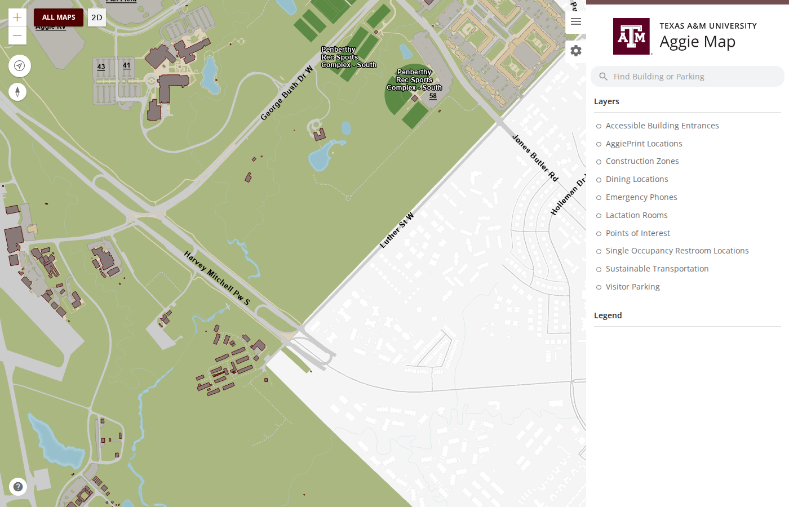 | 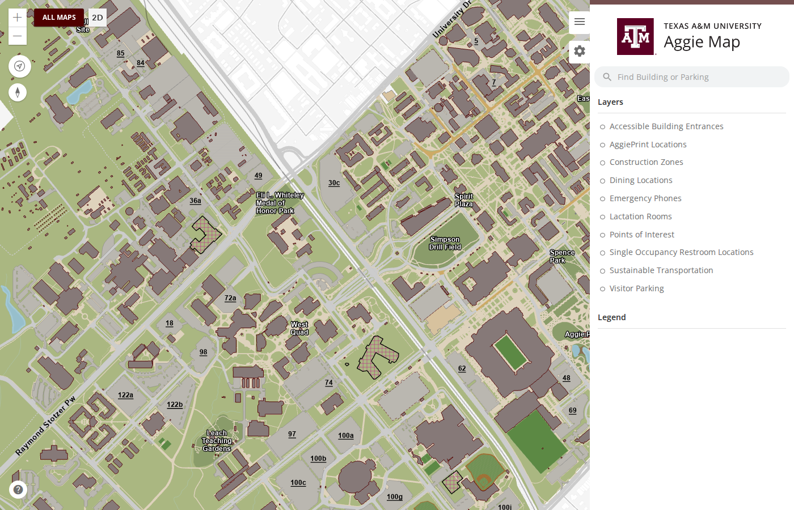 |

### The basemap panel's pictures are there when it opens

Each campus basemap's picture in the basemap panel was fetched from its GIS service on every map
load, 133 KB at a time and never kept, so on a slower connection the rows filled in one after another.
The application now ships one small picture for the campus basemaps and uses it for all of them, and
serves Aerial Imagery's from the same place ([#1730](https://github.com/TamuGeoInnovation/Tamu.GeoInnovation.js.monorepo/issues/1730)). Nothing looks different once it
has loaded; it is there sooner.

### Dev can show what production will (dev only)

Dev differs from production on purpose: it turns on features that are not released, and it draws from
the development GIS server. So dev could not show what a visitor to production would get, and on
12 October a new basemap went to production without having been seen drawn on dev
([#1722](https://github.com/TamuGeoInnovation/Tamu.GeoInnovation.js.monorepo/issues/1722)).

On a development host, every page now has a small **View as production** control at the bottom. One
click reloads the page as production shows it: development-only features off, and production's GIS
services. A yellow **Viewing as production** banner then stays on every page of that browser tab, with
**Back to dev**. The All Maps page has a section for it as well, and any address works with
`?as=production` added, so a link can be sent to someone.

On the first build that carried it, the switch hid the development features and still drew every layer
from the development GIS server, so the layers only production has stayed struck through. A dev build
chose its GIS server from how it was compiled, without asking the switch; it asks now
([#1734](https://github.com/TamuGeoInnovation/Tamu.GeoInnovation.js.monorepo/issues/1734)).

It lasts for the tab, because moving between maps drops what is in the address. It can only turn
development behaviour off: on production the control is not there and the parameter does nothing.

| On dev | Switched on |
| --- | --- |
| 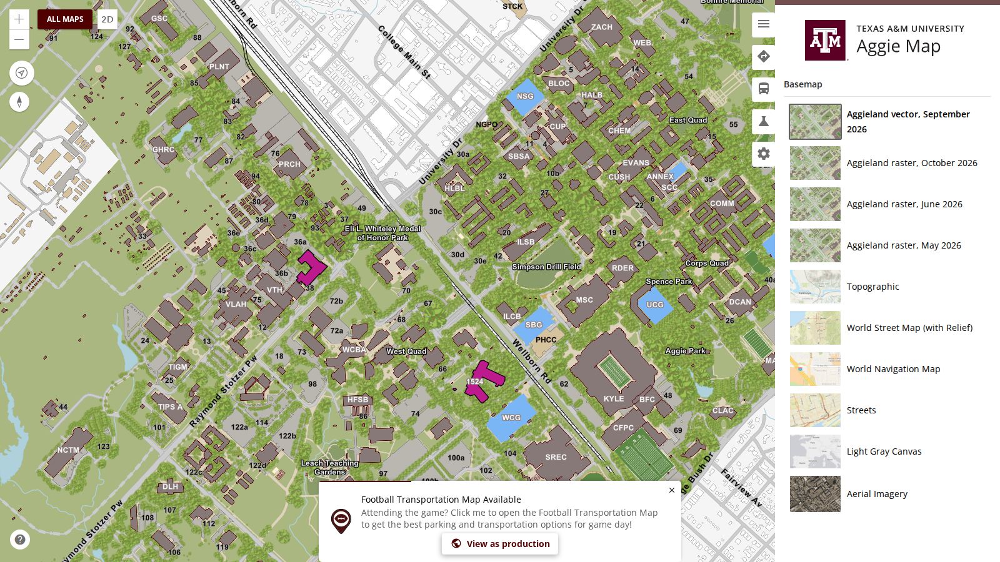 | 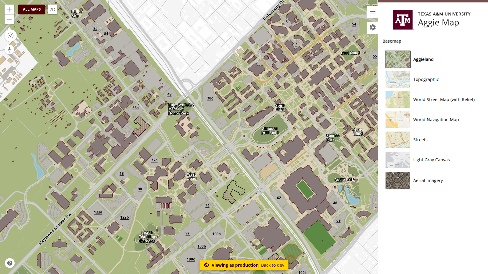 |

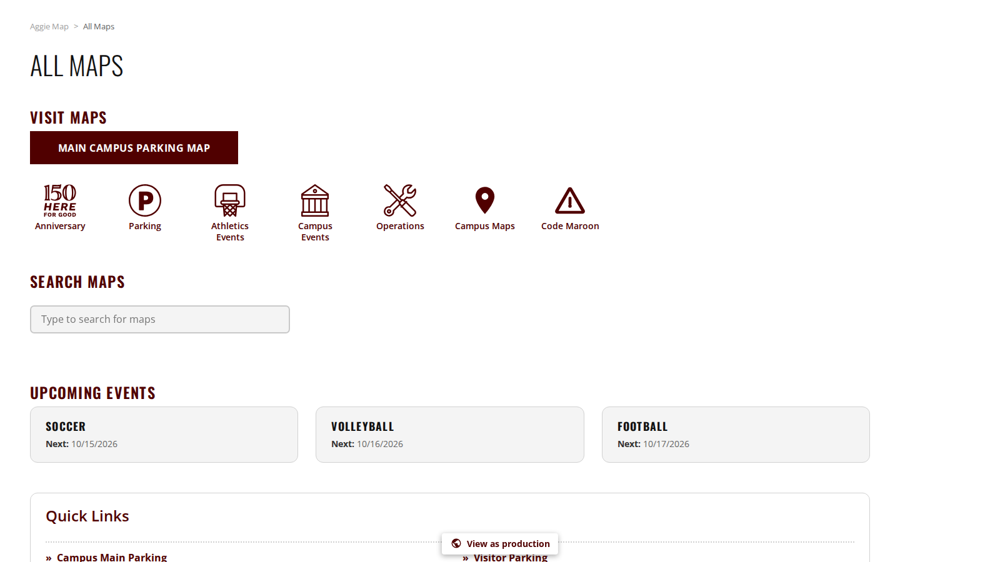

### A legend shows the symbol its map draws

On some visits a legend showed one symbol while the map drew another. On the Football Transportation map
for Micromobility, Entry, the legend's Entry Routes was a wide purple bar beside a map drawing thin
purple lines with arrowheads ([#1721](https://github.com/TamuGeoInnovation/Tamu.GeoInnovation.js.monorepo/issues/1721)).

A layer loads with the symbol its service publishes and is then given the one its portal item
publishes, which is the one it was authored with ([#1497](https://github.com/TamuGeoInnovation/Tamu.GeoInnovation.js.monorepo/issues/1497), on production since
6 October). The legend kept whichever it drew first. Usually the portal's answer was in before the
legend was drawn; when it was not, the legend was left showing the service's flattened version. It
was not one map or one layer: every hosted layer on every map could do it, and how wrong it looked
depended on how far the two symbols differ. Entry Routes is the worst case, because its service turns a
1.95-point line with a 15-point arrowhead into a 15-point line.

The legend now redraws a symbol whenever its layer's symbol is replaced.

| Before | After |
| --- | --- |
| 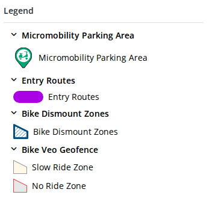 | 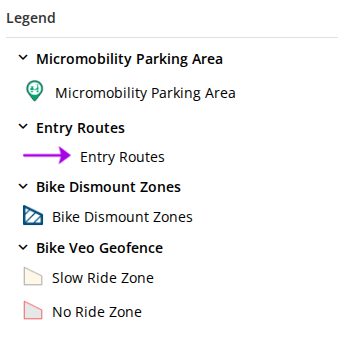 |

Both were taken with the portal's answer held back for 20 seconds, so the legend was drawn first: the
left on production, the right on a local server with the fix. All five entries differ, not only the
routes.

### Every published campus basemap, in the gallery on dev (dev only)

Dev opens on the vector tile campus basemap, which production does not have yet
([#1229](https://github.com/TamuGeoInnovation/Tamu.GeoInnovation.js.monorepo/issues/1229)), and its gallery offered that one alone under the name Aggieland. So the
raster basemap production shows could not be seen on dev at all, and on 12 October a new raster cache
went to production without anyone having seen it drawn there ([#1695](https://github.com/TamuGeoInnovation/Tamu.GeoInnovation.js.monorepo/issues/1695)).

On dev, the basemap gallery now lists the raster campus basemaps as well, each under its date:
October 2026, which is what production shows, and the June and May 2026 versions that are still
published, so they can be compared. The vector one is named the same way, "Aggieland vector, September
2026" ([#1582](https://github.com/TamuGeoInnovation/Tamu.GeoInnovation.js.monorepo/issues/1582)). Choosing one moves the map to it and back
without losing the place. Production's gallery is unchanged: one Aggieland basemap.

A basemap chosen there is remembered, and the event and parking maps restore it. They knew only the
original Aggieland basemap by name, so a dated one left them with no basemap at all: a white map at a
meaningless zoom. That was found on a local server before any build carried it, and fixed
([#1726](https://github.com/TamuGeoInnovation/Tamu.GeoInnovation.js.monorepo/issues/1726)).

| Before, on dev | After, on dev | After, as production shows it |
| --- | --- | --- |
| 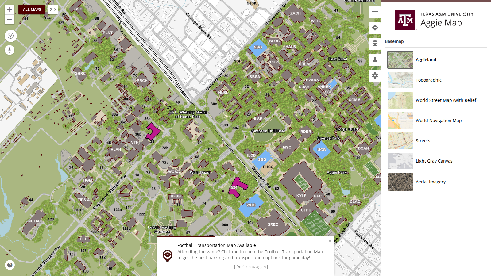 | 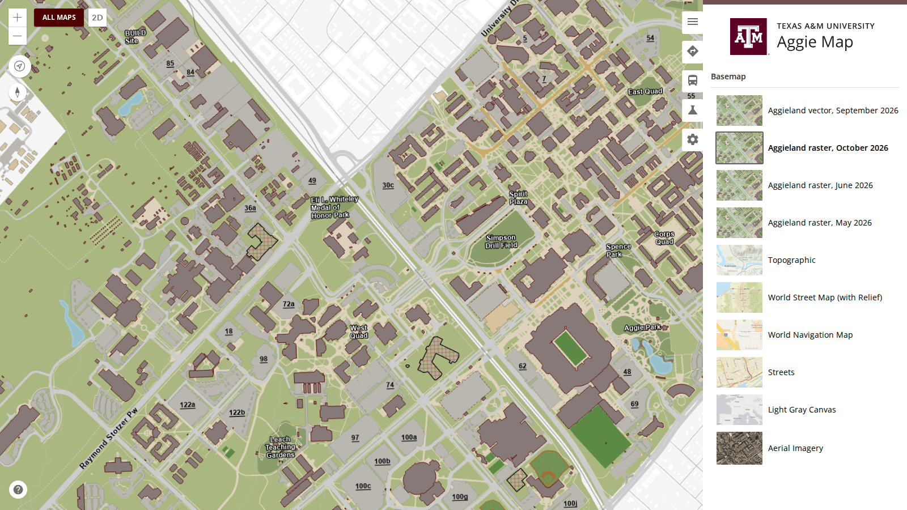 | 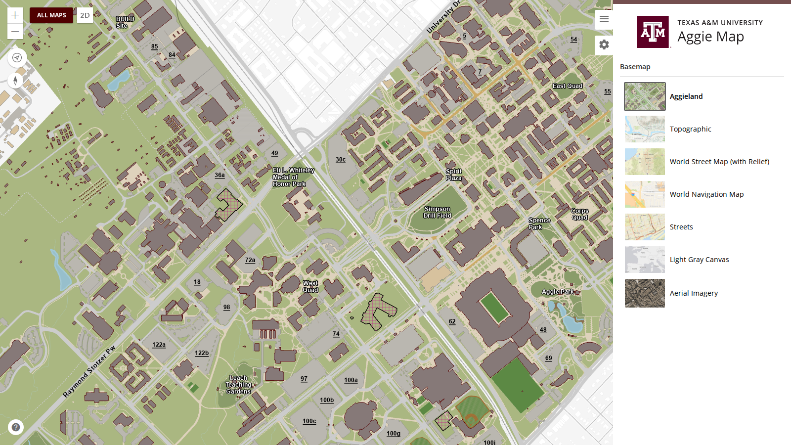 |

---

## What was tested

The last column says what checked each change on dev, and what nobody looked at. The links point at
production; a change marked dev only is not visible there, and its link stays on dev.

| Change | Open this | Look for | Checked on dev |
| --- | --- | --- | --- |
| 3D on every campus basemap ([#1735](https://github.com/TamuGeoInnovation/Tamu.GeoInnovation.js.monorepo/issues/1735)) | [The main map's basemap panel](https://dev.aggiemap.tamu.edu/map/d/settings), then the **2D** button beside All Maps | On **Aggieland vector**, click **2D**: the map tilts and **the buildings stand up in 3D**. While in 3D choose **Aggieland raster, October 2026**: still a 3D map, not pale bands. Click **3D** to come back: flat, in the same place, on the raster basemap. Repeat starting from a raster basemap | By the suite on dev: 3D from the vector basemap is a Web Mercator view with the 3D Buildings layer loaded, stays so as each raster basemap is chosen in 3D, and comes back to 2D in the same place at the same zoom (`perspective.spec.ts`). The suite's browser has no graphics card: **3D was not looked at in a real browser on this build when these notes were written** |
| 2D and 3D keep the place ([#1724](https://github.com/TamuGeoInnovation/Tamu.GeoInnovation.js.monorepo/issues/1724)) | [The main map](https://aggiemap.tamu.edu/map/d), then the **2D** button beside All Maps | Note what is in the middle of the map. Click **2D**: the map tilts into 3D with the same place in the middle. Click **3D**: it comes back flat, in the same place, at the same zoom. Pan or zoom in 3D first and come back: 2D shows where 3D was looking | By the suite on dev: the centre of the view is the same before the switch, in 3D and back in 2D, and the zoom is the same (`perspective.spec.ts`). Not looked at by hand on this build |
| Basemap pictures ship with the app ([#1730](https://github.com/TamuGeoInnovation/Tamu.GeoInnovation.js.monorepo/issues/1730)) | [The main map's basemap panel](https://aggiemap.tamu.edu/map/d/settings), and the same on [an event map](https://aggiemap.tamu.edu/parking/visitor-parking/map/d/settings) | Every campus basemap row and Aerial Imagery has its picture as soon as the panel is drawn, not one after another. Reload: still at once. The Esri basemaps' pictures still come from Esri | By the suite on dev: each shipped picture is served and is an image (`services.spec.ts`). Seen by the maintainer on a local server before it merged |
| View as production ([#1722](https://github.com/TamuGeoInnovation/Tamu.GeoInnovation.js.monorepo/issues/1722)) | [The main map](https://dev.aggiemap.tamu.edu/map/d), and [All Maps](https://dev.aggiemap.tamu.edu/all-maps) | A small white **View as production** control at the bottom of every page. Click it: the page reloads with a yellow **Viewing as production** banner, the Directions, Bus Routes and Experiments tabs are gone, and the basemap panel lists one Aggieland. **In the layer list, nothing is struck through: Accessible Building Entrances, Emergency Phones, Lactation Rooms and Single Occupancy Restroom Locations, which dev's own GIS server does not have, all load ([#1734](https://github.com/TamuGeoInnovation/Tamu.GeoInnovation.js.monorepo/issues/1734)).** Open another map from All Maps: the banner is still there. **Back to dev** returns to the same page with everything back. All Maps has a **View as Production** section at the bottom while the switch is off. On [production](https://aggiemap.tamu.edu/map/d?as=production) nothing changes and there is no control | By the suite on dev: the switch takes the three development tabs away, shows its banner, lasts when the address no longer carries it, asks nothing of the development GIS server, and gives everything back; All Maps offers it and following it works both ways (`development-only.spec.ts`). Measured on this build: 20 requests to production's GIS server, none to the development one, no layer failed. The first build that carried it failed that check, which is how it was caught |
| Legend symbols match the map ([#1721](https://github.com/TamuGeoInnovation/Tamu.GeoInnovation.js.monorepo/issues/1721)) | [Football Transportation, Micromobility, Entry](https://aggiemap.tamu.edu/events/gameday-parking/map/d?transport-type=micromobility&direction=entry) | In the legend, **Entry Routes is a thin purple line with an arrowhead**, as on the map, not a wide purple bar. Reload several times: it is the same every time. It was intermittent before, so one good load proves little; the suite forces the bad order and checks it | By the suite on dev: with the portal's symbology held back so the legend is drawn first, the Entry Routes symbol changes when it arrives (`legend.spec.ts`) |
| Dated raster campus basemaps in the gallery ([#1582](https://github.com/TamuGeoInnovation/Tamu.GeoInnovation.js.monorepo/issues/1582)) | [The main map's basemap panel](https://dev.aggiemap.tamu.edu/map/d/settings) | First **Aggieland vector, September 2026**, then **Aggieland raster, October 2026**, **June 2026** and **May 2026**, each with a thumbnail. Choose October: the map redraws on the raster basemap in the same place, with the buildings and labels on top, and zooming all the way in never shows white. Choose the vector one again: it comes back. Reload: the map opens on the vector one. **Then, with a dated one still chosen, open [Outdoor Track Parking](https://dev.aggiemap.tamu.edu/parking/outdoor-track-parking) and [Football Transportation](https://dev.aggiemap.tamu.edu/events/gameday-parking): each draws on that basemap, framed on its own lots, not white ([#1726](https://github.com/TamuGeoInnovation/Tamu.GeoInnovation.js.monorepo/issues/1726)).** [Production](https://aggiemap.tamu.edu/map/d/settings) lists a single Aggieland | By the suite on dev: the dated entries are offered; each raster service answers and its cache is as deep as the map lets a visitor zoom; an event map draws for a visitor who saved each of the four campus basemaps (`development-only.spec.ts`, `services.spec.ts`, `campus-basemap.spec.ts`). Seen by the maintainer on a local server |

Also in this build with nothing of its own to look at: a saved dated basemap no longer leaves event and
parking maps blank ([#1726](https://github.com/TamuGeoInnovation/Tamu.GeoInnovation.js.monorepo/issues/1726)), which never reached a deployed site and is part of the dated basemaps'
entry above.

---

## What went into this release

Every pull request this release carried, and the issue behind each one.

| Change | Pull request | Issue |
| --- | --- | --- |
| Offer every published campus basemap in the gallery on dev | [#1723](https://github.com/TamuGeoInnovation/Tamu.GeoInnovation.js.monorepo/pull/1723) | [#1582](https://github.com/TamuGeoInnovation/Tamu.GeoInnovation.js.monorepo/issues/1582) |
| Redraw a legend symbol when its layer's symbol is replaced | [#1725](https://github.com/TamuGeoInnovation/Tamu.GeoInnovation.js.monorepo/pull/1725) | [#1721](https://github.com/TamuGeoInnovation/Tamu.GeoInnovation.js.monorepo/issues/1721) |
| Let a dev host behave as production with `?as=production` | [#1728](https://github.com/TamuGeoInnovation/Tamu.GeoInnovation.js.monorepo/pull/1728) | [#1722](https://github.com/TamuGeoInnovation/Tamu.GeoInnovation.js.monorepo/issues/1722) |
| Turn a saved campus basemap id back into a basemap | [#1729](https://github.com/TamuGeoInnovation/Tamu.GeoInnovation.js.monorepo/pull/1729) | [#1726](https://github.com/TamuGeoInnovation/Tamu.GeoInnovation.js.monorepo/issues/1726) |
| Ship the campus basemaps' thumbnail with the application | [#1731](https://github.com/TamuGeoInnovation/Tamu.GeoInnovation.js.monorepo/pull/1731) | [#1730](https://github.com/TamuGeoInnovation/Tamu.GeoInnovation.js.monorepo/issues/1730) |
| Carry the place, not the camera, between 2D and 3D | [#1733](https://github.com/TamuGeoInnovation/Tamu.GeoInnovation.js.monorepo/pull/1733) | [#1724](https://github.com/TamuGeoInnovation/Tamu.GeoInnovation.js.monorepo/issues/1724) |
| Draw from production's GIS server when a dev build acts as production | [#1736](https://github.com/TamuGeoInnovation/Tamu.GeoInnovation.js.monorepo/pull/1736) | [#1734](https://github.com/TamuGeoInnovation/Tamu.GeoInnovation.js.monorepo/issues/1734) |
| Make 3D a Web Mercator globe whatever basemap the map was on | [#1737](https://github.com/TamuGeoInnovation/Tamu.GeoInnovation.js.monorepo/pull/1737) | [#1735](https://github.com/TamuGeoInnovation/Tamu.GeoInnovation.js.monorepo/issues/1735) |
| Give the smoke suite a quick tier, a release tier and a full tier | [#1720](https://github.com/TamuGeoInnovation/Tamu.GeoInnovation.js.monorepo/pull/1720) | [#1717](https://github.com/TamuGeoInnovation/Tamu.GeoInnovation.js.monorepo/issues/1717) |
| List the undated Move Out as a known failure on dev hosts | [#1706](https://github.com/TamuGeoInnovation/Tamu.GeoInnovation.js.monorepo/pull/1706) | [#1705](https://github.com/TamuGeoInnovation/Tamu.GeoInnovation.js.monorepo/issues/1705) |
| Cut the second 12 October release notes | [#1718](https://github.com/TamuGeoInnovation/Tamu.GeoInnovation.js.monorepo/pull/1718) | [#1707](https://github.com/TamuGeoInnovation/Tamu.GeoInnovation.js.monorepo/issues/1707) |
| Cut these notes | this pull request | [#1738](https://github.com/TamuGeoInnovation/Tamu.GeoInnovation.js.monorepo/issues/1738) |

### Also in the build, for GIS Day's next deploy

These merged in the same period and are in build 20261013.6, but the GIS Day site and API deploy
separately, so nothing here is on the public GIS Day site yet. Their entries and their rows to test stay
in [`unreleased.md`](unreleased.md) until GIS Day is deployed ([#1611](https://github.com/TamuGeoInnovation/Tamu.GeoInnovation.js.monorepo/issues/1611)).

| Change | Pull request | Issue |
| --- | --- | --- |
| Say GIS Day runs locally, and what is still missing | [#1683](https://github.com/TamuGeoInnovation/Tamu.GeoInnovation.js.monorepo/pull/1683) | [#1682](https://github.com/TamuGeoInnovation/Tamu.GeoInnovation.js.monorepo/issues/1682) |
| Show the university and class-year banner on the individual presenter page | [#1710](https://github.com/TamuGeoInnovation/Tamu.GeoInnovation.js.monorepo/pull/1710) | [#1703](https://github.com/TamuGeoInnovation/Tamu.GeoInnovation.js.monorepo/issues/1703) |
| Correct the 2026 competition pages' session dates, times and headings | [#1712](https://github.com/TamuGeoInnovation/Tamu.GeoInnovation.js.monorepo/pull/1712) | [#1709](https://github.com/TamuGeoInnovation/Tamu.GeoInnovation.js.monorepo/issues/1709) |
| Centre the label of a link styled as a button | [#1711](https://github.com/TamuGeoInnovation/Tamu.GeoInnovation.js.monorepo/pull/1711) | [#1708](https://github.com/TamuGeoInnovation/Tamu.GeoInnovation.js.monorepo/issues/1708) |
| Say how GIS Day is released | [#1714](https://github.com/TamuGeoInnovation/Tamu.GeoInnovation.js.monorepo/pull/1714) | [#1713](https://github.com/TamuGeoInnovation/Tamu.GeoInnovation.js.monorepo/issues/1713) |
