# 16 October 2026

**Azure Release-473 deployed build 20261016.11, from `264eebb42`, to dev at 7:33 AM Central on
16 October, and the same build was promoted to production that morning.** The tag `prod-2026-10-16`
on `264eebb42` records the deploy to production.

**What cleared it: the release tier on dev - see
[#1800](https://github.com/TamuGeoInnovation/Tamu.GeoInnovation.js.monorepo/issues/1800) for the
result.** The run started on this build as it reached dev, and it was still running when production
was promoted: production went out on the maintainer's own check of dev, not on a finished run. These
notes do not give the run's numbers because they were not in when the notes were written. If the run
passes, `264eebb42` is tagged `dev-2026-10-16`, as the release sequence requires of every production
build; [#1800](https://github.com/TamuGeoInnovation/Tamu.GeoInnovation.js.monorepo/issues/1800) says which it was.

**An earlier build was tested first and did not clear.** Release-471 (build 20261016.1, `70853796b`)
reached dev at 1:22 AM Central and the release tier failed on it: 499 passed, 3 failed, 12 flaky and
28 skipped, in 53.7 minutes. It was not tagged. Its failures are listed on
[#1800](https://github.com/TamuGeoInnovation/Tamu.GeoInnovation.js.monorepo/issues/1800). Eight more
pull requests merged after it, and build 20261016.11 carries them all.

**These notes are late.** The [release sequence](README.md#cutting-a-release) has the notes merge
before production; this time production was promoted first and the notes were written afterwards
([#1818](https://github.com/TamuGeoInnovation/Tamu.GeoInnovation.js.monorepo/issues/1818)).

**The headline is the Football Tailgating map, which is on production for the first time**
([#1814](https://github.com/TamuGeoInnovation/Tamu.GeoInnovation.js.monorepo/issues/1814)), opening on
the raster campus basemap and searching its own tents and areas. Around it are fixes for event and
parking maps that a visitor will see: route arrows back on three maps, layers named by the layer again,
the Night / Weekend map's lots and hours, Men's Basketball on its new service, a saved Aerial Imagery
choice that no longer leaves a white page, and legend, highlight and sidebar fixes that apply to every
map.

The build also carries GIS Day work, which reaches the GIS Day site only with its own deploy; it is
listed at the end and its entries stay in [`unreleased.md`](unreleased.md).

The release before this is [13 October 2026](2026-10-13.md).

---

## Summary

### Football Tailgating

#### The Football Tailgating map is on production

**Football Tailgating** (`/events/tailgating`) is now on production, listed under Athletics beside
Football ([#1814](https://github.com/TamuGeoInnovation/Tamu.GeoInnovation.js.monorepo/issues/1814)). It had been on dev only since it was built as a prototype ([#1422](https://github.com/TamuGeoInnovation/Tamu.GeoInnovation.js.monorepo/issues/1422)):
production left it out of the map list, so its links led to the main map. Its tailgating zones come from a
public layer in TAMU's ArcGIS Online organization, which production may now request. It no longer
carries a "Beta" label.

Its game days are now the Football map's own list rather than a copy, so the two maps say the season
is over on the same day.

| Before | After |
| --- | --- |
| 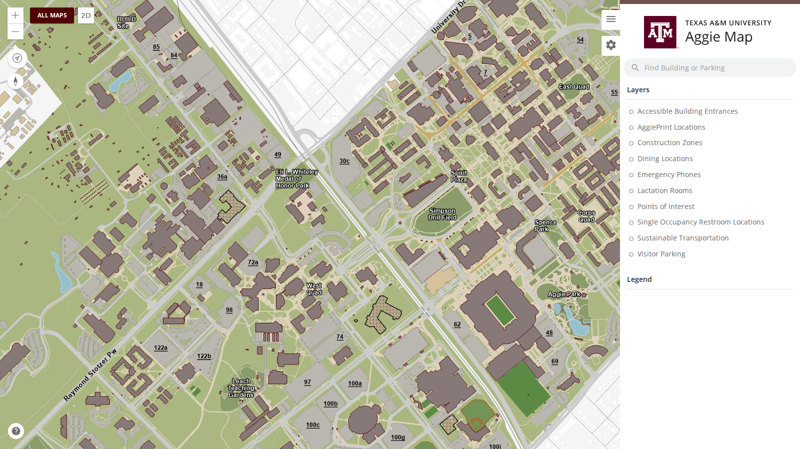 | 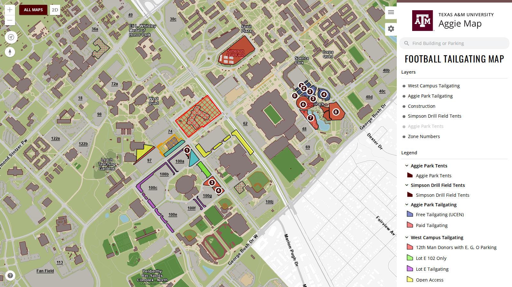 |
|  | 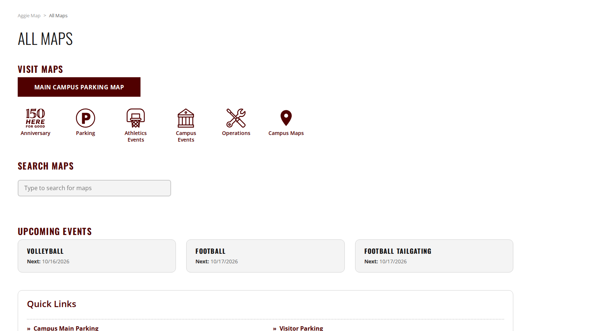 |

#### It opens on the raster campus basemap, and searches its tents and areas

The map now always opens on **Aggieland raster, October 2026** rather than the vector campus basemap,
and its search finds **tents** by id and **named areas** by name or zone id, alongside the usual
buildings and parking ([#1788](https://github.com/TamuGeoInnovation/Tamu.GeoInnovation.js.monorepo/issues/1788)). Picking a tent or area opens it as a `?tent=` or `?zone=` link does:
the map's own feature, with its popup. An area not yet given a name lists by its zone id, and a result
no longer on the map says so rather than doing nothing.

| Before | After |
| --- | --- |
| 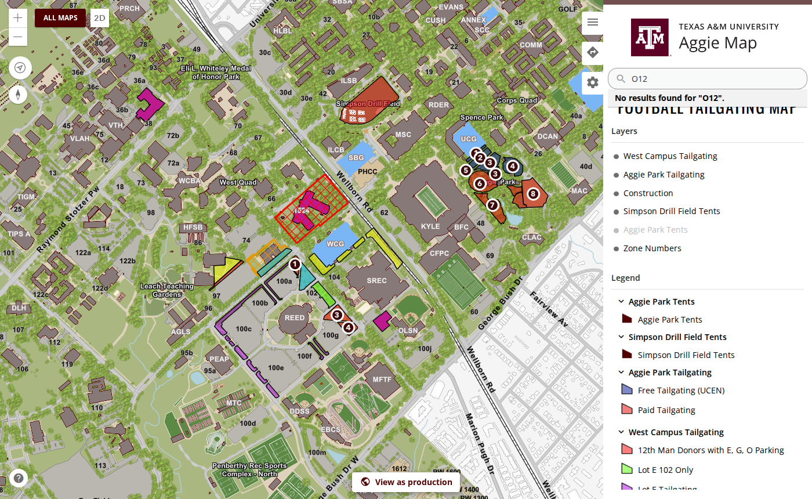 | 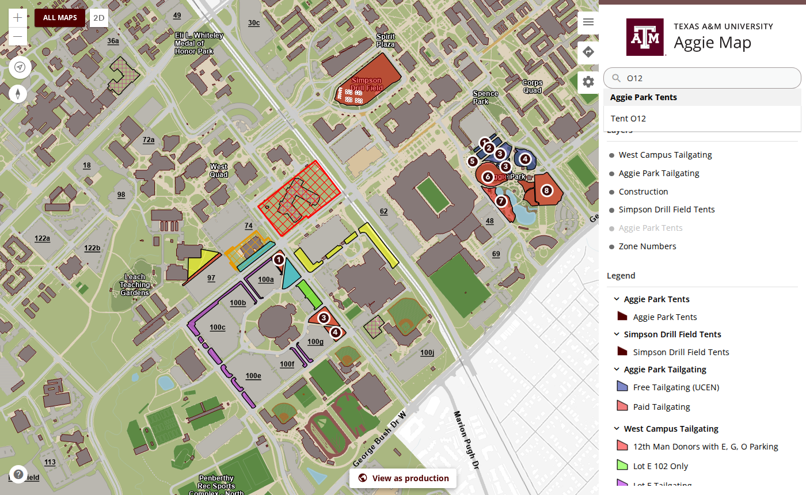 |

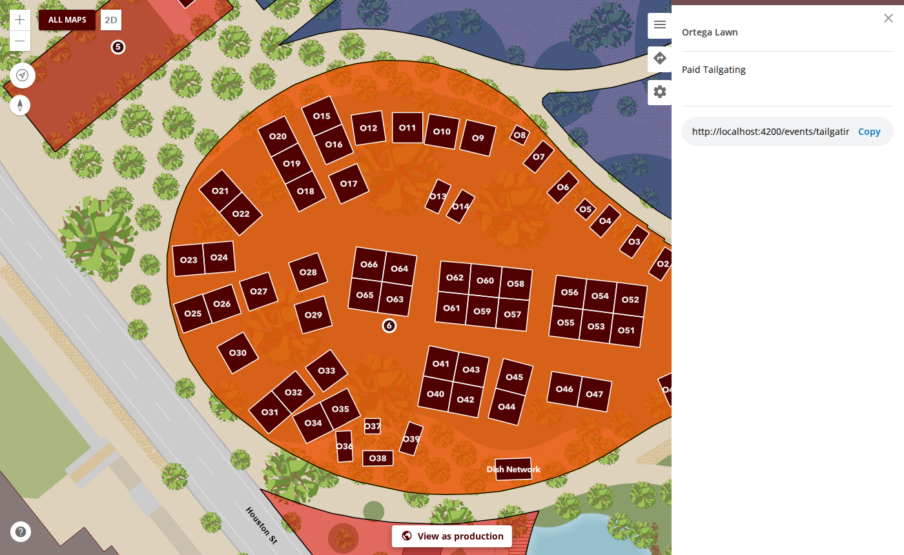

#### It opens on the campus basemap, whatever was chosen last

The Tailgating map opened on whatever basemap a visitor last chose on any map. For anyone who last
chose Aerial Imagery that was no basemap at all, and with it no zoom levels: the zones drew as a speck
on a white page ([#1692](https://github.com/TamuGeoInnovation/Tamu.GeoInnovation.js.monorepo/issues/1692)). It now always opens on a campus basemap, since its tents and zones
are read against campus ([#1751](https://github.com/TamuGeoInnovation/Tamu.GeoInnovation.js.monorepo/issues/1751)). This change opened it on Aggieland vector, September 2026, as
the image below shows; the entry above then moved it to **Aggieland raster, October 2026**, in
every environment ([#1788](https://github.com/TamuGeoInnovation/Tamu.GeoInnovation.js.monorepo/issues/1788)). A link naming a `?basemap=` still opens on that one, and the other
event maps are unchanged.

Any event map can ask for the campus basemap with `basemap: 'campus'` in its configuration - the vector
one on dev, the raster one production has - or for Aggieland raster, October 2026, everywhere, with
`basemap: 'campus-raster'`.

| Before, with Aerial Imagery last chosen | After |
| --- | --- |
|  |  |

### Event and parking maps

#### The Night / Weekend parking map names its lots and says when they can be used

The map's layer now reads **Night & Weekend Lots**, the name its service gives it, in the layers list
and the legend, rather than "Night Privileges 5:00pm - 6:00am", which left weekends out
([#836](https://github.com/TamuGeoInnovation/Tamu.GeoInnovation.js.monorepo/issues/836)). Between the map's title and its layers it now says when each privilege applies:
**Night Privileges**, Monday - Thursday 5:00 p.m. - 6:00 a.m., and **Weekend Privileges**, Friday
6:00 p.m. - Monday 6:00 a.m. Transportation Services asked for both.

| Before | After |
| --- | --- |
| 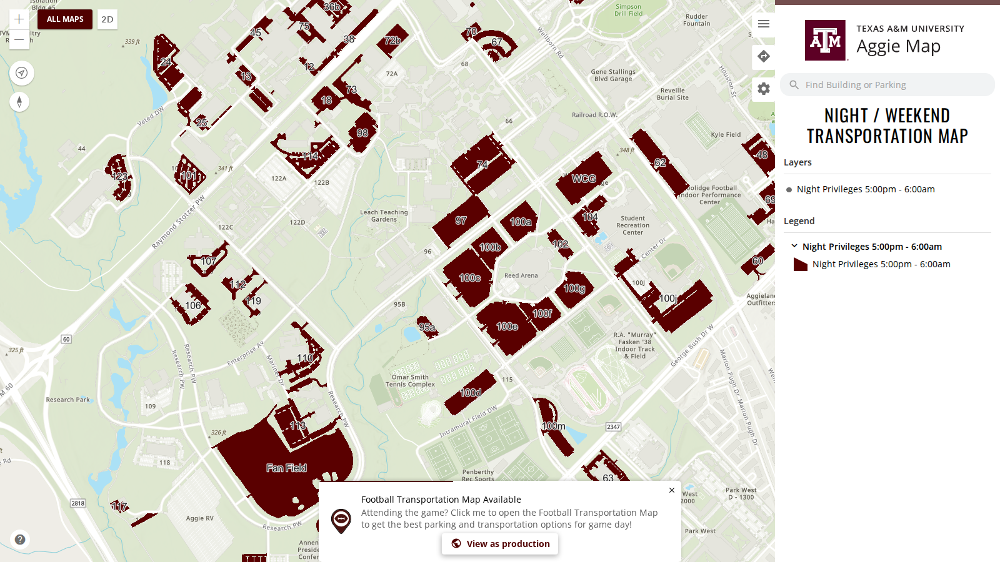 | 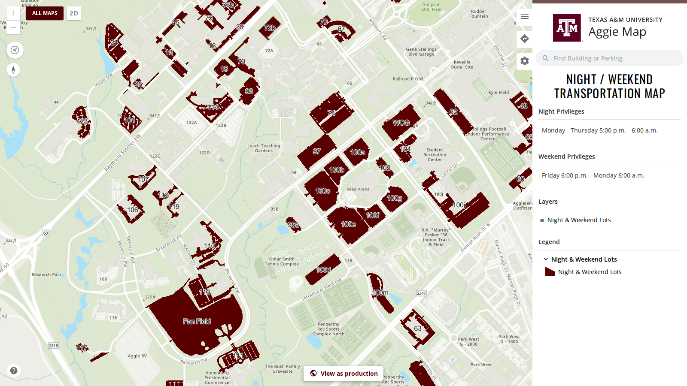 |

#### The Men's Basketball map reads Transportation's new service, and names the lot clicked

Transportation moved the Men's Basketball parking map to the production GIS server, so it can be kept
up to date from their editor map ([#1749](https://github.com/TamuGeoInnovation/Tamu.GeoInnovation.js.monorepo/issues/1749)). The map now reads its icons, closures and lots
from that service, `MBskt_view` on gis.tamu.edu, in every environment; the old service on the
transportation server is no longer updated. The layers, fields and features are the same. The new
service's portal item has no saved style, so icons and lots are drawn with the service's own symbols,
and the layer list may title them slightly differently.

Clicking a parking lot also showed a popup with no title: it was built from two fields, `lottype` and
`lotnum`, that neither service has. It now shows the lot's name, such as **Lot 74**.

| Before | After |
| --- | --- |
| 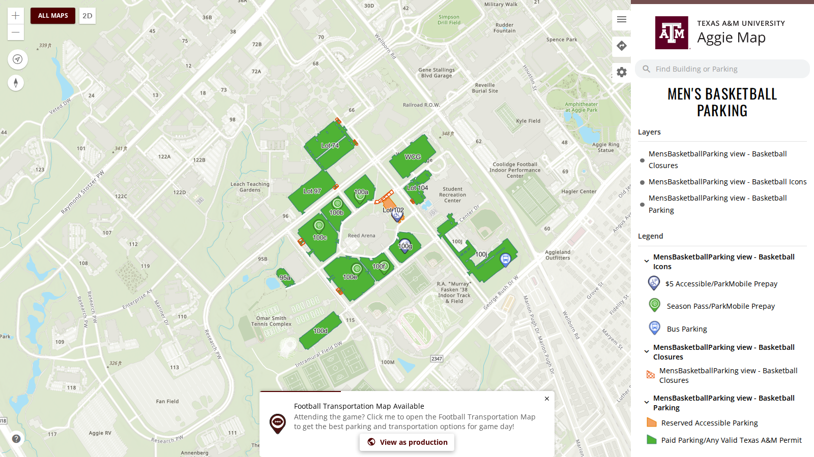 | 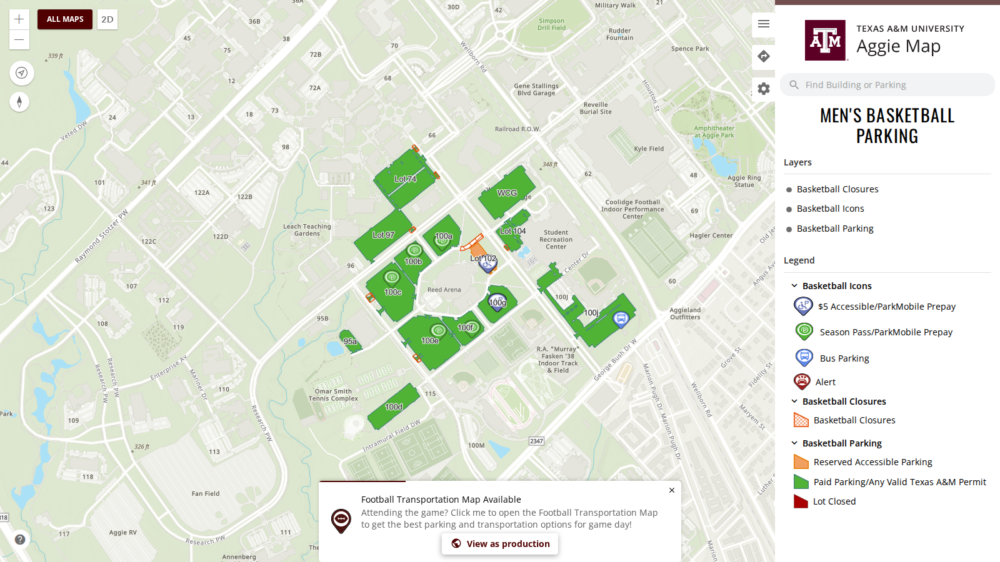 |

#### Event map layers are named by the layer again, without "view"

On Aggie Family Parade the route was listed as "Aggie Family Parade view - Parade Route", in the layer
list and the legend, and Aggieland Saturday, MS150 and Family Weekend read the same way
([#1802](https://github.com/TamuGeoInnovation/Tamu.GeoInnovation.js.monorepo/issues/1802), reported in [#1778](https://github.com/TamuGeoInnovation/Tamu.GeoInnovation.js.monorepo/issues/1778)). With their titles taken out of the definitions so
that names come from the services, ArcGIS named each layer from its service's name and its own, and
our services are the hosted `*_view` ones. Every untitled layer on an event or parking map is now
named by its own name in the service: "Parade Route", "Bus Stops", "Friday Parking Lots". A layer whose
map names it is unchanged.

| Before | After |
| --- | --- |
| 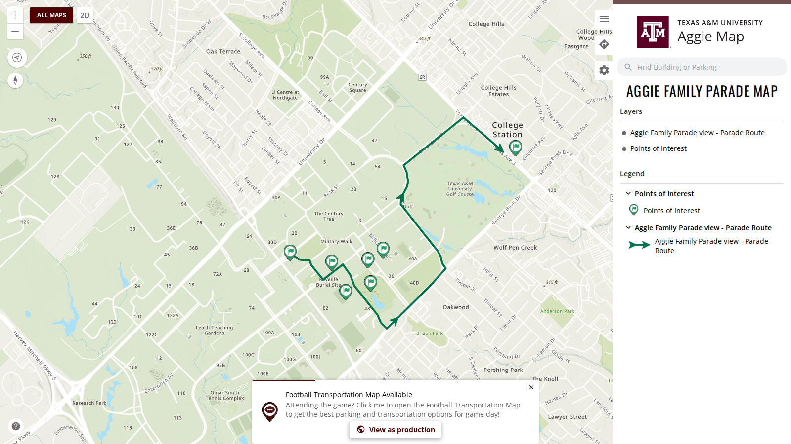 | 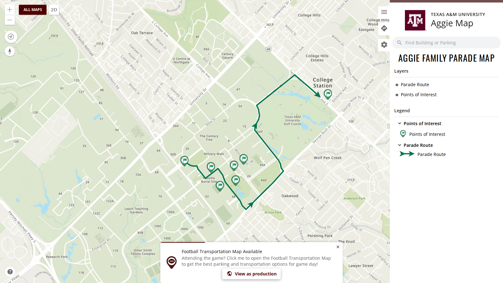 |

#### HS Graduation, Physics Fest and Fish Camp draw their routes as arrows again, and Physics Fest's groups have names

On HS Graduation and Physics Fest the routes drew as thick lines with no direction ([#1778](https://github.com/TamuGeoInnovation/Tamu.GeoInnovation.js.monorepo/issues/1778)),
and Fish Camp's did the same. [#1526](https://github.com/TamuGeoInnovation/Tamu.GeoInnovation.js.monorepo/issues/1526) removed their arrow renderers on the understanding that
each map's portal item supplies the symbol its owner drew. These three are MapServer services, whose
portal items carry no symbology, and whose services publish only a flattened 9 to 15 pt line with no
arrowheads. The arrows are back, each with the reason beside it in the definition, to be removed when
the service is republished as a hosted view that carries them ([#1803](https://github.com/TamuGeoInnovation/Tamu.GeoInnovation.js.monorepo/issues/1803)).

The same change left Physics Fest's three groups, which the map makes itself and no service names,
with no name in the legend or the layer list. They are General Parking, Buses Entering from Eastbound
University Dr and Buses Entering from Westbound University Dr again.

| Before | After |
| --- | --- |
| 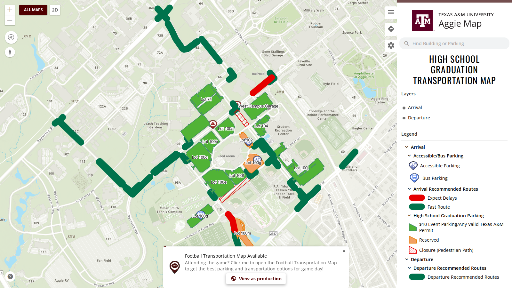 | 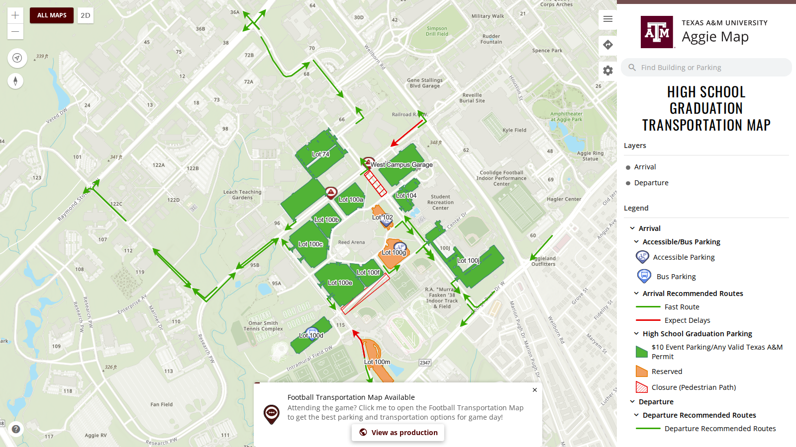 |
| 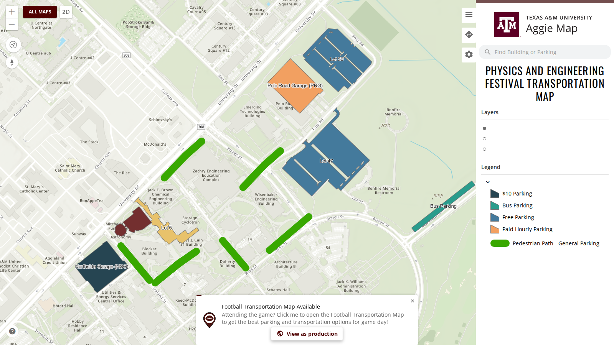 | 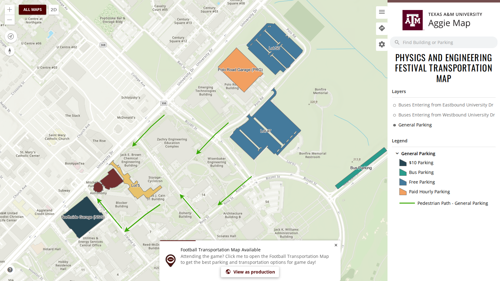 |
| 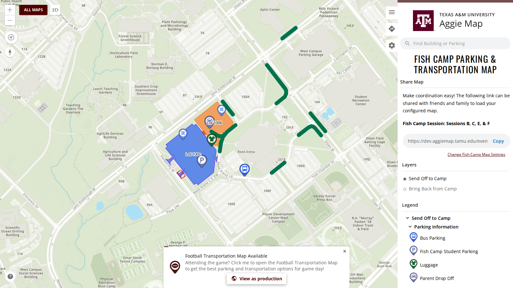 | 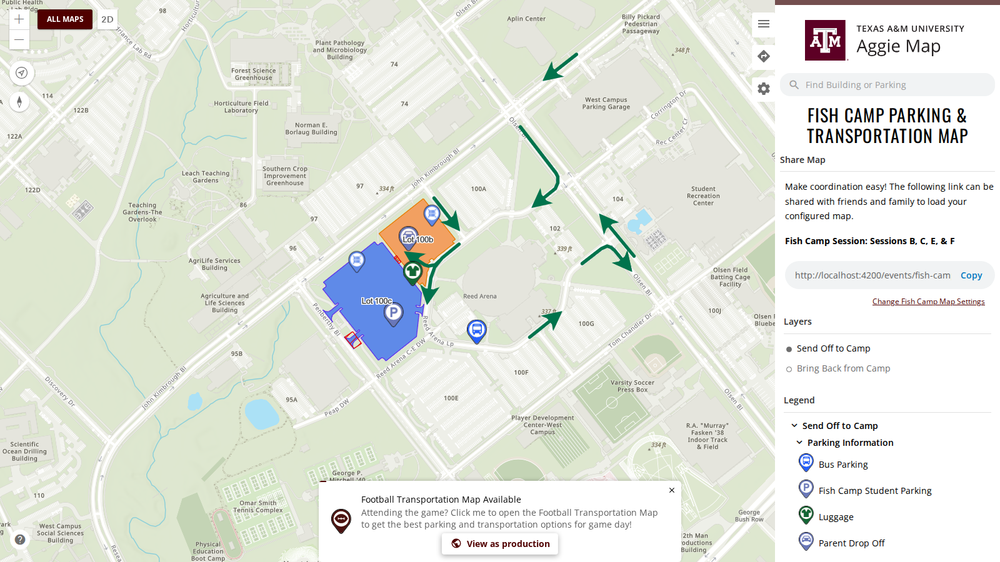 |

#### An event map opens on Aerial Imagery again when that was the last basemap chosen

A visitor whose last basemap choice was Aerial Imagery opened every event map with no basemap at all,
and with it no zoom levels: the map's layers a speck on a white page ([#1692](https://github.com/TamuGeoInnovation/Tamu.GeoInnovation.js.monorepo/issues/1692)). The saved
choice was handed to ArcGIS as a basemap name it does not know, and the map could not have built Aerial
Imagery from its definition anyway, since it only made tiled layers. Both are fixed: the saved choice
comes back as Aerial Imagery, on dev and production, as a saved campus basemap already did
([#1726](https://github.com/TamuGeoInnovation/Tamu.GeoInnovation.js.monorepo/issues/1726)).

| Before, Accessible Parking with Aerial Imagery last chosen | After |
| --- | --- |
|  |  |

### Every map

#### A legend symbol keeps its size beside a long label

On the Baseball Event Map, the legend's entry for main event parking showed no symbol
([#1778](https://github.com/TamuGeoInnovation/Tamu.GeoInnovation.js.monorepo/issues/1778)). Its label
lists every permit the lots accept, and a legend row let a long label squeeze the symbol beside it: the
24-pixel symbol was drawn 4 pixels wide. A symbol now keeps its size and the label wraps beside it, on
every map's legend, on desktop and phone, dev and production
([#1804](https://github.com/TamuGeoInnovation/Tamu.GeoInnovation.js.monorepo/issues/1804)).

| Before | After |
| --- | --- |
| 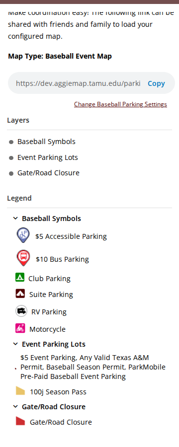 | 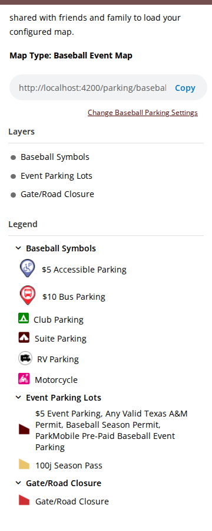 |

#### A link to one feature always shows it highlighted

A link such as `?tent=L1` on Football Tailgating opened with the tent named in the sidebar, and on some
loads the map showed the tent in its normal fill: the highlight was drawn under the tents and areas
([#1805](https://github.com/TamuGeoInnovation/Tamu.GeoInnovation.js.monorepo/issues/1805)). The map's
own layers and an event map's layers are added at the same time, so a layer could finish after the
highlight's and be drawn over it. The highlight is now moved back above every layer each time one is
added, on every map, and a smoke check opens tent and area links several times each and fails if any
layer is drawn over it.

| Before | After |
| --- | --- |
|  | 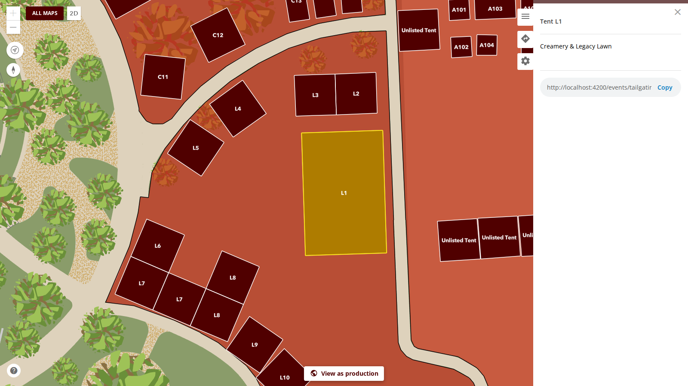 |

#### The sidebar's buttons work while a feature's details are open

With a feature's details open in the sidebar, after clicking a tent on Football Tailgating or a building
on the main map, the sidebar's other buttons did nothing visible
([#1806](https://github.com/TamuGeoInnovation/Tamu.GeoInnovation.js.monorepo/issues/1806)). The gear changed the address to `/settings` and ☰ and directions changed their views,
but the details stayed in front of all of them; only their [X] got the panel back. Choosing any sidebar
button now closes the details as their [X] does, clearing the highlighted feature with them, and shows
that button's panel. That includes ☰ when the details were opened from it, which used to collapse the
panel. On every map with a sidebar, on desktop; links that open a feature's details, such as `?tent=`,
still open them.

| Before | After |
| --- | --- |
| 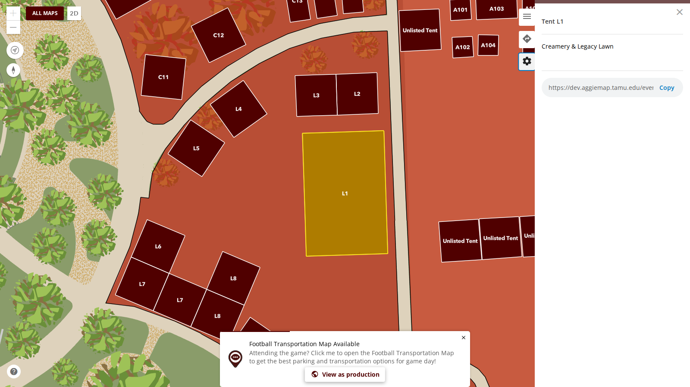 | 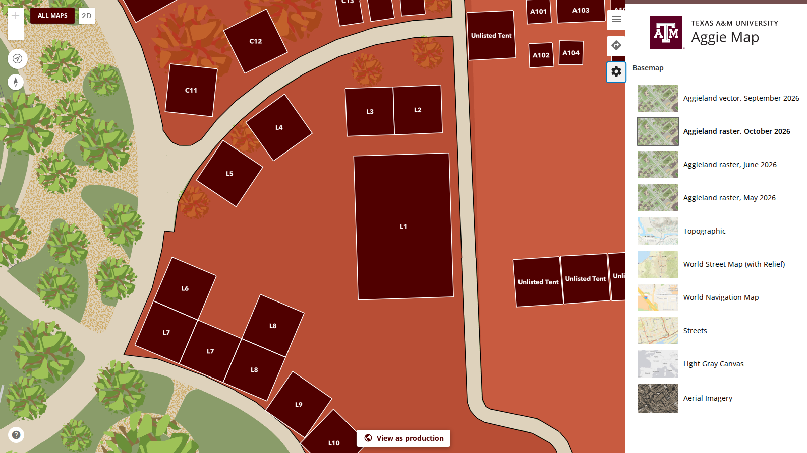 |

### Dev only

#### In 3D, the basemap panel says which basemaps it cannot show

On dev, with the map in 3D, the vector campus basemap could not be chosen again after another had
been: clicking it did nothing ([#1740](https://github.com/TamuGeoInnovation/Tamu.GeoInnovation.js.monorepo/issues/1740)). A 3D scene cannot draw that basemap, which is
published in a state plane reference, and draws the raster campus basemap in its place; the panel went
on offering the vector one as though it could.

While the map is in 3D the panel now shows such a basemap greyed and marked "2D only", and marks the
basemap that is actually on screen. Back in 2D it returns. It stops applying by itself when the vector
tiles are republished in Web Mercator ([#1741](https://github.com/TamuGeoInnovation/Tamu.GeoInnovation.js.monorepo/issues/1741)).
Production has only the raster campus basemap, so nothing changes there.

| Before, on dev, in 3D | After |
| --- | --- |
|  |  |

#### The Aerial Imagery timeline sits clear of "View as production", with arrows

The timeline that steps Aerial Imagery back through Nearmap's captures ([#1541](https://github.com/TamuGeoInnovation/Tamu.GeoInnovation.js.monorepo/issues/1541)) sat under the
"View as production" switch a dev host shows at the bottom of the window, and its year labels, placed
between captures, could sit beside the wrong ticks ([#1750](https://github.com/TamuGeoInnovation/Tamu.GeoInnovation.js.monorepo/issues/1750)).

It now sits above the switch. The ticks are unlabelled but for "2016" and "Latest" at the ends; each
shows its date on hover, and the date the timeline is on is beside the title, with ‹ › arrows to step
one capture at a time - the easy way to the captures days apart, 22 and 26 November 2025.

| Before | After |
| --- | --- |
|  |  |

---

## What was tested

The last column says what checked each change on dev. Production was promoted on the maintainer's own
check of dev before the release tier finished
([#1800](https://github.com/TamuGeoInnovation/Tamu.GeoInnovation.js.monorepo/issues/1800)); which of
these rows that check covered was not recorded, so no row claims a check by hand. The links point at
production; a change marked dev only is not visible there, and its link stays on dev.

| Change | Open this | Look for | Checked on dev |
| --- | --- | --- | --- |
| Football Tailgating on production ([#1814](https://github.com/TamuGeoInnovation/Tamu.GeoInnovation.js.monorepo/issues/1814)) | [Football Tailgating](https://aggiemap.tamu.edu/events/tailgating), then [All Maps](https://aggiemap.tamu.edu/all-maps) | The Tailgating map opens with its zones and tents, not the main map, and All Maps lists **Football Tailgating** under Athletics with no "Beta" label | The release tier loads the map on dev. The suite no longer lists its zones service as development-only, so production's own runs now load it too (`development-only.ts`). The production result was not checked by a test before promotion |
| Football Tailgating basemap and search ([#1788](https://github.com/TamuGeoInnovation/Tamu.GeoInnovation.js.monorepo/issues/1788)) | [Football Tailgating](https://aggiemap.tamu.edu/events/tailgating/map/d) | Opens on **Aggieland raster, October 2026**, marked in the Basemap panel. Search **O12**: Tent O12, which opens its popup. **Ortega**: Ortega Lawn. **Lot E**: the West Campus Lot E zones. **MSC**: still the Memorial Student Center and its parking | The release tier loads the map; no smoke check searches its tents or areas |
| Football Tailgating opens on the campus basemap ([#1751](https://github.com/TamuGeoInnovation/Tamu.GeoInnovation.js.monorepo/issues/1751)) | Choose **Aerial Imagery** on any map, then open [Football Tailgating](https://aggiemap.tamu.edu/events/tailgating/map/d) | The map opens on **Aggieland raster, October 2026** with its zones at the normal zoom, not on a white page. [The same map with ?basemap=gray-vector](https://aggiemap.tamu.edu/events/tailgating/map/d?basemap=gray-vector) opens on Light Gray Canvas. Other event maps still open on the basemap last chosen | No smoke check |
| Night / Weekend parking map ([#836](https://github.com/TamuGeoInnovation/Tamu.GeoInnovation.js.monorepo/issues/836)) | [Night / Weekend](https://aggiemap.tamu.edu/parking/night-weekend) | The layers list and the legend read **Night & Weekend Lots**. Under the title **Night / Weekend Transportation Map**, two blocks: **Night Privileges**, Monday - Thursday 5:00 p.m. - 6:00 a.m., and **Weekend Privileges**, Friday 6:00 p.m. - Monday 6:00 a.m. On a phone they sit above the legend | The release tier loads the map and its layers; the wording is not checked |
| Men's Basketball reads its new service ([#1749](https://github.com/TamuGeoInnovation/Tamu.GeoInnovation.js.monorepo/issues/1749)) | [Men's Basketball](https://aggiemap.tamu.edu/events/mens-basketball) | 8 icons, 7 closures and 21 lots draw. In the browser's network panel, their requests go to gis.tamu.edu `Hosted/MBskt_view`, not the transportation server. Clicking a lot shows its name as the popup title (e.g. **Lot 74**), not a bare dash. Layer names and symbols look acceptable | The release tier loads the map and checks its layers serve data; the popup title is not checked |
| Event map layer names ([#1802](https://github.com/TamuGeoInnovation/Tamu.GeoInnovation.js.monorepo/issues/1802)) | [Aggie Family Parade](https://aggiemap.tamu.edu/events/aggie-family-parade/map/d), [Aggieland Saturday](https://aggiemap.tamu.edu/events/aggieland-saturday/map/d), [MS150](https://aggiemap.tamu.edu/events/ms150/map/d), [Family Weekend](https://aggiemap.tamu.edu/events/family-weekend-2026/map/d) | The layer list and legend read **Parade Route**, **Bus Stops**, **MS150 Route**, **Friday Parking Lots**: the layer's own name, with no service name and no "view" before it | The release tier loads each map; layer titles are not checked |
| Route arrows on three event maps, Physics Fest group names ([#1803](https://github.com/TamuGeoInnovation/Tamu.GeoInnovation.js.monorepo/issues/1803)) | [HS Graduation](https://aggiemap.tamu.edu/events/hs-graduation-2026), [Physics Fest](https://aggiemap.tamu.edu/events/phys-eng-fest), [Fish Camp, sessions A-F](https://aggiemap.tamu.edu/events/fish-camp/map/d?fish-camp-session=sessions-a-f) | Every route is a thin line with an arrowhead at its end, not a thick band: green and red on HS Graduation, for both Arrival and Departure, green paths and blue and red bus routes on Physics Fest, green driving and dashed blue walking routes on Fish Camp. On Physics Fest the legend and layer list name the groups **General Parking**, **Buses Entering from Eastbound University Dr** and **Buses Entering from Westbound University Dr**; switch the two bus groups on to see their routes | The release tier loads each map; symbols and group names are not checked |
| A saved Aerial Imagery choice ([#1692](https://github.com/TamuGeoInnovation/Tamu.GeoInnovation.js.monorepo/issues/1692)) | Choose **Aerial Imagery** on any map, then open [Accessible Parking](https://aggiemap.tamu.edu/events/accessible-parking/map/d) | The map opens on Aerial Imagery with its parking spaces, not on a white page with the spaces floating. Reload: still Aerial Imagery. Choose another basemap and reload: that one | No smoke check |
| A legend symbol beside a long label ([#1804](https://github.com/TamuGeoInnovation/Tamu.GeoInnovation.js.monorepo/issues/1804)) | [Baseball Event Map](https://aggiemap.tamu.edu/parking/baseball-parking/map/d?map-mode=event), then its legend under Event Parking Lots | The **$5 Event Parking, Any Valid Texas A&M Permit, ...** entry shows its parking symbol at full size beside the label, which wraps; before, there was only a sliver. Other legend entries are unchanged | By the suite: the symbol beside that long label keeps its size (`legend.spec.ts`) |
| A feature's link always highlights it ([#1805](https://github.com/TamuGeoInnovation/Tamu.GeoInnovation.js.monorepo/issues/1805)) | [Tent L1](https://aggiemap.tamu.edu/events/tailgating/map/d?tent=L1), then [area AP-7](https://aggiemap.tamu.edu/events/tailgating/map/d?zone=AP-7) | Reload each several times: the tent or area is filled with the yellow highlight on every load, never in its normal fill with the sidebar alone naming it | By the suite: tent and area links opened several times each, failing if any layer is drawn over the highlight (`selection.spec.ts`) |
| Sidebar buttons while details are open ([#1806](https://github.com/TamuGeoInnovation/Tamu.GeoInnovation.js.monorepo/issues/1806)) | [Football Tailgating](https://aggiemap.tamu.edu/events/tailgating/map/d), then the [main map](https://aggiemap.tamu.edu/map/d) | Click a tent: its details open. Click the gear: the basemaps show and the details are gone. Click a tent again, then ☰: the layers and legend show and the panel stays open. On the main map, click a building, then the gear, then ☰: the same. The [X] still closes the details, and Esc too | No smoke check |
| Basemaps a 3D scene cannot show, dev only ([#1740](https://github.com/TamuGeoInnovation/Tamu.GeoInnovation.js.monorepo/issues/1740)) | [The main map's basemap panel on dev](https://dev.aggiemap.tamu.edu/map/d/settings), then the **2D** button beside All Maps | In 3D, **Aggieland vector** is greyed and says **2D only**, and **Aggieland raster, October 2026** is marked as chosen, which is what the map shows. Clicking the greyed one does nothing. Choose another basemap and it is still greyed. Click **3D** to go back: the vector basemap is back, marked, and can be chosen | By the suite: in 3D the vector basemap is shown as unavailable (`perspective.spec.ts`) |
| Aerial Imagery timeline restyled, dev only ([#1750](https://github.com/TamuGeoInnovation/Tamu.GeoInnovation.js.monorepo/issues/1750)) | [Football Tailgating on dev, on 22 November 2025](https://dev.aggiemap.tamu.edu/events/tailgating/map/d?imagery=2025-11-22) | The timeline is above **View as production**, not under it. Ticks have no labels but "2016" and "Latest"; hovering one shows its date. ‹ › beside the date step one capture: from Nov 22, 2025, › goes to Nov 26, 2025, then to Oct 5, 2026 (latest), where › greys out | No smoke check |

---

## What went into this release

Every pull request this release carried, and the issue behind each one.

| Change | Pull request | Issue |
| --- | --- | --- |
| Put the Football Tailgating map on production, with the Football map's game days | [#1815](https://github.com/TamuGeoInnovation/Tamu.GeoInnovation.js.monorepo/pull/1815) | [#1814](https://github.com/TamuGeoInnovation/Tamu.GeoInnovation.js.monorepo/issues/1814) |
| Open Football Tailgating on Aggieland raster, October 2026, and search its tents and areas | [#1789](https://github.com/TamuGeoInnovation/Tamu.GeoInnovation.js.monorepo/pull/1789) | [#1788](https://github.com/TamuGeoInnovation/Tamu.GeoInnovation.js.monorepo/issues/1788) |
| Open the Football Tailgating map on the campus basemap | [#1753](https://github.com/TamuGeoInnovation/Tamu.GeoInnovation.js.monorepo/pull/1753) | [#1751](https://github.com/TamuGeoInnovation/Tamu.GeoInnovation.js.monorepo/issues/1751) |
| Name the Night / Weekend lots from their service and show when privileges apply | [#1808](https://github.com/TamuGeoInnovation/Tamu.GeoInnovation.js.monorepo/pull/1808) | [#836](https://github.com/TamuGeoInnovation/Tamu.GeoInnovation.js.monorepo/issues/836) |
| Read Men's Basketball from the production GIS server's MBskt_view | [#1809](https://github.com/TamuGeoInnovation/Tamu.GeoInnovation.js.monorepo/pull/1809) | [#1749](https://github.com/TamuGeoInnovation/Tamu.GeoInnovation.js.monorepo/issues/1749) |
| Name an untitled feature layer by its layer, not '&lt;service&gt; view - &lt;layer&gt;' | [#1807](https://github.com/TamuGeoInnovation/Tamu.GeoInnovation.js.monorepo/pull/1807) | [#1802](https://github.com/TamuGeoInnovation/Tamu.GeoInnovation.js.monorepo/issues/1802) |
| Draw HS Graduation, Physics Fest and Fish Camp routes as arrows, and name Physics Fest's groups | [#1811](https://github.com/TamuGeoInnovation/Tamu.GeoInnovation.js.monorepo/pull/1811) | [#1803](https://github.com/TamuGeoInnovation/Tamu.GeoInnovation.js.monorepo/issues/1803) |
| Open an event map on Aerial Imagery when that was the last choice | [#1754](https://github.com/TamuGeoInnovation/Tamu.GeoInnovation.js.monorepo/pull/1754) | [#1692](https://github.com/TamuGeoInnovation/Tamu.GeoInnovation.js.monorepo/issues/1692) |
| Keep a legend symbol at full size beside a long label | [#1810](https://github.com/TamuGeoInnovation/Tamu.GeoInnovation.js.monorepo/pull/1810) | [#1804](https://github.com/TamuGeoInnovation/Tamu.GeoInnovation.js.monorepo/issues/1804) |
| Keep the selection highlight above every other layer | [#1812](https://github.com/TamuGeoInnovation/Tamu.GeoInnovation.js.monorepo/pull/1812) | [#1805](https://github.com/TamuGeoInnovation/Tamu.GeoInnovation.js.monorepo/issues/1805) |
| Close a feature's details when another sidebar tab is chosen | [#1813](https://github.com/TamuGeoInnovation/Tamu.GeoInnovation.js.monorepo/pull/1813) | [#1806](https://github.com/TamuGeoInnovation/Tamu.GeoInnovation.js.monorepo/issues/1806) |
| In 3D, show a basemap the scene cannot draw as unavailable | [#1746](https://github.com/TamuGeoInnovation/Tamu.GeoInnovation.js.monorepo/pull/1746) | [#1740](https://github.com/TamuGeoInnovation/Tamu.GeoInnovation.js.monorepo/issues/1740) |
| Raise the imagery timeline clear of View as production, label its ends, add step arrows | [#1752](https://github.com/TamuGeoInnovation/Tamu.GeoInnovation.js.monorepo/pull/1752) | [#1750](https://github.com/TamuGeoInnovation/Tamu.GeoInnovation.js.monorepo/issues/1750) |
| Say that the required Azure check does not run on a draft pull request | [#1799](https://github.com/TamuGeoInnovation/Tamu.GeoInnovation.js.monorepo/pull/1799) | [#1798](https://github.com/TamuGeoInnovation/Tamu.GeoInnovation.js.monorepo/issues/1798) |
| Cut the 13 October release notes | [#1739](https://github.com/TamuGeoInnovation/Tamu.GeoInnovation.js.monorepo/pull/1739) | [#1738](https://github.com/TamuGeoInnovation/Tamu.GeoInnovation.js.monorepo/issues/1738) |
| Cut these notes | this pull request | [#1818](https://github.com/TamuGeoInnovation/Tamu.GeoInnovation.js.monorepo/issues/1818) |

The release tier's runs on both builds are recorded on
[#1800](https://github.com/TamuGeoInnovation/Tamu.GeoInnovation.js.monorepo/issues/1800).

### Also in the build, for GIS Day's next deploy

These merged in the same period and are in build 20261016.11, but the GIS Day site and API deploy
separately, so nothing here is on the public GIS Day site yet. Their entries and their rows to test stay
in [`unreleased.md`](unreleased.md) until GIS Day is deployed ([#1611](https://github.com/TamuGeoInnovation/Tamu.GeoInnovation.js.monorepo/issues/1611)).

The time picker's fix ([#1755](https://github.com/TamuGeoInnovation/Tamu.GeoInnovation.js.monorepo/pull/1755)) is in a shared library, but the only picker it changes is
GIS Day's admin event time; AggieMap's trip planner uses the date-and-time picker, which is unchanged.

| Change | Pull request | Issue |
| --- | --- | --- |
| Offer a list of times in the time picker again | [#1755](https://github.com/TamuGeoInnovation/Tamu.GeoInnovation.js.monorepo/pull/1755) | [#1747](https://github.com/TamuGeoInnovation/Tamu.GeoInnovation.js.monorepo/issues/1747) |
| Show the university banner on the speaker's photo in the admin speaker form | [#1763](https://github.com/TamuGeoInnovation/Tamu.GeoInnovation.js.monorepo/pull/1763) | [#1757](https://github.com/TamuGeoInnovation/Tamu.GeoInnovation.js.monorepo/issues/1757) |
| Open a past year's sessions, presenters and sponsors | [#1764](https://github.com/TamuGeoInnovation/Tamu.GeoInnovation.js.monorepo/pull/1764) | [#1758](https://github.com/TamuGeoInnovation/Tamu.GeoInnovation.js.monorepo/issues/1758) |
| Let the GIS Day API start locally without Auth0 management credentials | [#1762](https://github.com/TamuGeoInnovation/Tamu.GeoInnovation.js.monorepo/pull/1762) | [#1759](https://github.com/TamuGeoInnovation/Tamu.GeoInnovation.js.monorepo/issues/1759) |
| Show presenters' company and class year on a session's page, grouped by company | [#1770](https://github.com/TamuGeoInnovation/Tamu.GeoInnovation.js.monorepo/pull/1770) | [#1768](https://github.com/TamuGeoInnovation/Tamu.GeoInnovation.js.monorepo/issues/1768), [#1769](https://github.com/TamuGeoInnovation/Tamu.GeoInnovation.js.monorepo/issues/1769) |
| Keep an event time that cannot be read from breaking the site and its form | [#1774](https://github.com/TamuGeoInnovation/Tamu.GeoInnovation.js.monorepo/pull/1774) | [#1772](https://github.com/TamuGeoInnovation/Tamu.GeoInnovation.js.monorepo/issues/1772) |
| Refuse to save an event without its day, times, name, abstract and choices | [#1776](https://github.com/TamuGeoInnovation/Tamu.GeoInnovation.js.monorepo/pull/1776) | [#1773](https://github.com/TamuGeoInnovation/Tamu.GeoInnovation.js.monorepo/issues/1773) |
| Show the admin event list as one table per day, under its date | [#1777](https://github.com/TamuGeoInnovation/Tamu.GeoInnovation.js.monorepo/pull/1777) | [#1775](https://github.com/TamuGeoInnovation/Tamu.GeoInnovation.js.monorepo/issues/1775) |
| Check in the attendee given when an admin adds a check-in | [#1797](https://github.com/TamuGeoInnovation/Tamu.GeoInnovation.js.monorepo/pull/1797) | [#1767](https://github.com/TamuGeoInnovation/Tamu.GeoInnovation.js.monorepo/issues/1767) |
| Shrink competition photographs before upload, and retry an upload that does not reach the server; with it, sign-in for competition submissions, the location and submit errors, and one shared owner-or-permitted check | [#1787](https://github.com/TamuGeoInnovation/Tamu.GeoInnovation.js.monorepo/pull/1787) | [#1780](https://github.com/TamuGeoInnovation/Tamu.GeoInnovation.js.monorepo/issues/1780), [#1784](https://github.com/TamuGeoInnovation/Tamu.GeoInnovation.js.monorepo/issues/1784), [#1786](https://github.com/TamuGeoInnovation/Tamu.GeoInnovation.js.monorepo/issues/1786), [#1793](https://github.com/TamuGeoInnovation/Tamu.GeoInnovation.js.monorepo/issues/1793) |
| Check-in to an in-person session only from inside its venue's zone | [#1771](https://github.com/TamuGeoInnovation/Tamu.GeoInnovation.js.monorepo/pull/1771) | [#1766](https://github.com/TamuGeoInnovation/Tamu.GeoInnovation.js.monorepo/issues/1766) |
| Score 2 points for a new find and 1 for one already submitted | [#1782](https://github.com/TamuGeoInnovation/Tamu.GeoInnovation.js.monorepo/pull/1782) | [#1781](https://github.com/TamuGeoInnovation/Tamu.GeoInnovation.js.monorepo/issues/1781) |
