# 18 October 2026 (draft, unfinished)

WIP: the AggieMap entries and What to test rows moved out of `unreleased.md` for `prod-2026-10-16..86893756c`, unedited. Status line, test record, behind-the-scenes and the "What went into this release" table are not written yet.

---

## Summary

#### The main map's legend lists the layers switched on

The main map's legend stayed empty whatever was switched on in the Layers list, on production as well as
dev. Every layer on the main map loads hidden, and the legend only lists a layer once it has seen it
visible, so that a layer switched off collapses instead of disappearing. It looked only when ArcGIS's
list of layers changed, and switching a layer on does not change that list, so once the map had loaded
it never looked again. It now also looks when a layer is switched on or off. Maps whose layers load
visible, such as Visitor Parking's own map, were not affected ([#1857](https://github.com/TamuGeoInnovation/Tamu.GeoInnovation.js.monorepo/issues/1857)).

| Before | After |
| --- | --- |
| 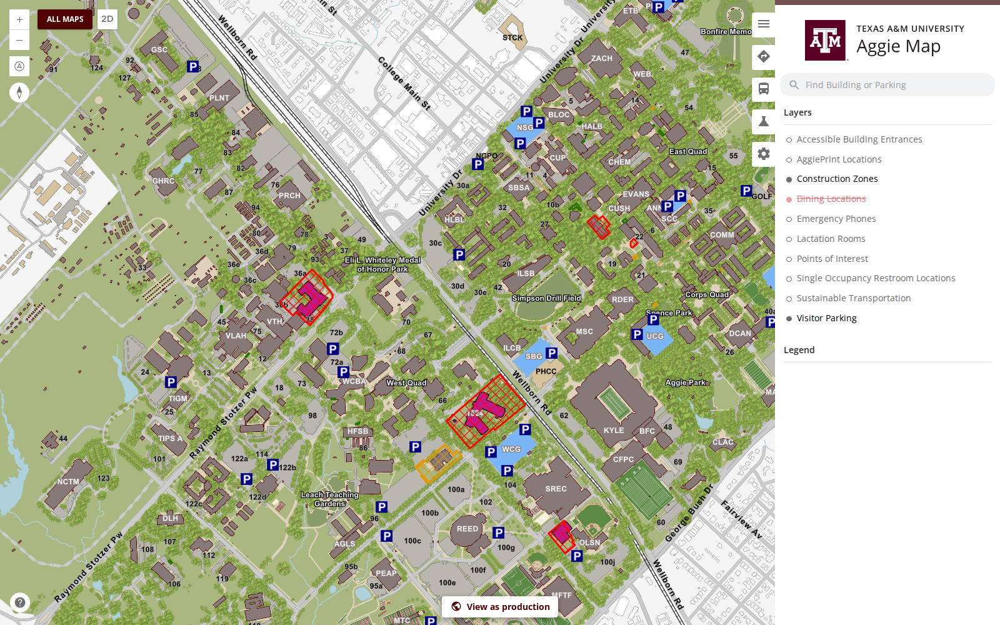 | 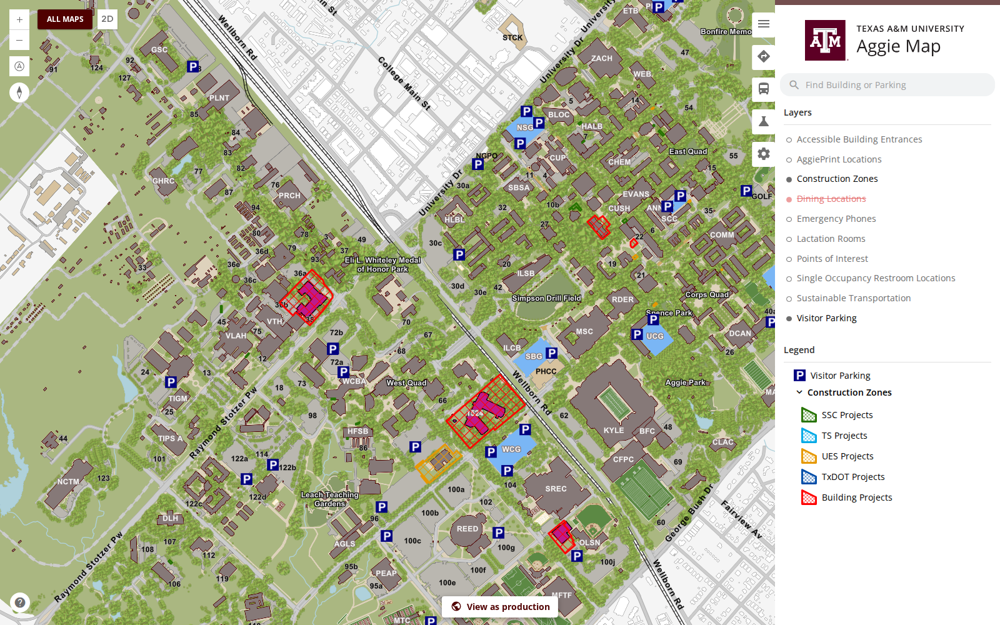 |

#### All Maps: choosing a search result opens the map

On the All Maps page, a map found with the search box could not be opened with the mouse. Pressing a
result took focus out of the search box, the list of results closed on that, and the click that should
have chosen the map landed on the page behind it. The box kept the typed text, so the page looked as if
it had simply not reacted. The keyboard worked throughout (arrow down, then Enter). A result is now
focusable, so pressing it keeps focus inside the search and the click arrives. The fix is in the shared
autocomplete component, which All Maps is the only user of today ([#1868](https://github.com/TamuGeoInnovation/Tamu.GeoInnovation.js.monorepo/issues/1868)).

| Before | After |
| --- | --- |
| 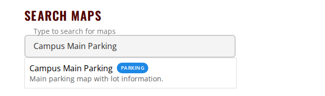 | |
| 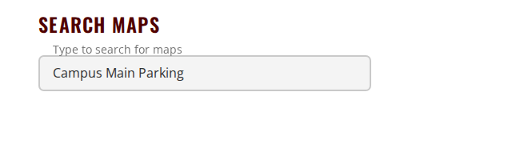 | 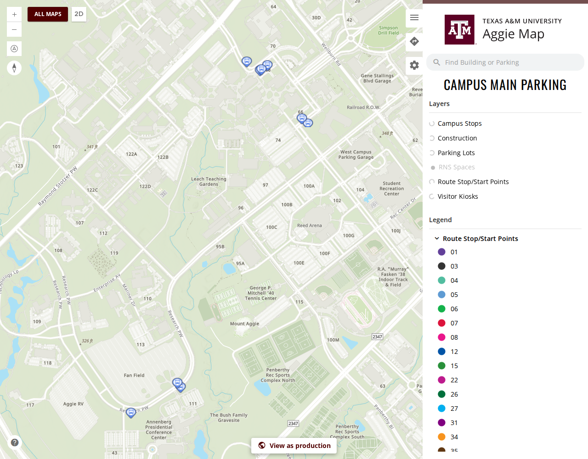 |

#### Map search works with an apostrophe or a percent sign

Searching for `Cain '51` found nothing, on every map: the apostrophe ended the query's text early, and
every GIS service the search asks rejected it. A `%` or `_` was read as a wildcard, so searching `%` on
the Football Tailgating map listed every tent and zone. What is typed is now escaped once, where every
map's search builds its query: an apostrophe is doubled, and in a "contains" search `%`, `_` and `\` are
matched as themselves. Searching `Cain '51` finds the James J. Cain '51 Building; `%` finds nothing,
because no name has one. The bus routes and the event maps' links, which escaped apostrophes on their
own, now use the same function
([#1790](https://github.com/TamuGeoInnovation/Tamu.GeoInnovation.js.monorepo/issues/1790)).

| Before | After |
| --- | --- |
| 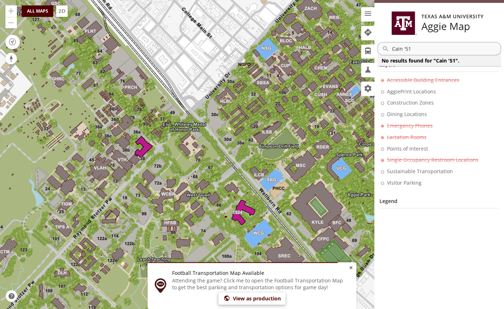 | 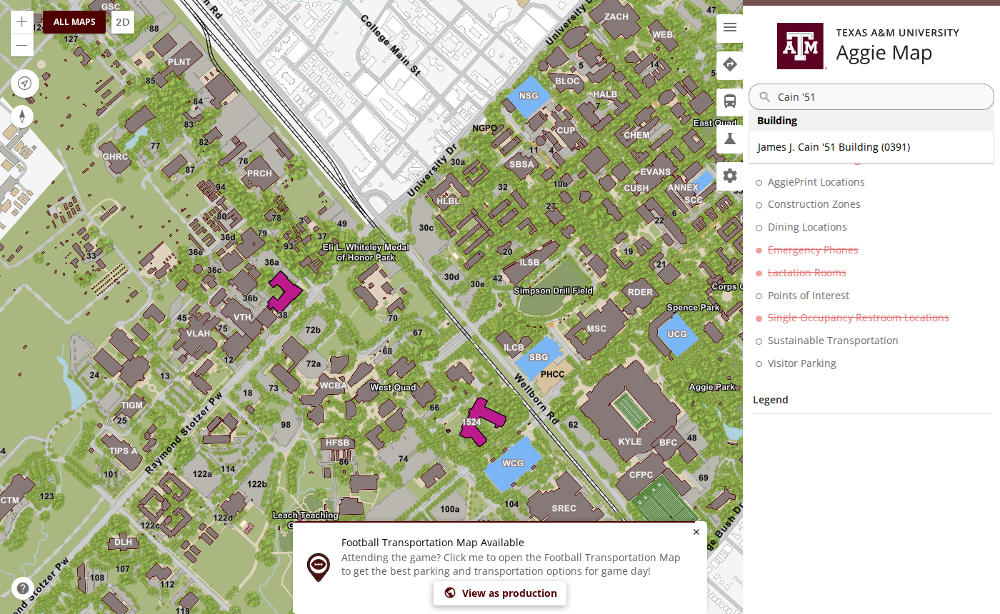 |
| 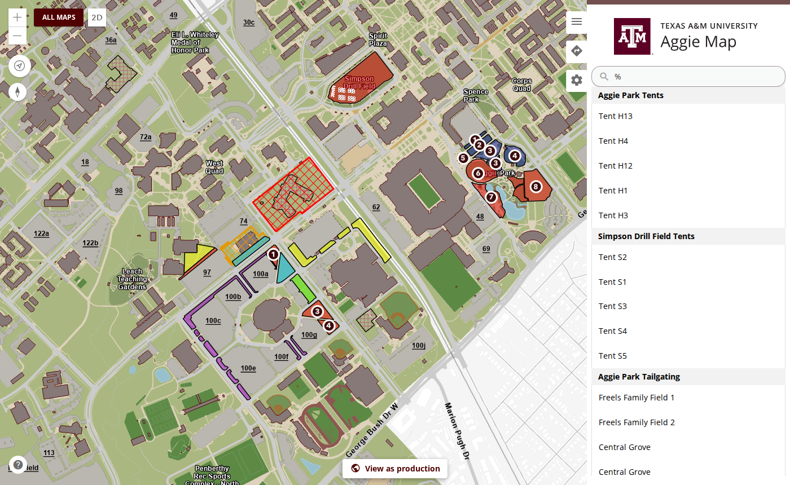 | 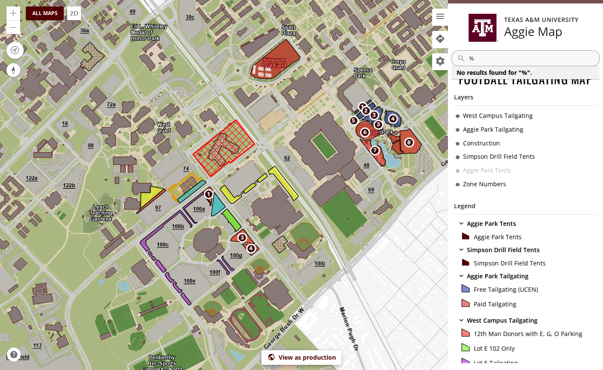 |

#### The maps load ArcGIS from `@arcgis/core`, still at 4.27

Every map's ArcGIS code is now part of the build, from Esri's `@arcgis/core` package at 4.27.6, instead
of being fetched from Esri's CDN at run time by `esri-loader`. The version is the same 4.27, so the maps
should look and behave as before; what changes is where the code comes from, and that newer Esri
releases, which are published only as `@arcgis/core`, can now be reached one at a time. Esri's workers,
fonts and translations still come from its CDN, from the path for 4.27. The map's widget stylesheet now
comes from the same path: it had been 4.23's since the runtime moved to 4.27. The layer filter's
`FeatureFilter` is loaded from where 4.27 keeps it; the old path no longer exists on Esri's CDN
([#1844](https://github.com/TamuGeoInnovation/Tamu.GeoInnovation.js.monorepo/issues/1844)).

| Before | After |
| --- | --- |
| 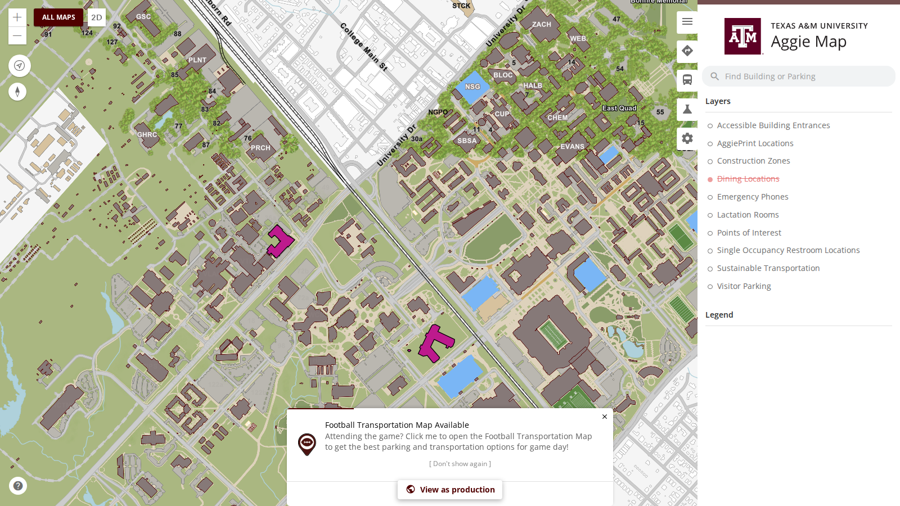 | 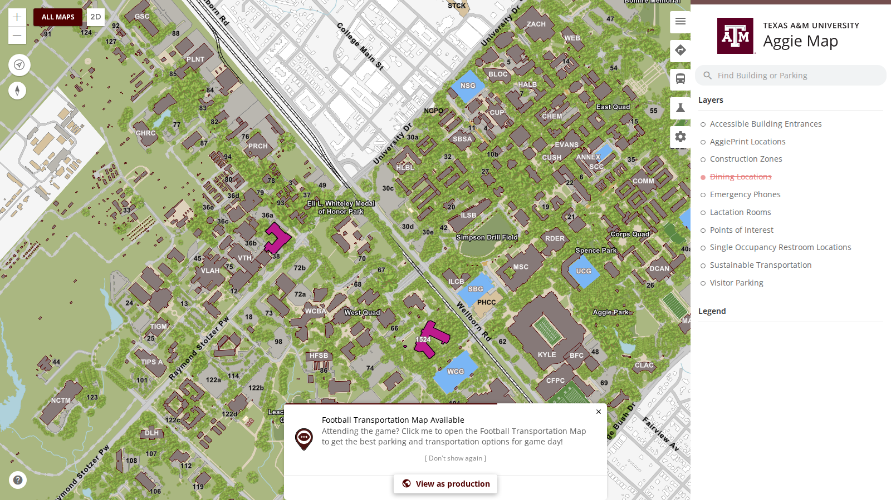 |
| 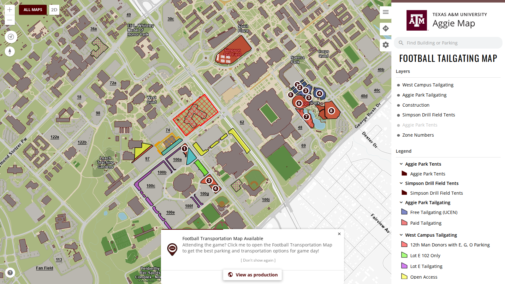 |  |

#### The maps run ArcGIS 4.34

The maps move from ArcGIS 4.27 to 4.34, the current release, one release at a time, each checked on its
own before the next ([#1845](https://github.com/TamuGeoInnovation/Tamu.GeoInnovation.js.monorepo/issues/1845)).
The maps draw as before, with the same layers. What looks different comes from Esri, which redrew its
map buttons with its Calcite icons in 4.28 and 4.29: the zoom buttons' plus and minus are thinner, and
the locate button shows a compass in a circle instead of an arrow. The main map's compass keeps its
needle on the campus basemap, as it did on 4.27; Esri's own compass would show an arrow there, because
the campus basemap is not in Web Mercator. Most of the work was in the code's types, which Esri rewrote
in 4.32; the browser console also loses an error the main map's hidden parking-lot layer had started to
log on every load.

| Before (4.27) | After (4.34) |
| --- | --- |
|  | 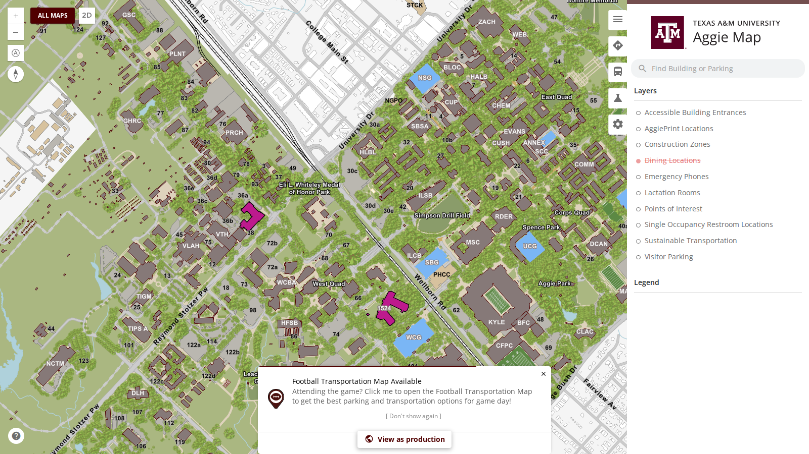 |
|  |  |

#### The map buttons move to Esri's components

ArcGIS 4.34 retires the widgets behind the maps' zoom, locate and compass buttons
([#1853](https://github.com/TamuGeoInnovation/Tamu.GeoInnovation.js.monorepo/issues/1853)). The zoom and locate buttons are now Esri's map components, `<arcgis-zoom>` and
`<arcgis-track>`, and look as they did; the browser console loses its last ArcGIS deprecation warning,
for the locate button. The compass is our own button, because Esri's component cannot keep the needle
on the campus basemap; it turns with the map and points it north again when pressed, from the mouse or
the keyboard. Focus rings and active states on the buttons are maroon instead of Esri's blue. Every map
with zoom buttons has the new ones, including signage, GeoServices and GIS Day's competition maps. The
legend, layer list and basemap panels are unchanged.

| Before | After |
| --- | --- |
| 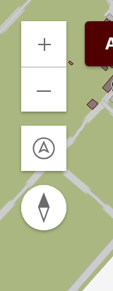 |  |
| 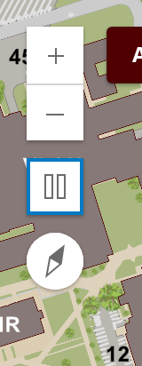 | 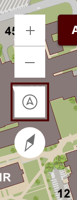 |
| 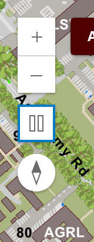 | 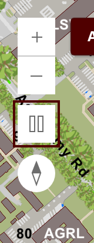 |
| 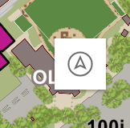 |  |
| 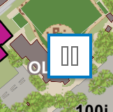 | 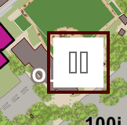 |
| | 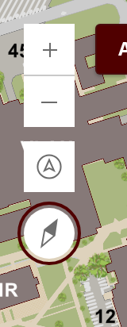 |

#### The maps run ArcGIS 5.0

The maps move from ArcGIS 4.34 to 5.0.19
([#1859](https://github.com/TamuGeoInnovation/Tamu.GeoInnovation.js.monorepo/issues/1859)), after the 4.34 step
([#1847](https://github.com/TamuGeoInnovation/Tamu.GeoInnovation.js.monorepo/pull/1847)) and the move to Esri's zoom and locate components
([#1858](https://github.com/TamuGeoInnovation/Tamu.GeoInnovation.js.monorepo/pull/1858)). Nothing is meant to look different: the maps draw the same layers, with the
same buttons, legend, layer list and basemap panels, and the same browser console. Esri's assets now
come from a path naming the exact release, `js.arcgis.com/5.0.19/`, where 4.x named the minor. Esri's
"Powered by Esri" bar, which the maps hide, stopped being one of the view's components in 5.0 and showed
across the bottom of the map until the rule hiding it was changed to match it. The rest of the work was
in the code's types. 5.1 is not part of this step: from 5.1.0, a layer with very many points never
finishes updating, though it draws, which leaves the maps' busy indicators turning. It waits on a fix
from Esri.

| Before (4.34) | After (5.0.19) |
| --- | --- |
|  | 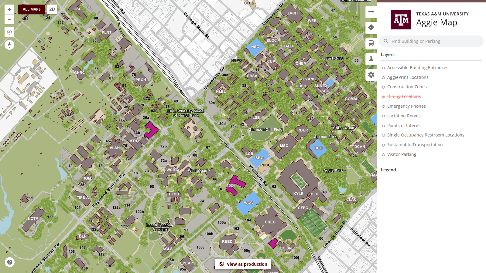 |
| 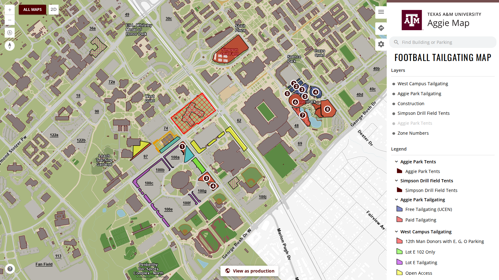 |  |
| 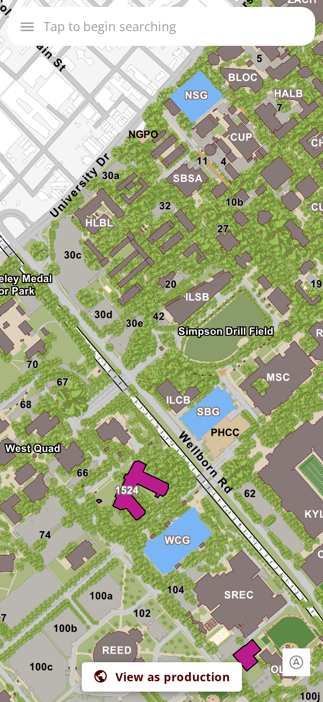 |  |

#### On game days, Football Tailgating has its own notice

In the week before a home game and on the day, the main map now shows **Football Tailgating Map
Available** below the Football Transportation one; clicking it opens the Tailgating map
([#1817](https://github.com/TamuGeoInnovation/Tamu.GeoInnovation.js.monorepo/issues/1817)). It uses the Football map's game days, so the two notices come and go together.

| Before | After |
| --- | --- |
| 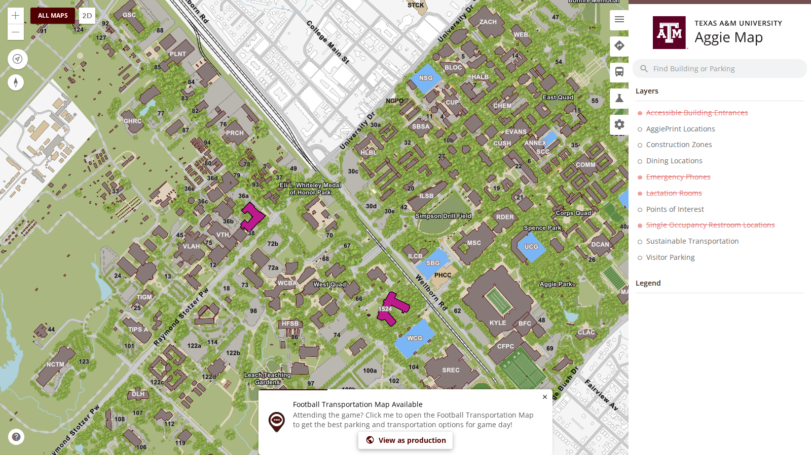 | 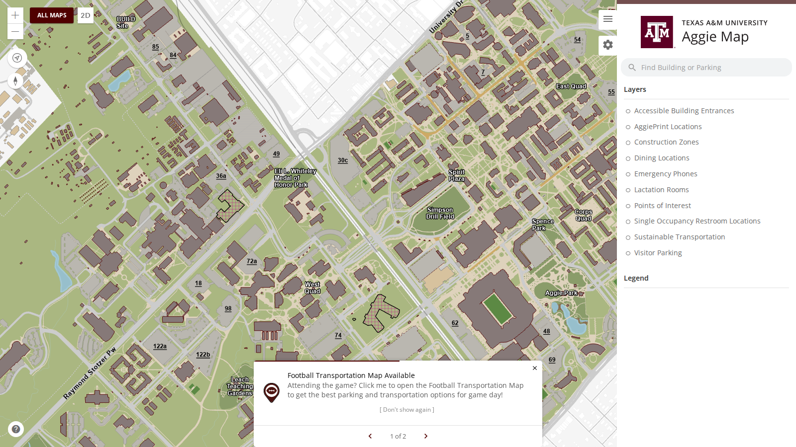 |
|  | 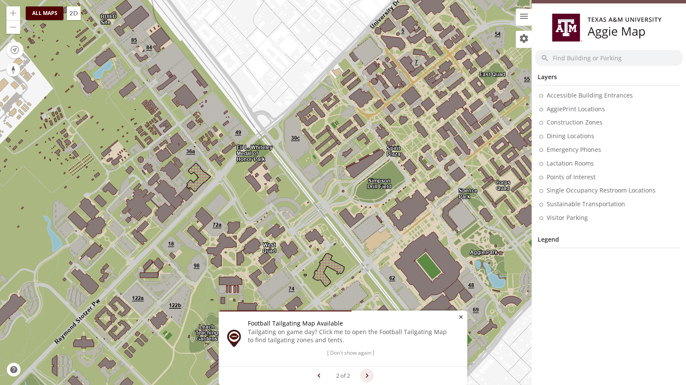 |

---

## What to test on dev (moved rows, not yet rewritten for production)

| Change | Open this on dev | Look for |
| --- | --- | --- |
| The main map's legend lists layers switched on ([#1857](https://github.com/TamuGeoInnovation/Tamu.GeoInnovation.js.monorepo/issues/1857)) | [/map/d](https://dev.aggiemap.tamu.edu/map/d) | Once the map has finished loading, switch Visitor Parking and Construction Zones on in the Layers list: each appears under Legend with its symbols within a few seconds |
| Maps load ArcGIS from `@arcgis/core` 4.27 ([#1844](https://github.com/TamuGeoInnovation/Tamu.GeoInnovation.js.monorepo/issues/1844)) | [The main map](https://dev.aggiemap.tamu.edu/map/d), [Football Tailgating](https://dev.aggiemap.tamu.edu/events/tailgating/map/d), [Aerial Imagery](https://dev.aggiemap.tamu.edu/map/d?imagery=2020-10-06), 3D, directions | Nothing different: every map draws as before; the zoom, locate and compass buttons look as they did; popups, search, the basemap gallery, the imagery date slider, 3D and directions work. In the browser's network panel, nothing is requested from `js.arcgis.com/4.27/init.js` or `js.arcgis.com/4.23` |
| Maps run ArcGIS 4.34 ([#1845](https://github.com/TamuGeoInnovation/Tamu.GeoInnovation.js.monorepo/issues/1845)) | [The main map](https://dev.aggiemap.tamu.edu/map/d), [Football Tailgating](https://dev.aggiemap.tamu.edu/events/tailgating/map/d), [Aerial Imagery](https://dev.aggiemap.tamu.edu/map/d?imagery=2020-10-06), 3D, directions, the bus routes | Every map draws with its layers; the zoom buttons' plus and minus are thinner and the locate button shows a compass in a circle (Esri's new icons); the main map's compass still shows a needle on the campus basemap; popups, search, the layer list and legend, the basemap gallery, the imagery date slider, 3D, directions and the live buses work. In the network panel, every `js.arcgis.com` request is under `/4.34/` |
| Map buttons on Esri's components ([#1853](https://github.com/TamuGeoInnovation/Tamu.GeoInnovation.js.monorepo/issues/1853)) | [The main map](https://dev.aggiemap.tamu.edu/map/d), [Football Tailgating](https://dev.aggiemap.tamu.edu/events/tailgating/map/d), [the main map on a phone](https://dev.aggiemap.tamu.edu/map/m), 3D | Zoom, locate and compass in the top left on desktop, the locate button alone at the bottom right on a phone. Turn the map (right-drag): the needle turns; press the compass, or Tab to it and press Enter, and the map points north. Locate follows you and turns the map without jumping to you. Switch to 3D and back: all three buttons are still there. Focus rings are maroon. No "deprecated" warning about Track in the console |
| Maps run ArcGIS 5.0 ([#1859](https://github.com/TamuGeoInnovation/Tamu.GeoInnovation.js.monorepo/issues/1859)) | [The main map](https://dev.aggiemap.tamu.edu/map/d), [Football Tailgating](https://dev.aggiemap.tamu.edu/events/tailgating/map/d), [Gameday Parking](https://dev.aggiemap.tamu.edu/events/gameday-parking/map/d), [the main map on a phone](https://dev.aggiemap.tamu.edu/map/m) | Every map draws the same layers as before, with the same zoom, locate and compass buttons, legend, layer list and basemap panels; no "Powered by Esri" bar across the bottom of the map; the basemap panel's spinner stops once the map has drawn. In the network panel, every `js.arcgis.com` request is under `/5.0.19/` |
| Map search with an apostrophe or a percent sign ([#1790](https://github.com/TamuGeoInnovation/Tamu.GeoInnovation.js.monorepo/issues/1790)) | [dev.aggiemap.tamu.edu](https://dev.aggiemap.tamu.edu), then [Football Tailgating](https://dev.aggiemap.tamu.edu/events/tailgating/map/d) | Search `Cain '51`: James J. Cain '51 Building is listed. Search `O'` or `Aggie's`: no error, results or "No results found". On Football Tailgating, search `%`: "No results found", not every tent. Ordinary searches still work: `MSC`, `O12`, `Creamery` |
| All Maps: choosing a search result opens the map ([#1868](https://github.com/TamuGeoInnovation/Tamu.GeoInnovation.js.monorepo/issues/1868)) | [All Maps](https://dev.aggiemap.tamu.edu/all-maps) | Type `Campus Main Parking` in Search Maps and click the result: Campus Main Parking opens. Arrow down and Enter does the same |
| Football Tailgating game-day notice ([#1817](https://github.com/TamuGeoInnovation/Tamu.GeoInnovation.js.monorepo/issues/1817)) | [The main map](https://dev.aggiemap.tamu.edu/map/d) in a private window, in the week before a home game | Two notices, **Football Transportation Map Available** then **Football Tailgating Map Available**; clicking the second opens the Tailgating map |
