# 19 October 2026

> **Draft.** These notes say what the release carries and what cleared it. The notes merge before
> production, on the maintainer's decision; the `prod-*` tag on `8463ac6af`, not this file, records that
> it reached production.

**Azure Release-486 deployed build 20261019.21, from `8463ac6af`, to dev.** That build is the one going
to production: the range `prod-2026-10-16..8463ac6af`. It is tagged `dev-2026-10-20`. Production still
serves `264eebb42` ([16 October 2026](2026-10-16.md)).

**What cleared it:**

- **The release tier against dev, on Release-486, re-run on 20 October** once Transportation Services'
  AnyValidPermitParking service had recovered (it answered the AVP query 20 times of 20 first): 546
  passed, 0 failed, 1 flaky and 29 skipped, of 576, in 36.8 minutes
  ([the results](https://github.com/TamuGeoInnovation/Tamu.GeoInnovation.js.monorepo/issues/1935#issuecomment-6284498115)). `directions.spec.ts:72` passed, and the
  `TS_Main/MapServer/6` flake was gone. The one flaky test was `lot-links.spec.ts:109` on Visitor
  Parking: its first attempt opened the main map's Lot 100j, then it passed. It is the same race as on
  Motorcycle Parking in the first run, below, and is [#1969](https://github.com/TamuGeoInnovation/Tamu.GeoInnovation.js.monorepo/issues/1969).
- **The screenshot comparison of Release-486** (`8463ac6af`), dev captured as production renders it
  (`tools/visual-baselines --as production`, [#1885](https://github.com/TamuGeoInnovation/Tamu.GeoInnovation.js.monorepo/issues/1885)), against production's set
  `prod-2026-10-16-corrected`: 848 shots of 848 captured, none failed, in 171 minutes. **No shot differed
  by more than 10%**: none at 20% or more, none at 10 to 20%, 11 at 5 to 10%, 756 at 0.5 to 5% and 81 at
  0.5% or less. The largest, 9.87%, is the bike-rack marker page, which differed by 9.66% on `8951a6364`,
  before [#1950](https://github.com/TamuGeoInnovation/Tamu.GeoInnovation.js.monorepo/pull/1950) existed. The largest desktop shot, Service and Loading Zone Parking at
  6.91%, was captured mid-load, with the sidebar's spinners still turning; re-captured on the same
  build, it differed from production by 2.94%. So hosting the maps in Esri's `<arcgis-map>` and
  `<arcgis-scene>` makes no map look different
  ([the comparison](https://github.com/TamuGeoInnovation/Tamu.GeoInnovation.js.monorepo/issues/1949#issuecomment-6284037695)).
- **The `dev-2026-10-20` tag on `8463ac6af`**, pushed once the re-run was clean, as the release sequence
  requires of every production build.

**The first run of the release tier on Release-486**, at 9 PM Central on 19 October, before the service
recovered, took 37.2 minutes: 544 passed, 1 failed, 2 flaky and 29 skipped, of 576.

- **The failure was not this release's.** `directions.spec.ts:72`, the AVP feature popup, failed
  because Transportation Services' AnyValidPermitParking service was failing about half its queries
  ([#1951](https://github.com/TamuGeoInnovation/Tamu.GeoInnovation.js.monorepo/issues/1951)). Production had the same fault. The service recovered: it answered 20
  queries of 20 at 00:14 Central on 20 October.
- **Two tests were flaky**, failing their first attempt and passing on the retry.
  `search-sources.spec.ts:512`, all parking: `TS_Main/MapServer/6`, on the same Transportation Services
  server, answered `400 Unable to complete operation`. `lot-links.spec.ts:109`, Motorcycle Parking: the
  first attempt opened the main map's Lot 100j instead of the map's own; it is a race,
  [#1969](https://github.com/TamuGeoInnovation/Tamu.GeoInnovation.js.monorepo/issues/1969).

**Earlier, on Release-484** (build 20261019.5, from `8951a6364`), the build these notes were first
written for:

- **The full tier against dev**, 7:38 to 8:50 AM Central on 19 October, 1.1 hours: 880 passed, 2 failed,
  7 flaky and 30 skipped, of 919.
  - **One failure was real, and not this release's**: the same `directions.spec.ts:72`, for the same
    reason ([#1951](https://github.com/TamuGeoInnovation/Tamu.GeoInnovation.js.monorepo/issues/1951)). Production had the same fault then: the same deep link opened its
    popup on only 4 of 8 loads there.
  - **The other failure and all seven flaky results were a measurement fault on the testing machine, not
    a fault in the build.** The machine was short of CPU while the run shared it. Re-run alone on an
    idle machine, `maps.spec.ts` passed 74 of 74, `/map` included.
- **The screenshot comparison of `8951a6364`**, dev captured `--as production`, against
  `prod-2026-10-16-corrected`: no map differed by more than 20%. The largest, Leggett at 15.26%, had been
  captured mid-animation; re-captured, it differed by 3.02%. Campus Main Parking's layer order, which
  differed, was fixed ([#1939](https://github.com/TamuGeoInnovation/Tamu.GeoInnovation.js.monorepo/issues/1939)) and is alphabetical again.

**Three earlier builds reached dev and were not promoted.** `f800c2edf` (ArcGIS 5.0.19) is tagged
`dev-2026-10-18`, and `86893756c` (build 20261018.12, Release-479), for which these notes were first
started, is tagged `dev-2026-10-18-2`; `8951a6364` (Release-484), above, reached dev on 19 October.
Production was postponed while more merged; this build carries all three, and everything merged after
them.

**The headline is ArcGIS: production goes from 4.27, loaded at run time by `esri-loader`, to 5.1.27,
built in from `@arcgis/core`**, in six steps, each its own pull request
([#1844](https://github.com/TamuGeoInnovation/Tamu.GeoInnovation.js.monorepo/issues/1844),
[#1845](https://github.com/TamuGeoInnovation/Tamu.GeoInnovation.js.monorepo/issues/1845),
[#1852](https://github.com/TamuGeoInnovation/Tamu.GeoInnovation.js.monorepo/issues/1852),
[#1853](https://github.com/TamuGeoInnovation/Tamu.GeoInnovation.js.monorepo/issues/1853),
[#1859](https://github.com/TamuGeoInnovation/Tamu.GeoInnovation.js.monorepo/issues/1859),
[#1867](https://github.com/TamuGeoInnovation/Tamu.GeoInnovation.js.monorepo/issues/1867)). The maps are
meant to look as they did; what a visitor sees differently is Esri's redrawn zoom and locate icons,
maroon focus rings, and busy spinners that turn for longer when zoomed in to the parking spaces. Underneath, **AggieMap and UES Operations are OnPush, with signals, and run without zone.js**, on Node 24,
with their unit tests on Vitest. Around them are fixes a visitor will notice: the main
map's legend lists the layers switched on and drops them when switched off, a search result on All Maps opens its map, map search
accepts an apostrophe, the campus maps load only their own campus, the accessible and motorcycle parking
maps finish drawing in seconds, so do Football Tailgating's tent and zone links, the Layers list is
alphabetical again, Football Tailgating has its own game-day notice, Lactation Rooms shows all 35 rooms,
and a `?lot=` link opens the lot on fourteen parking maps where it did not, and selects only what
the map draws. Last,
every map is now hosted by Esri's map components, `<arcgis-map>` and `<arcgis-scene>`, and is meant to
look as it did.

The build also carries GIS Day work, which reaches the GIS Day site only with its own deploy; it is
listed at the end and its entries stay in [`unreleased.md`](unreleased.md).

The release before this is [16 October 2026](2026-10-16.md).

---

## Summary

### ArcGIS 4.27 to 5.1

Each entry below is one step, written when it reached dev, so the versions in it are that step's.
Production takes all five at once: from 4.27 through `esri-loader` to 5.1.27 from `@arcgis/core`.

#### The maps load ArcGIS from `@arcgis/core`, still at 4.27

Every map's ArcGIS code is now part of the build, from Esri's `@arcgis/core` package at 4.27.6, instead
of being fetched from Esri's CDN at run time by `esri-loader`. The version is the same 4.27, so the maps
should look and behave as before; what changes is where the code comes from, and that newer Esri
releases, which are published only as `@arcgis/core`, can now be reached one at a time. Esri's workers,
fonts and translations still come from its CDN, from the path for 4.27. The map's widget stylesheet now
comes from the same path: it had been 4.23's since the runtime moved to 4.27. The layer filter's
`FeatureFilter` is loaded from where 4.27 keeps it; the old path no longer exists on Esri's CDN
([#1844](https://github.com/TamuGeoInnovation/Tamu.GeoInnovation.js.monorepo/issues/1844)).

| Before | After |
| --- | --- |
|  |  |
|  |  |

#### The maps run ArcGIS 4.34

The maps move from ArcGIS 4.27 to 4.34, the current release, one release at a time, each checked on its
own before the next ([#1845](https://github.com/TamuGeoInnovation/Tamu.GeoInnovation.js.monorepo/issues/1845)).
The maps draw as before, with the same layers. What looks different comes from Esri, which redrew its
map buttons with its Calcite icons in 4.28 and 4.29: the zoom buttons' plus and minus are thinner, and
the locate button shows a compass in a circle instead of an arrow. The main map's compass keeps its
needle on the campus basemap, as it did on 4.27; Esri's own compass would show an arrow there, because
the campus basemap is not in Web Mercator. Most of the work was in the code's types, which Esri rewrote
in 4.32; the browser console also loses an error the main map's hidden parking-lot layer had started to
log on every load.

| Before (4.27) | After (4.34) |
| --- | --- |
|  |  |
|  |  |

#### The map buttons move to Esri's components

ArcGIS 4.34 retires the widgets behind the maps' zoom, locate and compass buttons
([#1853](https://github.com/TamuGeoInnovation/Tamu.GeoInnovation.js.monorepo/issues/1853)). The zoom and locate buttons are now Esri's map components, `<arcgis-zoom>` and
`<arcgis-track>`, and look as they did; the browser console loses its last ArcGIS deprecation warning,
for the locate button. The compass is our own button, because Esri's component cannot keep the needle
on the campus basemap; it turns with the map and points it north again when pressed, from the mouse or
the keyboard. Focus rings and active states on the buttons are maroon instead of Esri's blue. Every map
with zoom buttons has the new ones, including signage, GeoServices and GIS Day's competition maps. The
legend, layer list and basemap panels are unchanged.

| Before | After |
| --- | --- |
|  |  |
|  |  |
|  |  |
|  |  |
|  |  |
| |  |

#### The maps run ArcGIS 5.0

The maps move from ArcGIS 4.34 to 5.0.19
([#1859](https://github.com/TamuGeoInnovation/Tamu.GeoInnovation.js.monorepo/issues/1859)), after the 4.34 step
([#1847](https://github.com/TamuGeoInnovation/Tamu.GeoInnovation.js.monorepo/pull/1847)) and the move to Esri's zoom and locate components
([#1858](https://github.com/TamuGeoInnovation/Tamu.GeoInnovation.js.monorepo/pull/1858)). Nothing is meant to look different: the maps draw the same layers, with the
same buttons, legend, layer list and basemap panels, and the same browser console. Esri's assets now
come from a path naming the exact release, `js.arcgis.com/5.0.19/`, where 4.x named the minor. Esri's
"Powered by Esri" bar, which the maps hide, stopped being one of the view's components in 5.0 and showed
across the bottom of the map until the rule hiding it was changed to match it. The rest of the work was
in the code's types. 5.1 was held back from this step, because from 5.1.0 a layer with very many points
never finishes updating; the next entry says how the maps reached it anyway.

| Before (4.34) | After (5.0.19) |
| --- | --- |
|  |  |
|  |  |
|  |  |

#### The maps run ArcGIS 5.1

The maps move from ArcGIS 5.0.19 to 5.1.27, the latest 5.1 release on 18 October, with Esri's map
components and Calcite to match
([#1867](https://github.com/TamuGeoInnovation/Tamu.GeoInnovation.js.monorepo/issues/1867)). Nothing
drawn changes. From 5.1.0, a layer with more than about 30,000 features never finished updating at the
scales the maps open at, which left the busy indicators turning for good; on our maps that layer is RNS
Spaces, the 44,980 parking-space points. The main map, and every event map built on its definitions,
now loads RNS Spaces at its service's own scale, 1:1,200, where its points can be seen at all, instead of
1:100,000, where they could not; a unit test fails if it goes back. The layer stays loaded and
unfiltered. On the main map it now also starts switched off, so that links zoomed in past 1:1,200
finish drawing ([#1926](https://github.com/TamuGeoInnovation/Tamu.GeoInnovation.js.monorepo/issues/1926), below).

**One difference can be seen.** Zoomed in past 1:1,200, where every parking space is loaded, the layer
list's spinner beside RNS Spaces and the basemap panel's spinner turn for longer than on 5.0: about a
minute on the main map with RNS Spaces switched on, and minutes on Campus Main Parking, which loads the layer twice. The spaces draw
meanwhile.

| Before (5.0.19) | After (5.1.27) |
| --- | --- |
|  | 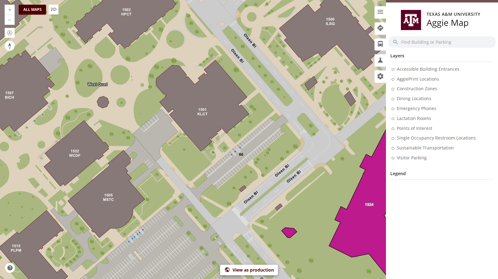 |
|  | 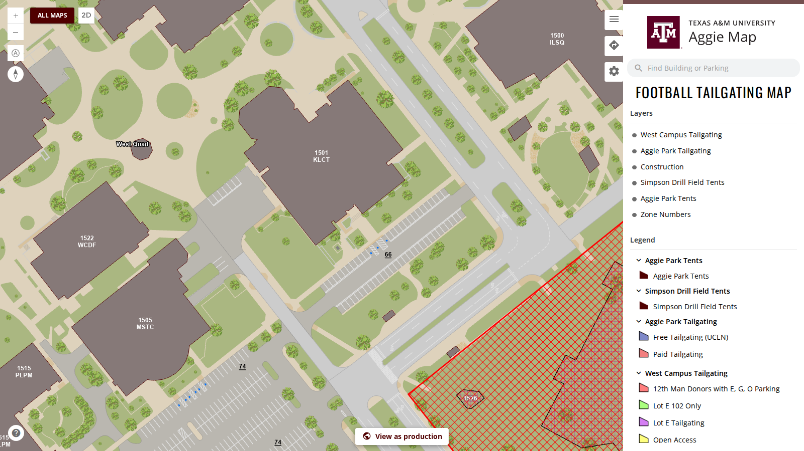 |
| 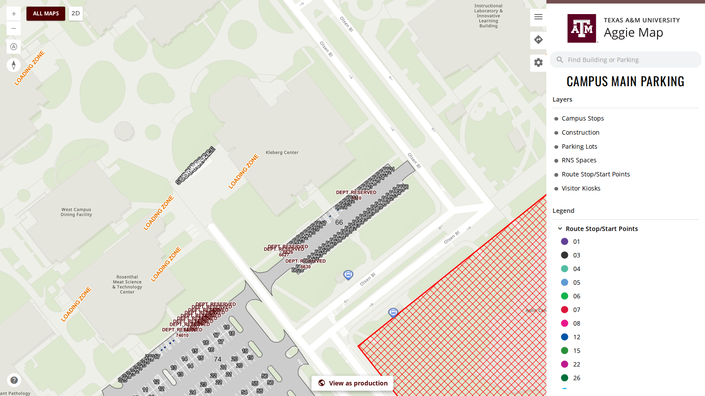 |  |

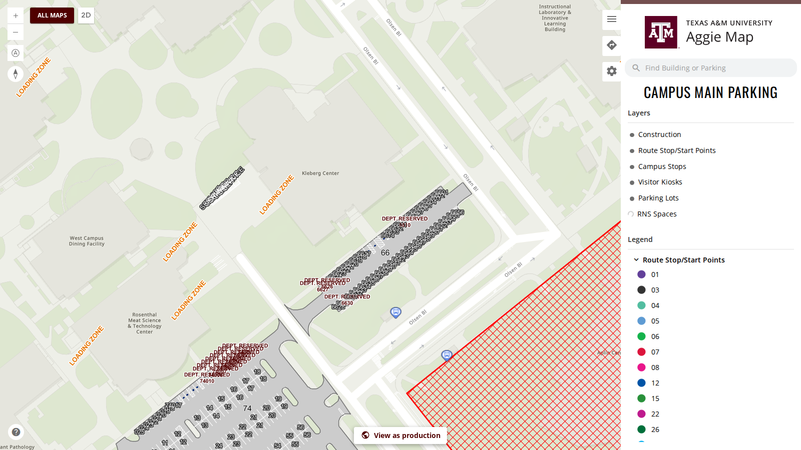

### Every map

#### The main map's legend lists the layers switched on

The main map's legend stayed empty whatever was switched on in the Layers list, on production as well as
dev. Every layer on the main map loads hidden, and the legend only lists a layer once it has seen it
visible, so that a layer switched off collapses instead of disappearing. It looked only when ArcGIS's
list of layers changed, and switching a layer on does not change that list, so once the map had loaded
it never looked again. It now also looks when a layer is switched on or off. Maps whose layers load
visible, such as Visitor Parking's own map, were not affected ([#1857](https://github.com/TamuGeoInnovation/Tamu.GeoInnovation.js.monorepo/issues/1857)).

| Before | After |
| --- | --- |
|  |  |

#### The main map's legend drops a layer switched off

Once [#1857](https://github.com/TamuGeoInnovation/Tamu.GeoInnovation.js.monorepo/issues/1857)'s fix listed a layer switched on in the main map's legend, switching it off again left it
there, symbols and all, though the map no longer drew it. The legend keeps a layer it has seen visible
so that it can collapse instead of disappearing, which is right on the event maps, where the collapsed
title is how the layer is switched back on; the main map's legend has no such titles. A legend that does
not switch layers now drops one switched off and lists it again when it is switched on. Event maps'
legends keep it collapsed, as before ([#1871](https://github.com/TamuGeoInnovation/Tamu.GeoInnovation.js.monorepo/issues/1871)).

| Before | After |
| --- | --- |
| 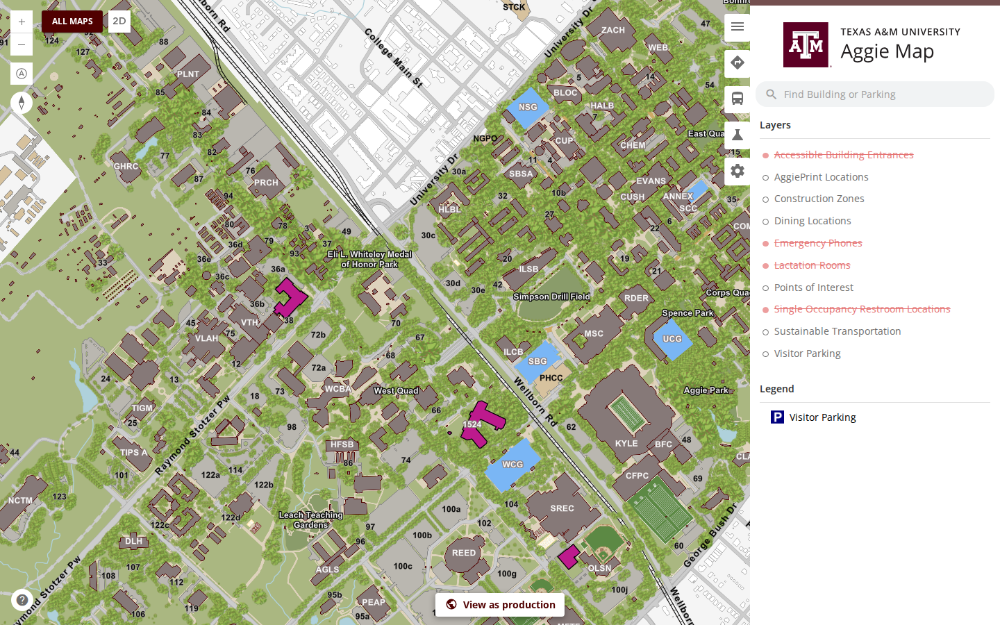 | 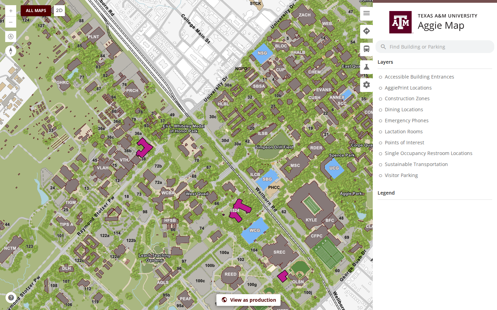 |

#### The Layers list is alphabetical again

On ArcGIS 5 a parking map's Layers list could keep the order its layers were added in, instead of
sorting them by name: Campus Main Parking read "Construction, Route Stop/Start Points, Campus Stops,
Visitor Kiosks, Parking Lots, RNS Spaces" on two loads in three on dev, and Service and Loading Zone
Parking listed Service Parking Spaces before Service Parking Lots on every load. The list was sorted only when a
layer was added or removed, and a layer named by its service only gets that name once it loads, which
on ArcGIS 5 is after it is listed. It is now sorted again whenever a layer's name arrives
([#1939](https://github.com/TamuGeoInnovation/Tamu.GeoInnovation.js.monorepo/issues/1939)).

| Before (dev) | After (local production build) |
| --- | --- |
| 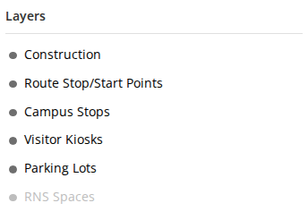 | 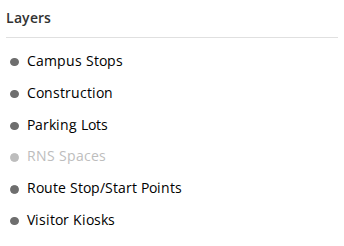 |
| 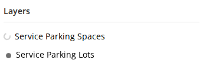 | 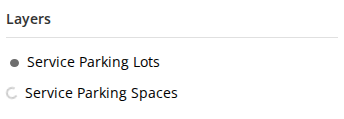 |

#### The maps are hosted by Esri's map components

AggieMap, the event and parking maps and UES Operations now use Esri's current way of building a map,
the map components: `<arcgis-map>` draws the map and `<arcgis-scene>` the 3D view, and the buttons sit
in their slots, instead of our own map view with buttons placed through its `ui`, which ArcGIS 5.1
deprecates and 6.0 removes ([#1949](https://github.com/TamuGeoInnovation/Tamu.GeoInnovation.js.monorepo/issues/1949),
part of [#1218](https://github.com/TamuGeoInnovation/Tamu.GeoInnovation.js.monorepo/issues/1218)).
Nothing is meant to look different. The buttons are in the same order and place, a pixel further
from the corner; in 3D the pan/rotate toggle and compass are Esri's components rather than its retired
widgets, and look the same. On a phone the locate button sits 14 pixels lower, as far from the bottom
of the screen as from its side: the space it kept above it was for the attribution line, which the map
hides. Signage, GeoServices and GIS Day's competition maps are hosted the same way.

| Before | After |
| --- | --- |
| 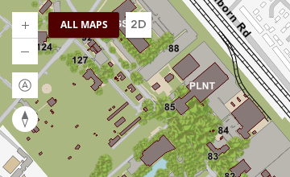 |  |
| 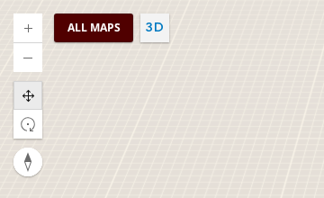 |  |
|  |  |
|  | 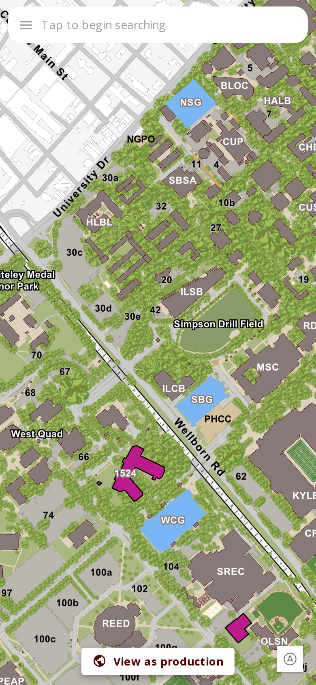 |

#### Lactation Rooms shows all 35 rooms, and how to reach each one

The Lactation Rooms layer now reads the hosted service Facilities Analytics & Mapping publishes for it,
`Hosted/Lactation_Spaces_view`, in place of layer 2 of `FCOR/MapInfo_20190529`: **35 rooms instead of
21**. Every field has a new name, so the popup was rewritten with it. It shows the building's name and
number, the room's availability and hours, how to reach it, what it has, and the notes, with their
contact and links, as text. Before, the notes were put into an "Additional Information" link whose
address was the notes themselves, and Building Number was always blank: the popup read a field neither
service has. A room with no amenities listed no longer shows an empty row
([#1960](https://github.com/TamuGeoInnovation/Tamu.GeoInnovation.js.monorepo/issues/1960)).

The service is on the production GIS server only, where it is public, so dev reads it from there too,
and dev's smoke tests no longer allow the layer to fail. Publishing it on the development GIS server, so
that each environment reads its own, is [#1963](https://github.com/TamuGeoInnovation/Tamu.GeoInnovation.js.monorepo/issues/1963). The UES Operations map uses the same
service. The Family Friendly Restroom popup's Building Number is always empty for a similar reason, and
is [#1961](https://github.com/TamuGeoInnovation/Tamu.GeoInnovation.js.monorepo/issues/1961).

| Before | After |
| --- | --- |
| 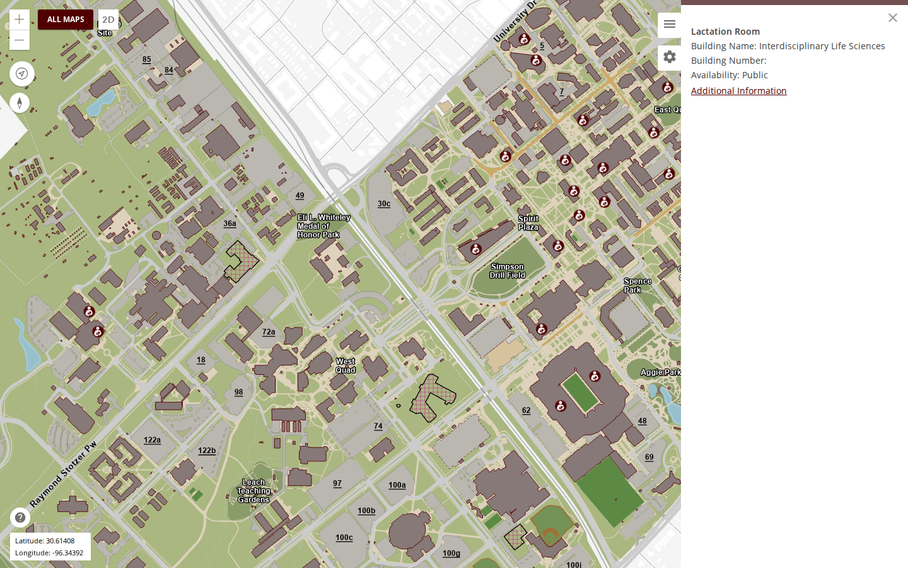 | 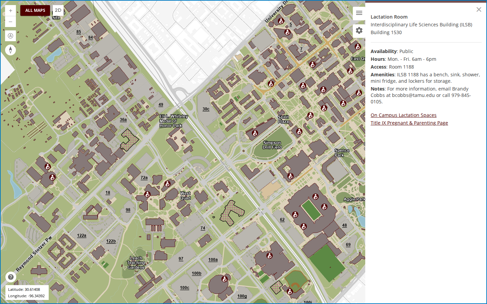 |

#### Map search works with an apostrophe or a percent sign

Searching for `Cain '51` found nothing, on every map: the apostrophe ended the query's text early, and
every GIS service the search asks rejected it. A `%` or `_` was read as a wildcard, so searching `%` on
the Football Tailgating map listed every tent and zone. What is typed is now escaped once, where every
map's search builds its query: an apostrophe is doubled, and in a "contains" search `%`, `_` and `\` are
matched as themselves. Searching `Cain '51` finds the James J. Cain '51 Building; `%` finds nothing,
because no name has one. The bus routes and the event maps' links, which escaped apostrophes on their
own, now use the same function
([#1790](https://github.com/TamuGeoInnovation/Tamu.GeoInnovation.js.monorepo/issues/1790)).

| Before | After |
| --- | --- |
|  |  |
|  |  |

### All Maps

#### All Maps: choosing a search result opens the map

On the All Maps page, a map found with the search box could not be opened with the mouse. Pressing a
result took focus out of the search box, the list of results closed on that, and the click that should
have chosen the map landed on the page behind it. The box kept the typed text, so the page looked as if
it had simply not reacted. The keyboard worked throughout (arrow down, then Enter). A result is now
focusable, so pressing it keeps focus inside the search and the click arrives. The fix is in the shared
autocomplete component, which All Maps is the only user of today ([#1868](https://github.com/TamuGeoInnovation/Tamu.GeoInnovation.js.monorepo/issues/1868)).

| Before | After |
| --- | --- |
|  | |
|  |  |

### Campus and event maps

#### Campus maps load only their own campus

The Galveston, McAllen and DC / Bush School maps also loaded every College Station layer: 26 layers on
DC, among them Buildings, parking, bus routes, bike lanes and RNS Spaces with all 44,980 parking-space
points, none of which can show anything on another campus. On dev ten of them failed to load and filled
the console with errors, and on ArcGIS 5.1 the RNS Spaces load kept the DC map painting for about a
minute and a half. The map looks the same afterwards, because none of those layers had anything to draw
there; what changes is how fast it finishes and the console. A campus map now loads only its basemap and its own campus's layers, as the dining
kiosk already did; College Station's maps are unchanged. A smoke check now fails if any campus map loads
a layer that is not its own ([#1910](https://github.com/TamuGeoInnovation/Tamu.GeoInnovation.js.monorepo/issues/1910)).

| Before | After |
| --- | --- |
| 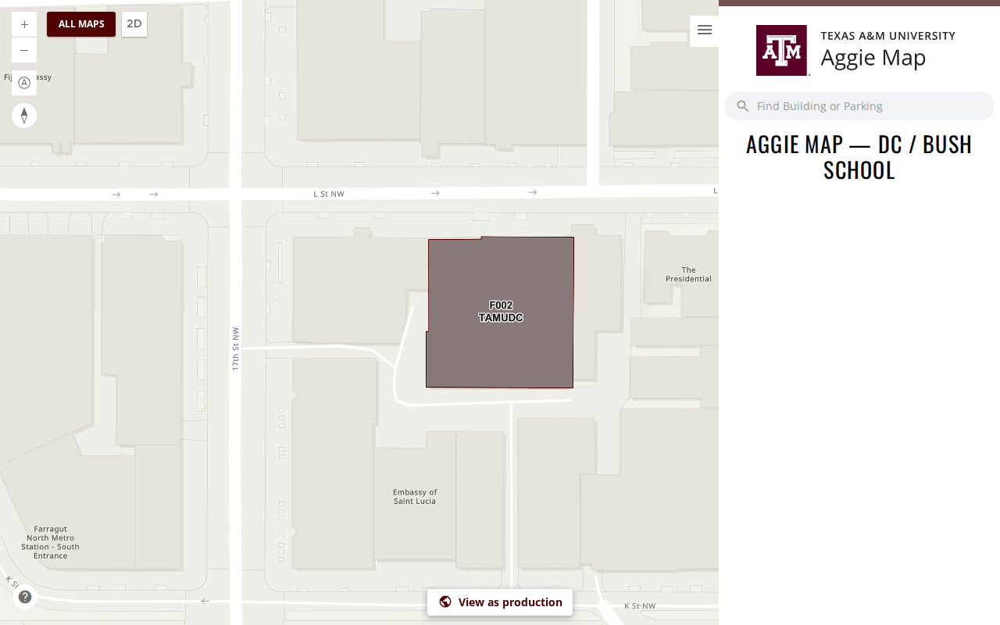 |  |

#### Accessible and motorcycle parking maps finish drawing in seconds

The Accessible Parking and Motorcycle Parking maps each draw one kind of space, from a service that holds
every parking space on campus: 44,980 points. Their symbology has symbols only for accessible spaces
(H/C and Visitor H/C, 1,263 of them) or motorcycle spaces (M/C, 1,016), so every other space was
downloaded and never drawn. On ArcGIS 5.1 in a headless browser the two maps took 104 to 177 seconds
to finish drawing. Each map now asks for its own spaces only. The maps look the same, because the same
spaces are drawn; on a local production build they finished drawing in 16 to 27 seconds. A smoke check
now fails if either map holds a space its symbology does not draw ([#1897](https://github.com/TamuGeoInnovation/Tamu.GeoInnovation.js.monorepo/issues/1897)).

| Before | After |
| --- | --- |
|  | 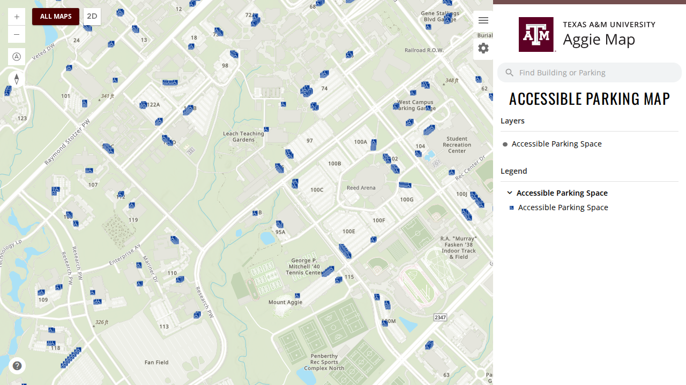 |
|  | 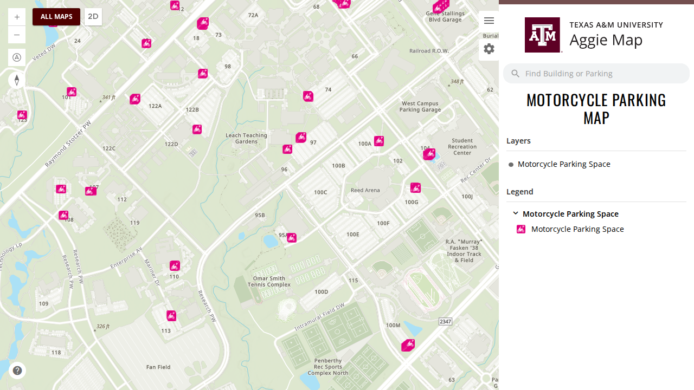 |

#### A Football Tailgating tent or zone link finishes drawing

A `?tent=` or `?zone=` link on Football Tailgating opened with the tent or zone highlighted, but on
ArcGIS 5.1 the map never finished drawing: the link zooms in past 1:1200, where the main map's RNS
Spaces layer holds all of its ~45,000 points, and from 5.1 a layer view that large never stops
updating. The layer draws nothing (its points are invisible and its labels off), so it is now left
off. The map looks the same; on dev it was still drawing after four minutes, and on a local
production build of the fix it finished drawing 25 seconds after opening. The smoke check for these links had failed
on every load on dev since ArcGIS 5.1 ([#1926](https://github.com/TamuGeoInnovation/Tamu.GeoInnovation.js.monorepo/issues/1926)).

| Before (dev) | After (local production build) |
| --- | --- |
| 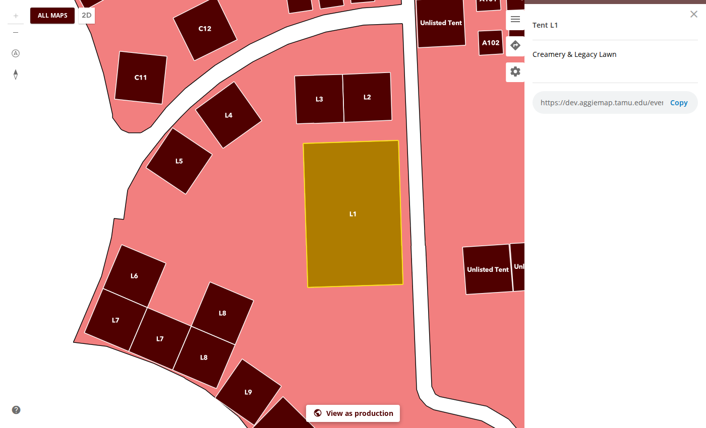 | 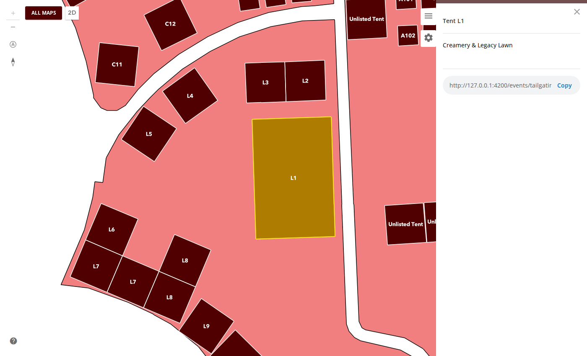 |

#### A `?lot=` link opens the lot on fourteen parking maps

A share link of the friendly form - `?lot=100j` - resolved to nothing on fourteen of Transportation
Services' parking maps, so their popups could only offer the generic `?feature=<layerId>:<objectId>`
form. Those services join several tables, so a lot's name is `GIS.TS.ParkingLots.LotName` rather than
`LotName`, and the app compared field names whole: no layer matched, and the link quietly opened
nothing. On Visitor Parking, `?lot=100j` instead opened the **main** map's Lot 100j, whose share link
reads `aggiemap.tamu.edu/?lot=...` - which is why it looked as though it half worked.

A candidate field now matches a field whose last dot-separated part equals it. The thirteen services
that already named their fields plainly are unaffected, and **every link shared since June still
works**: a `?feature=` link is tried first and returns as soon as it resolves
([#1952](https://github.com/TamuGeoInnovation/Tamu.GeoInnovation.js.monorepo/issues/1952)).

The affected maps are AVP, Contractor, Freshman Selectable, Media, Move-Out, New Student Conference,
Night and Weekend, Retiree, Staff Selectable, Student Selectable, Summer Break, Vendor, Visitor, and
the Track/Soccer/Softball/Swimming/Volleyball/Women's Basketball map.

| Before (dev) | After |
| --- | --- |
| 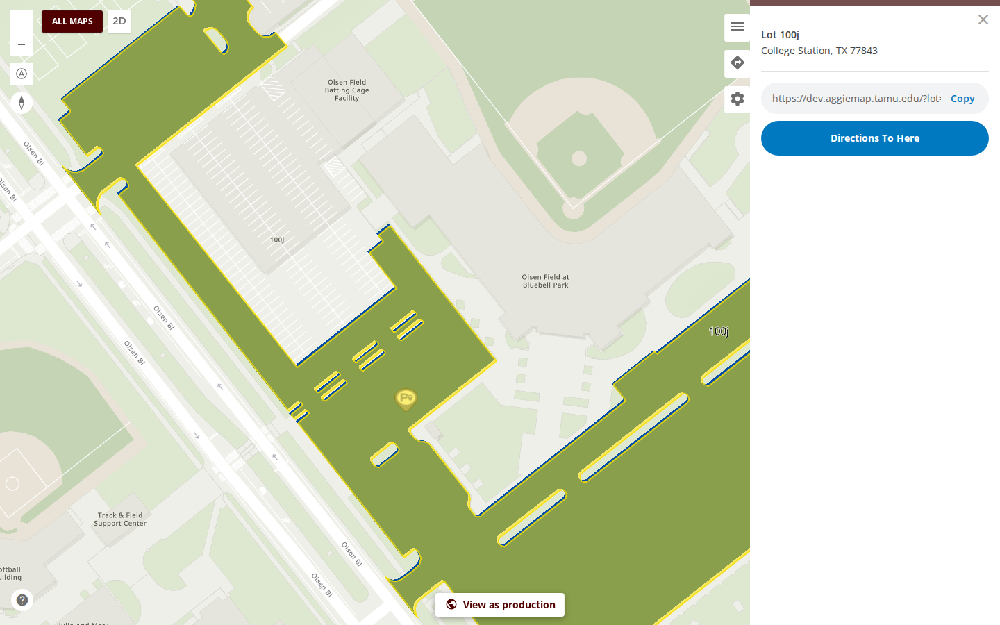 | Not captured: the dev server's first page load did not finish in time when the fix was made. A smoke check opens a `?lot=` link on each of the fourteen maps (`lot-links.spec.ts`). |

#### A map still opens where it should when a feature link cannot be looked up

A map opened from a link naming a feature - `?lot=`, `?feature=` - did three things in one step: it
looked the feature up, opened on the view the builder choices asked for, and flashed the feature to
draw the eye. A failure in the first skipped the other two, so when a service erred the visitor lost
the opening view as well as the popup. Transportation Services' AVP service was failing about half its
queries in October ([#1951](https://github.com/TamuGeoInnovation/Tamu.GeoInnovation.js.monorepo/issues/1951)),
which is how this came to light. The lookup is now allowed to fail on its own: the view and the flash
run either way, and the failure is logged, not retried - an outage stays visible to the smoke suite
rather than being papered over
([#1953](https://github.com/TamuGeoInnovation/Tamu.GeoInnovation.js.monorepo/issues/1953)).

There are no before and after images: the difference only appears while a service is erring, which
cannot be staged honestly. The pull request carries the `no-visible-change` label for that reason.

#### A lot link selects only what the map draws

A `?lot=` or `?feature=` link looked a feature up by querying its layer directly, and a layer's filter governs
what it *draws*, not what a query returns. So a link could select something the map does not show: on Motorcycle
Parking, which draws only `M/C` spaces, `?lot=100j` selected space 26692, an `H/C` space, and marked it in an
empty patch of map with nothing under it. Both lookups now start from the layer's own query, so the filter is
applied however it was set - a definition expression, a builder choice, a subtype - and the same link selects
32270, an `M/C` space the map draws
([#1954](https://github.com/TamuGeoInnovation/Tamu.GeoInnovation.js.monorepo/issues/1954)).

**A link shared before a map's filter changed may now select nothing.** That is deliberate: a link selects only
what the map shows.

| Before (dev) | After (local production build) |
| --- | --- |
| 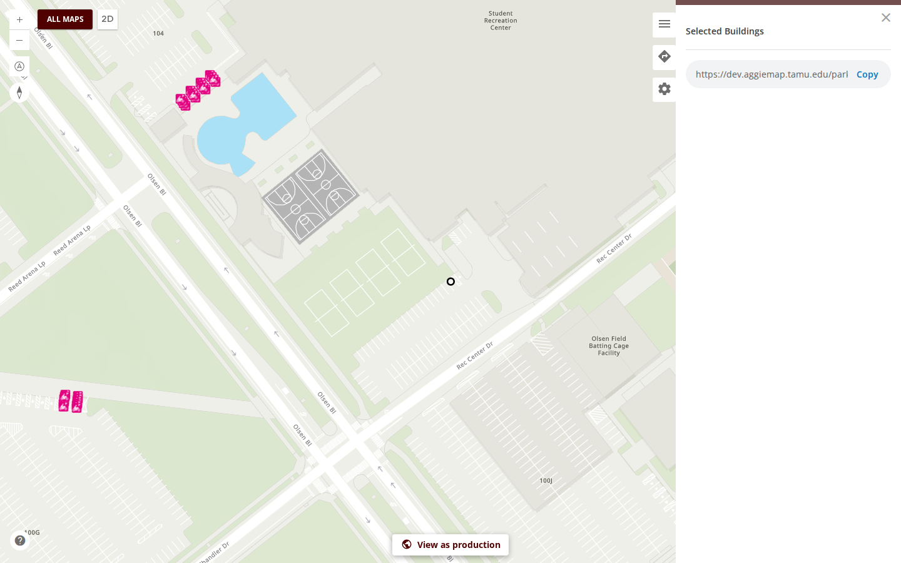 | 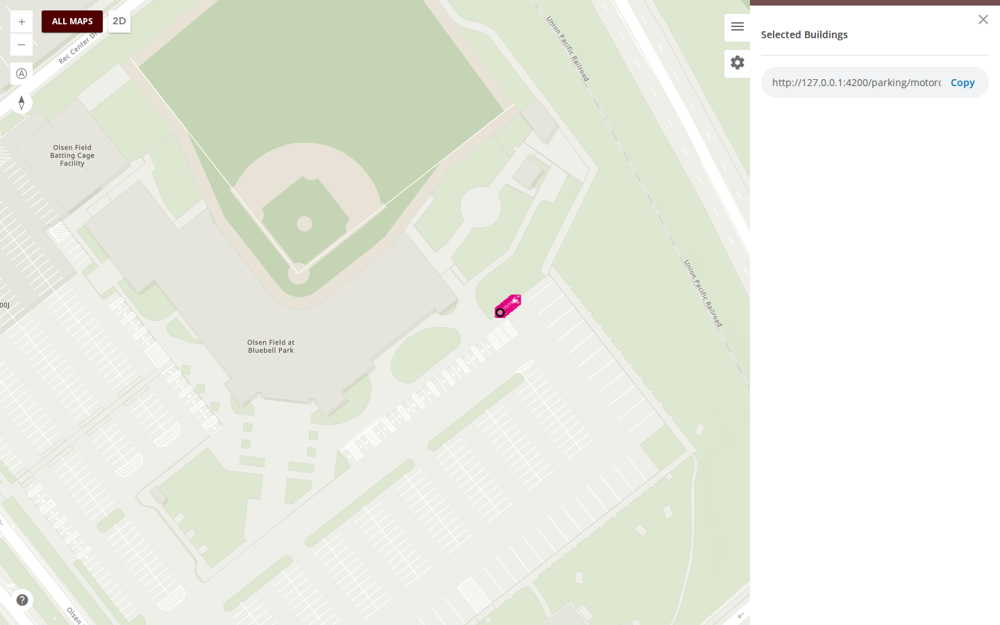 |

#### On game days, Football Tailgating has its own notice

In the week before a home game and on the day, the main map now shows **Football Tailgating Map
Available** below the Football Transportation one; clicking it opens the Tailgating map
([#1817](https://github.com/TamuGeoInnovation/Tamu.GeoInnovation.js.monorepo/issues/1817)). It uses the Football map's game days, so the two notices come and go together.

| Before | After |
| --- | --- |
|  |  |
|  |  |

### Dev only

#### Main map in 2D on dev: a click shows its coordinates, and the viewfinder lists buildings

On dev, the main map in 2D did not show the latitude and longitude of a click, bottom left, and logged
`Cannot read properties of null (reading 'toFixed')` instead. Moving the map with the arrow keys showed the
viewfinder with no buildings listed. Dev's 2D campus basemap is in Texas Centric (wkid 32139), and ArcGIS
gives a point's latitude and longitude only in a geographic or Web Mercator reference, so both read null
there. A click's position is now projected to latitude and longitude, and the viewfinder asks for the
buildings in the map's own reference, which needs no latitude at all. A click in directions, which sets a
stop at the point clicked, read the same null latitude, and is projected the same way. 3D and production,
whose basemaps are not in Texas Centric, were not affected ([#1875](https://github.com/TamuGeoInnovation/Tamu.GeoInnovation.js.monorepo/issues/1875)).

| Before | After |
| --- | --- |
| 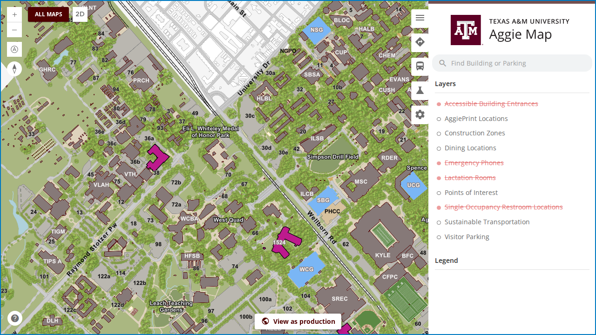 | 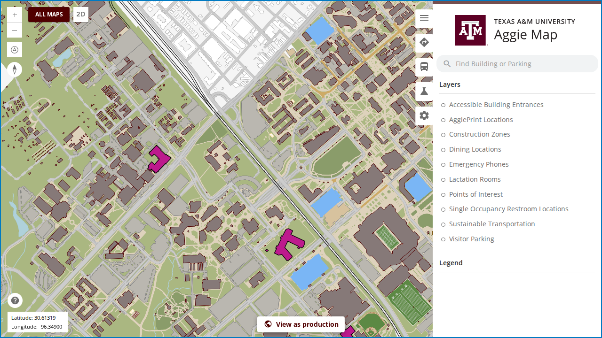 |
| 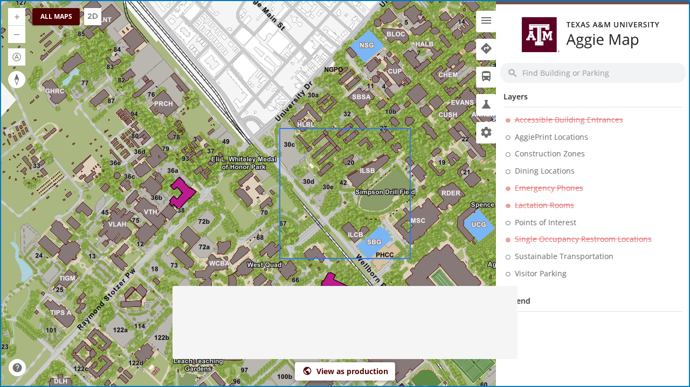 | 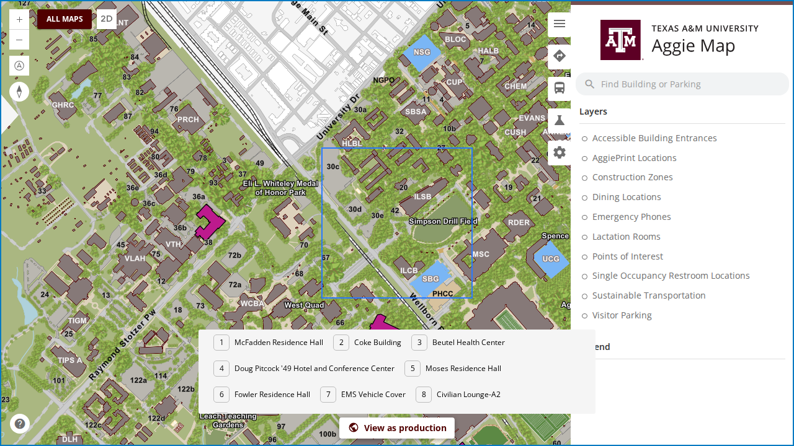 |

#### The trip planner is back on dev, for testing (dev only)

Since March ([#683](https://github.com/TamuGeoInnovation/Tamu.GeoInnovation.js.monorepo/issues/683)) the trip planner showed only "The Aggie Map routing services are currently
undergoing maintenance" on every host. On a development host it now shows the planner again - the from
and to boxes, the routing-service list, the travel modes and the directions panel on desktop, and the
from and to boxes and travel modes on a phone - so its components can be tested. **Production is
unchanged**: the Directions tab stays hidden there, and its address, `/map/d/trip`, still shows the
maintenance message; so does a development host with `?as=production`. Routing is published only on the
development GIS server (`Routing/20220119`, which answers a route request); the production server's
Routing folder is empty, so a local build, which uses the production server, shows the planner with an
empty routing list and cannot route. A smoke check opens `/map/d/trip` on each environment, both ways
([#1912](https://github.com/TamuGeoInnovation/Tamu.GeoInnovation.js.monorepo/issues/1912)).

| Before (dev) | After (local build, a development host) |
| --- | --- |
| 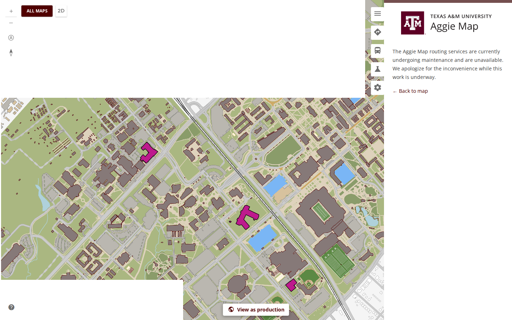 | 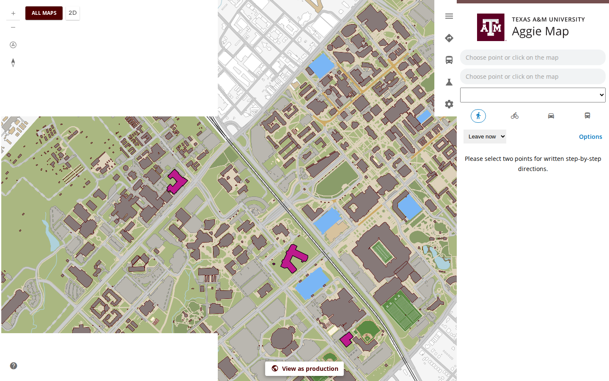 |
| 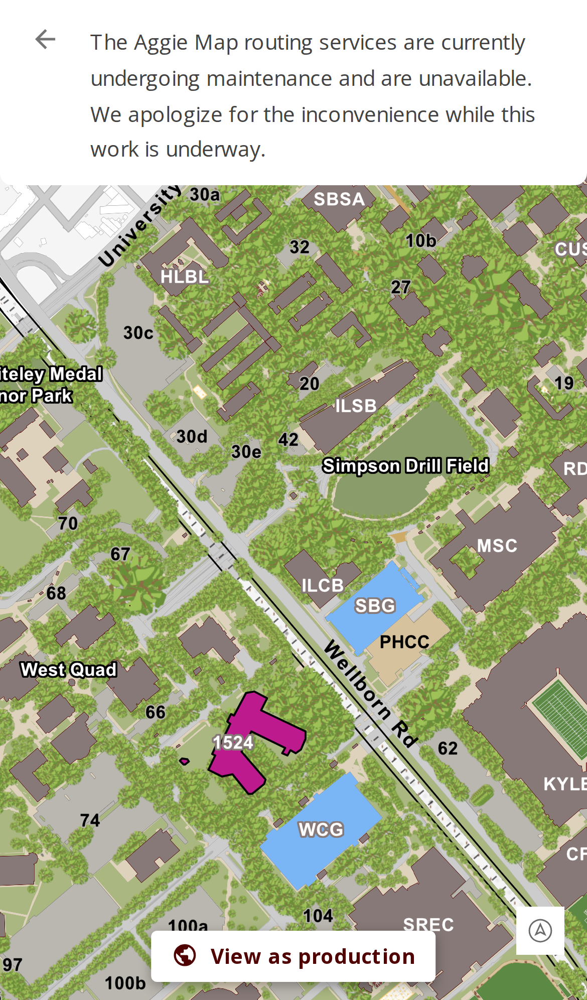 | 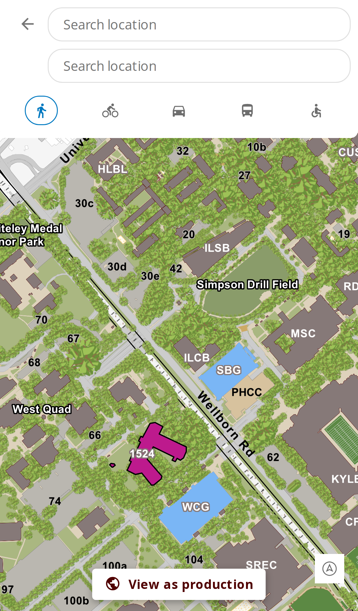 |

### Behind the scenes

None of this is meant to change what a visitor sees.

- **Every component AggieMap and UES Operations render is OnPush**, Angular 22's default, and is checked
  when something it shows changes rather than after every event anywhere
  ([#1455](https://github.com/TamuGeoInnovation/Tamu.GeoInnovation.js.monorepo/issues/1455)). In three
  steps: AggieMap's ten pages that are not the map
  ([#1670](https://github.com/TamuGeoInnovation/Tamu.GeoInnovation.js.monorepo/issues/1670)); 114
  components across the workspace whose fields were set in subscriptions, which are now signals
  ([#1671](https://github.com/TamuGeoInnovation/Tamu.GeoInnovation.js.monorepo/issues/1671)); and the map
  itself, 79 components with its sidebars, legend, layer list, popups, search and trip planner, and UES
  Operations ([#1673](https://github.com/TamuGeoInnovation/Tamu.GeoInnovation.js.monorepo/issues/1673)).
  What ArcGIS changes in place, such as a layer's visibility, now reaches a template through a new
  `arcgisSignal`. Only the modal host stays as it was.
- **No decorator input, output or query is left**: the last 71 inputs, 4 outputs and 10 queries are
  signals ([#1657](https://github.com/TamuGeoInnovation/Tamu.GeoInnovation.js.monorepo/issues/1657)).
- **Before the map lost its change detection, the smoke suite learned to check that the view follows an
  interaction**: a layer switched off and on, a second popup, a second search and a basemap choice
  ([#1672](https://github.com/TamuGeoInnovation/Tamu.GeoInnovation.js.monorepo/issues/1672)).
- **Two regressions the move to `@arcgis/core` exposed on dev, before they reached production**: a tent or
  zone link could make two selection layers, and so show no highlight, and every ArcGIS module request
  waited a second or more even when the module was loaded, which slowed every map
  ([#1850](https://github.com/TamuGeoInnovation/Tamu.GeoInnovation.js.monorepo/issues/1850)). The ArcGIS
  calls 4.32 and 4.34 deprecated are replaced, so the console loses their warnings
  ([#1852](https://github.com/TamuGeoInnovation/Tamu.GeoInnovation.js.monorepo/issues/1852)).
- **UES Operations is tested in CI and built with dev**, as AggieMap is; nothing compiled it before
  ([#1905](https://github.com/TamuGeoInnovation/Tamu.GeoInnovation.js.monorepo/issues/1905)).
- **Dead code deleted**: the unused layer configuration component and its library
  ([#1884](https://github.com/TamuGeoInnovation/Tamu.GeoInnovation.js.monorepo/issues/1884)), and
  AggieMap's unused building department list and the report-a-bad-route form's dead members
  ([#1878](https://github.com/TamuGeoInnovation/Tamu.GeoInnovation.js.monorepo/issues/1878)). That pull
  request also deleted Geoservices pages the maintainer had decided to keep; they are back, unchanged
  ([#1903](https://github.com/TamuGeoInnovation/Tamu.GeoInnovation.js.monorepo/issues/1903)).
- **The smoke suite**: a click in directions on the 2D main map must draw a stop
  ([#1883](https://github.com/TamuGeoInnovation/Tamu.GeoInnovation.js.monorepo/issues/1883)); the map's
  zoom, locate and compass buttons are found on ArcGIS 4.x or 5.x, so the suite can run against
  production before and after this release
  ([#1890](https://github.com/TamuGeoInnovation/Tamu.GeoInnovation.js.monorepo/issues/1890)); the three
  map tests that failed their first attempt in every tier run last, two at a time
  ([#1716](https://github.com/TamuGeoInnovation/Tamu.GeoInnovation.js.monorepo/issues/1716));
  `run-local.sh <environment> one` runs one spec or one test
  ([#1872](https://github.com/TamuGeoInnovation/Tamu.GeoInnovation.js.monorepo/issues/1872)), and `-x`
  stops a run at its first failure
  ([#1879](https://github.com/TamuGeoInnovation/Tamu.GeoInnovation.js.monorepo/issues/1879)).
- **Visual baselines can capture dev as production renders it**, with `--as production`, so dev can be
  compared with production's set without its development-only services showing as differences
  ([#1885](https://github.com/TamuGeoInnovation/Tamu.GeoInnovation.js.monorepo/issues/1885)).
- **AggieMap and UES Operations run without zone.js** ([#1932](https://github.com/TamuGeoInnovation/Tamu.GeoInnovation.js.monorepo/issues/1932), part of [#1478](https://github.com/TamuGeoInnovation/Tamu.GeoInnovation.js.monorepo/issues/1478)): Angular
  redraws a view when a signal it reads changes, not after every event and timer on the page. With every
  component OnPush first, nothing is meant to look different; the risk is a part of the page that stops
  updating, which the row in *What was tested* lists the places to check for.
- **Node.js 24** runs the builds, the checks and the Docker images, in place of 22 ([#1919](https://github.com/TamuGeoInnovation/Tamu.GeoInnovation.js.monorepo/issues/1919)).
- **AggieMap's unit tests run on Vitest** instead of Jest, 69 test targets with one shared configuration
  ([#1928](https://github.com/TamuGeoInnovation/Tamu.GeoInnovation.js.monorepo/issues/1928), the first part of [#1479](https://github.com/TamuGeoInnovation/Tamu.GeoInnovation.js.monorepo/issues/1479)), and the TypeScript 6.0 deprecations still in use
  are gone, ahead of TypeScript 7 ([#1922](https://github.com/TamuGeoInnovation/Tamu.GeoInnovation.js.monorepo/issues/1922)). These four went in as one pull request,
  [#1948](https://github.com/TamuGeoInnovation/Tamu.GeoInnovation.js.monorepo/pull/1948), in place of [#1945](https://github.com/TamuGeoInnovation/Tamu.GeoInnovation.js.monorepo/pull/1945), [#1946](https://github.com/TamuGeoInnovation/Tamu.GeoInnovation.js.monorepo/pull/1946) and [#1947](https://github.com/TamuGeoInnovation/Tamu.GeoInnovation.js.monorepo/pull/1947).
- **About 30 KB less JavaScript before a map draws**: interactjs, the click coordinates and the keyboard
  viewfinder are deferred ([#1934](https://github.com/TamuGeoInnovation/Tamu.GeoInnovation.js.monorepo/issues/1934)), and the date-time picker, which the trip planner's return
  on dev had put back into every first download, production's included, has its own entry again
  ([#1927](https://github.com/TamuGeoInnovation/Tamu.GeoInnovation.js.monorepo/issues/1927)).
- **Angular 22.1.8 to 22.2.3**, the latest 22.x, for its fixes ([#1923](https://github.com/TamuGeoInnovation/Tamu.GeoInnovation.js.monorepo/issues/1923)). The last untyped forms
  in AggieMap are typed ([#1917](https://github.com/TamuGeoInnovation/Tamu.GeoInnovation.js.monorepo/issues/1917)).
- **The experiments page's back arrow works** on dev, where that page is: it called a method the list did
  not have ([#1909](https://github.com/TamuGeoInnovation/Tamu.GeoInnovation.js.monorepo/issues/1909)).
- **Two unused libraries deleted**, the attribute table and the breadcrumbs, the last old-style templates
  ([#1915](https://github.com/TamuGeoInnovation/Tamu.GeoInnovation.js.monorepo/issues/1915)), and the library READMEs show `inject()` and standalone bootstrapping
  ([#1916](https://github.com/TamuGeoInnovation/Tamu.GeoInnovation.js.monorepo/issues/1916), [#1569](https://github.com/TamuGeoInnovation/Tamu.GeoInnovation.js.monorepo/issues/1569)).
- **How the home and work machines share the work** is written down in CLAUDE.md
  ([#1862](https://github.com/TamuGeoInnovation/Tamu.GeoInnovation.js.monorepo/issues/1862),
  [#1886](https://github.com/TamuGeoInnovation/Tamu.GeoInnovation.js.monorepo/issues/1886)).

---

## What was tested

The last column says what checked each change on dev. **TBD: who tested which rows by hand on dev, and
what they found.** The links point at production; a change marked dev only is not visible there, and
its link stays on dev.

| Change | Open this | Look for | Checked on dev |
| --- | --- | --- | --- |
| Maps load ArcGIS from `@arcgis/core` 4.27 ([#1844](https://github.com/TamuGeoInnovation/Tamu.GeoInnovation.js.monorepo/issues/1844)) | [The main map](https://aggiemap.tamu.edu/map/d), [Football Tailgating](https://aggiemap.tamu.edu/events/tailgating/map/d), [Aerial Imagery](https://aggiemap.tamu.edu/map/d?imagery=2020-10-06), 3D, directions | Nothing different: every map draws as before; the zoom, locate and compass buttons look as they did; popups, search, the basemap gallery, the imagery date slider, 3D and directions work. In the browser's network panel, nothing is requested from `js.arcgis.com/4.27/init.js` or `js.arcgis.com/4.23` | The suite loads every map, and checks the runtime served is the pinned one, now 5.1.27 (`esri-runtime.spec.ts`). By hand: TBD |
| Maps run ArcGIS 4.34 ([#1845](https://github.com/TamuGeoInnovation/Tamu.GeoInnovation.js.monorepo/issues/1845)) | [The main map](https://aggiemap.tamu.edu/map/d), [Football Tailgating](https://aggiemap.tamu.edu/events/tailgating/map/d), [Aerial Imagery](https://aggiemap.tamu.edu/map/d?imagery=2020-10-06), 3D, directions, the bus routes | Every map draws with its layers; the zoom buttons' plus and minus are thinner and the locate button shows a compass in a circle (Esri's new icons); the main map's compass still shows a needle on the campus basemap; popups, search, the layer list and legend, the basemap gallery, the imagery date slider, 3D, directions and the live buses work. In the network panel, every `js.arcgis.com` request is under `/4.34/` | The suite loads every map, and finds the zoom, locate and compass buttons (`basemap-zoom.spec.ts`). By hand: TBD |
| Map buttons on Esri's components ([#1853](https://github.com/TamuGeoInnovation/Tamu.GeoInnovation.js.monorepo/issues/1853)) | [The main map](https://aggiemap.tamu.edu/map/d), [Football Tailgating](https://aggiemap.tamu.edu/events/tailgating/map/d), [the main map on a phone](https://aggiemap.tamu.edu/map/m), 3D | Zoom, locate and compass in the top left on desktop, the locate button alone at the bottom right on a phone. Turn the map (right-drag): the needle turns; press the compass, or Tab to it and press Enter, and the map points north. Locate follows you and turns the map without jumping to you. Switch to 3D and back: all three buttons are still there. Focus rings are maroon. No "deprecated" warning about Track in the console | The suite finds the zoom, locate and compass buttons on every map it zooms (`basemap-zoom.spec.ts`) and in 3D (`perspective.spec.ts`). By hand: TBD |
| Maps run ArcGIS 5.0 ([#1859](https://github.com/TamuGeoInnovation/Tamu.GeoInnovation.js.monorepo/issues/1859)) | [The main map](https://aggiemap.tamu.edu/map/d), [Football Tailgating](https://aggiemap.tamu.edu/events/tailgating/map/d), [Gameday Parking](https://aggiemap.tamu.edu/events/gameday-parking/map/d), [the main map on a phone](https://aggiemap.tamu.edu/map/m) | Every map draws the same layers as before, with the same zoom, locate and compass buttons, legend, layer list and basemap panels; no "Powered by Esri" bar across the bottom of the map; the basemap panel's spinner stops once the map has drawn. In the network panel, every `js.arcgis.com` request is under `/5.0.19/` | The suite loads every map on the pinned runtime (`esri-runtime.spec.ts`). By hand: TBD |
| Maps run ArcGIS 5.1 ([#1867](https://github.com/TamuGeoInnovation/Tamu.GeoInnovation.js.monorepo/issues/1867)) | [The main map](https://aggiemap.tamu.edu/map/d), [Football Tailgating](https://aggiemap.tamu.edu/events/tailgating/map/d), [Campus Main Parking](https://aggiemap.tamu.edu/parking/ts-main-parking) | Every map draws as before. Zoom in past 1:1,200 on the main map: the parking spaces draw, and the spinner beside RNS Spaces in the layer list stops within about a minute and a half. In the network panel, every `js.arcgis.com` request is under `/5.1.27/` | The suite loads every map on 5.1.27 (`esri-runtime.spec.ts`); a unit test fails if RNS Spaces goes back to 1:100,000 (`layer-scale.spec.ts`). By hand: TBD |
| The main map's legend lists layers switched on ([#1857](https://github.com/TamuGeoInnovation/Tamu.GeoInnovation.js.monorepo/issues/1857)) | [/map/d](https://aggiemap.tamu.edu/map/d) | Once the map has finished loading, switch Visitor Parking and Construction Zones on in the Layers list: each appears under Legend with its symbols within a few seconds | By the suite: a layer that loads hidden is listed once it is switched on (`legend.spec.ts`). By hand: TBD |
| Layers list alphabetical again ([#1939](https://github.com/TamuGeoInnovation/Tamu.GeoInnovation.js.monorepo/issues/1939)) | [Campus Main Parking](https://aggiemap.tamu.edu/parking/ts-main-parking), [Service and Loading Zone Parking](https://aggiemap.tamu.edu/parking/service-loading) | Reload each a few times: the Layers list always reads Campus Stops, Construction, Parking Lots, RNS Spaces, Route Stop/Start Points, Visitor Kiosks, and Service Parking Lots, Service Parking Spaces. Other maps' lists are alphabetical too, except Fish Camp, Tailgating and Football, which keep their own order | No smoke check of the order. By hand: TBD |
| The main map's legend drops a layer switched off ([#1871](https://github.com/TamuGeoInnovation/Tamu.GeoInnovation.js.monorepo/issues/1871)) | [/map/d](https://aggiemap.tamu.edu/map/d) | Once the map has finished loading, switch Visitor Parking on in the Layers list, then off: it leaves the Legend; switched on again, it comes back. On [/parking/visitor-parking](https://aggiemap.tamu.edu/parking/visitor-parking), Visitor Kiosks switched off still shows its collapsed title in the legend, and clicking it switches the layer back on | By the suite (`legend.spec.ts`). By hand: TBD |
| Map search with an apostrophe or a percent sign ([#1790](https://github.com/TamuGeoInnovation/Tamu.GeoInnovation.js.monorepo/issues/1790)) | [dev.aggiemap.tamu.edu](https://aggiemap.tamu.edu), then [Football Tailgating](https://aggiemap.tamu.edu/events/tailgating/map/d) | Search `Cain '51`: James J. Cain '51 Building is listed. Search `O'` or `Aggie's`: no error, results or "No results found". On Football Tailgating, search `%`: "No results found", not every tent. Ordinary searches still work: `MSC`, `O12`, `Creamery` | No smoke check; unit tests in `common-utils-database`. By hand: TBD |
| All Maps: choosing a search result opens the map ([#1868](https://github.com/TamuGeoInnovation/Tamu.GeoInnovation.js.monorepo/issues/1868)) | [All Maps](https://aggiemap.tamu.edu/all-maps) | Type `Campus Main Parking` in Search Maps and click the result: Campus Main Parking opens. Arrow down and Enter does the same | By the suite: a result chosen with the mouse, and with the keyboard, opens its map (`all-maps-search.spec.ts`). By hand: TBD |
| Campus maps load only their own campus ([#1910](https://github.com/TamuGeoInnovation/Tamu.GeoInnovation.js.monorepo/issues/1910)) | [DC / Bush School](https://aggiemap.tamu.edu/campus/dc-bush-school), [Galveston](https://aggiemap.tamu.edu/campus/galveston), [McAllen](https://aggiemap.tamu.edu/campus/mcallen) | Each map draws its campus within a few seconds, as before but faster on DC; the browser console shows no "Failed to load layer" errors for Bike Racks, Lactation Rooms and the like; clicking a building still opens its popup and search still finds it | By the suite: each campus map loads none of College Station's layers (`campus-layers.spec.ts`). By hand: TBD |
| Tailgating tent and zone links finish drawing ([#1926](https://github.com/TamuGeoInnovation/Tamu.GeoInnovation.js.monorepo/issues/1926)) | [Tent L1](https://aggiemap.tamu.edu/events/tailgating/map/d?tent=L1), [Zone AP-7](https://aggiemap.tamu.edu/events/tailgating/map/d?zone=AP-7) | The tent or zone opens highlighted and named in the side panel, as before. The difference is not on screen: the map finishes drawing within a minute (`window.__tamuGiscMapProbe.drawing` in the console turns `false`), where before the fix it stayed `true`. Nothing else on the map changes: the RNS Spaces layer that is now off drew nothing | By the suite: a tent and an area link, several loads each, finish drawing with the highlight above every layer (`selection.spec.ts`). By hand: TBD |
| Accessible and motorcycle parking load only their own spaces ([#1897](https://github.com/TamuGeoInnovation/Tamu.GeoInnovation.js.monorepo/issues/1897)) | [Accessible Parking](https://aggiemap.tamu.edu/parking/accessible-parking), [Motorcycle Parking](https://aggiemap.tamu.edu/parking/motorcycle-parking) | The same blue accessible and pink motorcycle symbols in the same places as before, drawn within about half a minute rather than minutes. On Motorcycle Parking, clicking a space still opens its popup. In the network panel, the layer's queries carry `spc_type IN ('H/C', 'Visitor H/C')` or `Spc_Type = 'M/C'` | By the suite: neither map holds a space its symbology does not draw (`parking-spaces.spec.ts`). By hand: TBD |
| Football Tailgating game-day notice ([#1817](https://github.com/TamuGeoInnovation/Tamu.GeoInnovation.js.monorepo/issues/1817)) | [The main map](https://aggiemap.tamu.edu/map/d) in a private window, in the week before a home game | Two notices, **Football Transportation Map Available** then **Football Tailgating Map Available**; clicking the second opens the Tailgating map | No smoke check; the notice shows only in the week before a home game. By hand: TBD |
| AggieMap runs without zone.js ([#1478](https://github.com/TamuGeoInnovation/Tamu.GeoInnovation.js.monorepo/issues/1478)). Nothing should look different; what could go wrong is a part of the page that stops updating | [/map/d](https://aggiemap.tamu.edu/map/d), [/map/d/settings](https://aggiemap.tamu.edu/map/d/settings), [Visitor Parking](https://aggiemap.tamu.edu/parking/visitor-parking), [Gameday Parking](https://aggiemap.tamu.edu/events/gameday-parking/map/d?transport-type=micromobility&direction=entry), [Muster](https://aggiemap.tamu.edu/events/muster), [/code-maroon?sample=tornado](https://aggiemap.tamu.edu/code-maroon?sample=tornado), [Building Directory](https://aggiemap.tamu.edu/directory), and /map on a phone | Each follows at once, without a second click or a mouse move: a layer switched in the Layers list (its dot, the map and the Legend); a search result chosen (its popup opens and closes); the sidebar tab sliding the panel away and back; the basemap gallery marking the basemap chosen; Aerial Imagery's date slider; 2D to 3D and back (the label follows); a Legend title switching its layer off and the Layers row back on; the share button's "URL Copied" toast, whose bar runs down and which closes itself; Muster's "This event has passed" box and its close; the Code Maroon sample and Dismiss; the directory filtering as you type, sorting by Name and filling in rows as you scroll. On a phone: the search box's back arrow, the menu's Layers, Legend and Basemap, and a building's popup | By the suite: the checks that the view follows an interaction ([#1672](https://github.com/TamuGeoInnovation/Tamu.GeoInnovation.js.monorepo/issues/1672)). By hand: TBD |
| Main map in 2D: click coordinates and the viewfinder ([#1875](https://github.com/TamuGeoInnovation/Tamu.GeoInnovation.js.monorepo/issues/1875)) | [/map/d](https://dev.aggiemap.tamu.edu/map/d) | In 2D, click the map: its latitude and longitude (about 30.61, -96.34) show bottom left, and the browser console has no `toFixed` error. Then press an arrow key: the box in the middle of the map lists the buildings under it, numbered | By the suite: a click shows its latitude and longitude, the arrow keys list buildings, and a click in directions sets a stop (`map-coordinates.spec.ts`). By hand: TBD |
| Trip planner back on dev only ([#1912](https://github.com/TamuGeoInnovation/Tamu.GeoInnovation.js.monorepo/issues/1912)) | [Directions](https://dev.aggiemap.tamu.edu/map/d/trip), [on a phone](https://dev.aggiemap.tamu.edu/map/m/trip), [with ?as=production](https://dev.aggiemap.tamu.edu/map/d/trip?as=production) | Dev only: on dev the planner shows two empty from and to boxes, travel modes and "Please select two points"; choose two buildings: a route should be drawn from the development GIS server's routing (not yet tried through the app; if it fails, say so on the issue). With `?as=production`, and on production at [/map/d/trip](https://aggiemap.tamu.edu/map/d/trip), the maintenance message instead, and no Directions tab | By the suite: `/map/d/trip` on each environment, both ways (`directions.spec.ts`). By hand: TBD |
| Maps hosted by Esri's map components ([#1949](https://github.com/TamuGeoInnovation/Tamu.GeoInnovation.js.monorepo/issues/1949)). Nothing should look different | [/map/d](https://aggiemap.tamu.edu/map/d), [Gameday Parking](https://aggiemap.tamu.edu/events/gameday-parking/map/d?transport-type=micromobility&direction=entry), and /map on a phone; UES Operations' map wherever it is deployed | The zoom, locate and compass buttons at the top left, each working; 2D to 3D and back twice: in 3D zoom, pan/rotate and a compass, back in 2D the three buttons again and the map where it was; the Aerial Imagery date slider centred along the bottom on that basemap; a building popup; the Layers list and Legend. On a phone, locate at the bottom right. No attribution line along the bottom | By the suite: the map buttons are found in 2D and 3D on the new hosts (`controls.ts`, `perspective.spec.ts`); unit tests in `maps-esri`. The screenshot comparison of every map found no shot above 10%. By hand: TBD |
| Lactation Rooms from the new hosted service ([#1960](https://github.com/TamuGeoInnovation/Tamu.GeoInnovation.js.monorepo/issues/1960)) | [The main map](https://aggiemap.tamu.edu) | Switch on Lactation Rooms in the Layers list: 35 rooms (21 before). Click one, for example Liberal Arts and Humanities: the popup shows the building name, "Building 0275", Availability and Hours, Access, Amenities and Notes, with the notes' email and links as text and working links, no "Additional Information" link, and no row left empty | By the suite: the service has every field the popup shows, and holds the campus rooms, each with a building name (`lactation-rooms.spec.ts`); unit tests of the popup and definition. By hand: TBD |
| A `?lot=` link opens the lot on fourteen parking maps ([#1952](https://github.com/TamuGeoInnovation/Tamu.GeoInnovation.js.monorepo/issues/1952)) | [Visitor Parking, lot 100j](https://aggiemap.tamu.edu/parking/visitor-parking/map?lot=100j), [Motorcycle Parking, lot 100j](https://aggiemap.tamu.edu/parking/motorcycle-parking/map?lot=100j) | The popup is the map's own lot, not the main map's: its share link reads `/parking/visitor-parking/...`, not `aggiemap.tamu.edu/?lot=...`. Before the fix the first opened the main map's Lot 100j. The second map already worked and must still. Also check a `?feature=` link copied from a popup still opens the same feature | By the suite: a `?lot=` link on each of the fourteen maps, and a `?feature=` link shared before (`lot-links.spec.ts`); unit tests in `ts-events-ngx`. By hand: TBD |
| A lot link selects only what the map draws ([#1954](https://github.com/TamuGeoInnovation/Tamu.GeoInnovation.js.monorepo/issues/1954)) | [Motorcycle Parking, lot 100j](https://aggiemap.tamu.edu/parking/motorcycle-parking/map?lot=100j) | The selected space is one the map actually draws - a pink `M/C` space with the marker on it - not a marker in open ground. Its share link should name `motorcycle-parking-space:32270`, not `:26692`. Check a `?feature=` link copied from a popup still opens the same feature | By the suite: a lot link on Motorcycle Parking selects a space the map draws (`parking-spaces.spec.ts`); unit tests in `ts-events-ngx`. By hand: TBD |
| A map still opens where it should when a feature link cannot be looked up ([#1953](https://github.com/TamuGeoInnovation/Tamu.GeoInnovation.js.monorepo/issues/1953)) | Not checkable by hand: the difference shows only while a service is erring | When a lookup fails, the map still opens on the view its builder choices ask for, and flashes the feature | Unit tests in `ts-events-ngx` (`event.service.spec.ts`); no smoke check, since an outage cannot be staged. By hand: not applicable |

---

## What went into this release

Every pull request this release carried, and the issue behind each one.

| Change | Pull request | Issue |
| --- | --- | --- |
| Load the ArcGIS SDK from `@arcgis/core` 4.27 instead of esri-loader | [#1846](https://github.com/TamuGeoInnovation/Tamu.GeoInnovation.js.monorepo/pull/1846) | [#1844](https://github.com/TamuGeoInnovation/Tamu.GeoInnovation.js.monorepo/issues/1844) |
| Step `@arcgis/core` from 4.27 to 4.34, one release per commit | [#1847](https://github.com/TamuGeoInnovation/Tamu.GeoInnovation.js.monorepo/pull/1847) | [#1845](https://github.com/TamuGeoInnovation/Tamu.GeoInnovation.js.monorepo/issues/1845) |
| Make one selection layer, and answer a loaded ArcGIS module at once | [#1851](https://github.com/TamuGeoInnovation/Tamu.GeoInnovation.js.monorepo/pull/1851) | [#1850](https://github.com/TamuGeoInnovation/Tamu.GeoInnovation.js.monorepo/issues/1850) |
| Replace the ArcGIS calls 4.34 flags as deprecated | [#1854](https://github.com/TamuGeoInnovation/Tamu.GeoInnovation.js.monorepo/pull/1854) | [#1852](https://github.com/TamuGeoInnovation/Tamu.GeoInnovation.js.monorepo/issues/1852) |
| Use Esri's zoom and locate components, and our own compass | [#1858](https://github.com/TamuGeoInnovation/Tamu.GeoInnovation.js.monorepo/pull/1858) | [#1853](https://github.com/TamuGeoInnovation/Tamu.GeoInnovation.js.monorepo/issues/1853) |
| Step ArcGIS from 4.34 to 5.0.19 | [#1861](https://github.com/TamuGeoInnovation/Tamu.GeoInnovation.js.monorepo/pull/1861) | [#1859](https://github.com/TamuGeoInnovation/Tamu.GeoInnovation.js.monorepo/issues/1859) |
| Step ArcGIS to 5.1, with RNS Spaces at its service's own scale | [#1894](https://github.com/TamuGeoInnovation/Tamu.GeoInnovation.js.monorepo/pull/1894) | [#1867](https://github.com/TamuGeoInnovation/Tamu.GeoInnovation.js.monorepo/issues/1867) |
| List a layer that loaded hidden once it is switched on | [#1870](https://github.com/TamuGeoInnovation/Tamu.GeoInnovation.js.monorepo/pull/1870) | [#1857](https://github.com/TamuGeoInnovation/Tamu.GeoInnovation.js.monorepo/issues/1857) |
| Escape what is typed into map search, so an apostrophe or a percent sign works | [#1820](https://github.com/TamuGeoInnovation/Tamu.GeoInnovation.js.monorepo/pull/1820) | [#1790](https://github.com/TamuGeoInnovation/Tamu.GeoInnovation.js.monorepo/issues/1790) |
| Choose an autocomplete option pressed with the mouse, so All Maps opens the map | [#1869](https://github.com/TamuGeoInnovation/Tamu.GeoInnovation.js.monorepo/pull/1869) | [#1868](https://github.com/TamuGeoInnovation/Tamu.GeoInnovation.js.monorepo/issues/1868) |
| Load only a satellite campus map's own layers, not College Station's | [#1911](https://github.com/TamuGeoInnovation/Tamu.GeoInnovation.js.monorepo/pull/1911) | [#1910](https://github.com/TamuGeoInnovation/Tamu.GeoInnovation.js.monorepo/issues/1910) |
| Give Football Tailgating a game-day notice, second after Football's | [#1827](https://github.com/TamuGeoInnovation/Tamu.GeoInnovation.js.monorepo/pull/1827) | [#1817](https://github.com/TamuGeoInnovation/Tamu.GeoInnovation.js.monorepo/issues/1817) |
| Project a 2D click to latitude and longitude, and query the viewfinder in the map's reference | [#1882](https://github.com/TamuGeoInnovation/Tamu.GeoInnovation.js.monorepo/pull/1882) | [#1875](https://github.com/TamuGeoInnovation/Tamu.GeoInnovation.js.monorepo/issues/1875) |
| Remove ChangeDetectionStrategy.Eager from AggieMap's ten page components | [#1864](https://github.com/TamuGeoInnovation/Tamu.GeoInnovation.js.monorepo/pull/1864) | [#1670](https://github.com/TamuGeoInnovation/Tamu.GeoInnovation.js.monorepo/issues/1670) |
| Make fields set in subscriptions signals, and remove Eager outside the map | [#1874](https://github.com/TamuGeoInnovation/Tamu.GeoInnovation.js.monorepo/pull/1874) | [#1671](https://github.com/TamuGeoInnovation/Tamu.GeoInnovation.js.monorepo/issues/1671) |
| OnPush on the map: sidebars, legend, layer list, popups, search, trip planner and UES | [#1908](https://github.com/TamuGeoInnovation/Tamu.GeoInnovation.js.monorepo/pull/1908) | [#1673](https://github.com/TamuGeoInnovation/Tamu.GeoInnovation.js.monorepo/issues/1673) |
| Convert the last decorator inputs, outputs and queries to signals | [#1865](https://github.com/TamuGeoInnovation/Tamu.GeoInnovation.js.monorepo/pull/1865) | [#1657](https://github.com/TamuGeoInnovation/Tamu.GeoInnovation.js.monorepo/issues/1657) |
| Check the view follows a layer toggle, a second popup, a second search and a basemap choice | [#1866](https://github.com/TamuGeoInnovation/Tamu.GeoInnovation.js.monorepo/pull/1866) | [#1672](https://github.com/TamuGeoInnovation/Tamu.GeoInnovation.js.monorepo/issues/1672) |
| Check a click in directions on the main map in 2D draws a stop | [#1893](https://github.com/TamuGeoInnovation/Tamu.GeoInnovation.js.monorepo/pull/1893) | [#1883](https://github.com/TamuGeoInnovation/Tamu.GeoInnovation.js.monorepo/issues/1883) |
| Find the map's zoom, locate and compass buttons on ArcGIS 4.x or 5.x | [#1900](https://github.com/TamuGeoInnovation/Tamu.GeoInnovation.js.monorepo/pull/1900) | [#1890](https://github.com/TamuGeoInnovation/Tamu.GeoInnovation.js.monorepo/issues/1890) |
| Run the three contended map tests last, two at a time | [#1901](https://github.com/TamuGeoInnovation/Tamu.GeoInnovation.js.monorepo/pull/1901) | [#1716](https://github.com/TamuGeoInnovation/Tamu.GeoInnovation.js.monorepo/issues/1716) |
| Run one spec or one test with `run-local.sh <environment> one` | [#1873](https://github.com/TamuGeoInnovation/Tamu.GeoInnovation.js.monorepo/pull/1873) | [#1872](https://github.com/TamuGeoInnovation/Tamu.GeoInnovation.js.monorepo/issues/1872) |
| Document `-x`, which stops a smoke run at its first failure | [#1880](https://github.com/TamuGeoInnovation/Tamu.GeoInnovation.js.monorepo/pull/1880) | [#1879](https://github.com/TamuGeoInnovation/Tamu.GeoInnovation.js.monorepo/issues/1879) |
| Capture a development host as production renders it, with `--as production` | [#1887](https://github.com/TamuGeoInnovation/Tamu.GeoInnovation.js.monorepo/pull/1887) | [#1885](https://github.com/TamuGeoInnovation/Tamu.GeoInnovation.js.monorepo/issues/1885) |
| Check UES Operations in CI and build its app with dev | [#1907](https://github.com/TamuGeoInnovation/Tamu.GeoInnovation.js.monorepo/pull/1907) | [#1905](https://github.com/TamuGeoInnovation/Tamu.GeoInnovation.js.monorepo/issues/1905) |
| Delete the unused LayerConfigurationComponent and its library | [#1891](https://github.com/TamuGeoInnovation/Tamu.GeoInnovation.js.monorepo/pull/1891) | [#1884](https://github.com/TamuGeoInnovation/Tamu.GeoInnovation.js.monorepo/issues/1884) |
| Delete dead code found during [#1671](https://github.com/TamuGeoInnovation/Tamu.GeoInnovation.js.monorepo/issues/1671): AggieMap's building department list and the bad-route form's dead members, and load the GIS Day check-in detail | [#1892](https://github.com/TamuGeoInnovation/Tamu.GeoInnovation.js.monorepo/pull/1892) | [#1878](https://github.com/TamuGeoInnovation/Tamu.GeoInnovation.js.monorepo/issues/1878) |
| Put back the Geoservices response viewer and the unrouted partner page and form | [#1904](https://github.com/TamuGeoInnovation/Tamu.GeoInnovation.js.monorepo/pull/1904) | [#1903](https://github.com/TamuGeoInnovation/Tamu.GeoInnovation.js.monorepo/issues/1903) |
| Document the work-mailbox branch for handing tests to the work machine | [#1863](https://github.com/TamuGeoInnovation/Tamu.GeoInnovation.js.monorepo/pull/1863) | [#1862](https://github.com/TamuGeoInnovation/Tamu.GeoInnovation.js.monorepo/issues/1862) |
| Say how the home and work machines coordinate | [#1888](https://github.com/TamuGeoInnovation/Tamu.GeoInnovation.js.monorepo/pull/1888) | [#1886](https://github.com/TamuGeoInnovation/Tamu.GeoInnovation.js.monorepo/issues/1886) |
| Give the experiments list the backAction its back arrow calls | [#1913](https://github.com/TamuGeoInnovation/Tamu.GeoInnovation.js.monorepo/pull/1913) | [#1909](https://github.com/TamuGeoInnovation/Tamu.GeoInnovation.js.monorepo/issues/1909) |
| Load only the parking spaces accessible and motorcycle parking draw | [#1914](https://github.com/TamuGeoInnovation/Tamu.GeoInnovation.js.monorepo/pull/1914) | [#1897](https://github.com/TamuGeoInnovation/Tamu.GeoInnovation.js.monorepo/issues/1897) |
| Take a switched-off layer out of a legend that cannot switch it back on | [#1921](https://github.com/TamuGeoInnovation/Tamu.GeoInnovation.js.monorepo/pull/1921) | [#1871](https://github.com/TamuGeoInnovation/Tamu.GeoInnovation.js.monorepo/issues/1871) |
| Bring the trip planner back on development hosts, still hidden on production | [#1924](https://github.com/TamuGeoInnovation/Tamu.GeoInnovation.js.monorepo/pull/1924) | [#1912](https://github.com/TamuGeoInnovation/Tamu.GeoInnovation.js.monorepo/issues/1912) |
| Update Angular 22.1.8 to 22.2.3 | [#1925](https://github.com/TamuGeoInnovation/Tamu.GeoInnovation.js.monorepo/pull/1925) | [#1923](https://github.com/TamuGeoInnovation/Tamu.GeoInnovation.js.monorepo/issues/1923) |
| Start the main map's RNS Spaces switched off, so zoomed-in links finish drawing on ArcGIS 5.1 | [#1930](https://github.com/TamuGeoInnovation/Tamu.GeoInnovation.js.monorepo/pull/1930) | [#1926](https://github.com/TamuGeoInnovation/Tamu.GeoInnovation.js.monorepo/issues/1926) |
| Give the date-time picker its own entry, so it leaves AggieMap's first download | [#1931](https://github.com/TamuGeoInnovation/Tamu.GeoInnovation.js.monorepo/pull/1931) | [#1927](https://github.com/TamuGeoInnovation/Tamu.GeoInnovation.js.monorepo/issues/1927) |
| Sort the Layers panel again when a layer's title arrives | [#1944](https://github.com/TamuGeoInnovation/Tamu.GeoInnovation.js.monorepo/pull/1944) | [#1939](https://github.com/TamuGeoInnovation/Tamu.GeoInnovation.js.monorepo/issues/1939) |
| Defer interactjs, click coordinates and the keyboard viewfinder | [#1940](https://github.com/TamuGeoInnovation/Tamu.GeoInnovation.js.monorepo/pull/1940) | [#1934](https://github.com/TamuGeoInnovation/Tamu.GeoInnovation.js.monorepo/issues/1934) |
| Type the directory, basemap override and select list forms | [#1943](https://github.com/TamuGeoInnovation/Tamu.GeoInnovation.js.monorepo/pull/1943) | [#1917](https://github.com/TamuGeoInnovation/Tamu.GeoInnovation.js.monorepo/issues/1917) |
| Delete the unused attribute table and breadcrumb libraries, the last old-style templates | [#1941](https://github.com/TamuGeoInnovation/Tamu.GeoInnovation.js.monorepo/pull/1941) | [#1915](https://github.com/TamuGeoInnovation/Tamu.GeoInnovation.js.monorepo/issues/1915) |
| Show inject() and standalone bootstrapping in the library READMEs | [#1942](https://github.com/TamuGeoInnovation/Tamu.GeoInnovation.js.monorepo/pull/1942) | [#1569](https://github.com/TamuGeoInnovation/Tamu.GeoInnovation.js.monorepo/issues/1569), [#1916](https://github.com/TamuGeoInnovation/Tamu.GeoInnovation.js.monorepo/issues/1916) |
| Vitest, zoneless AggieMap and UES, Node 24 and the TypeScript 6.0 deprecations, together | [#1948](https://github.com/TamuGeoInnovation/Tamu.GeoInnovation.js.monorepo/pull/1948) | [#1919](https://github.com/TamuGeoInnovation/Tamu.GeoInnovation.js.monorepo/issues/1919), [#1922](https://github.com/TamuGeoInnovation/Tamu.GeoInnovation.js.monorepo/issues/1922), [#1928](https://github.com/TamuGeoInnovation/Tamu.GeoInnovation.js.monorepo/issues/1928), [#1932](https://github.com/TamuGeoInnovation/Tamu.GeoInnovation.js.monorepo/issues/1932) |
| Host the maps in Esri's `<arcgis-map>` and `<arcgis-scene>`, in place of `view.ui` | [#1950](https://github.com/TamuGeoInnovation/Tamu.GeoInnovation.js.monorepo/pull/1950) | [#1949](https://github.com/TamuGeoInnovation/Tamu.GeoInnovation.js.monorepo/issues/1949) |
| Draw lactation rooms from the new hosted service, and show what it adds | [#1966](https://github.com/TamuGeoInnovation/Tamu.GeoInnovation.js.monorepo/pull/1966) | [#1960](https://github.com/TamuGeoInnovation/Tamu.GeoInnovation.js.monorepo/issues/1960) |
| Make a lot deep link resolve where the service's fields are table-qualified | [#1958](https://github.com/TamuGeoInnovation/Tamu.GeoInnovation.js.monorepo/pull/1958) | [#1952](https://github.com/TamuGeoInnovation/Tamu.GeoInnovation.js.monorepo/issues/1952) |
| Keep the chosen view and the focus flash when a feature lookup fails | [#1959](https://github.com/TamuGeoInnovation/Tamu.GeoInnovation.js.monorepo/pull/1959) | [#1953](https://github.com/TamuGeoInnovation/Tamu.GeoInnovation.js.monorepo/issues/1953) |
| A deep link selects only a feature the map draws | [#1967](https://github.com/TamuGeoInnovation/Tamu.GeoInnovation.js.monorepo/pull/1967) | [#1954](https://github.com/TamuGeoInnovation/Tamu.GeoInnovation.js.monorepo/issues/1954) |
| Cut the 16 October release notes | [#1819](https://github.com/TamuGeoInnovation/Tamu.GeoInnovation.js.monorepo/pull/1819) | [#1818](https://github.com/TamuGeoInnovation/Tamu.GeoInnovation.js.monorepo/issues/1818) |
| Cut these notes | this pull request | [#1935](https://github.com/TamuGeoInnovation/Tamu.GeoInnovation.js.monorepo/issues/1935) |

Filed while this release was tested, not part of it:

| Found | Issue |
| --- | --- |
| Transportation Services' AnyValidPermitParking service fails about half its queries | [#1951](https://github.com/TamuGeoInnovation/Tamu.GeoInnovation.js.monorepo/issues/1951) |
| Publish `Lactation_Spaces_view` on the development GIS server, so the lactation layer resolves per environment | [#1963](https://github.com/TamuGeoInnovation/Tamu.GeoInnovation.js.monorepo/issues/1963) |
| The Family Friendly Restroom popup's Building Number is always empty | [#1961](https://github.com/TamuGeoInnovation/Tamu.GeoInnovation.js.monorepo/issues/1961) |
| A lot link on a parking map can open the main map's lot on its first attempt, a race in `lot-links.spec.ts` | [#1969](https://github.com/TamuGeoInnovation/Tamu.GeoInnovation.js.monorepo/issues/1969) |

Closed without merging, superseded by [#1948](https://github.com/TamuGeoInnovation/Tamu.GeoInnovation.js.monorepo/pull/1948), which carries their work; listed so their issues are not
read as shipped by them:

| Change | Pull request | Issue |
| --- | --- | --- |
| Remove the TypeScript 6.0 deprecations we still use, ahead of TypeScript 7 | [#1945](https://github.com/TamuGeoInnovation/Tamu.GeoInnovation.js.monorepo/pull/1945), closed | [#1922](https://github.com/TamuGeoInnovation/Tamu.GeoInnovation.js.monorepo/issues/1922) |
| Run AggieMap and UES Operations zoneless, without zone.js | [#1946](https://github.com/TamuGeoInnovation/Tamu.GeoInnovation.js.monorepo/pull/1946), closed | [#1932](https://github.com/TamuGeoInnovation/Tamu.GeoInnovation.js.monorepo/issues/1932) |
| Move Node.js from 22 to 24.22.0 in Docker, CI and the pipeline | [#1947](https://github.com/TamuGeoInnovation/Tamu.GeoInnovation.js.monorepo/pull/1947), closed | [#1919](https://github.com/TamuGeoInnovation/Tamu.GeoInnovation.js.monorepo/issues/1919) |

### Also in the build, for GIS Day's next deploy

These merged in the same period and are in this build, but the GIS Day site and API deploy separately,
so nothing here is on the public GIS Day site yet. Their entries and their rows to test stay in
[`unreleased.md`](unreleased.md) until GIS Day is deployed ([#1611](https://github.com/TamuGeoInnovation/Tamu.GeoInnovation.js.monorepo/issues/1611)).

| Change | Pull request | Issue |
| --- | --- | --- |
| Show participants their own submissions on My VGI Submissions | [#1822](https://github.com/TamuGeoInnovation/Tamu.GeoInnovation.js.monorepo/pull/1822) | [#1791](https://github.com/TamuGeoInnovation/Tamu.GeoInnovation.js.monorepo/issues/1791) |
| Put the sponsorship levels back to last year's prices | [#1823](https://github.com/TamuGeoInnovation/Tamu.GeoInnovation.js.monorepo/pull/1823) | [#1821](https://github.com/TamuGeoInnovation/Tamu.GeoInnovation.js.monorepo/issues/1821) |
| Let an organization be left out of the Sessions page's filter | [#1826](https://github.com/TamuGeoInnovation/Tamu.GeoInnovation.js.monorepo/pull/1826) | [#1825](https://github.com/TamuGeoInnovation/Tamu.GeoInnovation.js.monorepo/issues/1825) |
| Tell sponsors how to pay, instead of linking to the giving site | [#1830](https://github.com/TamuGeoInnovation/Tamu.GeoInnovation.js.monorepo/pull/1830) | [#1715](https://github.com/TamuGeoInnovation/Tamu.GeoInnovation.js.monorepo/issues/1715), [#1829](https://github.com/TamuGeoInnovation/Tamu.GeoInnovation.js.monorepo/issues/1829) |
| Make an outlined button the same height as a filled one | [#1832](https://github.com/TamuGeoInnovation/Tamu.GeoInnovation.js.monorepo/pull/1832) | [#1831](https://github.com/TamuGeoInnovation/Tamu.GeoInnovation.js.monorepo/issues/1831) |
| Make the sponsorship levels match the 2026 prospectus | [#1834](https://github.com/TamuGeoInnovation/Tamu.GeoInnovation.js.monorepo/pull/1834) | [#1833](https://github.com/TamuGeoInnovation/Tamu.GeoInnovation.js.monorepo/issues/1833) |
| Let a GIS Day site leave out features and use its own name and logo | [#1838](https://github.com/TamuGeoInnovation/Tamu.GeoInnovation.js.monorepo/pull/1838) | [#1835](https://github.com/TamuGeoInnovation/Tamu.GeoInnovation.js.monorepo/issues/1835) |
| Add the UCGIS GIS Day site | [#1839](https://github.com/TamuGeoInnovation/Tamu.GeoInnovation.js.monorepo/pull/1839) | [#1837](https://github.com/TamuGeoInnovation/Tamu.GeoInnovation.js.monorepo/issues/1837) |
| Let the local GIS Day stack serve another organization's site | [#1842](https://github.com/TamuGeoInnovation/Tamu.GeoInnovation.js.monorepo/pull/1842) | [#1841](https://github.com/TamuGeoInnovation/Tamu.GeoInnovation.js.monorepo/issues/1841) |
| Delete the design form's unused output, which missed edits after a saved form loaded | [#1881](https://github.com/TamuGeoInnovation/Tamu.GeoInnovation.js.monorepo/pull/1881) | [#1876](https://github.com/TamuGeoInnovation/Tamu.GeoInnovation.js.monorepo/issues/1876) |
| Switch a sponsor off for a season without losing its details | [#1965](https://github.com/TamuGeoInnovation/Tamu.GeoInnovation.js.monorepo/pull/1965) | [#1962](https://github.com/TamuGeoInnovation/Tamu.GeoInnovation.js.monorepo/issues/1962) |
| Give the local GIS Day dev server more file-system threads, so its first page load finishes | [#1956](https://github.com/TamuGeoInnovation/Tamu.GeoInnovation.js.monorepo/pull/1956) | [#1955](https://github.com/TamuGeoInnovation/Tamu.GeoInnovation.js.monorepo/issues/1955) |
