# 10 November 2026

AggieMap, built from `3254b114e` and tagged **`dev-2026-11-10`**: the commit the release tier cleared, and the
one to promote. **63 AggieMap pull requests**, listed in full in
[What went into this release](#what-went-into-this-release) at the end.

GIS Day ships on its own path and is not part of this release. Its 23 changes from the same period are in
[GIS Day, unreleased](gisday-unreleased.md).

## The three changes that matter most

**1. The vector basemap is the only source of parking lots and buildings**
([#2722](https://github.com/TamuGeoInnovation/Tamu.GeoInnovation.js.monorepo/issues/2722),
[#2791](https://github.com/TamuGeoInnovation/Tamu.GeoInnovation.js.monorepo/issues/2791)). Lots and buildings
under construction now come from `Hosted/VTBase3`, and once this ships production's basemap panel offers the
campus basemap alone. The old MapServer basemap is abandoned and nothing points at it any more. This is the change behind the
click fault below: a tile query against the old service failed with HTTP 200 and an error in the body, so those
features never arrived and the layer never asked again - every building in that tile stayed unclickable for the
whole visit, on 76% of main-map loads. The new service measured 0 failures in 300 attribute and 200 spatial
queries, against 4.7% on the old one.

**2. Bus routes are on** ([#2789](https://github.com/TamuGeoInnovation/Tamu.GeoInnovation.js.monorepo/issues/2789)).
This release turns the bus tab and panel on for production, listing every AggieSpirit route, On Campus and Off
Campus, each in its own colour; choosing a route draws its line and stops and zooms to fit. Each environment reads its own
Transportation service.

**3. Routing is on** ([#2804](https://github.com/TamuGeoInnovation/Tamu.GeoInnovation.js.monorepo/issues/2804)).
This release turns directions on for production for the first time, with the trip planner reading the routing
network on each environment's own host. A travel mode the service cannot offer is greyed out and can no longer be reached by
click, Tab or Enter, so a visitor cannot pick a mode that returns nothing.

## This release carries the one before it as well

The previous notes are [30 October 2026](2026-10-30.md), and **that release never reached production.** The
newest `prod-*` tag before this one is `prod-2026-10-22`, so production has been serving `36b962a04` since 22
October and 30 October's **215 pull requests** have not reached anybody. Confirmed by the maintainer on 10
November; no tag is missing, because `scripts/tag-build.sh` only ever records a promotion that happened
([#1145](https://github.com/TamuGeoInnovation/Tamu.GeoInnovation.js.monorepo/issues/1145)).

So promoting `3254b114e` puts **nineteen days of work** in front of visitors at once. Read
[the 30 October notes](2026-10-30.md) beside these: construction drawing as a hatch on all three campuses, the
athletics maps on the republished services, and routing on development are all in that set and all still
unseen. Anything those notes said to check on production has not been checkable until now.

## Also in this release

- **Every building on the map opens its popup when clicked**, which was the urgent fault for two days and is
  the consequence of change 1 above.
- **Fall Commencement offers this December's dates** - they had been left on December 2025 for eleven months -
  and the Graduation maps draw their event parking again.
- **Nine layers that were dead on development now draw**, so dev finally exercises what production does.
- **A Transportation section in All Maps**, with the micromobility, sustainable transportation and bus maps.
  Most of it is **development only** until each map is ready; every entry below says which.
- Nature Rx spaces, game-day restrooms on the Football Tailgating map, directions to a tailgate tent, and the
  locate button sitting above Legend and Layers on a phone.

These notes describe what the release contains and what cleared it. They do not assert that it is deployed: the
`prod-*` tag records that, which is a fact rather than a claim somebody has to remember to make true
([#1094](https://github.com/TamuGeoInnovation/Tamu.GeoInnovation.js.monorepo/issues/1094),
[#1132](https://github.com/TamuGeoInnovation/Tamu.GeoInnovation.js.monorepo/issues/1132)).

---

## The run that cleared this release

The **release tier** of the AggieMap smoke suite, against development serving this build, on the test machine,
**10:54 PM on 9 November to 12:08 AM US Central on 10 November 2026**. Dev was confirmed to be serving
`3254b114e` from the deployed bundle itself (`main-YHEYN3RL.js`) rather than from the deploy's say-so.

| | |
| --- | --- |
| Passed | **999** |
| Failed | **15** |
| Skipped | 70 |
| Total | 1,084 |

Playwright's own figure for the run is 1.2 hours, 45 minutes of which was a single test waiting on a click that
could never land. That is fixed separately
([#2822](https://github.com/TamuGeoInnovation/Tamu.GeoInnovation.js.monorepo/issues/2822), not in this release);
with the fix, the same 1,084 tests run in **27 minutes**.

**Every one of the 15 failures was traced, and none is a fault in this build:**

- **Two are known and tracked**: Nature Rx's two search sources have no cases in the suite
  ([#2797](https://github.com/TamuGeoInnovation/Tamu.GeoInnovation.js.monorepo/issues/2797)), and
  `popup.spec`'s `/map/d?bldg=0468` sequence lands in the wrong building
  ([#2701](https://github.com/TamuGeoInnovation/Tamu.GeoInnovation.js.monorepo/issues/2701)).
- **Three are the development environment**, whose GIS services differ from production's.
- **Ten are the suite itself**, out of date with changes already merged - each now filed as
  [#2776](https://github.com/TamuGeoInnovation/Tamu.GeoInnovation.js.monorepo/issues/2776),
  [#2777](https://github.com/TamuGeoInnovation/Tamu.GeoInnovation.js.monorepo/issues/2777),
  [#2784](https://github.com/TamuGeoInnovation/Tamu.GeoInnovation.js.monorepo/issues/2784),
  [#2821](https://github.com/TamuGeoInnovation/Tamu.GeoInnovation.js.monorepo/issues/2821),
  [#2822](https://github.com/TamuGeoInnovation/Tamu.GeoInnovation.js.monorepo/issues/2822) and
  [#2823](https://github.com/TamuGeoInnovation/Tamu.GeoInnovation.js.monorepo/issues/2823), with fixes open.
- **None of the 15 would fail on production for the same reason.**

**What this build changed, and what a pass had to mean:**

| New in this build | Result on dev |
| --- | --- |
| Routing on each environment's own host ([#2804](https://github.com/TamuGeoInnovation/Tamu.GeoInnovation.js.monorepo/issues/2804)) | **`directions.spec` passed 12.** Its only failures are two whose cause is a fixture, not routing |
| Directions and `RoutingProPublish` off the development-only lists | **`development-only.spec` passed 24 of 24**: the suite and the application agree on what is gated |
| The click grid on the release maps ([#2778](https://github.com/TamuGeoInnovation/Tamu.GeoInnovation.js.monorepo/issues/2778)) | **7 of 7.** The main map, AVP parking, NSC parking, Football Tailgating, Galveston and the construction map each opened their own popups |
| Parking lots and buildings read from the vector basemap's service | The VTBase3 layers came back clean |

**There was no nightly baseline to compare against.** Every scheduled run from 4 November on was cancelled, and
8 November's development job was cancelled too
([#2784](https://github.com/TamuGeoInnovation/Tamu.GeoInnovation.js.monorepo/issues/2784)), so each failure was
traced to its cause directly rather than by comparison with a known-good run.

**The suite does not cover GIS Day at all**, which is one reason GIS Day's changes are not in these notes.

---

## Summary

### The two campus pictures show construction as the maps draw it

The pictures of the Fort Worth Law School and Houston Space Institute maps, on Campus Maps and in the Campus Maps
part of All Maps, still showed construction as the pink grid the maps drew when the pictures were taken. The maps now
draw it with the main map's orange hatch
([#2532](https://github.com/TamuGeoInnovation/Tamu.GeoInnovation.js.monorepo/issues/2532), at 60% so a building number
reads through it, [#2578](https://github.com/TamuGeoInnovation/Tamu.GeoInnovation.js.monorepo/issues/2578)), so the
two pictures are retaken from dev, as a production visitor sees it, with the same view as before
([#2533](https://github.com/TamuGeoInnovation/Tamu.GeoInnovation.js.monorepo/issues/2533)).

| | Before | After |
| --- | --- | --- |
| Fort Worth Law School | 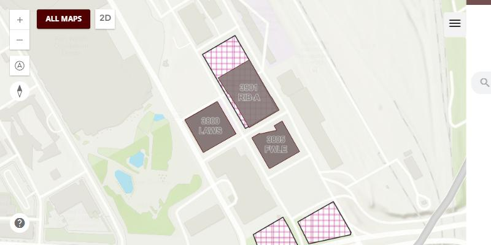 | 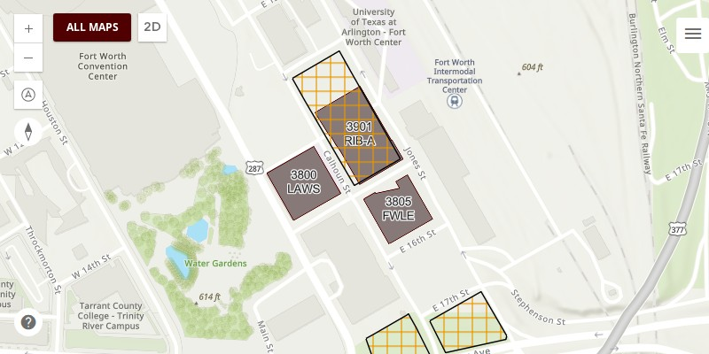 |
| Houston Space Institute | 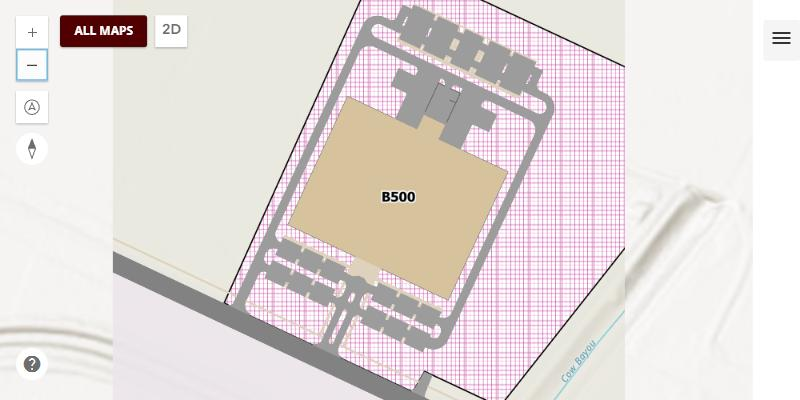 | 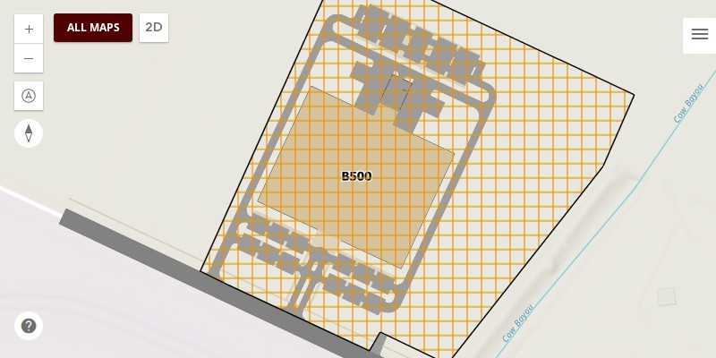 |
| At the sizes the pages show them | | 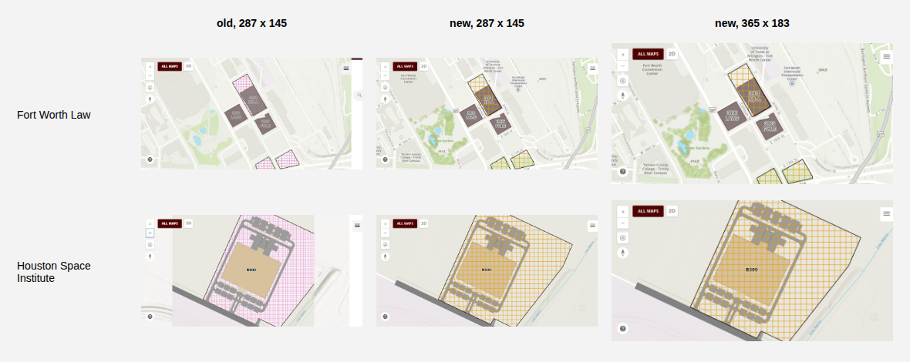 |
| On Campus Maps | | 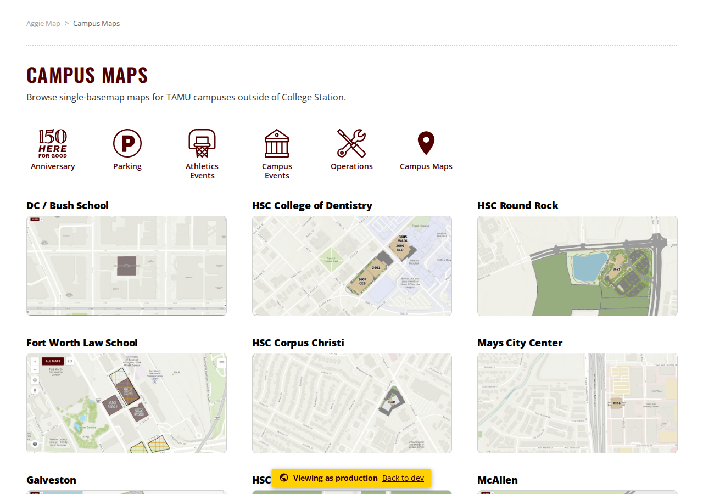 |

### A greyed-out travel mode can no longer be reached or chosen

In the trip planner, a travel mode that the trip options rule out (with Accessible Friendly Directions on, Biking and
the bus) is drawn grey, with a "not allowed" cursor. It was still a working button: the keyboard's Tab stopped on it
with nothing on screen to show where the focus was, a screen reader announced it as an ordinary button, and a click,
Enter or Space still asked the planner for that mode. A greyed mode is now disabled in fact: Tab skips it, a screen
reader announces it as unavailable, and a click or key does nothing. The modes that can be chosen are unchanged, and a
mode that found no route still shows "--" and can be chosen, to see why
([#2586](https://github.com/TamuGeoInnovation/Tamu.GeoInnovation.js.monorepo/issues/2586)).

| | Before | After |
| --- | --- | --- |
| Accessible directions on, one Tab from Walking | 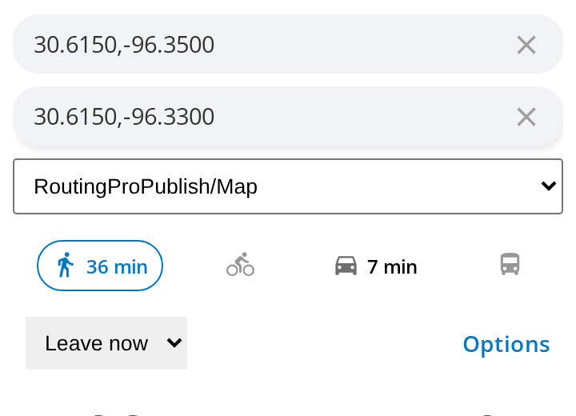 | 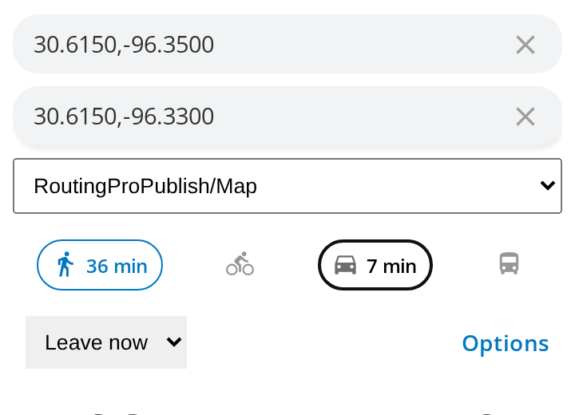 |
| The trip | | 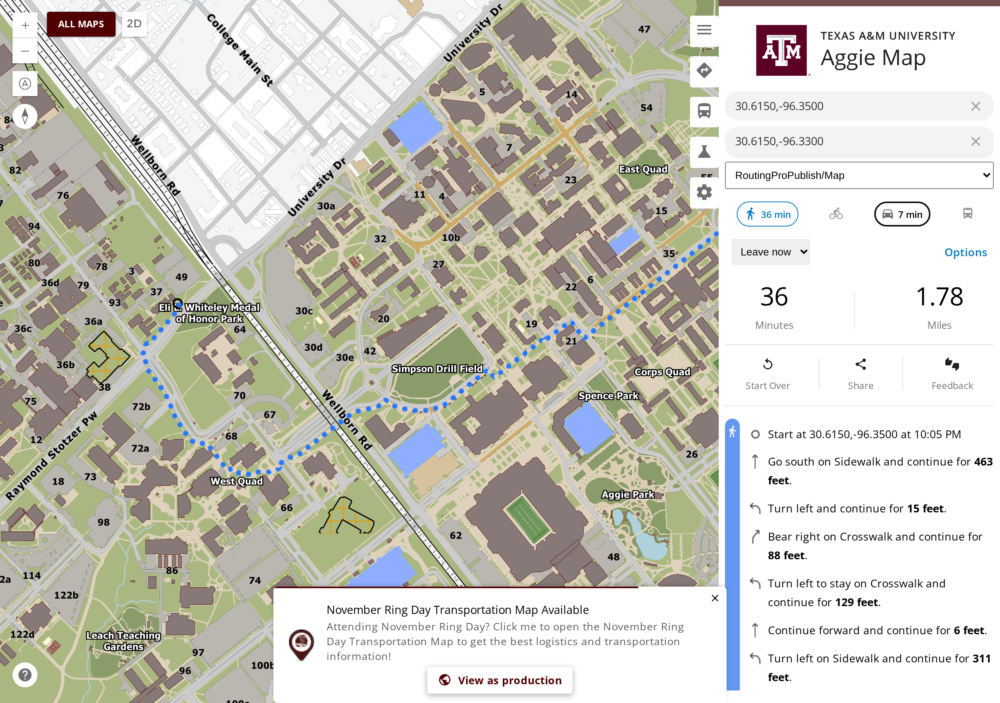 |

### The Graduation maps draw their event parking again

The Graduation parking service was republished on 28 October with the road closures split into a layer of their own,
which moved the event lots from layer 2 to layer 3. The Fall and Spring Commencement maps still read layer 2 for
their lots, so they showed traffic arrows, accessible parking and road closures, and **no parking at all**, on both
dev and production. They read the new layers now, and dev reads the new copy of the service that Transportation
Services published for it
([#2593](https://github.com/TamuGeoInnovation/Tamu.GeoInnovation.js.monorepo/issues/2593),
[#2530](https://github.com/TamuGeoInnovation/Tamu.GeoInnovation.js.monorepo/issues/2530)).

The nightly map check now asks the service behind every filtered layer how many features it holds and how many the
filter selects, and fails a map whose filter selects none of them. From outside, this fault was a layer that loaded and
answered every question with nothing in it, which the check used to allow, because most layers can be empty by design.
A filter that is empty on purpose (a day not chosen, a date window) is told apart by its form, and the one other found,
Move-In's Northside bike registration, is listed with why.

| | Before | After |
| --- | --- | --- |
| Fall, production | 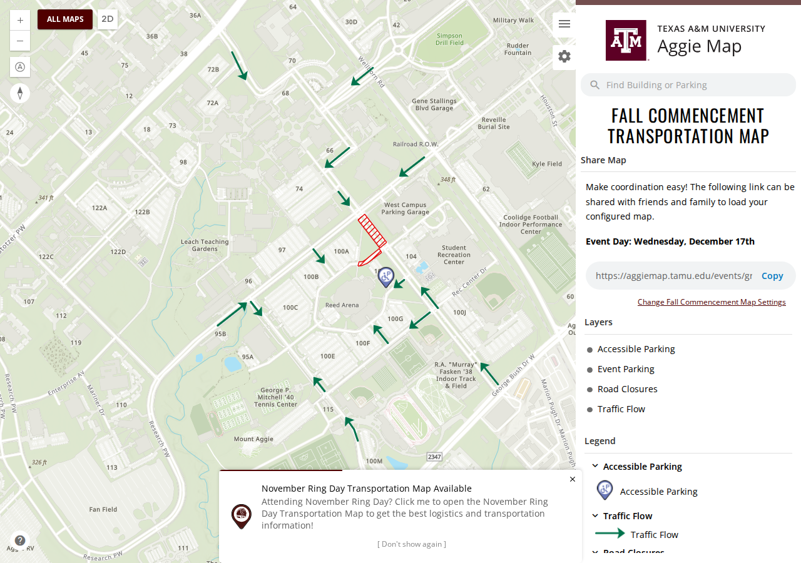 |  |
| Fall, dev | 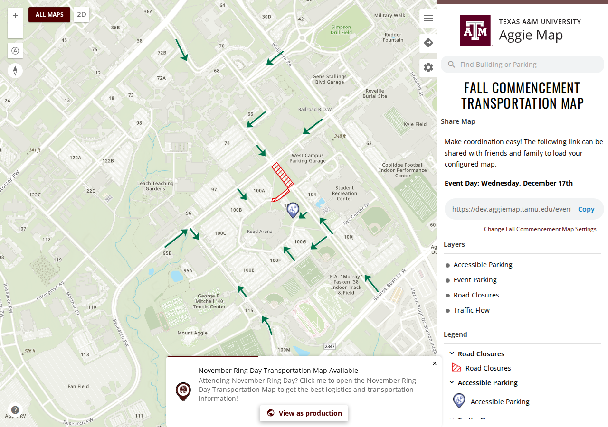 | 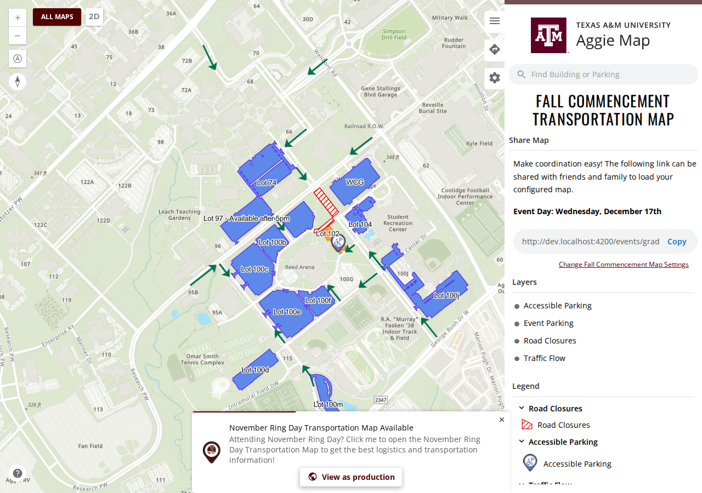 |
| Spring, production | 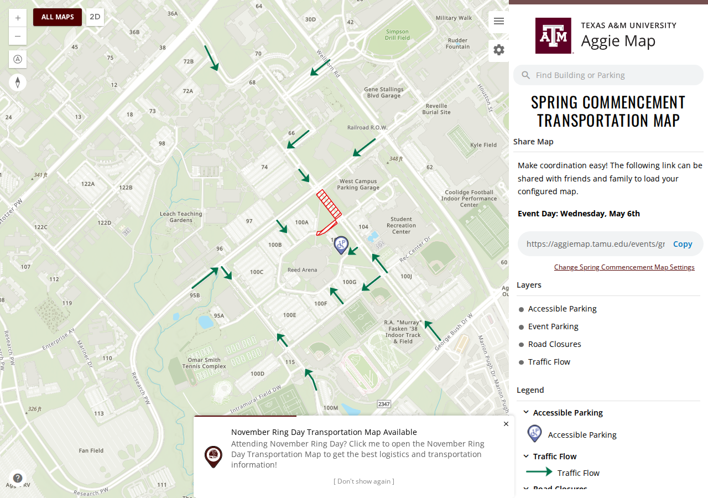 |  |
| Spring, dev | 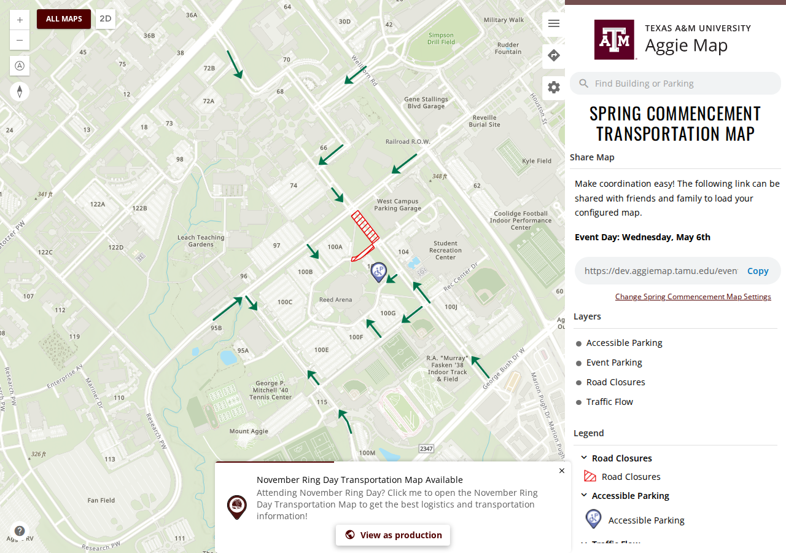 |  |

The "after" pictures are this change built and served locally: at `localhost`, which reads production's service, and at
`dev.localhost`, which reads dev's.

### Nature Rx spaces are on the map on dev

**On dev only, for now.** Seen on the map, the layer is not ready for the public, so a production build
leaves it out altogether - no entry under Layers, nothing in search, and a shared `?naturerx=` link does
nothing ([#2673](https://github.com/TamuGeoInnovation/Tamu.GeoInnovation.js.monorepo/issues/2673)). It stays
on dev, where the remaining work can be looked at. Everything below describes dev.

Texas A&M's **Nature Rx** green spaces - the places on campus set aside for being outdoors - are a layer on
the main map. Turn it on under Layers.

Clicking a space opens the same kind of panel as a Point of Interest: **photographs across the top**, then
where on campus it is, a description, and **what the space actually has** - restrooms, seating, shade,
hammocks, ponds, a nature trail, and so on. Only what a space has is listed, so the panel reads as
information rather than a form.

Nature Rx spaces are **searchable**, by name and by what they are for: searching *hammocks* or *disc golf*
finds them, not only *Aggie Park*. A copied link reopens the space it was copied from.

The spaces and their photographs come from Facilities Analytics & Mapping, who publish and maintain them.

| | |
| --- | --- |
| The layer and its legend | 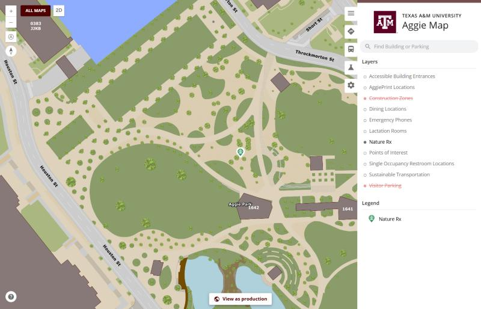 |
| A space's panel | 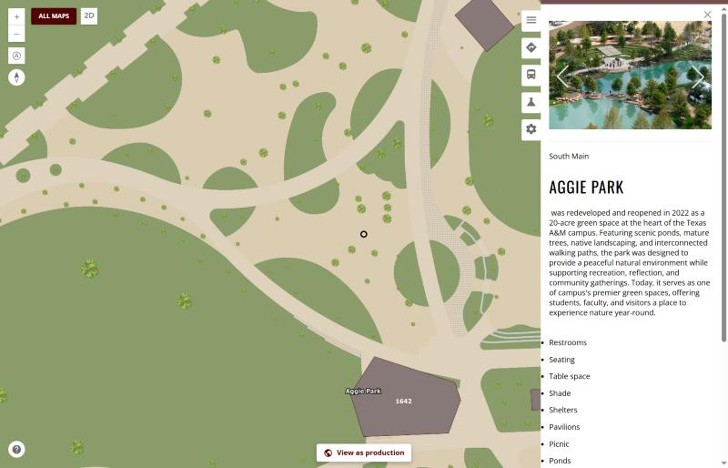 |

### Two event layers take their names from the service instead of the code

A layer's name belongs to the service that publishes it, so that renaming one on the service changes
the map without anybody editing the application. Two event layers overrode that name in their
definition, so the name published on the service never reached the map
([#2634](https://github.com/TamuGeoInnovation/Tamu.GeoInnovation.js.monorepo/issues/2634)).

Both overrides are removed, and each layer now shows what its service calls it:

| Map | Was, hard-coded | Now, from the service |
| --- | --- | --- |
| Muster, layer 0 | Muster Traffic Flow | **Traffic Flow** |
| Aggieland Saturday, layer 2 | Special Points of Interest | **Points of Interest @ Aggieland Saturday** |

Both names were read from the services before the change, on **both** the development and production
GIS hosts, which publish identical names for these two layers. The other overrides on these two maps
repeat their service's name exactly, so they change nothing and are left alone.

| | Before | After |
| --- | --- | --- |
| Muster | 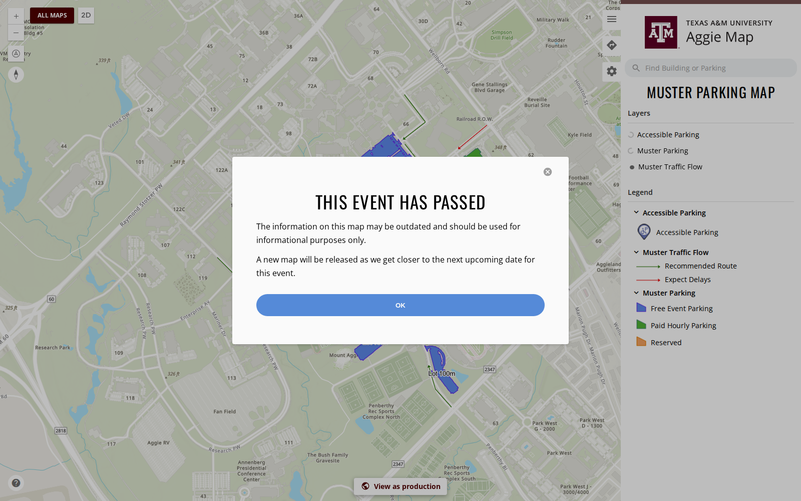 |  |
| Aggieland Saturday | 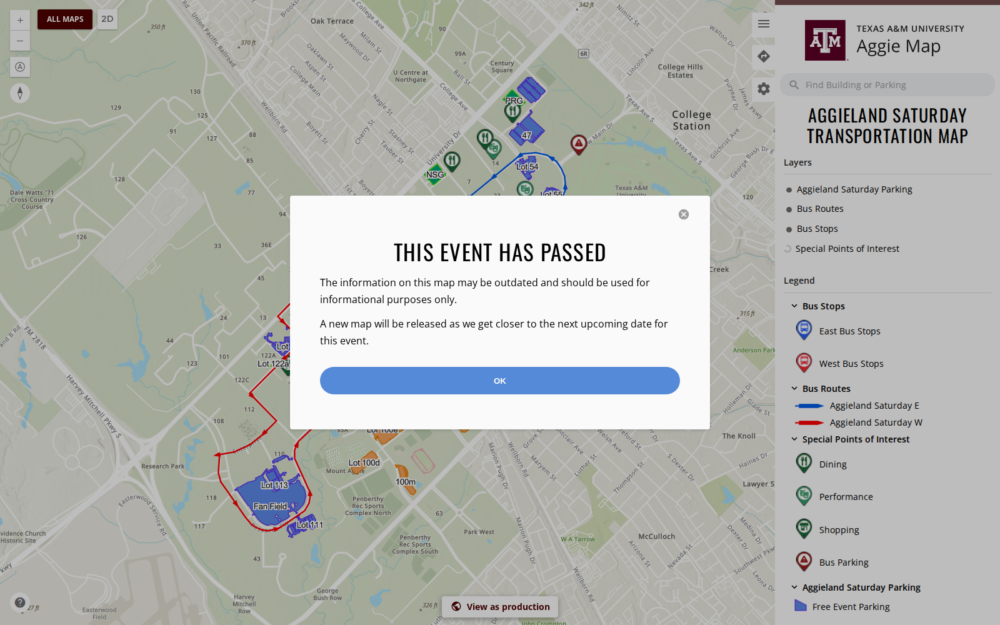 | 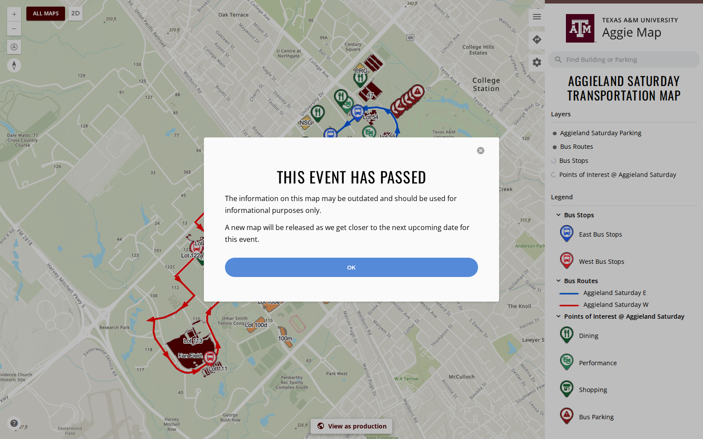 |

The smoke suite's title-override registry
([#2745](https://github.com/TamuGeoInnovation/Tamu.GeoInnovation.js.monorepo/pull/2745)) loses the two
matching rows in the same change. The registry records the overrides that still exist, so a row left
behind would assert an override the code no longer has.

### Bus routes read each environment's own Transportation service

The bus map read its routes and stops from an older Transportation service on the development GIS server, on every
environment, because that service was public nowhere else. Transportation has since published a hosted view of it,
public on both its servers, and each environment now reads its own, as it already does for Transportation's other
services. Bus routes are still shown on development only: whether they go to production is a separate decision.

The new service is not a copy of the old one. It no longer has routes 47/48 and 48, and it lists a 32nd stop for route
47 on production. Its stops have new ids, which are not the same on development and production, so a stop link shared
from the old service (`?busstop=4718` and up) no longer finds its stop, and a link copied on one environment does not
open on the other.
([#2636](https://github.com/TamuGeoInnovation/Tamu.GeoInnovation.js.monorepo/issues/2636))

| Before                                                                                                                     | After                                                                                                                     |
| -------------------------------------------------------------------------------------------------------------------------- | ------------------------------------------------------------------------------------------------------------------------- |
| 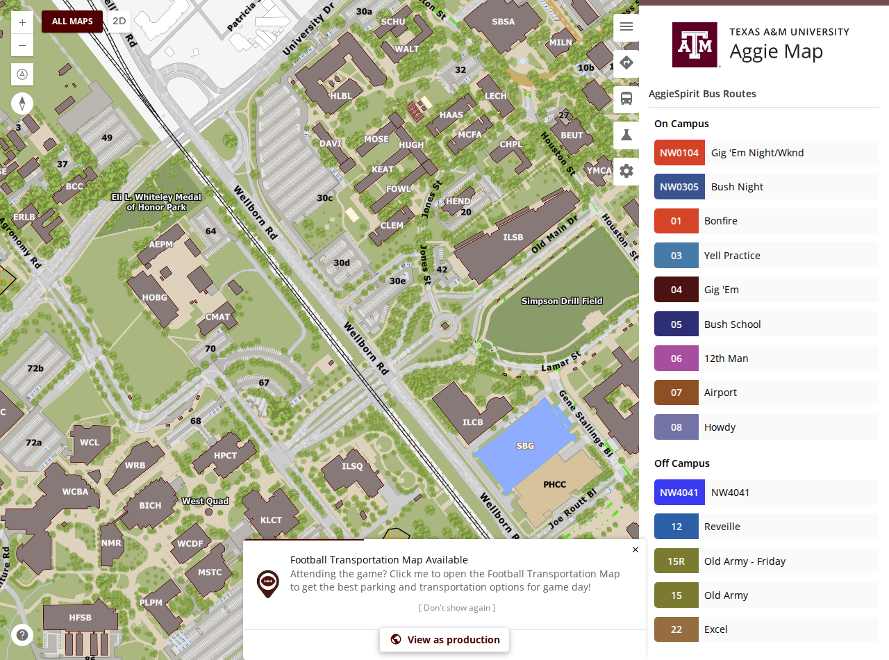         | 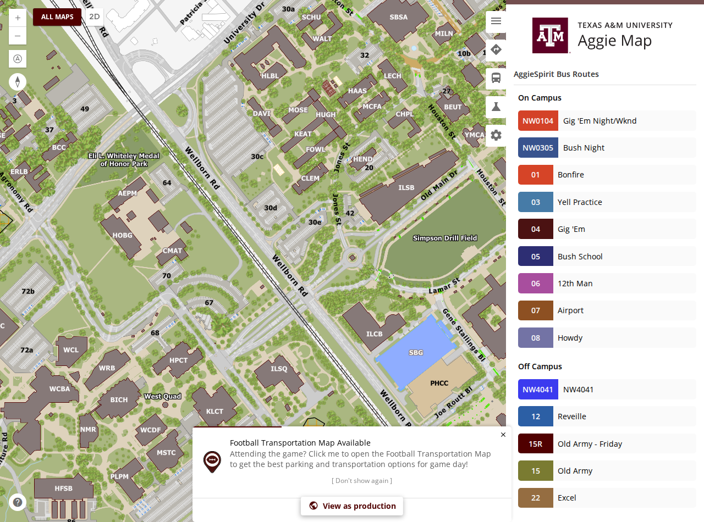         |
|                      | 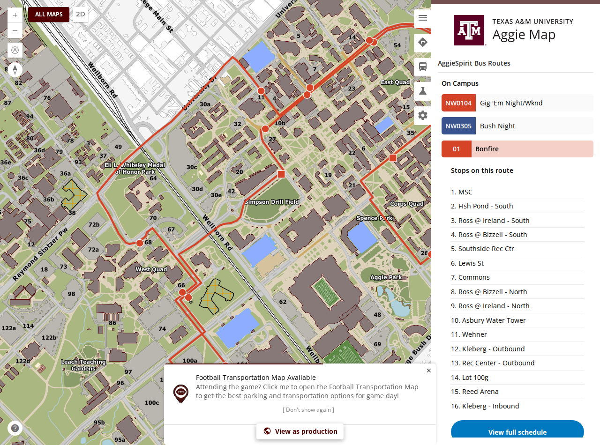                     |
|  | 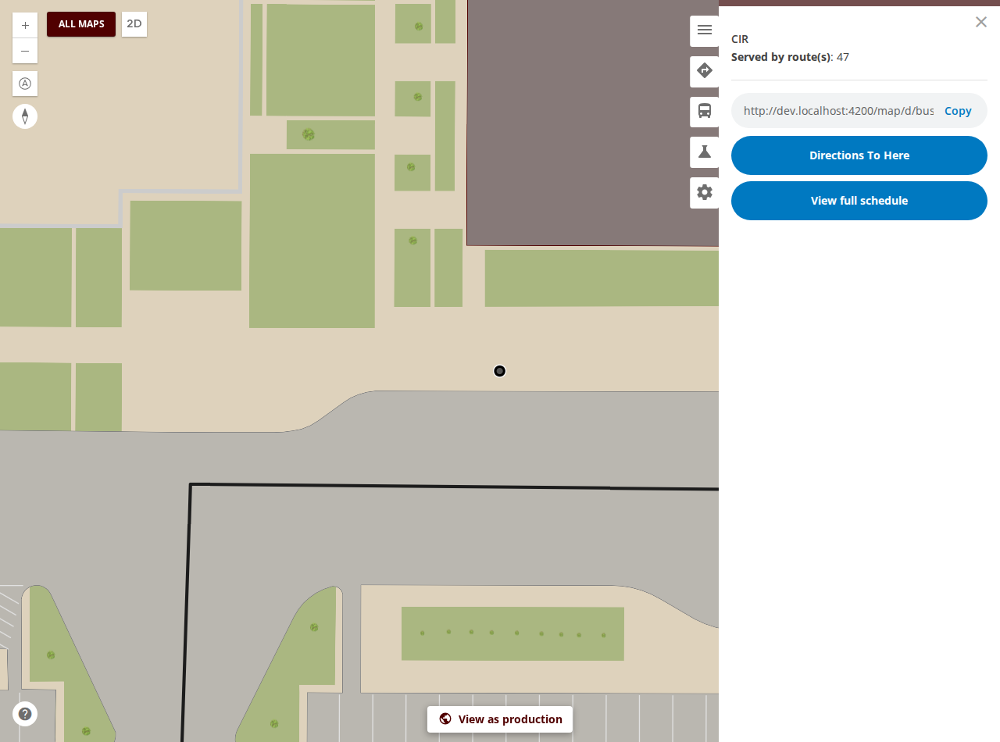 |

### Directions to a tailgate tent

A tent on the Football Tailgating map now offers **Directions To Here**, as other event map features do. The walking network
has only paths, so a trip to a tent used to end on the nearest walkway, about 35 m from tent O62. The trip planner now draws the
last stretch from the end of the route to the destination itself, and the last written step says to leave the path for it.
The last stretch is drawn for any destination up to 150 m off a path, so a building or lot gets it too. Directions are still
development-only ([#2639](https://github.com/TamuGeoInnovation/Tamu.GeoInnovation.js.monorepo/issues/2639)).

| Before | After |
| --- | --- |
| 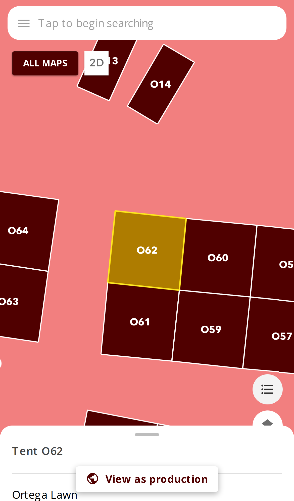 | 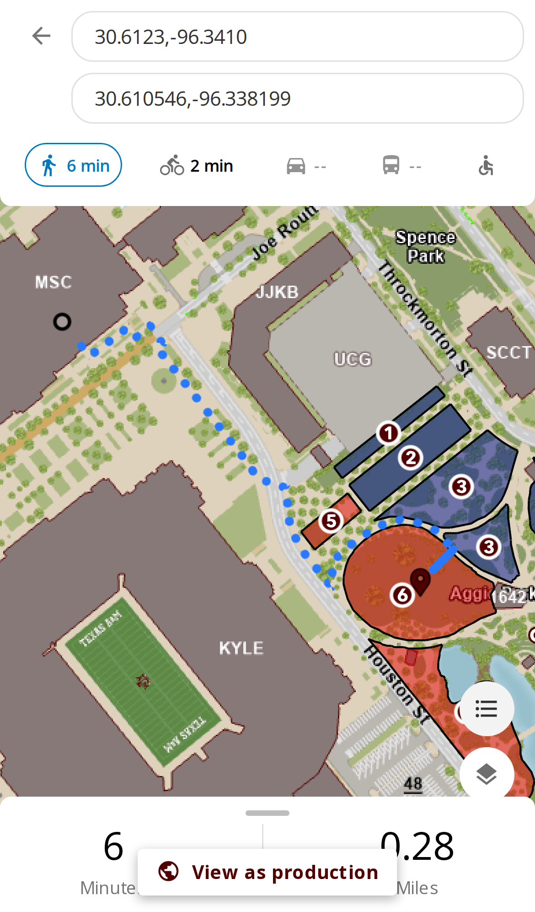 |

### Directions To Here works on a phone

On a phone, tapping **Directions To Here** in a popup closed the popup and stayed on the map, on every map. A phone shows its
popup in a second router outlet, and the button looked for the trip screen inside that outlet, where there is none. It now
opens the trip from the main outlet, as it does on a desktop. Directions are still development-only
([#2641](https://github.com/TamuGeoInnovation/Tamu.GeoInnovation.js.monorepo/issues/2641)).

| Before | After |
| --- | --- |
| 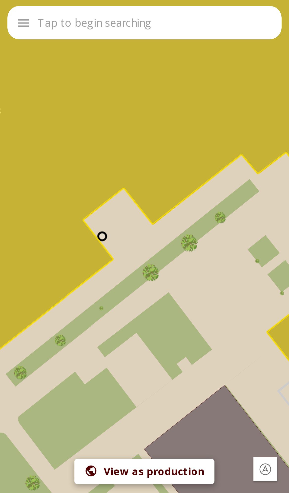 | 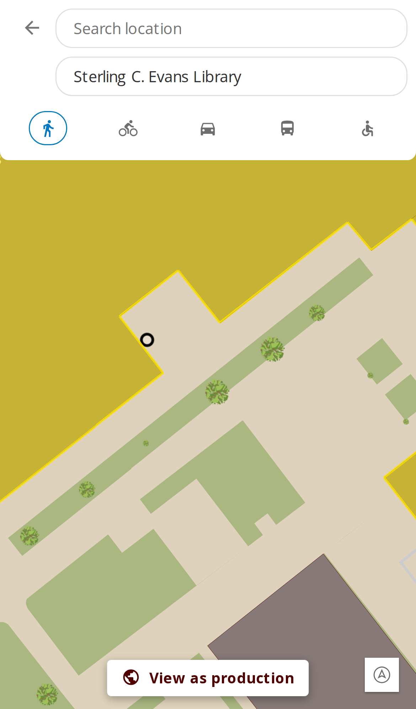 |

### On a phone, the locate button sits above Legend and Layers

On an event or parking map on a phone, the locate button sat alone at the very bottom right of the screen. On the Football
Tailgating map that corner is over tents and zones, so a tap that missed the button opened a feature's popup, which is hard
to close on a phone. Locate now heads the stack of round buttons on the right, above Legend and Layers, and looks like them.
Desktop is unchanged ([#2642](https://github.com/TamuGeoInnovation/Tamu.GeoInnovation.js.monorepo/issues/2642)).

| Before | After |
| --- | --- |
| 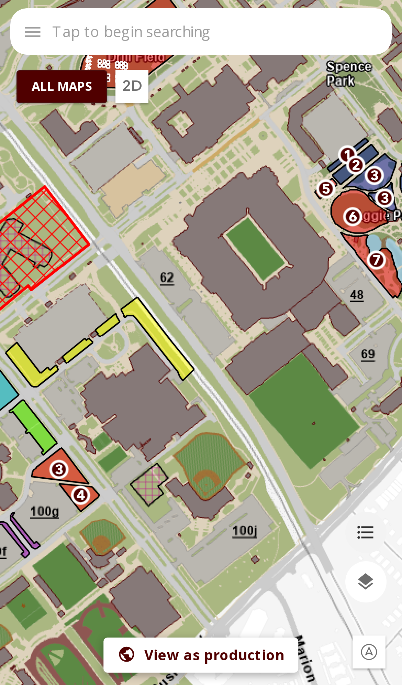 | 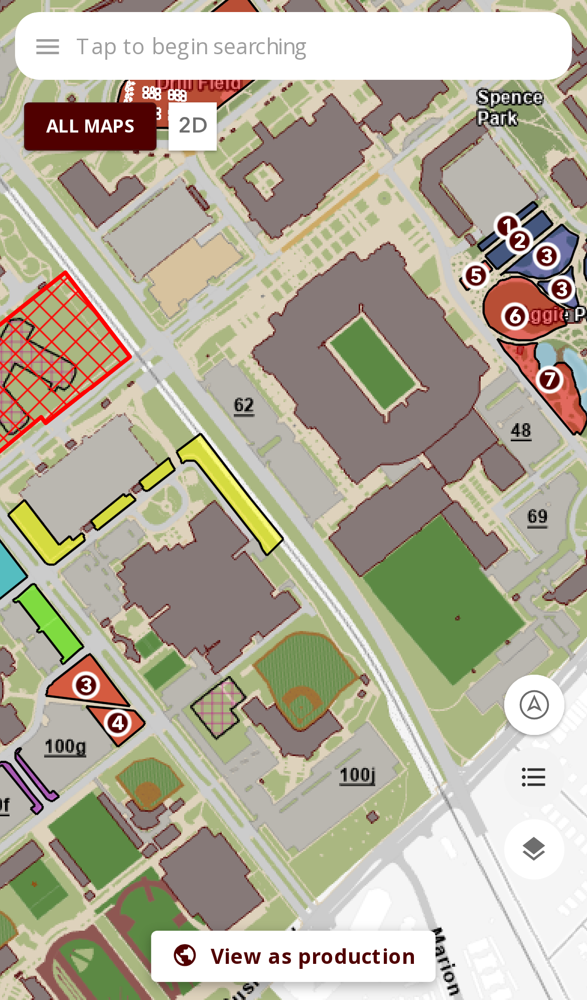 |

### Dev reads Transportation's development services

A development build of AggieMap read Transportation Services' **production** services for its permit and event maps,
because the host they come from was pinned to production while the development copies were being published. So a map
that broke when its service was republished could not be caught on dev first, which is how the Graduation maps lost
their parking on production in October
([#2593](https://github.com/TamuGeoInnovation/Tamu.GeoInnovation.js.monorepo/issues/2593)).

Dev now reads the development GIS server for every one of those services it can serve with the same layers and fields:
the permit parking maps, Aggieland Saturday, Big Event, 4-H Roundup, the family parade, Muster and the athletics maps
([#2653](https://github.com/TamuGeoInnovation/Tamu.GeoInnovation.js.monorepo/issues/2653)). Eighteen still read
production's on dev, each named with its reason: twelve whose development copy lacks the fields the maps use, 4-H
Roundup, whose development view answers "Token Required" so a development build cannot read it at all
([#2695](https://github.com/TamuGeoInnovation/Tamu.GeoInnovation.js.monorepo/issues/2695)), the main
parking service, and four retired 150th-anniversary events. Production reads exactly what it read before.

### Game-day restrooms on the Football Tailgating map

The Football Tailgating map shows game-day restrooms, 16 around Aggie Park and West Campus. They are drawn in ArcGIS Pro with
the tents and zones, so their icon, name and the zoom at which they appear are changed there. A restroom's popup offers
directions where directions are available. The campus layer of family and single-occupancy restrooms stays off by default,
because many buildings are closed on game days
([#2660](https://github.com/TamuGeoInnovation/Tamu.GeoInnovation.js.monorepo/issues/2660)).

| Before | After |
| --- | --- |
| 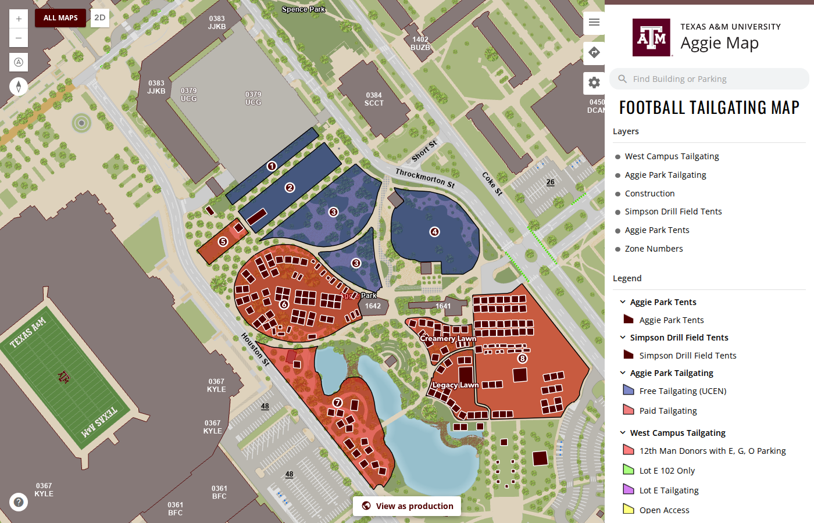 | 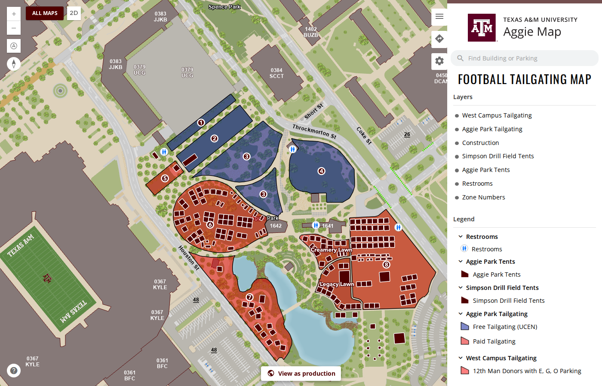 |

### The campus map tiles read in alphabetical order

The campus maps were sorted alphabetically and did not look it. The sorted list was cut into three
equal pieces and the pieces were put side by side, so the order ran **down** each column while a
reader runs **across** each row - and the first row read DC / Bush School, HSC College of Dentistry,
HSC Round Rock.

They now flow across the rows, and on a phone, where there is only one column, they are simply the
list. One order, read the same way at every width.

| Before, on production | After |
| --- | --- |
| 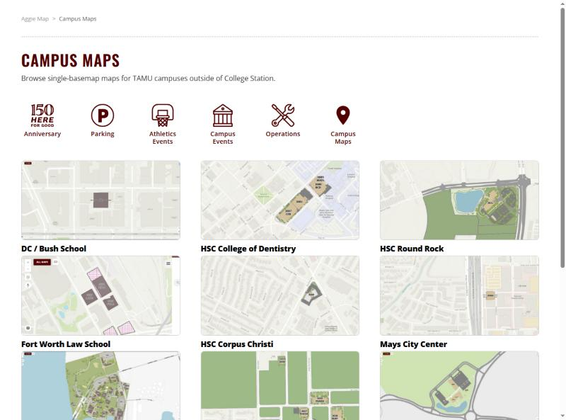 | 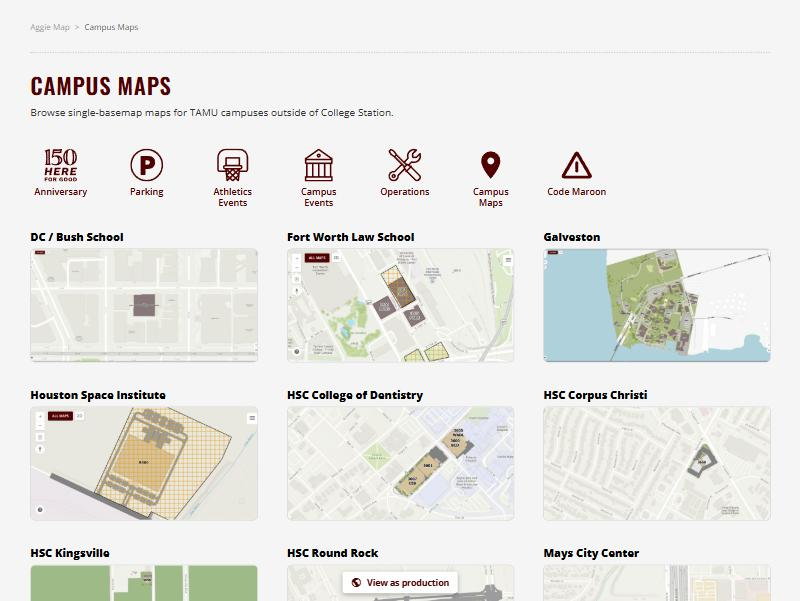 |

### AggieMap: every building on the map opens its popup when clicked

Some buildings did nothing when clicked, while the buildings around them worked. Which ones changed from one visit to the
next. The buildings were read from a service that answers about one request in twenty with an error, at random, and
the map does not ask again: every building in the part of the map that request covered could not be clicked for the
rest of the visit. Measured on 9 November 2026, every building that did not answer lay inside the area of a request
that had failed, and every visit with no failed request answered every click.

The buildings, and the building search, now come from the feature service the campus vector basemap is published
from, which returned no errors in any of the same measurements. The buildings, their names and numbers, and every
`?bldg=` link are the same as before.

([#2707](https://github.com/TamuGeoInnovation/Tamu.GeoInnovation.js.monorepo/issues/2707))

| Before: the buildings request for Reed Arena's part of the map failed, so clicking it (circled) only closes the popup | After: clicking Reed Arena opens its popup |
| --- | --- |
| 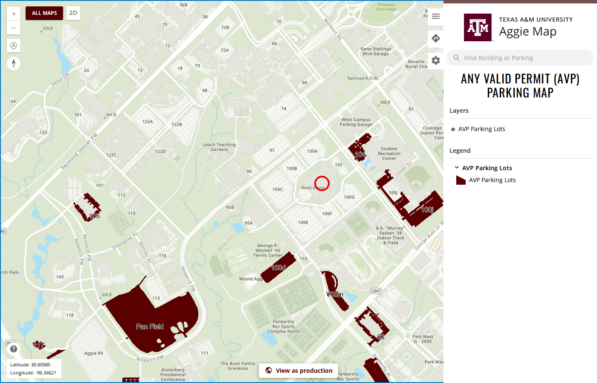 | 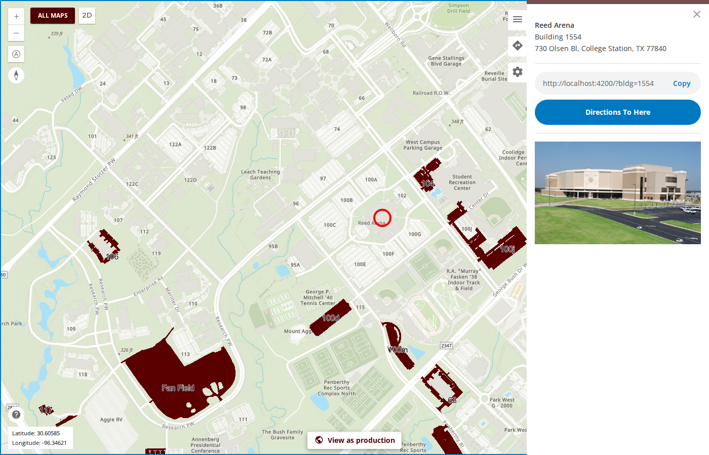 |

The "before" was made by answering that one request with the error the old service returns at random, so the picture
shows the fault every time rather than one visit in several. The same fault was observed without forcing it in three
of four runs of the new check on dev's AVP Parking map.

### A click on a map that is still drawing opens its popup

A click on a building in the first seconds after a map opened did nothing: the popup came only from
what the map had already drawn, and the buildings were not drawn under the point yet. On dev, 0 of 20
clicks opened a popup once the map had settled into place, about six seconds in, when the page looks
completely ready; it was only reliable at sixteen. The click was thrown away, not slowed. When nothing
under a click has a popup, the map now asks the layers still drawing what is there, as the trip planner
already did when setting a stop.
([#2707](https://github.com/TamuGeoInnovation/Tamu.GeoInnovation.js.monorepo/issues/2707))

There is no before image: the fault is a click that does nothing, so the measurement in the issue
stands in for one.

### A draft Micromobility map, on dev only

Transportation's new micromobility map, where scooters and bikes may ride on Main Campus: the
micromobility corridor, the sidewalks they may use, and the roadways and other facilities. Each layer's
name, symbols and order are the service's own. It is a draft that Transportation is still refining, so it
is on dev only. Production lists it nowhere, and a link to it opens the main map instead. The smoke suite
fails if production ever requests its service.
([#2712](https://github.com/TamuGeoInnovation/Tamu.GeoInnovation.js.monorepo/issues/2712))

A map can now be kept off production as a whole by naming the issue that holds it there
(`developmentOnly`). Before this, `visible: false` kept a map off production's lists but left its link
working.

There is no before image: the map did not exist. The capture on the right is the same link as production
sees it, which opens the main map.

| On dev | The same link as production sees it |
| --- | --- |
| 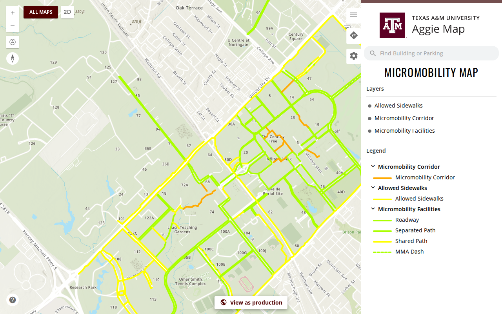 |  |

### An NCAA Volleyball 1st & 2nd Round parking map, on dev until Texas A&M is announced as a host

A parking map for the NCAA Volleyball 1st & 2nd Round on 4 and 5 December 2026: the event lots and the
accessible parking spaces, with the service's own titles, symbols and order. It is a map of its own, beside
the season's Volleyball map, which is unchanged. Whether Texas A&M hosts is announced on 29 November.
Until then, and until its service is published on the production server, it is on dev only: production
lists it nowhere, and a link to it opens the main map.
([#2713](https://github.com/TamuGeoInnovation/Tamu.GeoInnovation.js.monorepo/issues/2713))

There is no before image: the map did not exist. The capture on the right is the same link as production
sees it, which opens the main map.

| On dev | The same link as production sees it |
| --- | --- |
| 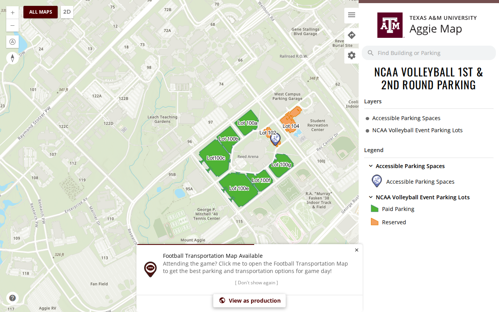 | 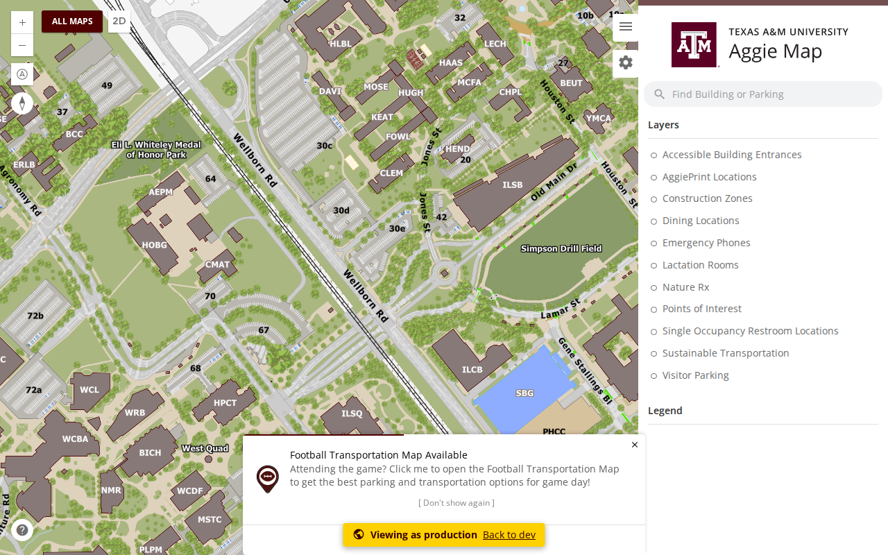 |

### The Nature Rx popup lists a space's features on one line, and fetches its photographs one at a time

A Nature Rx space's features were a bulleted list, the only one in any popup, drawn with the browser's own bullets and
indent. They are now one labelled line, **Features**: Seating, Shade, …, as every other popup shows a field, in the same
order and still only those the space has.
([#2717](https://github.com/TamuGeoInnovation/Tamu.GeoInnovation.js.monorepo/issues/2717))

The photo carousel fetched every photograph as soon as a popup opened, although one shows at a time: ILCB Green Space's
four came to 6.9 MB. It now fetches the photograph on show, and each further one when the visitor moves to it, with the
one either side. Opening ILCB Green Space now fetches 1.9 MB. The photographs themselves are still full-size camera
originals, which is with Facilities Analytics & Mapping, so this does not make the first one any smaller. The Points of
Interest and Bonfire popups use the same carousel and gain the same.
([#2716](https://github.com/TamuGeoInnovation/Tamu.GeoInnovation.js.monorepo/issues/2716))

| Before | After |
| --- | --- |
| 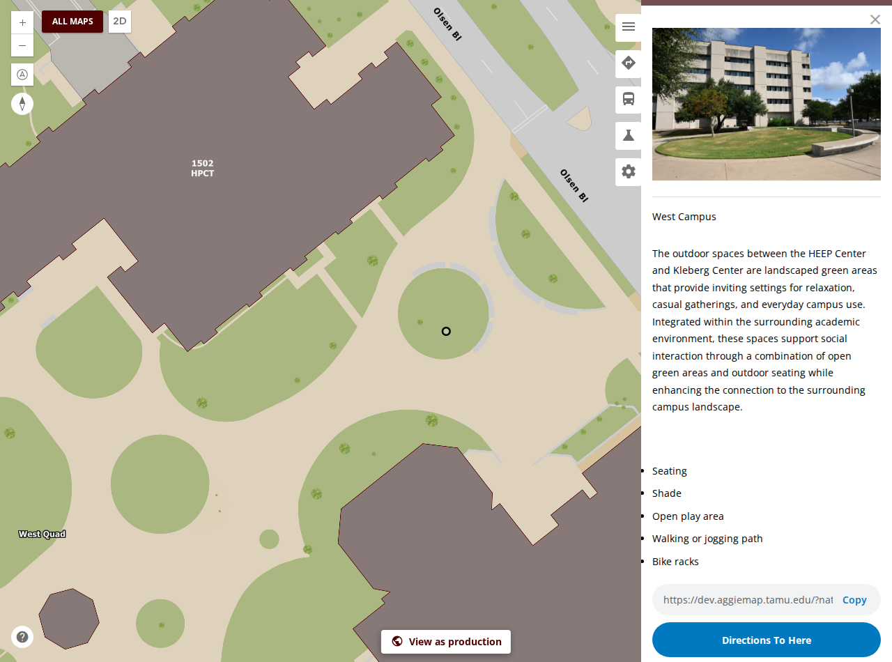 | 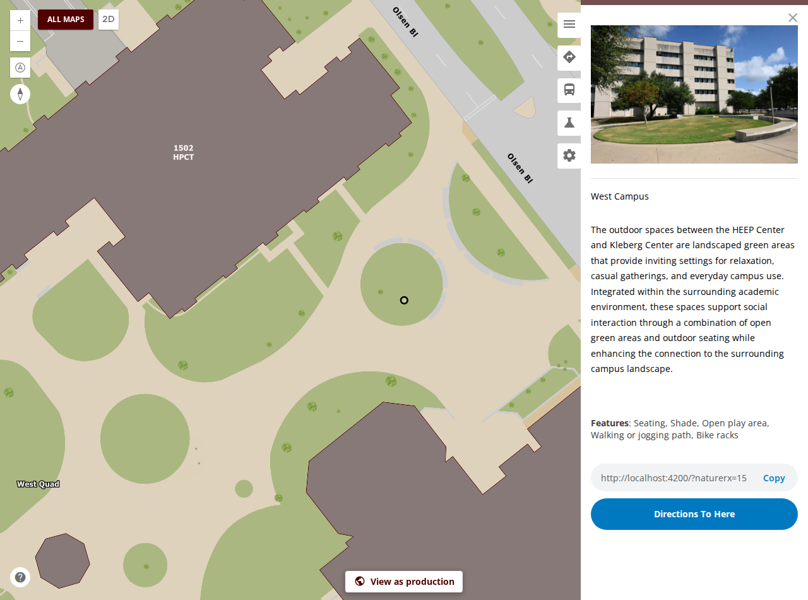 |
| 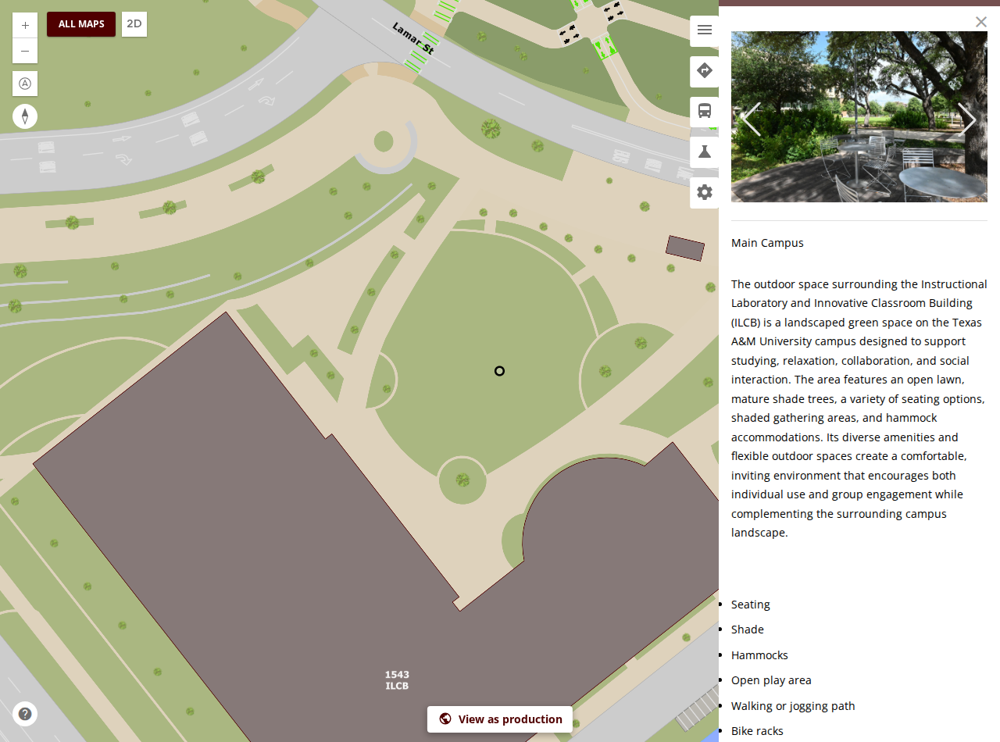 | 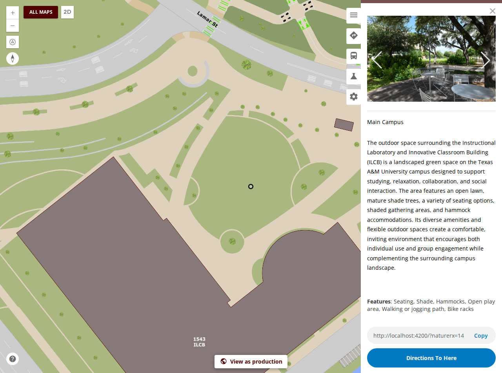 |

### AggieMap: parking lots and buildings under construction come from the vector basemap's service

The main map's surface parking lots, the parking lot search and `?lot=` links, the buildings drawn as under
construction, and the residence halls Move-In highlights now read the feature service the campus vector basemap is published from, as the buildings already do
([#2707](https://github.com/TamuGeoInnovation/Tamu.GeoInnovation.js.monorepo/issues/2707)). The service they read
before failed some requests at random (3 of 200 for the lots, measured 9 November 2026, against 0 of 200 for the new
one), and the map does not ask again. Nothing looks different: the same lots, in the same order for `?lot=` links, and
the same eight buildings under construction, the same hall for each Move-In choice.

Lot 8712 is the one lot not in the new service. Parking garages still come from the old service, because the new one
has no garage layer to take them from.

The UES Operations map's parking lot search works again. It had been asking the old service's Wall Area layer, which has
no lot names, so every search failed.

([#2722](https://github.com/TamuGeoInnovation/Tamu.GeoInnovation.js.monorepo/issues/2722))

### All Maps has a Transportation section, and the Micromobility map is in it

All Maps had nowhere for a map about getting around campus rather than parking a car. **Transportation** is a new tile
under Visit Maps, between Parking and Athletics Events, and a page behind it at `/all-maps/transportation`.
([#2737](https://github.com/TamuGeoInnovation/Tamu.GeoInnovation.js.monorepo/issues/2737))

Its icon is two map pins joined by a route, after Transportation Services' own "Bike Lanes and Racks" icon on
`m.tamu.edu`, so AggieMap and their pages read as one service. It is drawn as an inline shape like every other tile's
rather than used as their image, which would not take the page's colour or stay sharp.

**The Micromobility map is listed there**, and until now could not be reached from the site at all - it opened only by
typing its address, because its entry claimed a parking category and no map type, which left it listed nowhere.
([#2738](https://github.com/TamuGeoInnovation/Tamu.GeoInnovation.js.monorepo/issues/2738))

That also means **no test had ever loaded it**. The smoke suite finds maps by walking All Maps, and the 8 November run
discovered 81 maps and not this one - so nothing had drawn its layers or counted its features, while the NCAA Volleyball
map added the same day was checked in full. A map nobody can find is also a map nothing tests.

The Micromobility map stays development-only until it is ready for production. The Sustainable Transportation and bus
maps will join it on this page.

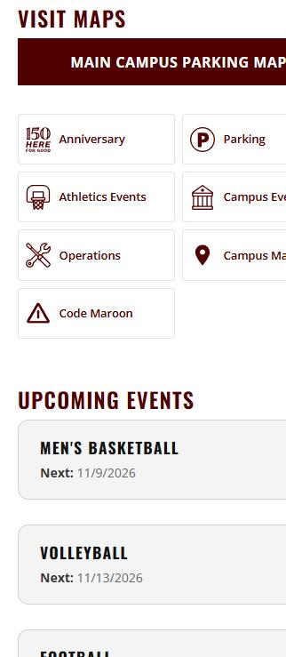

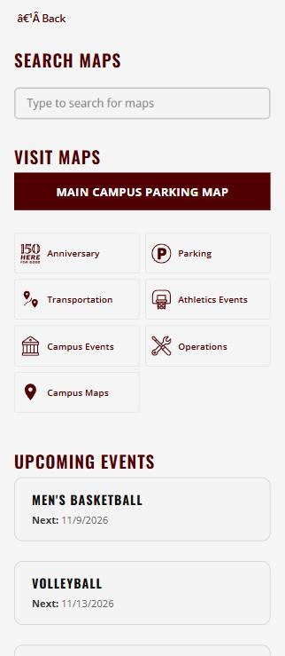

### The main map offers Micromobility as a layer, on development only

Transportation's micromobility map, where scooters and bikes can ride on Main Campus, has been its own map on
development since [#2712](https://github.com/TamuGeoInnovation/Tamu.GeoInnovation.js.monorepo/issues/2712). The main
map now offers the same three layers as one entry in Layers, **Micromobility**, off until a visitor turns it on. The
corridor, the allowed sidewalks and the facilities are drawn and named as Transportation's service draws and names them,
and clicking one shows its name and what kind it is.

It is on development only. The service is public on Transportation's production host, so a production build leaves the
entry out altogether, as it does Nature Rx, until the maintainer decides it is ready. The bike layers under Sustainable
Transportation are unchanged; whether both stay is a separate decision.
([#2739](https://github.com/TamuGeoInnovation/Tamu.GeoInnovation.js.monorepo/issues/2739))

| Before                                                                                                            | After                                                                                                              |
| ----------------------------------------------------------------------------------------------------------------- | ------------------------------------------------------------------------------------------------------------------ |
| 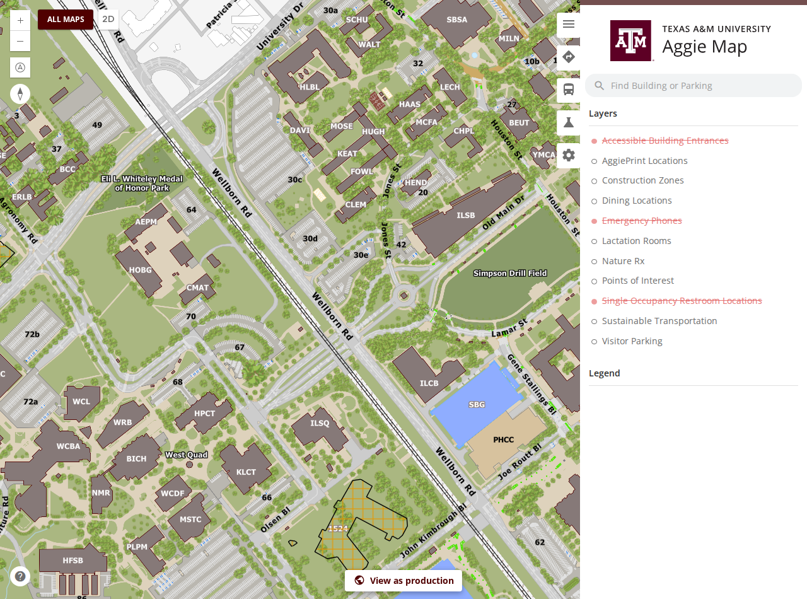 | 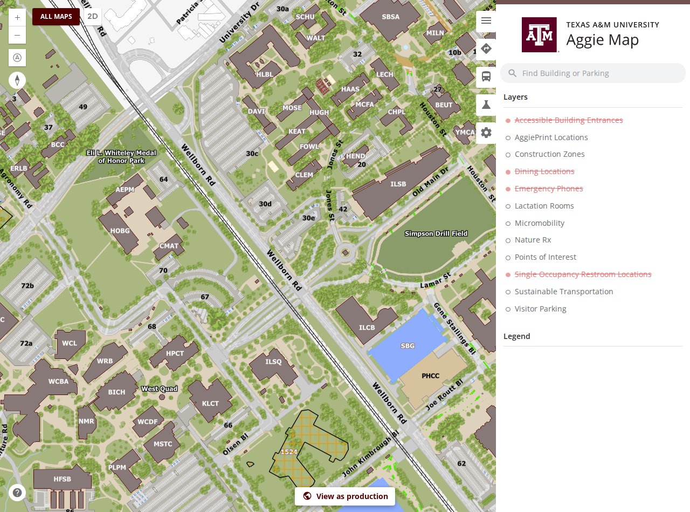      |
|                                                                                                                   | 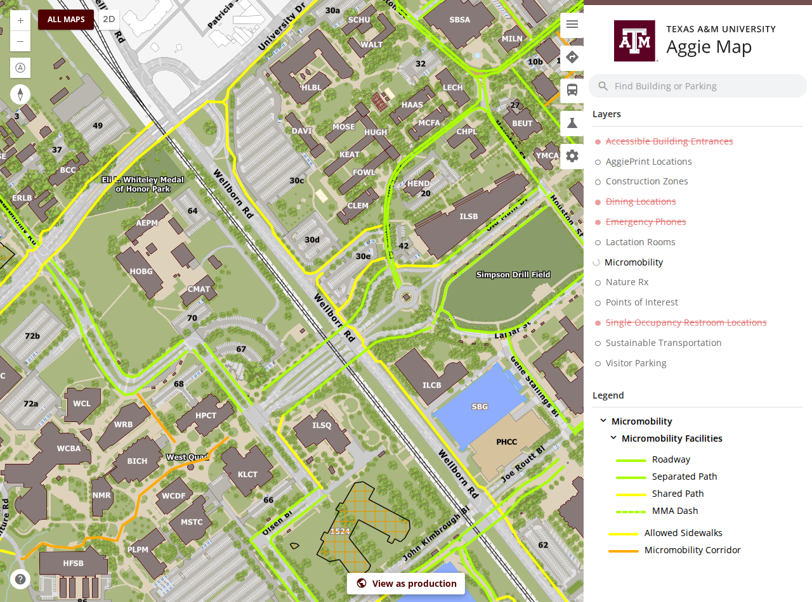 |
|                                                                                                                   | 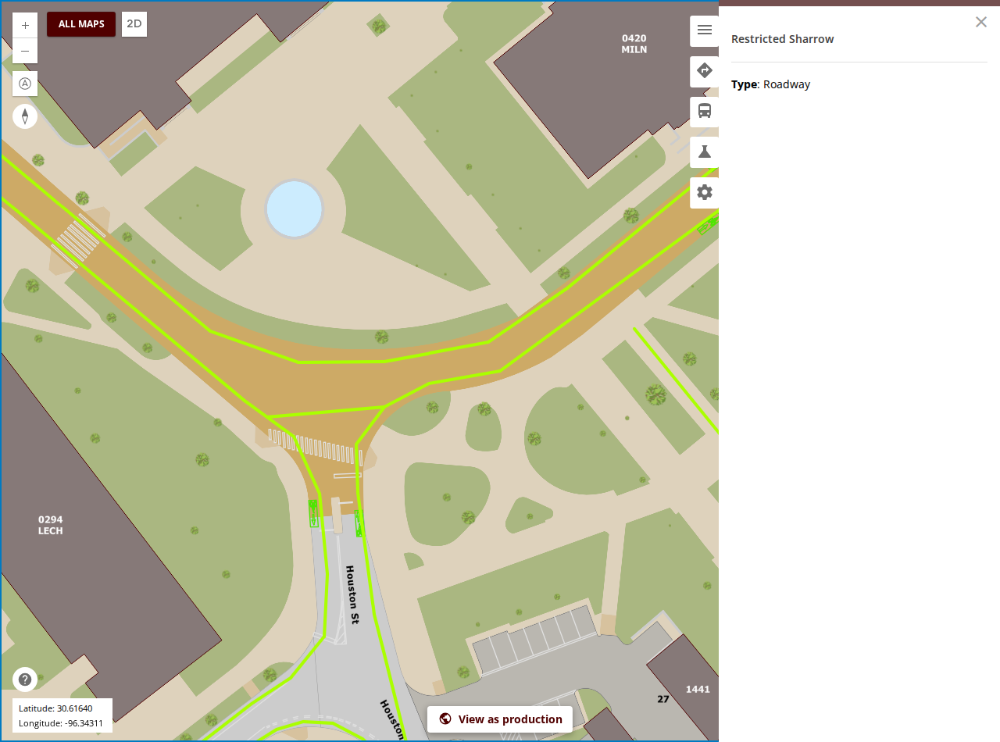                        |

### AggieMap: a Sustainable Transportation map in the Transportation section, on dev

The Sustainable Transportation map, with its six bike and EV charging layers on, is now listed in the Transportation
section of All Maps, beside Micromobility. The map has existed since May. But it was listed in no section, so only
someone with its link could reach it, and on dev its layers drew nothing.

It is on dev only for now. The bike layers are being reworked, and whether they stay is decided early in the week of
9 November, so on production its link opens the main map. On dev its layers read production's bike service, because
the development GIS server serves that only with a token, and each is marked **production data** in the Layers list.
([#2742](https://github.com/TamuGeoInnovation/Tamu.GeoInnovation.js.monorepo/issues/2742))

| Before: Transportation lists Micromobility only | After: Sustainable Transportation beside it |
| --- | --- |
| 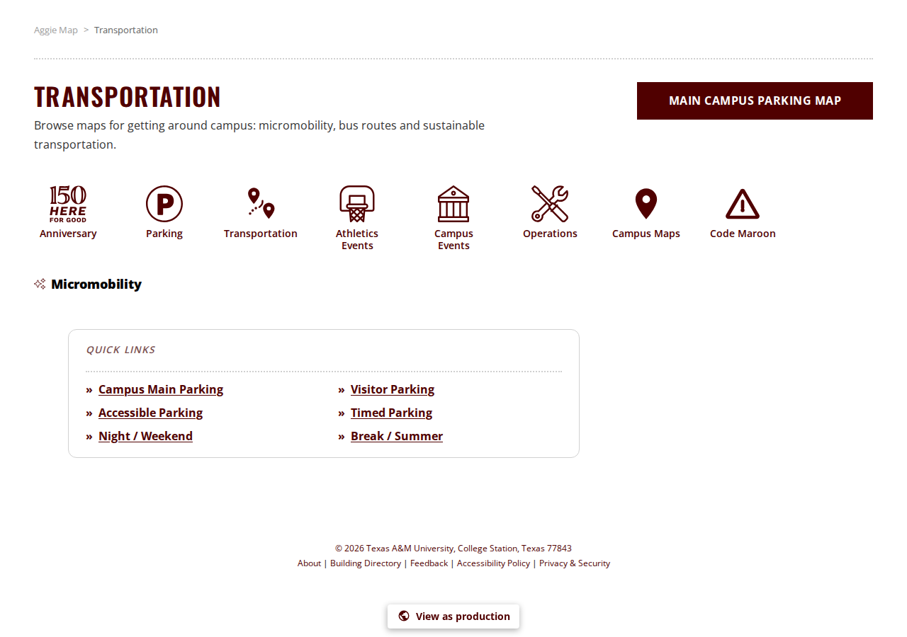 | 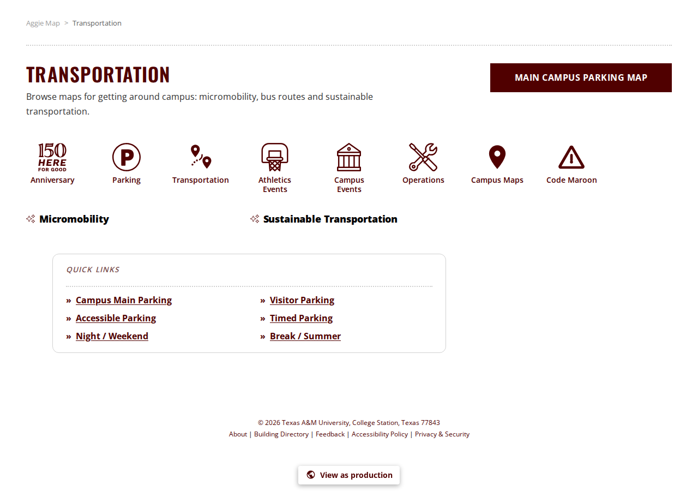 |

| Before: the map's six layers fail on dev | After: they draw, each marked |
| --- | --- |
|  |  |

### All Maps lists a bus map under Transportation, on development only

The Transportation section of All Maps now lists **Bus Routes**. It is the campus map with its bus panel open, the panel
that lists every AggieSpirit route and draws one with its stops when it is chosen - not a separate map, so it always
has the campus map's own layers and basemap. Searching All Maps for "bus" finds it too.

It is listed on development only, as the bus panel itself is. Bus routes read a service that production now serves
publicly ([#2636](https://github.com/TamuGeoInnovation/Tamu.GeoInnovation.js.monorepo/issues/2636)), but moving them to
production is a separate decision.
([#2743](https://github.com/TamuGeoInnovation/Tamu.GeoInnovation.js.monorepo/issues/2743))

| Before                                                                                                 | After                                                                                                              |
| ------------------------------------------------------------------------------------------------------ | ------------------------------------------------------------------------------------------------------------------ |
|  |  |
|                                                                                                        |                |

### AggieMap: nine layers that were dead on dev draw, and dev marks what it reads from production

Nine layers on dev's main map drew nothing. Six are Sustainable Transportation's: Dismount Zones, City Bike Lanes and
Routes, Campus Bike Lanes, Bike Fix Stations, Bike Racks and EV Charge Stations. Their service is on the development
GIS server, but there it answers "Token Required", which the map reports as "Service not found". The other three are
Accessible Building Entrances, Emergency Phones and Single Occupancy Restroom Locations, whose services' development
copies have no layers at all. Dev now reads all of them from production, as it already did for 4-H Roundup and the
Micromobility map.

On dev, the Layers list marks every layer read from production with a small **production data** label, and hovering it
shows why. A group is marked when a layer in it is, since the list shows Sustainable Transportation as one row. The
label comes from the same list that sends a layer to production, so the two cannot disagree, and it never appears on
production.

Seeing the labels showed that two pins were wider than their reasons ([#2756](https://github.com/TamuGeoInnovation/Tamu.GeoInnovation.js.monorepo/issues/2756)).
All of Transportation's TS_Main service was read from production because one of its eight layers, Parking Lots, keeps
its space counts under a different name on the development server. Now only Parking Lots is, and Visitor Parking and
the other six layers read dev's own copy, which matches production field for field. Construction Zones stays on
production, now with the reason written beside it: dev's construction service answers without any shapes, so it would
draw nothing.

The smoke suite now fails on any service dev cannot read, or any layer it lacks, while production serves it, rather
than letting one be allowed as a known failure, as these nine were for a year. That check is what found the last three.
([#2744](https://github.com/TamuGeoInnovation/Tamu.GeoInnovation.js.monorepo/issues/2744))

| Before: Sustainable Transportation is on and nothing draws; three layers are struck through | After: everything draws, and each layer read from production is marked |
| --- | --- |
|  |  |

### Fall Commencement offers this December's dates, and a check for maps left on a past season

The Fall Commencement map offered **Wednesday, December 17th** and **Thursday, December 18th** — the
2025 ceremonies. Every other graduation map had been rolled forward; this one had not, so a visitor
planning for this December was choosing between two dates that had already passed
([#2754](https://github.com/TamuGeoInnovation/Tamu.GeoInnovation.js.monorepo/issues/2754)).

It offers **Friday, December 11th** and **Saturday, December 12th** now.

**Nothing was going to catch this.** The labels carry a weekday and no year, and 17 December really was
a Wednesday in 2025, so the page reads as correct. The map draws, so the smoke suite passes — the dates
are configuration, not a service. The existing `event-dates.spec.ts` checks a map's dates are
*consistent* with each other, not that any of them is still ahead.

So this also adds a check that fails when a map is stranded on a past season: an event within 60 days
still carrying last year's dates, or dates more than 396 days old on a map not marked retired. Around
forty event maps exist and nothing noticed when one was left behind.

| | Before | After |
| --- | --- | --- |
| Fall Commencement date choices |  |  |

The dates come from [the University's published graduation
schedule](https://aggie.tamu.edu/graduation-and-beyond/commencement-details/graduation-schedule.html),
confirmed by the maintainer, rather than inferred from a calendar — which is the assumption that
produced the original fault.

### AggieMap: Transportation maps are at /transportation/, not /parking/

The maps in All Maps' Transportation section, Micromobility and Sustainable Transportation, opened at
`/parking/micromobility` and `/parking/sustainable-transportation`. A micromobility map is not a parking map, and the
address is what a visitor copies, shares and reads. They now open at `/transportation/micromobility` and
`/transportation/sustainable-transportation`, and their old `/parking/` addresses still work, moving to the new ones.

The section a map is listed in now decides its address, so a map listed under Transportation cannot end up at a
parking address again. Parking maps keep their addresses. Both maps are on dev only.
([#2767](https://github.com/TamuGeoInnovation/Tamu.GeoInnovation.js.monorepo/issues/2767))

| Before: Micromobility, chosen in All Maps > Transportation, opens at /parking/ | After: it opens at /transportation/ |
| --- | --- |
|  |  |

The address is drawn over the top of each image by the capture, which has no address bar.

### A building opens its popup even where the map lost part of its buildings

The service behind the buildings answers some of the map's requests with an error, about one request
in thirty on 9 November 2026, and the map does not ask again. On a load that lost one, a square of
campus held no buildings that could be clicked for the rest of the visit, though they were still drawn
by the basemap: a click there opened nothing. About a third of loads lost one that morning. When nothing
under a click has a popup, the map now also asks a layer that has finished drawing without all of its
features, as it already asked one still drawing. A click on bare ground on a complete map still asks
nothing.
([#2785](https://github.com/TamuGeoInnovation/Tamu.GeoInnovation.js.monorepo/issues/2785))

| Before | After |
| --- | --- |
|  |  |

### AggieMap: the Transportation section of All Maps stays on development until its maps are ready

All Maps' **Transportation** section lists Micromobility, Bus Routes and Sustainable Transportation, all three still on
development only. A production build would still have shown its tile and opened its page, which read "No event maps
are available right now". The tile and the page are now development-only too: on production the tile is not shown, and
its address goes back to All Maps. The maintainer moves the section to production when its maps go.
([#2788](https://github.com/TamuGeoInnovation/Tamu.GeoInnovation.js.monorepo/issues/2788))

| Before, as production would show it: the tile, and an empty page | After, as production: no tile |
| --- | --- |
|  |  |

### Bus routes on production

AggieMap's bus routes, which were on the development site only, are on the public map: the bus tab in the
sidebar, and Bus Routes in the phone menu, list every AggieSpirit route, and choosing one draws its line
and stops. Until now the public map's bus panel said bus routes were unavailable. Four routes, the night,
weekend and Friday ones, are drawn without their stops on the map, and two draw a stop too many or too
few, because of the route data; their stops are still listed in the panel.
([#2789](https://github.com/TamuGeoInnovation/Tamu.GeoInnovation.js.monorepo/issues/2789))

| Before | After |
| --- | --- |
|  |  |

### Production's basemap panel offers the campus basemap alone

The panel offered "Aggieland raster" beside the campus basemap, as a way back after the vector basemap became the
default. Its service is no longer maintained, so production now offers the campus basemap alone. A visitor who had
chosen the raster basemap opens on the campus basemap instead. Development still offers every version, for comparing
them.
([#2791](https://github.com/TamuGeoInnovation/Tamu.GeoInnovation.js.monorepo/issues/2791))

| Before | After |
| --- | --- |
|  |  |

### AggieMap: the trip planner's Options stay on development, since accessible routing is not supported yet

The trip planner's **Options** offers one thing, Accessible Friendly Directions, and the routing network does not
support accessible routing yet. Options and its page are now development-only.

On production today the whole trip planner is replaced by a notice that routing is unavailable, so the Options link
was never shown there. What did reach production was its page, by its address, `/map/d/trip/options`. It now goes back
to the trip planner. The link is gated as well, so it stays off production when directions are turned on there.
([#2801](https://github.com/TamuGeoInnovation/Tamu.GeoInnovation.js.monorepo/issues/2801))

| Before, as production would show it: the Options page by its address | After: the address goes back to the trip planner |
| --- | --- |
|  |  |

### AggieMap: directions are on production

The trip planner, the **Directions** tab and every **Directions To Here** button are on production, now that the
routing network Transportation published is public there. Until now production showed "The Aggie Map routing services
are currently undergoing maintenance" in place of the planner.

Two things stay on development only: **Options**, whose one choice is accessible routing, which the network does not
support yet ([#2801](https://github.com/TamuGeoInnovation/Tamu.GeoInnovation.js.monorepo/issues/2801)), and the
picker for comparing routing networks, which has nothing to choose with one network.
([#2804](https://github.com/TamuGeoInnovation/Tamu.GeoInnovation.js.monorepo/issues/2804))

| Before, on production: the maintenance message | After, as production: a route between two points |
| --- | --- |
|  |  |

The "after" is a production build of this change served locally as production, routing through production's network
(`arc.ts.tamu.edu`), on 9 November 2026.

### The Micromobility map draws Transportation's approved paths, on dev only

The Micromobility map now draws Transportation's approved paths in place of its draft: slow zones,
shared paths and dedicated micromobility paths. The same three layers are in the main map's
Micromobility group. The map stays on dev only, as before.
([#2812](https://github.com/TamuGeoInnovation/Tamu.GeoInnovation.js.monorepo/issues/2812))

| Before | After |
| --- | --- |
|  |  |

## What was checked, and what the team still should check

**These 32 rows were not individually walked by a person before this release.** What cleared it was the release
tier of the smoke suite, above: 999 automated checks against dev serving this exact build. Saying so is the
point of this section - the rows are kept so that the checking can still be done, and so nobody later reads an
empty table as "all verified".

**How to read the rows below.** Each one was written by the pull request that made the change, while the change
was fresh, and says where to open it and what to look for. Their links point at **dev**
([dev.aggiemap.tamu.edu](https://dev.aggiemap.tamu.edu)), because that is where they could be checked before the
release. After the promotion:

- A row that **does not** say development-only is on production too: open the same path on
  [aggiemap.tamu.edu](https://aggiemap.tamu.edu).
- A row that says **on dev only**, **development only**, or that it is gated, stays on dev deliberately, and its
  dev link is the right one. The maintainer decides when each of those moves
  ([#1229](https://github.com/TamuGeoInnovation/Tamu.GeoInnovation.js.monorepo/issues/1229)); the smoke suite
  fails if production ever requests one.

| Change | Open this on dev | Look for |
| --- | --- | --- |
| Campus pictures: Fort Worth Law and Houston Space Institute ([#2533](https://github.com/TamuGeoInnovation/Tamu.GeoInnovation.js.monorepo/issues/2533)) | [Campus Maps](https://dev.aggiemap.tamu.edu/all-maps/campus), and [All Maps](https://dev.aggiemap.tamu.edu/all-maps) at phone width | The Fort Worth Law School and Houston Space Institute pictures show construction as an orange grid with a black outline, not pink, the same as each map draws it when opened. The other eight pictures are unchanged |
| Directions: a greyed travel mode is skipped ([#2586](https://github.com/TamuGeoInnovation/Tamu.GeoInnovation.js.monorepo/issues/2586)) | [A walking trip on dev](https://dev.aggiemap.tamu.edu/map/d/trip?mode=1&stops=30.6150,-96.3500@30.6150,-96.3300), then Options, Accessible Friendly Directions, and back | Biking and the bus are grey. Press Tab from Walking: the outline goes to Driving, skipping Biking. Clicking Biking or the bus does nothing. Walking and Driving can still be chosen by click, Enter or Space. On a trip where a mode finds no route, that mode shows "--" and can still be chosen, to see why |
| Graduation draws its event parking ([#2593](https://github.com/TamuGeoInnovation/Tamu.GeoInnovation.js.monorepo/issues/2593)) | [Fall Commencement](https://dev.aggiemap.tamu.edu/events/graduation-fall/map/d?date=2026-12-11T06%3A00%3A00.000Z) and [Spring Commencement](https://dev.aggiemap.tamu.edu/events/graduation-spring/map/d?date=2026-05-06T05%3A00%3A00.000Z) | Thirteen blue lots, labelled (Lot 74, WCG, Lot 100b and the rest), with Lot 102 as accessible. Olsen Blvd and Reed Arena Loop are hatched red as Road Closures and **not** blue as parking. The browser's Network tab shows the layers read from `gis.dev.tamu.edu/.../Hosted/GraduationParking_view` on dev |
| Nature Rx ([#2630](https://github.com/TamuGeoInnovation/Tamu.GeoInnovation.js.monorepo/issues/2630)) | [The main map on dev](https://dev.aggiemap.tamu.edu/map/d), then Layers, then **Nature Rx** | The layer turns on and draws 36 green-space markers. Click **Aggie Park**: a photograph carousel at the top that scrolls through three images, the campus location, a description, and a list of what the space has (seating, shade, tables and so on - only what it has, not what it lacks). The copy-link field returns to the same space. Search **Aggie Park**, and also a key word such as **Water**, **Study** or **Quick Access**: Nature Rx results appear for both. (Searching an amenity such as *hammocks* finds nothing - the key words and the amenity fields are separate lists in the service, [#2632](https://github.com/TamuGeoInnovation/Tamu.GeoInnovation.js.monorepo/issues/2632).) Four spaces - Vet, ILSB, White Creek and Wehner - have photographs that the image server does not hold ([#2631](https://github.com/TamuGeoInnovation/Tamu.GeoInnovation.js.monorepo/issues/2631)), so their carousels are short or empty; that is the data, not the map |
| Layer names from the services ([#2634](https://github.com/TamuGeoInnovation/Tamu.GeoInnovation.js.monorepo/issues/2634)) | [Muster](https://dev.aggiemap.tamu.edu/events/muster/map/d) and [Aggieland Saturday](https://dev.aggiemap.tamu.edu/events/aggieland-saturday/map/d) | Muster's Layers list reads **Traffic Flow**, not "Muster Traffic Flow". Aggieland Saturday's reads **Points of Interest @ Aggieland Saturday**, not "Special Points of Interest". Every other layer name on both maps is unchanged, and both legends still draw |
| Bus routes from Transportation's hosted view ([#2636](https://github.com/TamuGeoInnovation/Tamu.GeoInnovation.js.monorepo/issues/2636)) | [dev.aggiemap.tamu.edu/map/d/bus](https://dev.aggiemap.tamu.edu/map/d/bus) | The route list shows 23 routes, On and Off Campus, each in its own colour (47/48 and 48 are gone: the service no longer has them). Choosing a route draws its line and stops and lists its stops; route 47 lists 31. Click a stop: its popup names it and its routes, and its copied link (`?busstop=` and a number from 1 to 212) opens the same stop. A link copied before this release, numbered 4718 or more, now opens no stop |
| Directions to a tent ([#2639](https://github.com/TamuGeoInnovation/Tamu.GeoInnovation.js.monorepo/issues/2639)) | [Tent O62 on dev](https://dev.aggiemap.tamu.edu/events/tailgating/map?tent=O62), and [a walk to it](https://dev.aggiemap.tamu.edu/events/tailgating/map/m/trip?mode=1&stops=30.6123,-96.3410@30.610546,-96.338199) | The tent's popup offers **Directions To Here**, on a phone too. The walk follows the walkway north of Ortega Lawn, then a solid blue line crosses the lawn to the tent, and the last step reads "Leave the path and walk about 35 m to …". On production the button stays hidden |
| Directions on a phone ([#2641](https://github.com/TamuGeoInnovation/Tamu.GeoInnovation.js.monorepo/issues/2641)) | [The Evans Library on dev](https://dev.aggiemap.tamu.edu/map?bldg=0468), on a phone | Tap **Directions To Here** in the popup. The trip screen opens with Sterling C. Evans Library as the destination. Before, the popup closed and nothing else happened. Desktop is unchanged. On production directions stay hidden |
| Locate button on a phone ([#2642](https://github.com/TamuGeoInnovation/Tamu.GeoInnovation.js.monorepo/issues/2642)) | [The Football Tailgating map on dev](https://dev.aggiemap.tamu.edu/events/tailgating/map), on a phone | The round locate button is at the top of the stack on the right, above Legend and Layers, not alone at the bottom corner. Tapping it shows your location. Desktop is unchanged, with locate under the zoom buttons. Applies to every event and parking map |
| Dev reads Transportation's development services ([#2653](https://github.com/TamuGeoInnovation/Tamu.GeoInnovation.js.monorepo/issues/2653)) | [Business Parking](https://dev.aggiemap.tamu.edu/parking/business-parking), [Visitor Parking](https://dev.aggiemap.tamu.edu/parking/visitor-parking), [Aggieland Saturday](https://dev.aggiemap.tamu.edu/events/aggieland-saturday) and [Big Event](https://dev.aggiemap.tamu.edu/events/big-event) | The browser's Network tab shows the layers read from `gis.dev.tamu.edu/arcgis/rest/services/TS/...` (or `Hosted/...` for the events), not `arc.ts.tamu.edu`. The lots draw with their legend symbols, and a lot's popup opens with its fields filled. Production is unchanged |
| Restrooms on the tailgating map ([#2660](https://github.com/TamuGeoInnovation/Tamu.GeoInnovation.js.monorepo/issues/2660)) | [The Football Tailgating map on dev](https://dev.aggiemap.tamu.edu/events/tailgating/map) | Zoom in close on Aggie Park: restroom icons appear by zones 3 and 4, by building 1641 and east of Creamery Lawn, and more on West Campus. "Restrooms" is in the Layers list and the Legend. The icons show only when zoomed in close, as set in ArcGIS Pro |
| Campus tiles ([#2681](https://github.com/TamuGeoInnovation/Tamu.GeoInnovation.js.monorepo/issues/2681)) | [Campus Maps on dev](https://dev.aggiemap.tamu.edu/all-maps/campus), and the Campus Maps section of [All Maps](https://dev.aggiemap.tamu.edu/all-maps) | Read the tiles **across** each row: DC / Bush School, Fort Worth Law School, Galveston, then Houston Space Institute, HSC College of Dentistry, HSC Corpus Christi, and so on to McAllen. Before this they ran alphabetically *down* each column, so the first row was DC / Bush School, HSC College of Dentistry, HSC Round Rock. Narrow the window to a phone width: one column, same order |
| Clicking buildings opens their popups, on every map ([#2707](https://github.com/TamuGeoInnovation/Tamu.GeoInnovation.js.monorepo/issues/2707)) | [the main map](https://dev.aggiemap.tamu.edu/map/d), [AVP Parking](https://dev.aggiemap.tamu.edu/parking/avp-parking/map/d) and [NSC Parking](https://dev.aggiemap.tamu.edu/events/nsc-parking) | Click a dozen buildings across the map, quickly: each opens its own popup, with its name, number, address and photo. Reload and try again; before this, some buildings never answered in a visit and which ones changed from visit to visit. Searching for a building and opening a `?bldg=` link still find it, and no building is tinted |
| A click on a building opens its popup while the map is still drawing ([#2707](https://github.com/TamuGeoInnovation/Tamu.GeoInnovation.js.monorepo/issues/2707)) | [dev.aggiemap.tamu.edu/map/d](https://dev.aggiemap.tamu.edu/map/d) | In a private window, click a building as soon as the loading overlay goes: its popup opens, where before nothing happened for the first ten seconds or so. A click on bare ground still opens nothing |
| The Micromobility draft map ([#2712](https://github.com/TamuGeoInnovation/Tamu.GeoInnovation.js.monorepo/issues/2712)) | [dev.aggiemap.tamu.edu/parking/micromobility](https://dev.aggiemap.tamu.edu/parking/micromobility) | The corridor, allowed sidewalks and micromobility facilities draw in Transportation's own colours, and clicking a line names it (for example "Sharrow", "Roadway"). It is listed on dev's Parking Maps page and found by searching "scooter". On production it is listed nowhere and the same link opens the main map |
| The NCAA Volleyball 1st & 2nd Round map ([#2713](https://github.com/TamuGeoInnovation/Tamu.GeoInnovation.js.monorepo/issues/2713)) | [dev.aggiemap.tamu.edu/parking/ncaa-volleyball](https://dev.aggiemap.tamu.edu/parking/ncaa-volleyball) | The eight event lots and the accessible parking spaces draw in Transportation's own colours, and clicking a lot names it (for example "Lot 104", "Parking is reserved for Athletics"). It is listed on dev's Athletics page beside the Volleyball map, which is unchanged. On production it is listed nowhere and the same link opens the main map |
| Nature Rx features as one labelled line ([#2717](https://github.com/TamuGeoInnovation/Tamu.GeoInnovation.js.monorepo/issues/2717)) | [dev.aggiemap.tamu.edu/map/d?naturerx=15](https://dev.aggiemap.tamu.edu/map/d?naturerx=15) | West Campus Spaces' popup shows "**Features**: Seating, Shade, Open play area, Walking or jogging path, Bike racks" on one line, styled like the other popups' fields, with no bullets |
| Parking lots read from the vector basemap's service ([#2722](https://github.com/TamuGeoInnovation/Tamu.GeoInnovation.js.monorepo/issues/2722)) | [dev.aggiemap.tamu.edu/map?lot=077](https://dev.aggiemap.tamu.edu/map?lot=077), then click a few surface lots on [the main map](https://dev.aggiemap.tamu.edu/map/d) | `?lot=077` opens Lot 077 itself, not its loading zone; clicking a lot opens its popup with the lot's name; searching "Lot 100" lists the lots; the buildings under construction still show the orange grid |
| A Transportation tile on All Maps ([#2737](https://github.com/TamuGeoInnovation/Tamu.GeoInnovation.js.monorepo/issues/2737)) | [dev.aggiemap.tamu.edu/all-maps](https://dev.aggiemap.tamu.edu/all-maps) | Under Visit Maps, a **Transportation** tile sits between **Parking** and **Athletics Events**, with a two-pins-and-route icon drawn like the other tiles' |
| Micromobility on the main map ([#2739](https://github.com/TamuGeoInnovation/Tamu.GeoInnovation.js.monorepo/issues/2739)) | [dev.aggiemap.tamu.edu/map/d/layers](https://dev.aggiemap.tamu.edu/map/d/layers) | Layers lists **Micromobility**, off. Turned on, it draws Transportation's corridor, allowed sidewalks and facilities, and the legend names them as the service does (Micromobility Facilities: Roadway, Separated Path, Shared Path, MMA Dash; Allowed Sidewalks; Micromobility Corridor). Clicking a line opens its name and type, e.g. "Restricted Sharrow, Type: Roadway". Not on production: production's Layers has no Micromobility |
| AggieMap: a Sustainable Transportation map under Transportation ([#2742](https://github.com/TamuGeoInnovation/Tamu.GeoInnovation.js.monorepo/issues/2742)) | [dev.aggiemap.tamu.edu/all-maps/transportation](https://dev.aggiemap.tamu.edu/all-maps/transportation), then open Sustainable Transportation | It is listed beside Micromobility. Its six layers (bike racks, fix stations, campus and city bike lanes, dismount zones, EV chargers) are on and draw, each marked "production data". On [aggiemap.tamu.edu/parking/sustainable-transportation](https://aggiemap.tamu.edu/parking/sustainable-transportation) the link opens the main map instead |
| A bus map under Transportation ([#2743](https://github.com/TamuGeoInnovation/Tamu.GeoInnovation.js.monorepo/issues/2743)) | [dev.aggiemap.tamu.edu/all-maps/transportation](https://dev.aggiemap.tamu.edu/all-maps/transportation) | **Bus Routes** is listed beside Micromobility. It opens the campus map with the bus panel showing every AggieSpirit route (`/map/d/bus`); choosing a route draws it and its stops and zooms to fit it, and Back returns to Transportation. Searching All Maps for "bus" finds it. Not on production: production's Transportation page lists only what it did |
| AggieMap: the bike layers, building entrances, emergency phones and restrooms draw on dev ([#2744](https://github.com/TamuGeoInnovation/Tamu.GeoInnovation.js.monorepo/issues/2744)) | [dev.aggiemap.tamu.edu/map](https://dev.aggiemap.tamu.edu/map), turn on Sustainable Transportation, Accessible Building Entrances, Emergency Phones and Single Occupancy Restroom Locations | All four draw and none is struck through. Each, and every other layer dev reads from production (Construction Zones, Lactation Rooms, Nature Rx), carries a small "production data" label that explains itself on hover. On [aggiemap.tamu.edu/map](https://aggiemap.tamu.edu/map) no layer has the label |
| Fall Commencement dates ([#2754](https://github.com/TamuGeoInnovation/Tamu.GeoInnovation.js.monorepo/issues/2754)) | [Fall Commencement](https://dev.aggiemap.tamu.edu/events/graduation-fall) | The two choices read **Friday, December 11th** and **Saturday, December 12th**. Neither December 17th nor December 18th appears. Picking either one opens the map for that day |
| AggieMap: Transportation maps' addresses ([#2767](https://github.com/TamuGeoInnovation/Tamu.GeoInnovation.js.monorepo/issues/2767)) | [dev.aggiemap.tamu.edu/all-maps/transportation](https://dev.aggiemap.tamu.edu/all-maps/transportation), open Micromobility, then Sustainable Transportation; then [dev.aggiemap.tamu.edu/parking/micromobility](https://dev.aggiemap.tamu.edu/parking/micromobility) | Each opens at `/transportation/<id>/map/d`. The old `/parking/micromobility` link ends at `/transportation/micromobility/map/d`. Parking maps, such as Visitor Parking, are still at `/parking/` |
| A building opens its popup where the map never received it ([#2785](https://github.com/TamuGeoInnovation/Tamu.GeoInnovation.js.monorepo/issues/2785)) | [dev.aggiemap.tamu.edu/map/d](https://dev.aggiemap.tamu.edu/map/d) | The fault only shows on a load that lost a buildings query, so it cannot be made to happen by hand. With the browser's console open, reload until it shows `Failed to load tile` (about one load in three on 9 November 2026), wait until the map stops drawing, then click buildings across the whole map: every one opens its popup, where before one square of campus opened nothing. A click on bare ground still opens nothing |
| Transportation section gated ([#2788](https://github.com/TamuGeoInnovation/Tamu.GeoInnovation.js.monorepo/issues/2788)) | [dev.aggiemap.tamu.edu/all-maps](https://dev.aggiemap.tamu.edu/all-maps), then the same with [?as=production](https://dev.aggiemap.tamu.edu/all-maps?as=production) | On dev the Transportation tile is there and opens its page. As production, the tile is gone, and [/all-maps/transportation?as=production](https://dev.aggiemap.tamu.edu/all-maps/transportation?as=production) goes back to All Maps |
| Bus routes are offered, and stay offered as production ([#2789](https://github.com/TamuGeoInnovation/Tamu.GeoInnovation.js.monorepo/issues/2789)) | [dev.aggiemap.tamu.edu/map/d/bus?as=production](https://dev.aggiemap.tamu.edu/map/d/bus?as=production) | Acting as production, the sidebar has the bus tab and the panel lists the AggieSpirit routes, On Campus and Off Campus, each in its colour; choosing route 01 draws its line and stops. Before, it said bus routes were unavailable. NW0104, NW0305, NW4041 and 15R draw their line but no stops, and 40 and 47 one stop too many and two too few, as on dev (#1174). On a phone, the menu's Bus Routes opens the same list |
| The basemap panel is unchanged on dev ([#2791](https://github.com/TamuGeoInnovation/Tamu.GeoInnovation.js.monorepo/issues/2791)) | [dev.aggiemap.tamu.edu/map/d/settings](https://dev.aggiemap.tamu.edu/map/d/settings) | Dev still lists Aggieland, Aggieland vector September 2026 and the October, June and May raster versions. The change is production's: it lists Aggieland alone, with no Aggieland raster. Production cannot be checked on dev; the pull request shows it served as production |
| Trip planner Options gated ([#2801](https://github.com/TamuGeoInnovation/Tamu.GeoInnovation.js.monorepo/issues/2801)) | [dev.aggiemap.tamu.edu/map/d/trip](https://dev.aggiemap.tamu.edu/map/d/trip), then [/map/d/trip/options?as=production](https://dev.aggiemap.tamu.edu/map/d/trip/options?as=production) | On dev the Options link is under the travel modes and opens Accessible Friendly Directions. As production, the Options address goes back to the trip planner, which shows its maintenance notice |
| Directions everywhere ([#2804](https://github.com/TamuGeoInnovation/Tamu.GeoInnovation.js.monorepo/issues/2804)) | [dev.aggiemap.tamu.edu/map/d/trip?as=production](https://dev.aggiemap.tamu.edu/map/d/trip?as=production), then a building, such as [?bldg=0468&as=production](https://dev.aggiemap.tamu.edu/map?bldg=0468&as=production) | As production: the Directions tab is there, a building's popup offers Directions To Here, and choosing two points draws a route with its minutes and miles. No maintenance message, no Options link, no network picker |
| The Micromobility map's approved paths ([#2812](https://github.com/TamuGeoInnovation/Tamu.GeoInnovation.js.monorepo/issues/2812)) | [dev.aggiemap.tamu.edu/transportation/micromobility](https://dev.aggiemap.tamu.edu/transportation/micromobility) | The Layers list shows Slow Zones, Shared Paths and Dedicated Micromobility Paths, with no "production data" mark. Clicking a line names it ("Shared Paths"). Before, it showed the draft's Micromobility Corridor, Allowed Sidewalks and Micromobility Facilities. On the main map, the Micromobility group in the Layers list holds the same three. On production the map is still listed nowhere |

---

## What went into this release

Every AggieMap pull request in this release and the issue behind it, in number order. Links are full
URLs because a bare `#2804` is inert text in a file under `docs/releases/` ([#1139](https://github.com/TamuGeoInnovation/Tamu.GeoInnovation.js.monorepo/issues/1139)).

| Pull request | What it changed | Issue |
| --- | --- | --- |
| [PR 2579](https://github.com/TamuGeoInnovation/Tamu.GeoInnovation.js.monorepo/pull/2579) | chore(workspace): Remove four dependencies nothing uses: @angular/language-service, @nx/web, @oxc-project/runtime, chart.js | [#2564](https://github.com/TamuGeoInnovation/Tamu.GeoInnovation.js.monorepo/issues/2564) |
| [PR 2590](https://github.com/TamuGeoInnovation/Tamu.GeoInnovation.js.monorepo/pull/2590) | docs(releases): Cut the 30 October 2026 release notes, for the build cleared from 21e69426e | [#2589](https://github.com/TamuGeoInnovation/Tamu.GeoInnovation.js.monorepo/issues/2589) |
| [PR 2594](https://github.com/TamuGeoInnovation/Tamu.GeoInnovation.js.monorepo/pull/2594) | feat(ts-events-ngx): Game-day refresh is one switch per event, declared in the event's definition | [#2581](https://github.com/TamuGeoInnovation/Tamu.GeoInnovation.js.monorepo/issues/2581) |
| [PR 2595](https://github.com/TamuGeoInnovation/Tamu.GeoInnovation.js.monorepo/pull/2595) | docs(CLAUDE.md): The reuse rule covers definition files, not only shared libraries | [#2587](https://github.com/TamuGeoInnovation/Tamu.GeoInnovation.js.monorepo/issues/2587) |
| [PR 2609](https://github.com/TamuGeoInnovation/Tamu.GeoInnovation.js.monorepo/pull/2609) | chore(aggiemap-angular): Retake the Fort Worth Law and Houston Space Institute campus tiles with the orange hatch | [#2533](https://github.com/TamuGeoInnovation/Tamu.GeoInnovation.js.monorepo/issues/2533) |
| [PR 2611](https://github.com/TamuGeoInnovation/Tamu.GeoInnovation.js.monorepo/pull/2611) | docs(aggiemap-angular): Record how the campus tiles are captured | [#2610](https://github.com/TamuGeoInnovation/Tamu.GeoInnovation.js.monorepo/issues/2610) |
| [PR 2613](https://github.com/TamuGeoInnovation/Tamu.GeoInnovation.js.monorepo/pull/2613) | fix(maps-feature-trip-planner): A greyed-out travel-mode toggle is disabled in fact, not only in appearance | [#2586](https://github.com/TamuGeoInnovation/Tamu.GeoInnovation.js.monorepo/issues/2586) |
| [PR 2615](https://github.com/TamuGeoInnovation/Tamu.GeoInnovation.js.monorepo/pull/2615) | fix(ts-events-ngx): The Graduation maps draw their event parking again, from the republished service | [#2593](https://github.com/TamuGeoInnovation/Tamu.GeoInnovation.js.monorepo/issues/2593) |
| [PR 2619](https://github.com/TamuGeoInnovation/Tamu.GeoInnovation.js.monorepo/pull/2619) | test(smoke): One way to ask which GIS host, one base URL, and a test that stops them multiplying again | [#2604](https://github.com/TamuGeoInnovation/Tamu.GeoInnovation.js.monorepo/issues/2604) |
| [PR 2622](https://github.com/TamuGeoInnovation/Tamu.GeoInnovation.js.monorepo/pull/2622) | chore(deps): Bump @esri/calcite-components from 5.1.2 to 5.2.0 in the arcgis group across 1 directory | [#2687](https://github.com/TamuGeoInnovation/Tamu.GeoInnovation.js.monorepo/issues/2687) |
| [PR 2624](https://github.com/TamuGeoInnovation/Tamu.GeoInnovation.js.monorepo/pull/2624) | chore(deps): Bump docker/login-action from 4.6.0 to 4.7.0 in the actions group | [#2686](https://github.com/TamuGeoInnovation/Tamu.GeoInnovation.js.monorepo/issues/2686) |
| [PR 2633](https://github.com/TamuGeoInnovation/Tamu.GeoInnovation.js.monorepo/pull/2633) | feat(aggiemap-angular): Add the Nature Rx layer, with the Points of Interest carousel | [#2630](https://github.com/TamuGeoInnovation/Tamu.GeoInnovation.js.monorepo/issues/2630) |
| [PR 2644](https://github.com/TamuGeoInnovation/Tamu.GeoInnovation.js.monorepo/pull/2644) | fix(aggiemap-ngx-popups): Directions To Here opens the trip on a phone | [#2641](https://github.com/TamuGeoInnovation/Tamu.GeoInnovation.js.monorepo/issues/2641) |
| [PR 2645](https://github.com/TamuGeoInnovation/Tamu.GeoInnovation.js.monorepo/pull/2645) | feat(ts-events-ngx): Directions to a tailgate tent, ending at the tent | [#2639](https://github.com/TamuGeoInnovation/Tamu.GeoInnovation.js.monorepo/issues/2639) |
| [PR 2648](https://github.com/TamuGeoInnovation/Tamu.GeoInnovation.js.monorepo/pull/2648) | feat(ts-events-ngx): On a phone, the locate button sits above Legend and Layers | [#2642](https://github.com/TamuGeoInnovation/Tamu.GeoInnovation.js.monorepo/issues/2642) |
| [PR 2651](https://github.com/TamuGeoInnovation/Tamu.GeoInnovation.js.monorepo/pull/2651) | docs(workspace): The dev-server optimizer hang has a second cause, a stale Vite cache in the shared volume | [#2650](https://github.com/TamuGeoInnovation/Tamu.GeoInnovation.js.monorepo/issues/2650) |
| [PR 2661](https://github.com/TamuGeoInnovation/Tamu.GeoInnovation.js.monorepo/pull/2661) | feat(ts-events-ngx): Game-day restrooms on the Football Tailgating map | [#2660](https://github.com/TamuGeoInnovation/Tamu.GeoInnovation.js.monorepo/issues/2660) |
| [PR 2664](https://github.com/TamuGeoInnovation/Tamu.GeoInnovation.js.monorepo/pull/2664) | chore(deps): Bump the nx group across 1 directory with 9 updates | [#2685](https://github.com/TamuGeoInnovation/Tamu.GeoInnovation.js.monorepo/issues/2685) |
| [PR 2665](https://github.com/TamuGeoInnovation/Tamu.GeoInnovation.js.monorepo/pull/2665) | chore(deps): Bump the angular group across 1 directory with 14 updates | [#2684](https://github.com/TamuGeoInnovation/Tamu.GeoInnovation.js.monorepo/issues/2684) |
| [PR 2666](https://github.com/TamuGeoInnovation/Tamu.GeoInnovation.js.monorepo/pull/2666) | chore(deps): Bump the everything-else group across 1 directory with 17 updates | [#2682](https://github.com/TamuGeoInnovation/Tamu.GeoInnovation.js.monorepo/issues/2682) |
| [PR 2667](https://github.com/TamuGeoInnovation/Tamu.GeoInnovation.js.monorepo/pull/2667) | fix(aggiemap-ngx-common): A development build reads Transportation's development services | [#2653](https://github.com/TamuGeoInnovation/Tamu.GeoInnovation.js.monorepo/issues/2653) |
| [PR 2675](https://github.com/TamuGeoInnovation/Tamu.GeoInnovation.js.monorepo/pull/2675) | fix(aggiemap-ngx-common): A production build leaves out the layers that are not ready for it | [#2673](https://github.com/TamuGeoInnovation/Tamu.GeoInnovation.js.monorepo/issues/2673) |
| [PR 2689](https://github.com/TamuGeoInnovation/Tamu.GeoInnovation.js.monorepo/pull/2689) | fix(aggiemap-ngx-discover): The campus tiles read across the rows, not down the columns | [#2681](https://github.com/TamuGeoInnovation/Tamu.GeoInnovation.js.monorepo/issues/2681) |
| [PR 2690](https://github.com/TamuGeoInnovation/Tamu.GeoInnovation.js.monorepo/pull/2690) | fix(workspace): The vite override under @angular/build follows the root vite, so vite updates can install | [#2688](https://github.com/TamuGeoInnovation/Tamu.GeoInnovation.js.monorepo/issues/2688) |
| [PR 2699](https://github.com/TamuGeoInnovation/Tamu.GeoInnovation.js.monorepo/pull/2699) | fix(aggiemap-ngx-common): 4-H Roundup reads production, because its development view needs a token | [#2695](https://github.com/TamuGeoInnovation/Tamu.GeoInnovation.js.monorepo/issues/2695) |
| [PR 2703](https://github.com/TamuGeoInnovation/Tamu.GeoInnovation.js.monorepo/pull/2703) | chore(workspace): Take follow-redirects 1.16.2 for GHSA-mrwp-f3q8-3g9p, a High in the APIs | [#2696](https://github.com/TamuGeoInnovation/Tamu.GeoInnovation.js.monorepo/issues/2696) |
| [PR 2705](https://github.com/TamuGeoInnovation/Tamu.GeoInnovation.js.monorepo/pull/2705) | feat(network-detour): A tool that compares network routes to straight-line distance | [#2655](https://github.com/TamuGeoInnovation/Tamu.GeoInnovation.js.monorepo/issues/2655) |
| [PR 2714](https://github.com/TamuGeoInnovation/Tamu.GeoInnovation.js.monorepo/pull/2714) | chore(workspace): Move glob to 14.0.3 and minimatch to 11.0.3 for their two advisories, keeping Nx's own copy | [#2697](https://github.com/TamuGeoInnovation/Tamu.GeoInnovation.js.monorepo/issues/2697) |
| [PR 2715](https://github.com/TamuGeoInnovation/Tamu.GeoInnovation.js.monorepo/pull/2715) | chore(workspace): Replace deepmerge in our code with a guarded helper, and pin a patched copy for the tools | [#2698](https://github.com/TamuGeoInnovation/Tamu.GeoInnovation.js.monorepo/issues/2698) |
| [PR 2718](https://github.com/TamuGeoInnovation/Tamu.GeoInnovation.js.monorepo/pull/2718) | fix(maps-esri): A click on a map that is still drawing opens its popup | [#2707](https://github.com/TamuGeoInnovation/Tamu.GeoInnovation.js.monorepo/issues/2707) |
| [PR 2720](https://github.com/TamuGeoInnovation/Tamu.GeoInnovation.js.monorepo/pull/2720) | chore(ts-events-ngx): Fourteen layers take their names from their services again | [#2719](https://github.com/TamuGeoInnovation/Tamu.GeoInnovation.js.monorepo/issues/2719) |
| [PR 2725](https://github.com/TamuGeoInnovation/Tamu.GeoInnovation.js.monorepo/pull/2725) | feat(ts-events-ngx): A draft Micromobility map, on dev only | [#2712](https://github.com/TamuGeoInnovation/Tamu.GeoInnovation.js.monorepo/issues/2712) |
| [PR 2727](https://github.com/TamuGeoInnovation/Tamu.GeoInnovation.js.monorepo/pull/2727) | feat(ts-events-ngx): An NCAA Volleyball 1st & 2nd Round parking map, on dev only | [#2713](https://github.com/TamuGeoInnovation/Tamu.GeoInnovation.js.monorepo/issues/2713) |
| [PR 2729](https://github.com/TamuGeoInnovation/Tamu.GeoInnovation.js.monorepo/pull/2729) | Revert "chore(ts-events-ngx): Fourteen layers take their names from their services again" | [#2728](https://github.com/TamuGeoInnovation/Tamu.GeoInnovation.js.monorepo/issues/2728) |
| [PR 2733](https://github.com/TamuGeoInnovation/Tamu.GeoInnovation.js.monorepo/pull/2733) | fix(aggiemap-angular): Read the bus routes from each environment's own hosted view | [#2636](https://github.com/TamuGeoInnovation/Tamu.GeoInnovation.js.monorepo/issues/2636) |
| [PR 2734](https://github.com/TamuGeoInnovation/Tamu.GeoInnovation.js.monorepo/pull/2734) | fix(aggiemap-ngx-popups): Nature Rx features on one labelled line, and carousel photos fetched as they are reached | [#2716](https://github.com/TamuGeoInnovation/Tamu.GeoInnovation.js.monorepo/issues/2716), [#2717](https://github.com/TamuGeoInnovation/Tamu.GeoInnovation.js.monorepo/issues/2717) |
| [PR 2741](https://github.com/TamuGeoInnovation/Tamu.GeoInnovation.js.monorepo/pull/2741) | chore(workspace): Stop committing Jest's per-project test-results files | [#2679](https://github.com/TamuGeoInnovation/Tamu.GeoInnovation.js.monorepo/issues/2679) |
| [PR 2745](https://github.com/TamuGeoInnovation/Tamu.GeoInnovation.js.monorepo/pull/2745) | test(maps-esri): Check each layer's title against the name its service publishes | [#2731](https://github.com/TamuGeoInnovation/Tamu.GeoInnovation.js.monorepo/issues/2731) |
| [PR 2749](https://github.com/TamuGeoInnovation/Tamu.GeoInnovation.js.monorepo/pull/2749) | test(aggiemap-angular): lot-links reads ids from the environment under test, not production | [#2747](https://github.com/TamuGeoInnovation/Tamu.GeoInnovation.js.monorepo/issues/2747) |
| [PR 2751](https://github.com/TamuGeoInnovation/Tamu.GeoInnovation.js.monorepo/pull/2751) | test(aggiemap-angular): Count failed basemap requests, which arrive as HTTP 200 | [#2748](https://github.com/TamuGeoInnovation/Tamu.GeoInnovation.js.monorepo/issues/2748) |
| [PR 2752](https://github.com/TamuGeoInnovation/Tamu.GeoInnovation.js.monorepo/pull/2752) | feat(aggiemap-ngx-discover): A Transportation tile and page on All Maps, with the Micromobility map in it | [#2737](https://github.com/TamuGeoInnovation/Tamu.GeoInnovation.js.monorepo/issues/2737), [#2738](https://github.com/TamuGeoInnovation/Tamu.GeoInnovation.js.monorepo/issues/2738) |
| [PR 2755](https://github.com/TamuGeoInnovation/Tamu.GeoInnovation.js.monorepo/pull/2755) | fix(aggiemap-ngx-common): Nine layers dead on dev read production, and dev marks what it reads from production | [#2744](https://github.com/TamuGeoInnovation/Tamu.GeoInnovation.js.monorepo/issues/2744), [#2756](https://github.com/TamuGeoInnovation/Tamu.GeoInnovation.js.monorepo/issues/2756) |
| [PR 2757](https://github.com/TamuGeoInnovation/Tamu.GeoInnovation.js.monorepo/pull/2757) | feat(ts-events-ngx): The micromobility layers on the main campus map, development-only | [#2739](https://github.com/TamuGeoInnovation/Tamu.GeoInnovation.js.monorepo/issues/2739) |
| [PR 2759](https://github.com/TamuGeoInnovation/Tamu.GeoInnovation.js.monorepo/pull/2759) | fix(ts-events-ngx): Fall Commencement offers the December 2026 dates, and a check for maps left on a past season | [#2754](https://github.com/TamuGeoInnovation/Tamu.GeoInnovation.js.monorepo/issues/2754) |
| [PR 2760](https://github.com/TamuGeoInnovation/Tamu.GeoInnovation.js.monorepo/pull/2760) | fix(ts-events-ngx): Take the Muster and Aggieland Saturday layer names from their services | [#2634](https://github.com/TamuGeoInnovation/Tamu.GeoInnovation.js.monorepo/issues/2634) |
| [PR 2761](https://github.com/TamuGeoInnovation/Tamu.GeoInnovation.js.monorepo/pull/2761) | feat(aggiemap-ngx-discover): All Maps lists a bus map under Transportation, on development only | [#2743](https://github.com/TamuGeoInnovation/Tamu.GeoInnovation.js.monorepo/issues/2743) |
| [PR 2762](https://github.com/TamuGeoInnovation/Tamu.GeoInnovation.js.monorepo/pull/2762) | test(aggiemap-ngx-discover): Check that development-only gates and the smoke suite's lists agree | [#2753](https://github.com/TamuGeoInnovation/Tamu.GeoInnovation.js.monorepo/issues/2753) |
| [PR 2766](https://github.com/TamuGeoInnovation/Tamu.GeoInnovation.js.monorepo/pull/2766) | feat(ts-events-ngx): A Sustainable Transportation map in the Transportation section, on development only | [#2742](https://github.com/TamuGeoInnovation/Tamu.GeoInnovation.js.monorepo/issues/2742) |
| [PR 2770](https://github.com/TamuGeoInnovation/Tamu.GeoInnovation.js.monorepo/pull/2770) | fix(aggiemap-ngx-discover): One definition of which services production reads, so the trunk is green again | [#2769](https://github.com/TamuGeoInnovation/Tamu.GeoInnovation.js.monorepo/issues/2769) |
| [PR 2772](https://github.com/TamuGeoInnovation/Tamu.GeoInnovation.js.monorepo/pull/2772) | fix(ts-events-ngx): The graduation closure filter's comment says why it stays, and a test keeps it | [#2764](https://github.com/TamuGeoInnovation/Tamu.GeoInnovation.js.monorepo/issues/2764) |
| [PR 2773](https://github.com/TamuGeoInnovation/Tamu.GeoInnovation.js.monorepo/pull/2773) | fix(ts-events-ngx): Transportation maps are at /transportation/<id>, not /parking/<id> | [#2767](https://github.com/TamuGeoInnovation/Tamu.GeoInnovation.js.monorepo/issues/2767) |
| [PR 2774](https://github.com/TamuGeoInnovation/Tamu.GeoInnovation.js.monorepo/pull/2774) | test(aggiemap): A legend check that could never fail, and why the bus map keeps its address | [#2771](https://github.com/TamuGeoInnovation/Tamu.GeoInnovation.js.monorepo/issues/2771) |
| [PR 2783](https://github.com/TamuGeoInnovation/Tamu.GeoInnovation.js.monorepo/pull/2783) | fix(aggiemap): The smoke suite builds Transportation maps' addresses as the application does | [#2775](https://github.com/TamuGeoInnovation/Tamu.GeoInnovation.js.monorepo/issues/2775) |
| [PR 2786](https://github.com/TamuGeoInnovation/Tamu.GeoInnovation.js.monorepo/pull/2786) | fix(aggiemap-angular): Every building opens its popup when clicked; buildings come from the vector basemap's service | [#2707](https://github.com/TamuGeoInnovation/Tamu.GeoInnovation.js.monorepo/issues/2707) |
| [PR 2787](https://github.com/TamuGeoInnovation/Tamu.GeoInnovation.js.monorepo/pull/2787) | fix(maps-esri): A click on a layer that lost a tile asks it, instead of being thrown away | [#2785](https://github.com/TamuGeoInnovation/Tamu.GeoInnovation.js.monorepo/issues/2785) |
| [PR 2790](https://github.com/TamuGeoInnovation/Tamu.GeoInnovation.js.monorepo/pull/2790) | feat(aggiemap): Bus routes are offered on production, not development only | [#2789](https://github.com/TamuGeoInnovation/Tamu.GeoInnovation.js.monorepo/issues/2789) |
| [PR 2795](https://github.com/TamuGeoInnovation/Tamu.GeoInnovation.js.monorepo/pull/2795) | fix(aggiemap): Lots, wall areas, construction and move-in halls read the vector basemap's feature service | [#2722](https://github.com/TamuGeoInnovation/Tamu.GeoInnovation.js.monorepo/issues/2722) |
| [PR 2798](https://github.com/TamuGeoInnovation/Tamu.GeoInnovation.js.monorepo/pull/2798) | fix(aggiemap-ngx-discover): The Transportation section is development-only, tile and page | [#2788](https://github.com/TamuGeoInnovation/Tamu.GeoInnovation.js.monorepo/issues/2788) |
| [PR 2809](https://github.com/TamuGeoInnovation/Tamu.GeoInnovation.js.monorepo/pull/2809) | fix(maps-feature-basemap): Production's basemap gallery offers the campus basemap alone | [#2791](https://github.com/TamuGeoInnovation/Tamu.GeoInnovation.js.monorepo/issues/2791) |
| [PR 2813](https://github.com/TamuGeoInnovation/Tamu.GeoInnovation.js.monorepo/pull/2813) | fix(maps-feature-trip-planner): The trip planner's Options page is development-only, and 2798's guard moves to its own function | [#2801](https://github.com/TamuGeoInnovation/Tamu.GeoInnovation.js.monorepo/issues/2801) |
| [PR 2815](https://github.com/TamuGeoInnovation/Tamu.GeoInnovation.js.monorepo/pull/2815) | feat(ts-events-ngx): The micromobility map draws Transportation's approved paths service | [#2812](https://github.com/TamuGeoInnovation/Tamu.GeoInnovation.js.monorepo/issues/2812) |
| [PR 2819](https://github.com/TamuGeoInnovation/Tamu.GeoInnovation.js.monorepo/pull/2819) | feat(aggiemap): Routing on production - the trip planner reads the network on each environment's own host | [#2804](https://github.com/TamuGeoInnovation/Tamu.GeoInnovation.js.monorepo/issues/2804) |
| [PR 2820](https://github.com/TamuGeoInnovation/Tamu.GeoInnovation.js.monorepo/pull/2820) | test(aggiemap): Click features on every map and report a rate, not a single miss | [#2778](https://github.com/TamuGeoInnovation/Tamu.GeoInnovation.js.monorepo/issues/2778) |

The same commit range also carries **27 GIS Day pull requests**, which ship on GIS Day's own path and
are listed in [GIS Day, unreleased](gisday-unreleased.md).
