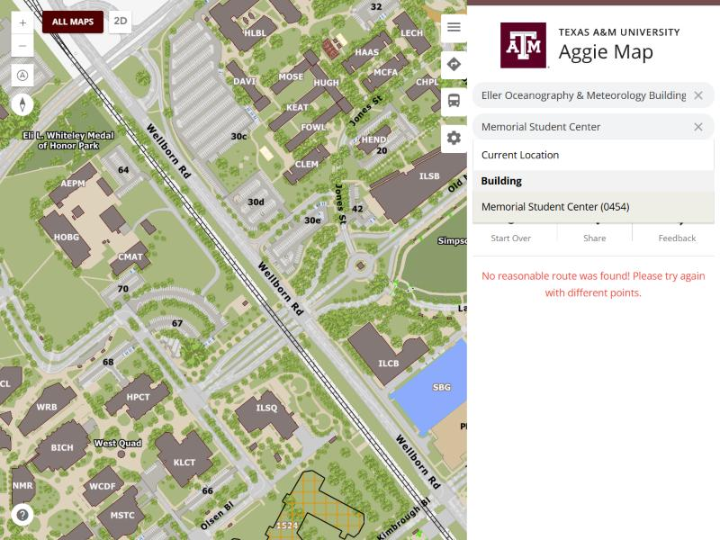
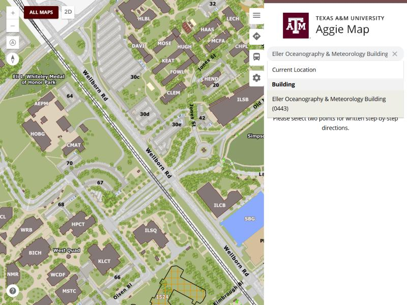

# 11 November 2026 (second release)

AggieMap, built from `94348414a` and tagged **`prod-2026-11-11-2`**. **Two pull requests** - [PR 2847](https://github.com/TamuGeoInnovation/Tamu.GeoInnovation.js.monorepo/pull/2847) and
[PR 2848](https://github.com/TamuGeoInnovation/Tamu.GeoInnovation.js.monorepo/pull/2848) - both fixes to things a visitor could hit on the map.

**These notes were written on 13 November, after the fact.** The release reached production on 11 November and no
dated file was written for it, so its two entries sat in [`unreleased/`](unreleased/README.md) as though they had
not shipped - where the next release would have collated them into *its* notes and claimed them a second time. Found
while cutting [13 November](2026-11-13.md), by checking which entries were already ancestors of the production tag
rather than assuming everything in `unreleased/` was unreleased.

The earlier release that day, `prod-2026-11-11`, is [10 November 2026](2026-11-10.md): the build cleared on dev on
the 10th and promoted on the 11th. This is the one after it.

## Summary

### A trip between two searched buildings finds a route again

Choosing both ends of a trip from the search box returned **"No reasonable route was found! Please try again
with different points"**, in every travel mode. Setting either end by clicking the map worked, which is what made
it look like a search fault rather than a routing one.

A trip to a building is moved to that building's nearest door before it is routed, and that only happens when
*both* ends came from search. From the north, the Memorial Student Center's nearest door is one that locates onto
a disconnected piece of the routing network, so the trip failed - while five other doors on the same building
would have worked, and a route plainly existed. Every nearby start chose the same door, so "try different
points" could not help.

The nearest door is now a preference rather than a requirement: doors are tried nearest first, and the first one
the network can route from is used. If none can, the trip keeps the building's own point, which routes.

The door itself is a data fault and is being fixed at source
([#2845](https://github.com/TamuGeoInnovation/Tamu.GeoInnovation.js.monorepo/issues/2845)). This is what makes
the next one survivable, because the application cannot tell a dead piece of network from a live one.
([#2843](https://github.com/TamuGeoInnovation/Tamu.GeoInnovation.js.monorepo/issues/2843))

| Before |
| --- |
|  |

An "after" capture needs a dev server built from the branch; it is added to the pull request before merging.

### Choosing a search result closes the drop down

Picking a result left the list open over whatever was underneath it. In the trip planner that is the other
endpoint's box and the route just calculated, so choosing a destination showed the list rather than the answer.

The options are chosen on `mousedown` - deliberately, because the input's own `blur` would otherwise hide the
list before a `click` could land on one. But `mousedown` runs before the browser moves focus, so the list closed
and the chosen option then took focus and opened it again. It now stays closed, and focusing the box again still
opens it.

This is the shared search component, so it is every search box in the application.
([#2844](https://github.com/TamuGeoInnovation/Tamu.GeoInnovation.js.monorepo/issues/2844))

| Before |
| --- |
|  |

An "after" capture needs a dev server built from the branch; it is added to the pull request before merging.

### Behind the scenes

- **AggieMap's notes are AggieMap's** ([#2833](https://github.com/TamuGeoInnovation/Tamu.GeoInnovation.js.monorepo/issues/2833), [PR 2837](https://github.com/TamuGeoInnovation/Tamu.GeoInnovation.js.monorepo/pull/2837)); GIS Day's collect in
  [GIS Day, unreleased](gisday-unreleased.md).
- **Pick pages on a visual-baselines comparison or gallery** ([#2841](https://github.com/TamuGeoInnovation/Tamu.GeoInnovation.js.monorepo/issues/2841), [PR 2842](https://github.com/TamuGeoInnovation/Tamu.GeoInnovation.js.monorepo/pull/2842)), with a list to
  share and the commands to retake them.
- **A current work-in-flight section** ([#2828](https://github.com/TamuGeoInnovation/Tamu.GeoInnovation.js.monorepo/issues/2828), [PR 2829](https://github.com/TamuGeoInnovation/Tamu.GeoInnovation.js.monorepo/pull/2829)), because the one a new session reads
  was eleven days stale.

## What was to be tested on dev

| Change | Open this on dev | Look for |
| --- | --- | --- |
| A trip between two searched buildings finds a route ([#2843](https://github.com/TamuGeoInnovation/Tamu.GeoInnovation.js.monorepo/issues/2843)) | [dev.aggiemap.tamu.edu/map/d/trip](https://dev.aggiemap.tamu.edu/map/d/trip) | Set both ends from the search box - Eller Oceanography & Meteorology Building to Memorial Student Center - and a walking route appears, where it said "No reasonable route was found!" |
| Choosing a search result closes the drop down ([#2844](https://github.com/TamuGeoInnovation/Tamu.GeoInnovation.js.monorepo/issues/2844)) | [dev.aggiemap.tamu.edu/map/d/trip](https://dev.aggiemap.tamu.edu/map/d/trip) | Type a building into the first box and pick it from the list: the list closes, and the second box and the route below it are visible without pressing Escape |

## What went into this release

| | |
| --- | --- |
| [#2843](https://github.com/TamuGeoInnovation/Tamu.GeoInnovation.js.monorepo/issues/2843) | A trip between two searched buildings found no route |
| [#2844](https://github.com/TamuGeoInnovation/Tamu.GeoInnovation.js.monorepo/issues/2844) | Choosing a search result left the drop down open |
| [PR 2847](https://github.com/TamuGeoInnovation/Tamu.GeoInnovation.js.monorepo/pull/2847) | fix(ui-kits-ngx-search): The search drop down closes when a result is chosen |
| [PR 2848](https://github.com/TamuGeoInnovation/Tamu.GeoInnovation.js.monorepo/pull/2848) | fix(maps-feature-trip-planner): A trip between two searched buildings finds a route again |
