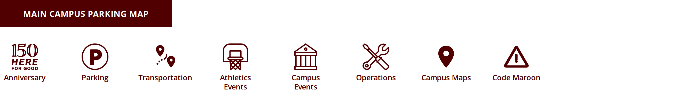
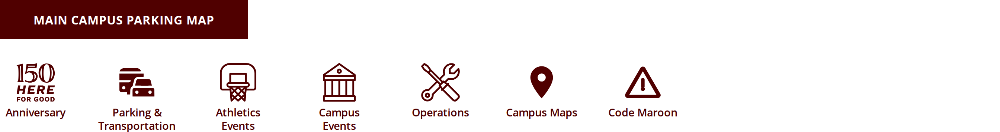
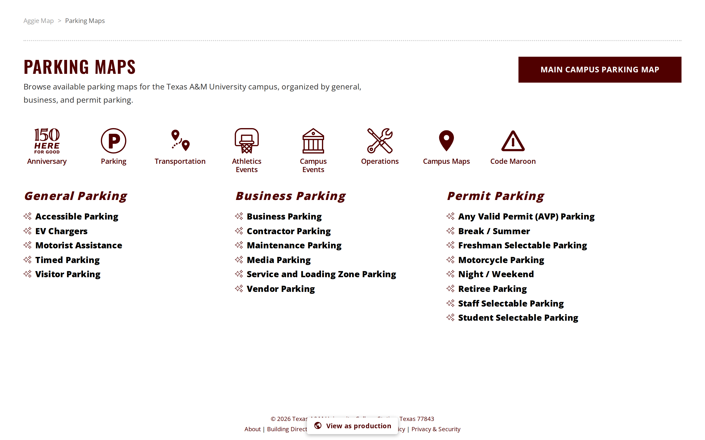
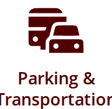
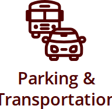
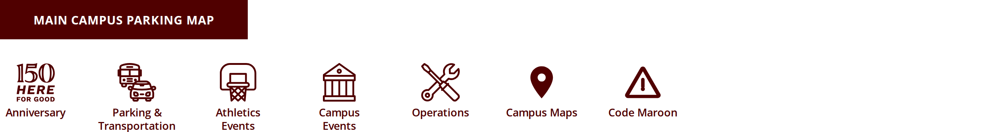
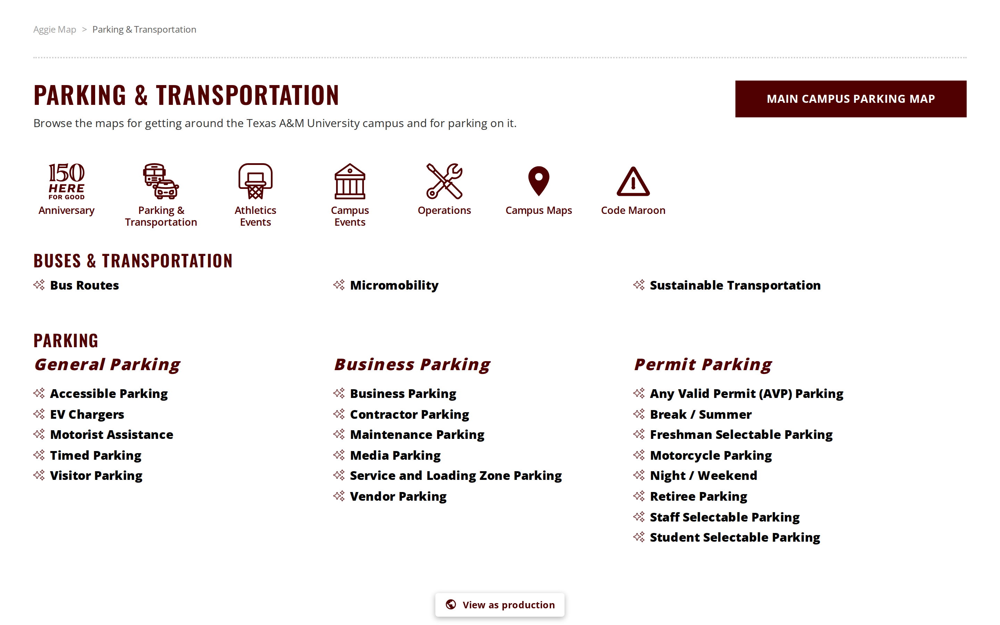

# 13 November 2026

AggieMap, built from `68d7b974c`. **Two pull requests** - [PR 2898](https://github.com/TamuGeoInnovation/Tamu.GeoInnovation.js.monorepo/pull/2898) and [PR 2911](https://github.com/TamuGeoInnovation/Tamu.GeoInnovation.js.monorepo/pull/2911) - listed in
[What went into this release](#what-went-into-this-release) at the end. Both are the same piece of work: the
Micromobility map reaching production, and the All Maps parking section becoming **Parking & Transportation**.

**This release went to production before the release tier ran, at the marketing team's request.** That is not the
order [the release sequence](README.md#cutting-a-release) sets out, and it is recorded here rather than left to be
inferred. What was skipped, precisely:

- **The quick tier on dev (step 2) and the release tier on the promoted build (step 3b) did not run before the
  promotion.** They are running against dev and production now, after the fact. [The run that cleared this
  release](#the-run-that-cleared-this-release) says what they found.
- **The team did not work through *What to test on dev* (step 3a)** before production. The table is below, and its
  rows are still worth walking - on production now, rather than on dev.
- **`68d7b974c` carries no tag.** A `dev-*` tag means "deployed to dev, and what changed was checked there", which
  is the claim the production tag depends on, so it cannot be written before the suite has said so. Both tags go on
  this commit once the run reports; until then the absence is the honest record.

What *was* checked before the promotion: the full affected check - lint, test and build for the three affected
projects, nothing replayed from cache - on [PR 2911](https://github.com/TamuGeoInnovation/Tamu.GeoInnovation.js.monorepo/pull/2911), and the new address and its redirect exercised by
hand in a dev server built from the branch. Neither is a substitute for the release tier, which is what checks that
nothing else moved.

GIS Day ships on its own path and is not part of this release. Its 14 changes from this period are in
[GIS Day, unreleased](gisday-unreleased.md).

## The change that matters most

**Micromobility is on production, at an address marketing can publish** ([#2895](https://github.com/TamuGeoInnovation/Tamu.GeoInnovation.js.monorepo/issues/2895), [#2864](https://github.com/TamuGeoInnovation/Tamu.GeoInnovation.js.monorepo/issues/2864),
[#2910](https://github.com/TamuGeoInnovation/Tamu.GeoInnovation.js.monorepo/issues/2910)). The map is live at
[aggiemap.tamu.edu/transportation/micromobility](https://aggiemap.tamu.edu/transportation/micromobility/) - the
address Transportation Services and the marketing team asked for - and the All Maps section listing it is at
`/all-maps/parking-transportation`, with the old `/all-maps/parking` still answering. That old address has been the
parking listing's for years and is linked from outside this repository, so it redirects rather than breaking.

## The run that cleared this release

**Nothing, at the time of promotion.** This is the section that usually carries the numbers. It does not, because
the release tier had not run.

It is running now on both environments from `68d7b974c`, and this file is updated with what it found - passed,
failed, skipped and duration, per environment - rather than left saying this. **A failure here is an incident on a
live site, not a test result**, because the build is already in front of visitors.

The two changes in this release have no smoke coverage of their own: nothing in `test/smoke/aggiemap` visits the All
Maps category pages. The new address, the redirect and the tile icon are being checked by hand on each environment
alongside the suite.

## Summary

### Micromobility is on production, and Parking is now Parking & Transportation

**The Micromobility map is on production**, on Transportation Services' approved paths service, which they publish on
each environment's own host. It is at
[aggiemap.tamu.edu/transportation/micromobility](https://aggiemap.tamu.edu/transportation/micromobility/).

**Transportation no longer has its own section.** It had a tile of its own on All Maps and a page behind it, both
visible only on development because every map they listed was. Rather than send a third top-level tile to production
for three maps, the **Parking** section is renamed **Parking & Transportation** and its page is split in two:

- **Buses & Transportation** first: Bus Routes, Micromobility and Sustainable Transportation.
- **Parking** below, in the General, Business and Permit columns it always had.

Each map keeps the address it should have: the transportation ones at `/transportation/<map>` and the parking ones at
`/parking/<map>`, from the one page. **Sustainable Transportation** is on production for the first time, and **Bus
Routes** is now listed everywhere rather than only where development features are on.

**Micromobility and Sustainable Transportation have come off the main map.** Both were groups in the main map's layer
list; they are maps in their own right and are reached as maps now. The six layers inside the Sustainable
Transportation group - Bike Racks, Campus Bike Lanes, City Bike Lanes and Routes, Bike Fix Stations, Bike Dismount
Zones and EV Charge Stations - went with it, and are on the Sustainable Transportation map.

([#2895](https://github.com/TamuGeoInnovation/Tamu.GeoInnovation.js.monorepo/issues/2895),
[#2864](https://github.com/TamuGeoInnovation/Tamu.GeoInnovation.js.monorepo/issues/2864))

| Before | After |
| --- | --- |
|  |  |
|  |  |

### Parking & Transportation has its own address, and the brand's own bus-and-car icon

Two pieces of feedback from the testing team on [#2895](https://github.com/TamuGeoInnovation/Tamu.GeoInnovation.js.monorepo/issues/2895), which brought the
transportation maps onto the parking section's page.

**The section is now at `/all-maps/parking-transportation`.** It was still at `/all-maps/parking`, which stopped
describing the page when Buses & Transportation was listed above Parking.

**The old address still works, at the same page.** `/all-maps/parking` has been the parking listing's address for
years and is linked from outside this repository, so it redirects to the new one rather than being retired - keeping
any query string and anchor - which is how [#2767](https://github.com/TamuGeoInnovation/Tamu.GeoInnovation.js.monorepo/issues/2767) treated the individual maps that moved from
`/parking/<map>` to `/transportation/<map>`. A test holds it open, so the next person to tidy the route table fails a
check rather than somebody's link.

**The tile now carries the university's own icon.** #2895 shipped a placeholder traced from artwork supplied by hand,
and [#2897](https://github.com/TamuGeoInnovation/Tamu.GeoInnovation.js.monorepo/issues/2897) asked Transportation for a version drawn for the 52-pixel tile. The team
pointed out that the icon already exists: **`aux_car-bus`**, in the Transportation family of the
[Aggie UX icon library](https://aggieux.tamu.edu/?path=/docs/getting-started-branding-aggie-ux-icon-library--docs)
(2.1.2). It is the brand's artwork, drawn at the weight the rest of the icon set uses, and it is already on the same
grid the older tiles are traced on - so it needed no redrawing and it settles #2897.

The maps themselves did not move: Micromobility is still at `/transportation/micromobility/` and the parking maps are
still at `/parking/<map>`.

([#2910](https://github.com/TamuGeoInnovation/Tamu.GeoInnovation.js.monorepo/issues/2910), [#2897](https://github.com/TamuGeoInnovation/Tamu.GeoInnovation.js.monorepo/issues/2897))

| Before                                                                                                                                      | After                                                                                                                                             |
| ------------------------------------------------------------------------------------------------------------------------------------------- | ------------------------------------------------------------------------------------------------------------------------------------------------- |
|        |                                   |
|  |  |
|                           |                        |

### Behind the scenes

- **CI's heavy jobs moved to the hosted pool** ([#2902](https://github.com/TamuGeoInnovation/Tamu.GeoInnovation.js.monorepo/issues/2902), [PR 2904](https://github.com/TamuGeoInnovation/Tamu.GeoInnovation.js.monorepo/pull/2904)) after the lab agents stopped
  taking work: the scheduled tasks that run them are triggered at logon, so a reboot left them idle and pull request
  builds queued with nothing to run them. [#2901](https://github.com/TamuGeoInnovation/Tamu.GeoInnovation.js.monorepo/issues/2901), the missing warning, is open.
- **An issue closes when its work merges to `development`, not when a release carries it to production**
  ([#2905](https://github.com/TamuGeoInnovation/Tamu.GeoInnovation.js.monorepo/issues/2905), [PR 2906](https://github.com/TamuGeoInnovation/Tamu.GeoInnovation.js.monorepo/pull/2906)), written into `CLAUDE.md` so it stops being decided case by case.

## What to test on dev

**These were not worked through before production.** Each row was written by the change that made it, for dev; the
same checks hold on production, where this release now is.

| Change | Open this on dev | Look for |
| --- | --- | --- |
| Micromobility on production, and Parking & Transportation ([#2895](https://github.com/TamuGeoInnovation/Tamu.GeoInnovation.js.monorepo/issues/2895)) | [All Maps on dev](https://dev.aggiemap.tamu.edu/all-maps), then [Parking & Transportation](https://dev.aggiemap.tamu.edu/all-maps/parking-transportation) and [the Micromobility map](https://dev.aggiemap.tamu.edu/transportation/micromobility/) | One **Parking & Transportation** tile with a bus-and-car icon, and no separate Transportation tile; the page lists **Buses & Transportation** first - Bus Routes, Micromobility, Sustainable Transportation - then **Parking** in its three columns; every link opens its map, with the transportation ones at `/transportation/...` and the parking ones at `/parking/...`; the main map's layer list has neither Micromobility nor Sustainable Transportation |
| Parking & Transportation's address and icon ([#2910](https://github.com/TamuGeoInnovation/Tamu.GeoInnovation.js.monorepo/issues/2910)) | [All Maps on dev](https://dev.aggiemap.tamu.edu/all-maps), then [the new address](https://dev.aggiemap.tamu.edu/all-maps/parking-transportation) and [the old one](https://dev.aggiemap.tamu.edu/all-maps/parking) | The **Parking & Transportation** tile shows Aggie UX's `aux_car-bus` - a bus behind a car, in the same line weight as the Athletics, Campus Events and Operations icons - and opens `/all-maps/parking-transportation`; the old `/all-maps/parking` lands on that same page, with the address bar showing the new one |

## What went into this release

| | |
| --- | --- |
| [#2895](https://github.com/TamuGeoInnovation/Tamu.GeoInnovation.js.monorepo/issues/2895) | Micromobility to production, and Parking becomes Parking & Transportation |
| [#2864](https://github.com/TamuGeoInnovation/Tamu.GeoInnovation.js.monorepo/issues/2864) | The Micromobility map's new service URL |
| [#2910](https://github.com/TamuGeoInnovation/Tamu.GeoInnovation.js.monorepo/issues/2910) | Parking & Transportation needs its own address and the brand's own bus-and-car icon |
| [#2897](https://github.com/TamuGeoInnovation/Tamu.GeoInnovation.js.monorepo/issues/2897) | The tile icon wanted one drawn for 52 px - answered by Aggie UX's own `aux_car-bus` |
| [PR 2898](https://github.com/TamuGeoInnovation/Tamu.GeoInnovation.js.monorepo/pull/2898) | feat(aggiemap-angular): Micromobility to production, and Parking becomes Parking & Transportation |
| [PR 2911](https://github.com/TamuGeoInnovation/Tamu.GeoInnovation.js.monorepo/pull/2911) | feat(aggiemap-angular): Parking & Transportation gets its own address and the brand's own bus-and-car icon |
