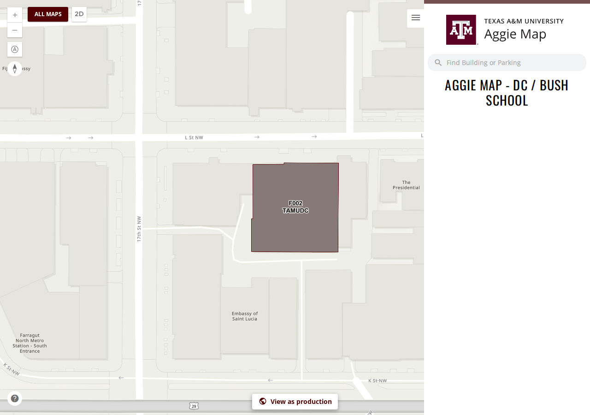
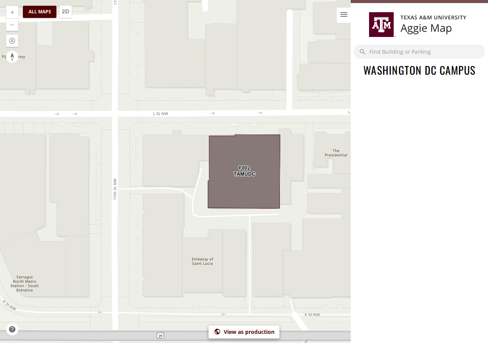
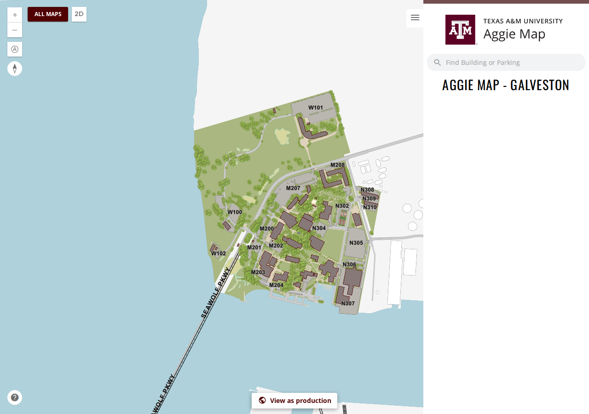
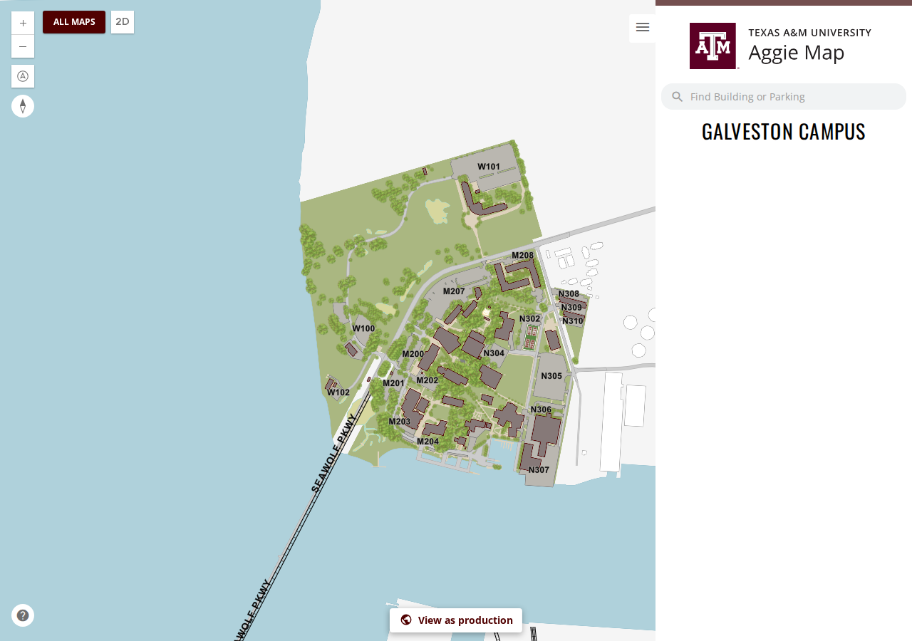
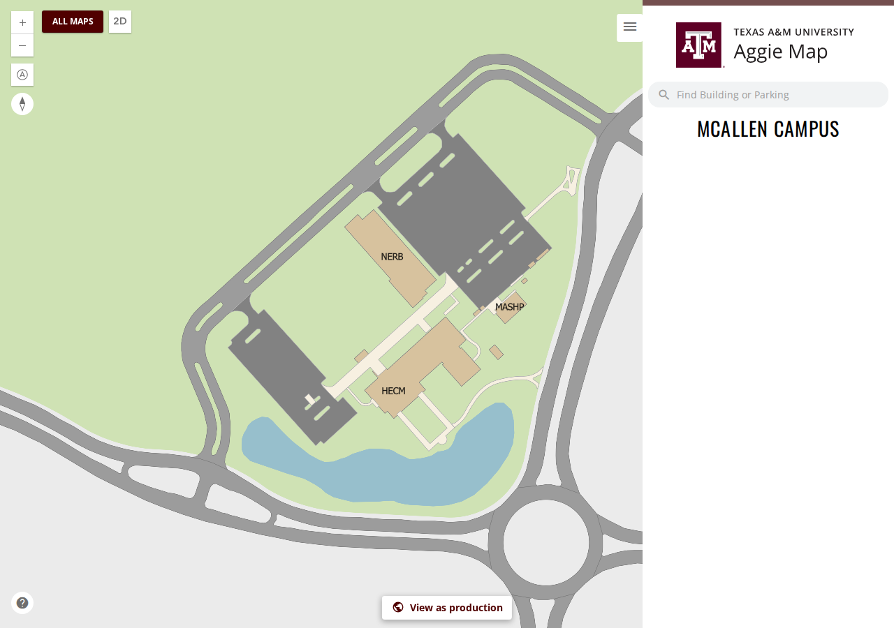
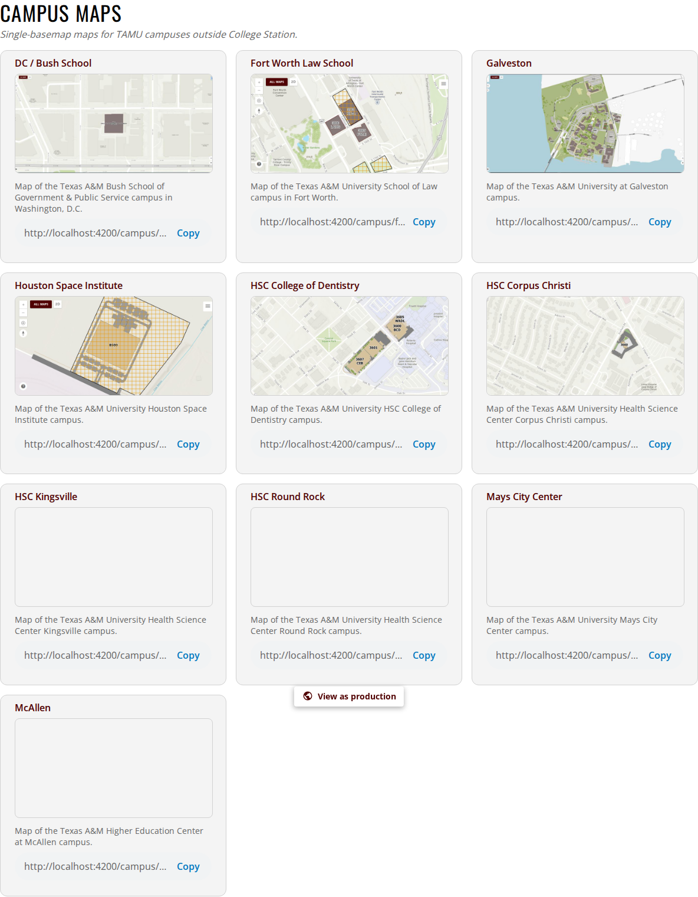
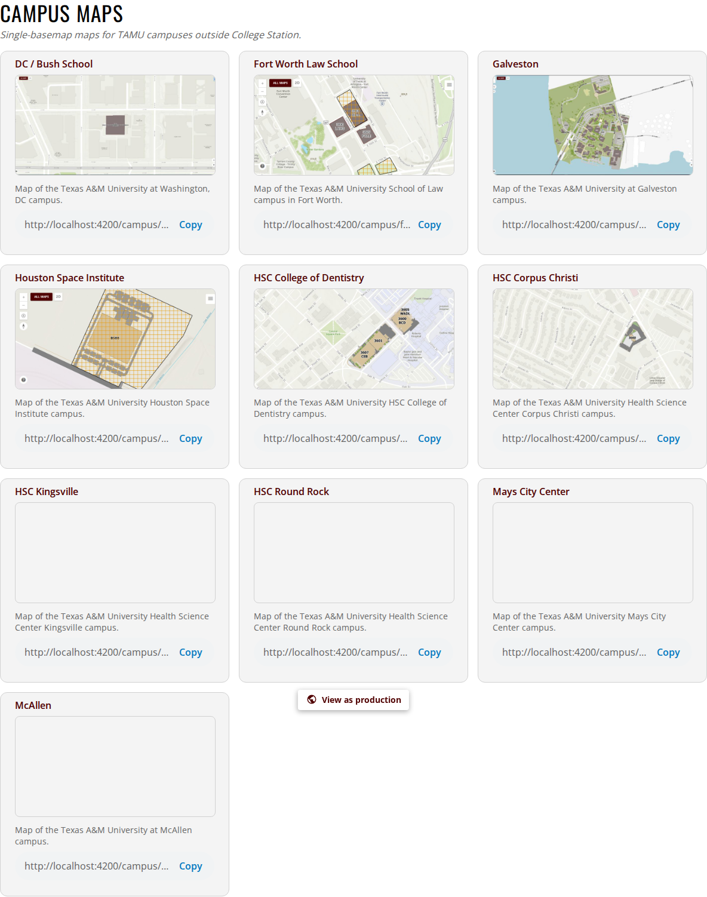

# 24 November 2026 (second release)

Built from `50b125bf5`, **20 pull requests** since [24 November 2026](2026-11-24.md) (`61dc13b89`), which
went to production earlier the same day.

**One of those changes is visible to an AggieMap visitor**: the remote campuses' new names
([#3161](https://github.com/TamuGeoInnovation/Tamu.GeoInnovation.js.monorepo/issues/3161)). 15 are GIS Day's,
released on its own path, with their entries in [GIS Day, unreleased](gisday-unreleased.md); the remaining
four are this file's predecessor, a smoke-suite fix, a documentation register and the disk guard.

A second release on the same day is unusual here and was deliberate: the campus rebranding was asked for
that day, and it is three strings.

## The dev run that cleared it

| | |
| --- | --- |
| Commit under test | `50b125bf5` |
| Tier | `quick` - the core, plus what changed since `dev-2026-11-24` |
| Passed | **365** |
| Failed | **0** |
| Flaky | **0** |
| Skipped | 28 |
| Duration | **4.8 minutes** |

It chose its own set from the diff and named it before the first test, as the tier does: 13 spec files whole,
and six routes - including `/campus/dc-bush-school`, `/campus/galveston` and `/campus/mcallen`, the three maps
this release changes. Eleven checks across those three passed. It also reported that three changed files map
to no test of their own, all of them GIS Day's chart components, so only the core covers them.

**This is the first green tier since 23 November.** `the basemap definitions yield services to check` passed
in 3 ms, where it had failed three attempts on every run since #3352 merged; the fix
([#3416](https://github.com/TamuGeoInnovation/Tamu.GeoInnovation.js.monorepo/issues/3416), PR 3423) is in this
build. A release can be cleared by reading a result again rather than by subtracting a known-false failure
from it.

**This release was cleared by a `quick` tier, and [the suite's own guidance](../../test/smoke/aggiemap/README.md#the-three-tiers)
says `quick` is never used to clear production.** That is a deliberate departure, taken by the maintainer, and
it is written here rather than left for someone to infer from the numbers:

- The **`release` tier ran this morning** against dev on `61dc13b89`, this build's parent, and its reading is
  in [the first release's notes](2026-11-24.md): 1,033 passed, and no visitor-facing regression.
- The delta between the two builds is **one text change to three campus maps**, plus GIS Day, documentation
  and the smoke suite. Nothing in it touches a service, a layer, a basemap or a route.
- What `quick` cannot do is find a map that broke **without** a release - a real gap, and the reason the rule
  exists. Against that: the `release` tier ran against **production itself** the same afternoon, which covers
  exactly that gap for the environment that matters.

So the honest summary is that two tiers cleared this release between them, neither of them the one the rule
names. If that turns out to have been the wrong call, this paragraph is where to start.

## Summary

### The Washington DC, Galveston and McAllen maps carry Texas A&M's new names

Texas A&M has new naming conventions for its locations in Washington, D.C., McAllen and Galveston. Each map's sidebar
is now headed **Washington DC Campus**, **Galveston Campus** and **McAllen Campus**, and the Campus Maps page describes
DC's and McAllen's maps as the **Texas A&M University at Washington, DC** and **at McAllen** campus. Their addresses
are unchanged, so links already shared still open them.
([#3161](https://github.com/TamuGeoInnovation/Tamu.GeoInnovation.js.monorepo/issues/3161))

| | Before | After |
| --- | --- | --- |
| Washington DC |  |  |
| Galveston |  |  |
| McAllen |  |  |
| Campus Maps |  |  |

## What was tested on dev

The entry's row named only the DC map. The rebranding changes six things across four pages, and **no
automated check reads any of these strings**, so all six were checked by eye on dev and are listed here
rather than the one. Links point at **production**, which is where anyone following them will look now.

| Change | Where to look | What to look for | Tested on dev |
| --- | --- | --- | --- |
| Washington DC's map ([#3161](https://github.com/TamuGeoInnovation/Tamu.GeoInnovation.js.monorepo/issues/3161)) | [aggiemap.tamu.edu/campus/dc-bush-school/map/d](https://aggiemap.tamu.edu/campus/dc-bush-school/map/d) | The sidebar's heading reads **Washington DC Campus** | **Passed**, read from the live page on dev, 3:46 PM Central |
| Galveston's map | [aggiemap.tamu.edu/campus/galveston/map/d](https://aggiemap.tamu.edu/campus/galveston/map/d) | The sidebar's heading reads **Galveston Campus** | **Passed**, same reading |
| McAllen's map | [aggiemap.tamu.edu/campus/mcallen/map/d](https://aggiemap.tamu.edu/campus/mcallen/map/d) | The sidebar's heading reads **McAllen Campus** | **Passed**, same reading |
| Campus Maps, DC's description | [aggiemap.tamu.edu/all-maps](https://aggiemap.tamu.edu/all-maps) | Map of the Texas A&M University at Washington, DC campus. | **Passed** |
| Campus Maps, McAllen's description | [aggiemap.tamu.edu/all-maps](https://aggiemap.tamu.edu/all-maps) | Map of the Texas A&M University at McAllen campus. | **Passed** |
| Campus Maps, the three card names | [aggiemap.tamu.edu/all-maps](https://aggiemap.tamu.edu/all-maps) | **Unchanged**: DC / Bush School, Galveston, McAllen. Two specs pin the cards' order by these names, so a change here is a fault, not an improvement | **Passed** - all three unchanged |

**What production said before the release**, read from the live site at 1:50 PM US Central, so the "before"
is a reading rather than a recollection:

| Where | Production said |
| --- | --- |
| DC map's sidebar | `Aggie Map - DC / Bush School` |
| Campus Maps, DC | Map of the Texas A&M Bush School of Government & Public Service campus in Washington, D.C. |
| Campus Maps, McAllen | Map of the Texas A&M Higher Education Center at McAllen campus. |
| Campus Maps, Galveston | Map of the Texas A&M University at Galveston campus. - already the new wording, which is why the issue asked for no change |

**The logos are not part of this, deliberately.** The issue opens by mentioning Texas A&M's updated logos,
which is policy context rather than assets handed over to apply; the maintainer confirmed that on
24 November. Every item the issue lists is text. The three campuses' `brandingIconUrl` is unset, with a TODO
beside each, so no out-of-date logo is on screen either.

## What went into this release

20 pull requests, `61dc13b89..50b125bf5`. **15 of them are GIS Day's**, which is released on its own path;
they are listed with their entries in [GIS Day, unreleased](gisday-unreleased.md) rather than repeated here,
so this table answers "what reached AggieMap's visitors" rather than "what was in the build".

Of the five below, **only [#3422](https://github.com/TamuGeoInnovation/Tamu.GeoInnovation.js.monorepo/pull/3422)
changes anything a visitor sees.** The other four are this morning's release notes, a smoke-suite fix, a
documentation register with a check behind it, and the disk guard - none of them reaches a browser.

| Pull request | Issue | Change |
| --- | --- | --- |
| [#3421](https://github.com/TamuGeoInnovation/Tamu.GeoInnovation.js.monorepo/pull/3421) | [#3402](https://github.com/TamuGeoInnovation/Tamu.GeoInnovation.js.monorepo/issues/3402) | docs(aggiemap): One register of development-to-production GIS service differences, so the GIS team can be told |
| [#3423](https://github.com/TamuGeoInnovation/Tamu.GeoInnovation.js.monorepo/pull/3423) | [#3416](https://github.com/TamuGeoInnovation/Tamu.GeoInnovation.js.monorepo/issues/3416) | test(aggiemap): A basemap drawn from something that is not an ArcGIS service says so, with its reason |
| [#3422](https://github.com/TamuGeoInnovation/Tamu.GeoInnovation.js.monorepo/pull/3422) | [#3161](https://github.com/TamuGeoInnovation/Tamu.GeoInnovation.js.monorepo/issues/3161) | fix(ts-events-ngx): Washington DC, Galveston and McAllen campus maps under Texas A&M's new names |
| [#3418](https://github.com/TamuGeoInnovation/Tamu.GeoInnovation.js.monorepo/pull/3418) | [#3417](https://github.com/TamuGeoInnovation/Tamu.GeoInnovation.js.monorepo/issues/3417) | docs(releases): The 24 November 2026 release notes, and the suite at 1,127 tests |
| [#3407](https://github.com/TamuGeoInnovation/Tamu.GeoInnovation.js.monorepo/pull/3407) | [#3400](https://github.com/TamuGeoInnovation/Tamu.GeoInnovation.js.monorepo/issues/3400) | chore(workspace): A check refuses to start on low disk, and a merged branch's worktree and volume can be removed |
