# 24 November 2026

Built from `61dc13b89`, **236 pull requests** since [13 November 2026](2026-11-13.md) (`68d7b974c`), which
is what production ran until this one.

**Five of those changes are AggieMap's and visible.** 180 are GIS Day's, released on its own path, with its
notes in [GIS Day, unreleased](gisday-unreleased.md); the remaining 51 are shared libraries, tests,
dependencies and build work with no visible result of their own. A release carrying three weeks of work is
why the suite had so much to report at once, and shortening the cadence is
[#3411](https://github.com/TamuGeoInnovation/Tamu.GeoInnovation.js.monorepo/issues/3411).

## The dev run that cleared it

The `release` tier of [`test/smoke/aggiemap`](../../test/smoke/aggiemap/README.md) - every map once - against
[dev.aggiemap.tamu.edu](https://dev.aggiemap.tamu.edu), on a machine with nothing else running: the GIS Day
stack was stopped first and `docker ps` reported no containers.

| | 13 November's build, run 23 November | **This build, 24 November** |
| --- | --- | --- |
| Passed | 982 | **1,033** |
| Failed | 18 | **9** |
| Flaky | 7 | 14 |
| Skipped | 71 | 71 |
| Duration | 1.6 h | **1.4 h** |

Started 10:50 AM US Central, finished about 12:14 PM. Two retries per test, so *failed* means three attempts
failed and *flaky* means it failed and then passed.

**The tier was red, and nothing in it is a visible regression from this release.**

- **One real regression, and it is in a check.** [#3352](https://github.com/TamuGeoInnovation/Tamu.GeoInnovation.js.monorepo/pull/3352), merged this morning, made the basemap scraper
  resolve every campus constant rather than one it knew by name. It now flags **`NearmapCSBasemap`**, whose
  URL is a literal Nearmap address and not a campus constant at all. It fails in under 20 ms, on every run,
  whatever the load - a static check, never the network. Visitors see nothing different, and it will keep
  every release tier red until the check or that definition changes
  ([#3416](https://github.com/TamuGeoInnovation/Tamu.GeoInnovation.js.monorepo/issues/3416)).
- **Two are real on a quiet machine and were already known**, both failing the same way, "never finished
  drawing": indoor-track-parking's layer order on 2 of 3 loads
  ([#3369](https://github.com/TamuGeoInnovation/Tamu.GeoInnovation.js.monorepo/issues/3369)) and
  break-summer's Lot 100g popup. Each map's drawing does not finish inside the test's wait with nothing else
  running, which is timing work rather than flakiness to retry through.
- **The rest are flakiness and two services having a bad hour, neither of them this build.** The dining API
  was unreachable now and then across the 1.4 hours, which fits eight parking maps reaching it at different
  moments; re-run alone afterwards it passed 9 of 9, and the service answered 5 of 5 in under 50 ms with the
  right `Access-Control-Allow-Origin`. **Production's** basemap service answers `400 Unable to complete
  operation` to count queries on Bevel, Field Line and Trees at random, and refuses records past its 2,000
  limit; [#3386](https://github.com/TamuGeoInnovation/Tamu.GeoInnovation.js.monorepo/pull/3386), also from this morning, already asks a refused count again once.

**One of 23 November's eighteen is now answered:** `basemap-requests`
([#3364](https://github.com/TamuGeoInnovation/Tamu.GeoInnovation.js.monorepo/issues/3364)) **passed on its first try** here. It fails under load and
passes on a quiet machine, so it is a measurement of the machine rather than of the campus features service.

The previous release went to production **before** its tier ran, at the marketing team's request, and
[13 November](2026-11-13.md) records that. This one did not.

## Summary

### Games of Texas's Road Closures swatch matches the other red-hatch swatches

Three maps show a red hatch in their legend: Beef Cattle's No Parking Zones and the Road Closures of Fire School and
Games of Texas. ArcGIS draws no legend swatch for a hatch, so each map drew its own, and Games of Texas's had drifted
to heavier diagonals than the other two. All three now use one swatch, the finer one. The hatch drawn on the map is
unchanged.
([#2601](https://github.com/TamuGeoInnovation/Tamu.GeoInnovation.js.monorepo/issues/2601))

| The legend swatch, at its size and 6 times larger | Before | After |
| --- | --- | --- |
| Games of Texas, Road Closures | 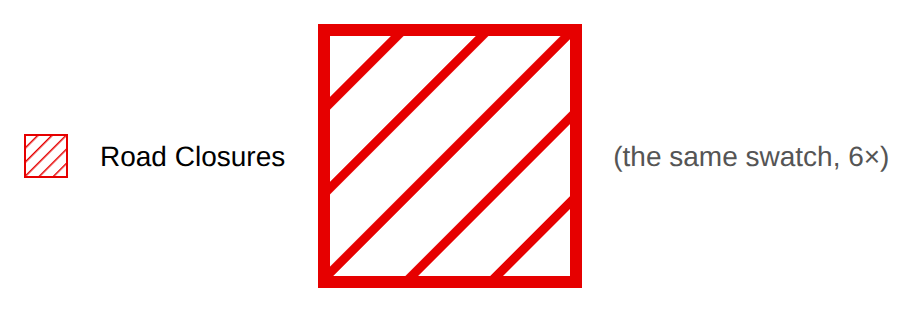 | 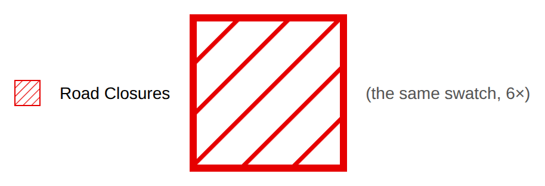 |

### Nature Rx is now Nature Spaces, and a space's popup is headed by its name

The GIS team asked for two changes before the layer goes to production. It is now called **Nature Spaces** in the
Layers list, the legend and search. And the line under a space's photograph is the space's own name, the service's
*Area Name*, where it was the part of campus it is on, so that every space on West Campus read "West Campus". All 36
spaces have a name. The service still calls the layer "NatureRx Spaces", so the new title is declared as an override
until the GIS team renames it there. Development only, as the layer is (#2673).
([#3223](https://github.com/TamuGeoInnovation/Tamu.GeoInnovation.js.monorepo/issues/3223))

| | Before | After |
| --- | --- | --- |
| The popup | 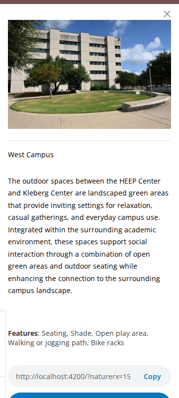 | 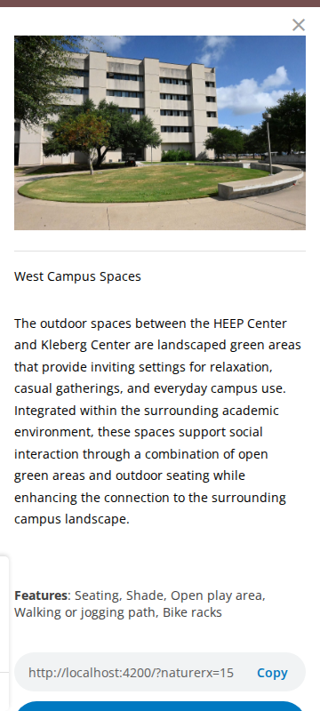 |
| The Layers list | 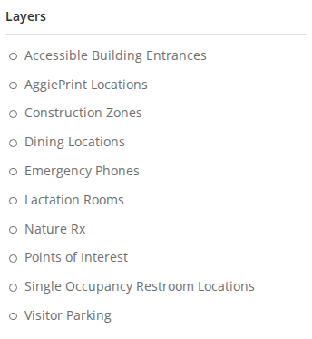 | 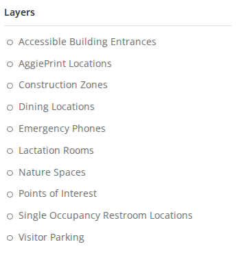 |

### The November 2026 campus basemap, on every environment, with its buildings under construction

The GIS team published a new campus basemap on 19 November (`TAMU_BaseMap_20261119`). It is now the basemap every map
opens on, on dev and on production, replacing the October cache outright rather than being offered beside it
([#3225](https://github.com/TamuGeoInnovation/Tamu.GeoInnovation.js.monorepo/issues/3225)).

**The data moved with the tiles**
([#3299](https://github.com/TamuGeoInnovation/Tamu.GeoInnovation.js.monorepo/issues/3299)). The campus basemap is not
only tiles: the buildings behind search and popups, the surface parking lots, and the buildings drawn as under
construction all come from the feature service the basemap is published from. The old and new services disagree about
what is being built, so leaving the data behind would have drawn three buildings wrong:

| Building | Before | Now |
| --- | --- | --- |
| Easterwood Airport ARFF Station | hatched as under construction | finished, so no hatch |
| Golf Performance Center | not shown as under construction | hatched |
| Last Energy PWR5 Facility | not shown as under construction | hatched |

**The hatch is unchanged.** The new cache draws buildings under construction as a plain black outline, where the old
one drew them as a solid pink block - a fault the GIS team has fixed at source. Taking the new cache exactly as
published would have replaced the orange grid with that plain outline on every map, so the grid is kept, as it was
settled on 27 October (#2532, #2459).

| At 1280 pixels | Before | After |
| --- | --- | --- |
| Campus | 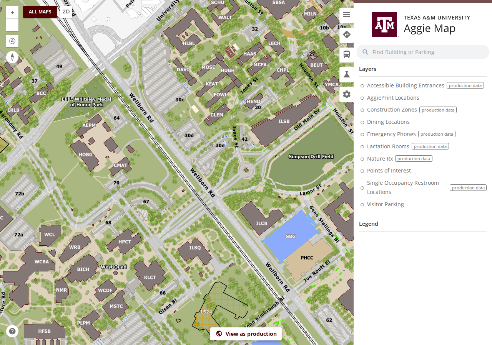 | 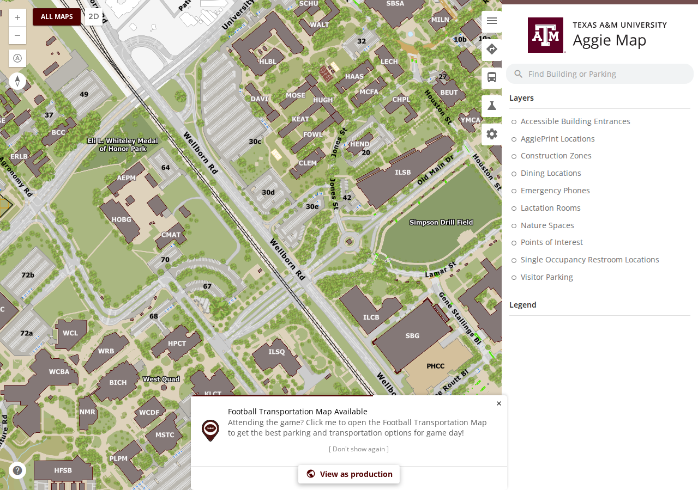 |
| Easterwood Airport ARFF Station | 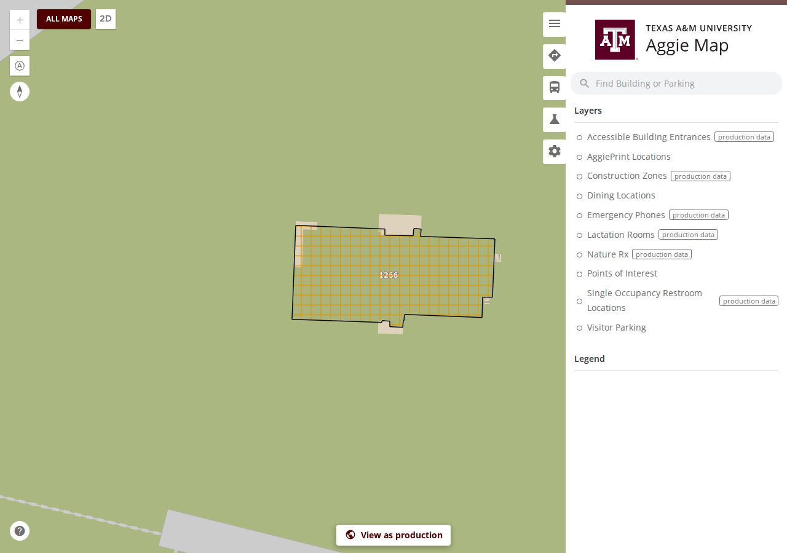 | 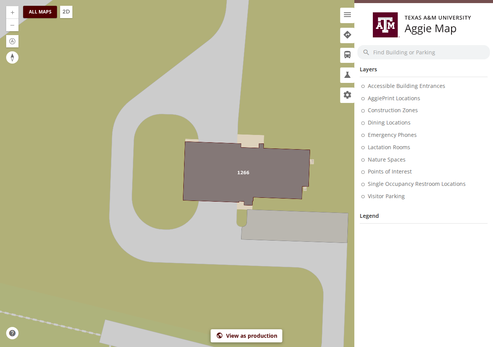 |
| The Golf Performance Center | Not in the old data at all, so its link does not resolve and nothing can be shown | 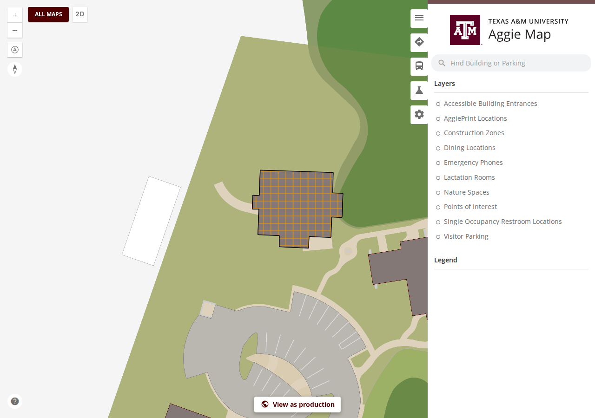 |

"Before" is dev as it stands, drawing from the October cache; "after" is a local dev server on this change, drawing from the November one. The Golf Performance Center has no "before": it is not in the old building data, so a link to it does not resolve on dev and the map stays where it opened. That absence is the change.

**The gallery no longer offers a dated vector version.** When a cache was replaced, the one it replaced used to stay
in the development gallery so the two could be compared (#2436). Nothing points at the October cache any more, so
there is nothing to compare against on dev. That is deliberate, and it is a change to how a new basemap gets
reviewed: the September cache came out for its own reason (#3279), and this one follows the decision that nothing
should point at the old service once the new one ships.

### Commencement: the ceremony details link reaches a page that exists

The three commencement maps - fall, spring and summer - each showed **Click here for &lt;map&gt; Ceremony details** above
the day picker, and all three pointed at `aggie.tamu.edu/graduation`, which Aggie One Stop now answers with its own
"Page Not Found". Anyone following it to find out when their ceremony was got a 404. They now open
`graduation.tamu.edu/ceremony-information`, the page Transportation Services asked for, which carries the ceremony
schedule, the individual colleges' and branch campuses' ceremonies, photography rules and the program archives
([#3278](https://github.com/TamuGeoInnovation/Tamu.GeoInnovation.js.monorepo/issues/3278)).

Only the fall map was reported, because it is the one in season. The same dead address was written out in all three
definitions, so spring's and summer's links were equally dead; all three move together rather than being found again
by whoever uses those maps next.

| At 1280 pixels | Before | After |
| --- | --- | --- |
| Where the link is, on production | 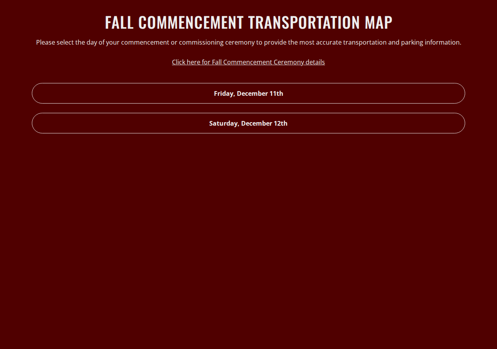 | The page is unchanged; only where the link goes changes |
| Following it |  |  |
| The schedule, one step on | | 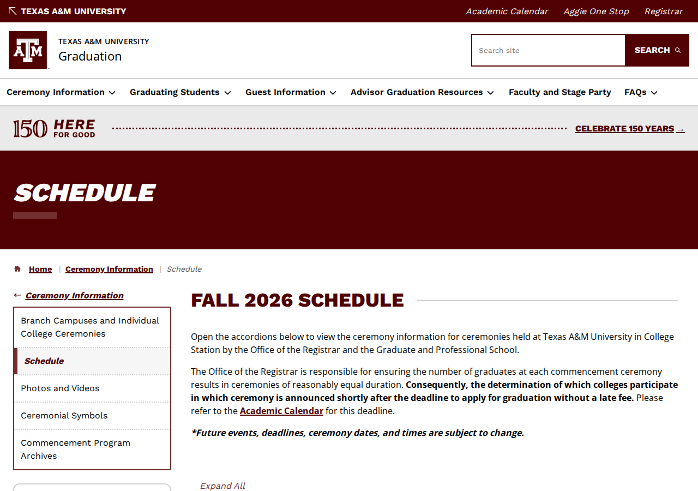 |

The builder page itself looks exactly the same before and after - the words above the day picker do not change, only
the address behind them - so the "before" image is the page as production shows it today, and the pair that matters is
the destination.

Nothing here could have caught this on its own. A map's schedule link is configuration rather than a service, so the
map loads, draws and passes the smoke suite with a dead link in it; the only signal was a visitor following it. A unit
check now fails if any map points at that retired host, and
[#3285](https://github.com/TamuGeoInnovation/Tamu.GeoInnovation.js.monorepo/issues/3285) adds the check that asks each
link whether it still answers.

### Dev's basemap settings no longer ask visitors to sign in

Opening the map's settings on dev raised a portal sign-in dialog over the basemap gallery, because the gallery still
offered the September 2026 campus basemap, and its service has since been retired and secured. That basemap was kept
only to compare with October's, a comparison settled when October's became the default. It is gone from the gallery,
and the dialog with it. Anyone who had chosen it gets the campus basemap instead. Production never offered it.
([#3279](https://github.com/TamuGeoInnovation/Tamu.GeoInnovation.js.monorepo/issues/3279))

| | Before | After |
| --- | --- | --- |
| The settings page on dev | 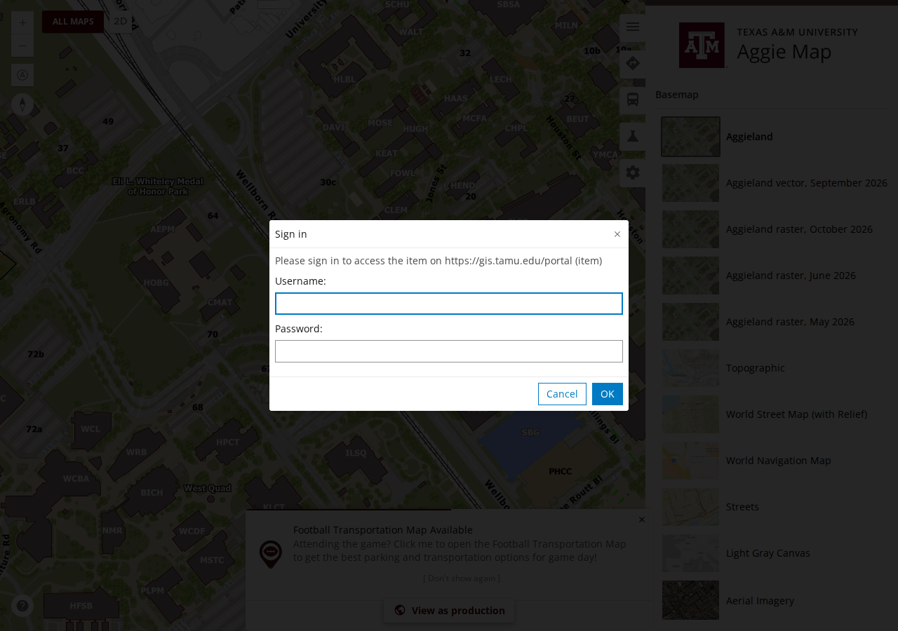 | 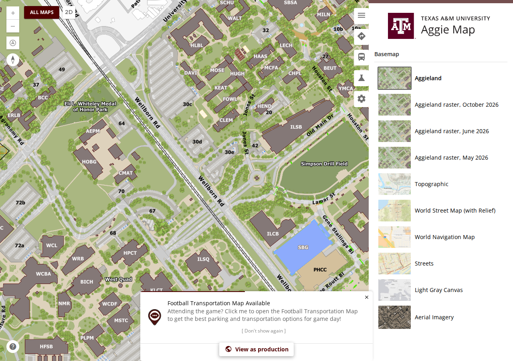 |

## What was tested on dev

These are the rows that stood in *What to test on dev* while the build was on dev. Links point at
**production**, which is where anyone following them will look now; the two changes deliberately not on
production keep their dev link and say why.

**What is automated, and what is not.** Three of the five are now covered by checks that merged in this same
release, which is why they are reported as proven: the Nature Spaces rename by
[#3383](https://github.com/TamuGeoInnovation/Tamu.GeoInnovation.js.monorepo/pull/3383), every map's outbound links - including the commencement one - by
[#3334](https://github.com/TamuGeoInnovation/Tamu.GeoInnovation.js.monorepo/pull/3334), and the basemap definitions by
[#3352](https://github.com/TamuGeoInnovation/Tamu.GeoInnovation.js.monorepo/pull/3352). The other two are a swatch and the absence of a dialog; no check
sees either, and **no hand check of them has been reported**, so they are listed as untested rather than as
passed.

| Change | Where to look | What to look for | Tested on dev |
| --- | --- | --- | --- |
| Games of Texas's Road Closures swatch matches Beef Cattle's and Fire School's ([#2601](https://github.com/TamuGeoInnovation/Tamu.GeoInnovation.js.monorepo/issues/2601)) | [aggiemap.tamu.edu/events/games-of-texas](https://aggiemap.tamu.edu/events/games-of-texas), the legend | Road Closures shows a red-hatched square with diagonals as fine as the No Parking Zones swatch on [/events/beef-cattle-vendor](https://aggiemap.tamu.edu/events/beef-cattle-vendor); the map's own hatch is unchanged | **Not reported.** The three swatches are drawn from one shared SVG data URI after [#3341](https://github.com/TamuGeoInnovation/Tamu.GeoInnovation.js.monorepo/pull/3341), and its unit tests pass, but nothing checks the rendered legend |
| Nature Spaces ([#3223](https://github.com/TamuGeoInnovation/Tamu.GeoInnovation.js.monorepo/issues/3223)) | **Development only:** [dev.aggiemap.tamu.edu/map/d?naturerx=15](https://dev.aggiemap.tamu.edu/map/d?naturerx=15). Production does not have the layer yet ([#2673](https://github.com/TamuGeoInnovation/Tamu.GeoInnovation.js.monorepo/issues/2673)) | The Layers list says Nature Spaces, not Nature Rx; the space's popup says "West Campus Spaces" under its photograph, not "West Campus" | **Passed** in the release tier. [#3383](https://github.com/TamuGeoInnovation/Tamu.GeoInnovation.js.monorepo/pull/3383) rewrote the search checks to expect the new name after [#3368](https://github.com/TamuGeoInnovation/Tamu.GeoInnovation.js.monorepo/issues/3368) caught the old one |
| The November 2026 campus basemap ([#3225](https://github.com/TamuGeoInnovation/Tamu.GeoInnovation.js.monorepo/issues/3225), [#3299](https://github.com/TamuGeoInnovation/Tamu.GeoInnovation.js.monorepo/issues/3299)) | [aggiemap.tamu.edu/map/d](https://aggiemap.tamu.edu/map/d), then the basemap panel at [/map/d/settings](https://aggiemap.tamu.edu/map/d/settings) | The map opens on **Aggieland**, now drawn from the November cache, and the gallery lists no dated vector version beside it. Buildings under construction still carry the orange grid with a black outline, not a pink block and not a plain outline. Specifically: the **Golf Performance Center** and the **Last Energy PWR5 Facility** are hatched, and the **Easterwood Airport ARFF Station** is not, because it is finished. Building search and surface parking lots still work | **Passed**, with one caveat. The basemap's layers, fields and counts were checked; `basemap-requests` ([#3364](https://github.com/TamuGeoInnovation/Tamu.GeoInnovation.js.monorepo/issues/3364)) passed first try on a quiet machine. **Production's** basemap service answered `400` to three layers' count queries at random, which is the service and not this build |
| Commencement schedule link ([#3278](https://github.com/TamuGeoInnovation/Tamu.GeoInnovation.js.monorepo/issues/3278)) | The [Fall Commencement builder](https://aggiemap.tamu.edu/events/graduation-fall/builder/accommodations/date?ret=review), then **Click here for Fall Commencement Ceremony details**; then the same link on the [spring](https://aggiemap.tamu.edu/events/graduation-spring/builder/accommodations/date?ret=review) and [summer](https://aggiemap.tamu.edu/events/graduation-summer/builder/accommodations/date?ret=review) maps | Each opens Texas A&M's **Ceremony Information** page at `graduation.tamu.edu`, with Schedule, Branch Campuses, Photos and Videos and the rest. None reaches Aggie One Stop's maroon "404 Page Not Found" page with Reveille on it | **Passed** in the release tier. [#3334](https://github.com/TamuGeoInnovation/Tamu.GeoInnovation.js.monorepo/pull/3334) now follows every map's outbound links, so the next dead one is found here rather than by a visitor |
| The basemap settings open without a sign-in prompt ([#3279](https://github.com/TamuGeoInnovation/Tamu.GeoInnovation.js.monorepo/issues/3279)) | **Development only:** [dev.aggiemap.tamu.edu/map/d/settings](https://dev.aggiemap.tamu.edu/map/d/settings). Production never offered the vector basemap, so nothing changes there | No "Please sign in to access the item" dialog when the page opens; the gallery lists Aggieland and the dated raster basemaps, with no "Aggieland vector, September 2026" | **Not reported.** No check looks for the absence of a portal dialog. The entry it came from was removed from the gallery, which is what the fix was |

## What went into this release

236 pull requests, `68d7b974c..61dc13b89`. **180 of them are GIS Day's**, which is released on its own path;
they are listed with their entries in [GIS Day, unreleased](gisday-unreleased.md) rather than repeated here,
so that this table answers "what reached AggieMap's visitors" rather than "what was in the build". The 56
below are AggieMap's, the shared libraries, the smoke suite, dependencies and build work.

Five of the 56 are Dependabot's and show their tracking issue rather than a closing reference: Dependabot
rewrites a pull request's body on every rebase, which drops `Closes #N` even when the issue exists and was
closed by hand, exactly as [CLAUDE.md](../../CLAUDE.md) warns. Each was found by searching for `Tracks PR #<n>`
and each is already closed.

| Pull request | Issue | Change |
| --- | --- | --- |
| [#3401](https://github.com/TamuGeoInnovation/Tamu.GeoInnovation.js.monorepo/pull/3401) | [#3405](https://github.com/TamuGeoInnovation/Tamu.GeoInnovation.js.monorepo/issues/3405) | chore(deps): bump the everything-else group with 2 updates |
| [#3404](https://github.com/TamuGeoInnovation/Tamu.GeoInnovation.js.monorepo/pull/3404) | [#3317](https://github.com/TamuGeoInnovation/Tamu.GeoInnovation.js.monorepo/issues/3317) | fix(workspace): The front ends build from the nginx base with libxml2 2.13.9-r3 |
| [#3403](https://github.com/TamuGeoInnovation/Tamu.GeoInnovation.js.monorepo/pull/3403) | [#2282](https://github.com/TamuGeoInnovation/Tamu.GeoInnovation.js.monorepo/issues/2282) | chore(workspace): Move geoservices' and GIS Day's animations off @angular/animations, and remove the package |
| [#3342](https://github.com/TamuGeoInnovation/Tamu.GeoInnovation.js.monorepo/pull/3342) | [#2602](https://github.com/TamuGeoInnovation/Tamu.GeoInnovation.js.monorepo/issues/2602) | chore(ts-events-ngx): One markdown popup helper, and the Construction project fields shared with Tailgating |
| [#3385](https://github.com/TamuGeoInnovation/Tamu.GeoInnovation.js.monorepo/pull/3385) | [#2701](https://github.com/TamuGeoInnovation/Tamu.GeoInnovation.js.monorepo/issues/2701) | test(aggiemap): Clicking one building after another clicks them where they are, not at fixed screen points |
| [#3383](https://github.com/TamuGeoInnovation/Tamu.GeoInnovation.js.monorepo/pull/3383) | [#3368](https://github.com/TamuGeoInnovation/Tamu.GeoInnovation.js.monorepo/issues/3368) | test(aggiemap): The Nature Rx search checks expect Nature Spaces and the space's name |
| [#3352](https://github.com/TamuGeoInnovation/Tamu.GeoInnovation.js.monorepo/pull/3352) | [#3350](https://github.com/TamuGeoInnovation/Tamu.GeoInnovation.js.monorepo/issues/3350) | test(aggiemap): The basemap scraper resolves every campus constant, not one it knows by name |
| [#3353](https://github.com/TamuGeoInnovation/Tamu.GeoInnovation.js.monorepo/pull/3353) | [#3338](https://github.com/TamuGeoInnovation/Tamu.GeoInnovation.js.monorepo/issues/3338) | test(aggiemap): A route change is exactly one page view, to the site's own property |
| [#3335](https://github.com/TamuGeoInnovation/Tamu.GeoInnovation.js.monorepo/pull/3335) | [#2605](https://github.com/TamuGeoInnovation/Tamu.GeoInnovation.js.monorepo/issues/2605) | chore(sass): Texas A&M's maroon is $aggie-maroon, not #500000 typed 75 times |
| [#3334](https://github.com/TamuGeoInnovation/Tamu.GeoInnovation.js.monorepo/pull/3334) | [#3285](https://github.com/TamuGeoInnovation/Tamu.GeoInnovation.js.monorepo/issues/3285) | test(aggiemap): Check every map's outbound links, so a dead schedule link is found by us |
| [#3341](https://github.com/TamuGeoInnovation/Tamu.GeoInnovation.js.monorepo/pull/3341) | [#2601](https://github.com/TamuGeoInnovation/Tamu.GeoInnovation.js.monorepo/issues/2601) | chore(ts-events-ngx): One red-hatch swatch, one SVG data URI and one arrow line, shared |
| [#3386](https://github.com/TamuGeoInnovation/Tamu.GeoInnovation.js.monorepo/pull/3386) | [#2616](https://github.com/TamuGeoInnovation/Tamu.GeoInnovation.js.monorepo/issues/2616) | test(aggiemap): A count the GIS server refuses or leaves unanswered is asked again once |
| [#3336](https://github.com/TamuGeoInnovation/Tamu.GeoInnovation.js.monorepo/pull/3336) | [#2603](https://github.com/TamuGeoInnovation/Tamu.GeoInnovation.js.monorepo/issues/2603) | test(aggiemap): The smoke suite names the map probe once, and waits for a map in one helper |
| [#3389](https://github.com/TamuGeoInnovation/Tamu.GeoInnovation.js.monorepo/pull/3389) | [#3376](https://github.com/TamuGeoInnovation/Tamu.GeoInnovation.js.monorepo/issues/3376) | docs(workspace): The hand-written Playwright commands read the image from package.json |
| [#3384](https://github.com/TamuGeoInnovation/Tamu.GeoInnovation.js.monorepo/pull/3384) | [#3358](https://github.com/TamuGeoInnovation/Tamu.GeoInnovation.js.monorepo/issues/3358) | fix(aggiemap-ngx-common): A development build reads business, contractor and Freshman parking from production |
| [#3374](https://github.com/TamuGeoInnovation/Tamu.GeoInnovation.js.monorepo/pull/3374) | [#1756](https://github.com/TamuGeoInnovation/Tamu.GeoInnovation.js.monorepo/issues/1756) | fix(ui-kits-ngx-layout): The date and time picker's popup opens on screen at phone width |
| [#3343](https://github.com/TamuGeoInnovation/Tamu.GeoInnovation.js.monorepo/pull/3343) | [#3332](https://github.com/TamuGeoInnovation/Tamu.GeoInnovation.js.monorepo/issues/3332) | fix(common-utils-ui): Every CSV export writes a cell that starts like a formula as text |
| [#3333](https://github.com/TamuGeoInnovation/Tamu.GeoInnovation.js.monorepo/pull/3333) | [#1794](https://github.com/TamuGeoInnovation/Tamu.GeoInnovation.js.monorepo/issues/1794) | fix(common-nest-auth): The auth configuration is logged without the management client secret |
| [#3362](https://github.com/TamuGeoInnovation/Tamu.GeoInnovation.js.monorepo/pull/3362) | [#3265](https://github.com/TamuGeoInnovation/Tamu.GeoInnovation.js.monorepo/issues/3265) | test(maps-feature-basemap): Scan the sources once, before the tests that read them |
| [#3356](https://github.com/TamuGeoInnovation/Tamu.GeoInnovation.js.monorepo/pull/3356) | [#2122](https://github.com/TamuGeoInnovation/Tamu.GeoInnovation.js.monorepo/issues/2122) | chore(workspace): List the three packages our code imports without declaring, and drop two dead install pieces |
| [#3311](https://github.com/TamuGeoInnovation/Tamu.GeoInnovation.js.monorepo/pull/3311) | [#2835](https://github.com/TamuGeoInnovation/Tamu.GeoInnovation.js.monorepo/issues/2835) | fix(workspace): The release notes collate each entry into its own application's notes |
| [#3282](https://github.com/TamuGeoInnovation/Tamu.GeoInnovation.js.monorepo/pull/3282) | [#3225](https://github.com/TamuGeoInnovation/Tamu.GeoInnovation.js.monorepo/issues/3225), [#3299](https://github.com/TamuGeoInnovation/Tamu.GeoInnovation.js.monorepo/issues/3299) | feat(maps-feature-basemap): The November 2026 campus basemap on every environment, and nothing points at VTBase3 |
| [#3296](https://github.com/TamuGeoInnovation/Tamu.GeoInnovation.js.monorepo/pull/3296) | [#3297](https://github.com/TamuGeoInnovation/Tamu.GeoInnovation.js.monorepo/issues/3297) | chore(deps): bump jsdom from 30.1.3 to 31.0.1 |
| [#3295](https://github.com/TamuGeoInnovation/Tamu.GeoInnovation.js.monorepo/pull/3295) | [#3254](https://github.com/TamuGeoInnovation/Tamu.GeoInnovation.js.monorepo/issues/3254) | chore(deps): bump the everything-else group across 1 directory with 18 updates |
| [#3294](https://github.com/TamuGeoInnovation/Tamu.GeoInnovation.js.monorepo/pull/3294) | [#3279](https://github.com/TamuGeoInnovation/Tamu.GeoInnovation.js.monorepo/issues/3279) | fix(maps-feature-basemap): Take the September vector cache out of the development gallery |
| [#3276](https://github.com/TamuGeoInnovation/Tamu.GeoInnovation.js.monorepo/pull/3276) | [#3287](https://github.com/TamuGeoInnovation/Tamu.GeoInnovation.js.monorepo/issues/3287) | chore(deps): bump the testing group across 1 directory with 3 updates |
| [#2831](https://github.com/TamuGeoInnovation/Tamu.GeoInnovation.js.monorepo/pull/2831) | [#2824](https://github.com/TamuGeoInnovation/Tamu.GeoInnovation.js.monorepo/issues/2824) | fix(builder-inventory): A restricted walk keeps every other map's recordings |
| [#3291](https://github.com/TamuGeoInnovation/Tamu.GeoInnovation.js.monorepo/pull/3291) | [#3288](https://github.com/TamuGeoInnovation/Tamu.GeoInnovation.js.monorepo/issues/3288) | ci(dependabot): Keep amCharts at the version @arcgis/core depends on |
| [#2827](https://github.com/TamuGeoInnovation/Tamu.GeoInnovation.js.monorepo/pull/2827) | [#2823](https://github.com/TamuGeoInnovation/Tamu.GeoInnovation.js.monorepo/issues/2823) | fix(ts-events-ngx): Recorded builder destinations match the choices their builders offer |
| [#2840](https://github.com/TamuGeoInnovation/Tamu.GeoInnovation.js.monorepo/pull/2840) | [#2839](https://github.com/TamuGeoInnovation/Tamu.GeoInnovation.js.monorepo/issues/2839) | docs(releases): The promotion is waiting on the team, and the table named a pull request that had merged |
| [#2855](https://github.com/TamuGeoInnovation/Tamu.GeoInnovation.js.monorepo/pull/2855) | [#2853](https://github.com/TamuGeoInnovation/Tamu.GeoInnovation.js.monorepo/issues/2853) | test(aggiemap): A trip with both ends chosen from search must show a route on the map |
| [#2852](https://github.com/TamuGeoInnovation/Tamu.GeoInnovation.js.monorepo/pull/2852) | [#2851](https://github.com/TamuGeoInnovation/Tamu.GeoInnovation.js.monorepo/issues/2851) | fix(maps-feature-trip-planner): A failed door lookup no longer cancels the trip in silence |
| [#2832](https://github.com/TamuGeoInnovation/Tamu.GeoInnovation.js.monorepo/pull/2832) | [#2797](https://github.com/TamuGeoInnovation/Tamu.GeoInnovation.js.monorepo/issues/2797) | test(aggiemap): Give Nature Rx's two search sources their cases, development only |
| [#2830](https://github.com/TamuGeoInnovation/Tamu.GeoInnovation.js.monorepo/pull/2830) | [#2822](https://github.com/TamuGeoInnovation/Tamu.GeoInnovation.js.monorepo/issues/2822) | test(aggiemap): The 3D test skips a basemap 3D refuses, and fails a click in seconds |
| [#2826](https://github.com/TamuGeoInnovation/Tamu.GeoInnovation.js.monorepo/pull/2826) | [#2776](https://github.com/TamuGeoInnovation/Tamu.GeoInnovation.js.monorepo/issues/2776) | fix(aggiemap-smoke): The tailgating kiosk check reads its layers from the application |
| [#2825](https://github.com/TamuGeoInnovation/Tamu.GeoInnovation.js.monorepo/pull/2825) | [#2777](https://github.com/TamuGeoInnovation/Tamu.GeoInnovation.js.monorepo/issues/2777), [#2821](https://github.com/TamuGeoInnovation/Tamu.GeoInnovation.js.monorepo/issues/2821) | fix(aggiemap-smoke): Specs take their fixtures from the environment under test |
| [#3274](https://github.com/TamuGeoInnovation/Tamu.GeoInnovation.js.monorepo/pull/3274) | [#3273](https://github.com/TamuGeoInnovation/Tamu.GeoInnovation.js.monorepo/issues/3273) | docs: The wrong bash in PowerShell reads as an expired GitHub key |
| [#3281](https://github.com/TamuGeoInnovation/Tamu.GeoInnovation.js.monorepo/pull/3281) | [#3223](https://github.com/TamuGeoInnovation/Tamu.GeoInnovation.js.monorepo/issues/3223) | fix(aggiemap-ngx-common): Nature Rx becomes Nature Spaces, and its popup names the space |
| [#3289](https://github.com/TamuGeoInnovation/Tamu.GeoInnovation.js.monorepo/pull/3289) | [#3278](https://github.com/TamuGeoInnovation/Tamu.GeoInnovation.js.monorepo/issues/3278) | fix(ts-events-ngx): The commencement maps' ceremony details link reaches a page that exists |
| [#3275](https://github.com/TamuGeoInnovation/Tamu.GeoInnovation.js.monorepo/pull/3275) | [#3286](https://github.com/TamuGeoInnovation/Tamu.GeoInnovation.js.monorepo/issues/3286) | chore(deps): bump the nestjs group with 4 updates |
| [#3233](https://github.com/TamuGeoInnovation/Tamu.GeoInnovation.js.monorepo/pull/3233) | [#3252](https://github.com/TamuGeoInnovation/Tamu.GeoInnovation.js.monorepo/issues/3252) | chore(deps): bump the lint group across 1 directory with 5 updates |
| [#3259](https://github.com/TamuGeoInnovation/Tamu.GeoInnovation.js.monorepo/pull/3259) | [#3253](https://github.com/TamuGeoInnovation/Tamu.GeoInnovation.js.monorepo/issues/3253) | chore(workspace): Angular 22.2.6, with @angular/animations and the CLI's own packages in the same change |
| [#3132](https://github.com/TamuGeoInnovation/Tamu.GeoInnovation.js.monorepo/pull/3132) | [#3250](https://github.com/TamuGeoInnovation/Tamu.GeoInnovation.js.monorepo/issues/3250) | chore(deps): bump @esri/calcite-components from 5.2.0 to 5.2.1 in the arcgis group across 1 directory |
| [#3263](https://github.com/TamuGeoInnovation/Tamu.GeoInnovation.js.monorepo/pull/3263) | [#3262](https://github.com/TamuGeoInnovation/Tamu.GeoInnovation.js.monorepo/issues/3262) | docs(claude): A new machine is told DIRECTOR.md is on work-mailbox, with the current start line |
| [#3128](https://github.com/TamuGeoInnovation/Tamu.GeoInnovation.js.monorepo/pull/3128) | [#3249](https://github.com/TamuGeoInnovation/Tamu.GeoInnovation.js.monorepo/issues/3249) | chore(deps): bump the nestjs group across 1 directory with 7 updates |
| [#2779](https://github.com/TamuGeoInnovation/Tamu.GeoInnovation.js.monorepo/pull/2779) | [#3248](https://github.com/TamuGeoInnovation/Tamu.GeoInnovation.js.monorepo/issues/3248) | chore(deps): bump the nx group across 1 directory with 9 updates |
| [#3134](https://github.com/TamuGeoInnovation/Tamu.GeoInnovation.js.monorepo/pull/3134) | [#3251](https://github.com/TamuGeoInnovation/Tamu.GeoInnovation.js.monorepo/issues/3251) | chore(deps): bump docker/login-action from 4.7.0 to 4.8.0 in the actions group across 1 directory |
| [#3236](https://github.com/TamuGeoInnovation/Tamu.GeoInnovation.js.monorepo/pull/3236) | [#3255](https://github.com/TamuGeoInnovation/Tamu.GeoInnovation.js.monorepo/issues/3255) | chore(deps): bump the api-images group across 4 directories with 1 update |
| [#3217](https://github.com/TamuGeoInnovation/Tamu.GeoInnovation.js.monorepo/pull/3217) | [#3216](https://github.com/TamuGeoInnovation/Tamu.GeoInnovation.js.monorepo/issues/3216) | chore(workspace): Build the Angular images on nginx 1.30.7, for the 18 November nginx security release |
| [#3184](https://github.com/TamuGeoInnovation/Tamu.GeoInnovation.js.monorepo/pull/3184) | [#3177](https://github.com/TamuGeoInnovation/Tamu.GeoInnovation.js.monorepo/issues/3177) | docs(releases): Before and after images of a large speaker photo |
| [#2917](https://github.com/TamuGeoInnovation/Tamu.GeoInnovation.js.monorepo/pull/2917) | [#2915](https://github.com/TamuGeoInnovation/Tamu.GeoInnovation.js.monorepo/issues/2915) | docs(releases): The 13 November release notes, and the 11 November release that shipped without any |
| [#3040](https://github.com/TamuGeoInnovation/Tamu.GeoInnovation.js.monorepo/pull/3040) | [#3039](https://github.com/TamuGeoInnovation/Tamu.GeoInnovation.js.monorepo/issues/3039) | docs(workspace): A pull request with a visible result opens once its screenshots are on the branch |
| [#2889](https://github.com/TamuGeoInnovation/Tamu.GeoInnovation.js.monorepo/pull/2889) | [#2887](https://github.com/TamuGeoInnovation/Tamu.GeoInnovation.js.monorepo/issues/2887) | fix(ui-kits-ngx-forms): An event opened in GIS Day Admin shows its tags ticked, so ticking them again no longer removes them |
| [#3001](https://github.com/TamuGeoInnovation/Tamu.GeoInnovation.js.monorepo/pull/3001) | [#2964](https://github.com/TamuGeoInnovation/Tamu.GeoInnovation.js.monorepo/issues/2964) | fix(ui-kits-ngx-forms): Shared form controls report a loaded value as the user's change |
| [#2996](https://github.com/TamuGeoInnovation/Tamu.GeoInnovation.js.monorepo/pull/2996) | [#2963](https://github.com/TamuGeoInnovation/Tamu.GeoInnovation.js.monorepo/issues/2963) | feat(ui-kits-ngx-forms): A clear option on the shared textbox, used by every GIS Day search box |
| [#2931](https://github.com/TamuGeoInnovation/Tamu.GeoInnovation.js.monorepo/pull/2931) | [#2930](https://github.com/TamuGeoInnovation/Tamu.GeoInnovation.js.monorepo/issues/2930) | fix(ui-kits-ngx-forms): A textbox's text in the page font, centred beside its actions |
