# 26 November 2026

Built from `57efe8b6b`, **156 pull requests** since [24 November 2026 (second release)](2026-11-24-2.md)
(`50b125bf5`), which is what production ran until this one.

**Nineteen of those changes are AggieMap's and visible**, each with its own entry below. 36 are GIS Day's,
released on its own path, with its notes in [GIS Day, unreleased](gisday-unreleased.md); the remaining 101
are shared libraries, the smoke suite, dependencies, strict typing and build work with no visible result of
their own. Two days rather than three weeks, which is [#3411](https://github.com/TamuGeoInnovation/Tamu.GeoInnovation.js.monorepo/issues/3411) working as intended.

**Every one of the 156 carries a closing issue reference.** That is worth recording because the release
before it had five Dependabot pull requests without one.

## The dev run that cleared it

Two runs of [`test/smoke/aggiemap`](../../test/smoke/aggiemap/README.md) against
[dev.aggiemap.tamu.edu](https://dev.aggiemap.tamu.edu), both from a checkout detached at exactly
`57efe8b6b`, on a machine with nothing else running. Before each, dev's build banner was read from a fresh
browser and named `57efe8b6b0fec8a8f7164e940c085d92a023df47`, so the suite and the deployed build are the
same commit rather than assumed to be ([#3721](https://github.com/TamuGeoInnovation/Tamu.GeoInnovation.js.monorepo/issues/3721) added that banner this cycle, and this is the first
release to use it).

| | `quick`, the gate for the dev tag | `release`, the gate for production |
| --- | --- | --- |
| Passed | 816 | **1,068** |
| Failed | **0** | **0** |
| Flaky | 0 | 1 |
| Skipped | 64 | 70 |
| Duration | 21 min 37 s | **22 min 44 s** |
| Started (US Central) | 2:52 PM | 3:41 PM |

**The release tier was green: no failures, in the suite or in the application.** The last release's tier was
red with nine, and the three weeks before that with eighteen; this is the first clean release tier.

- **Nothing was skipped because of the tag.** The suite skips a check whose change the deployed build
  predates, read from `deployed-changes.json`; both runs reported "changes it predates: none". The 70 skips
  are each spec's own conditions - 23 service checks, 22 framings, 11 event dates, 5 service-metadata,
  5 portal-renderer, 3 development-only search sources and one perspective check.
- **One flaky test, which passed on retry:** `service-metadata.spec.ts:104`, fetching a basemap layer's
  `?f=json` from the GIS server, timed out at 30 s and then succeeded. The same layer timed out the same way
  in the run before this one, so it is worth watching, but a slow server is neither a fault in the maps nor in
  the suite.
- **One expected failure, counted as a pass:** `mobile.spec.ts:220` ([#71](https://github.com/TamuGeoInnovation/Tamu.GeoInnovation.js.monorepo/issues/71), still open).
- **The bus check ran for the first time.** [#2758](https://github.com/TamuGeoInnovation/Tamu.GeoInnovation.js.monorepo/issues/2758)'s four checks had skipped on every previous
  build because the tag predated them. All four ran here and passed, which is why that row below is the only
  one reported as proven on dev rather than by unit tests.

Then `one bus.spec.ts` on its own, 25 passed in 71 s, confirming the whole spec rather than the subset the
tier runs.

## Summary

### Lactation rooms, accessible entrances, restrooms and visitor kiosks offer Directions To Here

The popups for lactation rooms, accessible building entrances, single-occupancy restrooms and visitor parking kiosks
had no **Directions To Here**, so the people most likely to want directions to them had to find the place on the map
themselves ([#602](https://github.com/TamuGeoInnovation/Tamu.GeoInnovation.js.monorepo/issues/602)). They now end with
the same button as a building's popup, and pressing it plans a trip there. Construction zones are left without it on
purpose: a construction area is a fenced site, and routing to its middle would send people into it.

Every popup that already had a copy link or Directions now draws them from one shared footer rather than its own copy,
so they look and work the same everywhere. A copy link is shown only where it reopens the place; for these four kinds of
place that needs a link of their own first
([#3555](https://github.com/TamuGeoInnovation/Tamu.GeoInnovation.js.monorepo/issues/3555)).

| Before                                                                                                                           | After                                                                                                               |
| -------------------------------------------------------------------------------------------------------------------------------- | ------------------------------------------------------------------------------------------------------------------- |
| 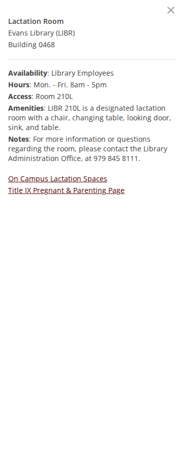                       | 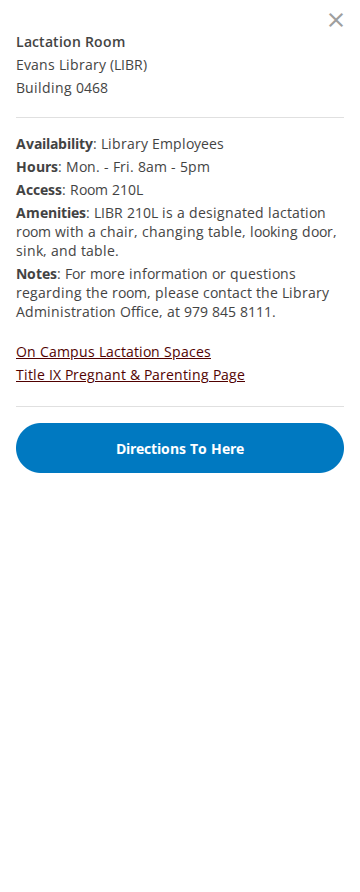 |
| 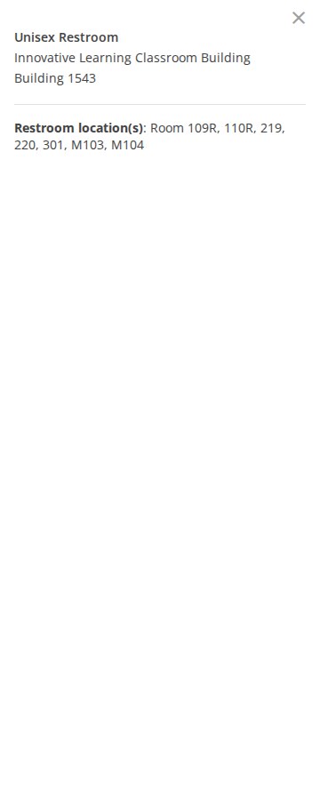                              | 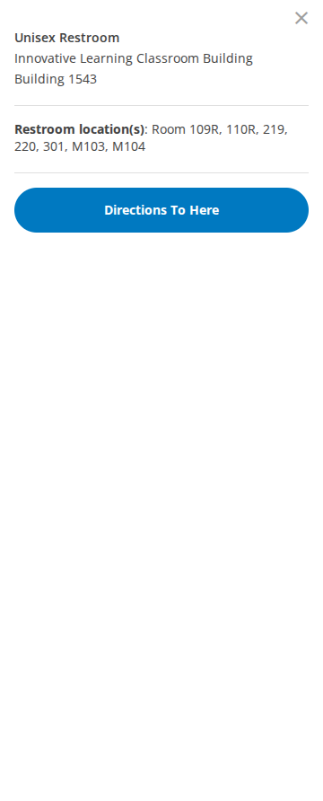          |
| 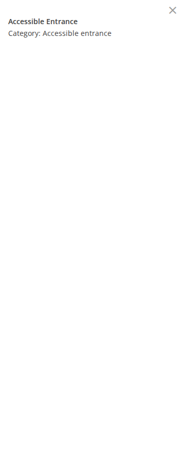                | 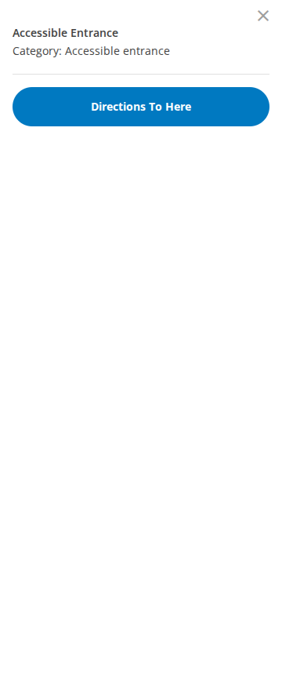        |
| 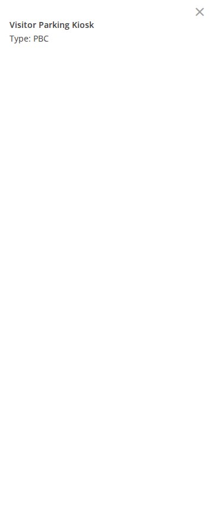                    | 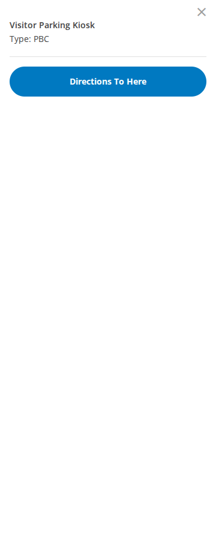             |
| 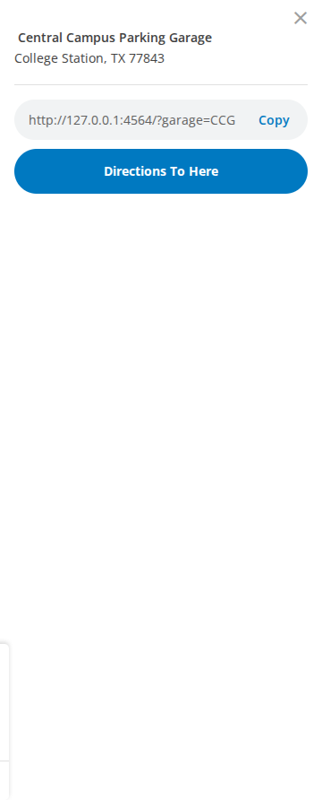 |                                 |

### Every dining location's address reads the same way

The dining popup showed whatever the dining service published for the state. Counted over all 54
locations on 25 November 2026:

| Published value | Locations |
| --------------- | --------: |
| `TX`            |        35 |
| `Texas`         |        15 |
| `texas`         |         3 |
| _(empty)_       |         1 |

So the same line read **College Station, TX** on two thirds of the locations and **College Station,
texas** on the rest, and Food Truck Row ended in a bare comma with nothing after it. The issue recorded
three different values in September; there are four now, so this is drifting rather than settling.

| Before                                                                               | After                                                                            |
| ------------------------------------------------------------------------------------ | -------------------------------------------------------------------------------- |
|  | 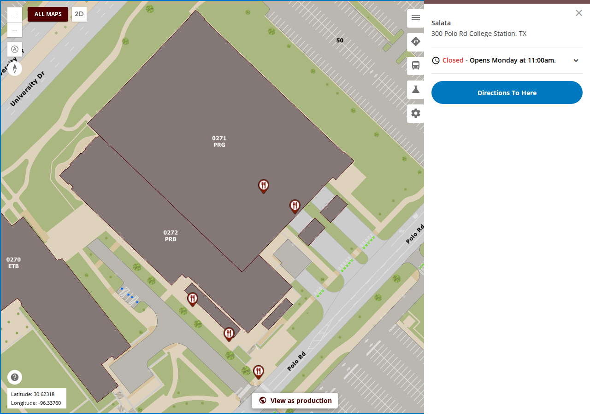 |

Any spelling of Texas is now shown as **TX**. Anything else is shown exactly as published, because the
application cannot know what is right for a state it has not seen, and a part that is missing takes its
separator with it.

**The service still publishes four values**; this only stops them reaching the page. Correcting the
records is for whoever maintains the dining data.

| Issue                                                                                  | What                                                                      |
| -------------------------------------------------------------------------------------- | ------------------------------------------------------------------------- |
| [#954](https://github.com/TamuGeoInnovation/Tamu.GeoInnovation.js.monorepo/issues/954) | The dining popup's address shows the state the same way on every location |

### Keyboard focus is visible on the Copy action and on search results

Someone using the keyboard could not see where they were on two controls: a map's **Copy** showed nothing at all
when it had focus, and a search result reached with the arrow keys looked exactly like one under the mouse
pointer. Both now show a maroon outline when reached from the keyboard, and nothing extra after a click. The same
outline comes back to the sidebar menu of the geoservices site.
([#1001](https://github.com/TamuGeoInnovation/Tamu.GeoInnovation.js.monorepo/issues/1001))

| Before                                                                                                                                     | After                                                                                                  |
| ------------------------------------------------------------------------------------------------------------------------------------------ | ------------------------------------------------------------------------------------------------------ |
| 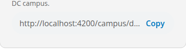 | 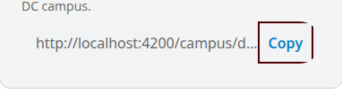 |
| 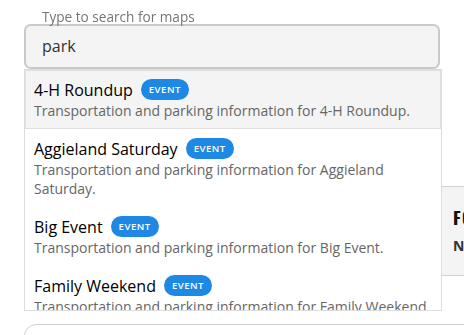       | 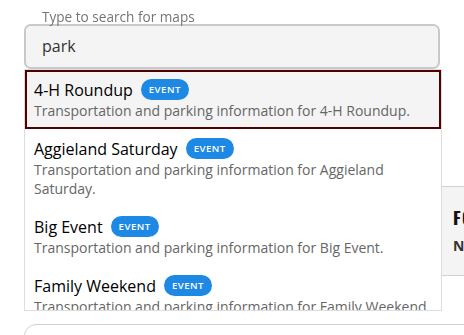     |

### Dates and times are chosen or typed exactly

The shared date and time picker, used by the GIS Day VGI Form Designer and event forms and by AggieMap's trip
planner, was the browser's own date-and-time box. Once that box holds a whole value it reports a change on every
key, and the picker closed on the first one. Typing "30" into the minutes kept only the 3 and saved 11:03, and the
maintainer needed four saves to set the 2026 VGI scoring window: the cutoff kept saving as 11:30 while 11:00 was
being chosen.

A date is now chosen from a calendar or typed, and a time chosen from the list of times or typed, both Angular
Material's own, with their keyboard and screen-reader support. Each takes effect once it is chosen, or a typed one is
left or entered, never on a single key. A picker of both stays open after the date until the time is set. A time
alone (the GIS Day event times) and a date alone (the GIS Day season days) open their list or calendar at once, as
before ([#2583](https://github.com/TamuGeoInnovation/Tamu.GeoInnovation.js.monorepo/issues/2583)).

| | Before | After |
| --- | --- | --- |
| The Designer's "Submissions stop counting at", opened | 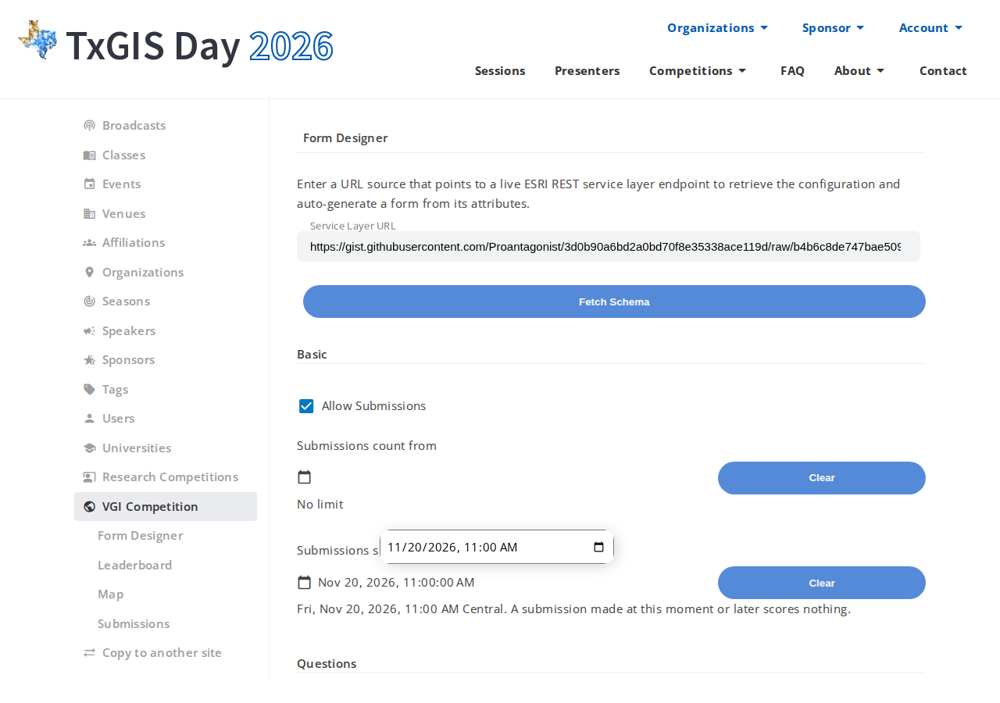 | 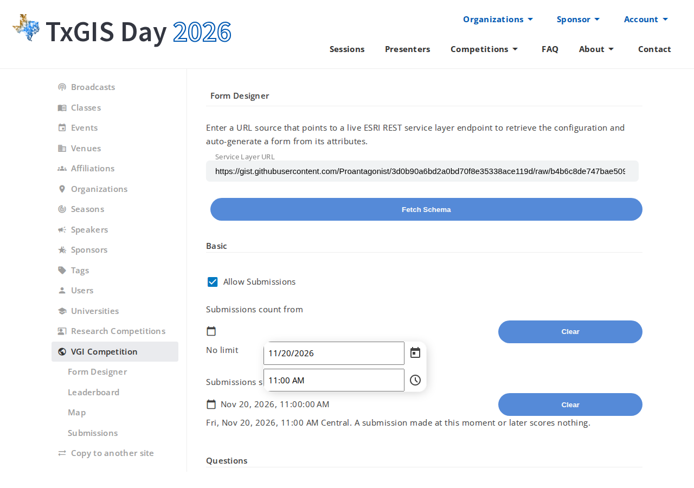 |
| "30" typed into the minutes of 11:00 AM |  |  |
| The date, chosen | | 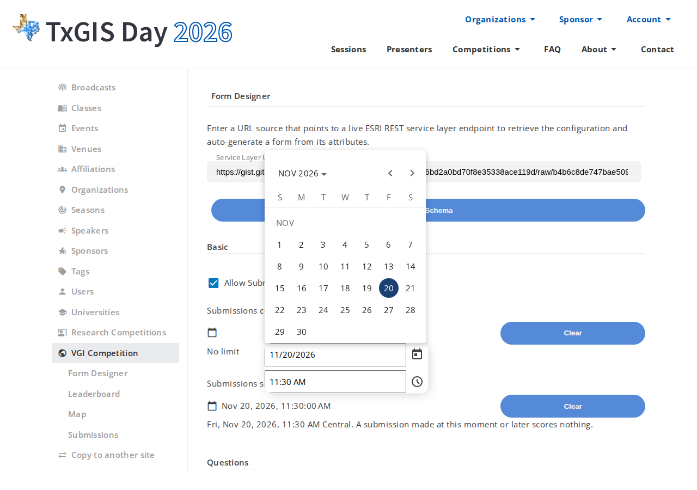 |
| The time, chosen | | 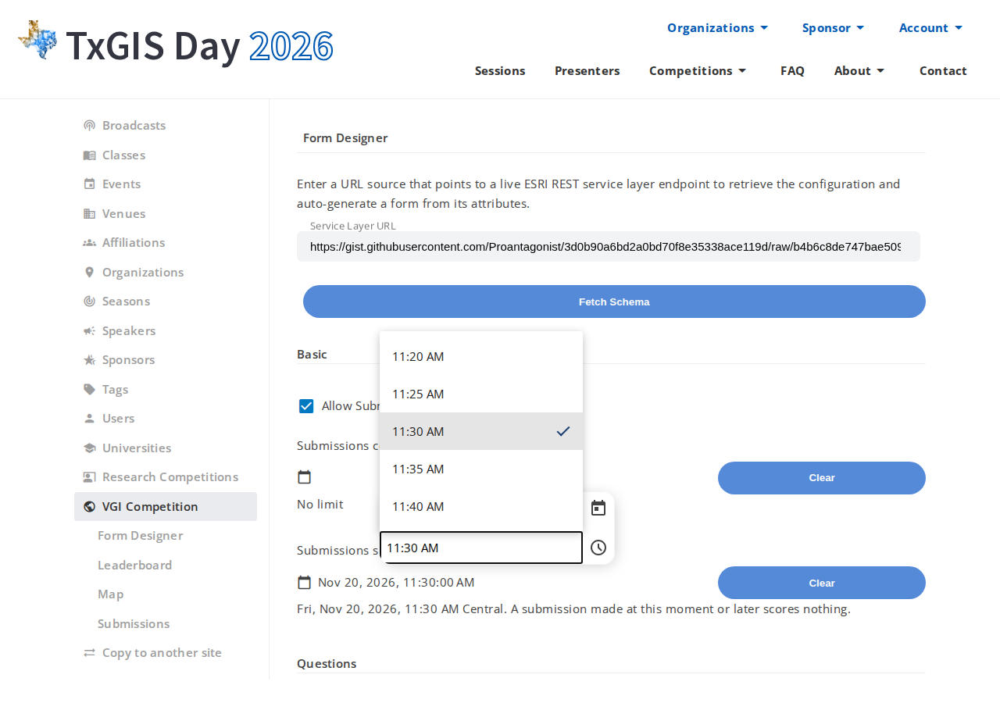 |
| A GIS Day event's start time | 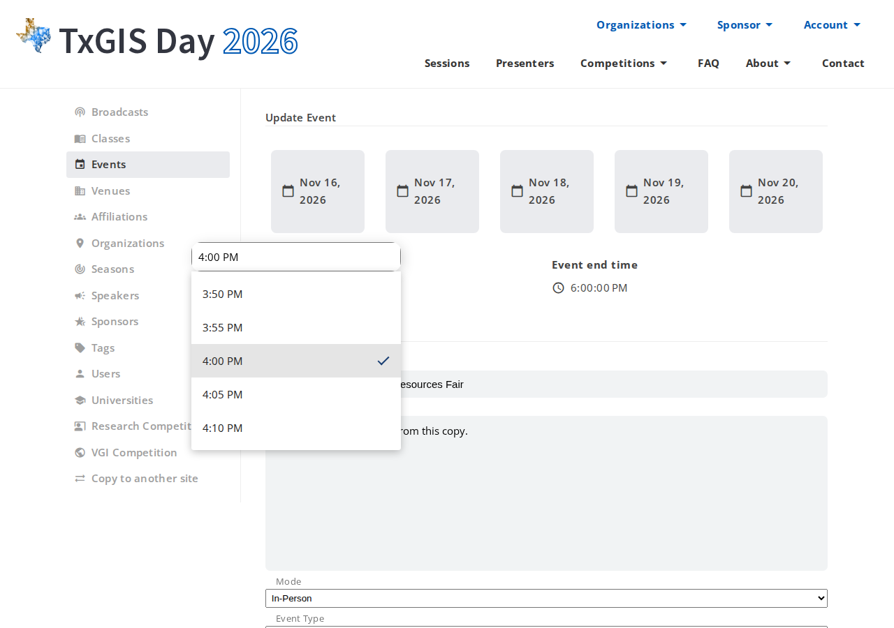 | 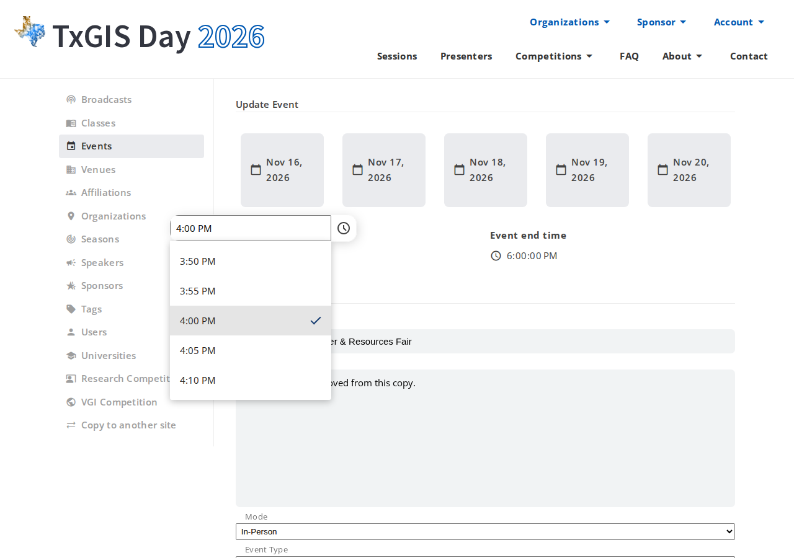 |

### Times around midnight and noon are right on a 12-hour clock

Two faults in one small pair of functions, each the other's mirror, and both at the only two hours
where a 12-hour clock is awkward.

- **Showing a time:** the hour was reduced only when it was **above** 12, so **noon printed as `12:00 AM`**
  and a minute past midnight as `00:01 AM`
  ([#2643](https://github.com/TamuGeoInnovation/Tamu.GeoInnovation.js.monorepo/issues/2643)). Trip steps
  are where this showed.
- **Reading a time:** `12` was treated as noon whatever followed it, so **`12:05 AM` was read as five past
  noon** - twelve hours wrong, in the middle of the day
  ([#3464](https://github.com/TamuGeoInnovation/Tamu.GeoInnovation.js.monorepo/issues/3464)). Bus
  timetables are where this showed.

Both now follow the ordinary rule: **12 PM is noon, 12 AM is the hour after midnight**, and every other
hour is unchanged. A time written with neither AM nor PM keeps its hour, so a bare `12:00` is still noon.

**No before/after capture.** Showing either needs a real time at one of those two hours - a bus departure
between midnight and 1 AM, or a trip step landing in the midday minute. Contriving one with a frozen clock
would photograph the contrivance rather than the fault. The evidence is a unit test for each boundary that
fails on the old code and passes on the new.

| Issue                                                                                    | What                                                                                                      |
| ---------------------------------------------------------------------------------------- | --------------------------------------------------------------------------------------------------------- |
| [#2643](https://github.com/TamuGeoInnovation/Tamu.GeoInnovation.js.monorepo/issues/2643) | A time at noon reads 12 PM, and just after midnight 12 AM, instead of both reading AM with the wrong hour |
| [#3464](https://github.com/TamuGeoInnovation/Tamu.GeoInnovation.js.monorepo/issues/3464) | A time written `12:0x AM` is read as the hour after midnight, not as noon                                 |

### Every map's side panel offers the same tabs

The event and parking maps had a side panel of their own, maintained apart from the main map's, and the Bus Routes
and Experiments tabs were only ever added to the main map's. So **Bus Routes was missing from every event and parking
map**, on production as well as dev, and Experiments was missing on dev
([#2758](https://github.com/TamuGeoInnovation/Tamu.GeoInnovation.js.monorepo/issues/2758)).

There is now one side panel for every map, and its tabs are declared once, so a tab added to it reaches every map
that has one. A satellite campus map still shows only Features, as its definition asks.

|                                                    | Before                                                                                                           | After                                                                                                     |
| -------------------------------------------------- | ---------------------------------------------------------------------------------------------------------------- | --------------------------------------------------------------------------------------------------------- |
| Football Tailgating                                | 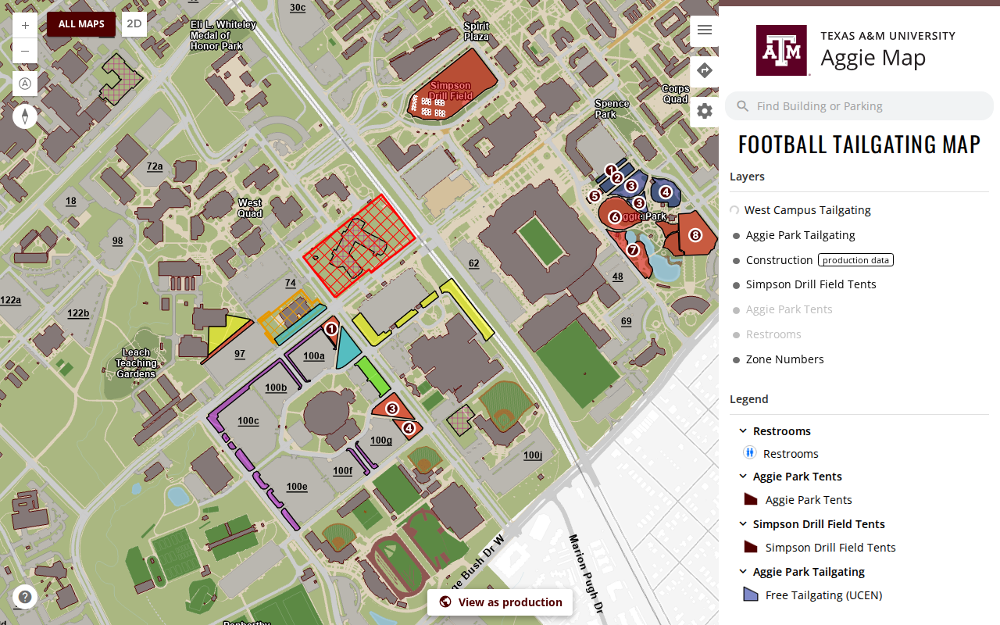           | 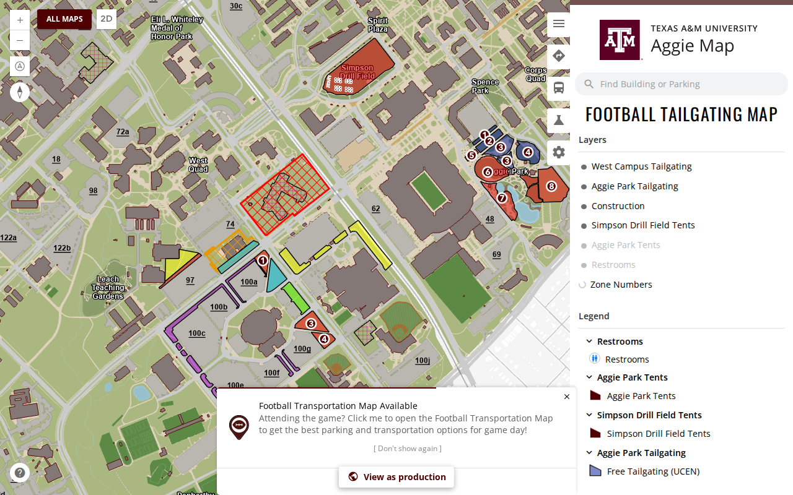                     |
| The main map                                       | 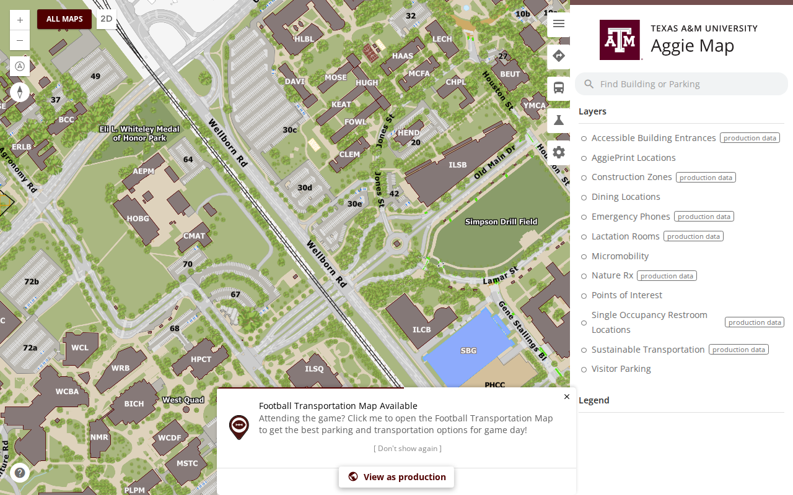                                                | 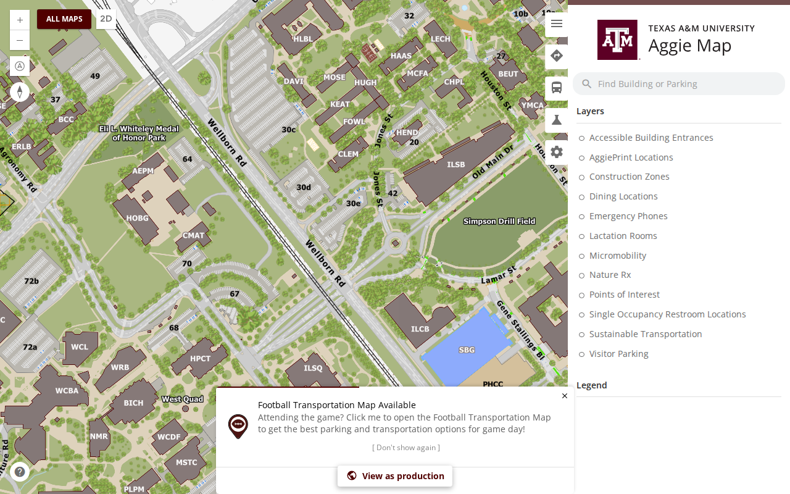                                 |
| Bus Routes on Football Tailgating, route 01 chosen | 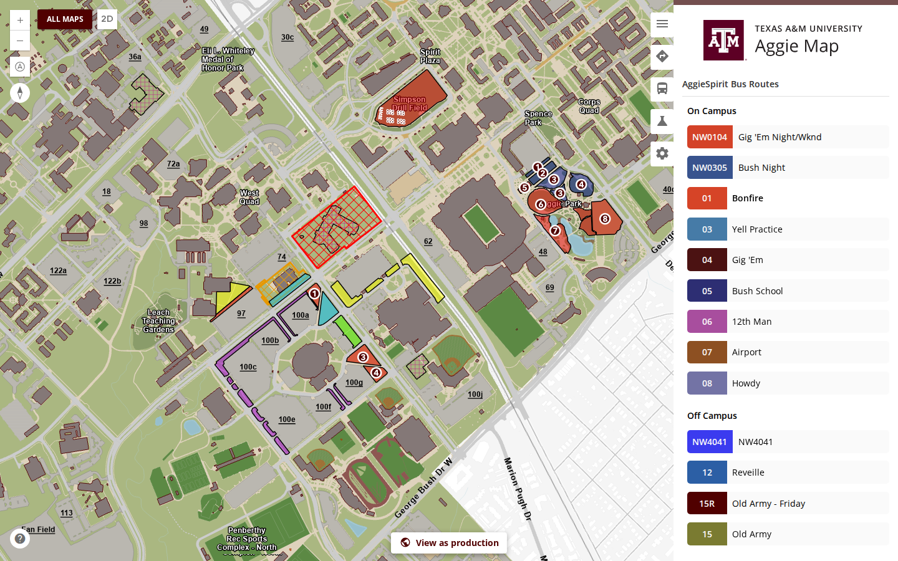 | 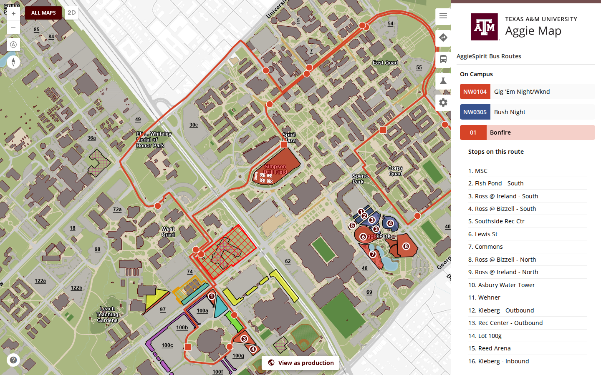 |

Choosing a route there draws it. The bus service was the application's, bound to the application's map, so an event
map's Bus Routes tab listed the routes and drew nothing when one was chosen; each event map has its own now, as it
already did for its layers and its trip planner.

The event maps' trip planner Options page is also now development-only, as the main map's has been since
[#2801](https://github.com/TamuGeoInnovation/Tamu.GeoInnovation.js.monorepo/issues/2801): it was the same drift.

| Issue                                                                                    | What                                                                                                                           |
| ---------------------------------------------------------------------------------------- | ------------------------------------------------------------------------------------------------------------------------------ |
| [#2758](https://github.com/TamuGeoInnovation/Tamu.GeoInnovation.js.monorepo/issues/2758) | One side panel for the main map and every event and parking map, and an event map's Bus Routes tab draws the route it is given |

### April Ring Day is listed on Campus Events again

The April Ring Day map was hidden from the Campus Events listing, where its two siblings - October Ring Day
and November Ring Day - were not. No reason was ever recorded for hiding it; the smoke suite's note said only
that #899's All Maps overhaul hid it on 5 August 2026 and to ask before listing it again.

The maintainer confirmed on 8 November 2026 that it should be listed, so it is.

|               | Before                                                                                                   | After                                                                                              |
| ------------- | -------------------------------------------------------------------------------------------------------- | -------------------------------------------------------------------------------------------------- |
| Campus Events | 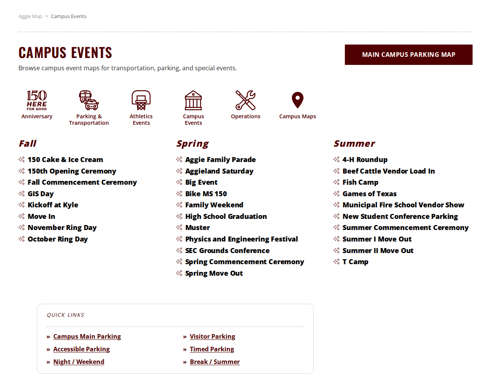 | 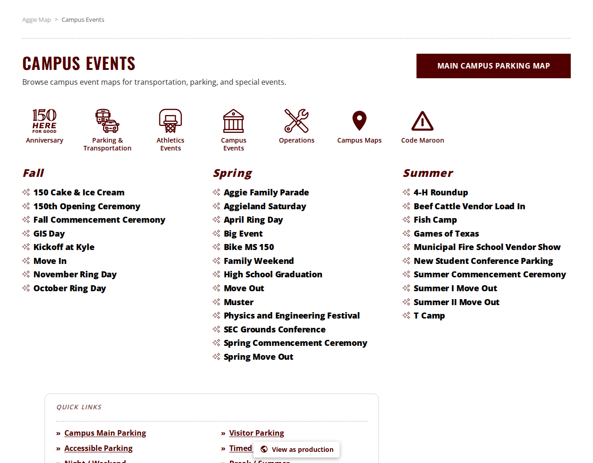 |

The map itself was always reachable at `/events/april-ring-day`; only the listing was missing, so a shared
link to it kept working throughout.

### A popup no longer shows a field the map has no value for, and a shared link opens the same popup a click does

Some map layers leave a field empty for some features: ten of the bike racks have no notes. Their popups printed the
label anyway, and a popup opened from a shared link printed the raw field name, "Notes: {attributes.BR_Notes}". A row
whose value is empty is now left out, label and all
([#2816](https://github.com/TamuGeoInnovation/Tamu.GeoInnovation.js.monorepo/issues/2816)).

A popup opened from a shared link (`?feature=…`) also went through its own copy of the code that fills a popup in,
which a click did not use, so two earlier fixes had reached clicks only: this one, and the construction map's dates,
which a shared link showed as long numbers such as 1735689600000. Both now go through one piece of code, so a shared
link opens exactly the popup a click does
([#3536](https://github.com/TamuGeoInnovation/Tamu.GeoInnovation.js.monorepo/issues/3536)). A popup whose fields are all
filled is unchanged.

| Before                                                                                                                                                                       | After                                                                                                                 |
| ---------------------------------------------------------------------------------------------------------------------------------------------------------------------------- | --------------------------------------------------------------------------------------------------------------------- |
| 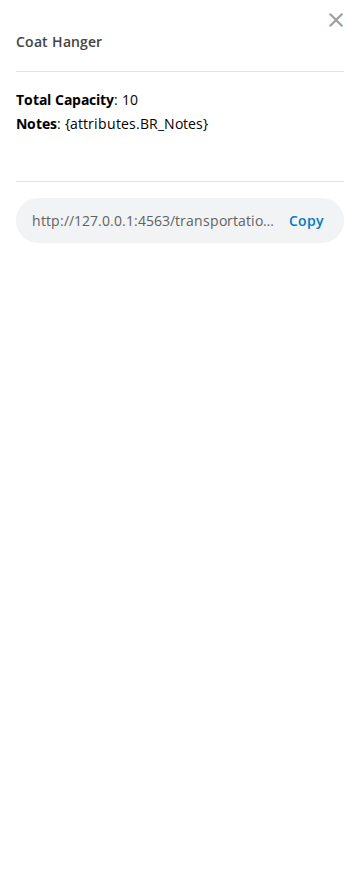     | 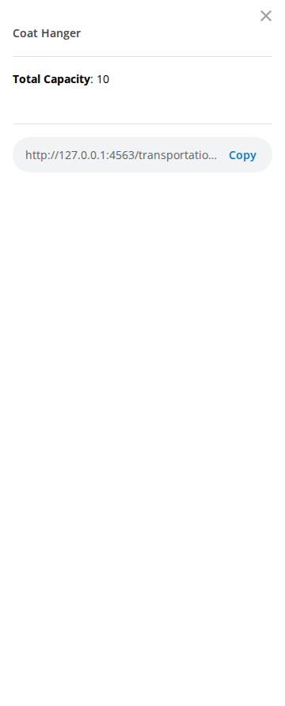 |
| 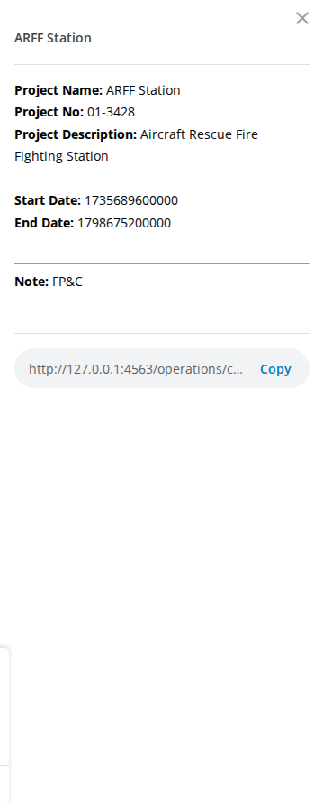 | 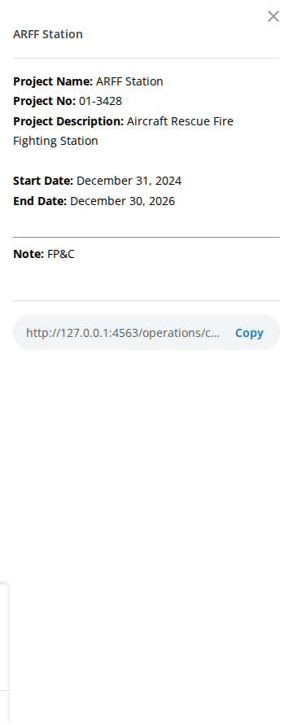 |
| 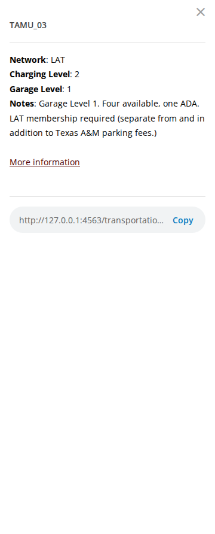                                                                     |                                  |

### Directions on a phone, from the menu and back from a stop's search

The phone menu now has **Directions**, after Bus Routes. A phone had its own trip planner all along, but nothing on a
phone led to it except Directions To Here in a feature's popup; the desktop has always had a Directions tab. And the back
arrow in a trip stop's search, which should return to the trip planner, went to the main map instead, losing the trip.
It now returns to the trip planner, as choosing a place for the stop does.
([#3149](https://github.com/TamuGeoInnovation/Tamu.GeoInnovation.js.monorepo/issues/3149),
[#3319](https://github.com/TamuGeoInnovation/Tamu.GeoInnovation.js.monorepo/issues/3319))

| Phone, 390 pixels         | Before                                                                                             | After                                                                                          |
| ------------------------- | -------------------------------------------------------------------------------------------------- | ---------------------------------------------------------------------------------------------- |
| The menu                  | 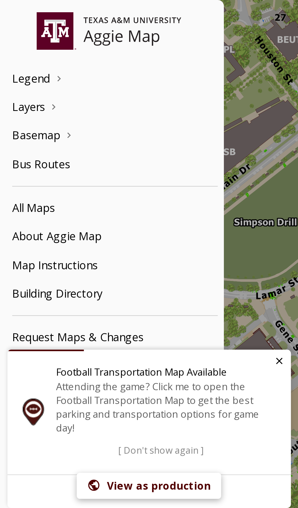 | 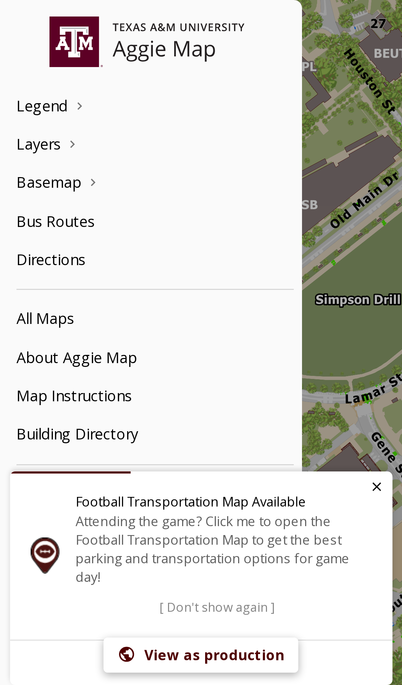      |
| Directions, tapped        |                                                                                                    | 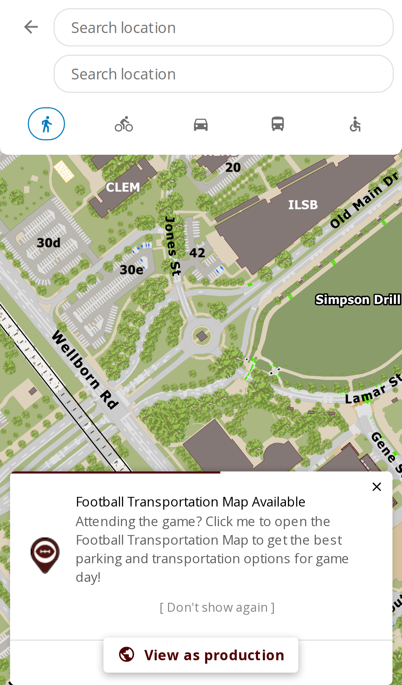 |
| Back from a stop's search | 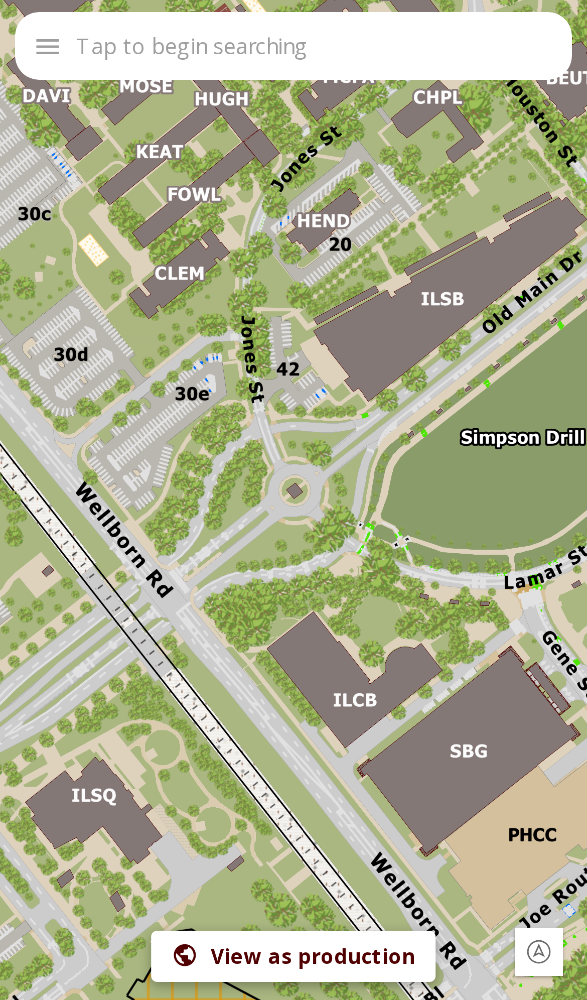   | 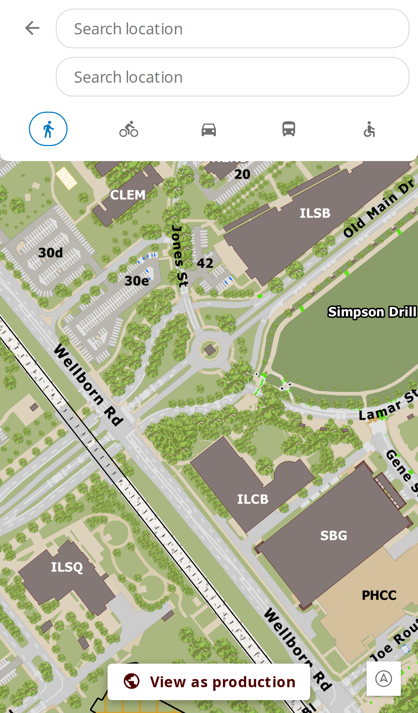   |

### Tapping a bus route on a phone opens it

On a phone, tapping a route in the Bus Routes list did nothing at all: the list stayed as it was, with no route drawn and
no stops or times. The tap looked for the route's page in the wrong part of the phone layout, where it was not, and
said nothing. It now opens the route's own panel and draws it on the map, as Directions To Here was fixed for the same
cause (#2641). The desktop list was not affected.
([#3150](https://github.com/TamuGeoInnovation/Tamu.GeoInnovation.js.monorepo/issues/3150))

| Phone, 390 pixels    | Before                                                                                                      | After                                                                                                                      |
| -------------------- | ----------------------------------------------------------------------------------------------------------- | -------------------------------------------------------------------------------------------------------------------------- |
| Route NW0104 tapped  | 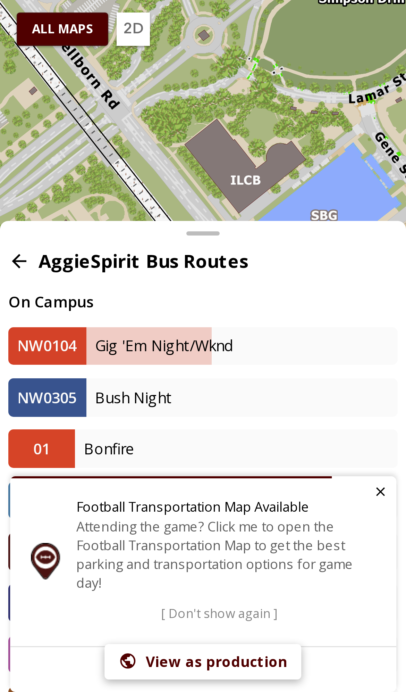            | 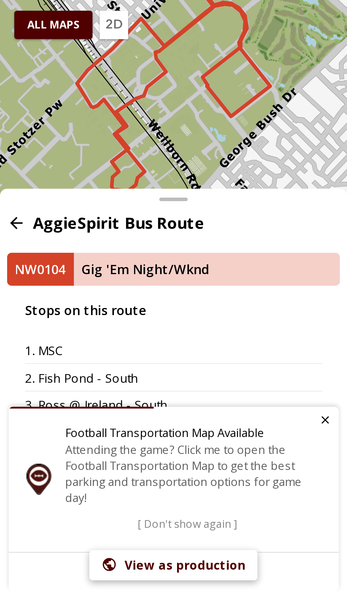 |
| Desktop, the control | 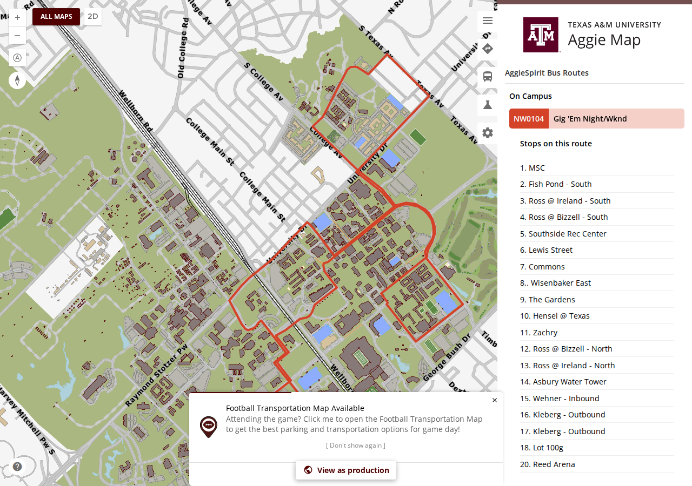 | 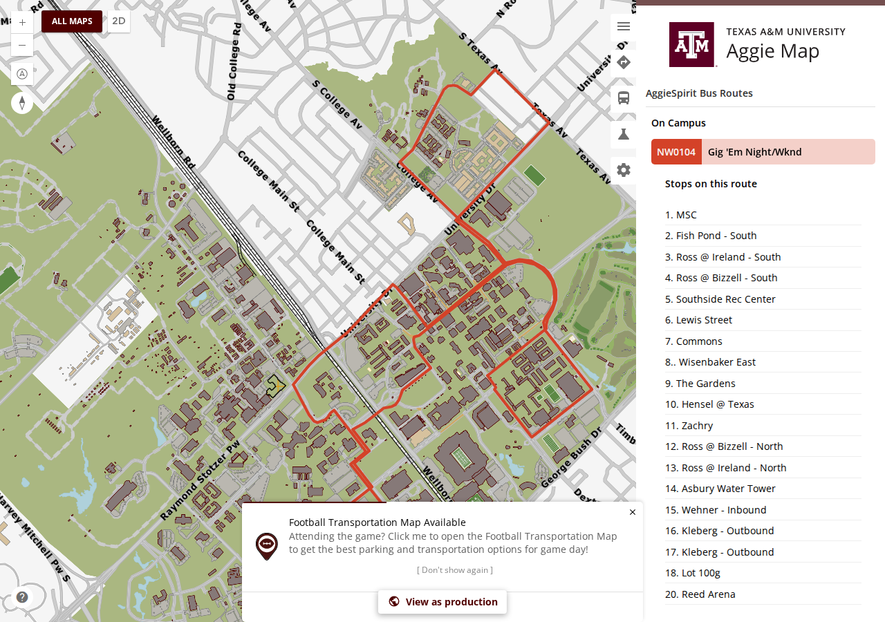                                       |

### The garage search reads the campus feature service, and each garage appears once

The garages were the last thing on the map still reading the old raster campus basemap, which was retired as
a data source on 9 November 2026 and is no longer maintained. They now come from Campus Structures on the
same feature service the buildings and surface lots already use.

**The names change**, because the two sources name the same garages differently: "Southside Garage" is
"Southside Parking Garage" in Facilities' data, and a search finds it by typing any part of that.

**Shared links keep working.** A `?garage=CCG` link made before this still opens Central Campus Parking
Garage: the two services carry the same garage codes, and the search matches on those rather than on a name.

Each garage is also listed once now. Garages are buildings in the new source, so for a moment they appeared
twice - once under Building and once under Parking Garage - and the building search gives them up. A deep
link to a garage as a building, such as `?bldg=0469`, still works.

| | Before | After |
| --- | --- | --- |
| Searching `garage` | 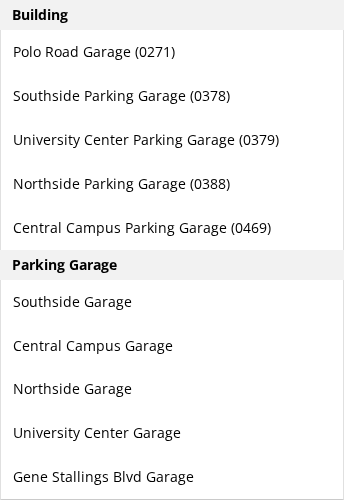 | 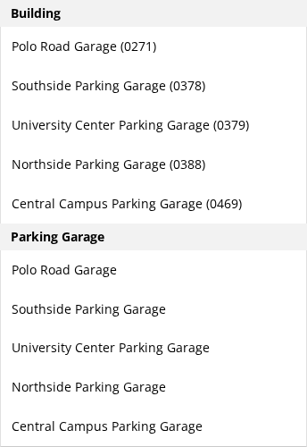 |
| A garage's popup | 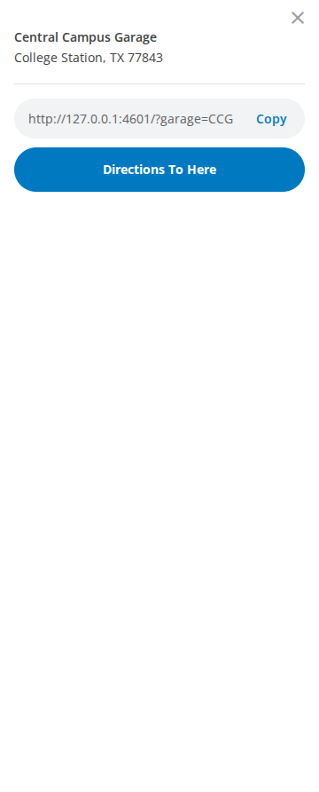 |  |

Two things found while doing it are filed rather than fixed here: a general search returns only five of the
ten garages ([#3433](https://github.com/TamuGeoInnovation/Tamu.GeoInnovation.js.monorepo/issues/3433), which
predates this), and the service carries an eleventh garage row with no name at all
([#3434](https://github.com/TamuGeoInnovation/Tamu.GeoInnovation.js.monorepo/issues/3434), which is the GIS
team's).

### Searching for "garage" finds every garage

Typing a general term into the search box returned **five garages and no more**, and which five was
arbitrary. It was not a display limit that more scrolling would get past: the search asked the service for
five rows, so the rest were never fetched and there was nothing to page through.

That is the search someone uses when they do not know the name - "garage", or "parking" - and it was the
one that did not work. Searching for a garage by name always found it.

|                 | Before                                                                                   | After                                                                                                          |
| --------------- | ---------------------------------------------------------------------------------------- | -------------------------------------------------------------------------------------------------------------- |
| Typing "garage" | 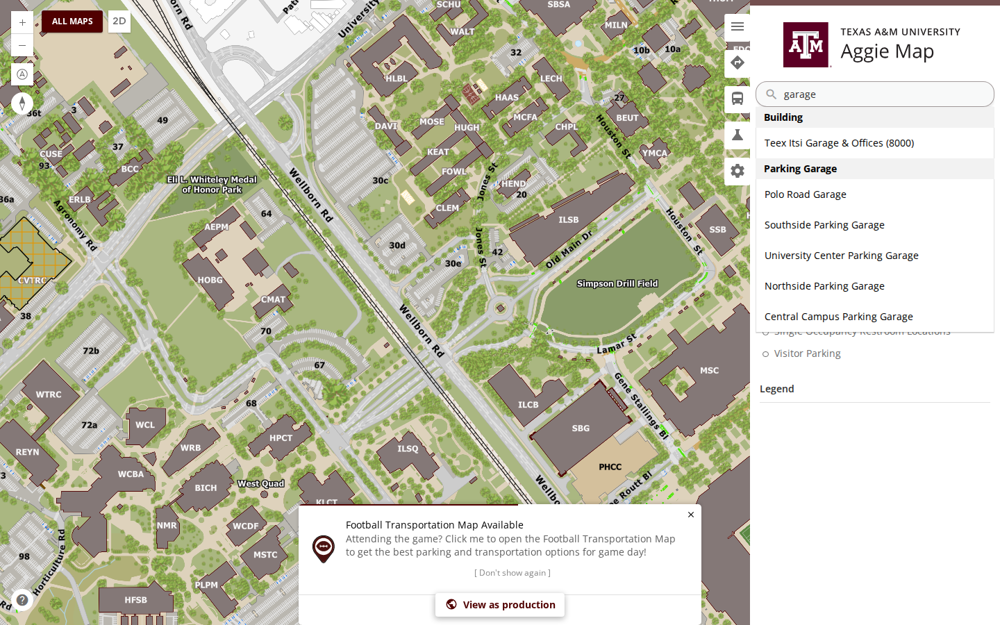 | 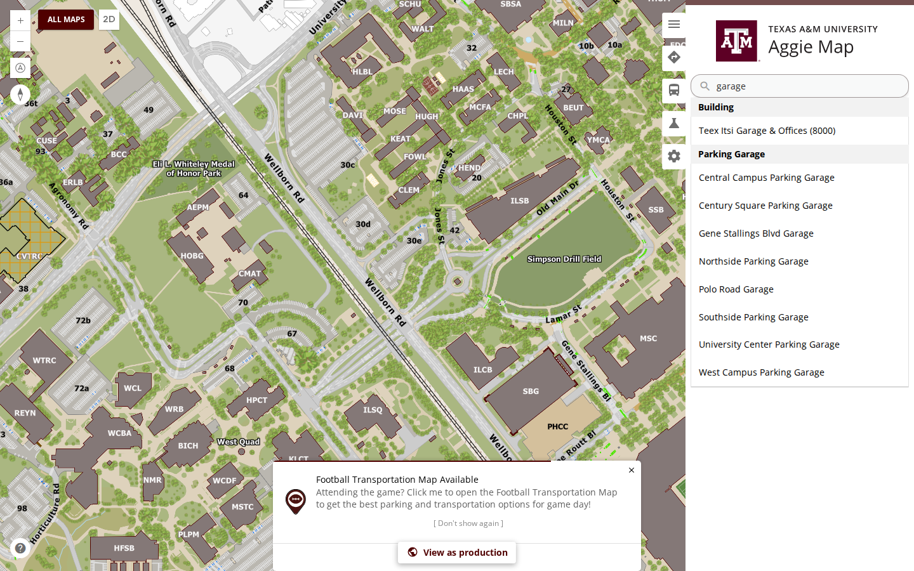 |

Counted against Campus Structures on 24 November 2026: the layer holds 11 rows marked as a garage, and
typing "garage" matches 8 of them, "parking" 7. The garage search now asks for all of them and sorts them by
name, so the list reads in a useful order and a garage built later cannot quietly fall off the end.

**The typed building search keeps its limit of five on purpose.** Its layer has 1,987 rows, so asking for
every one of them would be a different fault. Raising a count is right only where a whole category fits in
one page.

| Issue                                                                                    | What                                                                                        |
| ---------------------------------------------------------------------------------------- | ------------------------------------------------------------------------------------------- |
| [#3433](https://github.com/TamuGeoInnovation/Tamu.GeoInnovation.js.monorepo/issues/3433) | A general search returns every garage, in alphabetical order, rather than an arbitrary five |

### An event's notice stays up through the evening of the event

A map notice for an event - the banner that offers the game-day or parking map for something happening
now - **stopped being shown at 7 PM Central on the day of the event itself**, which is when people are
most likely to be looking for it.

The dates in an event's definition are date-only strings. `new Date('2026-10-02')` reads one as **UTC
midnight**, which is 7 PM Central the evening before, and the service then asked whether now was within a
day of that moment. So the window opened the evening before the event and closed at 7 PM on its own day.

It now uses the same `parseEventDate` and `nextEventDate` the rest of the application reads these dates
with, so a notice is offered while the event's own local day has not ended. No new date arithmetic was
added: a second timezone correction would have been a third copy of the same idea, which is what caused
this.

**No before/after capture.** Showing it needs the clock set to the evening of a real event, and with
Playwright's date fixed no notice appeared at all - not even a control the day before, which should have
shown one. The frozen clock suppresses notices for some other reason, so an image from it would prove
nothing. The evidence is a test with a fixed clock that fails on the old code and passes on the new.

| Issue                                                                                    | What                                                                                               |
| ---------------------------------------------------------------------------------------- | -------------------------------------------------------------------------------------------------- |
| [#3467](https://github.com/TamuGeoInnovation/Tamu.GeoInnovation.js.monorepo/issues/3467) | An event's notice is offered through the evening of the event, instead of stopping at 7 PM Central |

### The phone's trip planner no longer offers accessible routing on production

Accessible routing is development-only, because the campus routing network does not yet route accessible trips
([#2801](https://github.com/TamuGeoInnovation/Tamu.GeoInnovation.js.monorepo/issues/2801)). The desktop trip planner
hid it, but the phone's travel-mode buttons are a separate template and still offered the accessible icon on
aggiemap.tamu.edu. Both now read one setting, so the phone shows the four travel modes and nothing it cannot deliver.
([#3468](https://github.com/TamuGeoInnovation/Tamu.GeoInnovation.js.monorepo/issues/3468))

| Before                                                                                                                                                        | After                                                                                                              |
| ------------------------------------------------------------------------------------------------------------------------------------------------------------- | ------------------------------------------------------------------------------------------------------------------ |
| 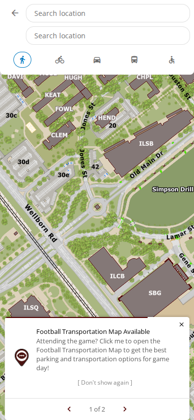 | 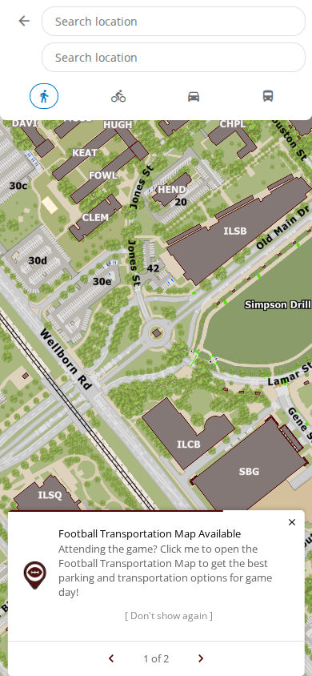 |

### The map search's results list is named to screen readers, and its arrow keys are unchanged

The map search, on the desktop and on a phone, now moves through its results with the same shared keyboard code as the All Maps
search box, instead of a copy of its own, so a keyboard fix is made once. What the keys do is unchanged: down from the box to the first
result, no wrapping at the last, up from the first back to the box, Enter or Space to choose, Escape to close.

One thing a screen reader user gains: the box now tells assistive technology which list it controls. It used to name a list id that
did not exist.
([#3471](https://github.com/TamuGeoInnovation/Tamu.GeoInnovation.js.monorepo/issues/3471))

|                                            | Before                                                                                                                              | After                                                                                          |
| ------------------------------------------ | ----------------------------------------------------------------------------------------------------------------------------------- | ---------------------------------------------------------------------------------------------- |
| Desktop, a result chosen with the keyboard | 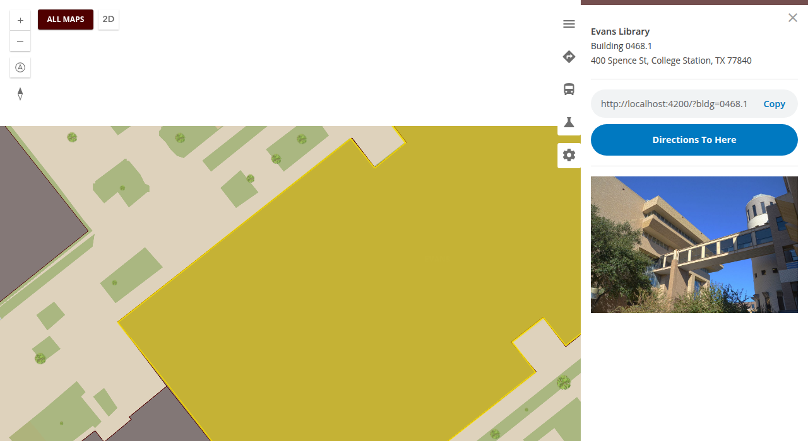 |  |
| Phone, a result chosen with the keyboard   |      |    |

### Searching for coordinates typed the wrong way round now answers instead of doing nothing

The map search accepted any two numbers separated by a comma as "latitude, longitude", with no check that they were a
latitude and a longitude at all. So `-96.3, 30.6` - the same point with its halves the wrong way round, which is how a
copy and paste often gives them - was taken as latitude -96.3, which is not a latitude. The search then stopped
looking: it offered nothing, said nothing, and left an error in the browser's console. A visitor saw their typing
ignored, with no way to tell why.

Coordinates are now read in one place, which checks that the latitude is within 90 degrees and the longitude within 180. A pair out of range is not a coordinate, so the text is searched for as text and the visitor gets an answer -
**No results found** - instead of silence. A pair typed the right way round is read as a coordinate exactly as before.
([#3477](https://github.com/TamuGeoInnovation/Tamu.GeoInnovation.js.monorepo/issues/3477))

| Before                                                                                                                                  | After                                                                                                                                       |
| --------------------------------------------------------------------------------------------------------------------------------------- | ------------------------------------------------------------------------------------------------------------------------------------------- |
|  |  |

### AggieMap and the event maps share one markdown popup

AggieMap and the event maps each had their own copy of the two simplest popups: a title and a description, with or
without **Directions To Here**. The copies had drifted apart, so the same kind of feature looked different depending on
which map it was opened from
([#3486](https://github.com/TamuGeoInnovation/Tamu.GeoInnovation.js.monorepo/issues/3486)). There is now one pair,
used by both.

Almost nothing a visitor sees changes, by design:

- On an event map, these popups keep their copy link, which carries the map's builder choices.
  The NSC parking map, which used AggieMap's copy, now has the link too. On the event parking maps that link does not
  yet reopen the lot ([#3673](https://github.com/TamuGeoInnovation/Tamu.GeoInnovation.js.monorepo/issues/3673)).
- On AggieMap, the popup with **Directions To Here** puts the button below a dividing line, as a building's popup does.
- A feature with a blank description no longer leaves an empty space where it would have been.
- The UES Operations map's campus stops are still titled with the stop's name.

| Before                                                                                                                                      | After                                                                                                                  |
| ------------------------------------------------------------------------------------------------------------------------------------------- | ---------------------------------------------------------------------------------------------------------------------- |
|  |  |
|                                 |                          |

### Construction project dates no longer show a day early

Every date in a construction project's popup showed a day early for anyone in Central time
([#3551](https://github.com/TamuGeoInnovation/Tamu.GeoInnovation.js.monorepo/issues/3551)). A project starting on
1 January 2025 read "December 31, 2024". The service stores a date with no time as midnight UTC, which is 6 PM the
evening before in College Station, and the popup showed it as that moment rather than as the date it is.

Popups now show the date itself, on the Construction map and on the Tailgating map, which shows the same projects. It is
the third fault of this kind in a week, after an event's notice that vanished at 7 PM on the day of the event and noon
printed as 12:00 AM. The popups now use the same shared date code that fixed the first of those.

| Before                                                                                                                                     | After                                                                                                                             |
| ------------------------------------------------------------------------------------------------------------------------------------------ | --------------------------------------------------------------------------------------------------------------------------------- |
|  |  |

### Asking drive directions for an accessible visitor space now narrows the lots

When someone without a parking permit asked drive directions for an **accessible visitor space**, the filter that was
meant to narrow the lots matched every one of them, so the request had no effect: the driver was offered lots with no
accessible visitor spaces at all. The option read one setting and filtered on another, which made the query
"accessible visitor spaces of nought or more" - true everywhere.

It now asks for lots that actually have one. Measured against the parking service on 25 November 2026, that is **18
lots of 244**, so 226 lots that could not help are no longer offered.
([#3605](https://github.com/TamuGeoInnovation/Tamu.GeoInnovation.js.monorepo/issues/3605))

No before-and-after images: the difference is in which lots a drive is planned to, not in anything that changes on
screen by itself, and it is checked by the row above and by a test that fails against the unfixed code.

## What was tested on dev

These are the rows that stood in *What to test on dev* while the build was on dev. Links are left pointing at
**dev** rather than production, because at the time these notes merge the build is on dev and has not been
promoted; the `prod-*` tag records when that happens.

**What is automated, and what is not.** Only three of the nineteen are reported as proven on dev, and all
three for the same reason: a smoke check covers them and ran in the release tier above. The other sixteen have
unit tests - most written red first against the unfixed code, as every bug here must be - and those pass, but
a unit test says nothing about the deployed site. **No hand check of the sixteen has been reported**, so they
are listed as not reported rather than as passed. That is a true statement about this release, not a gap
somebody forgot to fill: the suite proves the maps load and draw, and a person still has to look at a focus
ring or a listing's column.
| Change | Open this on dev | Look for | Tested on dev |
| --- | --- | --- | --- |
| Directions from four more popups ([#602](https://github.com/TamuGeoInnovation/Tamu.GeoInnovation.js.monorepo/issues/602)) | AggieMap dev, `/map/d`: turn on Lactation Rooms, click a room; then the same for Single Occupancy Restroom Locations, Accessible Building Entrances and Visitor Parking | Each popup ends with **Directions To Here**. Pressing it opens the trip planner with the place as the destination; choose a start and a route appears. A building, garage, lot or point of interest popup is unchanged, with its copy link and its Directions. Construction zones still have no Directions | **Not reported.** The four popups' footers are covered by unit tests in the accessible-entrance, lactation-room and popup-footer components, and they pass; nothing opens these popups on a deployed site, so no automated check saw them on dev |
| Dining addresses ([#954](https://github.com/TamuGeoInnovation/Tamu.GeoInnovation.js.monorepo/issues/954)) | [dev.aggiemap.tamu.edu/map/d](https://dev.aggiemap.tamu.edu/map/d), with **Dining Locations** turned on | Open several locations - Salata, Reynolds and Reynolds Cafe, Sbisa - and the address ends **College Station, TX** on every one, not "College Station, texas" or "College Station, Texas". **Food Truck Row**, which has no state, ends at the city with no trailing comma | **Not reported.** `dining.state.spec.ts` covers the address wording and passes. The smoke suite reaches the dining service from the parking maps but never asserts how an address reads |
| Keyboard focus on Copy and on search results ([#1001](https://github.com/TamuGeoInnovation/Tamu.GeoInnovation.js.monorepo/issues/1001)) | [dev.aggiemap.tamu.edu/all-maps](https://dev.aggiemap.tamu.edu/all-maps) | Tab to a map's **Copy**: a maroon box is drawn around it. Type `park` in the search and press the down arrow: the highlighted result has a maroon box. Clicking either with the mouse draws no box | **Not reported.** No check looks at a drawn focus ring, and no hand check has been reported. The ring comes from shared styles, so the risk is a style that stops applying rather than a wrong rule |
| Date and time pickers: every key of a typed time counts ([#2583](https://github.com/TamuGeoInnovation/Tamu.GeoInnovation.js.monorepo/issues/2583)) | AggieMap: [a trip on dev](https://dev.aggiemap.tamu.edu/map/d/trip?mode=1&stops=30.6150,-96.3500@30.6150,-96.3300), then Leave now, changed to Leave at. GIS Day is not on dev ([#1525](https://github.com/TamuGeoInnovation/Tamu.GeoInnovation.js.monorepo/issues/1525)); on production after release, as an admin: [VGI Competition, Form Designer](https://txgisday.org/admin/competitions/designer) | Open the picker: a date field with a calendar button and a time field with a clock button. Choose a date from the calendar: the picker stays open. Type a time such as 11:30 AM and press Enter: 11:30 is set, not 11:03. In the Designer, the Central-time line under "Submissions stop counting at" shows exactly the time chosen, and Save keeps it. GIS Day event times still open their list of times at once | **Not reported.** `date-time-picker.component.spec.ts` covers a typed time key by key and passes. The GIS Day half of the row cannot be checked on dev at all ([#1525](https://github.com/TamuGeoInnovation/Tamu.GeoInnovation.js.monorepo/issues/1525)), as the row says |
| Times at noon and after midnight ([#2643](https://github.com/TamuGeoInnovation/Tamu.GeoInnovation.js.monorepo/issues/2643), [#3464](https://github.com/TamuGeoInnovation/Tamu.GeoInnovation.js.monorepo/issues/3464)) | [dev.aggiemap.tamu.edu/map/d/bus](https://dev.aggiemap.tamu.edu/map/d/bus) and the trip planner | A bus timetable entry for just after midnight reads **12:0x AM**, not 12:0x PM, and sits at the start of the night's times rather than in the middle of the day. A trip step arriving at midday reads **12:xx PM**. Times at any other hour are unchanged | **Not reported.** `common-utils-date.spec.ts` covers midnight and noon and passes; the bus timetable it feeds was not read by hand on dev |
| Side panel tabs on event and parking maps ([#2758](https://github.com/TamuGeoInnovation/Tamu.GeoInnovation.js.monorepo/issues/2758)) | [Football Tailgating](https://dev.aggiemap.tamu.edu/events/tailgating/map) and [the main map](https://dev.aggiemap.tamu.edu/map), on a desktop | The tailgating map's side panel has the same five tabs as the main map's: Features, Directions, Bus Routes, Experiments and Settings. Bus Routes opens the bus list on the tailgating map. A satellite campus map, such as [Galveston](https://dev.aggiemap.tamu.edu/campus/galveston/map), still shows only Features. With **View as production**, Experiments goes from both | **Passed in the release tier**, and this was its first run against a build carrying it. `bus.spec.ts` passed 25 of 25 - the tailgating map's route list, a route expanding with its stops drawn, and the same choice removing them - and `development-only.spec.ts` passed the Experiments tab, the Bus Routes tab and the trip options page. Neither spec skipped anything |
| April Ring Day is listed ([#2768](https://github.com/TamuGeoInnovation/Tamu.GeoInnovation.js.monorepo/issues/2768)) | [dev.aggiemap.tamu.edu/all-maps/campus-events](https://dev.aggiemap.tamu.edu/all-maps/campus-events) | **April Ring Day** appears in the **Spring** column, between Aggieland Saturday and Big Event. Its two siblings, October and November Ring Day, are still under Fall. The same page with `?as=production` shows it too, because it is no longer hidden from production's listings | **Not reported.** Nothing checks which column of the Campus Events listing a map appears in |
| Empty popup rows left out, and shared links matching a click ([#2816](https://github.com/TamuGeoInnovation/Tamu.GeoInnovation.js.monorepo/issues/2816), [#3536](https://github.com/TamuGeoInnovation/Tamu.GeoInnovation.js.monorepo/issues/3536)) | AggieMap dev: `/transportation/sustainable-transportation/map/d?feature=sustainable-transportation-bike-racks:7057`, then `/operations/construction-map/map/d?feature=construction-map-popup:35375`, then an EV charger such as `?feature=sustainable-transportation-ev-chargers:35` | The bike rack shows its type and Total Capacity and no Notes row (not "Notes: {attributes.BR_Notes}"). The construction project shows its start and end as dates, not long numbers. The EV charger shows all four of its rows, as before. Clicking the same features on the map shows the same | **Not reported.** `common-utils-string.spec.ts` and `event.service.spec.ts` cover the empty-row rule and the shared link, and pass |
| Directions in the phone menu ([#3149](https://github.com/TamuGeoInnovation/Tamu.GeoInnovation.js.monorepo/issues/3149)) | [dev.aggiemap.tamu.edu/map/m/sidebar](https://dev.aggiemap.tamu.edu/map/m/sidebar), **on a phone or a phone-sized window** | The menu lists Directions after Bus Routes, and it opens the trip planner at `/map/m/trip` | **Not reported.** `main-mobile-sidebar.component.spec.ts` and `omnisearch-trip.spec.ts` pass. The smoke suite reaches the phone trip planner but does not assert the menu's order |
| Bus routes on a phone ([#3150](https://github.com/TamuGeoInnovation/Tamu.GeoInnovation.js.monorepo/issues/3150)) | [dev.aggiemap.tamu.edu/map/m/bus](https://dev.aggiemap.tamu.edu/map/m/bus), **on a phone or a phone-sized window** | Tapping a route opens its panel - its name, stops and times - and draws it on the map, with the address becoming `/map/m/bus/<route>`. On a desktop, the bus list works as before | **Not reported.** `bus-route.component.spec.ts` and `common-utils-routing.spec.ts` pass |
| The garage search ([#3425](https://github.com/TamuGeoInnovation/Tamu.GeoInnovation.js.monorepo/issues/3425)) | [dev.aggiemap.tamu.edu/map/d](https://dev.aggiemap.tamu.edu/map/d), then search `garage`; then open [?garage=CCG](https://dev.aggiemap.tamu.edu/map/d?garage=CCG) | Each garage is listed **once**, under Parking Garage, and the names carry "Parking" in the middle - "Southside Parking Garage", not "Southside Garage". Building lists only "Teex Itsi Garage & Offices", which has Garage in its name and is not one. The popup names the garage rather than showing an empty heading, and `?garage=CCG` still opens Central Campus Parking Garage | **Passed in the release tier.** `search-sources.spec.ts` reads each search source's columns against the campus feature service: 3 development-only sources skipped, the rest passed |
| Every garage is findable ([#3433](https://github.com/TamuGeoInnovation/Tamu.GeoInnovation.js.monorepo/issues/3433)) | [dev.aggiemap.tamu.edu/map](https://dev.aggiemap.tamu.edu/map) | Type **garage** into the search box. Under **Parking Garage** every garage whose name contains the word is listed, in alphabetical order, rather than five of them. Typing **parking** does the same. Searching for one by name, such as **Southside**, still finds it | **Passed in the release tier**, in the same spec and the same run |
| Event notices on the day of the event ([#3467](https://github.com/TamuGeoInnovation/Tamu.GeoInnovation.js.monorepo/issues/3467)) | [dev.aggiemap.tamu.edu/map](https://dev.aggiemap.tamu.edu/map), on a day an event map is running | The notice for an event happening today is still offered after 7 PM Central, and is gone the following day. Notices auto-dismiss about ten seconds after the page loads, so hover over the panel to hold one while you look | **Not reported.** `event-notifications.evening.spec.ts` covers the evening boundary in Central time and passes. This one is awkward by hand: a notice auto-dismisses about ten seconds after the page loads, so the panel has to be hovered to hold it |
| Accessible routing stays development-only on a phone ([#3468](https://github.com/TamuGeoInnovation/Tamu.GeoInnovation.js.monorepo/issues/3468)) | AggieMap dev at phone width, `/map/m/trip`, then the same with `?as=production` | On dev, five buttons: walk, bike, car, bus and the accessible icon. As production, four: no accessible icon. On desktop, `/map/d/trip` shows Options on dev only, as before | **The development side passed in the release tier:** `development-only.spec.ts:271` ran and passed, so dev offers the accessible icon. **The production side is not provable yet** - its registry entry gates only production's direction, and this build is not on production |
| The map search's arrow keys ([#3471](https://github.com/TamuGeoInnovation/Tamu.GeoInnovation.js.monorepo/issues/3471)) | [dev.aggiemap.tamu.edu/map/d](https://dev.aggiemap.tamu.edu/map/d), then [the phone map](https://dev.aggiemap.tamu.edu/map/m) | Type `Evans` in the search. **Down** goes from the box to the first result and stays on the last; **Up** walks back to the box; **Enter** or **Space** chooses one; **Escape** closes the list. The same as before; in the trip planner the arrows stay in the box being typed in | **Not reported.** `search.component.spec.ts` covers the arrow keys, including that they stay in the box in the trip planner, and passes |
| Coordinates typed the wrong way round ([#3477](https://github.com/TamuGeoInnovation/Tamu.GeoInnovation.js.monorepo/issues/3477)) | [Aggie Map dev](https://dev.aggiemap.tamu.edu/map/d) | Type `-96.3, 30.6` in **Find Building or Parking** - longitude first, as a copy and paste often gives it. The search answers **No results found for "-96.3, 30.6"**. Before this it showed nothing at all and left an error in the console. Typed the right way round, `30.6, -96.3` is unchanged by this release and still does not place a point ([#3615](https://github.com/TamuGeoInnovation/Tamu.GeoInnovation.js.monorepo/issues/3615)) | **Not reported.** The shared coordinate reader's unit tests pass. The row's own caveat stands: typed the right way round a coordinate is still not placed on the map ([#3615](https://github.com/TamuGeoInnovation/Tamu.GeoInnovation.js.monorepo/issues/3615)), which is queued |
| One markdown popup ([#3486](https://github.com/TamuGeoInnovation/Tamu.GeoInnovation.js.monorepo/issues/3486)) | AggieMap dev, `/map/d`: turn on AggiePrint Locations and click a printer; then Dismount Zones, and click one. Then the New Student Conference parking map on dev, and click a lot. Then the UES Operations map, Bus, Campus Stops | AggiePrint's popup shows the printer's details, then **Directions To Here** below a dividing line. A dismount zone shows its name, unchanged. An NSC lot shows its name and a copy link, as the other event parking maps' lots do. Pasting the link does not yet reopen the lot, on NSC or on those maps ([#3673](https://github.com/TamuGeoInnovation/Tamu.GeoInnovation.js.monorepo/issues/3673)). A campus stop is titled with the stop's name, not "Campus Stops" | **Not reported.** `markdown-popup.component.spec.ts` passes. The row's caveat stands too: a lot's copied link still does not reopen it ([#3673](https://github.com/TamuGeoInnovation/Tamu.GeoInnovation.js.monorepo/issues/3673)), which is queued |
| Construction dates ([#3551](https://github.com/TamuGeoInnovation/Tamu.GeoInnovation.js.monorepo/issues/3551)) | The Construction map on the dev event maps, `/construction-map`: click ARFF Station, by Easterwood Airport. Then any construction project on the Tailgating map | ARFF Station reads **Start Date: January 1, 2025** and **End Date: December 31, 2026**, not December 31, 2024 and December 30, 2026. Every project's dates match the dates Transportation published for it | **Not reported.** `common-utils-date.spec.ts` and `resolve-popup-data.spec.ts` cover the dates in Central time, were proven red against the unfixed code, and pass |
| Accessible visitor parking ([#3605](https://github.com/TamuGeoInnovation/Tamu.GeoInnovation.js.monorepo/issues/3605)) | [Aggie Map dev](https://dev.aggiemap.tamu.edu/map/d/trip), Directions, driving | Choose **no parking permit**, then ask for an accessible visitor space, and plan a drive. The lots offered are only ones that have one - 18 of the 244 on campus, among them Central Campus Garage, University Center Garage and Lot 072a. Before this, every lot was offered | **Not reported.** `parking.queries.spec.ts` covers the narrowed lot query and passes; the query was also run against the live service when the fix was made |

## What went into this release

156 pull requests, `50b125bf5..57efe8b6b`. **36 of them are GIS Day's**, which is released on its own
path; they are listed with their entries in [GIS Day, unreleased](gisday-unreleased.md) rather than repeated
here, so that this table answers "what reached AggieMap's visitors" rather than "what was in the build". The
120 below are AggieMap's, the shared libraries, the smoke suite, dependencies, strict typing and build work.

Every row has an issue behind it, with no exceptions to explain for the first time in several releases.

| Pull request | Issue | Change |
| --- | --- | --- |
| [#3751](https://github.com/TamuGeoInnovation/Tamu.GeoInnovation.js.monorepo/pull/3751) | [#3722](https://github.com/TamuGeoInnovation/Tamu.GeoInnovation.js.monorepo/issues/3722) | test(aggiemap-smoke): The phone trip planner's toggle check opens the phone page |
| [#3750](https://github.com/TamuGeoInnovation/Tamu.GeoInnovation.js.monorepo/pull/3750) | [#3749](https://github.com/TamuGeoInnovation/Tamu.GeoInnovation.js.monorepo/issues/3749) | docs(workspace): The modernization plan lives in the repository, and says what gates what |
| [#3745](https://github.com/TamuGeoInnovation/Tamu.GeoInnovation.js.monorepo/pull/3745) | [#3725](https://github.com/TamuGeoInnovation/Tamu.GeoInnovation.js.monorepo/issues/3725) | chore(workspace): Remove @typescript-eslint/utils, which nothing uses, and tell knip what it misreads |
| [#3744](https://github.com/TamuGeoInnovation/Tamu.GeoInnovation.js.monorepo/pull/3744) | [#3742](https://github.com/TamuGeoInnovation/Tamu.GeoInnovation.js.monorepo/issues/3742) | fix(workspace): es-toolkit 1.53.2, which fixes a High and two Medium advisories |
| [#3746](https://github.com/TamuGeoInnovation/Tamu.GeoInnovation.js.monorepo/pull/3746) | [#3723](https://github.com/TamuGeoInnovation/Tamu.GeoInnovation.js.monorepo/issues/3723) | test(aggiemap-smoke): The trip planner's columns are read when a comment sits between the keys |
| [#3741](https://github.com/TamuGeoInnovation/Tamu.GeoInnovation.js.monorepo/pull/3741) | [#3721](https://github.com/TamuGeoInnovation/Tamu.GeoInnovation.js.monorepo/issues/3721) | test(aggiemap-smoke): The build banner check requires a real build on dev, which now names its commit |
| [#3737](https://github.com/TamuGeoInnovation/Tamu.GeoInnovation.js.monorepo/pull/3737) | [#3726](https://github.com/TamuGeoInnovation/Tamu.GeoInnovation.js.monorepo/issues/3726) | chore(workspace): Remove @angular/platform-server, which nothing imports or invokes |
| [#3736](https://github.com/TamuGeoInnovation/Tamu.GeoInnovation.js.monorepo/pull/3736) | [#3719](https://github.com/TamuGeoInnovation/Tamu.GeoInnovation.js.monorepo/issues/3719) | chore(workspace): Remove ng-packagr, which nothing invokes |
| [#3734](https://github.com/TamuGeoInnovation/Tamu.GeoInnovation.js.monorepo/pull/3734) | [#3728](https://github.com/TamuGeoInnovation/Tamu.GeoInnovation.js.monorepo/issues/3728) | docs(workspace): Socket is the one required check, and the dependency review reads it |
| [#3733](https://github.com/TamuGeoInnovation/Tamu.GeoInnovation.js.monorepo/pull/3733) | [#3707](https://github.com/TamuGeoInnovation/Tamu.GeoInnovation.js.monorepo/issues/3707) | fix(workspace): tidy.sh prunes finished local branches, and sweeps branches and worktrees on every check |
| [#3639](https://github.com/TamuGeoInnovation/Tamu.GeoInnovation.js.monorepo/pull/3639) | [#3628](https://github.com/TamuGeoInnovation/Tamu.GeoInnovation.js.monorepo/issues/3628) | fix(ui-kits-ngx-layout-modal): The modal host type-checks under the library's own strict settings |
| [#3670](https://github.com/TamuGeoInnovation/Tamu.GeoInnovation.js.monorepo/pull/3670) | [#3701](https://github.com/TamuGeoInnovation/Tamu.GeoInnovation.js.monorepo/issues/3701) | chore(deps): Bump the testing group with 2 updates |
| [#3640](https://github.com/TamuGeoInnovation/Tamu.GeoInnovation.js.monorepo/pull/3640) | [#3630](https://github.com/TamuGeoInnovation/Tamu.GeoInnovation.js.monorepo/issues/3630) | fix(common-ngx-settings): The settings service type-checks under strict |
| [#3619](https://github.com/TamuGeoInnovation/Tamu.GeoInnovation.js.monorepo/pull/3619) | [#3596](https://github.com/TamuGeoInnovation/Tamu.GeoInnovation.js.monorepo/issues/3596) | chore(ui-kits-ngx-search): strictNullChecks in the shared search library |
| [#3632](https://github.com/TamuGeoInnovation/Tamu.GeoInnovation.js.monorepo/pull/3632) | [#3618](https://github.com/TamuGeoInnovation/Tamu.GeoInnovation.js.monorepo/issues/3618) | fix(common-utils-geometry-generic): strictNullChecks is on in the generic geometry utilities |
| [#3709](https://github.com/TamuGeoInnovation/Tamu.GeoInnovation.js.monorepo/pull/3709) | [#3706](https://github.com/TamuGeoInnovation/Tamu.GeoInnovation.js.monorepo/issues/3706) | docs(workspace): Merge commands delete their branch, and a pull request opens from its own branch |
| [#3686](https://github.com/TamuGeoInnovation/Tamu.GeoInnovation.js.monorepo/pull/3686) | [#3657](https://github.com/TamuGeoInnovation/Tamu.GeoInnovation.js.monorepo/issues/3657) | chore(maps-feature-trip-planner): Delete the retired bus API cluster, and park it |
| [#3692](https://github.com/TamuGeoInnovation/Tamu.GeoInnovation.js.monorepo/pull/3692) | [#3678](https://github.com/TamuGeoInnovation/Tamu.GeoInnovation.js.monorepo/issues/3678) | fix(workspace): The sweep reports the folders it cannot reclaim, and can remove the orphans |
| [#3676](https://github.com/TamuGeoInnovation/Tamu.GeoInnovation.js.monorepo/pull/3676) | [#3651](https://github.com/TamuGeoInnovation/Tamu.GeoInnovation.js.monorepo/issues/3651) | docs: A doubled backslash in a Bash-tool command arrives single |
| [#3663](https://github.com/TamuGeoInnovation/Tamu.GeoInnovation.js.monorepo/pull/3663) | [#3471](https://github.com/TamuGeoInnovation/Tamu.GeoInnovation.js.monorepo/issues/3471) | refactor(ui-kits-ngx-search): The map search uses the shared keyboard navigation directive |
| [#3689](https://github.com/TamuGeoInnovation/Tamu.GeoInnovation.js.monorepo/pull/3689) | [#3633](https://github.com/TamuGeoInnovation/Tamu.GeoInnovation.js.monorepo/issues/3633) | fix(ui-kits-ngx-forms): The forms library type-checks under full strict |
| [#3685](https://github.com/TamuGeoInnovation/Tamu.GeoInnovation.js.monorepo/pull/3685) | [#3646](https://github.com/TamuGeoInnovation/Tamu.GeoInnovation.js.monorepo/issues/3646) | ci(workspace): Type-check the GIS Day smoke suite |
| [#3653](https://github.com/TamuGeoInnovation/Tamu.GeoInnovation.js.monorepo/pull/3653) | [#3487](https://github.com/TamuGeoInnovation/Tamu.GeoInnovation.js.monorepo/issues/3487) | refactor(maps-feature-trip-planner): One current trip result, drawn once |
| [#3697](https://github.com/TamuGeoInnovation/Tamu.GeoInnovation.js.monorepo/pull/3697) | [#3696](https://github.com/TamuGeoInnovation/Tamu.GeoInnovation.js.monorepo/issues/3696) | test(aggiemap-smoke): Drive directions reach into campus, to a visitor garage |
| [#3698](https://github.com/TamuGeoInnovation/Tamu.GeoInnovation.js.monorepo/pull/3698) | [#3592](https://github.com/TamuGeoInnovation/Tamu.GeoInnovation.js.monorepo/issues/3592) | refactor(maps-esri): One observable for a reactiveUtils.watch, in place of two hand-written wrappers |
| [#3677](https://github.com/TamuGeoInnovation/Tamu.GeoInnovation.js.monorepo/pull/3677) | [#3486](https://github.com/TamuGeoInnovation/Tamu.GeoInnovation.js.monorepo/issues/3486) | refactor(aggiemap-ngx-popups): One markdown popup pair, shared by AggieMap and the event maps |
| [#3699](https://github.com/TamuGeoInnovation/Tamu.GeoInnovation.js.monorepo/pull/3699) | [#3695](https://github.com/TamuGeoInnovation/Tamu.GeoInnovation.js.monorepo/issues/3695) | fix(scripts): A check whose read of the checkout fails on Docker file sharing tries once more |
| [#3694](https://github.com/TamuGeoInnovation/Tamu.GeoInnovation.js.monorepo/pull/3694) | [#3474](https://github.com/TamuGeoInnovation/Tamu.GeoInnovation.js.monorepo/issues/3474) | refactor(aggiemap-smoke): One reader of the builder inventory |
| [#3691](https://github.com/TamuGeoInnovation/Tamu.GeoInnovation.js.monorepo/pull/3691) | [#3551](https://github.com/TamuGeoInnovation/Tamu.GeoInnovation.js.monorepo/issues/3551) | fix(maps-feature-popup): Construction project dates no longer show a day early |
| [#3684](https://github.com/TamuGeoInnovation/Tamu.GeoInnovation.js.monorepo/pull/3684) | [#1169](https://github.com/TamuGeoInnovation/Tamu.GeoInnovation.js.monorepo/issues/1169) | fix(maps-feature-trip-planner): Drive directions' visitor parking asks for a column the service has |
| [#3683](https://github.com/TamuGeoInnovation/Tamu.GeoInnovation.js.monorepo/pull/3683) | [#3674](https://github.com/TamuGeoInnovation/Tamu.GeoInnovation.js.monorepo/issues/3674) | feat(ts-events-ngx): Every event map's monitors are listed from its definition |
| [#3681](https://github.com/TamuGeoInnovation/Tamu.GeoInnovation.js.monorepo/pull/3681) | [#2597](https://github.com/TamuGeoInnovation/Tamu.GeoInnovation.js.monorepo/issues/2597) | refactor(ts-events-ngx): athleticsDevelopmentSource takes popupData, and Men's Basketball uses it |
| [#3634](https://github.com/TamuGeoInnovation/Tamu.GeoInnovation.js.monorepo/pull/3634) | [#3620](https://github.com/TamuGeoInnovation/Tamu.GeoInnovation.js.monorepo/issues/3620) | fix(common-ngx-ui-notification): strictNullChecks is on in the notification library |
| [#3613](https://github.com/TamuGeoInnovation/Tamu.GeoInnovation.js.monorepo/pull/3613) | [#3601](https://github.com/TamuGeoInnovation/Tamu.GeoInnovation.js.monorepo/issues/3601) | chore(ui-kits-ngx-layout): strictNullChecks in the shared layout library |
| [#3688](https://github.com/TamuGeoInnovation/Tamu.GeoInnovation.js.monorepo/pull/3688) | [#3597](https://github.com/TamuGeoInnovation/Tamu.GeoInnovation.js.monorepo/issues/3597) | test(geoservices-ngx): The pricing page's credit slider opens and moves without an error |
| [#3675](https://github.com/TamuGeoInnovation/Tamu.GeoInnovation.js.monorepo/pull/3675) | [#1429](https://github.com/TamuGeoInnovation/Tamu.GeoInnovation.js.monorepo/issues/1429) | ci(workspace): A documentation-only pull request skips the Azure build |
| [#3631](https://github.com/TamuGeoInnovation/Tamu.GeoInnovation.js.monorepo/pull/3631) | [#3617](https://github.com/TamuGeoInnovation/Tamu.GeoInnovation.js.monorepo/issues/3617) | fix(common-utils-routing): strictNullChecks is on in the routing utilities |
| [#3666](https://github.com/TamuGeoInnovation/Tamu.GeoInnovation.js.monorepo/pull/3666) | [#2599](https://github.com/TamuGeoInnovation/Tamu.GeoInnovation.js.monorepo/issues/2599) | refactor(ts-events-ngx): Ring Day and Graduation are each built from one factory |
| [#3665](https://github.com/TamuGeoInnovation/Tamu.GeoInnovation.js.monorepo/pull/3665) | [#3483](https://github.com/TamuGeoInnovation/Tamu.GeoInnovation.js.monorepo/issues/3483) | refactor(ui-kits-ngx-qr-code): The QR code Download uses the shared downloadFile |
| [#3664](https://github.com/TamuGeoInnovation/Tamu.GeoInnovation.js.monorepo/pull/3664) | [#3482](https://github.com/TamuGeoInnovation/Tamu.GeoInnovation.js.monorepo/issues/3482) | refactor(ui-kits-ngx-forms): One floating-label rule for the textbox and the select |
| [#3660](https://github.com/TamuGeoInnovation/Tamu.GeoInnovation.js.monorepo/pull/3660) | [#3655](https://github.com/TamuGeoInnovation/Tamu.GeoInnovation.js.monorepo/issues/3655) | test(aggiemap): Three smoke checks for behaviour nothing covered |
| [#3654](https://github.com/TamuGeoInnovation/Tamu.GeoInnovation.js.monorepo/pull/3654) | [#2600](https://github.com/TamuGeoInnovation/Tamu.GeoInnovation.js.monorepo/issues/2600) | refactor(ts-events-ngx): Ten satellite campus maps are built from one function |
| [#3652](https://github.com/TamuGeoInnovation/Tamu.GeoInnovation.js.monorepo/pull/3652) | [#3488](https://github.com/TamuGeoInnovation/Tamu.GeoInnovation.js.monorepo/issues/3488) | refactor(common-ngx-analytics): One helper builds every analytics event |
| [#3624](https://github.com/TamuGeoInnovation/Tamu.GeoInnovation.js.monorepo/pull/3624) | [#3477](https://github.com/TamuGeoInnovation/Tamu.GeoInnovation.js.monorepo/issues/3477) | refactor(common-utils-geometry): One reader for a typed latitude and longitude |
| [#3612](https://github.com/TamuGeoInnovation/Tamu.GeoInnovation.js.monorepo/pull/3612) | [#3605](https://github.com/TamuGeoInnovation/Tamu.GeoInnovation.js.monorepo/issues/3605) | fix(maps-feature-trip-planner): Accessible visitor parking narrows the lots drive directions offers |
| [#3608](https://github.com/TamuGeoInnovation/Tamu.GeoInnovation.js.monorepo/pull/3608) | [#3595](https://github.com/TamuGeoInnovation/Tamu.GeoInnovation.js.monorepo/issues/3595) | chore(ui-kits-ngx-forms): strictNullChecks in the shared forms library |
| [#3607](https://github.com/TamuGeoInnovation/Tamu.GeoInnovation.js.monorepo/pull/3607) | [#3484](https://github.com/TamuGeoInnovation/Tamu.GeoInnovation.js.monorepo/issues/3484) | refactor(maps-feature-trip-planner): One service shows a search result on the map, in place of three copies |
| [#3606](https://github.com/TamuGeoInnovation/Tamu.GeoInnovation.js.monorepo/pull/3606) | [#3470](https://github.com/TamuGeoInnovation/Tamu.GeoInnovation.js.monorepo/issues/3470) | refactor(aggiemap-ngx-discover): One rule for which maps a listing shows on development and production |
| [#3603](https://github.com/TamuGeoInnovation/Tamu.GeoInnovation.js.monorepo/pull/3603) | [#3493](https://github.com/TamuGeoInnovation/Tamu.GeoInnovation.js.monorepo/issues/3493) | refactor(maps-esri): One observable for a map view event, in place of five hand-written wrappers |
| [#3602](https://github.com/TamuGeoInnovation/Tamu.GeoInnovation.js.monorepo/pull/3602) | [#1215](https://github.com/TamuGeoInnovation/Tamu.GeoInnovation.js.monorepo/issues/1215) | fix(workspace): tag-build.sh prod refuses a build already tagged for production |
| [#3600](https://github.com/TamuGeoInnovation/Tamu.GeoInnovation.js.monorepo/pull/3600) | [#2554](https://github.com/TamuGeoInnovation/Tamu.GeoInnovation.js.monorepo/issues/2554) | chore(ts-events-ngx): The athletics maps lose popup data nothing draws |
| [#3599](https://github.com/TamuGeoInnovation/Tamu.GeoInnovation.js.monorepo/pull/3599) | [#1479](https://github.com/TamuGeoInnovation/Tamu.GeoInnovation.js.monorepo/issues/1479) | chore(workspace): Jest leaves the workspace |
| [#3598](https://github.com/TamuGeoInnovation/Tamu.GeoInnovation.js.monorepo/pull/3598) | [#3586](https://github.com/TamuGeoInnovation/Tamu.GeoInnovation.js.monorepo/issues/3586) | fix(workspace): The format check runs Prettier in batches and names a wrong base |
| [#3591](https://github.com/TamuGeoInnovation/Tamu.GeoInnovation.js.monorepo/pull/3591) | [#3545](https://github.com/TamuGeoInnovation/Tamu.GeoInnovation.js.monorepo/issues/3545) | chore(workspace): Node 24.22.3 everywhere, matching the API images |
| [#3590](https://github.com/TamuGeoInnovation/Tamu.GeoInnovation.js.monorepo/pull/3590) | [#2794](https://github.com/TamuGeoInnovation/Tamu.GeoInnovation.js.monorepo/issues/2794) | docs(workspace): A test sample is never drawn from the rows under test |
| [#3589](https://github.com/TamuGeoInnovation/Tamu.GeoInnovation.js.monorepo/pull/3589) | [#3505](https://github.com/TamuGeoInnovation/Tamu.GeoInnovation.js.monorepo/issues/3505) | chore(workspace): A report of the fork branches that were never opened as a pull request |
| [#3588](https://github.com/TamuGeoInnovation/Tamu.GeoInnovation.js.monorepo/pull/3588) | [#3539](https://github.com/TamuGeoInnovation/Tamu.GeoInnovation.js.monorepo/issues/3539) | test(aggiemap-smoke): A check that came with a change skips until that change is deployed |
| [#3587](https://github.com/TamuGeoInnovation/Tamu.GeoInnovation.js.monorepo/pull/3587) | [#602](https://github.com/TamuGeoInnovation/Tamu.GeoInnovation.js.monorepo/issues/602) | fix(aggiemap-ngx-popups): Every popup for a place you can go to ends with one shared footer |
| [#3585](https://github.com/TamuGeoInnovation/Tamu.GeoInnovation.js.monorepo/pull/3585) | [#3581](https://github.com/TamuGeoInnovation/Tamu.GeoInnovation.js.monorepo/issues/3581) | ci(workspace): Every strict library is type-checked with its own configuration |
| [#3579](https://github.com/TamuGeoInnovation/Tamu.GeoInnovation.js.monorepo/pull/3579) | [#2206](https://github.com/TamuGeoInnovation/Tamu.GeoInnovation.js.monorepo/issues/2206) | docs(workspace): Record the inferred webpack plugin faults the API builds work around |
| [#3576](https://github.com/TamuGeoInnovation/Tamu.GeoInnovation.js.monorepo/pull/3576) | [#3572](https://github.com/TamuGeoInnovation/Tamu.GeoInnovation.js.monorepo/issues/3572) | ci(workspace): A pull request cannot add .pr-body.md to development |
| [#3570](https://github.com/TamuGeoInnovation/Tamu.GeoInnovation.js.monorepo/pull/3570) | [#3565](https://github.com/TamuGeoInnovation/Tamu.GeoInnovation.js.monorepo/issues/3565) | chore(ts-events-angular): The event maps app, dev-tools and geoprocessing libraries move from Jest to Vitest |
| [#3559](https://github.com/TamuGeoInnovation/Tamu.GeoInnovation.js.monorepo/pull/3559) | [#2390](https://github.com/TamuGeoInnovation/Tamu.GeoInnovation.js.monorepo/issues/2390) | chore(workspace): An unused variable, import or parameter fails lint |
| [#3568](https://github.com/TamuGeoInnovation/Tamu.GeoInnovation.js.monorepo/pull/3568) | [#3563](https://github.com/TamuGeoInnovation/Tamu.GeoInnovation.js.monorepo/issues/3563) | chore(mailroom-angular): The Mailroom front end and its libraries move from Jest to Vitest |
| [#3567](https://github.com/TamuGeoInnovation/Tamu.GeoInnovation.js.monorepo/pull/3567) | [#3562](https://github.com/TamuGeoInnovation/Tamu.GeoInnovation.js.monorepo/issues/3562) | chore(geoservices-angular): The Geoservices front end and its libraries move from Jest to Vitest |
| [#3561](https://github.com/TamuGeoInnovation/Tamu.GeoInnovation.js.monorepo/pull/3561) | [#3557](https://github.com/TamuGeoInnovation/Tamu.GeoInnovation.js.monorepo/issues/3557) | ci(workspace): A fork compares against the base repository's development, not its own |
| [#3556](https://github.com/TamuGeoInnovation/Tamu.GeoInnovation.js.monorepo/pull/3556) | [#954](https://github.com/TamuGeoInnovation/Tamu.GeoInnovation.js.monorepo/issues/954) | fix(aggiemap-ngx-popups): The dining popup's address reads the same on every location |
| [#3554](https://github.com/TamuGeoInnovation/Tamu.GeoInnovation.js.monorepo/pull/3554) | [#3524](https://github.com/TamuGeoInnovation/Tamu.GeoInnovation.js.monorepo/issues/3524) | fix(common-nest-auth): strictNullChecks is on in the shared libraries the GIS Day API reaches |
| [#3553](https://github.com/TamuGeoInnovation/Tamu.GeoInnovation.js.monorepo/pull/3553) | [#2816](https://github.com/TamuGeoInnovation/Tamu.GeoInnovation.js.monorepo/issues/2816) | fix(maps-feature-popup): A popup opened from a link reads the same as one opened by a click |
| [#3550](https://github.com/TamuGeoInnovation/Tamu.GeoInnovation.js.monorepo/pull/3550) | [#3478](https://github.com/TamuGeoInnovation/Tamu.GeoInnovation.js.monorepo/issues/3478) | refactor(common-utils-geometry): One point-to-point distance, in place of distanceInMetres and relativeDistance |
| [#3549](https://github.com/TamuGeoInnovation/Tamu.GeoInnovation.js.monorepo/pull/3549) | [#2263](https://github.com/TamuGeoInnovation/Tamu.GeoInnovation.js.monorepo/issues/2263) | ci(workspace): Each changed project's specs are type-checked, and the 16 that already fail are held to their counts |
| [#3546](https://github.com/TamuGeoInnovation/Tamu.GeoInnovation.js.monorepo/pull/3546) | [#3522](https://github.com/TamuGeoInnovation/Tamu.GeoInnovation.js.monorepo/issues/3522) | test(workspace): Angular projects get a testTimeout the machine's load cannot exhaust |
| [#3544](https://github.com/TamuGeoInnovation/Tamu.GeoInnovation.js.monorepo/pull/3544) | [#3541](https://github.com/TamuGeoInnovation/Tamu.GeoInnovation.js.monorepo/issues/3541) | chore(mailroom-nest): The mailroom projects move from Jest to Vitest |
| [#3543](https://github.com/TamuGeoInnovation/Tamu.GeoInnovation.js.monorepo/pull/3543) | [#3540](https://github.com/TamuGeoInnovation/Tamu.GeoInnovation.js.monorepo/issues/3540) | chore(geoservices-nest): geoservices-nest and geoservices-data-api move from Jest to Vitest |
| [#3542](https://github.com/TamuGeoInnovation/Tamu.GeoInnovation.js.monorepo/pull/3542) | [#1105](https://github.com/TamuGeoInnovation/Tamu.GeoInnovation.js.monorepo/issues/1105) | docs(testing): Why a visual suite can hash pages but not maps |
| [#3538](https://github.com/TamuGeoInnovation/Tamu.GeoInnovation.js.monorepo/pull/3538) | [#1001](https://github.com/TamuGeoInnovation/Tamu.GeoInnovation.js.monorepo/issues/1001) | fix(sass): Keyboard focus is visible on the copy button, sidebar menu and autocomplete items |
| [#3537](https://github.com/TamuGeoInnovation/Tamu.GeoInnovation.js.monorepo/pull/3537) | [#2643](https://github.com/TamuGeoInnovation/Tamu.GeoInnovation.js.monorepo/issues/2643) | fix(common-utils-date): Noon is 12 PM and the hour after midnight is 12 AM |
| [#3533](https://github.com/TamuGeoInnovation/Tamu.GeoInnovation.js.monorepo/pull/3533) | [#3000](https://github.com/TamuGeoInnovation/Tamu.GeoInnovation.js.monorepo/issues/3000) | fix(workspace): The pre-push check says when a failure was a memory kill, and a GIS Day-wide check runs at CHECK_PARALLEL=1 |
| [#3535](https://github.com/TamuGeoInnovation/Tamu.GeoInnovation.js.monorepo/pull/3535) | [#3531](https://github.com/TamuGeoInnovation/Tamu.GeoInnovation.js.monorepo/issues/3531) | ci(workspace): Each merge's run on development finishes, and a failure there opens one development-health issue |
| [#3534](https://github.com/TamuGeoInnovation/Tamu.GeoInnovation.js.monorepo/pull/3534) | [#2849](https://github.com/TamuGeoInnovation/Tamu.GeoInnovation.js.monorepo/issues/2849) | docs(aggiemap): The 11 November release's two after captures, which it said it would have |
| [#3532](https://github.com/TamuGeoInnovation/Tamu.GeoInnovation.js.monorepo/pull/3532) | [#3467](https://github.com/TamuGeoInnovation/Tamu.GeoInnovation.js.monorepo/issues/3467) | fix(aggiemap-ngx-core): An event notice is still raised on the evening of its event |
| [#3530](https://github.com/TamuGeoInnovation/Tamu.GeoInnovation.js.monorepo/pull/3530) | [#3527](https://github.com/TamuGeoInnovation/Tamu.GeoInnovation.js.monorepo/issues/3527) | docs(workspace): Sessions set an issue's Priority from their best estimate instead of asking |
| [#3529](https://github.com/TamuGeoInnovation/Tamu.GeoInnovation.js.monorepo/pull/3529) | [#3468](https://github.com/TamuGeoInnovation/Tamu.GeoInnovation.js.monorepo/issues/3468) | fix(maps-feature-trip-planner): The phone's trip planner offers accessible routing only in development |
| [#3526](https://github.com/TamuGeoInnovation/Tamu.GeoInnovation.js.monorepo/pull/3526) | [#2719](https://github.com/TamuGeoInnovation/Tamu.GeoInnovation.js.monorepo/issues/2719) | refactor(ts-events-ngx): Seven layers take their names from their services, which already say the same |
| [#3521](https://github.com/TamuGeoInnovation/Tamu.GeoInnovation.js.monorepo/pull/3521) | [#3433](https://github.com/TamuGeoInnovation/Tamu.GeoInnovation.js.monorepo/issues/3433) | fix(aggiemap-ngx-common): A general search finds every garage, not an arbitrary five |
| [#3513](https://github.com/TamuGeoInnovation/Tamu.GeoInnovation.js.monorepo/pull/3513) | [#3473](https://github.com/TamuGeoInnovation/Tamu.GeoInnovation.js.monorepo/issues/3473) | refactor(aggiemap-smoke): One "map finished drawing" wait, and the probe name only in map-probe.ts |
| [#3511](https://github.com/TamuGeoInnovation/Tamu.GeoInnovation.js.monorepo/pull/3511) | [#2758](https://github.com/TamuGeoInnovation/Tamu.GeoInnovation.js.monorepo/issues/2758) | fix(aggiemap-angular): One side panel for every map, and an event map's Bus Routes draws |
| [#3510](https://github.com/TamuGeoInnovation/Tamu.GeoInnovation.js.monorepo/pull/3510) | [#3508](https://github.com/TamuGeoInnovation/Tamu.GeoInnovation.js.monorepo/issues/3508) | ci(workspace): scripts/pre-pr-check.sh checks a branch the way its pull request will be checked |
| [#3509](https://github.com/TamuGeoInnovation/Tamu.GeoInnovation.js.monorepo/pull/3509) | [#3150](https://github.com/TamuGeoInnovation/Tamu.GeoInnovation.js.monorepo/issues/3150) | fix(aggiemap-ngx-ui-shared): Tapping a bus route on a phone opens it |
| [#3502](https://github.com/TamuGeoInnovation/Tamu.GeoInnovation.js.monorepo/pull/3502) | [#3501](https://github.com/TamuGeoInnovation/Tamu.GeoInnovation.js.monorepo/issues/3501) | docs(workspace): CLAUDE.md says what the pull-request title check accepts |
| [#3507](https://github.com/TamuGeoInnovation/Tamu.GeoInnovation.js.monorepo/pull/3507) | [#3149](https://github.com/TamuGeoInnovation/Tamu.GeoInnovation.js.monorepo/issues/3149) | fix(aggiemap-ngx-ui-mobile): The phone menu offers Directions, and a stop's search returns to the phone's trip planner |
| [#3504](https://github.com/TamuGeoInnovation/Tamu.GeoInnovation.js.monorepo/pull/3504) | [#3503](https://github.com/TamuGeoInnovation/Tamu.GeoInnovation.js.monorepo/issues/3503) | fix(workspace): The format check leaves Markdown alone |
| [#3497](https://github.com/TamuGeoInnovation/Tamu.GeoInnovation.js.monorepo/pull/3497) | [#2768](https://github.com/TamuGeoInnovation/Tamu.GeoInnovation.js.monorepo/issues/2768) | fix(ts-events-ngx): April Ring Day is listed on Campus Events again |
| [#3496](https://github.com/TamuGeoInnovation/Tamu.GeoInnovation.js.monorepo/pull/3496) | [#274](https://github.com/TamuGeoInnovation/Tamu.GeoInnovation.js.monorepo/issues/274) | chore(common-ngx-settings): Remove getSimpleSettingsBranch, which nothing calls |
| [#3489](https://github.com/TamuGeoInnovation/Tamu.GeoInnovation.js.monorepo/pull/3489) | [#3438](https://github.com/TamuGeoInnovation/Tamu.GeoInnovation.js.monorepo/issues/3438) | fix(workspace): tidy.sh considers detached worktrees by their commit, and reports folders git does not list |
| [#3466](https://github.com/TamuGeoInnovation/Tamu.GeoInnovation.js.monorepo/pull/3466) | [#1449](https://github.com/TamuGeoInnovation/Tamu.GeoInnovation.js.monorepo/issues/1449) | ci(workspace): Lint fails on a changed file that Prettier would reformat |
| [#3465](https://github.com/TamuGeoInnovation/Tamu.GeoInnovation.js.monorepo/pull/3465) | [#2058](https://github.com/TamuGeoInnovation/Tamu.GeoInnovation.js.monorepo/issues/2058) | fix(geoservices-ngx): The template accessibility rules are back on in Geoservices and Mailroom, and their 21 findings fixed |
| [#3463](https://github.com/TamuGeoInnovation/Tamu.GeoInnovation.js.monorepo/pull/3463) | [#1340](https://github.com/TamuGeoInnovation/Tamu.GeoInnovation.js.monorepo/issues/1340) | chore(workspace): The shared flex mixins emit only the standard properties |
| [#3462](https://github.com/TamuGeoInnovation/Tamu.GeoInnovation.js.monorepo/pull/3462) | [#1148](https://github.com/TamuGeoInnovation/Tamu.GeoInnovation.js.monorepo/issues/1148) | fix(workspace): The Azure build stamps the build banner, so an IIS-served app says which commit it came from |
| [#3455](https://github.com/TamuGeoInnovation/Tamu.GeoInnovation.js.monorepo/pull/3455) | [#3454](https://github.com/TamuGeoInnovation/Tamu.GeoInnovation.js.monorepo/issues/3454) | feat(workspace): tidy.sh --if-due, so a machine that runs no checks still cleans up |
| [#3461](https://github.com/TamuGeoInnovation/Tamu.GeoInnovation.js.monorepo/pull/3461) | [#1274](https://github.com/TamuGeoInnovation/Tamu.GeoInnovation.js.monorepo/issues/1274) | ci(workspace): A pull request's title is checked against type(project-name): Short description |
| [#3460](https://github.com/TamuGeoInnovation/Tamu.GeoInnovation.js.monorepo/pull/3460) | [#1938](https://github.com/TamuGeoInnovation/Tamu.GeoInnovation.js.monorepo/issues/1938) | fix(workspace): The pre-push check builds in the configuration build.yml builds with |
| [#3459](https://github.com/TamuGeoInnovation/Tamu.GeoInnovation.js.monorepo/pull/3459) | [#1025](https://github.com/TamuGeoInnovation/Tamu.GeoInnovation.js.monorepo/issues/1025) | chore(workspace): Every tracked file is LF but startup.bat, and lint fails on a new CRLF file |
| [#3458](https://github.com/TamuGeoInnovation/Tamu.GeoInnovation.js.monorepo/pull/3458) | [#2588](https://github.com/TamuGeoInnovation/Tamu.GeoInnovation.js.monorepo/issues/2588) | fix(ui-kits-ngx-navigation-mobile-tile): A menu tile is a link or button for the keyboard, with a visible focus |
| [#3457](https://github.com/TamuGeoInnovation/Tamu.GeoInnovation.js.monorepo/pull/3457) | [#3456](https://github.com/TamuGeoInnovation/Tamu.GeoInnovation.js.monorepo/issues/3456) | docs(workspace): A merge command is handed over only after checking, right then, that the pull request is open and green |
| [#3318](https://github.com/TamuGeoInnovation/Tamu.GeoInnovation.js.monorepo/pull/3318) | [#1855](https://github.com/TamuGeoInnovation/Tamu.GeoInnovation.js.monorepo/issues/1855) | fix(workspace): check-in-volume.sh names a long project list's log by its first project, count and checksum (#1855) |
| [#3453](https://github.com/TamuGeoInnovation/Tamu.GeoInnovation.js.monorepo/pull/3453) | [#3452](https://github.com/TamuGeoInnovation/Tamu.GeoInnovation.js.monorepo/issues/3452) | fix(workspace): The compaction advice says what it would reclaim, so it can be weighed |
| [#3451](https://github.com/TamuGeoInnovation/Tamu.GeoInnovation.js.monorepo/pull/3451) | [#2583](https://github.com/TamuGeoInnovation/Tamu.GeoInnovation.js.monorepo/issues/2583) | fix(ui-kits-ngx-forms): The shared date-time picker is built on Material's calendar and time fields, so every key of a typed time counts |
| [#3450](https://github.com/TamuGeoInnovation/Tamu.GeoInnovation.js.monorepo/pull/3450) | [#2015](https://github.com/TamuGeoInnovation/Tamu.GeoInnovation.js.monorepo/issues/2015) | docs(workspace): CLAUDE_SETUP.md requires gh, says how to install it, and proves it reaches the organization |
| [#3449](https://github.com/TamuGeoInnovation/Tamu.GeoInnovation.js.monorepo/pull/3449) | [#1518](https://github.com/TamuGeoInnovation/Tamu.GeoInnovation.js.monorepo/issues/1518) | fix(geoservices-nest): Three Nest apps use the shared startup logging, and no longer print the environment |
| [#3448](https://github.com/TamuGeoInnovation/Tamu.GeoInnovation.js.monorepo/pull/3448) | [#3406](https://github.com/TamuGeoInnovation/Tamu.GeoInnovation.js.monorepo/issues/3406) | fix(workspace): A check's container is named after its volume, and a second check in the same volume is refused |
| [#3441](https://github.com/TamuGeoInnovation/Tamu.GeoInnovation.js.monorepo/pull/3441) | [#3363](https://github.com/TamuGeoInnovation/Tamu.GeoInnovation.js.monorepo/issues/3363) | docs(workspace): The check reserves 16 GiB whatever its scope, and stopping it leaves the container |
| [#3446](https://github.com/TamuGeoInnovation/Tamu.GeoInnovation.js.monorepo/pull/3446) | [#1264](https://github.com/TamuGeoInnovation/Tamu.GeoInnovation.js.monorepo/issues/1264) | ci(workspace): A user-visible pull request fails until it adds a release-notes entry |
| [#3445](https://github.com/TamuGeoInnovation/Tamu.GeoInnovation.js.monorepo/pull/3445) | [#2042](https://github.com/TamuGeoInnovation/Tamu.GeoInnovation.js.monorepo/issues/2042) | fix(scripts): The release-notes collation refuses an entry that calls itself GIS Day's without saying so |
| [#3444](https://github.com/TamuGeoInnovation/Tamu.GeoInnovation.js.monorepo/pull/3444) | [#3442](https://github.com/TamuGeoInnovation/Tamu.GeoInnovation.js.monorepo/issues/3442) | ci(workspace): A workflow runs every scripts/*.test.sh on a pull request that touches the scripts |
| [#3440](https://github.com/TamuGeoInnovation/Tamu.GeoInnovation.js.monorepo/pull/3440) | [#3439](https://github.com/TamuGeoInnovation/Tamu.GeoInnovation.js.monorepo/issues/3439) | ci(workspace): The registry-signatures check tries again when the registry fails to answer, and only then |
| [#3437](https://github.com/TamuGeoInnovation/Tamu.GeoInnovation.js.monorepo/pull/3437) | [#3432](https://github.com/TamuGeoInnovation/Tamu.GeoInnovation.js.monorepo/issues/3432) | fix(workspace): A worktree holding only a drafted .pr-body.md is removable |
| [#3435](https://github.com/TamuGeoInnovation/Tamu.GeoInnovation.js.monorepo/pull/3435) | [#3425](https://github.com/TamuGeoInnovation/Tamu.GeoInnovation.js.monorepo/issues/3425) | fix(aggiemap-ngx-common): The garage search reads Campus Structures, not the retired raster basemap |
| [#3431](https://github.com/TamuGeoInnovation/Tamu.GeoInnovation.js.monorepo/pull/3431) | [#3430](https://github.com/TamuGeoInnovation/Tamu.GeoInnovation.js.monorepo/issues/3430) | docs(releases): The second 24 November 2026 release notes, for the remote campus rebranding |
| [#3427](https://github.com/TamuGeoInnovation/Tamu.GeoInnovation.js.monorepo/pull/3427) | [#3426](https://github.com/TamuGeoInnovation/Tamu.GeoInnovation.js.monorepo/issues/3426) | chore(workspace): Ignore .claude/settings.local.json |
