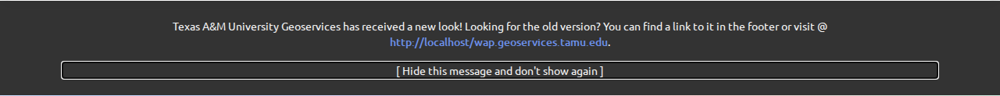

# Geoservices, unreleased

**Geoservices's changes collect here until Geoservices is next released.** This is `geoservices-angular`, the Geoservices web front end. It is released on its own path, not
with AggieMap or GIS Day, so its changes do not belong in their notes. The file was started on 24 November 2026 for the first change
that needed it ([#2058](https://github.com/TamuGeoInnovation/Tamu.GeoInnovation.js.monorepo/issues/2058)); each change adds its own
entry file to [`unreleased/`](unreleased/README.md) with `app: geoservices` in its front matter, and
`node scripts/collate-release-notes.mjs --write` gathers them here.

**What is deployed is not recorded here.** Where Geoservices runs is part of the infrastructure inventory
([#1517](https://github.com/TamuGeoInnovation/Tamu.GeoInnovation.js.monorepo/issues/1517)).

---

## Summary

### Geoservices' clickable controls work from the keyboard

Eight of Geoservices' controls were a span, a div, a paragraph or a link with no address that only a mouse could use: the revival
modal's and banner's dismiss, the summary blurb's close and "here", Reset, "See all fields", "Deselect All" and the pricing call to action.
Tab now reaches each of them, and Enter or Space does what a click does, the way the shared menu tiles' back button already works. The
seven template accessibility rules that would have caught them are switched back on for Geoservices, so a new one fails the lint.

| Before | After |
| --- | --- |
|  |  |

## What to check, and where

| Change | Open this on dev | Look for |
| --- | --- | --- |
| Geoservices: keyboard controls ([#2058](https://github.com/TamuGeoInnovation/Tamu.GeoInnovation.js.monorepo/issues/2058)) | Wherever Geoservices' front end is served (or locally, `nx serve geoservices-angular`): the banner, an interactive service page's summary and fields, the pricing page | Tab reaches the banner's dismiss, the summary's close and "here", Reset, "See all fields", "Deselect All" and the pricing call to action; each shows focus, and Enter (or Space) does what a click does |

---
