# GIS Day, unreleased

**GIS Day is released on its own path, not with AggieMap.** It is `gisday-angular` and `gisday-nest` at
[txgisday.org](https://txgisday.org), [gisday.tamu.edu](https://gisday.tamu.edu) and
[gisday.ucgis.org](https://gisday.ucgis.org); its images are built by GitHub Actions rather than Azure DevOps,
production pins a `sha-` tag, and [the release README](README.md#releasing-gis-day) gives the steps. So its
changes do not belong in AggieMap's dated notes, and this file is where they collect until a GIS Day release
takes them.

This replaces the arrangement the README called **"not settled yet"**: GIS Day entries used to go into
`unreleased.md` with AggieMap's, so an AggieMap release collated them into its own notes as though it shipped
them. The 10 November release was the first where somebody noticed the mix in the finished document rather than
in the process.

**37 changes**, merged into `development` between 4 and 13 November 2026 and present in `68d7b974c`. Being in
that commit does not mean being live: a GIS Day build is a separate image, promoted separately.

**What is deployed is not recorded here.** The GIS Day release path records it as a pinned `sha-` tag in the
private cluster configuration repository, because this repository is public. To find out what production is
running, read the pin there rather than inferring it from this file. Several of these changes went out ahead of
the November event and are already live; this file does not say which, and should not be read as if it did.

**Nothing automated covers GIS Day.** It has no development site
([#1525](https://github.com/TamuGeoInnovation/Tamu.GeoInnovation.js.monorepo/issues/1525)), so production is
the first place a built image runs, and the AggieMap smoke suite does not touch it. Check a change on the local
stack first ([`docs/gisday-local.md`](../gisday-local.md)). That makes the checks below the only ones there are.

---

## Summary

### GIS Day: UCGIS's Sign in goes straight to Tradewing

UCGIS's members, and its organizers, sign in to gisday.ucgis.org only with their UCGIS Tradewing accounts. Its **Login/Signup** used to open a Texas A&M Geoservices page offering an email address, Google and Tradewing; it now goes straight to Tradewing's own sign-in page. Organizers who are not UCGIS members get a UCGIS Tradewing account with the admin role on it. txgisday.org and gisday.tamu.edu are unchanged ([#2575](https://github.com/TamuGeoInnovation/Tamu.GeoInnovation.js.monorepo/issues/2575)).

| Before | After |
| --- | --- |
| 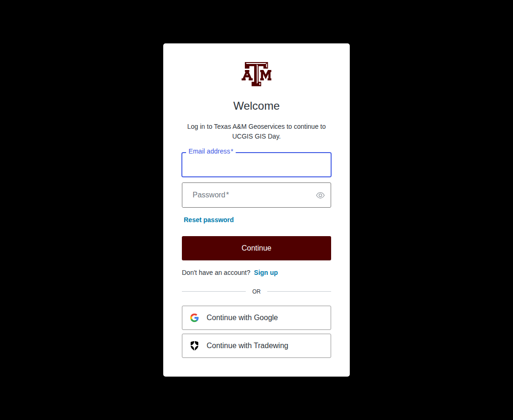 | 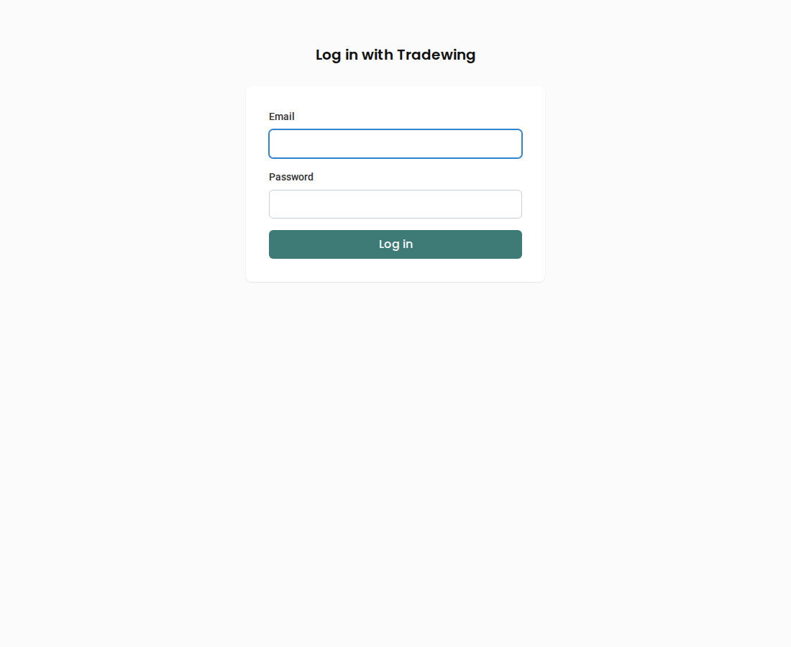 |

### The VGI map shows your own submissions, where you are, and one ring per thing found last year

Three things that made the competition map hard to play from a phone
([#2625](https://github.com/TamuGeoInnovation/Tamu.GeoInnovation.js.monorepo/issues/2625)):

- **Your own submissions stand out.** Every 2026 submission used to be the same grey dot. Yours are now solid
  maroon, above everyone else's, with a key. They come from your own submissions; the map of everyone's still
  says nothing about whose each one is
  ([#1792](https://github.com/TamuGeoInnovation/Tamu.GeoInnovation.js.monorepo/issues/1792)).
- **A "you are here" dot.** Blue, inside a circle as wide as the phone says its location may be off, following
  you as you walk, with a button that centres the map on it. It uses the location only where the site is
  already allowed it, or once you tap the button, so it never asks on its own
  ([#2559](https://github.com/TamuGeoInnovation/Tamu.GeoInnovation.js.monorepo/issues/2559)). It is a shared map
  feature, `maps-feature-location`, for any other map that wants one.
- **One ring per thing found last year.** A memorial submitted several times in 2025 showed as several rings a few
  metres apart. Finds of one type close enough to count as the same thing for scoring are now one ring, which
  says how many times it was found. The distance is the one scoring uses to call a 2026 find already found (15 m
  for monuments, 3 m for tree and bench plaques), so a ring still means "a find here scores as already found".
  On the local copy of the database, 504 rings became 316.

| | Before | After |
| --- | --- | --- |
| The map | 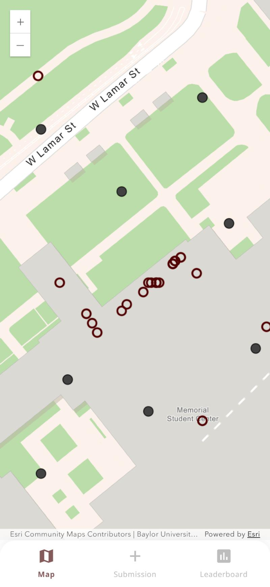 | 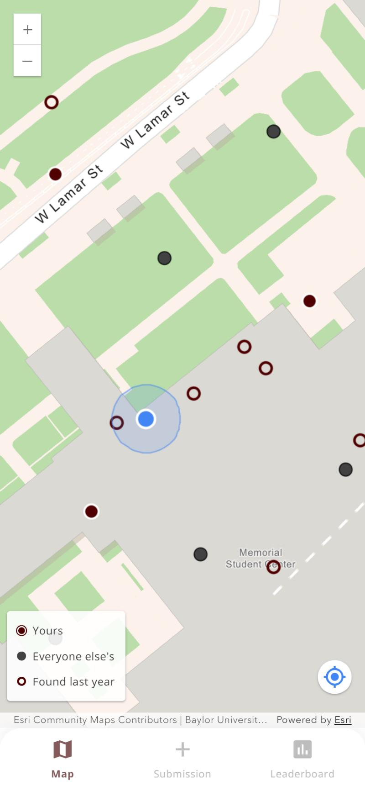 |
| A ring from last year | 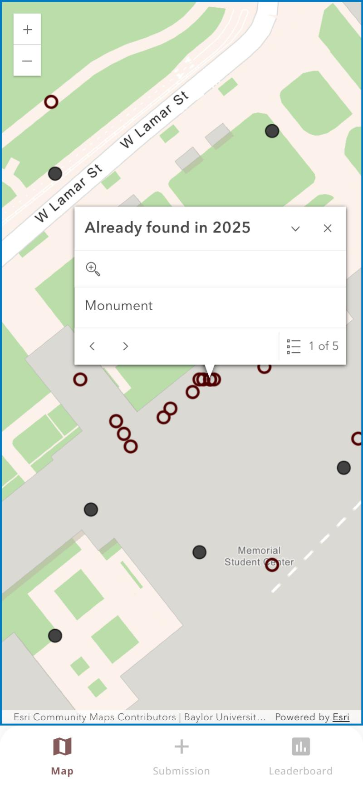 | 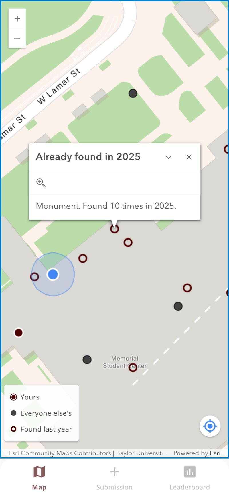 |
| Where you are | | 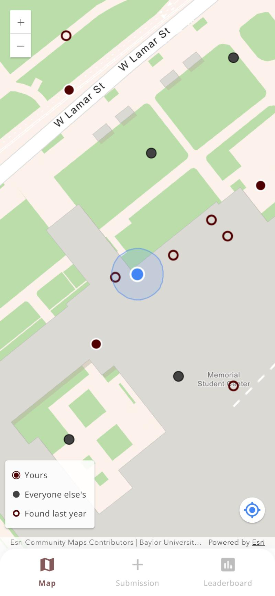 |

### GIS Day: VGI monuments and memorial markers reach the ArcGIS Online layer with their names

The submission form asks every find for its name, but only plaques reached the competition's ArcGIS Online layer
with one: a monument or memorial marker arrived with `memorial_name` blank. The publisher found the name through a
scoring setting only the plaque type has. It now publishes the name for every type. How finds are scored and
reviewed is unchanged. Points already on the layer get their names when next published, by a review or by
**Publish to ArcGIS** in Admin.
([#2628](https://github.com/TamuGeoInnovation/Tamu.GeoInnovation.js.monorepo/issues/2628))

Before: a monument's point on the layer, with `memorial_name` blank although a name was typed. The after image
is taken on production after release, as the *What to test* row says, because the local test layer does not
accept edits at the moment.

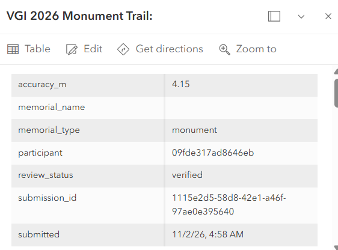

### GIS Day: open a session's check-in at any time, and see check-ins made outside its time

A session's check-in used to be open only from its start until 15 minutes after its end
([#1795](https://github.com/TamuGeoInnovation/Tamu.GeoInnovation.js.monorepo/issues/1795)), which made
check-in, and the location check above all, hard to test, and left no way to accept a late check-in. An
admin can now tick **Check-in open at any time?** on a session's event form. Its page then offers
**CHECKIN** before, during and after the session, and the API accepts it. Every other rule still applies:
an in-person session still needs the attendee inside its check-in zone
([#1766](https://github.com/TamuGeoInnovation/Tamu.GeoInnovation.js.monorepo/issues/1766)), and a hybrid
or virtual one its QR code
([#2560](https://github.com/TamuGeoInnovation/Tamu.GeoInnovation.js.monorepo/issues/2560))
([#2635](https://github.com/TamuGeoInnovation/Tamu.GeoInnovation.js.monorepo/issues/2635)).

A check-in made outside the session's time is marked **Outside Session Time Check-In**. The mark is
decided when the check-in is made, so moving the session later does not change it, and check-ins an
organizer adds by hand are never marked. Admins see each session's check-ins in the organizer section of
its page: who, when in Central time, and the mark. Every other session keeps its window. Production needs
the `AddCheckInAnyTime` migration before this release.

| Before | After |
| --- | --- |
| 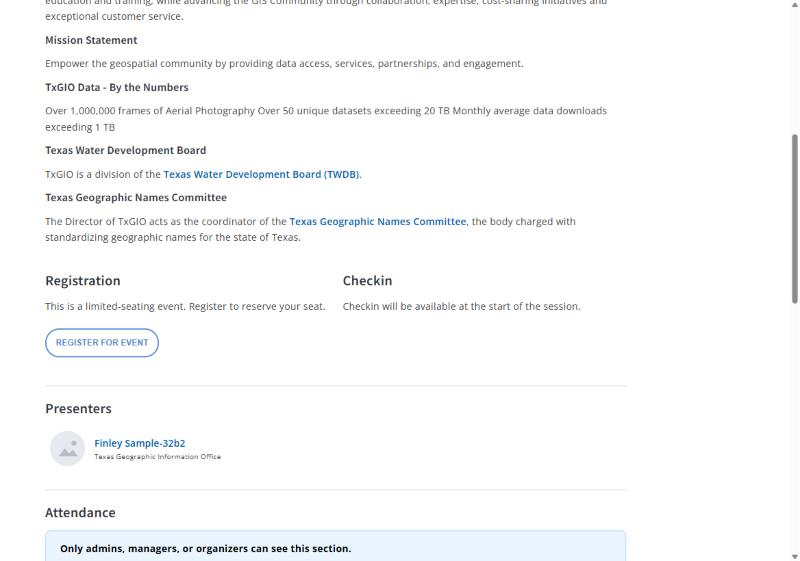 | 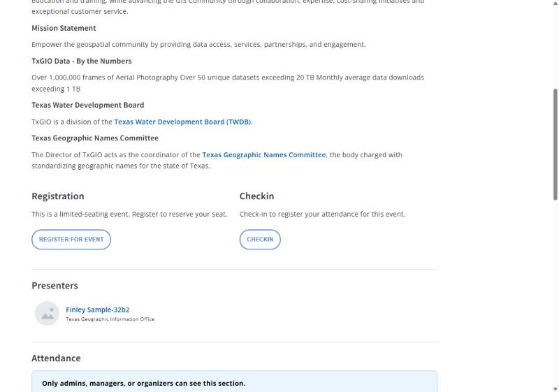 |
| 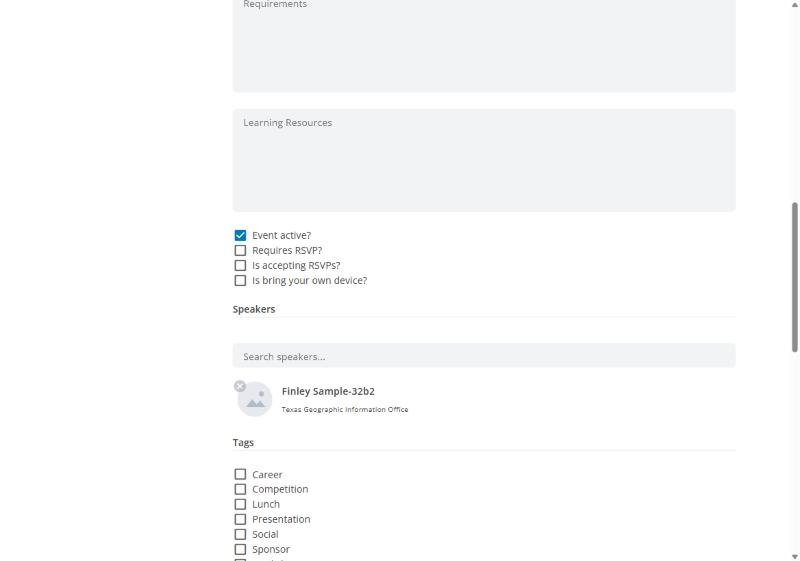 | 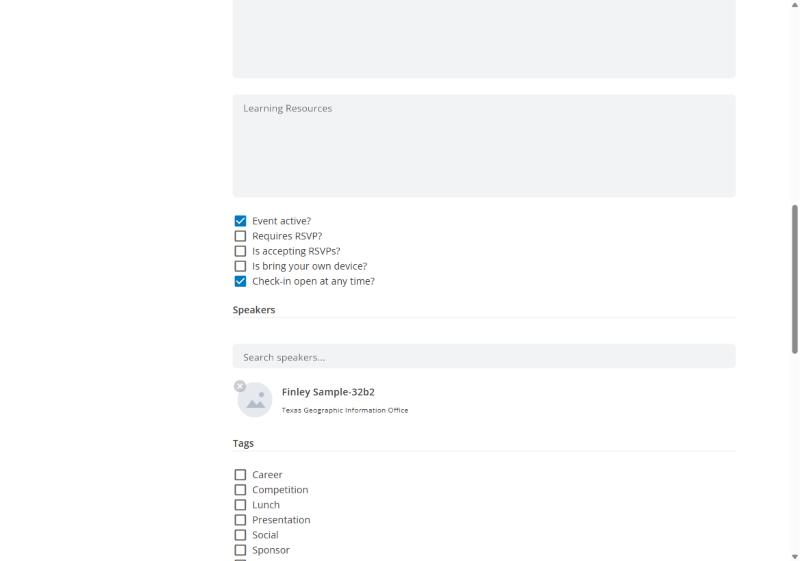 |
| 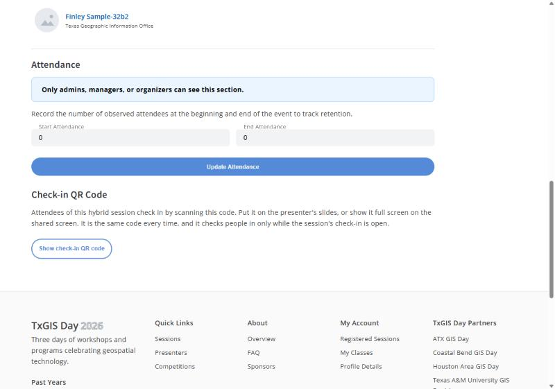 | 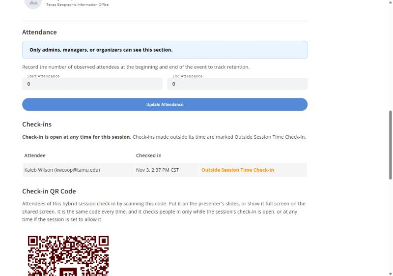 |

### GIS Day: each sponsor's logo can be drawn small, regular, large or extra large

Every logo on the Sponsors page was fitted into the same 250 × 60 px box, whatever its shape, so a logo with
small text, like the Bush School's seal and two lines beside it, read as tiny next to its neighbours and nothing
could make it bigger. A sponsor's form now has a **Logo size**: Small, Regular, Large or Extra large. Regular is
the box before and stays the size of every existing sponsor until someone changes it; Large and Extra large draw
the logo 1.5 and 2 times as large (375 × 90 and 500 × 120 px), and no logo is ever wider than a phone's screen
([#2638](https://github.com/TamuGeoInnovation/Tamu.GeoInnovation.js.monorepo/issues/2638)).

The size is a new column on the sponsors table, added by the migration `AddSponsorLogoSize`. It only adds, so it
is run on both production databases before the new API is rolled out, and the API already running keeps working
once it has.

| Before | After |
| --- | --- |
| 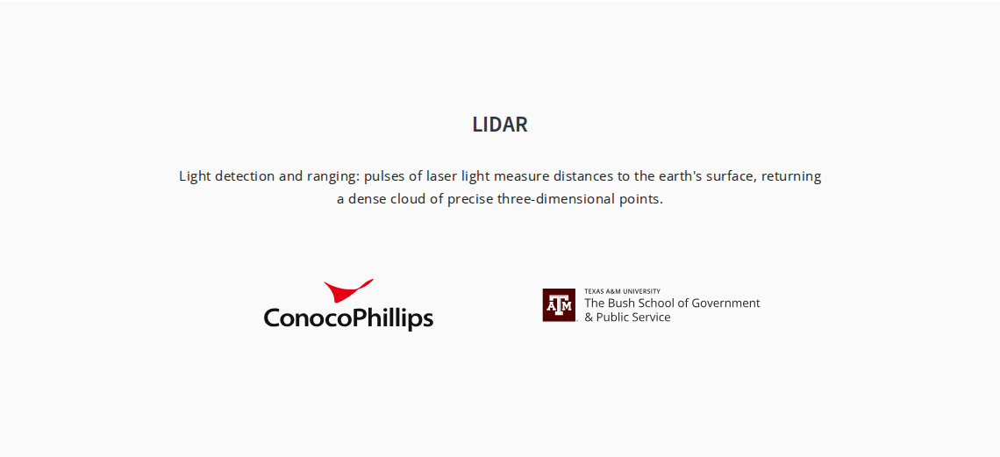 | 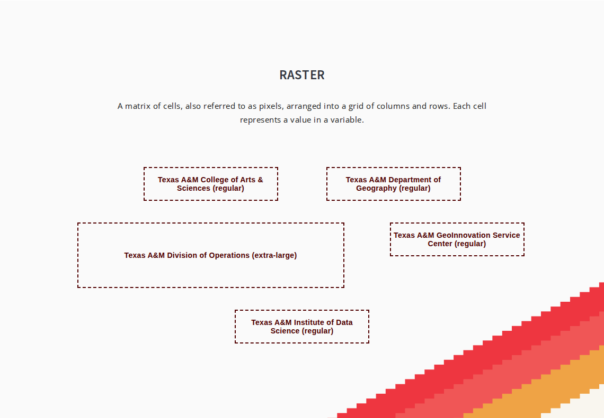 |
| | 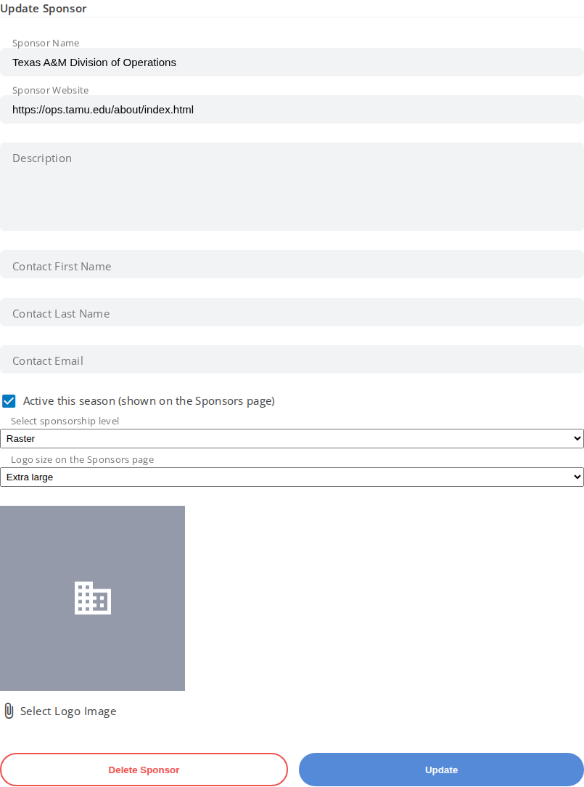 |

### GIS Day: a stacked sponsor logo set to Large or Extra large grows in height too

The logo sizes added in [#2638](https://github.com/TamuGeoInnovation/Tamu.GeoInnovation.js.monorepo/issues/2638) were boxes with the same wide shape as Regular, so a stacked logo stopped at the box's height. The Bush School's stacked logo, set to Extra large, came out about 260 × 120 px, smaller than the wide logo it replaced. Large and Extra large are now about 2:1 boxes, 450 × 200 and 650 × 300 px, so a stacked logo grows in height. A wide logo still stops at the box's width, so it looks no different. Small and Regular are unchanged ([#2646](https://github.com/TamuGeoInnovation/Tamu.GeoInnovation.js.monorepo/issues/2646)).

| Before | After |
| --- | --- |
| 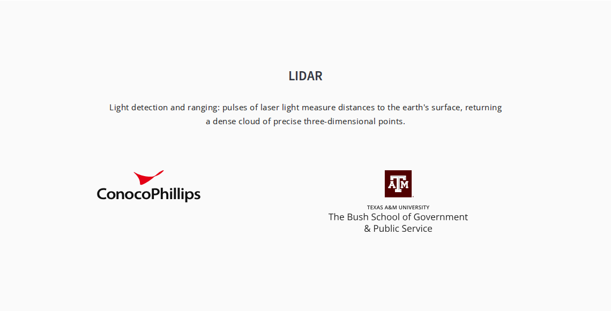 | 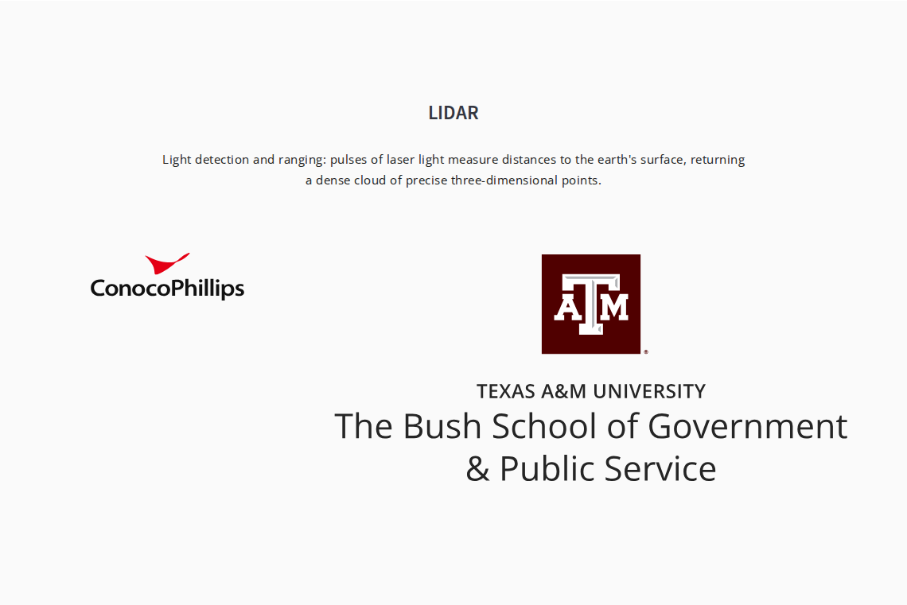 |

### GIS Day: each site's link preview shows its own name, description and image

A post linking to gisday.ucgis.org showed "TxGIS Day", TxGIS Day's description and a grey placeholder, and gisday.tamu.edu's links did the same. Link previews read the page a site serves without running the app, and every site served txgisday.org's page, with no image at all. Each site now serves its own page, written when the app is built from the same site settings as the rest of its branding, with its name, a description, its address and a 1200 × 630 preview image made from its homepage banner. The site's server picks the page by the address it is reached at. UCGIS's description is its homepage's first line until UCGIS sends its own ([#2649](https://github.com/TamuGeoInnovation/Tamu.GeoInnovation.js.monorepo/issues/2649)).

The pictures are preview cards drawn from each page's own tags: before from the live site, after from the new build.

| Before | After |
| --- | --- |
|  | 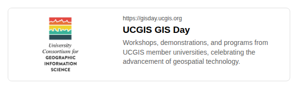 |
| 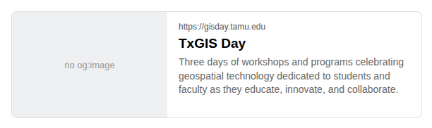 | 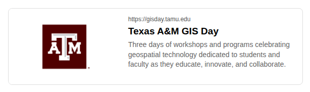 |

### GIS Day: university and organization lists can be searched by typing

The University and Organization fields on the admin speaker form, and Institution and Employer on the profile page, were plain drop-downs of about 80 universities and 290 organizations. They now take typed text as well: clicking one opens the whole list, and typing narrows it to the names that contain the text. What is saved is the same as before. It is the shared select with a new `searchable` option, which uses the shared autocomplete for the typing and the list, so any other drop-down can turn it on ([#2656](https://github.com/TamuGeoInnovation/Tamu.GeoInnovation.js.monorepo/issues/2656)).

| Before | After |
| --- | --- |
| 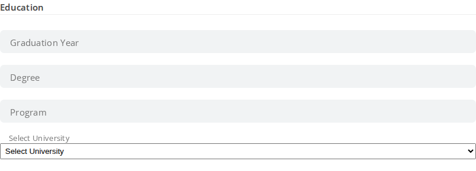 | 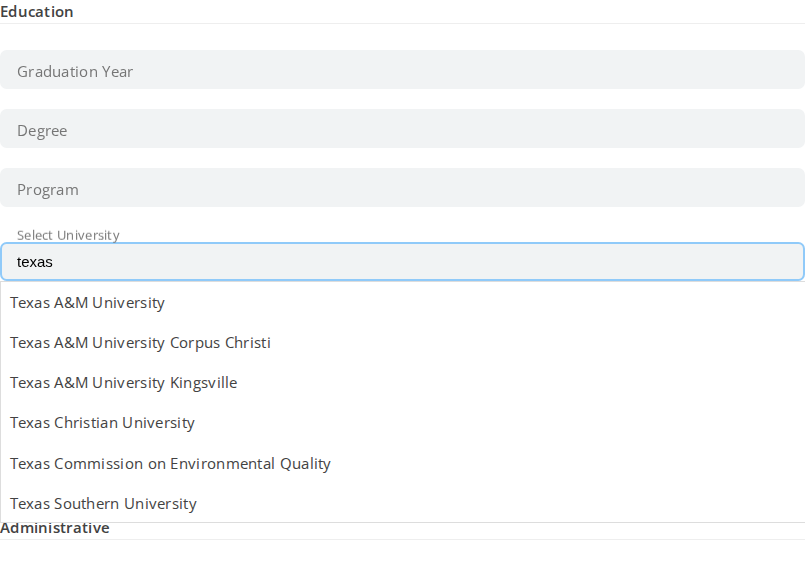 |
| 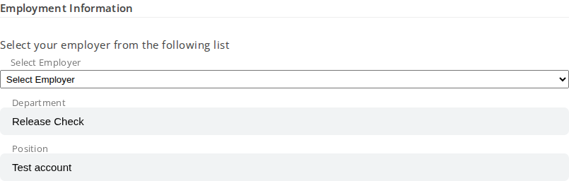 | 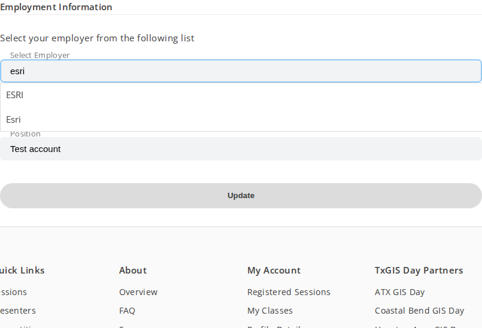 |

### GIS Day: UCGIS's Login/Signup says to use a UCGIS account first

Since [#2575](https://github.com/TamuGeoInnovation/Tamu.GeoInnovation.js.monorepo/issues/2575), Login/Signup on
gisday.ucgis.org goes straight to UCGIS's own Tradewing sign-in page. That page says only "Log in with Tradewing", with
no UCGIS logo and nothing to say it wants a UCGIS member account, and it is UCGIS's page, which this site cannot change.

Login/Signup now first opens a short window with the UCGIS logo:
- **Sign in with your UCGIS account**: the next page is the UCGIS sign-in titled "Log in with Tradewing", and visitors use the email and password they use on ucgis.org.
- **Continue** goes on to that page.
- **Cancel** stays on the site.

txgisday.org and gisday.tamu.edu are unchanged
([#2662](https://github.com/TamuGeoInnovation/Tamu.GeoInnovation.js.monorepo/issues/2662)).

| Before: Login/Signup went straight here | After: Login/Signup says first whose account to use |
| --- | --- |
|  | 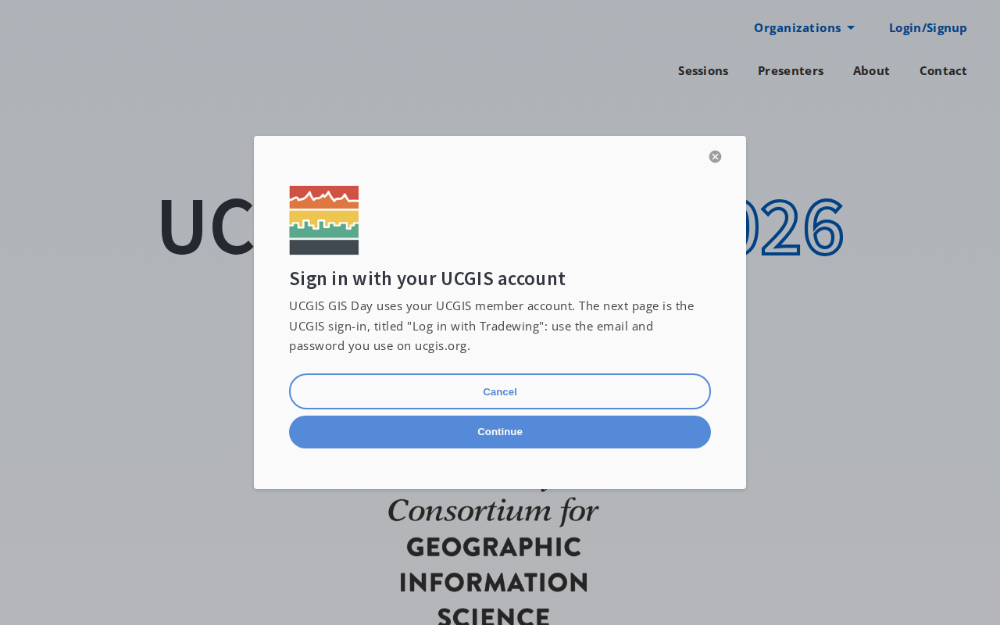 |

### GIS Day: the presentation and poster competitions give the new deadline

The student presentation competition and the poster competition took submissions until Monday, November 9. Their
deadline is now **Friday, November 13, 2026, at 5:00 PM Central**, and finalists for both are notified on **Saturday,
November 14**. The poster page had said finalists would hear on Wednesday, November 11, which would have come before
the new deadline. The sessions on Tuesday, November 17 and the awards on Wednesday, November 18 are unchanged
([#2663](https://github.com/TamuGeoInnovation/Tamu.GeoInnovation.js.monorepo/issues/2663)).

| Before | After |
| --- | --- |
|  | 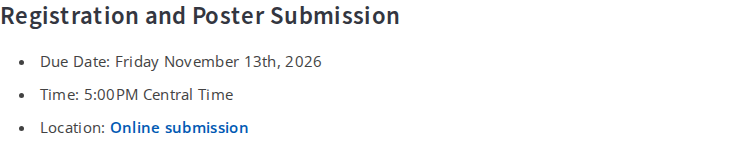 |
| 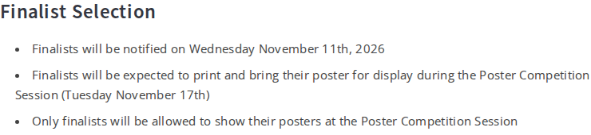 | 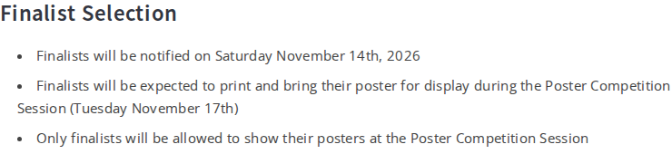 |
| 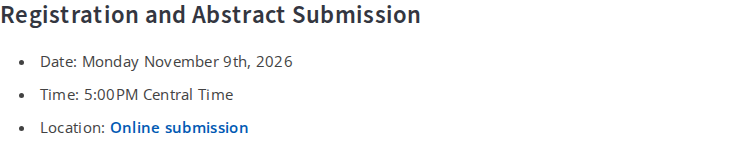 |  |
| 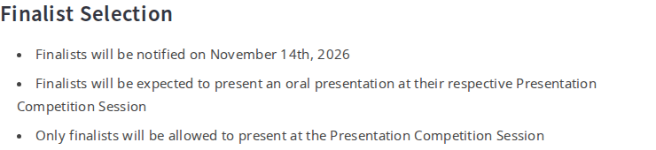 | 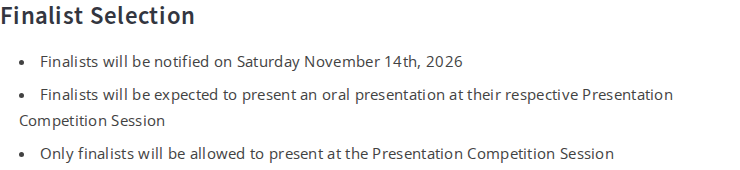 |

### GIS Day: the poster and presentation competitions no longer credit the Center for Teaching Excellence

The Prizes section of the poster and presentation competition pages said the prizes were provided by the Texas A&M
Center for Teaching Excellence, through a Montague-CTE Scholar Award won by Dr. Heng Cai. That sentence is removed from
both pages. The prize amounts are unchanged
([#2676](https://github.com/TamuGeoInnovation/Tamu.GeoInnovation.js.monorepo/issues/2676)).

| Before | After |
| --- | --- |
| 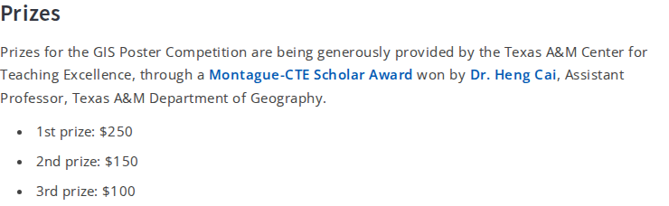 | 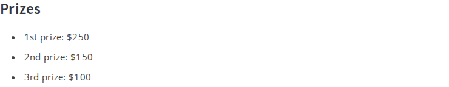 |
| 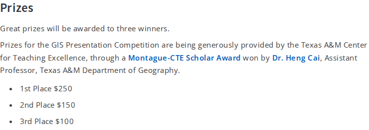 | 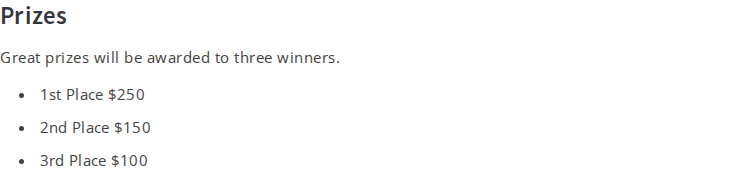 |

### GIS Day: the VGI competition page credits the Office of the University Architect

The VGI competition page now says, under the 2026 competition, that its prizes are provided by the Texas A&M Office of
the University Architect. The Monument Trail page it links to already said so
([#2677](https://github.com/TamuGeoInnovation/Tamu.GeoInnovation.js.monorepo/issues/2677)).

| Before | After |
| --- | --- |
| 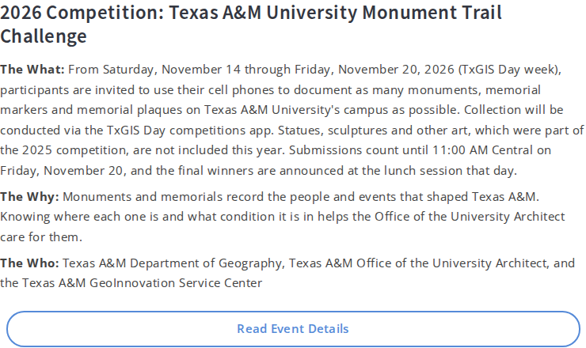 | 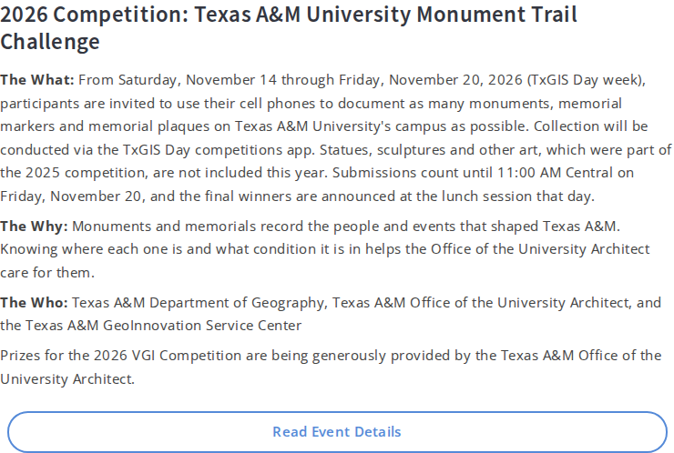 |

### AggieMap tells visitors about GIS Day

Texas A&M GIS Day is **Monday 16 to Friday 20 November 2026**, and AggieMap would have said nothing about
it. The main map raises a notice for an event that is on now or within a week - Ring Day, Big Event, football
and the rest all have one - and GIS Day's never appeared.

Its dates were right all along. What it did not have was a notice to raise: the service skips an event with
no notice configured before it ever looks at a date, so GIS Day's could not have appeared in any year,
whatever the dates said. **The absence of a notice looks exactly like a quiet week**, which is why it went
unnoticed for several of them.

From a week before the event, a visitor to the main map now gets a notice that opens the GIS Day map, where
the building and parking locations around the MSC and Rudder Tower are. It can be dismissed for good, and it
comes back next year on its own: the service stamps the season onto the notice from the event's own earliest
date, so giving the map next year's dates is all anybody has to do.

#### Behind the scenes

Twenty-seven other event maps carry dates and no notice, and that is correct - a notice is for an event the
public is invited to, not for every permit map. So the new check asserts GIS Day's notice specifically, and
then asserts what must be true of *every* notice, which is where a copied definition goes wrong: no season
typed into an id, each notice opening its own map, and no two events sharing an id and so silencing each
other. All three already held across the existing twelve.

### GIS Day: signing in on UCGIS GIS Day comes back to GIS Day again

For a few hours on 6 November, signing in on gisday.ucgis.org stopped at Tradewing. The email and password were
accepted and the visitor was signed in to ucgis.org, but never sent back to GIS Day. The cause was the change for
[#2672](https://github.com/TamuGeoInnovation/Tamu.GeoInnovation.js.monorepo/issues/2672) in
[PR 2683](https://github.com/TamuGeoInnovation/Tamu.GeoInnovation.js.monorepo/pull/2683), which asked Tradewing for the
password at every sign-in, which opened Tradewing's own sign-in form:

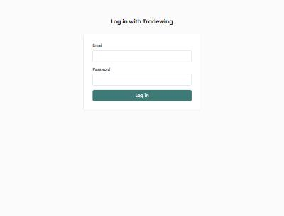

The UCGIS site was rolled back the same day, and this takes that one change out
([#2700](https://github.com/TamuGeoInnovation/Tamu.GeoInnovation.js.monorepo/issues/2700)).

The rest of PR 2683 stays: Logout ends only the site's own session, on every site, and clears the API answers the
browser kept. What PR 2683 was for is open again: after Logout, the next sign-in on UCGIS GIS Day signs straight back
in while ucgis.org still has a session, and only Tradewing can end that session.

### GIS Day admin: a new event starts out accepting RSVPs

The form for adding an event started with "Is accepting RSVPs?" unticked, although the database treats an event as
accepting RSVPs unless told otherwise. So every event added in the admin pages was saved as not accepting them: on
6 November 2026 all 45 active events on each site were, and a script had to set them. A new event now starts with the
box ticked; an organizer can still untick it, and an event being edited keeps what it has.
([#2706](https://github.com/TamuGeoInnovation/Tamu.GeoInnovation.js.monorepo/issues/2706))

| Admin > Events > Add | Before | After |
| --- | --- | --- |
| A new event | 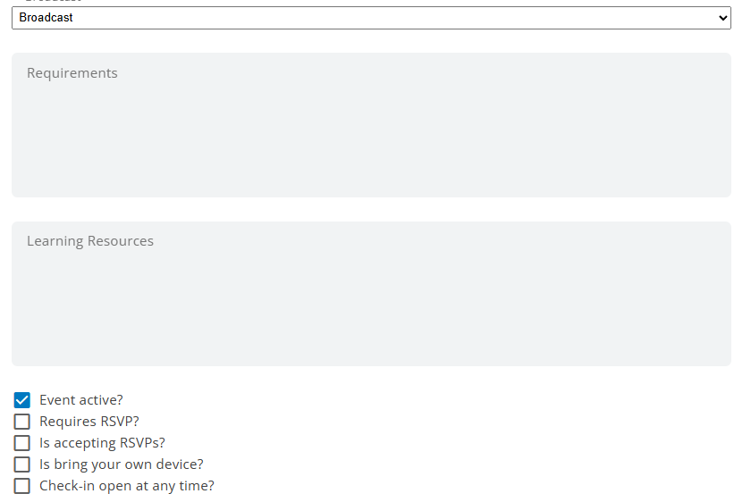 | 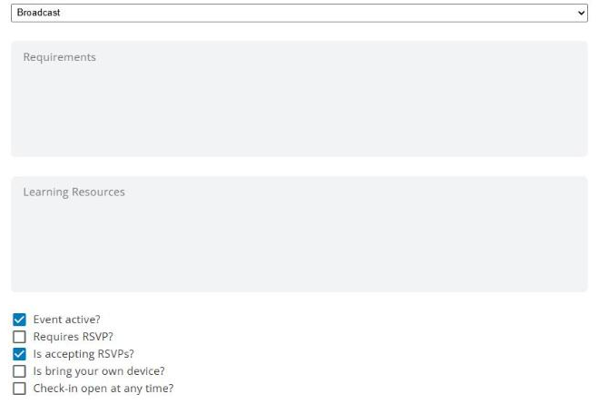 |

### GIS Day: the Sessions page names each day's weekday

Each day on the Sessions page is now headed with its weekday, "Thursday, November 19" rather than "November 19", on
all three GIS Day sites.

The headings are now also in Central time, as the page's times already were. A day arrives from the server as
midnight Central, which is still the evening before further west, so a visitor in Pacific time saw every day a day
early: 15 to 19 November for a week that runs 16 to 20 November.
([#2708](https://github.com/TamuGeoInnovation/Tamu.GeoInnovation.js.monorepo/issues/2708))

| | Before | After |
| --- | --- | --- |
| Central time | 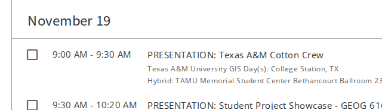 |  |
| Pacific time |  |  |

### GIS Day: session times are Central wherever the visitor is

The Sessions page says all its times are in Central time, but it showed each session in the visitor's own time zone.
Further west it was also a day early on a session's own page: in Pacific time, a session at 9:00 AM on Thursday 19
November read 7:00 AM, on 18 November. The Sessions page, a session's page and a speaker's page now show every
session's day and times in Central time, for every visitor. Check-in already read them this way, and the pages now
use the same reading.
([#2710](https://github.com/TamuGeoInnovation/Tamu.GeoInnovation.js.monorepo/issues/2710))

| Pacific time | Before | After |
| --- | --- | --- |
| Sessions page | 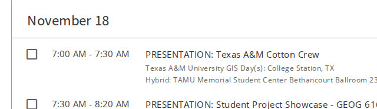 | 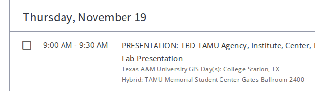 |
| A session's page | 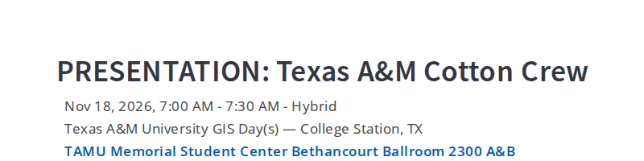 | 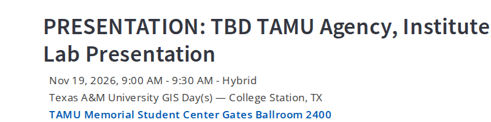 |

### GIS Day: every UCGIS member institution is in the institution list

When visitors complete their profile, they choose the institution they attend or work at from a list, and choose
**Other** when theirs is missing. The list had 23 institutions on the UCGIS site and 92 on txgisday.org, and many UCGIS
members were not among them. All 67 members on UCGIS's
[members page](https://www.ucgis.org/site/members) are now in each site's list for this season. A new script adds
those that are missing, and leaves alone those that were already there under another spelling ("Pennsylvania State
University" for Penn State, "Clemson" for Clemson University), so none is listed twice. Esri and the US Geological
Survey, UCGIS's government and commercial affiliates, are not in the list, because it is a list of schools.
([#2721](https://github.com/TamuGeoInnovation/Tamu.GeoInnovation.js.monorepo/issues/2721))

### The GIS Day competition maps draw the campus vector basemap

The competition maps drew the older raster campus basemap, whose service is no longer maintained. They now draw the
campus vector basemap AggieMap opens on. It looks a little different: parking garages are blue, and buildings under
construction are patterned.
([#2792](https://github.com/TamuGeoInnovation/Tamu.GeoInnovation.js.monorepo/issues/2792))

| Before | After |
| --- | --- |
| 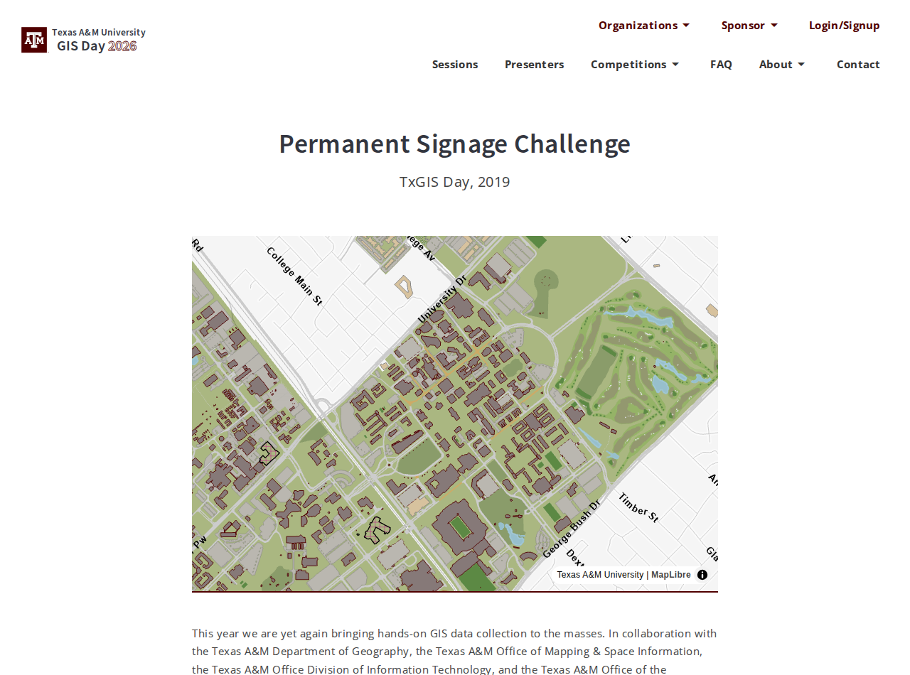 | 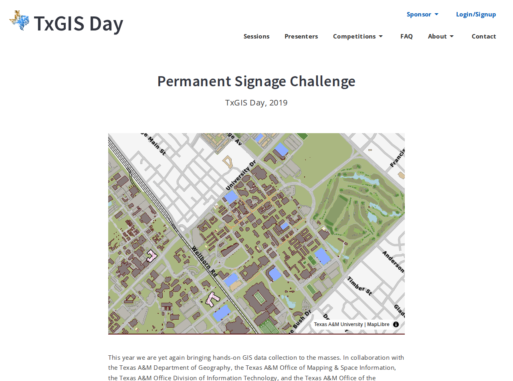 |

### GIS Day admin: the submissions list shows who submitted each, and when

The admin list of student competition submissions showed each one's title, type, format, classification and status,
but not who submitted it or when. Checking whether a particular student's poster had arrived meant opening each
submission in turn, and even then it showed only the participants typed into the form, not the account that submitted
it. The list now shows the date and time each was submitted, and the submitter's first and last name, email and
department (the field of study for a student, the department for anyone else), read from their account, stacked in one
Submitted by column. A submission
whose account no longer exists still appears, marked "Account not found".
([#2799](https://github.com/TamuGeoInnovation/Tamu.GeoInnovation.js.monorepo/issues/2799))

| Admin > Research Competitions | Before | After |
| --- | --- | --- |
| The 2026 list (local test data) | 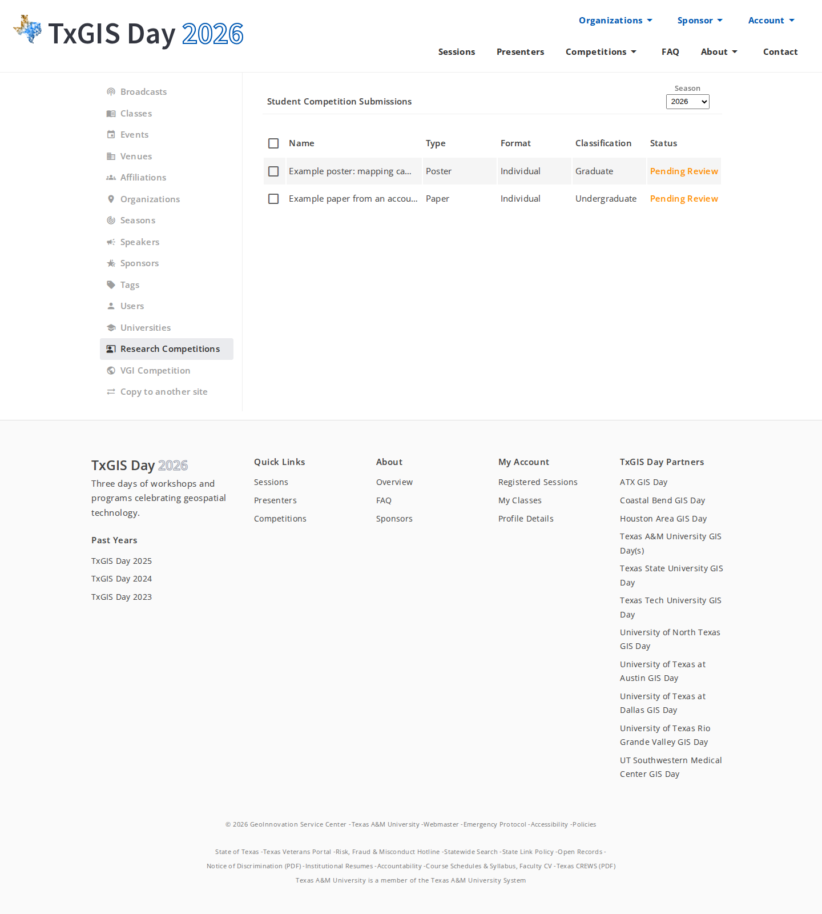 |  |

### GIS Day admin: tables use the screen's width and no longer scroll sideways

The admin pages were held to a fixed 1140-pixel layout, and a table wider than its column scrolled sideways inside it.
The competition submissions list, with its new submitter columns, overlapped its own headings and cut names to three
letters. On a desktop the admin pages now use the screen's width, as every GIS Day page already does on a phone; the
menu keeps its width, and each table takes the rest and wraps between words instead of scrolling.
([#2806](https://github.com/TamuGeoInnovation/Tamu.GeoInnovation.js.monorepo/issues/2806))

| Admin > Research Competitions | Before | After |
| --- | --- | --- |
| Desktop, 1440 pixels wide (local test data) |  |  |

### GIS Day admin: filter, count and sort the competition submissions

The admin list of student competition submissions showed every entry of the season at once, in no particular order.
It can now be narrowed by classification (undergraduate or graduate) and by type (poster, presentation and the
rest), says how many entries it is showing out of the season's total, and sorts by any column when its heading is
clicked, newest first to begin with. The filters offer the same choices as the submission form, and the table is
the one the VGI review list already uses, which also gains a visible sort arrow.
([#2807](https://github.com/TamuGeoInnovation/Tamu.GeoInnovation.js.monorepo/issues/2807),
[#2808](https://github.com/TamuGeoInnovation/Tamu.GeoInnovation.js.monorepo/issues/2808))

| Admin > Research Competitions | Before | After |
| --- | --- | --- |
| Desktop, 1440 pixels wide (local test data) |  |  |

### GIS Day admin: the submissions filters offer only the season's choices; department or major is a column

The submissions list's filters offered every choice the submission form has, so picking Paper in a season with no
papers showed nothing. Each filter now offers All and only the choices the selected season's submissions have. The
submitter's department or major, until now a grey line under their email, is a column of its own and can be sorted.
([#2817](https://github.com/TamuGeoInnovation/Tamu.GeoInnovation.js.monorepo/issues/2817))

| Admin > Research Competitions | Before | After |
| --- | --- | --- |
| Desktop, 1440 pixels wide (local test data) |  |  |

Nothing has merged since the 30 October release.

---

---

### GIS Day Presenters: search by name or organization, and listed by last name

The Presenters page showed every presenter, 77 this year, in order of first name, with no way to find one person or
everyone from one organization except scrolling. A search box above the cards now narrows them to the presenters
whose first name, last name or organization contains what is typed, in any case and ignoring accents, and says how
many it is showing. The cards are in order of last name, as a printed program would list them.
([#2859](https://github.com/TamuGeoInnovation/Tamu.GeoInnovation.js.monorepo/issues/2859),
[#2860](https://github.com/TamuGeoInnovation/Tamu.GeoInnovation.js.monorepo/issues/2860))

| Presenters | Before | After |
| --- | --- | --- |
| Desktop, 1440 pixels wide |  |  |

### GIS Day: presenter photos load as they come into view

The Presenters page asked for every presenter's photo the moment it opened, 76 of them and 8.6 MB on
11 November 2026, before any could be seen. A photo is now loaded as its card nears the screen, so the page draws
without waiting for photos further down. The same photo component is used wherever a presenter appears, so their
own pages and session pages gain it too. The largest stored photos are resized separately, on production.
([#2861](https://github.com/TamuGeoInnovation/Tamu.GeoInnovation.js.monorepo/issues/2861))

### Edit Speaker's university and organization lists stay closed until used

On the GIS Day admin's Edit Speaker page, the University and Organization lists opened as soon as the page
loaded, with nothing touched, and lay over each other and over Affiliation, Is organizer and Delete Speaker.

Both are the shared searchable select (#2656), which fills its text field with the saved item's name. That
field reports every value written to it as a change, and the autocomplete inside opened its list on any change.
It now opens the list for a change only while someone is typing in it, so a saved value leaves it closed.
Focusing the field still opens the whole list, as before.

This is the shared autocomplete, so it covers every searchable select, and AggieMap's All Maps search, which
only opens on typing already. ([#2867](https://github.com/TamuGeoInnovation/Tamu.GeoInnovation.js.monorepo/issues/2867))

| Before | After | After, University clicked |
| --- | --- | --- |
|  |  |  |

### GIS Day: the Presenters search finds a university, by name or abbreviation

The search on the Presenters page found a presenter by name or organization. It now also finds them by their
university, by its full name or its abbreviation, so `TAMU` lists everyone from Texas A&M, including those who now
work elsewhere. On the local site, `TAMU` found none of its 13 presenters before and 5 after.
([#2869](https://github.com/TamuGeoInnovation/Tamu.GeoInnovation.js.monorepo/issues/2869))

| Before | After |
| --- | --- |
|  |  |

### GIS Day: the Presenters page says how many presenters are listed, under the list

Under the last card, the Presenters page now says how many presenters there are, and while a search is typed, how
many of them it shows. The count above the list, under the search box, stays as it was. ([#2870](https://github.com/TamuGeoInnovation/Tamu.GeoInnovation.js.monorepo/issues/2870))

| Before | After |
| --- | --- |
|  |  |

### GIS Day admin: the event form's speaker search closes once a speaker is added

On the admin's event pages, clicking a speaker in the Speakers search added them but left the results open over the
rest of the form. The list stays open while anything in it has focus, and the speaker just clicked kept it. Choosing a
speaker now adds them, clears the search and closes the list. Enter and Space still choose a speaker from the
keyboard. ([#2871](https://github.com/TamuGeoInnovation/Tamu.GeoInnovation.js.monorepo/issues/2871))

| Before | After |
| --- | --- |
|  |  |

### GIS Day admin: Create Class adds several sections at once

A class with several sections used to be entered once for each. Create Class's section field now takes a list,
separated by commas (`501, 502, 503`), and adds one class for each section, with the same code, number, name and
professor. The form says how under the field. If a section cannot be added, for example because it already exists,
the page names it, leaves it in the field to correct, and stays open; the others are kept. A single section works as
before, and Edit Class still edits one. ([#2872](https://github.com/TamuGeoInnovation/Tamu.GeoInnovation.js.monorepo/issues/2872))

| Before | After |
| --- | --- |
|  |  |

### GIS Day admin: a Dashboards section, starting with RSVPs per event by person type, over time

The admin menu opens with a new **Dashboards** section. Its first dashboard, **RSVPs**, shows for the selected season:

- **RSVPs over time**: the running total at the end of each day, in Central time. Opening an event adds that event's
  own line.
- **By event**: each event, in the order they happen, with its number of RSVPs split by person type, and a total row.
  The types come from what each person chose on My Details: **Undergraduate** and **Graduate** students (read from
  the classification they typed; a student whose classification reads as neither is counted as *Student,
  classification not given*), **Faculty & academia**, **Industry**, and **Not given** for an account that never
  completed its profile.
- **An event, opened**: who RSVP'd, under their type's heading, with their email, classification or position,
  department or field of study, and university or employer, and an **Export as CSV** of the same.

Names and emails are read only when an event is opened, and only by an admin with the `read:rsvps` permission.
([#2878](https://github.com/TamuGeoInnovation/Tamu.GeoInnovation.js.monorepo/issues/2878))

| Before | After |
| --- | --- |
|  |  |

### GIS Day: signed-in visitors get the Account card in the phone menu again

On a phone, a signed-in visitor who opened the menu found no **Account** card, and so had no way to their profile,
classes, check-ins or Logout. The card is back on every GIS Day site. It had been missing since the Angular 20 upgrade
of 5 October 2026, whose conversion of the templates left the card nested where the menu does not look for it.
([#2884](https://github.com/TamuGeoInnovation/Tamu.GeoInnovation.js.monorepo/issues/2884))

| Before | After |
| --- | --- |
|  |  |

### GIS Day admin: the RSVP chart redrawn, readable at any width, with each day's numbers on hover

The **RSVPs over time** chart on the RSVP dashboard is drawn again, with amCharts. The first version scaled with the
page, so on a wide screen it stood about 600 px tall, with text and dots several times the page's size, a scale running
to 1,500 for a total of 1,071, and no numbers anywhere.

Now the chart is a fixed 320 px tall, at the page's own text size, and its scale ends just above the total.
- **Hovering** any day shows that day's total and how many RSVPs it gained.
- **Columns under the line** show each day's new RSVPs, so the days that drove sign-ups stand out.
- **The GIS Day week is shaded.**
- **Dragging across the chart** zooms into a stretch of time, and a double-click shows it all again.
- **Opening an event** adds its own line and a legend, as before.

([#2886](https://github.com/TamuGeoInnovation/Tamu.GeoInnovation.js.monorepo/issues/2886))

| Before | After |
| --- | --- |
|  |  |

### GIS Day admin: sort the RSVP dashboard's table by any column

On the RSVP dashboard, a click on any heading of the **By event** table sorts the table by it, and a second click
reverses it; an arrow on the heading shows which. Counts sort highest first, **Event** A to Z, and the event's start,
now in its own **When** column, earliest first, which brings back the date order. The **All events** row stays at the
bottom, and an opened event's people stay under its row.
([#2891](https://github.com/TamuGeoInnovation/Tamu.GeoInnovation.js.monorepo/issues/2891))

The table and its list of people are now shared pieces, which the coming dashboards for user accounts, check-ins and
VGI submissions will use.

| Before | After, sorted by Industry |
| --- | --- |
|  |  |

### GIS Day admin: a User accounts dashboard, by university or employer and person type

The admin's **Dashboards** section has a second dashboard, **User accounts**. For the selected season it counts the
accounts with a GIS Day profile made between the previous GIS Day and the end of this one, and shows:

- **A summary**: how many, and how many accounts the sign-in service made in the same time, with or without a profile.
  The sign-in service is shared with other sites, so the difference is at most the GIS Day sign-ups that never
  finished a profile.
- **Accounts over time**: the running total by day, with each day's new accounts beneath.
- **By university or employer**: a row each, counted by person type, with a total row, sortable by any heading. A row
  opens to its people, with an **Export as CSV**.

Accounts are read from Auth0 by when they were made, in slices small enough that none is cut off at the 1,000 a search
returns. ([#2892](https://github.com/TamuGeoInnovation/Tamu.GeoInnovation.js.monorepo/issues/2892))

The charts on both dashboards now end at the end of their last day, which they had cut off.

| Before | After |
| --- | --- |
|  |  |

### GIS Day admin: a Speaker badges dashboard, to print name badges from

The admin's **Dashboards** section has a **Speaker badges** page: the season's presenters, as the Presenters page lists
them, in a table to copy into the software that prints name badges.

- **Columns:** First name, Last name, Company / organization, Email, Former student year.
  - **Company / organization** is the speaker's organization or affiliation, as the site shows it, else their
    university.
  - **Former student year** is a Texas A&M former student's class year, written as the site writes it after their name
    ('14). It is blank for anyone else.
- **A search** above the table narrows it by name, company or organization, or email, ignoring case and accents, as
  the Presenters page's search does.
- **Every heading sorts** the table, and **Export as CSV** downloads what the table shows, in its order.

([#2899](https://github.com/TamuGeoInnovation/Tamu.GeoInnovation.js.monorepo/issues/2899))

| Before | After |
| --- | --- |
|  |  |

### GIS Day admin: Speaker badges records which badges are printed, and shows only the ones still to print

The **Speaker badges** page now remembers which badges have been printed, so that as presenters are added only the
new ones are shown and exported.

- **It opens on Not printed yet.** A **Show** choice switches to Printed or All.
- **Mark these N as printed** marks exactly the rows shown, after asking on the page. Export and print first; the
  mark is only made when you say the badges have printed.
- **A Printed column** gives the date each badge was marked. A speaker whose badge would now say something else (their
  name, organization or class year has changed) is flagged **Changed since printed**, to be reprinted.
- **Not printed** on a row puts that badge back on the list, to undo a mistake or to reprint it.

A badge printed one year starts unprinted the next. Whether a badge is printed is seen only by admins who can edit
speakers. ([#2908](https://github.com/TamuGeoInnovation/Tamu.GeoInnovation.js.monorepo/issues/2908))

| Before | After |
| --- | --- |
|  |  |

## What to check, and where

Each row was written by the change that made it. GIS Day has no dev site, so every link is a live site:
check on the local stack before a promotion, and on these pages after one.

| Change | Open this on dev | Look for |
| --- | --- | --- |
| GIS Day: UCGIS signs in with Tradewing only ([#2575](https://github.com/TamuGeoInnovation/Tamu.GeoInnovation.js.monorepo/issues/2575)) | Not on dev: GIS Day has no dev site yet ([#1525](https://github.com/TamuGeoInnovation/Tamu.GeoInnovation.js.monorepo/issues/1525)). On production after release: [gisday.ucgis.org](https://gisday.ucgis.org), then **Login/Signup** | It opens "Log in with Tradewing" on www.ucgis.org, with no email, Google or sign-up choices; signing in with a UCGIS Tradewing account comes back signed in. On [txgisday.org](https://txgisday.org) and [gisday.tamu.edu](https://gisday.tamu.edu), Login/Signup still shows the page with email, Google and sign-up |
| GIS Day: the VGI competition map on a phone ([#2625](https://github.com/TamuGeoInnovation/Tamu.GeoInnovation.js.monorepo/issues/2625)) | Not on dev: GIS Day has no dev site yet ([#1525](https://github.com/TamuGeoInnovation/Tamu.GeoInnovation.js.monorepo/issues/1525)). On production after release, signed in, on a phone: [txgisday.org/app/map](https://txgisday.org/app/map) | Your own submissions are solid maroon with a white edge, everyone else's grey, and a key at the bottom left says which is which. Where the site already has your location, a blue dot with a pale circle shows where you are and moves with you; the round button at the bottom right centres the map on it. Where it has not been allowed, nothing asks until you tap that button, and then only once. A ring from last year opens "Already found in 2025", its type, and how many times it was found ("Found 10 times in 2025."); one memorial no longer shows as a stack of rings |
| GIS Day: names on the VGI ArcGIS Online layer ([#2628](https://github.com/TamuGeoInnovation/Tamu.GeoInnovation.js.monorepo/issues/2628)) | Not on dev: GIS Day has no dev site yet ([#1525](https://github.com/TamuGeoInnovation/Tamu.GeoInnovation.js.monorepo/issues/1525)). On production after release: submit a Monument with a name, or press **Publish to ArcGIS** in Admin > Competitions > Submissions, then open its point on the layer | `memorial_name` shows the name that was typed, for a monument and a memorial marker as well as a plaque |
| GIS Day: a session's check-in at any time ([#2635](https://github.com/TamuGeoInnovation/Tamu.GeoInnovation.js.monorepo/issues/2635)) | Not on dev: GIS Day has no dev site yet ([#1525](https://github.com/TamuGeoInnovation/Tamu.GeoInnovation.js.monorepo/issues/1525)). On production after release and the `AddCheckInAnyTime` migration, as an admin: Admin, Events, a session that is not on now, tick "Check-in open at any time?" and save, then open the session at [txgisday.org/sessions](https://txgisday.org/sessions) | The session offers CHECKIN outside its time. For an in-person session with a zone it still asks for your location and refuses you outside the zone; a hybrid or virtual one still needs its QR code. Once checked in, the session's Check-ins list (organizer section) shows you, the time, and "Outside Session Time Check-In". A session without the box still says check-in is available at the start |
| GIS Day: a sponsor's logo size ([#2638](https://github.com/TamuGeoInnovation/Tamu.GeoInnovation.js.monorepo/issues/2638)) | Not on dev: GIS Day has no dev site yet ([#1525](https://github.com/TamuGeoInnovation/Tamu.GeoInnovation.js.monorepo/issues/1525)). On production after release: signed in as an admin, [Admin, then Sponsors](https://txgisday.org/admin/sponsors), then [the Sponsors page](https://txgisday.org/sponsors) | A sponsor's form has a Logo size select, Regular for every sponsor until it is changed. Set one sponsor to Extra large and save: on the Sponsors page its logo is about twice as wide as its neighbours', and every other logo is as it was |
| GIS Day: a stacked sponsor logo at Extra large ([#2646](https://github.com/TamuGeoInnovation/Tamu.GeoInnovation.js.monorepo/issues/2646)) | Not on dev: GIS Day has no dev site yet ([#1525](https://github.com/TamuGeoInnovation/Tamu.GeoInnovation.js.monorepo/issues/1525)). On production after release: [the Sponsors page](https://gisday.tamu.edu/sponsors) | The Bush School's stacked logo, at Extra large, is about 650 × 300 px beside ConocoPhillips at the LiDAR level; every Regular logo is as it was, and on a phone the page does not scroll sideways |
| GIS Day: link previews ([#2649](https://github.com/TamuGeoInnovation/Tamu.GeoInnovation.js.monorepo/issues/2649)) | Not on dev: GIS Day has no dev site yet ([#1525](https://github.com/TamuGeoInnovation/Tamu.GeoInnovation.js.monorepo/issues/1525)). On production after release: `npx playwright test --config=playwright.smoke.config.ts -g "link preview"` with `SMOKE_BASE_URL` set to each of https://gisday.ucgis.org, https://gisday.tamu.edu and https://txgisday.org | Each passes. Pasting https://gisday.ucgis.org into a post (Tradewing, LinkedIn, Teams) shows "UCGIS GIS Day" and the UCGIS logo, and https://gisday.tamu.edu shows "Texas A&M GIS Day" and the block ATM; a service that saw the old preview may keep it for a while |
| GIS Day: searchable University and Organization ([#2656](https://github.com/TamuGeoInnovation/Tamu.GeoInnovation.js.monorepo/issues/2656)) | Not on dev: GIS Day has no dev site yet ([#1525](https://github.com/TamuGeoInnovation/Tamu.GeoInnovation.js.monorepo/issues/1525)). On production after release: [Add a speaker](https://gisday.tamu.edu/admin/speakers/add) and [your profile](https://gisday.tamu.edu/account/details) | Clicking University or Organization (or, on the profile, Institution or Employer) opens the whole list; typing "texas" narrows it to names containing it; choosing one shows its name, and saving keeps it. An existing speaker's university and organization still show when the speaker is opened for editing |
| GIS Day: UCGIS's Login/Signup says first to use a UCGIS account ([#2662](https://github.com/TamuGeoInnovation/Tamu.GeoInnovation.js.monorepo/issues/2662)) | Not on dev: GIS Day has no dev site yet ([#1525](https://github.com/TamuGeoInnovation/Tamu.GeoInnovation.js.monorepo/issues/1525)). On production after release: [gisday.ucgis.org](https://gisday.ucgis.org) and [txgisday.org](https://txgisday.org) | On gisday.ucgis.org, Login/Signup opens a window with the UCGIS logo, "Sign in with your UCGIS account", and Cancel and Continue. Cancel stays on the page; Continue goes to "Log in with Tradewing". On txgisday.org, Login/Signup goes straight to its usual sign-in page with no window |
| GIS Day: presentation and poster competitions give the Friday, November 13 deadline ([#2663](https://github.com/TamuGeoInnovation/Tamu.GeoInnovation.js.monorepo/issues/2663)) | Not on dev: GIS Day has no dev site yet ([#1525](https://github.com/TamuGeoInnovation/Tamu.GeoInnovation.js.monorepo/issues/1525)). On production after release: [/competitions/posters](https://txgisday.org/competitions/posters) and [/competitions/presentation](https://txgisday.org/competitions/presentation) | Both pages give the submission deadline as Friday November 13th, 2026 at 5:00PM Central and say finalists are notified on Saturday November 14th, 2026. Neither mentions November 9th or November 11th. The sessions are still Tuesday, November 17th |
| GIS Day: poster and presentation competition pages without the Center for Teaching Excellence credit ([#2676](https://github.com/TamuGeoInnovation/Tamu.GeoInnovation.js.monorepo/issues/2676)) | Not on dev: GIS Day has no dev site yet ([#1525](https://github.com/TamuGeoInnovation/Tamu.GeoInnovation.js.monorepo/issues/1525)). On production after release: [/competitions/posters](https://txgisday.org/competitions/posters) and [/competitions/presentation](https://txgisday.org/competitions/presentation) | Under Prizes, neither page mentions the Center for Teaching Excellence, the Montague-CTE Scholar Award or Dr. Heng Cai. The prize amounts ($250, $150, $100) are still there |
| GIS Day: the VGI page credits the Office of the University Architect ([#2677](https://github.com/TamuGeoInnovation/Tamu.GeoInnovation.js.monorepo/issues/2677)) | Not on dev: GIS Day has no dev site yet ([#1525](https://github.com/TamuGeoInnovation/Tamu.GeoInnovation.js.monorepo/issues/1525)). On production after release: [/competitions/vgi](https://txgisday.org/competitions/vgi) | Under "2026 Competition", after "The Who", the page says the prizes are provided by the Texas A&M Office of the University Architect |
| GIS Day notice ([#2678](https://github.com/TamuGeoInnovation/Tamu.GeoInnovation.js.monorepo/issues/2678)) | [The main map on dev](https://dev.aggiemap.tamu.edu/map/d), from 9 November | A notice appears once per browser session: **GIS Day Map Available**, with a parking icon and a "don't show again" option. Clicking it opens [the GIS Day map](https://dev.aggiemap.tamu.edu/events/gis-day). It should appear from 9 November (a week before the event) through Friday 20 November, and not before or after. Before 9 November there is nothing to see, which is also what the fault looked like |
| GIS Day: signing in on UCGIS GIS Day comes back to GIS Day ([#2700](https://github.com/TamuGeoInnovation/Tamu.GeoInnovation.js.monorepo/issues/2700)) | Not on dev, and not locally: Tradewing accepts sign-ins only from production's Auth0, so it can be checked only on [gisday.ucgis.org](https://gisday.ucgis.org) after release | In a private window: Login/Signup, Continue, then the Tradewing email and password. You land back on GIS Day, signed in. txgisday.org's sign-in is unchanged |
| GIS Day admin: a new event starts out accepting RSVPs ([#2706](https://github.com/TamuGeoInnovation/Tamu.GeoInnovation.js.monorepo/issues/2706)) | Not on dev: GIS Day has no dev site. After release, sign in as an admin on [txgisday.org](https://txgisday.org) and open Admin > Events > Add | "Is accepting RSVPs?" is ticked on the empty form. Open an existing event that does not accept RSVPs: it is still unticked |
| GIS Day: each day on the Sessions page shows its weekday ([#2708](https://github.com/TamuGeoInnovation/Tamu.GeoInnovation.js.monorepo/issues/2708)) | Not on dev: GIS Day has no dev site. After release, [txgisday.org/sessions](https://txgisday.org/sessions), [gisday.tamu.edu/sessions](https://gisday.tamu.edu/sessions) and [gisday.ucgis.org/sessions](https://gisday.ucgis.org/sessions) | Each day reads like "Thursday, November 19", Monday 16 to Friday 20. The same dates on a computer set to Pacific time |
| GIS Day: session times are Central for every visitor ([#2710](https://github.com/TamuGeoInnovation/Tamu.GeoInnovation.js.monorepo/issues/2710)) | Not on dev: GIS Day has no dev site. After release, [txgisday.org/sessions](https://txgisday.org/sessions), [gisday.tamu.edu/sessions](https://gisday.tamu.edu/sessions) and [gisday.ucgis.org/sessions](https://gisday.ucgis.org/sessions), on a computer set to Pacific or Eastern time | Each session shows the same time as on a computer set to Central (9:00 AM, not 7:00 AM or 10:00 AM), and a session's own page shows its real date. Check-in is unchanged |
| GIS Day: every UCGIS member institution is in the institution list ([#2721](https://github.com/TamuGeoInnovation/Tamu.GeoInnovation.js.monorepo/issues/2721)) | Not on dev: GIS Day has no dev site, and this is a change to each database, made with `nx run gisday-nest:add-ucgis-members --apply`. After it has run, sign in on [gisday.ucgis.org](https://gisday.ucgis.org) and on [txgisday.org](https://txgisday.org) and open Account > My details | As a student and as Staff/Faculty, the institution list finds Yale, KU Leuven and Hunter College; an institution that was already there, such as Penn State, appears once |
| The competition maps draw the campus vector basemap ([#2792](https://github.com/TamuGeoInnovation/Tamu.GeoInnovation.js.monorepo/issues/2792)) | Not on dev: GIS Day has no dev site yet ([#1525](https://github.com/TamuGeoInnovation/Tamu.GeoInnovation.js.monorepo/issues/1525)). On production after release: [txgisday.org](https://txgisday.org), Competitions, then the Permanent Signage Challenge map (and Sidewalk, Stormwater, Light Pole) | The map draws campus with blue parking garages and pink-and-white buildings under construction, as AggieMap's campus basemap does, and credits Texas A&M University in its corner. Before, it drew the older raster basemap |
| GIS Day admin: the competition submissions list shows each submitter and when they submitted ([#2799](https://github.com/TamuGeoInnovation/Tamu.GeoInnovation.js.monorepo/issues/2799)) | Not on dev: GIS Day has no dev site. After release, sign in as an admin on [txgisday.org](https://txgisday.org) and open Admin > Research Competitions | Each submission shows the date and time it was submitted, and under Submitted by the submitter's name, email and department. The list may take a few seconds longer to appear than before, while it looks up each submitter |
| GIS Day admin: tables fit the page ([#2806](https://github.com/TamuGeoInnovation/Tamu.GeoInnovation.js.monorepo/issues/2806)) | Not on dev: GIS Day has no dev site. After release, sign in as an admin on [txgisday.org](https://txgisday.org) on a desktop and open Admin > Research Competitions, then Users and Speakers | Each table spans the page beside the menu, every heading and value reads as whole words, and there is no sideways scroll bar |
| GIS Day admin: filter, count and sort the competition submissions ([#2807](https://github.com/TamuGeoInnovation/Tamu.GeoInnovation.js.monorepo/issues/2807), [#2808](https://github.com/TamuGeoInnovation/Tamu.GeoInnovation.js.monorepo/issues/2808)) | Not on dev: GIS Day has no dev site. After release, sign in as an admin on [txgisday.org](https://txgisday.org) and open Admin > Research Competitions | Choose Graduate and Poster: only graduate posters are listed, and "Showing N of M" counts them. Click a heading: the list sorts by it, with an arrow; click again and it reverses. A click on a row still opens it |
| GIS Day admin: the submissions filters offer only what the season has, and Department / major is a column ([#2817](https://github.com/TamuGeoInnovation/Tamu.GeoInnovation.js.monorepo/issues/2817)) | Not on dev: GIS Day has no dev site. After release, sign in as an admin on [txgisday.org](https://txgisday.org) and open Admin > Research Competitions | Type offers All, Presentation and Poster only (2026 has no papers or cartography). Department / major is a column; click its heading to sort by it |

---

| GIS Day Presenters: search, and last-name order ([#2859](https://github.com/TamuGeoInnovation/Tamu.GeoInnovation.js.monorepo/issues/2859), [#2860](https://github.com/TamuGeoInnovation/Tamu.GeoInnovation.js.monorepo/issues/2860)) | Not on dev: GIS Day has no dev site. After release, open [Presenters on gisday.tamu.edu](https://gisday.tamu.edu/presenters) | The cards run A to Z by last name. Type part of a first name, a last name or an organization (for example "Esri") in the search box: only matching presenters stay, with "Showing N of M presenters" |
| GIS Day: presenter photos load as they come into view ([#2861](https://github.com/TamuGeoInnovation/Tamu.GeoInnovation.js.monorepo/issues/2861)) | Not on dev: GIS Day has no dev site. After release, open [Presenters on gisday.tamu.edu](https://gisday.tamu.edu/presenters) with the browser's network panel open | The first cards' photos load at once; the rest load as you scroll down to them. Every photo still appears |
| Edit Speaker's university and organization lists stay closed until used ([#2867](https://github.com/TamuGeoInnovation/Tamu.GeoInnovation.js.monorepo/issues/2867)) | GIS Day has no dev site; check on production after the rollout: [gisday.tamu.edu/admin/speakers](https://gisday.tamu.edu/admin/speakers), open any speaker with a university and an organization | Both fields show the saved name with no list open; clicking into University opens its list over the fields below, and typing narrows it |
| GIS Day: the Presenters search finds a university ([#2869](https://github.com/TamuGeoInnovation/Tamu.GeoInnovation.js.monorepo/issues/2869)) | Not on dev: GIS Day has no dev site. After release, open [Presenters on gisday.tamu.edu](https://gisday.tamu.edu/presenters) and search for `TAMU`, then `Texas A&M University` | Both find the presenters from Texas A&M, including those whose organization is somewhere else |
| GIS Day: the presenter count under the list ([#2870](https://github.com/TamuGeoInnovation/Tamu.GeoInnovation.js.monorepo/issues/2870)) | Not on dev: GIS Day has no dev site. After release, open [Presenters on gisday.tamu.edu](https://gisday.tamu.edu/presenters), scroll to the bottom, then type a search | Under the cards it says how many presenters there are; with a search, "Showing N of M presenters", matching the cards shown |
| GIS Day admin: the speaker search closes once a speaker is added ([#2871](https://github.com/TamuGeoInnovation/Tamu.GeoInnovation.js.monorepo/issues/2871)) | Not on dev: GIS Day has no dev site. After release, open any event at [gisday.tamu.edu/admin/events](https://gisday.tamu.edu/admin/events), type part of a name under Speakers and click a speaker | The speaker is added under the search box, the search is cleared and the results close; clicking the box opens them again |
| GIS Day admin: Create Class adds several sections at once ([#2872](https://github.com/TamuGeoInnovation/Tamu.GeoInnovation.js.monorepo/issues/2872)) | Not on dev: GIS Day has no dev site. After release, open [gisday.tamu.edu/admin/classes/add](https://gisday.tamu.edu/admin/classes/add), fill in a class and type sections such as `501, 502` | The form says how to list sections; Create adds one class per section, each in the class list. A section that already exists is named and left in the field |
| GIS Day admin: the RSVP dashboard ([#2878](https://github.com/TamuGeoInnovation/Tamu.GeoInnovation.js.monorepo/issues/2878)) | Not on dev: GIS Day has no dev site. After release, sign in as an admin and open [Dashboards > RSVPs on gisday.tamu.edu](https://gisday.tamu.edu/admin/dashboards/rsvps), then open an event and export its CSV | Each event's RSVPs, counted by person type, with a total row that matches the summary line; a chart of the running total by day; an opened event lists its people under their types, adds its own line to the chart, and its CSV has one row per person. If it says the RSVPs could not be read, the admin role is missing the `read:rsvps` permission |
| GIS Day: the Account card in the phone menu ([#2884](https://github.com/TamuGeoInnovation/Tamu.GeoInnovation.js.monorepo/issues/2884)) | Not on dev: GIS Day has no dev site. After release, on a phone (or a browser narrower than the menu), sign in on [gisday.tamu.edu](https://gisday.tamu.edu), then open the menu | An **Account** card after About, opening Profile, Classes, Checkins and Logout; Profile opens My Details. Signed out, the card is **Login** instead |
| GIS Day admin: the RSVP chart redrawn ([#2886](https://github.com/TamuGeoInnovation/Tamu.GeoInnovation.js.monorepo/issues/2886)) | Not on dev: GIS Day has no dev site. After release, sign in as an admin and open [Dashboards > RSVPs on gisday.tamu.edu](https://gisday.tamu.edu/admin/dashboards/rsvps) on a wide screen | The chart about 320 px tall, with text the page's size; the scale ending just above the total; hovering a day shows its total and its new RSVPs; each day's new RSVPs as columns beneath; GIS Day week shaded; dragging across zooms in, and double-click shows it all; opening an event adds its line and a legend |
| GIS Day admin: sort the RSVP table ([#2891](https://github.com/TamuGeoInnovation/Tamu.GeoInnovation.js.monorepo/issues/2891)) | Not on dev: GIS Day has no dev site. After release, sign in as an admin and open [Dashboards > RSVPs on gisday.tamu.edu](https://gisday.tamu.edu/admin/dashboards/rsvps) | Clicking a heading sorts the table by it and again reverses it, with an arrow on that heading; a count sorts highest first, Event A to Z, When earliest first; the All events row stays at the bottom; an opened event's people stay under its row |
| GIS Day admin: the User accounts dashboard ([#2892](https://github.com/TamuGeoInnovation/Tamu.GeoInnovation.js.monorepo/issues/2892)) | Not on dev: GIS Day has no dev site. After release, sign in as an admin and open [Dashboards > User accounts on gisday.tamu.edu](https://gisday.tamu.edu/admin/dashboards/accounts) | The summary gives the accounts with a GIS Day profile made from the day after last year's GIS Day to the end of this one, and every account the sign-in service made then; the chart shows them over time; the table counts them by university or employer and person type, sorts by any heading, and a row opens to its people with a CSV. Needs the `read:users` permission |
| GIS Day admin: Speaker badges ([#2899](https://github.com/TamuGeoInnovation/Tamu.GeoInnovation.js.monorepo/issues/2899)) | Not on dev: GIS Day has no dev site. After release, sign in as an admin and open [Dashboards > Speaker badges on gisday.tamu.edu](https://gisday.tamu.edu/admin/dashboards/speaker-badges) | Every presenter the Presenters page lists, with First name, Last name, Company / organization, Email and Former student year; a search narrows it on all but the year; any heading sorts it; Export as CSV downloads what is shown, in that order |
| GIS Day admin: printed badges ([#2908](https://github.com/TamuGeoInnovation/Tamu.GeoInnovation.js.monorepo/issues/2908)) | Not on dev: GIS Day has no dev site. After release, and after the migration, sign in as an admin and open [Dashboards > Speaker badges on gisday.tamu.edu](https://gisday.tamu.edu/admin/dashboards/speaker-badges) | It opens on Not printed yet; Mark these N as printed asks first, then they leave the list; Show > Printed lists them with the date; a speaker changed since is flagged; Not printed puts one back |
## The pull requests

| Pull request | What it changed | Issue |
| --- | --- | --- |
| [PR 2626](https://github.com/TamuGeoInnovation/Tamu.GeoInnovation.js.monorepo/pull/2626) | feat(gisday-competitions): The VGI map shows your own submissions, where you are, and one ring per 2025 find | [#2625](https://github.com/TamuGeoInnovation/Tamu.GeoInnovation.js.monorepo/issues/2625) |
| [PR 2629](https://github.com/TamuGeoInnovation/Tamu.GeoInnovation.js.monorepo/pull/2629) | fix(gisday-nest): Publish the name of every VGI find to ArcGIS Online, not only plaques' | [#2628](https://github.com/TamuGeoInnovation/Tamu.GeoInnovation.js.monorepo/issues/2628) |
| [PR 2637](https://github.com/TamuGeoInnovation/Tamu.GeoInnovation.js.monorepo/pull/2637) | feat(gisday): Open a session's check-in at any time, and mark check-ins outside its time | [#2635](https://github.com/TamuGeoInnovation/Tamu.GeoInnovation.js.monorepo/issues/2635) |
| [PR 2640](https://github.com/TamuGeoInnovation/Tamu.GeoInnovation.js.monorepo/pull/2640) | feat(gisday-angular): Choose a logo size for each sponsor on the Sponsors page | [#2638](https://github.com/TamuGeoInnovation/Tamu.GeoInnovation.js.monorepo/issues/2638) |
| [PR 2647](https://github.com/TamuGeoInnovation/Tamu.GeoInnovation.js.monorepo/pull/2647) | fix(gisday-angular): Let a stacked sponsor logo grow at Large and Extra large | [#2646](https://github.com/TamuGeoInnovation/Tamu.GeoInnovation.js.monorepo/issues/2646) |
| [PR 2652](https://github.com/TamuGeoInnovation/Tamu.GeoInnovation.js.monorepo/pull/2652) | fix(gisday-angular): Give each GIS Day site's link preview its own name, description and image | [#2649](https://github.com/TamuGeoInnovation/Tamu.GeoInnovation.js.monorepo/issues/2649) |
| [PR 2658](https://github.com/TamuGeoInnovation/Tamu.GeoInnovation.js.monorepo/pull/2658) | feat(ui-kits-ngx-forms): A searchable option for the shared select, on for GIS Day's university and organization lists | [#2656](https://github.com/TamuGeoInnovation/Tamu.GeoInnovation.js.monorepo/issues/2656) |
| [PR 2659](https://github.com/TamuGeoInnovation/Tamu.GeoInnovation.js.monorepo/pull/2659) | feat(gisday-angular): UCGIS's Sign in goes straight to Tradewing | [#2575](https://github.com/TamuGeoInnovation/Tamu.GeoInnovation.js.monorepo/issues/2575) |
| [PR 2668](https://github.com/TamuGeoInnovation/Tamu.GeoInnovation.js.monorepo/pull/2668) | chore(gisday-angular): Move the student presentation and poster competitions' deadline to Friday 13 November | [#2663](https://github.com/TamuGeoInnovation/Tamu.GeoInnovation.js.monorepo/issues/2663) |
| [PR 2669](https://github.com/TamuGeoInnovation/Tamu.GeoInnovation.js.monorepo/pull/2669) | feat(gisday-angular): Tell UCGIS's visitors to sign in with their UCGIS account before sending them to Tradewing | [#2662](https://github.com/TamuGeoInnovation/Tamu.GeoInnovation.js.monorepo/issues/2662) |
| [PR 2674](https://github.com/TamuGeoInnovation/Tamu.GeoInnovation.js.monorepo/pull/2674) | fix(gisday-angular): Logout on UCGIS GIS Day signs the visitor out of Tradewing as well | [#2672](https://github.com/TamuGeoInnovation/Tamu.GeoInnovation.js.monorepo/issues/2672) |
| [PR 2680](https://github.com/TamuGeoInnovation/Tamu.GeoInnovation.js.monorepo/pull/2680) | fix(ts-events-ngx): GIS Day raises its event notice, which it never had | [#2678](https://github.com/TamuGeoInnovation/Tamu.GeoInnovation.js.monorepo/issues/2678) |
| [PR 2683](https://github.com/TamuGeoInnovation/Tamu.GeoInnovation.js.monorepo/pull/2683) | fix(gisday-angular): Every sign-in on UCGIS GIS Day asks Tradewing for the password | [#2672](https://github.com/TamuGeoInnovation/Tamu.GeoInnovation.js.monorepo/issues/2672) |
| [PR 2691](https://github.com/TamuGeoInnovation/Tamu.GeoInnovation.js.monorepo/pull/2691) | chore(gisday-angular): Remove the Center for Teaching Excellence prize credit from the poster and presentation competition pages | [#2676](https://github.com/TamuGeoInnovation/Tamu.GeoInnovation.js.monorepo/issues/2676) |
| [PR 2692](https://github.com/TamuGeoInnovation/Tamu.GeoInnovation.js.monorepo/pull/2692) | feat(gisday-angular): Say on the VGI competition page that the Texas A&M Office of the University Architect provides its prizes | [#2677](https://github.com/TamuGeoInnovation/Tamu.GeoInnovation.js.monorepo/issues/2677) |
| [PR 2694](https://github.com/TamuGeoInnovation/Tamu.GeoInnovation.js.monorepo/pull/2694) | fix(gisday-platform-data-api): Keep contact details and speakers' emails to the admins who manage them | [#2693](https://github.com/TamuGeoInnovation/Tamu.GeoInnovation.js.monorepo/issues/2693) |
| [PR 2704](https://github.com/TamuGeoInnovation/Tamu.GeoInnovation.js.monorepo/pull/2704) | fix(gisday-angular): Signing in on UCGIS GIS Day comes back to GIS Day again | [#2700](https://github.com/TamuGeoInnovation/Tamu.GeoInnovation.js.monorepo/issues/2700) |
| [PR 2709](https://github.com/TamuGeoInnovation/Tamu.GeoInnovation.js.monorepo/pull/2709) | feat(gisday-angular): The Sessions page names each day's weekday, in Central time | [#2708](https://github.com/TamuGeoInnovation/Tamu.GeoInnovation.js.monorepo/issues/2708) |
| [PR 2711](https://github.com/TamuGeoInnovation/Tamu.GeoInnovation.js.monorepo/pull/2711) | fix(gisday-platform-ngx-common): Session times are Central wherever the visitor is | [#2710](https://github.com/TamuGeoInnovation/Tamu.GeoInnovation.js.monorepo/issues/2710) |
| [PR 2726](https://github.com/TamuGeoInnovation/Tamu.GeoInnovation.js.monorepo/pull/2726) | feat(gisday-platform-data-api): Add every UCGIS member institution to the GIS Day institution lists | [#2721](https://github.com/TamuGeoInnovation/Tamu.GeoInnovation.js.monorepo/issues/2721) |
| [PR 2735](https://github.com/TamuGeoInnovation/Tamu.GeoInnovation.js.monorepo/pull/2735) | chore(gisday-platform-data-api): Point to where production GIS Day data is changed, and let that script ask for the UCGIS plan | [#2730](https://github.com/TamuGeoInnovation/Tamu.GeoInnovation.js.monorepo/issues/2730) |
| [PR 2740](https://github.com/TamuGeoInnovation/Tamu.GeoInnovation.js.monorepo/pull/2740) | fix(gisday-platform-ngx-common): A new event starts accepting RSVPs, as the database column does | [#2706](https://github.com/TamuGeoInnovation/Tamu.GeoInnovation.js.monorepo/issues/2706) |
| [PR 2803](https://github.com/TamuGeoInnovation/Tamu.GeoInnovation.js.monorepo/pull/2803) | feat(gisday-angular): The admin submissions list shows who submitted each, and when | [#2799](https://github.com/TamuGeoInnovation/Tamu.GeoInnovation.js.monorepo/issues/2799) |
| [PR 2810](https://github.com/TamuGeoInnovation/Tamu.GeoInnovation.js.monorepo/pull/2810) | feat(maps-mapbox): The GIS Day competition maps draw the campus vector basemap | [#2792](https://github.com/TamuGeoInnovation/Tamu.GeoInnovation.js.monorepo/issues/2792) |
| [PR 2811](https://github.com/TamuGeoInnovation/Tamu.GeoInnovation.js.monorepo/pull/2811) | fix(gisday-angular): Admin tables use the screen's width instead of scrolling sideways | [#2806](https://github.com/TamuGeoInnovation/Tamu.GeoInnovation.js.monorepo/issues/2806) |
| [PR 2814](https://github.com/TamuGeoInnovation/Tamu.GeoInnovation.js.monorepo/pull/2814) | feat(gisday-angular): Filter, count and sort the admin submissions list | [#2807](https://github.com/TamuGeoInnovation/Tamu.GeoInnovation.js.monorepo/issues/2807), [#2808](https://github.com/TamuGeoInnovation/Tamu.GeoInnovation.js.monorepo/issues/2808) |
| [PR 2818](https://github.com/TamuGeoInnovation/Tamu.GeoInnovation.js.monorepo/pull/2818) | feat(gisday-angular): Submissions filters offer only the season's choices, and department has its own column | [#2817](https://github.com/TamuGeoInnovation/Tamu.GeoInnovation.js.monorepo/issues/2817) |
| [PR 2862](https://github.com/TamuGeoInnovation/Tamu.GeoInnovation.js.monorepo/pull/2862) | feat(gisday-angular): Search the Presenters page, and list presenters by last name | [#2859](https://github.com/TamuGeoInnovation/Tamu.GeoInnovation.js.monorepo/issues/2859) |
| [PR 2863](https://github.com/TamuGeoInnovation/Tamu.GeoInnovation.js.monorepo/pull/2863) | fix(gisday-angular): Presenter photos load as they come into view | [#2861](https://github.com/TamuGeoInnovation/Tamu.GeoInnovation.js.monorepo/issues/2861) |
| [PR 2868](https://github.com/TamuGeoInnovation/Tamu.GeoInnovation.js.monorepo/pull/2868) | fix(ui-kits-ngx-forms): Edit Speaker's university and organization lists stay closed until used | [#2867](https://github.com/TamuGeoInnovation/Tamu.GeoInnovation.js.monorepo/issues/2867) |
| [PR 2873](https://github.com/TamuGeoInnovation/Tamu.GeoInnovation.js.monorepo/pull/2873) | feat(gisday-angular): Presenters search finds a university by name or abbreviation, and the count shows under the list | [#2869](https://github.com/TamuGeoInnovation/Tamu.GeoInnovation.js.monorepo/issues/2869) |
| [PR 2874](https://github.com/TamuGeoInnovation/Tamu.GeoInnovation.js.monorepo/pull/2874) | fix(ui-kits-ngx-forms): The event form's speaker search closes once a speaker is added | [#2871](https://github.com/TamuGeoInnovation/Tamu.GeoInnovation.js.monorepo/issues/2871) |
| [PR 2875](https://github.com/TamuGeoInnovation/Tamu.GeoInnovation.js.monorepo/pull/2875) | feat(gisday-angular): Create Class adds one class per section from a list of sections | [#2872](https://github.com/TamuGeoInnovation/Tamu.GeoInnovation.js.monorepo/issues/2872) |
| [PR 2880](https://github.com/TamuGeoInnovation/Tamu.GeoInnovation.js.monorepo/pull/2880) | feat(gisday-angular): A Dashboards section in the admin, starting with RSVPs per event by person type, over time | [#2878](https://github.com/TamuGeoInnovation/Tamu.GeoInnovation.js.monorepo/issues/2878) |
| [PR 2885](https://github.com/TamuGeoInnovation/Tamu.GeoInnovation.js.monorepo/pull/2885) | fix(gisday-angular): Signed-in visitors get the Account card in the phone menu again | [#2884](https://github.com/TamuGeoInnovation/Tamu.GeoInnovation.js.monorepo/issues/2884) |
| [PR 2888](https://github.com/TamuGeoInnovation/Tamu.GeoInnovation.js.monorepo/pull/2888) | feat(gisday-angular): Draw the RSVP chart with amCharts, at a readable size, with each day's numbers on hover | [#2886](https://github.com/TamuGeoInnovation/Tamu.GeoInnovation.js.monorepo/issues/2886) |
| [PR 2896](https://github.com/TamuGeoInnovation/Tamu.GeoInnovation.js.monorepo/pull/2896) | feat(gisday-angular): Sort the RSVP dashboard's table by any column, on a shared dashboard table | [#2891](https://github.com/TamuGeoInnovation/Tamu.GeoInnovation.js.monorepo/issues/2891) |
| [PR 2907](https://github.com/TamuGeoInnovation/Tamu.GeoInnovation.js.monorepo/pull/2907) | feat(gisday-angular): A User accounts dashboard, by university or employer and person type | [#2892](https://github.com/TamuGeoInnovation/Tamu.GeoInnovation.js.monorepo/issues/2892) |
| [PR 2900](https://github.com/TamuGeoInnovation/Tamu.GeoInnovation.js.monorepo/pull/2900) | feat(gisday-angular): A Speaker badges dashboard, with a search, sortable columns and a CSV for printing name badges | [#2899](https://github.com/TamuGeoInnovation/Tamu.GeoInnovation.js.monorepo/issues/2899) |
| [PR 2909](https://github.com/TamuGeoInnovation/Tamu.GeoInnovation.js.monorepo/pull/2909) | feat(gisday-angular): Record which speaker badges are printed, and show only the ones that are not | [#2908](https://github.com/TamuGeoInnovation/Tamu.GeoInnovation.js.monorepo/issues/2908) |