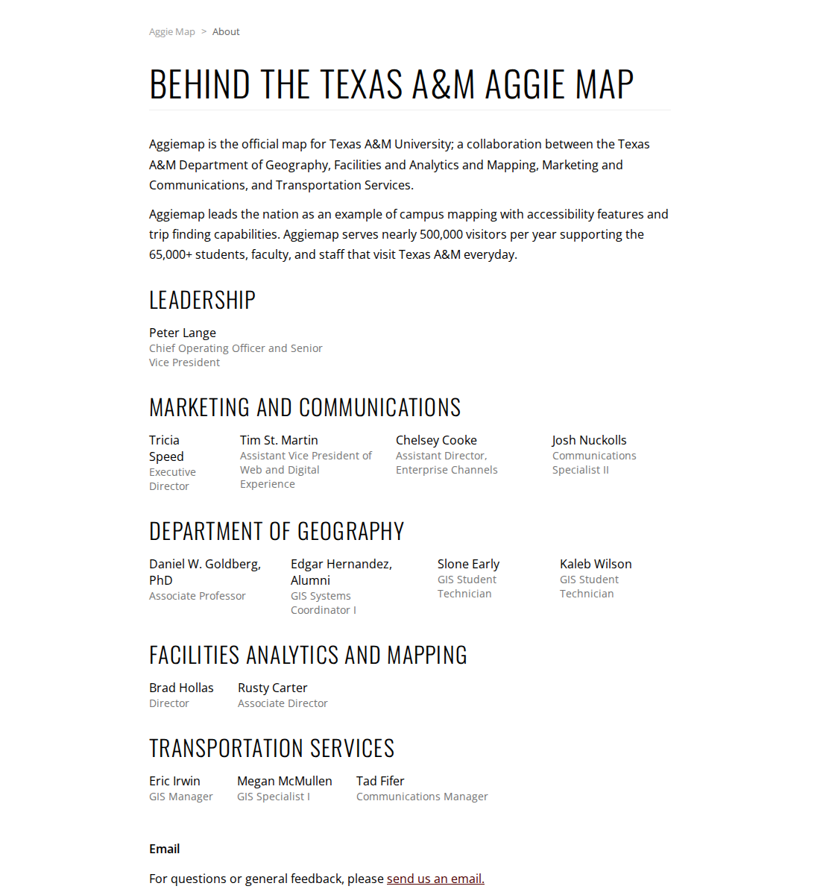
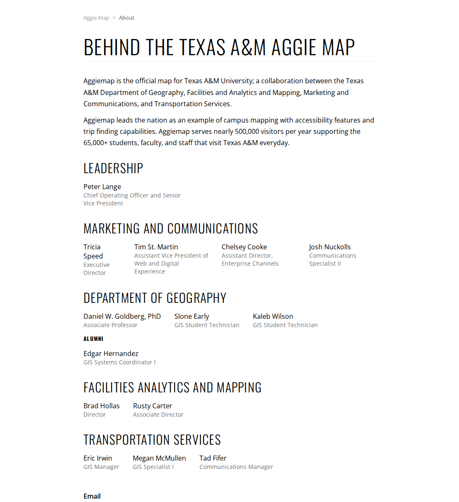
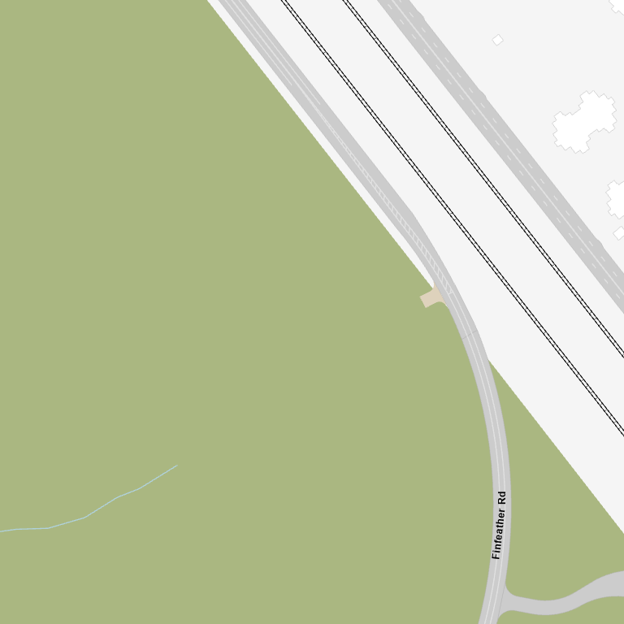
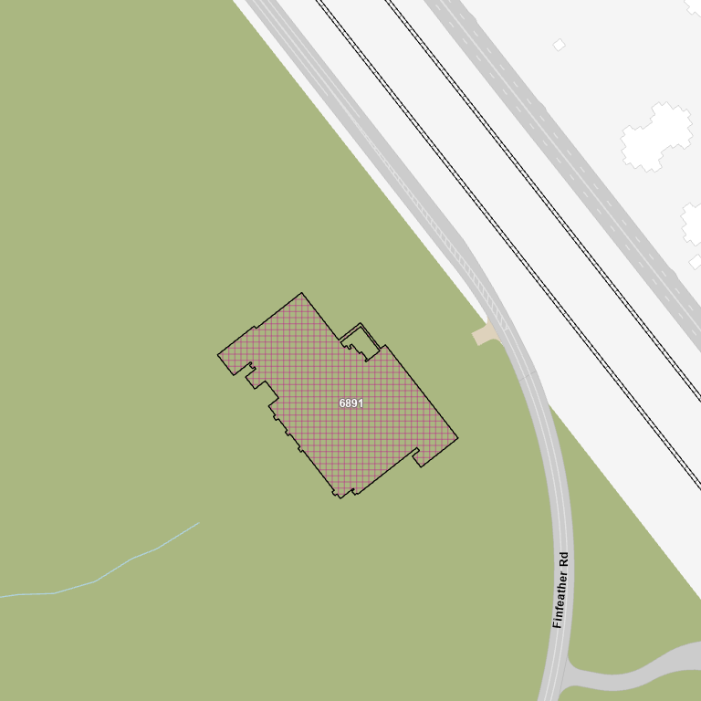
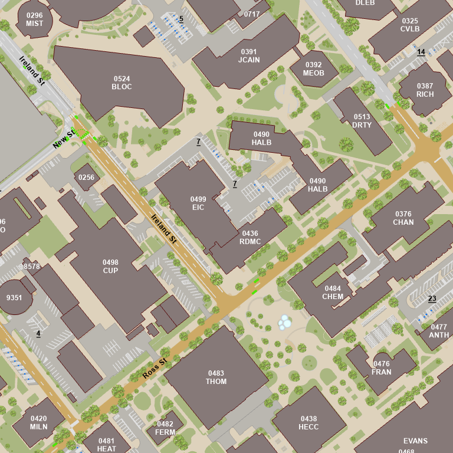
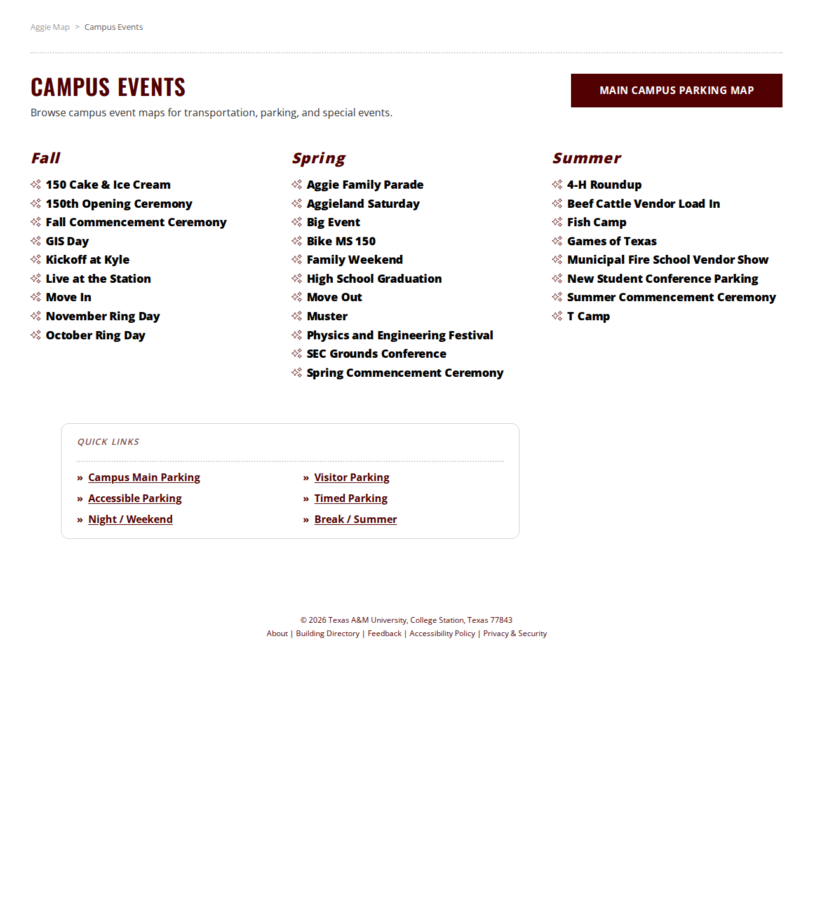
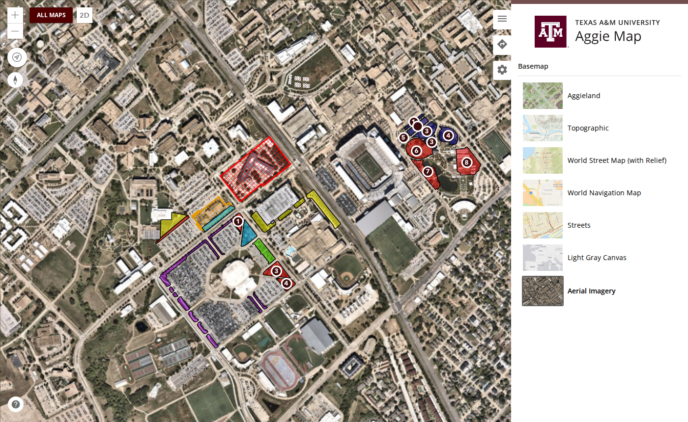
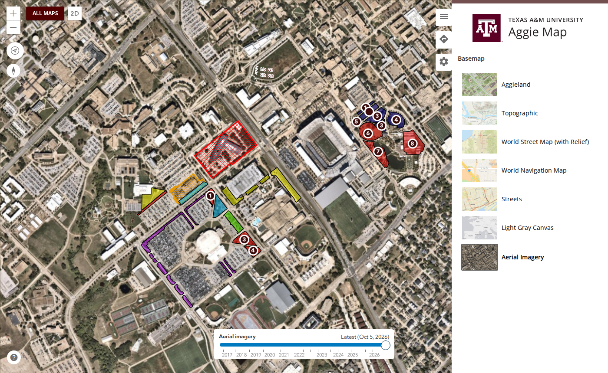
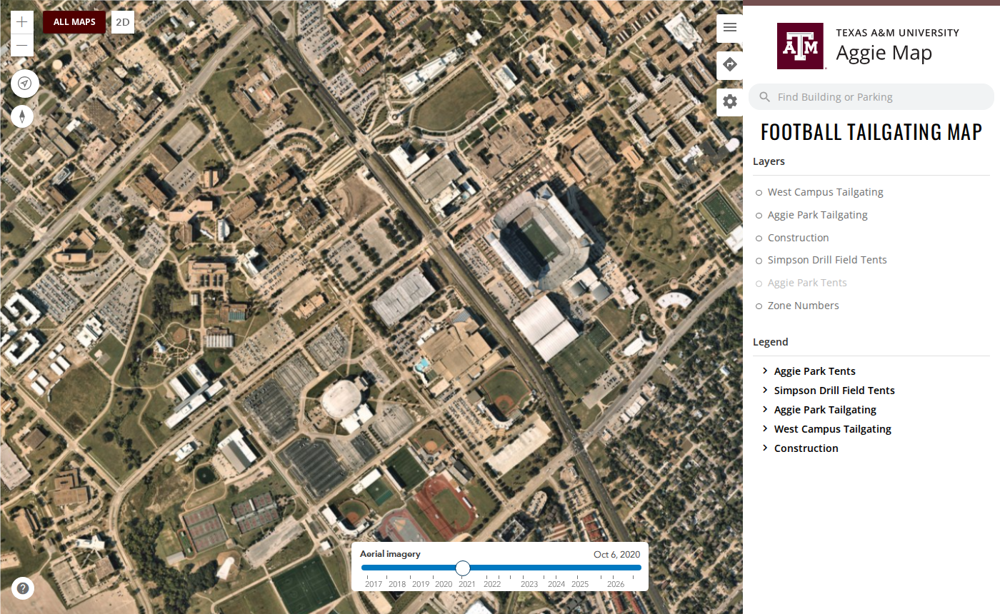

# Unreleased

Since the 12 October release: a new campus basemap, move-out's three dated maps, November's Ring Day,
an About page tidy-up, an Aerial Imagery timeline on dev, and GIS Day changes waiting for GIS Day's
own deploy.

**The last release is [12 October 2026](2026-10-12.md)**, built from `79cadfccc` (build 20261012.5). The
full suite cleared it on dev: 446 passed, none failed. The release before it is
[8 October 2026](2026-10-08.md).

This file collects what merges from here until the next release. **A pull request with a user-visible
result adds its own entry below, in that pull request**, with its before/after screenshots linked from
`docs/screenshots/<slug>/` - and a row in *What to test on dev*. Nobody writes these later. See
[README.md](README.md#cutting-a-release).

---

## Summary

### The About page says who is alumni, in its structure

Under **Department of Geography**, one entry on [the About page](https://aggiemap.tamu.edu/about)
carried its status in the name field - "Edgar Hernandez, Alumni" - while every other entry on the page
is a name and a title. It read as though "Alumni" were part of the person's name, and it sat in the
middle of the current staff with nothing to mark it apart, so someone scanning for who to contact had
no way to tell ([#1702](https://github.com/TamuGeoInnovation/Tamu.GeoInnovation.js.monorepo/issues/1702)).

Alumni now have their own subsection under the same heading, built from the `h5` and spacing classes
the page already has, with no new styles. The name field holds a name again.

| Before | After |
| --- | --- |
|  |  |

### A new campus basemap

Every AggieMap view draws over a cached basemap of campus that Facilities Coordination publishes.
AggieMap has been drawing June's; it now draws October's, `TAMU_Basemap_20261008`
([#1695](https://github.com/TamuGeoInnovation/Tamu.GeoInnovation.js.monorepo/issues/1695)). The buildings that have gone up since June are on the map.

The clearest example is on the north-west edge, beside Finfeather Road, where building 6891 did not
exist in the old cache at all:

| Before | After |
| --- | --- |
|  |  |

Most of the change is finer than that, and it is everywhere: a third of the basemap tiles over campus
differ between the two caches, and in the core two thirds do. The core looks the same at a glance,
which is the point - the detail is redrawn, not rearranged:

| Before | After |
| --- | --- |
|  |  |

The same service also supplies the Buildings layer, Surface Lots and the building search, and those
move with it, so a search finds the 18 buildings the new service knows about and the old one did not.

One thing is not as it should be, and is worth knowing: the October service is on the production GIS
server, where it is public, and is not on the development one - that server's FCOR folder lists six
services and this is not among them. The basemap *tiles* were always named on the production server
outright, so they are unaffected, but the data layers were not: they followed the environment. They
are pinned to production until the new service is published on the development server
([#1696](https://github.com/TamuGeoInnovation/Tamu.GeoInnovation.js.monorepo/issues/1696)), which
means development now reads its buildings and surface lots from the same place it already drew its
basemap. Nothing about this is visible to a visitor on either environment.
### Move-out has a map for each of its three deadlines

Residence Life runs move-out three times a year, on its own deadline each time, and AggieMap had one
"Move Out" map with no dates on it covering all three. A visitor could not tell which one they were
looking at, and the map could never say its event was over - so it sat under Spring on
[campus events](https://aggiemap.tamu.edu/all-maps/campus-events) all year round.

There are now three: **Spring Move Out**, **Summer I Move Out** and **Summer II Move Out**, each with
its own dates and its own entry on the campus events page - spring under Spring, the two summer ones
under Summer. The parking is the same for all three, so they share the layers the one map used; only
the name, the dates and the season differ, and next year's is one line rather than another copy of
the map.

The dates want confirming before anyone relies on them. Residence Life has published 2026's -
9 May, 30 June and 8 August ([reslife.tamu.edu/moveout](https://reslife.tamu.edu/moveout/)) - but not
2027's, so these are matched to them by weekday rather than by calendar date, because each deadline
falls at the end of its term: 8 May, 29 June and 7 August. Taking the same calendar dates would have
put two of them on a Sunday.

The original undated map is unlisted rather than deleted, so anything already linking to
`/events/move-out` still works.

**T Camp is dated too**, 11 to 13 August 2026, from the Aggie Transfer Camp site - it was the other
event map that could never say its event was over. While looking that up it turned out the camp is
held off campus, so what its map is for is a question for the team ([#1697](https://github.com/TamuGeoInnovation/Tamu.GeoInnovation.js.monorepo/issues/1697)).

New Student Conference Parking keeps no dates: the conference runs in sessions across the summer and
no single set of dates describes it. It stays listed as a known exception in the smoke suite, so it
is visible rather than quietly passing.

| Before | After |
| --- | --- |
|  | Captured from dev once this is deployed |

### November's Ring Day is on the map

The Association of Former Students asked for November's dates now that October's are past: **Ring
Pick-Up on Thursday 5 November** and **Aggie Ring Days on Friday the 6th**. November Ring Day now
appears under Fall on [campus events](https://aggiemap.tamu.edu/all-maps/campus-events), and its
builder offers both days.

Each day opens on its own view, which November's map never did: pick-up frames the lots beside the
Williams Alumni Center, the ring day frames Aggie Park out to the West Campus Garage shuttle loop.
One shared view fits neither - the reason [#1230](https://github.com/TamuGeoInnovation/Tamu.GeoInnovation.js.monorepo/issues/1230) gave October's periods their own framing,
which November was still missing.

October Ring Day stays listed and says "This event has passed". That it is not checked by anything
but a person's eye is [#1687](https://github.com/TamuGeoInnovation/Tamu.GeoInnovation.js.monorepo/issues/1687).

Times are not shown. The maps carry dates, not hours ([#1686](https://github.com/TamuGeoInnovation/Tamu.GeoInnovation.js.monorepo/issues/1686)).

### Aerial Imagery can go back in time (dev only)

The Aerial Imagery basemap only ever showed Nearmap's latest capture. Now, while it is the basemap, a
timeline along the bottom of the map steps back through every capture of campus Nearmap has: fifteen,
from September 2016 to October 2026 ([#1541](https://github.com/TamuGeoInnovation/Tamu.GeoInnovation.js.monorepo/issues/1541)). Like Google Earth's historical imagery, each
capture is a tick at its date, years are marked, and the slider snaps to the nearest capture; the
right end is the latest. The list comes from Nearmap's own service, so it offers what exists rather
than empty months.

Choosing an older capture turns the map's layers off, so the campus is seen as it was rather than
under today's zones and buildings; any layer can be turned back on, and returning to the latest
brings back the ones that were on. A chosen date goes into the address (`?imagery=2020-10-06`), so a
copied link opens on the same capture.

**Development only for now**: older captures may be billed differently from the current one, and that
is to be known before production shows it.

| Before | After |
| --- | --- |
|  |  |



### GIS Day: the 2026 VGI competition, the Monument Trail Challenge

The VGI Competition pages still described 2025's Art Trail Challenge. This year's competition collects
monuments and memorial plaques only, not statues or other art: from Monday 9 November through GIS Day
week, one point for each complete submission, winners announced at lunch on Thursday 19 November, with
the Office of the University Architect as sponsor. It has its own page, the VGI Competition page links
to it, and 2025's competition moves to the list of prior ones ([#1665](https://github.com/TamuGeoInnovation/Tamu.GeoInnovation.js.monorepo/issues/1665)).

| Before | After |
| --- | --- |
|  |  |
| No such page |  |

### GIS Day: poster and presentation competition dates for 2026

The Poster Competition and Presentation Competition pages showed 2025's dates. Each is now the same
day of the week in 2026, one day earlier in the month: submissions due Monday 9 November at 5:00 PM,
the undergraduate presentations and the posters on Tuesday 17 November, the graduate presentations
and the winners on Wednesday 18 November ([#1662](https://github.com/TamuGeoInnovation/Tamu.GeoInnovation.js.monorepo/issues/1662)).

| Before | After |
| --- | --- |
|  |  |
|  |  |

### GIS Day: no Aggie Map Design Competition in 2026

GIS Day is not running the Aggie Map Design Competition this year, so the site no longer lists it: it
is gone from the Competitions menu and the Competitions page, and its own page is removed
([#1661](https://github.com/TamuGeoInnovation/Tamu.GeoInnovation.js.monorepo/issues/1661)). An old link to that page now lands on the home page.

| Before | After |
| --- | --- |
|  |  |
|  |  |

### GIS Day: the sponsorship levels double for 2026

The sponsor page on the GIS Day site showed last year's amounts. Each level is now twice what it was:
Point $512, Line $1,024, Polygon $2,048, Raster $4,096. What each level includes is unchanged
([#1655](https://github.com/TamuGeoInnovation/Tamu.GeoInnovation.js.monorepo/issues/1655)). This reaches
the public site with GIS Day's next deploy, not with an AggieMap release.

| Before | After |
| --- | --- |
|  |  |

### GIS Day: ten more ways to sponsor, listed on the sponsor page

Besides the four levels, GIS Day offers sponsorships of a single event or award: coffee breaks, lunch,
the keynotes and their reception, the networking reception, the social event, the two student research
awards and the VGI competition, from $1,000 to $2,500. They were not on the site. The sponsor page now
lists each with its amount below the four levels, and says each can be sponsored on its own or added to
any level ([#1658](https://github.com/TamuGeoInnovation/Tamu.GeoInnovation.js.monorepo/issues/1658)).

| Before | After |
| --- | --- |
|  |  |

### GIS Day: a presenter's university banner is on their own page too

On the Presenters page each card carries a corner banner with the university the presenter attended
and their class year, in that university's colour. Opening a presenter lost it: their own page showed
the same photograph with nothing on it. The banner is now on the photograph there as well, at desktop
and phone widths, and a presenter with no university recorded shows none on either page. The cards
themselves are unchanged ([#1703](https://github.com/TamuGeoInnovation/Tamu.GeoInnovation.js.monorepo/issues/1703)).

The "before" images are the live site and the "after" images a local copy, which has no presenter
photographs, so the grey placeholder in the "after" column is the local copy and not part of the change.

| Before | After |
| --- | --- |
|  |  |
|  |  |
|  |  |

---

## What to test on dev

**The team tests these on dev before a release goes to production.** Dev is
[dev.aggiemap.tamu.edu](https://dev.aggiemap.tamu.edu). Each row is a change on dev and not yet on
production. A pull request with a visible result adds its own row; at release, the rows move into the
dated notes as what was tested, and this table empties.

**Currently on dev for testing:** nothing beyond the [12 October release](2026-10-12.md) itself.

| Change | Open this on dev | Look for |
| --- | --- | --- |
| About page alumni subsection ([#1702](https://github.com/TamuGeoInnovation/Tamu.GeoInnovation.js.monorepo/issues/1702)) | [About](https://dev.aggiemap.tamu.edu/about) | Under **Department of Geography**: the staff row, then an **Alumni** heading with Edgar Hernandez under it, and no "Edgar Hernandez, Alumni" among the staff. Worth an eye on the spacing - the Alumni heading sits closer to the row above it than the section headings do |
| A new campus basemap ([#1695](https://github.com/TamuGeoInnovation/Tamu.GeoInnovation.js.monorepo/issues/1695)) | [The main map](https://dev.aggiemap.tamu.edu/map), then zoom right in; and [building 6891 on Finfeather Road](https://dev.aggiemap.tamu.edu/map/d?lat=30.62669&lng=-96.36040&zoom=18) | **The map looks like campus and nothing is missing**, at every zoom including the deepest - the basemap is a new cache, so a gap would show as white under the layers. Building 6891 beside Finfeather Road is drawn; it was not there before. Search a building by name and by number: the Buildings layer and the search now read the new service too |
| Move-out split into three dated maps ([#1691](https://github.com/TamuGeoInnovation/Tamu.GeoInnovation.js.monorepo/issues/1691)) | [Campus events](https://dev.aggiemap.tamu.edu/all-maps/campus-events), then [Spring Move Out](https://dev.aggiemap.tamu.edu/events/spring-move-out), [Summer I](https://dev.aggiemap.tamu.edu/events/summer-i-move-out) and [Summer II](https://dev.aggiemap.tamu.edu/events/summer-ii-move-out) | **Spring Move Out under Spring; Summer I and Summer II Move Out under Summer**, and no plain "Move Out" anywhere on the page. Each of the three opens a map with the same parking as the old one. **This is the arrangement to confirm with the team** - whether three entries is what they want, and whether the 2027 dates (8 May, 29 June, 7 August) are right. `/events/move-out` should still open its map |
| November Ring Day ([#1686](https://github.com/TamuGeoInnovation/Tamu.GeoInnovation.js.monorepo/issues/1686)) | [Campus events](https://dev.aggiemap.tamu.edu/all-maps/campus-events), then [November Ring Day](https://dev.aggiemap.tamu.edu/events/november-ring-day) | **November Ring Day listed under Fall**, beside October's. Its builder offers two days: Aggie Ring Pickup (November 5) and Aggie Ring Day (November 6). **Each opens on its own view** - pick-up tight on the Williams Alumni Center, the ring day wider across Aggie Park; they must not share a framing. October Ring Day should still say "This event has passed" |
| Aerial Imagery timeline ([#1541](https://github.com/TamuGeoInnovation/Tamu.GeoInnovation.js.monorepo/issues/1541)) | [Football Tailgating](https://dev.aggiemap.tamu.edu/events/tailgating/map/d/settings), choose **Aerial Imagery**; then [the same map on 6 October 2020](https://dev.aggiemap.tamu.edu/events/tailgating/map/d?imagery=2020-10-06) | A slider along the bottom of the map, ticks at each capture, years 2017-2026, "Latest (Oct 5, 2026)" at the right. Dragging snaps to a capture and changes the imagery; leaving the latest turns the layers off, and coming back turns them on. The second link opens on the 2020 imagery with layers off. Any other basemap hides the slider. Not on production |
| GIS Day: 2026 VGI competition page ([#1665](https://github.com/TamuGeoInnovation/Tamu.GeoInnovation.js.monorepo/issues/1665)) | Not on dev: GIS Day has no dev site yet ([#1525](https://github.com/TamuGeoInnovation/Tamu.GeoInnovation.js.monorepo/issues/1525)). Locally, `/competitions/vgi` and `/competitions/monuments` | The VGI page says "November 9-20, 2026" and "2026 Competition: Texas A&M University Monument Trail Challenge", with 2025's Art Trail Challenge first under Prior Competitions. "Read Event Details" opens the new page: two things to collect, one point each, winners Thursday November 19, University Architect logo, no broken images |
| GIS Day: poster and presentation competition dates moved to 2026 ([#1662](https://github.com/TamuGeoInnovation/Tamu.GeoInnovation.js.monorepo/issues/1662)) | Not on dev, for the same reason. Locally, `/competitions/posters` and `/competitions/presentation` | No 2025 date on either page. Posters: Tuesday November 17th, 2026, due Monday November 9th. Presentations: Tuesday November 17th and Wednesday November 18th, 2026 |
| GIS Day: Aggie Map Design Competition removed ([#1661](https://github.com/TamuGeoInnovation/Tamu.GeoInnovation.js.monorepo/issues/1661)) | Not on dev: GIS Day has no dev site yet ([#1525](https://github.com/TamuGeoInnovation/Tamu.GeoInnovation.js.monorepo/issues/1525)). Locally, `/competitions` | The Competitions menu and page list VGI, Poster and Presentation only; `/competitions/aggie-map` goes to the home page |
| GIS Day sponsorship levels doubled ([#1655](https://github.com/TamuGeoInnovation/Tamu.GeoInnovation.js.monorepo/issues/1655)) | Not on dev: GIS Day has no dev site yet ([#1525](https://github.com/TamuGeoInnovation/Tamu.GeoInnovation.js.monorepo/issues/1525)). Locally, `/sponsors/tamu` (see `docs/gisday-local.md`) | Point $512, Line $1,024, Polygon $2,048, Raster $4,096; each level's perks unchanged |
| GIS Day additional sponsorship opportunities ([#1658](https://github.com/TamuGeoInnovation/Tamu.GeoInnovation.js.monorepo/issues/1658)) | Not on dev, for the same reason. Locally, `/sponsors/tamu` | Under the four levels: "Additional Sponsorship Opportunities", ten rows from Daily Coffee Break Sponsor ($1,500 per day) to VGI Competition Sponsor ($1,000), and a "Send Us a Message" button |
| GIS Day: university banner on a presenter's own page ([#1703](https://github.com/TamuGeoInnovation/Tamu.GeoInnovation.js.monorepo/issues/1703)) | Not on dev, for the same reason. Locally, `/presenters`, then open any presenter | The banner on the card (for example "TAMU '24") is also across the top-left corner of the photograph on the presenter's own page, same text and colour. A presenter whose card has no banner has none on their page. Narrow the window to phone width: the banner stays inside the photograph. The Presenters page itself looks as it did |

---

## Work in flight - 12 October

Nothing below has merged, so it is not part of a release yet. This section exists because
[`CLAUDE_SETUP.md`](../../CLAUDE_SETUP.md) sends a session on another machine here first, and an empty
file would say the work had stopped.

### Signals and OnPush ([#1455](https://github.com/TamuGeoInnovation/Tamu.GeoInnovation.js.monorepo/issues/1455)), 12 October

The three migrations are in the 12 October release: 216 of 287 inputs, 40 of 44 outputs, 31 of 40 queries.

| Step | State |
| --- | --- |
| What the migrations left ([#1657](https://github.com/TamuGeoInnovation/Tamu.GeoInnovation.js.monorepo/issues/1657)) | 71 inputs, 4 outputs and 9 queries, listed on the issue by reason. Next: five inputs whose specs have no fixture, then the 22 a component writes to itself |
| OnPush, the safe libraries ([#1670](https://github.com/TamuGeoInnovation/Tamu.GeoInnovation.js.monorepo/issues/1670)) | UI kits (12) and geoservices (58) are in the release. AggieMap's ten non-map pages are on the branch `refactor/1670-onpush-aggiemap-pages`, checked, with no pull request until this release is out. GIS Day's wait for the work in flight there to merge |
| OnPush, fields set in subscriptions ([#1671](https://github.com/TamuGeoInnovation/Tamu.GeoInnovation.js.monorepo/issues/1671)) | not started: about 90 components to read |
| Interaction tests in the smoke suite ([#1672](https://github.com/TamuGeoInnovation/Tamu.GeoInnovation.js.monorepo/issues/1672)) | not started; before the map |
| OnPush, the map ([#1673](https://github.com/TamuGeoInnovation/Tamu.GeoInnovation.js.monorepo/issues/1673)) | last |

The approach and the risks are written on [#1455](https://github.com/TamuGeoInnovation/Tamu.GeoInnovation.js.monorepo/issues/1455#issuecomment-6118481532). A view that stops
updating fails no compile and no unit test, so every step is checked in a browser.

### A smaller first load ([#1454](https://github.com/TamuGeoInnovation/Tamu.GeoInnovation.js.monorepo/issues/1454))

Done, and in the 12 October release: popups, the All Maps pages, lodash and colornames, the event
definitions loaded after startup, and the trip planner's components. The map page's JavaScript goes from
459 KB to about 330 KB gzipped. Still owed: paint timings for the lodash and trip planner changes, and one
measurement of all of it together, on a quiet machine. Parked until after signals: downloading an event
map's definition only when its map opens ([#1646](https://github.com/TamuGeoInnovation/Tamu.GeoInnovation.js.monorepo/issues/1646)).

### GIS Day

- **Its production site is on an Angular 15 build**, so its next deploy carries every upgrade and refactor
  of 2026 at once. [#1611](https://github.com/TamuGeoInnovation/Tamu.GeoInnovation.js.monorepo/issues/1611) (high) is the test pass on its dev site first.
- **Running the whole GIS Day stack locally** needs a development database and a development Auth0
  application ([#1511](https://github.com/TamuGeoInnovation/Tamu.GeoInnovation.js.monorepo/issues/1511), [#1522](https://github.com/TamuGeoInnovation/Tamu.GeoInnovation.js.monorepo/issues/1522)).

**What Angular's standalone migration gets wrong here, so check for it next time:**

- `--mode=standalone-bootstrap` drops `provideZoneChangeDetection()` (the app then runs zoneless), gives
  the `env` token only the `environment` export where the module used `import * as environment` (AggieMap
  then rendered nothing, and only the smoke suite noticed), and loses anything at the top of the deleted
  `app.module.ts`, such as `WebFont.load`. A module with a constructor is left in place with a TODO.
- `--mode=prune-ng-modules` must run over the whole workspace in one pass, and even then leaves imports of
  the modules it deleted in routing modules, unconverted code and specs.
- Every pass leaves relative imports across libraries and components not exported from their library's
  index; both show as lint or `TS2305` errors in the check.
- The production daily smoke run fails its campus and All Maps notification tests until the Ring Day fix
  ships: the hard-coded notice it removes shows on every page from 8 to 10 October.

### The Angular upgrade ([#1218](https://github.com/TamuGeoInnovation/Tamu.GeoInnovation.js.monorepo/issues/1218)), in order

| Order | Step | State |
| --- | --- | --- |
| 1 | Remove `ngcc` ([#1220](https://github.com/TamuGeoInnovation/Tamu.GeoInnovation.js.monorepo/issues/1220)) | done |
| 2 | ArcGIS runtime off 4.23 ([#1219](https://github.com/TamuGeoInnovation/Tamu.GeoInnovation.js.monorepo/issues/1219)) | done: 4.27, in the 5 October release |
| 3 | Angular 15 to 16 ([#1343](https://github.com/TamuGeoInnovation/Tamu.GeoInnovation.js.monorepo/issues/1343)) | done, in the 5 October release |
| 4 | NestJS 9 to 10 ([#1350](https://github.com/TamuGeoInnovation/Tamu.GeoInnovation.js.monorepo/issues/1350)) | done: [#1363](https://github.com/TamuGeoInnovation/Tamu.GeoInnovation.js.monorepo/pull/1363) |
| 5 | ArcGIS type definitions 4.23 to 4.27 ([#1322](https://github.com/TamuGeoInnovation/Tamu.GeoInnovation.js.monorepo/issues/1322)) | done: [#1364](https://github.com/TamuGeoInnovation/Tamu.GeoInnovation.js.monorepo/pull/1364) |
| 6 | Angular 16 to 17 ([#1365](https://github.com/TamuGeoInnovation/Tamu.GeoInnovation.js.monorepo/issues/1365)) | done: [#1370](https://github.com/TamuGeoInnovation/Tamu.GeoInnovation.js.monorepo/pull/1370) |
| 7 | Angular 17 to 18 ([#1371](https://github.com/TamuGeoInnovation/Tamu.GeoInnovation.js.monorepo/issues/1371)) | done: [#1377](https://github.com/TamuGeoInnovation/Tamu.GeoInnovation.js.monorepo/pull/1377) |
| 8 | Node 20.18 to 22.23.3 ([#1376](https://github.com/TamuGeoInnovation/Tamu.GeoInnovation.js.monorepo/issues/1376)) | done: [#1401](https://github.com/TamuGeoInnovation/Tamu.GeoInnovation.js.monorepo/pull/1401) |
| 9 | Angular 18 to 19 ([#1378](https://github.com/TamuGeoInnovation/Tamu.GeoInnovation.js.monorepo/issues/1378)) | done: [#1406](https://github.com/TamuGeoInnovation/Tamu.GeoInnovation.js.monorepo/pull/1406). Steps 2 to 9b are all in the 5 October release |
| 9b | esbuild-based `application` builder ([#1403](https://github.com/TamuGeoInnovation/Tamu.GeoInnovation.js.monorepo/issues/1403)) | done: [#1408](https://github.com/TamuGeoInnovation/Tamu.GeoInnovation.js.monorepo/pull/1408), in the 5 October release |
| 10 | Angular 19 to 22, one major per pull request | done and merged: 20 ([#1451](https://github.com/TamuGeoInnovation/Tamu.GeoInnovation.js.monorepo/pull/1451)), 21 ([#1465](https://github.com/TamuGeoInnovation/Tamu.GeoInnovation.js.monorepo/pull/1465), dev-tagged `dev-2026-10-06`), 22 ([#1471](https://github.com/TamuGeoInnovation/Tamu.GeoInnovation.js.monorepo/pull/1471)), about 1 to 1.5 hours each ([`docs/upgrades/angular.md`](../upgrades/angular.md)). **Angular 22 is not yet tested on dev**: its dev build was deploying on the morning of 6 October; the full suite, then the dev tag, come next |
| 10b | Faster smoke suite ([#1426](https://github.com/TamuGeoInnovation/Tamu.GeoInnovation.js.monorepo/issues/1426)) | merged ([#1477](https://github.com/TamuGeoInnovation/Tamu.GeoInnovation.js.monorepo/pull/1477)): a release check runs one framing route per map, 6 workers, the ArcGIS library cached; 22 min 44 s on a workstation against about 1 h 50 min. Further cuts: [#1473](https://github.com/TamuGeoInnovation/Tamu.GeoInnovation.js.monorepo/issues/1473) (bus test), [#1427](https://github.com/TamuGeoInnovation/Tamu.GeoInnovation.js.monorepo/issues/1427) (maps) |
| 11 | `esri-loader` to `@arcgis/core`, 134 files | last |
| — | Dead projects ([#1226](https://github.com/TamuGeoInnovation/Tamu.GeoInnovation.js.monorepo/issues/1226)) | VeoRide retired ([#1404](https://github.com/TamuGeoInnovation/Tamu.GeoInnovation.js.monorepo/pull/1404)); the old Ring Day app is removed ([#1236](https://github.com/TamuGeoInnovation/Tamu.GeoInnovation.js.monorepo/issues/1236)); CPA is retired ([#1458](https://github.com/TamuGeoInnovation/Tamu.GeoInnovation.js.monorepo/issues/1458); restore it from the tag `cpa-last` if it is ever needed); the unused projects are listed in the cloud's Batch B report on `cloud-mailbox`, and the Cypress `*-e2e` projects are deleted, with Cypress itself ([#1545](https://github.com/TamuGeoInnovation/Tamu.GeoInnovation.js.monorepo/issues/1545), part of [#1457](https://github.com/TamuGeoInnovation/Tamu.GeoInnovation.js.monorepo/issues/1457)) |
| — | After Angular 22 | standalone ([#1452](https://github.com/TamuGeoInnovation/Tamu.GeoInnovation.js.monorepo/issues/1452)) and no NgModules ([#1569](https://github.com/TamuGeoInnovation/Tamu.GeoInnovation.js.monorepo/issues/1569)): done, in the 12 October release. `inject()` ([#1453](https://github.com/TamuGeoInnovation/Tamu.GeoInnovation.js.monorepo/issues/1453)): done, same release. Next, in order: `@defer` and a smaller first load ([#1454](https://github.com/TamuGeoInnovation/Tamu.GeoInnovation.js.monorepo/issues/1454), started 11 October), signals and OnPush ([#1455](https://github.com/TamuGeoInnovation/Tamu.GeoInnovation.js.monorepo/issues/1455)), zoneless ([#1478](https://github.com/TamuGeoInnovation/Tamu.GeoInnovation.js.monorepo/issues/1478)), Vitest ([#1479](https://github.com/TamuGeoInnovation/Tamu.GeoInnovation.js.monorepo/issues/1479)), accessibility rules back on ([#1474](https://github.com/TamuGeoInnovation/Tamu.GeoInnovation.js.monorepo/issues/1474)) |

**A local `nx affected` on a `package.json` change fails on projects that already fail on
`development`.** Every project counts as affected. Measured on 2 October: `cpa-angular` (since
retired, #1458), `ues-recycling-angular`, `signage-angular`, `ues-valves-angular` and `oidc-admin-angular` fail to build
on unchanged `development` (TypeORM and NestJS typings, signage typings, a missing `secrets` file);
NestJS builds fail on missing `ormconfig` files; three NestJS projects fail stale generator specs. CI
excludes all of them. Compare against this list, not the exit code. After any dependency change, prove
the lock file with a clean `npm ci` before pushing (CLAUDE.md, [#1347](https://github.com/TamuGeoInnovation/Tamu.GeoInnovation.js.monorepo/issues/1347)).

### Also open

- **The standalone GIS Day competitions app and API are to be removed** ([#1609](https://github.com/TamuGeoInnovation/Tamu.GeoInnovation.js.monorepo/issues/1609), low): the main GIS Day
  site and API serve everything they did, and nothing builds or deploys them.
- **`gisday-competitions-angular`'s page never answers when served locally** ([#1410](https://github.com/TamuGeoInnovation/Tamu.GeoInnovation.js.monorepo/issues/1410), low);
  CI and Azure exclude the app.
- **Clicking a Ring Day popup throws in `TripPlannerConnectionService.connection`**, on production too
  ([#1411](https://github.com/TamuGeoInnovation/Tamu.GeoInnovation.js.monorepo/issues/1411), medium). The popup still works.
- **The map probe should report popups**, so a test can see one carried between maps ([#1400](https://github.com/TamuGeoInnovation/Tamu.GeoInnovation.js.monorepo/issues/1400),
  medium).
- **The shared flex mixins emit dead vendor prefixes** ([#1340](https://github.com/TamuGeoInnovation/Tamu.GeoInnovation.js.monorepo/issues/1340), low priority), which makes
  reused CSS larger than hand-written.
- **Angular 16's parallel Sass compilation failed once on Azure** with "This file is already being
  loaded", on stylesheets that built cleanly before and since. If it recurs, it becomes its own issue.

### Also open from 1 and 2 October

- **Code Maroon needs an IIS proxy for its feed.** Dev reads a saved copy of the feed until then
  ([#1304](https://github.com/TamuGeoInnovation/Tamu.GeoInnovation.js.monorepo/issues/1304), in the 2 October release). The fix is an IIS URL Rewrite and ARR rule
  with server-side caching, for dev only, to be arranged with the team that manages the server; the
  saved copy is removed once it is in place.
- **The browser console's build banner prints `___BUILD_DATE___` and the other placeholders** instead
  of the build's details ([#1306](https://github.com/TamuGeoInnovation/Tamu.GeoInnovation.js.monorepo/issues/1306), low priority).
- **The old standalone Ring Day app's deployed copy at `/ringday/`** still needs deleting, or redirecting
  to `/events/ring-day`, on dev and production; its code is removed
  ([#1236](https://github.com/TamuGeoInnovation/Tamu.GeoInnovation.js.monorepo/issues/1236)). The old Move-In app's deployed copy at `/movein/` still needs deleting
  ([#1235](https://github.com/TamuGeoInnovation/Tamu.GeoInnovation.js.monorepo/issues/1235)).
- **Every map's starting center and zoom** to be checked against its data ([#1231](https://github.com/TamuGeoInnovation/Tamu.GeoInnovation.js.monorepo/issues/1231)).
- **Signage does not build from its current source** ([#1226](https://github.com/TamuGeoInnovation/Tamu.GeoInnovation.js.monorepo/issues/1226)).

### Waiting on someone else

**Bus route stops are a data fix, not a code fix
([#1174](https://github.com/TamuGeoInnovation/Tamu.GeoInnovation.js.monorepo/issues/1174)).** Five
routes draw no stops — NW0104, NW0305, NW4041, 15R and 47/48 — and two draw the wrong number: 40 has
one extra, 47 two missing. The map matches each stop's `Route` field in the Bus Stops layer
(`TS/Bus_Routes/MapServer/0`) against the route code, and no stop carries those codes. The side panel
still lists their stops, because that comes from separate text fields.

**Megan maintains the bus data.** `bus.spec.ts` records the seven as known failures for dev, so the
nightly run shows each one going green as its data is corrected. Production deliberately has no
entries, so the test holds any bus release until the data is right.

### Read this first if you are picking up elsewhere

**726 screenshots exist only on the work machine.** They are in `test/visual/baselines/builder/`,
untracked and deliberately uncommitted — 363 builder destinations at two viewports, 325MB. They are
the output of a two-hour crawl against dev and can be regenerated with:

```bash
AGGIEMAP_SMOKE_BASE_URL=https://dev.aggiemap.tamu.edu BUILDER_INVENTORY_SHOTS=/some/dir \
  npx playwright test --config=tools/builder-inventory/playwright.config.ts
```

The capture resumes rather than restarts, so an interrupted run costs only what it had not reached.

They are uncommitted on purpose: at 325MB they would more than triple a 153MB repository,
permanently, since git keeps every version. Where they should live is
[#1107](https://github.com/TamuGeoInnovation/Tamu.GeoInnovation.js.monorepo/issues/1107).

### A lesson from this release worth keeping

**A red smoke run is not automatically a code fault.** On the morning of 30 September the scheduled
run was red on both environments: 57 failures on production, one on dev. Every one of them was the
new tests running against builds that predated them — neither environment had been redeployed since
the 29 September release. Checking the deployed bundle settled it in minutes; debugging the
application would have wasted the morning.

Until a build can say which commit it came from
([#1148](https://github.com/TamuGeoInnovation/Tamu.GeoInnovation.js.monorepo/issues/1148)), the smoke
suite tests a URL and cannot know what it verified, so this can happen after any merge that is not
promptly deployed.

### The decision waiting to be made

**[#1107](https://github.com/TamuGeoInnovation/Tamu.GeoInnovation.js.monorepo/issues/1107) — evaluate
Visual Regression Tracker on the cluster** as the home for baseline images, with
[#1119](https://github.com/TamuGeoInnovation/Tamu.GeoInnovation.js.monorepo/issues/1119) to stand it
up. Phase 0 is five decisions that need no VPN: hostname, TLS issuer, image storage, PVC size, and who
can log in.

The contained test is in #1107: stand VRT up, point the existing capture at `gameday-parking`'s 14
destinations, and find out whether its Playwright agent — about two years stale, while the server is
current — still works before migrating 726 images.

### Open, none started

| Issue | |
| --- | --- |
| [#1079](https://github.com/TamuGeoInnovation/Tamu.GeoInnovation.js.monorepo/issues/1079) | Visual baselines are stale against dev, and there is one set for all environments |
| [#1082](https://github.com/TamuGeoInnovation/Tamu.GeoInnovation.js.monorepo/issues/1082) | All Maps scrolls sideways on a phone: a copy field with an unbreakable URL widens its card |
| [#1089](https://github.com/TamuGeoInnovation/Tamu.GeoInnovation.js.monorepo/issues/1089) | Full visual suite: a screenshot of every page, including builder paths |
| [#1090](https://github.com/TamuGeoInnovation/Tamu.GeoInnovation.js.monorepo/issues/1090) | Nothing asserts development-only sections stay off production |
| [#1091](https://github.com/TamuGeoInnovation/Tamu.GeoInnovation.js.monorepo/issues/1091) | Layer toggle round-trip: prove a layer returns the map to its original state |
| [#1097](https://github.com/TamuGeoInnovation/Tamu.GeoInnovation.js.monorepo/issues/1097) | Two 2025 events still registered on dev |
| [#1099](https://github.com/TamuGeoInnovation/Tamu.GeoInnovation.js.monorepo/issues/1099) | Ring Day naming: October holds the generic `/events/ring-day` id |
| [#1101](https://github.com/TamuGeoInnovation/Tamu.GeoInnovation.js.monorepo/issues/1101) | Inventory every GIS service, with dev and prod URLs and which maps use them |
| [#1102](https://github.com/TamuGeoInnovation/Tamu.GeoInnovation.js.monorepo/issues/1102) | Dev is hardcoded to the production transportation GIS host by a `TEMP` |
| [#1103](https://github.com/TamuGeoInnovation/Tamu.GeoInnovation.js.monorepo/issues/1103) | No test that a past event shows the "this event has passed" warning |
| [#1104](https://github.com/TamuGeoInnovation/Tamu.GeoInnovation.js.monorepo/issues/1104) | Define an emergency test tier for urgent deploys |
| [#1105](https://github.com/TamuGeoInnovation/Tamu.GeoInnovation.js.monorepo/issues/1105) | Map captures are not byte-reproducible; page captures are |
| [#1123](https://github.com/TamuGeoInnovation/Tamu.GeoInnovation.js.monorepo/issues/1123) | Two unused football entries point at stopped services |
| [#1134](https://github.com/TamuGeoInnovation/Tamu.GeoInnovation.js.monorepo/issues/1134) | Test production's builder-gated maps using the builder inventory |
| [#1137](https://github.com/TamuGeoInnovation/Tamu.GeoInnovation.js.monorepo/issues/1137) | Run a frequent scheduled subset of map function checks and alert on failure |
| [#1140](https://github.com/TamuGeoInnovation/Tamu.GeoInnovation.js.monorepo/issues/1140) | Field names differ between three maps in the latest service data |
| [#1144](https://github.com/TamuGeoInnovation/Tamu.GeoInnovation.js.monorepo/issues/1144) | Release process: which of the remaining options to adopt |
| [#1146](https://github.com/TamuGeoInnovation/Tamu.GeoInnovation.js.monorepo/issues/1146) | Professionalization sweep |
| [#1148](https://github.com/TamuGeoInnovation/Tamu.GeoInnovation.js.monorepo/issues/1148) | A deployed build cannot say which commit it came from |
| [#1156](https://github.com/TamuGeoInnovation/Tamu.GeoInnovation.js.monorepo/issues/1156) | Decide whether to turn Claude's auto memory off, as the C# repository did |
| [#1159](https://github.com/TamuGeoInnovation/Tamu.GeoInnovation.js.monorepo/issues/1159) | Test that every map's side panel tabs open and close |
| [#1160](https://github.com/TamuGeoInnovation/Tamu.GeoInnovation.js.monorepo/issues/1160) | Test that the items inside every map's side panel open and close |
| [#1161](https://github.com/TamuGeoInnovation/Tamu.GeoInnovation.js.monorepo/issues/1161) | Test that an upcoming event's toast appears, opens its map, and stays dismissed |
| [#1169](https://github.com/TamuGeoInnovation/Tamu.GeoInnovation.js.monorepo/issues/1169) | Drive directions' visitor parking query uses a column that no longer exists |
| [#1173](https://github.com/TamuGeoInnovation/Tamu.GeoInnovation.js.monorepo/issues/1173) | Every popup offers a copy link that reopens that map and feature, through shared code |
| [#1174](https://github.com/TamuGeoInnovation/Tamu.GeoInnovation.js.monorepo/issues/1174) | Five bus routes draw no stops (waiting on the data) |

### Worth knowing before touching the visual work

- **Page captures are byte-identical across runs; map captures are not.** Measured three times each.
  So hash comparison works for pages and cannot work for maps, which need pixel tolerance
  ([#1105](https://github.com/TamuGeoInnovation/Tamu.GeoInnovation.js.monorepo/issues/1105)).
- **A local dev server must be reached at `http://localhost:4200`, not `127.0.0.1`.** `TestingService`
  keys on the host containing `dev` or `localhost`, so `127.0.0.1` renders the *production* variant.
  That is deliberate and useful — it is the `local-production` test environment, and the way to capture
  production behaviour before deploying — but it is not what you want for everyday work.
- **The builder inventory is environment-specific** and the smoke suite refuses one captured
  elsewhere. Production has no inventory yet, so its builder maps still skip
  ([#1134](https://github.com/TamuGeoInnovation/Tamu.GeoInnovation.js.monorepo/issues/1134)).
