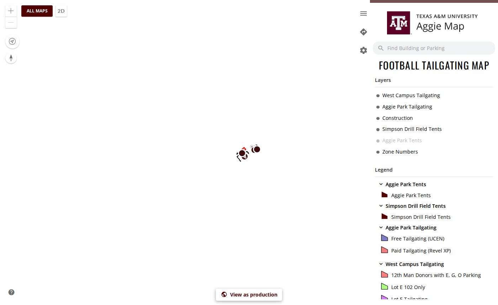
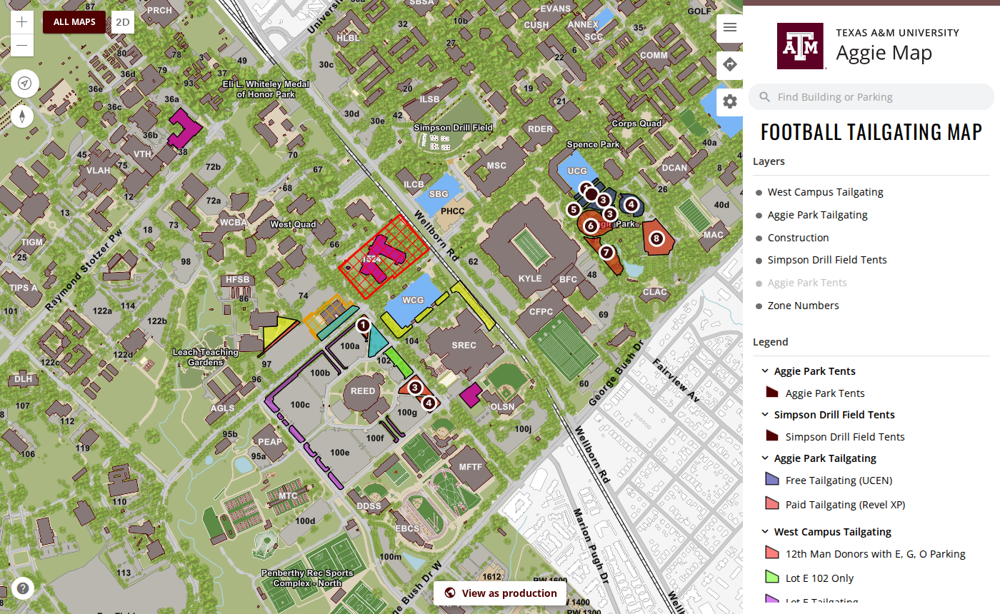
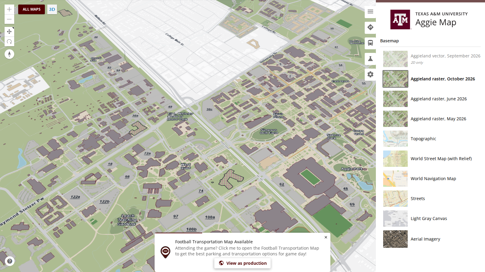
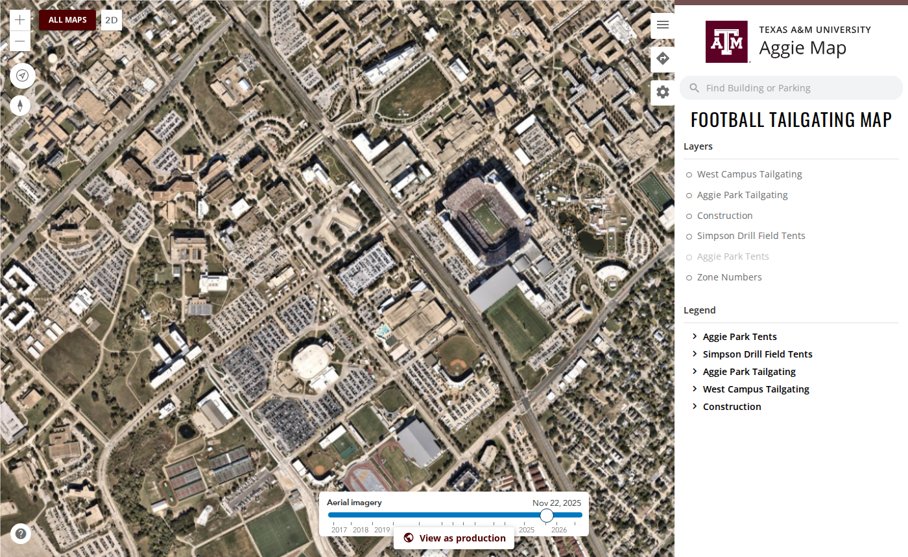
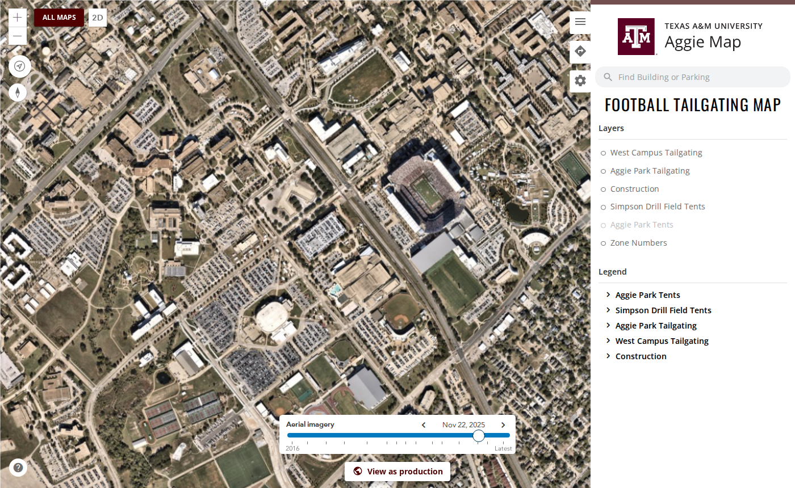
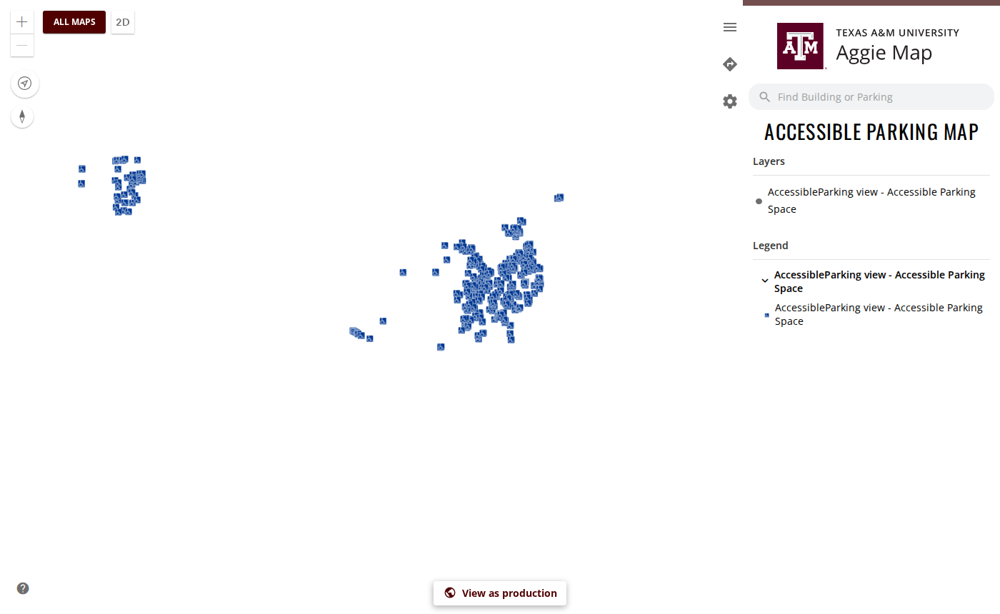
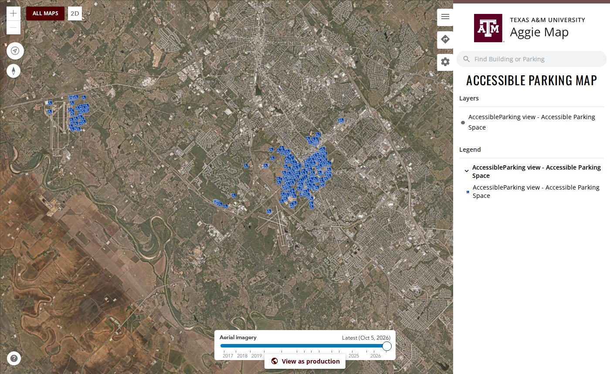

# Unreleased

Since the 13 October release: GIS Day changes only, waiting for GIS Day's own deploy.

**The last release is [13 October 2026](2026-10-13.md)**, built from `82e243ec3` (build 20261013.6). The
release tier cleared it on dev: 513 passed, none failed. The release before it is
[12 October 2026, second release](2026-10-12-2.md).

This file collects what merges from here until the next release. **A pull request with a user-visible
result adds its own entry below, in that pull request**, with its before/after screenshots linked from
`docs/screenshots/<slug>/` - and a row in *What to test on dev*. Nobody writes these later. See
[README.md](README.md#cutting-a-release).

---

## Summary

### The Football Tailgating map opens on the campus basemap (dev only)

The Tailgating map opened on whatever basemap a visitor last chose on any map. For anyone who last
chose Aerial Imagery that was no basemap at all, and with it no zoom levels: the zones drew as a speck
on a white page ([#1692](https://github.com/TamuGeoInnovation/Tamu.GeoInnovation.js.monorepo/issues/1692)). It now always opens on the campus basemap - Aggieland vector,
September 2026, on dev - since its tents and zones are read against campus ([#1751](https://github.com/TamuGeoInnovation/Tamu.GeoInnovation.js.monorepo/issues/1751)). A link
naming a `?basemap=` still opens on that one, and the other event maps are unchanged.

Any event map can now ask for this with `basemap: 'campus'` in its configuration. On production it
opens on the campus basemap production has.

| Before, with Aerial Imagery last chosen | After |
| --- | --- |
|  |  |
### In 3D, the basemap panel says which basemaps it cannot show (dev only)

On dev, with the map in 3D, the vector campus basemap could not be chosen again after another had
been: clicking it did nothing ([#1740](https://github.com/TamuGeoInnovation/Tamu.GeoInnovation.js.monorepo/issues/1740)). A 3D scene cannot draw that basemap, which is
published in a state plane reference, and draws the raster campus basemap in its place; the panel went
on offering the vector one as though it could.

While the map is in 3D the panel now shows such a basemap greyed and marked "2D only", and marks the
basemap that is actually on screen. Back in 2D it returns. It stops applying by itself when the vector
tiles are republished in Web Mercator ([#1741](https://github.com/TamuGeoInnovation/Tamu.GeoInnovation.js.monorepo/issues/1741)).

| Before, on dev, in 3D | After |
| --- | --- |
|  |  |

### The Aerial Imagery timeline sits clear of "View as production", with arrows (dev only)

The timeline that steps Aerial Imagery back through Nearmap's captures ([#1541](https://github.com/TamuGeoInnovation/Tamu.GeoInnovation.js.monorepo/issues/1541)) sat under the
"View as production" switch a dev host shows at the bottom of the window, and its year labels, placed
between captures, could sit beside the wrong ticks ([#1750](https://github.com/TamuGeoInnovation/Tamu.GeoInnovation.js.monorepo/issues/1750)).

It now sits above the switch. The ticks are unlabelled but for "2016" and "Latest" at the ends; each
shows its date on hover, and the date the timeline is on is beside the title, with ‹ › arrows to step
one capture at a time - the easy way to the captures days apart, 22 and 26 November 2025.

| Before | After |
| --- | --- |
|  |  |
### An event map opens on Aerial Imagery again when that was the last basemap chosen

A visitor whose last basemap choice was Aerial Imagery opened every event map with no basemap at all,
and with it no zoom levels: the map's layers a speck on a white page ([#1692](https://github.com/TamuGeoInnovation/Tamu.GeoInnovation.js.monorepo/issues/1692)). The saved
choice was handed to ArcGIS as a basemap name it does not know, and the map could not have built Aerial
Imagery from its definition anyway, since it only made tiled layers. Both are fixed: the saved choice
comes back as Aerial Imagery, on dev and production, as a saved campus basemap already did
([#1726](https://github.com/TamuGeoInnovation/Tamu.GeoInnovation.js.monorepo/issues/1726)).

| Before, Accessible Parking with Aerial Imagery last chosen | After |
| --- | --- |
|  |  |
### GIS Day: an event's time is chosen from a list again

Editing an event's start or end time on the GIS Day admin pages had stopped offering times to choose
from: the picker opened on a single typed field. The shared date and time picker lost its grid of hours
and minutes when the library behind it was replaced with the browser's own inputs for the Angular
upgrade ([#1220](https://github.com/TamuGeoInnovation/Tamu.GeoInnovation.js.monorepo/issues/1220)), and the browser's time input only shows its list after another click on a
small icon, or not at all. It was checked in AggieMap; GIS Day could not be run at the time
([#1747](https://github.com/TamuGeoInnovation/Tamu.GeoInnovation.js.monorepo/issues/1747)).

A time of day is now Angular Material's time picker, inside the same shared picker: the list of times
opens with it, in five-minute steps, with the current time highlighted, and an exact time can still be
typed. Choosing a time sets it and closes the picker. Dates, and the date-and-time picker AggieMap's
trip planner uses, are unchanged. `@angular/material` is a new dependency, at the same version as
Angular.

The images are the picker on a scratch page of the local GIS Day site, because the event form needs a
sign-in.

| Before | After |
| --- | --- |
|  |  |

### GIS Day: the admin speaker form shows the university banner, and follows the form

Editing a speaker on the admin pages showed the photograph without the university and class-year banner
the public Presenters page and presenter page draw on it ([#1703](https://github.com/TamuGeoInnovation/Tamu.GeoInnovation.js.monorepo/issues/1703)). It is now on the photograph
in the form too, and it changes as the University and Graduation Year fields change, before saving, so an
administrator sees what the public pages will show. Clearing the university removes it
([#1757](https://github.com/TamuGeoInnovation/Tamu.GeoInnovation.js.monorepo/issues/1757)).

The photograph in the form is now shown at the size of a presenter's card, so the banner is drawn exactly
as the card draws it. The banner's look, written out twice in the app's stylesheet, is now one shared
style used by the card, the presenter page and the form; the card and presenter page measure the same as
before.

The images are the form on a scratch page of the local site, with a sample photograph, because the admin
pages need a sign-in.

| Before | After | After changing the university and year |
| --- | --- | --- |
|  |  |  |

### GIS Day: the 2026 VGI competition, the Monument Trail Challenge

The VGI Competition pages still described 2025's Art Trail Challenge. This year's competition collects
monuments and memorial plaques only, not statues or other art: from Monday 9 November through GIS Day
week, one point for each complete submission, winners announced at lunch on Thursday 19 November, with
the Office of the University Architect as sponsor. It has its own page, the VGI Competition page links
to it, and 2025's competition moves to the list of prior ones ([#1665](https://github.com/TamuGeoInnovation/Tamu.GeoInnovation.js.monorepo/issues/1665)).

| Before | After |
| --- | --- |
|  |  |
| No such page |  |

### GIS Day: poster and presentation competition dates for 2026

The Poster Competition and Presentation Competition pages showed 2025's dates. Each is now the same
day of the week in 2026, one day earlier in the month: submissions due Monday 9 November at 5:00 PM,
the undergraduate presentations and the posters on Tuesday 17 November, the graduate presentations
and the winners on Wednesday 18 November ([#1662](https://github.com/TamuGeoInnovation/Tamu.GeoInnovation.js.monorepo/issues/1662)).

| Before | After |
| --- | --- |
|  |  |
|  |  |

### GIS Day: no Aggie Map Design Competition in 2026

GIS Day is not running the Aggie Map Design Competition this year, so the site no longer lists it: it
is gone from the Competitions menu and the Competitions page, and its own page is removed
([#1661](https://github.com/TamuGeoInnovation/Tamu.GeoInnovation.js.monorepo/issues/1661)). An old link to that page now lands on the home page.

| Before | After |
| --- | --- |
|  |  |
|  |  |

### GIS Day: the competition pages match the 2026 schedule

Three competition pages disagreed with the schedule ([#1709](https://github.com/TamuGeoInnovation/Tamu.GeoInnovation.js.monorepo/issues/1709)):

- **Presentation Competition.** The date under the title said Wednesday, November 18th; both sessions
  are on Tuesday, November 17th. The graduate session moves from Wednesday morning to Tuesday
  3:00 - 4:00 PM, and the undergraduate session is 2:00 - 3:00 PM so the two no longer overlap.
- **Poster Competition.** The poster session was headed "Presentation Competition Session", on the page
  and in its side menu; it says "Poster Competition Session". Its time is 4:15-5:15PM, not 4:00-5:00PM.
- **Monument Trail Challenge.** "Monuments and Memorial Markers" is gone from the list of what is being
  surveyed and from the examples, with the line about statues and sculptures, leaving plaques for trees
  and benches.

The "after" images were taken with the button fix ([#1708](https://github.com/TamuGeoInnovation/Tamu.GeoInnovation.js.monorepo/issues/1708)) also in place, which is why the
Submit button's label is centred in them.

| Before | After |
| --- | --- |
|  |  |
|  |  |
|  |  |
|  |  |
|  |  |

### GIS Day: the sponsorship levels double for 2026

The sponsor page on the GIS Day site showed last year's amounts. Each level is now twice what it was:
Point $512, Line $1,024, Polygon $2,048, Raster $4,096. What each level includes is unchanged
([#1655](https://github.com/TamuGeoInnovation/Tamu.GeoInnovation.js.monorepo/issues/1655)). This reaches
the public site with GIS Day's next deploy, not with an AggieMap release.

| Before | After |
| --- | --- |
|  |  |

### GIS Day: button labels are centred again

On the GIS Day site a link styled as a button showed its label at the left edge of the button:
"Submit Your Presentation", "Submit Your Poster", "Read Event Details" and the rest. The shared rule
that makes such a link a proper block (so its width and padding apply) left GIS Day's own button
definition centring with a property that only works on a flex box. The label is now centred in that
one definition, as the shared button does it, so every button on the site follows
([#1708](https://github.com/TamuGeoInnovation/Tamu.GeoInnovation.js.monorepo/issues/1708)). Buttons that were already centred, such as those on the sponsor page, are unchanged.

| Before | After |
| --- | --- |
|  |  |
|  |  |
|  |  |

### GIS Day: ten more ways to sponsor, listed on the sponsor page

Besides the four levels, GIS Day offers sponsorships of a single event or award: coffee breaks, lunch,
the keynotes and their reception, the networking reception, the social event, the two student research
awards and the VGI competition, from $1,000 to $2,500. They were not on the site. The sponsor page now
lists each with its amount below the four levels, and says each can be sponsored on its own or added to
any level ([#1658](https://github.com/TamuGeoInnovation/Tamu.GeoInnovation.js.monorepo/issues/1658)).

| Before | After |
| --- | --- |
|  |  |

### GIS Day: a presenter's university banner is on their own page too

On the Presenters page each card carries a corner banner with the university the presenter attended
and their class year, in that university's colour. Opening a presenter lost it: their own page showed
the same photograph with nothing on it. The banner is now on the photograph there as well, at desktop
and phone widths, and a presenter with no university recorded shows none on either page. The cards
themselves are unchanged ([#1703](https://github.com/TamuGeoInnovation/Tamu.GeoInnovation.js.monorepo/issues/1703)).

The "before" images are the live site and the "after" images a local copy, which has no presenter
photographs, so the grey placeholder in the "after" column is the local copy and not part of the change.

| Before | After |
| --- | --- |
|  |  |
|  |  |
|  |  |

### GIS Day: past years' sessions, presenters and sponsors

Every year's sessions, presenters and sponsors were still in the database, but the site only ever
showed the current year, so last year's programme could not be looked up: `/seasons/2025` on
production today is a blank page. `/seasons/2025` now opens
2025's Sessions, and from there its Presenters and Sponsors, drawn from that year's records exactly
as the current year's pages are ([#1758](https://github.com/TamuGeoInnovation/Tamu.GeoInnovation.js.monorepo/issues/1758)).

On a past year the header says which year it is, a banner says so and links back to this year, and the
Sessions, Presenters and Sponsors links stay in that year. Registering for a session (on the list and
on a session's own page, where check-in goes too), the profile reminder, and the sponsor page's "become a sponsor" and logistics sections are left out, since they are
about this year. The footer lists every past year. A year with no TxGIS Day says so. The competitions,
FAQ, About and home pages are the current year's whichever year is being looked at.

| Before | After |
| --- | --- |
|  |  |
| No way to reach a past year |  |
| No such page |  |
| No such page |  |
| No such page |  |
| No such page |  |
|  |  |

### GIS Day: a session's presenters show their company and class year, grouped by company

A session's page listed its presenters by photograph and name only, in no particular order, so on the
career fair the people from one company were scattered across the list. Each presenter now has their
company or organization on a second line, and a Texas A&M former student has their class year after
their name, as in "Benjamin Lybrand '14" ([#1768](https://github.com/TamuGeoInnovation/Tamu.GeoInnovation.js.monorepo/issues/1768)). The list is grouped by company, then by last and
first name, so everyone from one company sits together ([#1769](https://github.com/TamuGeoInnovation/Tamu.GeoInnovation.js.monorepo/issues/1769)).

A graduate of another university shows no year after their name; their university is on the banner on
their photograph on the Presenters page, as before. A record holding two years shows both ('19, '21).
The banner on the photograph uses the same year logic now, so a two-digit year reads '22 rather than
' 22.

The "after" images are the local copy, which has no presenter photographs, so the broken-image
placeholders are the local copy and not part of the change.

| Before | After |
| --- | --- |
|  |  |
| |  |

### GIS Day: one event time that cannot be read no longer breaks the site

On 14 October an event's start time was saved as the text "Invalid Date". From then on the event
could not be opened in the admin pages to correct it, and the public Sessions page and the session's
own page failed on it ([#1772](https://github.com/TamuGeoInnovation/Tamu.GeoInnovation.js.monorepo/issues/1772)). The data was repaired directly in the database the same afternoon.

Now a time that cannot be read is shown as "Time TBD" on the Sessions page and as no time on the
session's page, and the rest of each page draws as usual. The event form opens such an event with an
empty time to fill in, never saves a time that is not valid, and the time picker builds a newly picked
time on today's date when the stored one cannot be read, so choosing a time always fixes it.

The images are the local site, with one local event's start time set to "Invalid Date" as production's
was. Before, the page logged `Unable to convert "Invalid Date" into a date`; after, it logs nothing.

| Before | After |
| --- | --- |
|  |  |
|  |  |


### GIS Day: the admin event form refuses an incomplete event and says what is missing

The admin form for adding or editing an event saved whatever it was given, including an event with no
day, no name, or times left at the 12:00 AM default ([#1773](https://github.com/TamuGeoInnovation/Tamu.GeoInnovation.js.monorepo/issues/1773)). It now refuses to save until the event has a
day, a start and an end time other than 12:00 AM with the end after the start, a name, an abstract, and
a mode, event type, presentation type and location chosen. When something is missing, a list above the
buttons says what, and nothing is sent.

The images are the form on a scratch page of the local site, because the admin pages need a sign-in.

| Before | After pressing Create on an empty event |
| --- | --- |
|  |  |

### GIS Day: the admin event list is one table per day, under its date

The admin Events page listed a season's events in one long table, about 45 rows over five days, and
only a Day column said where one day ended and the next began ([#1775](https://github.com/TamuGeoInnovation/Tamu.GeoInnovation.js.monorepo/issues/1775)). Each day now has its own card and
table, headed by its date as on the public Sessions page, with the day's events in start-time order.
Events with no day yet come last, under "No day set". Each table's header checkbox selects that day's
events; Copy and Delete work as before.

The images are the list on a scratch page of the local site, because the admin pages need a sign-in.

| Before | After |
| --- | --- |
|  |  |
| |  |

### GIS Day: an admin adding a check-in checks in the attendee, not the admin

The admin page's Check-ins, Add asks for an attendee's account id and an event, but it checked in the
admin who pressed the button: it sent both to the endpoint attendees use to check themselves in, which
records whoever is signed in and ignores any account id it is sent ([#1767](https://github.com/TamuGeoInnovation/Tamu.GeoInnovation.js.monorepo/issues/1767)). A second
add for another attendee then failed with "Check-in already exists". The page now sends them to a
separate admin endpoint, which needs the `create:checkins` permission and checks in the account given.
It still refuses an event that does not exist or a check-in that is already recorded, and asks for no
location, so an organizer can check in someone whose phone could not. Attendees checking themselves in
are unchanged.

The page looks the same; what changes is whose name appears in the check-in list afterwards.

---

## What to test on dev

**The team tests these on dev before a release goes to production.** Dev is
[dev.aggiemap.tamu.edu](https://dev.aggiemap.tamu.edu). Each row is a change on dev and not yet on
production. A pull request with a visible result adds its own row; at release, the rows move into the
dated notes as what was tested, and this table empties.

**Currently on dev for testing:** the first row, once a build with it reaches dev.

| Change | Open this on dev | Look for |
| --- | --- | --- |
| Football Tailgating opens on the campus basemap ([#1751](https://github.com/TamuGeoInnovation/Tamu.GeoInnovation.js.monorepo/issues/1751)) | Choose **Aerial Imagery** on any map, then open [Football Tailgating](https://dev.aggiemap.tamu.edu/events/tailgating/map/d) | The map opens on **Aggieland vector, September 2026** with its zones at the normal zoom, not on a white page. [The same map with ?basemap=gray-vector](https://dev.aggiemap.tamu.edu/events/tailgating/map/d?basemap=gray-vector) opens on Light Gray Canvas. Other event maps still open on the basemap last chosen |
| Basemaps a 3D scene cannot show ([#1740](https://github.com/TamuGeoInnovation/Tamu.GeoInnovation.js.monorepo/issues/1740)) | [The main map's basemap panel](https://dev.aggiemap.tamu.edu/map/d/settings), then the **2D** button beside All Maps | In 3D, **Aggieland vector** is greyed and says **2D only**, and **Aggieland raster, October 2026** is marked as chosen, which is what the map shows. Clicking the greyed one does nothing. Choose another basemap and it is still greyed. Click **3D** to go back: the vector basemap is back, marked, and can be chosen |
| Aerial Imagery timeline restyled ([#1750](https://github.com/TamuGeoInnovation/Tamu.GeoInnovation.js.monorepo/issues/1750)) | [Football Tailgating on 22 November 2025](https://dev.aggiemap.tamu.edu/events/tailgating/map/d?imagery=2025-11-22) | The timeline is above **View as production**, not under it. Ticks have no labels but "2016" and "Latest"; hovering one shows its date. ‹ › beside the date step one capture: from Nov 22, 2025, › goes to Nov 26, 2025, then to Oct 5, 2026 (latest), where › greys out. Not on production |
| A saved Aerial Imagery choice ([#1692](https://github.com/TamuGeoInnovation/Tamu.GeoInnovation.js.monorepo/issues/1692)) | Choose **Aerial Imagery** on any map, then open [Accessible Parking](https://dev.aggiemap.tamu.edu/events/accessible-parking/map/d) | The map opens on Aerial Imagery with its parking spaces, not on a white page with the spaces floating. Reload: still Aerial Imagery. Choose another basemap and reload: that one. Also on production |
| GIS Day: event times chosen from a list ([#1747](https://github.com/TamuGeoInnovation/Tamu.GeoInnovation.js.monorepo/issues/1747)) | Not on dev: GIS Day has no dev site yet ([#1525](https://github.com/TamuGeoInnovation/Tamu.GeoInnovation.js.monorepo/issues/1525)). Locally, signed in as an administrator: Admin, Events, edit any event, then click its start or end time | A list of times opens at once, in five-minute steps, with the event's current time highlighted and in view. Choosing one changes the time shown and closes the picker; the event's day does not change. Typing an exact time such as 4:07 PM also works. Save and reopen the event: the time is kept. A season day's date picker is unchanged |
| GIS Day: university banner in the admin speaker form ([#1757](https://github.com/TamuGeoInnovation/Tamu.GeoInnovation.js.monorepo/issues/1757)) | Not on dev: GIS Day has no dev site yet ([#1525](https://github.com/TamuGeoInnovation/Tamu.GeoInnovation.js.monorepo/issues/1525)). Locally, signed in as an administrator: Admin, Speakers, edit a speaker who has a photograph | The university and class-year banner on the photograph, as on the Presenters page. Change the University or the Graduation Year: the banner changes at once, before saving. Choose no university: it goes. The public Presenters page and a presenter's page look as they did |
| GIS Day: 2026 VGI competition page ([#1665](https://github.com/TamuGeoInnovation/Tamu.GeoInnovation.js.monorepo/issues/1665)) | Not on dev: GIS Day has no dev site yet ([#1525](https://github.com/TamuGeoInnovation/Tamu.GeoInnovation.js.monorepo/issues/1525)). Locally, `/competitions/vgi` and `/competitions/monuments` | The VGI page says "November 9-20, 2026" and "2026 Competition: Texas A&M University Monument Trail Challenge", with 2025's Art Trail Challenge first under Prior Competitions. "Read Event Details" opens the new page: two things to collect, one point each, winners Thursday November 19, University Architect logo, no broken images |
| GIS Day: poster and presentation competition dates moved to 2026 ([#1662](https://github.com/TamuGeoInnovation/Tamu.GeoInnovation.js.monorepo/issues/1662)) | Not on dev, for the same reason. Locally, `/competitions/posters` and `/competitions/presentation` | No 2025 date on either page. Posters: Tuesday November 17th, 2026, due Monday November 9th. Presentations: Tuesday November 17th and Wednesday November 18th, 2026 |
| GIS Day: Aggie Map Design Competition removed ([#1661](https://github.com/TamuGeoInnovation/Tamu.GeoInnovation.js.monorepo/issues/1661)) | Not on dev: GIS Day has no dev site yet ([#1525](https://github.com/TamuGeoInnovation/Tamu.GeoInnovation.js.monorepo/issues/1525)). Locally, `/competitions` | The Competitions menu and page list VGI, Poster and Presentation only; `/competitions/aggie-map` goes to the home page |
| GIS Day: competition pages corrected for 2026 ([#1709](https://github.com/TamuGeoInnovation/Tamu.GeoInnovation.js.monorepo/issues/1709)) | Not on dev, for the same reason. Locally, `/competitions/presentation`, `/competitions/posters` and `/competitions/monuments` | Presentation: Tuesday, November 17th, 2026 under the title; undergraduate 2:00 - 3:00 PM and graduate 3:00 - 4:00 PM, both Tuesday. Posters: the session is headed Poster Competition Session, on the page and in the side menu, at 4:15-5:15PM. Monuments: the list and the examples show Plaques for Trees and Benches only, and no line about statues |
| GIS Day sponsorship levels doubled ([#1655](https://github.com/TamuGeoInnovation/Tamu.GeoInnovation.js.monorepo/issues/1655)) | Not on dev: GIS Day has no dev site yet ([#1525](https://github.com/TamuGeoInnovation/Tamu.GeoInnovation.js.monorepo/issues/1525)). Locally, `/sponsors/tamu` (see `docs/gisday-local.md`) | Point $512, Line $1,024, Polygon $2,048, Raster $4,096; each level's perks unchanged |
| GIS Day: button labels centred ([#1708](https://github.com/TamuGeoInnovation/Tamu.GeoInnovation.js.monorepo/issues/1708)) | Not on dev, for the same reason. Locally, `/competitions/vgi`, `/competitions/posters`, `/competitions/presentation` and `/sponsors/tamu` | The label of every button is in the middle of the button, not at its left edge: Read Event Details, Submit Your Poster, Submit Your Presentation. The sponsor page's buttons look as they did |
| GIS Day additional sponsorship opportunities ([#1658](https://github.com/TamuGeoInnovation/Tamu.GeoInnovation.js.monorepo/issues/1658)) | Not on dev, for the same reason. Locally, `/sponsors/tamu` | Under the four levels: "Additional Sponsorship Opportunities", ten rows from Daily Coffee Break Sponsor ($1,500 per day) to VGI Competition Sponsor ($1,000), and a "Send Us a Message" button |
| GIS Day: university banner on a presenter's own page ([#1703](https://github.com/TamuGeoInnovation/Tamu.GeoInnovation.js.monorepo/issues/1703)) | Not on dev, for the same reason. Locally, `/presenters`, then open any presenter | The banner on the card (for example "TAMU '24") is also across the top-left corner of the photograph on the presenter's own page, same text and colour. A presenter whose card has no banner has none on their page. Narrow the window to phone width: the banner stays inside the photograph. The Presenters page itself looks as it did |
| GIS Day: past years ([#1758](https://github.com/TamuGeoInnovation/Tamu.GeoInnovation.js.monorepo/issues/1758)) | Not on dev: GIS Day has no dev site yet ([#1525](https://github.com/TamuGeoInnovation/Tamu.GeoInnovation.js.monorepo/issues/1525)). Locally, `/seasons/2025` | 2025's sessions under a "TxGIS Day 2025" header and a banner, with no register boxes. Presenters and Sponsors in the header and footer stay in 2025; Sponsors shows who sponsored, without "Interested in Becoming a Sponsor?". The footer's Past Years list opens each year, and moving from one year to another changes the sessions as well as the header. Opening one of 2025's sessions shows no Registration or Checkin, while a 2026 session still does. `/sessions` is unchanged, and `/seasons/1999` says there is no TxGIS Day 1999 |
| GIS Day: an unreadable event time no longer breaks the site ([#1772](https://github.com/TamuGeoInnovation/Tamu.GeoInnovation.js.monorepo/issues/1772)) | Not on dev: GIS Day has no dev site yet ([#1525](https://github.com/TamuGeoInnovation/Tamu.GeoInnovation.js.monorepo/issues/1525)). On production after release: Admin, Events, edit any event and change its start time | The time can be picked from the list and typed, and saving keeps it. Sessions and the session's page show the new time. No event on production has a bad time now, so the broken case is checked only locally |
| GIS Day: the event form refuses an incomplete event ([#1773](https://github.com/TamuGeoInnovation/Tamu.GeoInnovation.js.monorepo/issues/1773)) | Not on dev: GIS Day has no dev site yet ([#1525](https://github.com/TamuGeoInnovation/Tamu.GeoInnovation.js.monorepo/issues/1525)). On production after release: Admin, Events, Add event, then Create without filling anything in | A list above the buttons names each missing item and the event is not created. Filling everything in (with times other than 12:00 AM) creates it. Editing an existing complete event still saves |
| GIS Day: the admin event list grouped by day ([#1775](https://github.com/TamuGeoInnovation/Tamu.GeoInnovation.js.monorepo/issues/1775)) | Not on dev: GIS Day has no dev site yet ([#1525](https://github.com/TamuGeoInnovation/Tamu.GeoInnovation.js.monorepo/issues/1525)). On production after release: Admin, Events | One card per day, headed by its date (November 16 to 20 for 2026), each with its own table in start-time order. A table's header checkbox selects that day's events, and Copy and Delete act on what is selected. Changing the season shows that season's days |
| GIS Day: presenters' company and class year, grouped by company ([#1768](https://github.com/TamuGeoInnovation/Tamu.GeoInnovation.js.monorepo/issues/1768), [#1769](https://github.com/TamuGeoInnovation/Tamu.GeoInnovation.js.monorepo/issues/1769)) | Not on dev: GIS Day has no dev site yet ([#1525](https://github.com/TamuGeoInnovation/Tamu.GeoInnovation.js.monorepo/issues/1525)). Locally or on production, any session's page, e.g. the career fair | Under each presenter's name is their company. Texas A&M former students have their class year after their name ('14). The people from one company are next to each other, companies in alphabetical order, and people without a company last |
| GIS Day: an admin's added check-in is the attendee's ([#1767](https://github.com/TamuGeoInnovation/Tamu.GeoInnovation.js.monorepo/issues/1767)) | Not on dev: GIS Day has no dev site yet ([#1525](https://github.com/TamuGeoInnovation/Tamu.GeoInnovation.js.monorepo/issues/1525)). On production after release, signed in as an administrator whose account has `create:checkins`: Admin, Check-ins, Add, with another person's account id and an event they have not checked in to | Admin, Check-ins lists the new check-in under that person, not the admin. Adding the same person to the same event again is refused as already checked in. An attendee checking in from a session's page still checks in themselves |

---

## Work in flight - 13 October

Nothing below has merged, so it is not part of a release yet. This section exists because
[`CLAUDE_SETUP.md`](../../CLAUDE_SETUP.md) sends a session on another machine here first, and an empty
file would say the work had stopped.

### The smoke suite, 13 October

| What | State |
| --- | --- |
| Three tiers: quick, release, full ([#1717](https://github.com/TamuGeoInnovation/Tamu.GeoInnovation.js.monorepo/issues/1717)) | Done, in the 13 October release. `run-local.sh development quick` clears a dev build; `release` clears production; `full` is the nightly run |
| Maps reported as "drew but never settled" ([#1716](https://github.com/TamuGeoInnovation/Tamu.GeoInnovation.js.monorepo/issues/1716), High) | Not fixed. The cause is measured and on the issue: the check's 90-second clock, on a machine short of CPU. The nightly GitHub runs fail or are cancelled on it; a local run does not. The fix chosen is a longer clock |
| Whether loading got heavier on 6 October ([#1719](https://github.com/TamuGeoInnovation/Tamu.GeoInnovation.js.monorepo/issues/1719), Medium) | Not started |

### Found on 12 and 13 October, not started

| What | State |
| --- | --- |
| Outdoor Track and Cross Country zoom ([#1727](https://github.com/TamuGeoInnovation/Tamu.GeoInnovation.js.monorepo/issues/1727), High) | Outdoor Track is confirmed fixed by [#1726](https://github.com/TamuGeoInnovation/Tamu.GeoInnovation.js.monorepo/issues/1726). Cross Country has not been looked at |
| Blank pause coming back from 3D to 2D on dev's vector basemap ([#1732](https://github.com/TamuGeoInnovation/Tamu.GeoInnovation.js.monorepo/issues/1732), High) | Measured: under a second on the raster basemap, about four on the vector one |

### Signals and OnPush ([#1455](https://github.com/TamuGeoInnovation/Tamu.GeoInnovation.js.monorepo/issues/1455)), 12 October

The three migrations are in the 12 October release: 216 of 287 inputs, 40 of 44 outputs, 31 of 40 queries.

| Step | State |
| --- | --- |
| What the migrations left ([#1657](https://github.com/TamuGeoInnovation/Tamu.GeoInnovation.js.monorepo/issues/1657)) | 71 inputs, 4 outputs and 9 queries, listed on the issue by reason. Next: five inputs whose specs have no fixture, then the 22 a component writes to itself |
| OnPush, the safe libraries ([#1670](https://github.com/TamuGeoInnovation/Tamu.GeoInnovation.js.monorepo/issues/1670)) | UI kits (12) and geoservices (58) are in the release. AggieMap's ten non-map pages are on the branch `refactor/1670-onpush-aggiemap-pages`, checked, with no pull request until this release is out. GIS Day's wait for the work in flight there to merge |
| OnPush, fields set in subscriptions ([#1671](https://github.com/TamuGeoInnovation/Tamu.GeoInnovation.js.monorepo/issues/1671)) | not started: about 90 components to read |
| Interaction tests in the smoke suite ([#1672](https://github.com/TamuGeoInnovation/Tamu.GeoInnovation.js.monorepo/issues/1672)) | not started; before the map |
| OnPush, the map ([#1673](https://github.com/TamuGeoInnovation/Tamu.GeoInnovation.js.monorepo/issues/1673)) | last |

The approach and the risks are written on [#1455](https://github.com/TamuGeoInnovation/Tamu.GeoInnovation.js.monorepo/issues/1455#issuecomment-6118481532). A view that stops
updating fails no compile and no unit test, so every step is checked in a browser.

### A smaller first load ([#1454](https://github.com/TamuGeoInnovation/Tamu.GeoInnovation.js.monorepo/issues/1454))

Done, and in the 12 October release: popups, the All Maps pages, lodash and colornames, the event
definitions loaded after startup, and the trip planner's components. The map page's JavaScript goes from
459 KB to about 330 KB gzipped. Still owed: paint timings for the lodash and trip planner changes, and one
measurement of all of it together, on a quiet machine. Parked until after signals: downloading an event
map's definition only when its map opens ([#1646](https://github.com/TamuGeoInnovation/Tamu.GeoInnovation.js.monorepo/issues/1646)).

### GIS Day

- **Its production site is on an Angular 15 build**, so its next deploy carries every upgrade and refactor
  of 2026 at once. [#1611](https://github.com/TamuGeoInnovation/Tamu.GeoInnovation.js.monorepo/issues/1611) (high) is the test pass on its dev site first.
- **The whole GIS Day stack runs locally** from `scripts/gisday-local.sh`, with sign-in, on a starting
  database kept in the repository that holds nobody's real data. [`docs/gisday-local.md`](../gisday-local.md)
  explains it and `CLAUDE_SETUP.md` Phase 6 is the step-by-step ([#1621](https://github.com/TamuGeoInnovation/Tamu.GeoInnovation.js.monorepo/issues/1621), [#1522](https://github.com/TamuGeoInnovation/Tamu.GeoInnovation.js.monorepo/issues/1522)).
- **A new developer still has to be given one file**, the API's settings, because it holds production's
  Auth0 credentials until a separate development tenant exists ([#1623](https://github.com/TamuGeoInnovation/Tamu.GeoInnovation.js.monorepo/issues/1623), medium).
- **No development database exists outside a developer's machine.** [#1511](https://github.com/TamuGeoInnovation/Tamu.GeoInnovation.js.monorepo/issues/1511) (medium) is open for
  that: one on the cluster, then a migration run and reverted there, following
  [`docs/gisday-migrations.md`](../gisday-migrations.md). It is the first step of the dev site
  ([#1525](https://github.com/TamuGeoInnovation/Tamu.GeoInnovation.js.monorepo/issues/1525), high).

**What Angular's standalone migration gets wrong here, so check for it next time:**

- `--mode=standalone-bootstrap` drops `provideZoneChangeDetection()` (the app then runs zoneless), gives
  the `env` token only the `environment` export where the module used `import * as environment` (AggieMap
  then rendered nothing, and only the smoke suite noticed), and loses anything at the top of the deleted
  `app.module.ts`, such as `WebFont.load`. A module with a constructor is left in place with a TODO.
- `--mode=prune-ng-modules` must run over the whole workspace in one pass, and even then leaves imports of
  the modules it deleted in routing modules, unconverted code and specs.
- Every pass leaves relative imports across libraries and components not exported from their library's
  index; both show as lint or `TS2305` errors in the check.
- The production daily smoke run fails its campus and All Maps notification tests until the Ring Day fix
  ships: the hard-coded notice it removes shows on every page from 8 to 10 October.

### The Angular upgrade ([#1218](https://github.com/TamuGeoInnovation/Tamu.GeoInnovation.js.monorepo/issues/1218)), in order

| Order | Step | State |
| --- | --- | --- |
| 1 | Remove `ngcc` ([#1220](https://github.com/TamuGeoInnovation/Tamu.GeoInnovation.js.monorepo/issues/1220)) | done |
| 2 | ArcGIS runtime off 4.23 ([#1219](https://github.com/TamuGeoInnovation/Tamu.GeoInnovation.js.monorepo/issues/1219)) | done: 4.27, in the 5 October release |
| 3 | Angular 15 to 16 ([#1343](https://github.com/TamuGeoInnovation/Tamu.GeoInnovation.js.monorepo/issues/1343)) | done, in the 5 October release |
| 4 | NestJS 9 to 10 ([#1350](https://github.com/TamuGeoInnovation/Tamu.GeoInnovation.js.monorepo/issues/1350)) | done: [#1363](https://github.com/TamuGeoInnovation/Tamu.GeoInnovation.js.monorepo/pull/1363) |
| 5 | ArcGIS type definitions 4.23 to 4.27 ([#1322](https://github.com/TamuGeoInnovation/Tamu.GeoInnovation.js.monorepo/issues/1322)) | done: [#1364](https://github.com/TamuGeoInnovation/Tamu.GeoInnovation.js.monorepo/pull/1364) |
| 6 | Angular 16 to 17 ([#1365](https://github.com/TamuGeoInnovation/Tamu.GeoInnovation.js.monorepo/issues/1365)) | done: [#1370](https://github.com/TamuGeoInnovation/Tamu.GeoInnovation.js.monorepo/pull/1370) |
| 7 | Angular 17 to 18 ([#1371](https://github.com/TamuGeoInnovation/Tamu.GeoInnovation.js.monorepo/issues/1371)) | done: [#1377](https://github.com/TamuGeoInnovation/Tamu.GeoInnovation.js.monorepo/pull/1377) |
| 8 | Node 20.18 to 22.23.3 ([#1376](https://github.com/TamuGeoInnovation/Tamu.GeoInnovation.js.monorepo/issues/1376)) | done: [#1401](https://github.com/TamuGeoInnovation/Tamu.GeoInnovation.js.monorepo/pull/1401) |
| 9 | Angular 18 to 19 ([#1378](https://github.com/TamuGeoInnovation/Tamu.GeoInnovation.js.monorepo/issues/1378)) | done: [#1406](https://github.com/TamuGeoInnovation/Tamu.GeoInnovation.js.monorepo/pull/1406). Steps 2 to 9b are all in the 5 October release |
| 9b | esbuild-based `application` builder ([#1403](https://github.com/TamuGeoInnovation/Tamu.GeoInnovation.js.monorepo/issues/1403)) | done: [#1408](https://github.com/TamuGeoInnovation/Tamu.GeoInnovation.js.monorepo/pull/1408), in the 5 October release |
| 10 | Angular 19 to 22, one major per pull request | done and merged: 20 ([#1451](https://github.com/TamuGeoInnovation/Tamu.GeoInnovation.js.monorepo/pull/1451)), 21 ([#1465](https://github.com/TamuGeoInnovation/Tamu.GeoInnovation.js.monorepo/pull/1465), dev-tagged `dev-2026-10-06`), 22 ([#1471](https://github.com/TamuGeoInnovation/Tamu.GeoInnovation.js.monorepo/pull/1471)), about 1 to 1.5 hours each ([`docs/upgrades/angular.md`](../upgrades/angular.md)). **Angular 22 is not yet tested on dev**: its dev build was deploying on the morning of 6 October; the full suite, then the dev tag, come next |
| 10b | Faster smoke suite ([#1426](https://github.com/TamuGeoInnovation/Tamu.GeoInnovation.js.monorepo/issues/1426)) | merged ([#1477](https://github.com/TamuGeoInnovation/Tamu.GeoInnovation.js.monorepo/pull/1477)): a release check runs one framing route per map, 6 workers, the ArcGIS library cached; 22 min 44 s on a workstation against about 1 h 50 min. Further cuts: [#1473](https://github.com/TamuGeoInnovation/Tamu.GeoInnovation.js.monorepo/issues/1473) (bus test), [#1427](https://github.com/TamuGeoInnovation/Tamu.GeoInnovation.js.monorepo/issues/1427) (maps) |
| 11 | `esri-loader` to `@arcgis/core`, 134 files | last |
| — | Dead projects ([#1226](https://github.com/TamuGeoInnovation/Tamu.GeoInnovation.js.monorepo/issues/1226)) | VeoRide retired ([#1404](https://github.com/TamuGeoInnovation/Tamu.GeoInnovation.js.monorepo/pull/1404)); the old Ring Day app is removed ([#1236](https://github.com/TamuGeoInnovation/Tamu.GeoInnovation.js.monorepo/issues/1236)); CPA is retired ([#1458](https://github.com/TamuGeoInnovation/Tamu.GeoInnovation.js.monorepo/issues/1458); restore it from the tag `cpa-last` if it is ever needed); the unused projects are listed in the cloud's Batch B report on `cloud-mailbox`, and the Cypress `*-e2e` projects are deleted, with Cypress itself ([#1545](https://github.com/TamuGeoInnovation/Tamu.GeoInnovation.js.monorepo/issues/1545), part of [#1457](https://github.com/TamuGeoInnovation/Tamu.GeoInnovation.js.monorepo/issues/1457)) |
| — | After Angular 22 | standalone ([#1452](https://github.com/TamuGeoInnovation/Tamu.GeoInnovation.js.monorepo/issues/1452)) and no NgModules ([#1569](https://github.com/TamuGeoInnovation/Tamu.GeoInnovation.js.monorepo/issues/1569)): done, in the 12 October release. `inject()` ([#1453](https://github.com/TamuGeoInnovation/Tamu.GeoInnovation.js.monorepo/issues/1453)): done, same release. Next, in order: `@defer` and a smaller first load ([#1454](https://github.com/TamuGeoInnovation/Tamu.GeoInnovation.js.monorepo/issues/1454), started 11 October), signals and OnPush ([#1455](https://github.com/TamuGeoInnovation/Tamu.GeoInnovation.js.monorepo/issues/1455)), zoneless ([#1478](https://github.com/TamuGeoInnovation/Tamu.GeoInnovation.js.monorepo/issues/1478)), Vitest ([#1479](https://github.com/TamuGeoInnovation/Tamu.GeoInnovation.js.monorepo/issues/1479)), accessibility rules back on ([#1474](https://github.com/TamuGeoInnovation/Tamu.GeoInnovation.js.monorepo/issues/1474)) |

**A local `nx affected` on a `package.json` change fails on projects that already fail on
`development`.** Every project counts as affected. Measured on 2 October: `cpa-angular` (since
retired, #1458), `ues-recycling-angular`, `signage-angular`, `ues-valves-angular` and `oidc-admin-angular` fail to build
on unchanged `development` (TypeORM and NestJS typings, signage typings, a missing `secrets` file);
NestJS builds fail on missing `ormconfig` files; three NestJS projects fail stale generator specs. CI
excludes all of them. Compare against this list, not the exit code. After any dependency change, prove
the lock file with a clean `npm ci` before pushing (CLAUDE.md, [#1347](https://github.com/TamuGeoInnovation/Tamu.GeoInnovation.js.monorepo/issues/1347)).

### Also open

- **The standalone GIS Day competitions app and API are to be removed** ([#1609](https://github.com/TamuGeoInnovation/Tamu.GeoInnovation.js.monorepo/issues/1609), low): the main GIS Day
  site and API serve everything they did, and nothing builds or deploys them.
- **`gisday-competitions-angular`'s page never answers when served locally** ([#1410](https://github.com/TamuGeoInnovation/Tamu.GeoInnovation.js.monorepo/issues/1410), low);
  CI and Azure exclude the app.
- **Clicking a Ring Day popup throws in `TripPlannerConnectionService.connection`**, on production too
  ([#1411](https://github.com/TamuGeoInnovation/Tamu.GeoInnovation.js.monorepo/issues/1411), medium). The popup still works.
- **The map probe should report popups**, so a test can see one carried between maps ([#1400](https://github.com/TamuGeoInnovation/Tamu.GeoInnovation.js.monorepo/issues/1400),
  medium).
- **The shared flex mixins emit dead vendor prefixes** ([#1340](https://github.com/TamuGeoInnovation/Tamu.GeoInnovation.js.monorepo/issues/1340), low priority), which makes
  reused CSS larger than hand-written.
- **Angular 16's parallel Sass compilation failed once on Azure** with "This file is already being
  loaded", on stylesheets that built cleanly before and since. If it recurs, it becomes its own issue.

### Also open from 1 and 2 October

- **Code Maroon needs an IIS proxy for its feed.** Dev reads a saved copy of the feed until then
  ([#1304](https://github.com/TamuGeoInnovation/Tamu.GeoInnovation.js.monorepo/issues/1304), in the 2 October release). The fix is an IIS URL Rewrite and ARR rule
  with server-side caching, for dev only, to be arranged with the team that manages the server; the
  saved copy is removed once it is in place.
- **The browser console's build banner prints `___BUILD_DATE___` and the other placeholders** instead
  of the build's details ([#1306](https://github.com/TamuGeoInnovation/Tamu.GeoInnovation.js.monorepo/issues/1306), low priority).
- **The old standalone Ring Day app's deployed copy at `/ringday/`** still needs deleting, or redirecting
  to `/events/ring-day`, on dev and production; its code is removed
  ([#1236](https://github.com/TamuGeoInnovation/Tamu.GeoInnovation.js.monorepo/issues/1236)). The old Move-In app's deployed copy at `/movein/` still needs deleting
  ([#1235](https://github.com/TamuGeoInnovation/Tamu.GeoInnovation.js.monorepo/issues/1235)).
- **Every map's starting center and zoom** to be checked against its data ([#1231](https://github.com/TamuGeoInnovation/Tamu.GeoInnovation.js.monorepo/issues/1231)).
- **Signage does not build from its current source** ([#1226](https://github.com/TamuGeoInnovation/Tamu.GeoInnovation.js.monorepo/issues/1226)).

### Waiting on someone else

**Everything waiting on the GIS teams is in one list: [#1745](https://github.com/TamuGeoInnovation/Tamu.GeoInnovation.js.monorepo/issues/1745).** The basemap republished in Web
Mercator and with its tree cutoffs corrected, bus route data on a production server, routing, the
symbology review and the rest, each with its issue and the AggieMap work that follows it.

**Bus route stops are a data fix, not a code fix
([#1174](https://github.com/TamuGeoInnovation/Tamu.GeoInnovation.js.monorepo/issues/1174)).** Five
routes draw no stops — NW0104, NW0305, NW4041, 15R and 47/48 — and two draw the wrong number: 40 has
one extra, 47 two missing. The map matches each stop's `Route` field in the Bus Stops layer
(`TS/Bus_Routes/MapServer/0`) against the route code, and no stop carries those codes. The side panel
still lists their stops, because that comes from separate text fields.

**Megan maintains the bus data.** `bus.spec.ts` records the seven as known failures for dev, so the
nightly run shows each one going green as its data is corrected. Production deliberately has no
entries, so the test holds any bus release until the data is right.

### Read this first if you are picking up elsewhere

**726 screenshots exist only on the work machine.** They are in `test/visual/baselines/builder/`,
untracked and deliberately uncommitted — 363 builder destinations at two viewports, 325MB. They are
the output of a two-hour crawl against dev and can be regenerated with:

```bash
AGGIEMAP_SMOKE_BASE_URL=https://dev.aggiemap.tamu.edu BUILDER_INVENTORY_SHOTS=/some/dir \
  npx playwright test --config=tools/builder-inventory/playwright.config.ts
```

The capture resumes rather than restarts, so an interrupted run costs only what it had not reached.

They are uncommitted on purpose: at 325MB they would more than triple a 153MB repository,
permanently, since git keeps every version. Where they should live is
[#1107](https://github.com/TamuGeoInnovation/Tamu.GeoInnovation.js.monorepo/issues/1107).

### A lesson from this release worth keeping

**A red smoke run is not automatically a code fault.** On the morning of 30 September the scheduled
run was red on both environments: 57 failures on production, one on dev. Every one of them was the
new tests running against builds that predated them — neither environment had been redeployed since
the 29 September release. Checking the deployed bundle settled it in minutes; debugging the
application would have wasted the morning.

Until a build can say which commit it came from
([#1148](https://github.com/TamuGeoInnovation/Tamu.GeoInnovation.js.monorepo/issues/1148)), the smoke
suite tests a URL and cannot know what it verified, so this can happen after any merge that is not
promptly deployed.

### The decision waiting to be made

**[#1107](https://github.com/TamuGeoInnovation/Tamu.GeoInnovation.js.monorepo/issues/1107) — evaluate
Visual Regression Tracker on the cluster** as the home for baseline images, with
[#1119](https://github.com/TamuGeoInnovation/Tamu.GeoInnovation.js.monorepo/issues/1119) to stand it
up. Phase 0 is five decisions that need no VPN: hostname, TLS issuer, image storage, PVC size, and who
can log in.

The contained test is in #1107: stand VRT up, point the existing capture at `gameday-parking`'s 14
destinations, and find out whether its Playwright agent — about two years stale, while the server is
current — still works before migrating 726 images.

### Open, none started

| Issue | |
| --- | --- |
| [#1079](https://github.com/TamuGeoInnovation/Tamu.GeoInnovation.js.monorepo/issues/1079) | Visual baselines are stale against dev, and there is one set for all environments |
| [#1082](https://github.com/TamuGeoInnovation/Tamu.GeoInnovation.js.monorepo/issues/1082) | All Maps scrolls sideways on a phone: a copy field with an unbreakable URL widens its card |
| [#1089](https://github.com/TamuGeoInnovation/Tamu.GeoInnovation.js.monorepo/issues/1089) | Full visual suite: a screenshot of every page, including builder paths |
| [#1090](https://github.com/TamuGeoInnovation/Tamu.GeoInnovation.js.monorepo/issues/1090) | Nothing asserts development-only sections stay off production |
| [#1091](https://github.com/TamuGeoInnovation/Tamu.GeoInnovation.js.monorepo/issues/1091) | Layer toggle round-trip: prove a layer returns the map to its original state |
| [#1097](https://github.com/TamuGeoInnovation/Tamu.GeoInnovation.js.monorepo/issues/1097) | Two 2025 events still registered on dev |
| [#1099](https://github.com/TamuGeoInnovation/Tamu.GeoInnovation.js.monorepo/issues/1099) | Ring Day naming: October holds the generic `/events/ring-day` id |
| [#1101](https://github.com/TamuGeoInnovation/Tamu.GeoInnovation.js.monorepo/issues/1101) | Inventory every GIS service, with dev and prod URLs and which maps use them |
| [#1102](https://github.com/TamuGeoInnovation/Tamu.GeoInnovation.js.monorepo/issues/1102) | Dev is hardcoded to the production transportation GIS host by a `TEMP` |
| [#1103](https://github.com/TamuGeoInnovation/Tamu.GeoInnovation.js.monorepo/issues/1103) | No test that a past event shows the "this event has passed" warning |
| [#1104](https://github.com/TamuGeoInnovation/Tamu.GeoInnovation.js.monorepo/issues/1104) | Define an emergency test tier for urgent deploys |
| [#1105](https://github.com/TamuGeoInnovation/Tamu.GeoInnovation.js.monorepo/issues/1105) | Map captures are not byte-reproducible; page captures are |
| [#1123](https://github.com/TamuGeoInnovation/Tamu.GeoInnovation.js.monorepo/issues/1123) | Two unused football entries point at stopped services |
| [#1134](https://github.com/TamuGeoInnovation/Tamu.GeoInnovation.js.monorepo/issues/1134) | Test production's builder-gated maps using the builder inventory |
| [#1137](https://github.com/TamuGeoInnovation/Tamu.GeoInnovation.js.monorepo/issues/1137) | Run a frequent scheduled subset of map function checks and alert on failure |
| [#1140](https://github.com/TamuGeoInnovation/Tamu.GeoInnovation.js.monorepo/issues/1140) | Field names differ between three maps in the latest service data |
| [#1144](https://github.com/TamuGeoInnovation/Tamu.GeoInnovation.js.monorepo/issues/1144) | Release process: which of the remaining options to adopt |
| [#1146](https://github.com/TamuGeoInnovation/Tamu.GeoInnovation.js.monorepo/issues/1146) | Professionalization sweep |
| [#1148](https://github.com/TamuGeoInnovation/Tamu.GeoInnovation.js.monorepo/issues/1148) | A deployed build cannot say which commit it came from |
| [#1156](https://github.com/TamuGeoInnovation/Tamu.GeoInnovation.js.monorepo/issues/1156) | Decide whether to turn Claude's auto memory off, as the C# repository did |
| [#1159](https://github.com/TamuGeoInnovation/Tamu.GeoInnovation.js.monorepo/issues/1159) | Test that every map's side panel tabs open and close |
| [#1160](https://github.com/TamuGeoInnovation/Tamu.GeoInnovation.js.monorepo/issues/1160) | Test that the items inside every map's side panel open and close |
| [#1161](https://github.com/TamuGeoInnovation/Tamu.GeoInnovation.js.monorepo/issues/1161) | Test that an upcoming event's toast appears, opens its map, and stays dismissed |
| [#1169](https://github.com/TamuGeoInnovation/Tamu.GeoInnovation.js.monorepo/issues/1169) | Drive directions' visitor parking query uses a column that no longer exists |
| [#1173](https://github.com/TamuGeoInnovation/Tamu.GeoInnovation.js.monorepo/issues/1173) | Every popup offers a copy link that reopens that map and feature, through shared code |
| [#1174](https://github.com/TamuGeoInnovation/Tamu.GeoInnovation.js.monorepo/issues/1174) | Five bus routes draw no stops (waiting on the data) |

### Worth knowing before touching the visual work

- **Page captures are byte-identical across runs; map captures are not.** Measured three times each.
  So hash comparison works for pages and cannot work for maps, which need pixel tolerance
  ([#1105](https://github.com/TamuGeoInnovation/Tamu.GeoInnovation.js.monorepo/issues/1105)).
- **A local dev server must be reached at `http://localhost:4200`, not `127.0.0.1`.** `TestingService`
  keys on the host containing `dev` or `localhost`, so `127.0.0.1` renders the *production* variant.
  That is deliberate and useful — it is the `local-production` test environment, and the way to capture
  production behaviour before deploying — but it is not what you want for everyday work.
- **The builder inventory is environment-specific** and the smoke suite refuses one captured
  elsewhere. Production has no inventory yet, so its builder maps still skip
  ([#1134](https://github.com/TamuGeoInnovation/Tamu.GeoInnovation.js.monorepo/issues/1134)).
