# Unreleased

Nothing yet. The one AggieMap entry of this cycle moved into
[24 November 2026 (second release)](2026-11-24-2.md), and the period's five GIS Day entries into
[GIS Day, unreleased](gisday-unreleased.md).

**The latest release notes are [24 November 2026 (second release)](2026-11-24-2.md)**, built from
`50b125bf5`, carrying the remote campuses' new names. Earlier the same day,
[24 November 2026](2026-11-24.md) from `61dc13b89` carried three weeks of work and was cleared by the
`release` tier. Before those: [13 November 2026](2026-11-13.md) from `68d7b974c`, promoted at the marketing
team's request **before its release tier ran**; [11 November 2026 (second release)](2026-11-11-2.md) from
`94348414a`; and [10 November 2026](2026-11-10.md) from `3254b114e`.

**This file is AggieMap's.** GIS Day is released on its own path and its changes collect in
[GIS Day, unreleased](gisday-unreleased.md), not here - 15 of this cycle's 20 pull requests were GIS Day's,
and 180 of the cycle before it. See [Releasing GIS Day](README.md#releasing-gis-day).

This file collects what merges from here until the next release. **A pull request with a user-visible
result adds its own file to [`unreleased/`](unreleased/README.md), in that pull request**, with its
before/after screenshots linked from `docs/screenshots/<slug>/` and its row for *What to test on dev*;
the files are collated here at release ([#2037](https://github.com/TamuGeoInnovation/Tamu.GeoInnovation.js.monorepo/issues/2037)). Nobody writes these later. See
[README.md](README.md#cutting-a-release).

---

## Summary

### Lactation rooms, accessible entrances, restrooms and visitor kiosks offer Directions To Here

The popups for lactation rooms, accessible building entrances, single-occupancy restrooms and visitor parking kiosks
had no **Directions To Here**, so the people most likely to want directions to them had to find the place on the map
themselves ([#602](https://github.com/TamuGeoInnovation/Tamu.GeoInnovation.js.monorepo/issues/602)). They now end with
the same button as a building's popup, and pressing it plans a trip there. Construction zones are left without it on
purpose: a construction area is a fenced site, and routing to its middle would send people into it.

Every popup that already had a copy link or Directions now draws them from one shared footer rather than its own copy,
so they look and work the same everywhere. A copy link is shown only where it reopens the place; for these four kinds of
place that needs a link of their own first
([#3555](https://github.com/TamuGeoInnovation/Tamu.GeoInnovation.js.monorepo/issues/3555)).

| Before                                                                                                                           | After                                                                                                               |
| -------------------------------------------------------------------------------------------------------------------------------- | ------------------------------------------------------------------------------------------------------------------- |
| 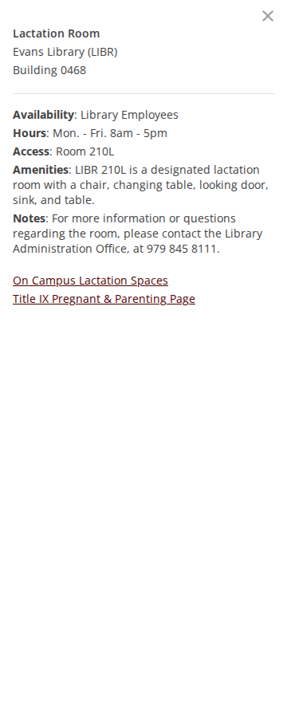                       | 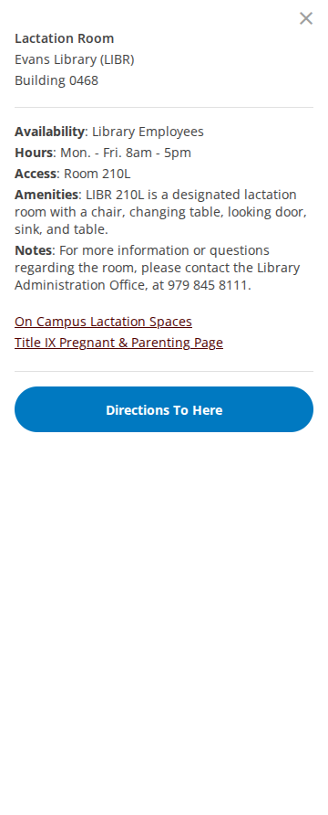 |
|                               |           |
| 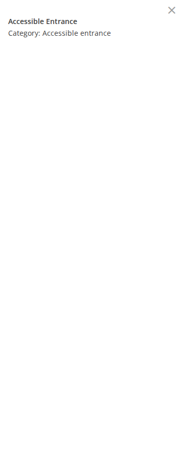                | 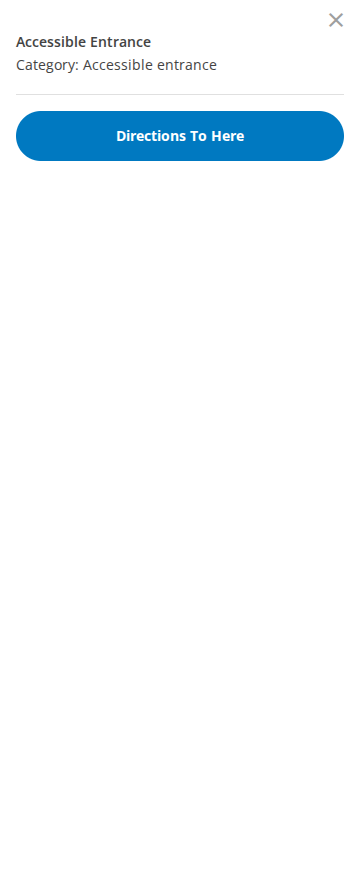        |
|                     |              |
| 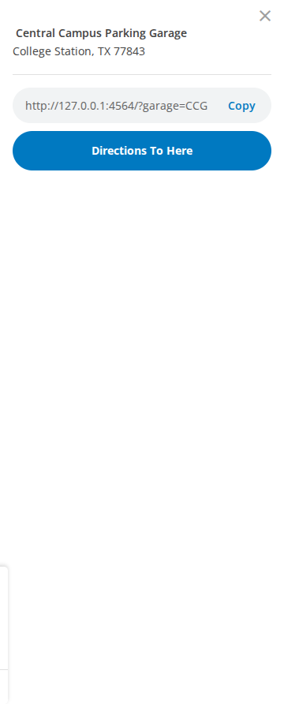 |                                 |

### Every dining location's address reads the same way

The dining popup showed whatever the dining service published for the state. Counted over all 54
locations on 25 November 2026:

| Published value | Locations |
| --------------- | --------: |
| `TX`            |        35 |
| `Texas`         |        15 |
| `texas`         |         3 |
| _(empty)_       |         1 |

So the same line read **College Station, TX** on two thirds of the locations and **College Station,
texas** on the rest, and Food Truck Row ended in a bare comma with nothing after it. The issue recorded
three different values in September; there are four now, so this is drifting rather than settling.

| Before                                                                               | After                                                                            |
| ------------------------------------------------------------------------------------ | -------------------------------------------------------------------------------- |
|  | 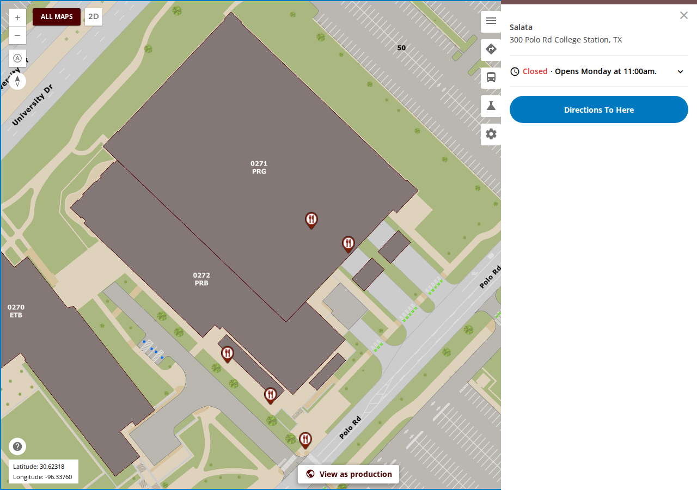 |

Any spelling of Texas is now shown as **TX**. Anything else is shown exactly as published, because the
application cannot know what is right for a state it has not seen, and a part that is missing takes its
separator with it.

**The service still publishes four values**; this only stops them reaching the page. Correcting the
records is for whoever maintains the dining data.

| Issue                                                                                  | What                                                                      |
| -------------------------------------------------------------------------------------- | ------------------------------------------------------------------------- |
| [#954](https://github.com/TamuGeoInnovation/Tamu.GeoInnovation.js.monorepo/issues/954) | The dining popup's address shows the state the same way on every location |

### Keyboard focus is visible on the Copy action and on search results

Someone using the keyboard could not see where they were on two controls: a map's **Copy** showed nothing at all
when it had focus, and a search result reached with the arrow keys looked exactly like one under the mouse
pointer. Both now show a maroon outline when reached from the keyboard, and nothing extra after a click. The same
outline comes back to the sidebar menu of the geoservices site.
([#1001](https://github.com/TamuGeoInnovation/Tamu.GeoInnovation.js.monorepo/issues/1001))

| Before                                                                                                                                     | After                                                                                                  |
| ------------------------------------------------------------------------------------------------------------------------------------------ | ------------------------------------------------------------------------------------------------------ |
| 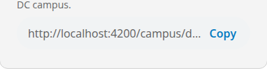 | 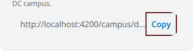 |
| 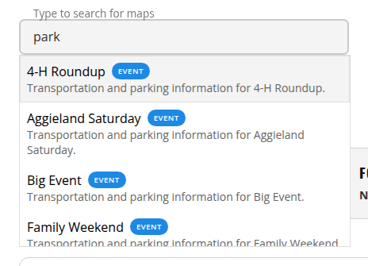       | 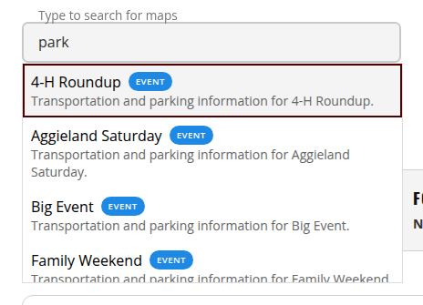     |

### Dates and times are chosen or typed exactly

The shared date and time picker, used by the GIS Day VGI Form Designer and event forms and by AggieMap's trip
planner, was the browser's own date-and-time box. Once that box holds a whole value it reports a change on every
key, and the picker closed on the first one. Typing "30" into the minutes kept only the 3 and saved 11:03, and the
maintainer needed four saves to set the 2026 VGI scoring window: the cutoff kept saving as 11:30 while 11:00 was
being chosen.

A date is now chosen from a calendar or typed, and a time chosen from the list of times or typed, both Angular
Material's own, with their keyboard and screen-reader support. Each takes effect once it is chosen, or a typed one is
left or entered, never on a single key. A picker of both stays open after the date until the time is set. A time
alone (the GIS Day event times) and a date alone (the GIS Day season days) open their list or calendar at once, as
before ([#2583](https://github.com/TamuGeoInnovation/Tamu.GeoInnovation.js.monorepo/issues/2583)).

| | Before | After |
| --- | --- | --- |
| The Designer's "Submissions stop counting at", opened | 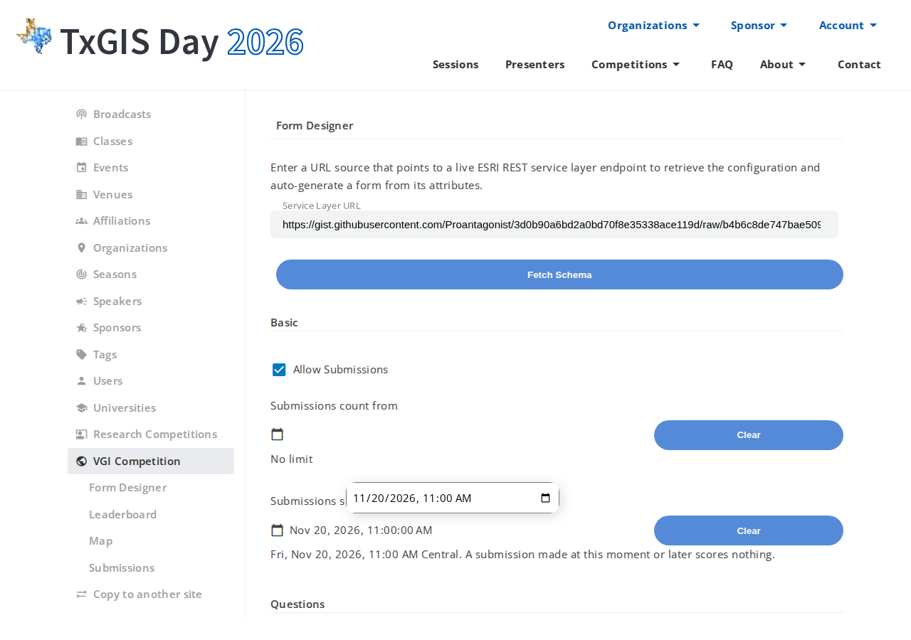 | 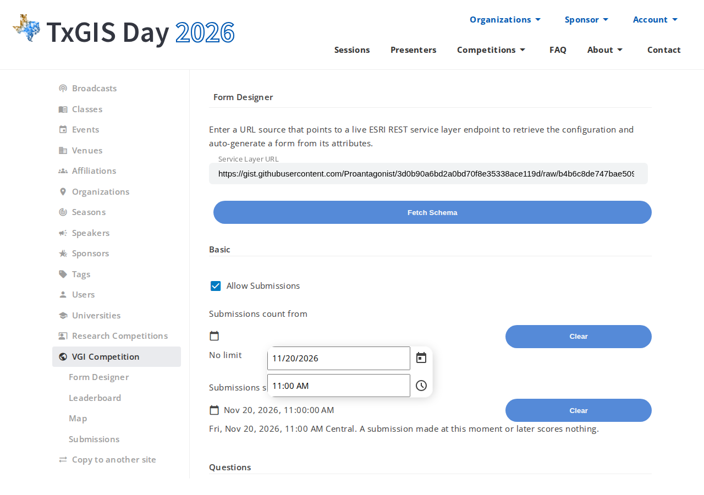 |
| "30" typed into the minutes of 11:00 AM |  |  |
| The date, chosen | | 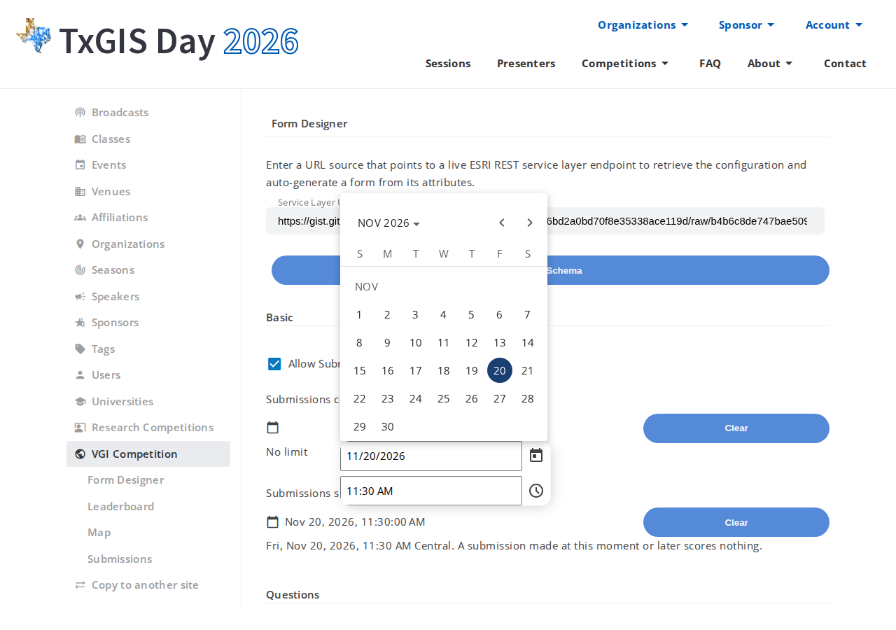 |
| The time, chosen | | 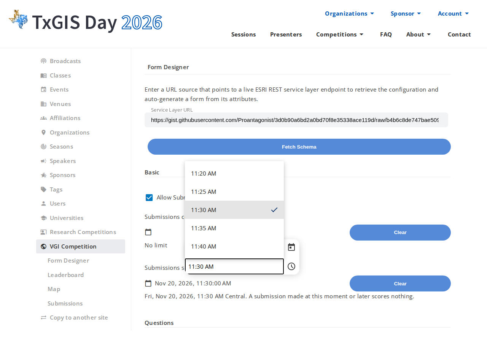 |
| A GIS Day event's start time | 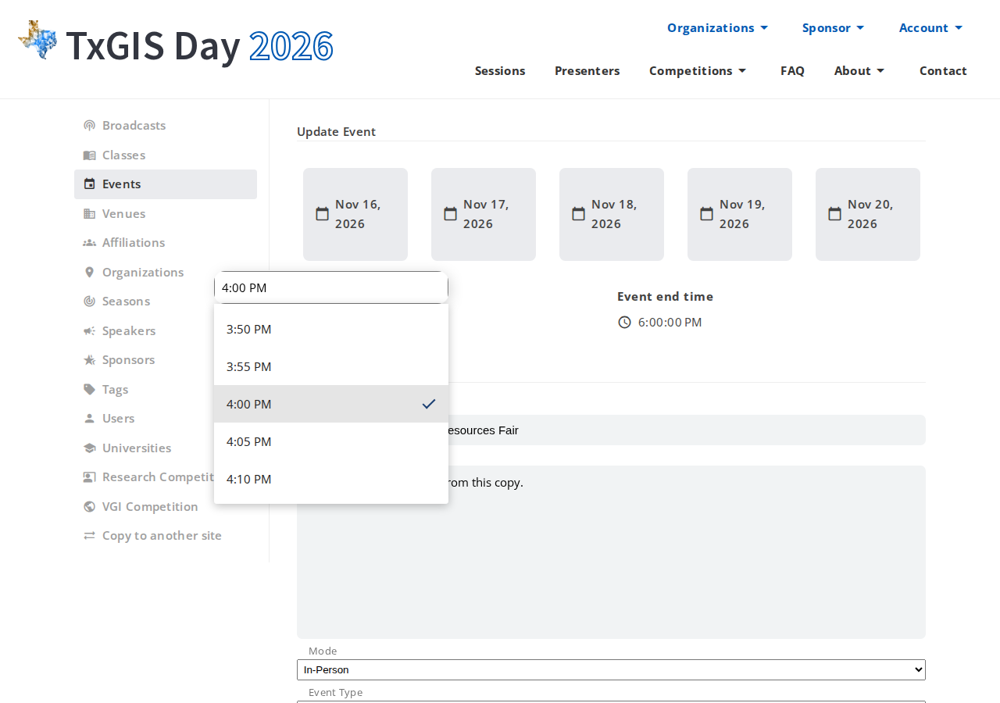 | 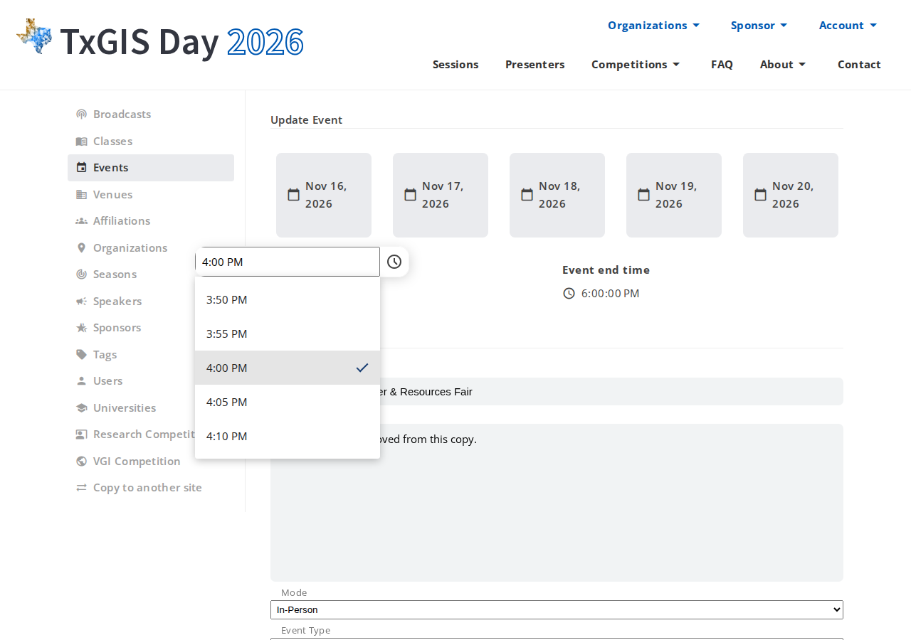 |

### Times around midnight and noon are right on a 12-hour clock

Two faults in one small pair of functions, each the other's mirror, and both at the only two hours
where a 12-hour clock is awkward.

- **Showing a time:** the hour was reduced only when it was **above** 12, so **noon printed as `12:00 AM`**
  and a minute past midnight as `00:01 AM`
  ([#2643](https://github.com/TamuGeoInnovation/Tamu.GeoInnovation.js.monorepo/issues/2643)). Trip steps
  are where this showed.
- **Reading a time:** `12` was treated as noon whatever followed it, so **`12:05 AM` was read as five past
  noon** - twelve hours wrong, in the middle of the day
  ([#3464](https://github.com/TamuGeoInnovation/Tamu.GeoInnovation.js.monorepo/issues/3464)). Bus
  timetables are where this showed.

Both now follow the ordinary rule: **12 PM is noon, 12 AM is the hour after midnight**, and every other
hour is unchanged. A time written with neither AM nor PM keeps its hour, so a bare `12:00` is still noon.

**No before/after capture.** Showing either needs a real time at one of those two hours - a bus departure
between midnight and 1 AM, or a trip step landing in the midday minute. Contriving one with a frozen clock
would photograph the contrivance rather than the fault. The evidence is a unit test for each boundary that
fails on the old code and passes on the new.

| Issue                                                                                    | What                                                                                                      |
| ---------------------------------------------------------------------------------------- | --------------------------------------------------------------------------------------------------------- |
| [#2643](https://github.com/TamuGeoInnovation/Tamu.GeoInnovation.js.monorepo/issues/2643) | A time at noon reads 12 PM, and just after midnight 12 AM, instead of both reading AM with the wrong hour |
| [#3464](https://github.com/TamuGeoInnovation/Tamu.GeoInnovation.js.monorepo/issues/3464) | A time written `12:0x AM` is read as the hour after midnight, not as noon                                 |

### Every map's side panel offers the same tabs

The event and parking maps had a side panel of their own, maintained apart from the main map's, and the Bus Routes
and Experiments tabs were only ever added to the main map's. So **Bus Routes was missing from every event and parking
map**, on production as well as dev, and Experiments was missing on dev
([#2758](https://github.com/TamuGeoInnovation/Tamu.GeoInnovation.js.monorepo/issues/2758)).

There is now one side panel for every map, and its tabs are declared once, so a tab added to it reaches every map
that has one. A satellite campus map still shows only Features, as its definition asks.

|                                                    | Before                                                                                                           | After                                                                                                     |
| -------------------------------------------------- | ---------------------------------------------------------------------------------------------------------------- | --------------------------------------------------------------------------------------------------------- |
| Football Tailgating                                | 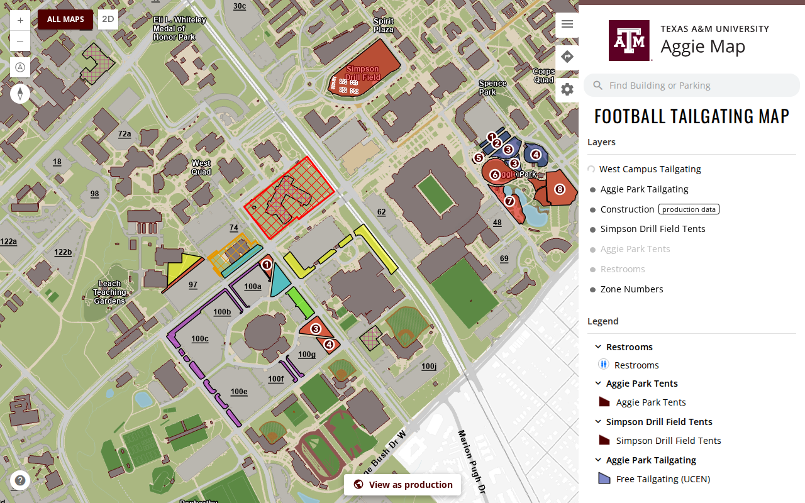           | 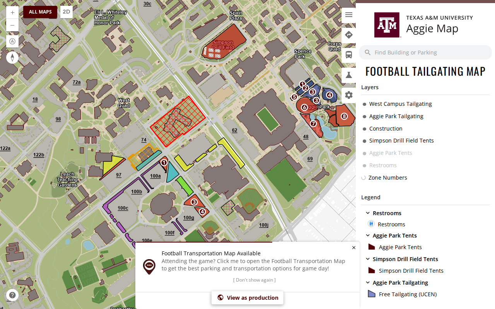                     |
| The main map                                       | 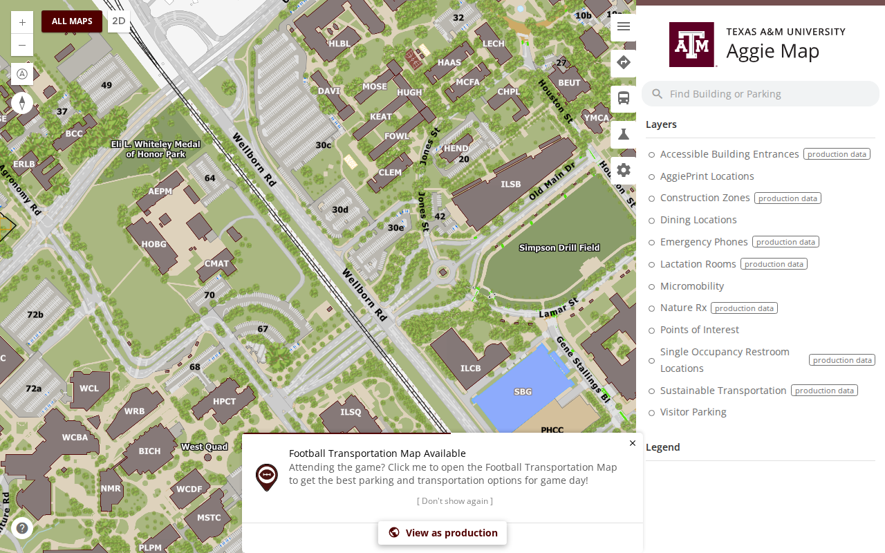                                                | 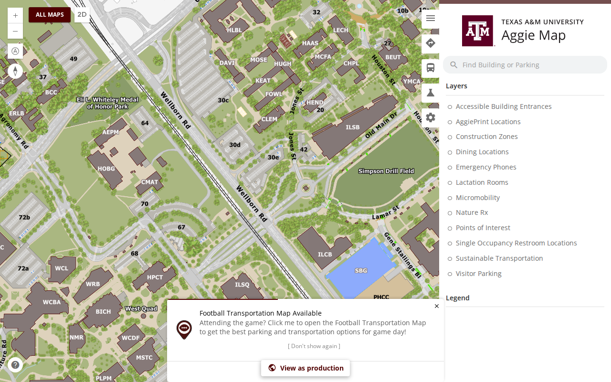                                 |
| Bus Routes on Football Tailgating, route 01 chosen | 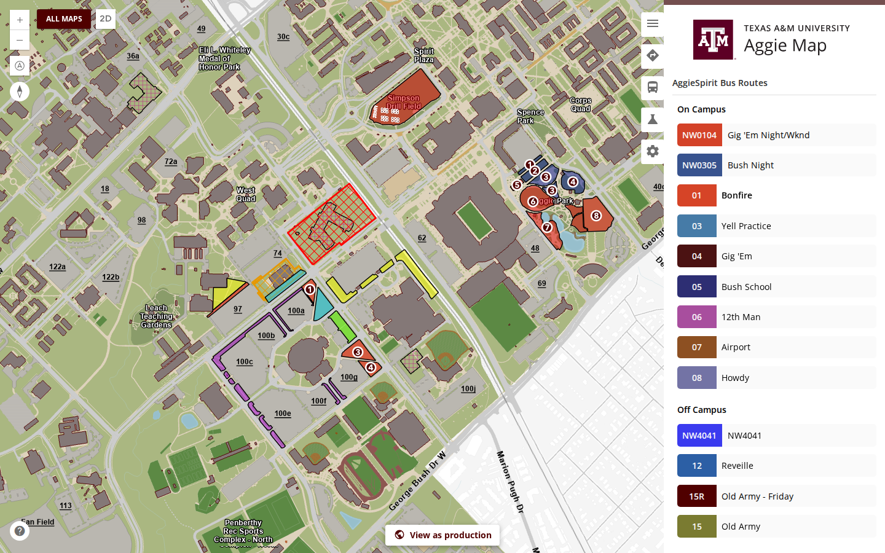 | 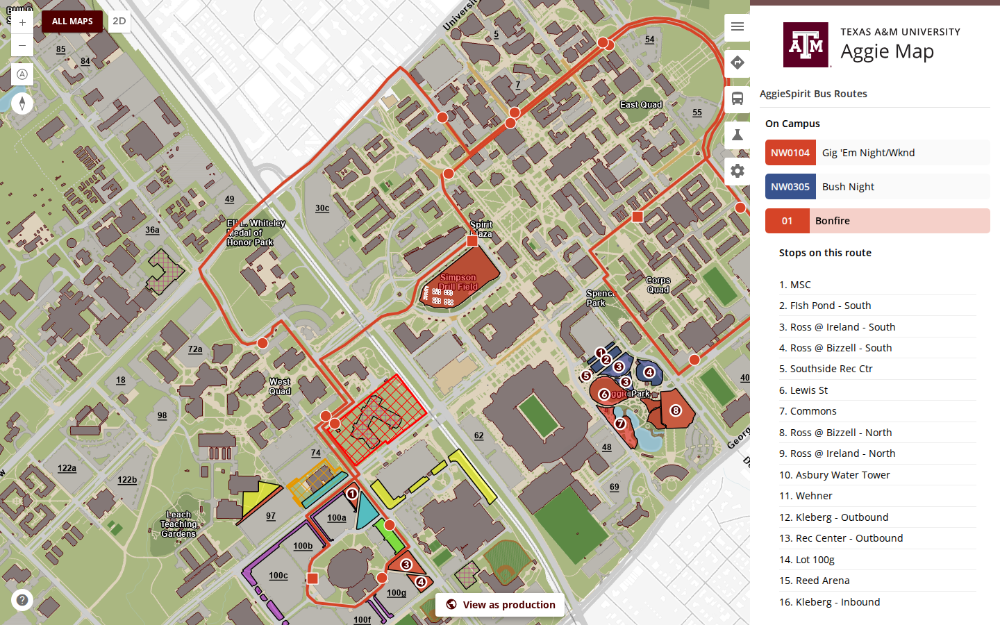 |

Choosing a route there draws it. The bus service was the application's, bound to the application's map, so an event
map's Bus Routes tab listed the routes and drew nothing when one was chosen; each event map has its own now, as it
already did for its layers and its trip planner.

The event maps' trip planner Options page is also now development-only, as the main map's has been since
[#2801](https://github.com/TamuGeoInnovation/Tamu.GeoInnovation.js.monorepo/issues/2801): it was the same drift.

| Issue                                                                                    | What                                                                                                                           |
| ---------------------------------------------------------------------------------------- | ------------------------------------------------------------------------------------------------------------------------------ |
| [#2758](https://github.com/TamuGeoInnovation/Tamu.GeoInnovation.js.monorepo/issues/2758) | One side panel for the main map and every event and parking map, and an event map's Bus Routes tab draws the route it is given |

### April Ring Day is listed on Campus Events again

The April Ring Day map was hidden from the Campus Events listing, where its two siblings - October Ring Day
and November Ring Day - were not. No reason was ever recorded for hiding it; the smoke suite's note said only
that #899's All Maps overhaul hid it on 5 August 2026 and to ask before listing it again.

The maintainer confirmed on 8 November 2026 that it should be listed, so it is.

|               | Before                                                                                                   | After                                                                                              |
| ------------- | -------------------------------------------------------------------------------------------------------- | -------------------------------------------------------------------------------------------------- |
| Campus Events | 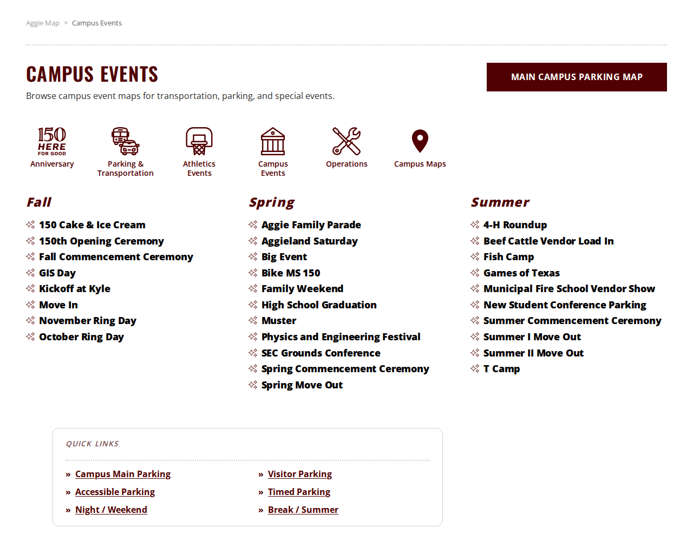 | 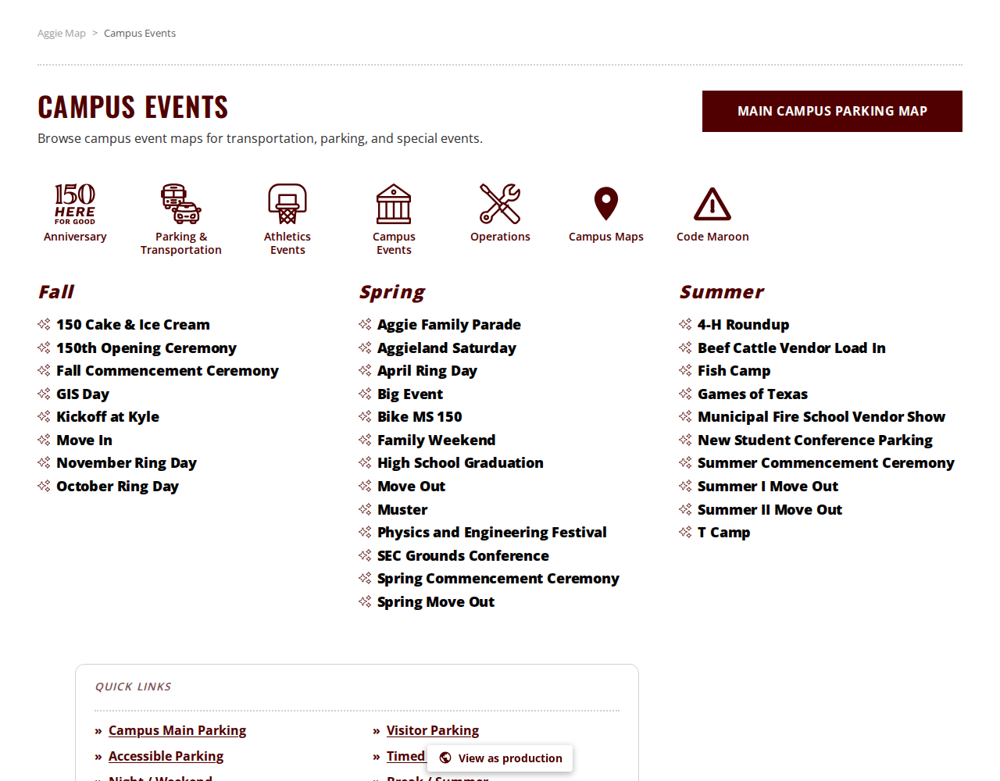 |

The map itself was always reachable at `/events/april-ring-day`; only the listing was missing, so a shared
link to it kept working throughout.

### A popup no longer shows a field the map has no value for, and a shared link opens the same popup a click does

Some map layers leave a field empty for some features: ten of the bike racks have no notes. Their popups printed the
label anyway, and a popup opened from a shared link printed the raw field name, "Notes: {attributes.BR_Notes}". A row
whose value is empty is now left out, label and all
([#2816](https://github.com/TamuGeoInnovation/Tamu.GeoInnovation.js.monorepo/issues/2816)).

A popup opened from a shared link (`?feature=…`) also went through its own copy of the code that fills a popup in,
which a click did not use, so two earlier fixes had reached clicks only: this one, and the construction map's dates,
which a shared link showed as long numbers such as 1735689600000. Both now go through one piece of code, so a shared
link opens exactly the popup a click does
([#3536](https://github.com/TamuGeoInnovation/Tamu.GeoInnovation.js.monorepo/issues/3536)). A popup whose fields are all
filled is unchanged.

| Before                                                                                                                                                                       | After                                                                                                                 |
| ---------------------------------------------------------------------------------------------------------------------------------------------------------------------------- | --------------------------------------------------------------------------------------------------------------------- |
| 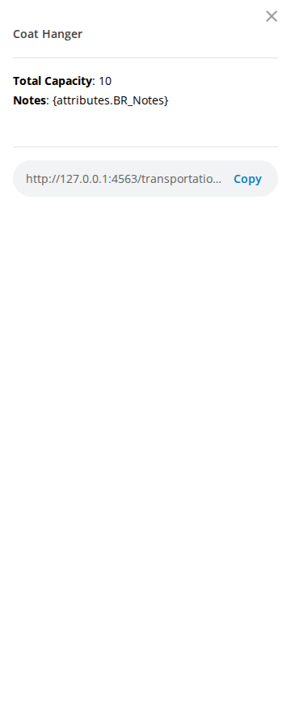     | 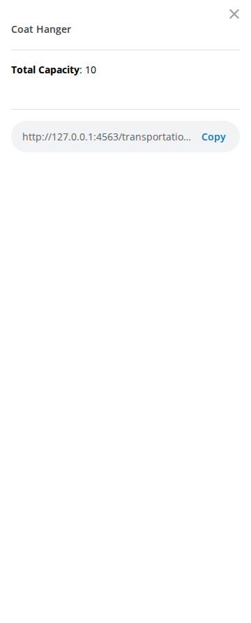 |
| 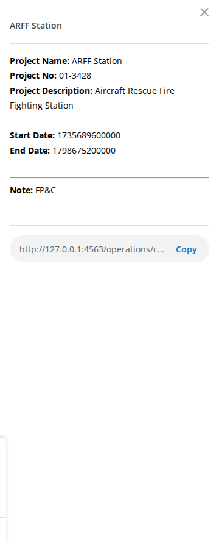 | 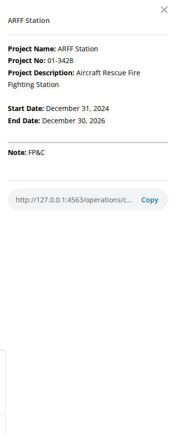 |
|                                                                      | 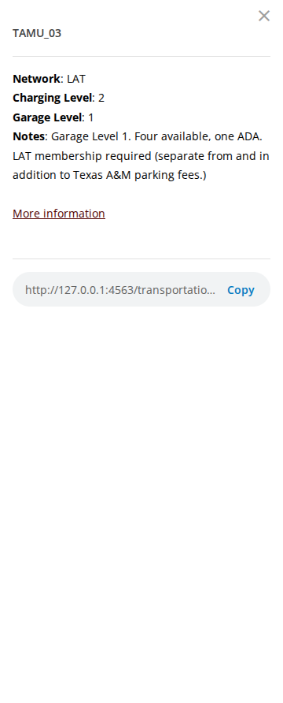                                 |

### Directions on a phone, from the menu and back from a stop's search

The phone menu now has **Directions**, after Bus Routes. A phone had its own trip planner all along, but nothing on a
phone led to it except Directions To Here in a feature's popup; the desktop has always had a Directions tab. And the back
arrow in a trip stop's search, which should return to the trip planner, went to the main map instead, losing the trip.
It now returns to the trip planner, as choosing a place for the stop does.
([#3149](https://github.com/TamuGeoInnovation/Tamu.GeoInnovation.js.monorepo/issues/3149),
[#3319](https://github.com/TamuGeoInnovation/Tamu.GeoInnovation.js.monorepo/issues/3319))

| Phone, 390 pixels         | Before                                                                                             | After                                                                                          |
| ------------------------- | -------------------------------------------------------------------------------------------------- | ---------------------------------------------------------------------------------------------- |
| The menu                  | 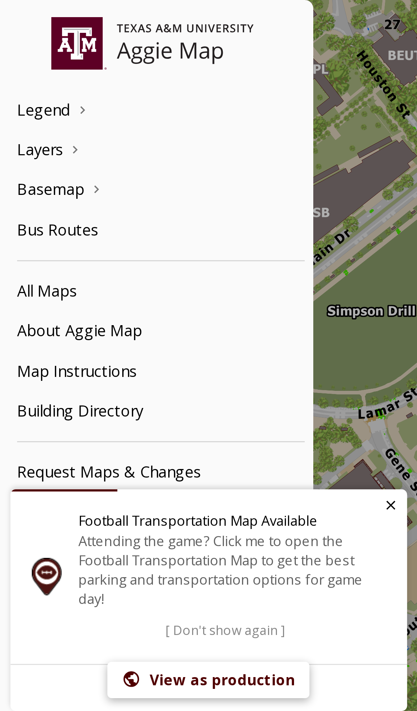 | 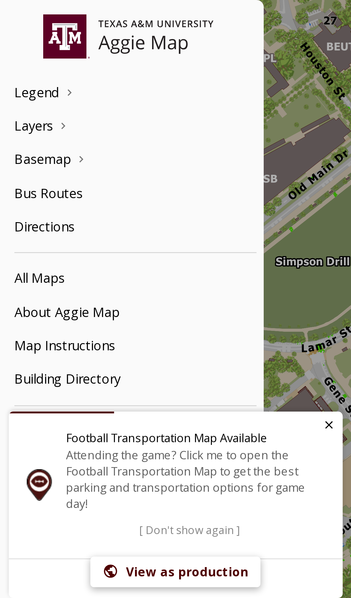      |
| Directions, tapped        |                                                                                                    | 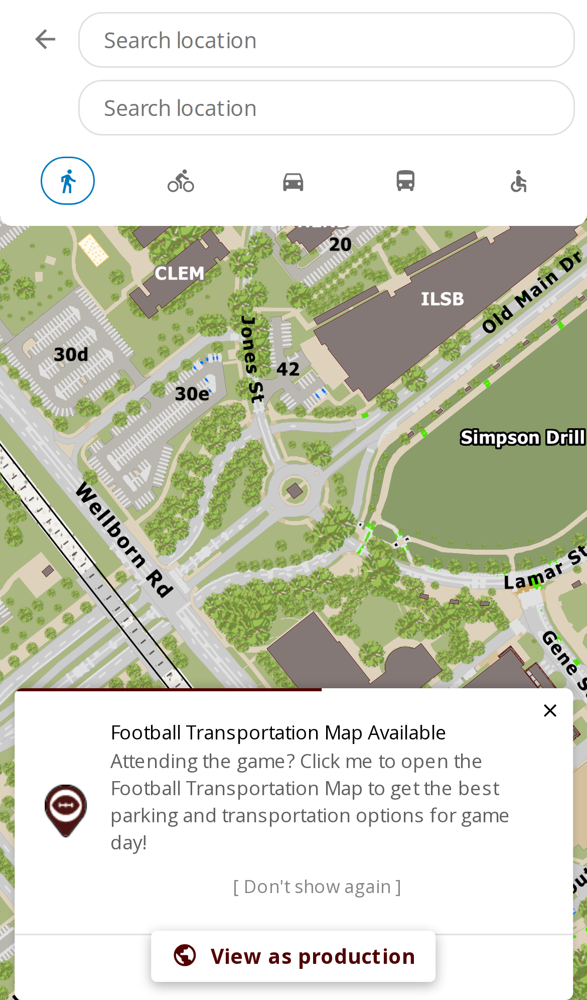 |
| Back from a stop's search | 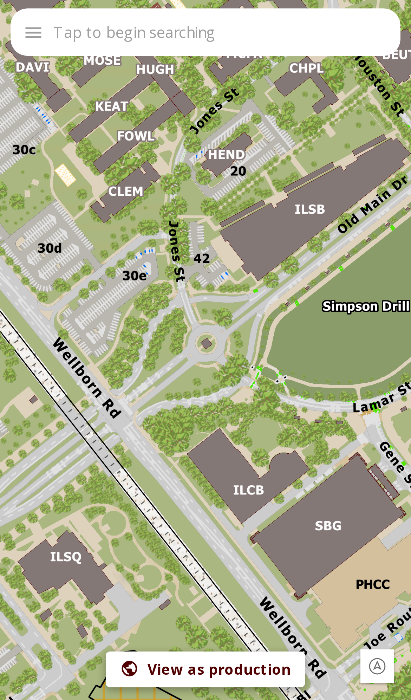   | 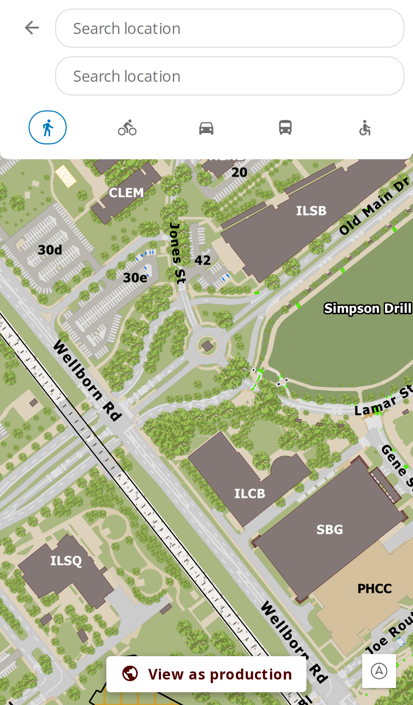   |

### Tapping a bus route on a phone opens it

On a phone, tapping a route in the Bus Routes list did nothing at all: the list stayed as it was, with no route drawn and
no stops or times. The tap looked for the route's page in the wrong part of the phone layout, where it was not, and
said nothing. It now opens the route's own panel and draws it on the map, as Directions To Here was fixed for the same
cause (#2641). The desktop list was not affected.
([#3150](https://github.com/TamuGeoInnovation/Tamu.GeoInnovation.js.monorepo/issues/3150))

| Phone, 390 pixels    | Before                                                                                                      | After                                                                                                                      |
| -------------------- | ----------------------------------------------------------------------------------------------------------- | -------------------------------------------------------------------------------------------------------------------------- |
| Route NW0104 tapped  | 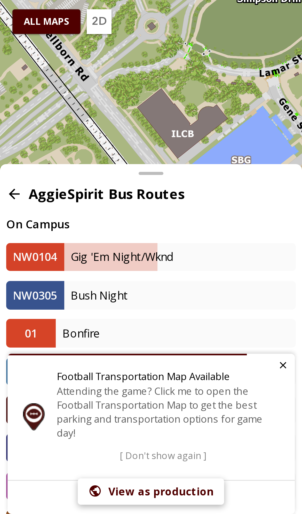            | 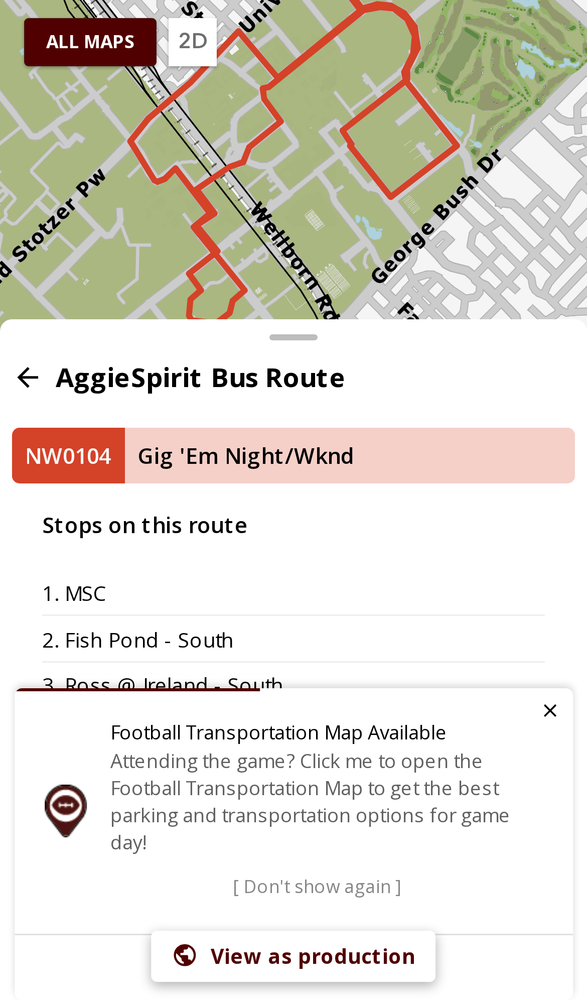 |
| Desktop, the control | 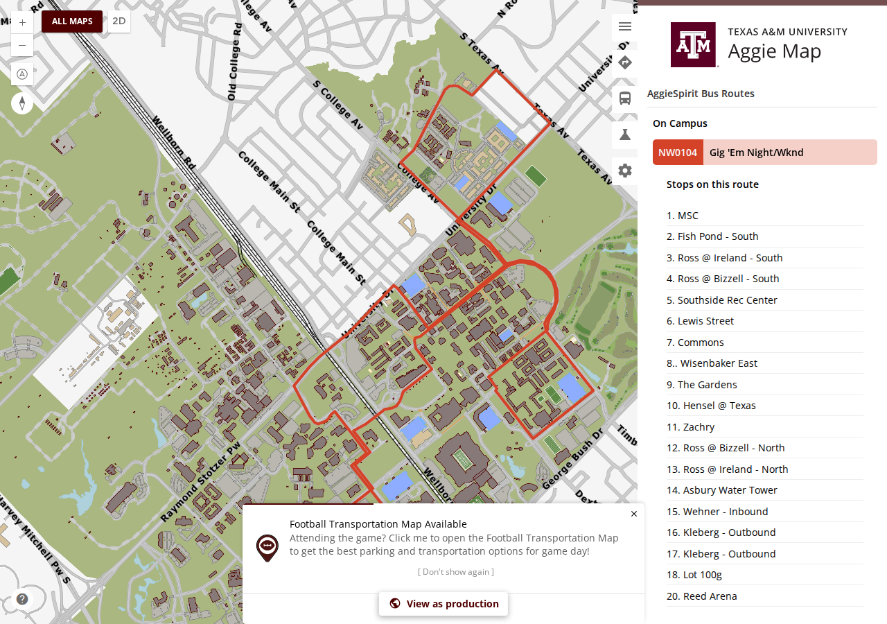 | 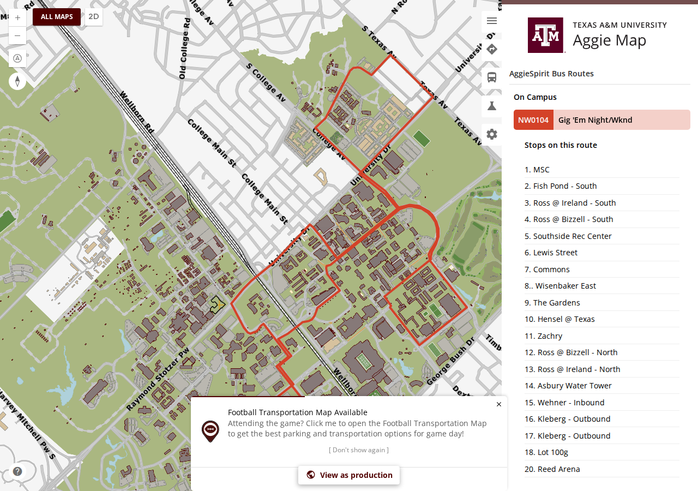                                       |

### The garage search reads the campus feature service, and each garage appears once

The garages were the last thing on the map still reading the old raster campus basemap, which was retired as
a data source on 9 November 2026 and is no longer maintained. They now come from Campus Structures on the
same feature service the buildings and surface lots already use.

**The names change**, because the two sources name the same garages differently: "Southside Garage" is
"Southside Parking Garage" in Facilities' data, and a search finds it by typing any part of that.

**Shared links keep working.** A `?garage=CCG` link made before this still opens Central Campus Parking
Garage: the two services carry the same garage codes, and the search matches on those rather than on a name.

Each garage is also listed once now. Garages are buildings in the new source, so for a moment they appeared
twice - once under Building and once under Parking Garage - and the building search gives them up. A deep
link to a garage as a building, such as `?bldg=0469`, still works.

| | Before | After |
| --- | --- | --- |
| Searching `garage` | 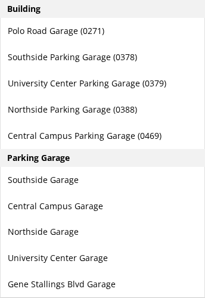 | 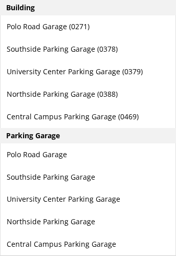 |
| A garage's popup | 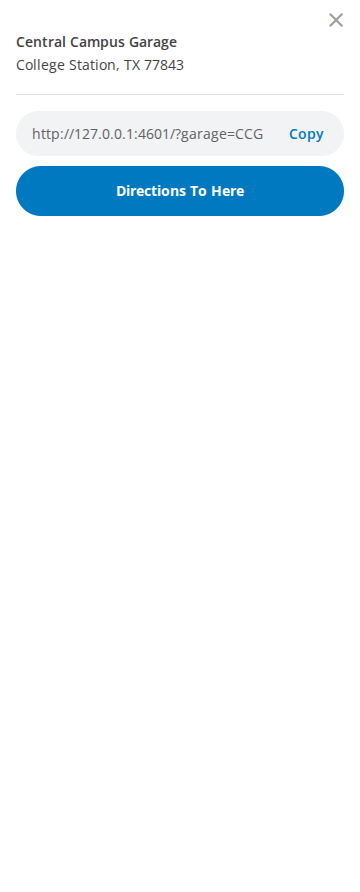 |  |

Two things found while doing it are filed rather than fixed here: a general search returns only five of the
ten garages ([#3433](https://github.com/TamuGeoInnovation/Tamu.GeoInnovation.js.monorepo/issues/3433), which
predates this), and the service carries an eleventh garage row with no name at all
([#3434](https://github.com/TamuGeoInnovation/Tamu.GeoInnovation.js.monorepo/issues/3434), which is the GIS
team's).

### Searching for "garage" finds every garage

Typing a general term into the search box returned **five garages and no more**, and which five was
arbitrary. It was not a display limit that more scrolling would get past: the search asked the service for
five rows, so the rest were never fetched and there was nothing to page through.

That is the search someone uses when they do not know the name - "garage", or "parking" - and it was the
one that did not work. Searching for a garage by name always found it.

|                 | Before                                                                                   | After                                                                                                          |
| --------------- | ---------------------------------------------------------------------------------------- | -------------------------------------------------------------------------------------------------------------- |
| Typing "garage" | 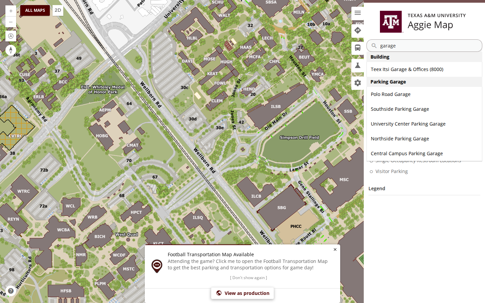 | 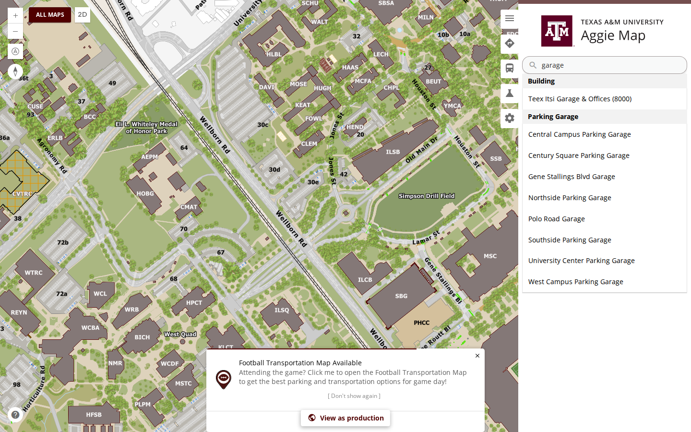 |

Counted against Campus Structures on 24 November 2026: the layer holds 11 rows marked as a garage, and
typing "garage" matches 8 of them, "parking" 7. The garage search now asks for all of them and sorts them by
name, so the list reads in a useful order and a garage built later cannot quietly fall off the end.

**The typed building search keeps its limit of five on purpose.** Its layer has 1,987 rows, so asking for
every one of them would be a different fault. Raising a count is right only where a whole category fits in
one page.

| Issue                                                                                    | What                                                                                        |
| ---------------------------------------------------------------------------------------- | ------------------------------------------------------------------------------------------- |
| [#3433](https://github.com/TamuGeoInnovation/Tamu.GeoInnovation.js.monorepo/issues/3433) | A general search returns every garage, in alphabetical order, rather than an arbitrary five |

### An event's notice stays up through the evening of the event

A map notice for an event - the banner that offers the game-day or parking map for something happening
now - **stopped being shown at 7 PM Central on the day of the event itself**, which is when people are
most likely to be looking for it.

The dates in an event's definition are date-only strings. `new Date('2026-10-02')` reads one as **UTC
midnight**, which is 7 PM Central the evening before, and the service then asked whether now was within a
day of that moment. So the window opened the evening before the event and closed at 7 PM on its own day.

It now uses the same `parseEventDate` and `nextEventDate` the rest of the application reads these dates
with, so a notice is offered while the event's own local day has not ended. No new date arithmetic was
added: a second timezone correction would have been a third copy of the same idea, which is what caused
this.

**No before/after capture.** Showing it needs the clock set to the evening of a real event, and with
Playwright's date fixed no notice appeared at all - not even a control the day before, which should have
shown one. The frozen clock suppresses notices for some other reason, so an image from it would prove
nothing. The evidence is a test with a fixed clock that fails on the old code and passes on the new.

| Issue                                                                                    | What                                                                                               |
| ---------------------------------------------------------------------------------------- | -------------------------------------------------------------------------------------------------- |
| [#3467](https://github.com/TamuGeoInnovation/Tamu.GeoInnovation.js.monorepo/issues/3467) | An event's notice is offered through the evening of the event, instead of stopping at 7 PM Central |

### The phone's trip planner no longer offers accessible routing on production

Accessible routing is development-only, because the campus routing network does not yet route accessible trips
([#2801](https://github.com/TamuGeoInnovation/Tamu.GeoInnovation.js.monorepo/issues/2801)). The desktop trip planner
hid it, but the phone's travel-mode buttons are a separate template and still offered the accessible icon on
aggiemap.tamu.edu. Both now read one setting, so the phone shows the four travel modes and nothing it cannot deliver.
([#3468](https://github.com/TamuGeoInnovation/Tamu.GeoInnovation.js.monorepo/issues/3468))

| Before                                                                                                                                                        | After                                                                                                              |
| ------------------------------------------------------------------------------------------------------------------------------------------------------------- | ------------------------------------------------------------------------------------------------------------------ |
| 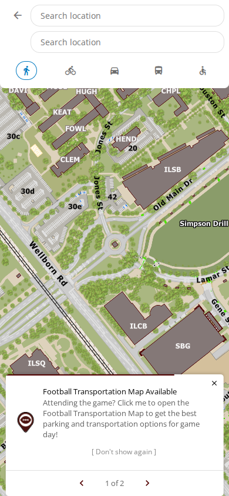 | 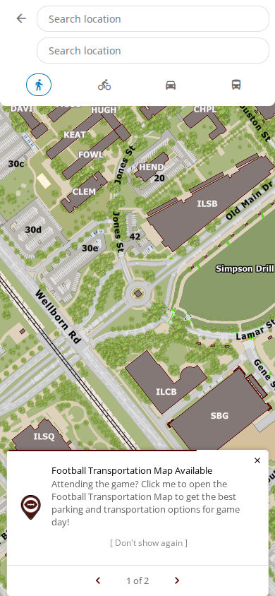 |

### The map search's results list is named to screen readers, and its arrow keys are unchanged

The map search, on the desktop and on a phone, now moves through its results with the same shared keyboard code as the All Maps
search box, instead of a copy of its own, so a keyboard fix is made once. What the keys do is unchanged: down from the box to the first
result, no wrapping at the last, up from the first back to the box, Enter or Space to choose, Escape to close.

One thing a screen reader user gains: the box now tells assistive technology which list it controls. It used to name a list id that
did not exist.
([#3471](https://github.com/TamuGeoInnovation/Tamu.GeoInnovation.js.monorepo/issues/3471))

|                                            | Before                                                                                                                              | After                                                                                          |
| ------------------------------------------ | ----------------------------------------------------------------------------------------------------------------------------------- | ---------------------------------------------------------------------------------------------- |
| Desktop, a result chosen with the keyboard | 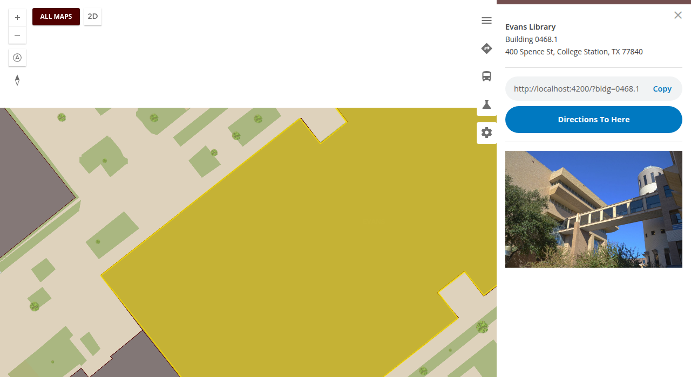 | 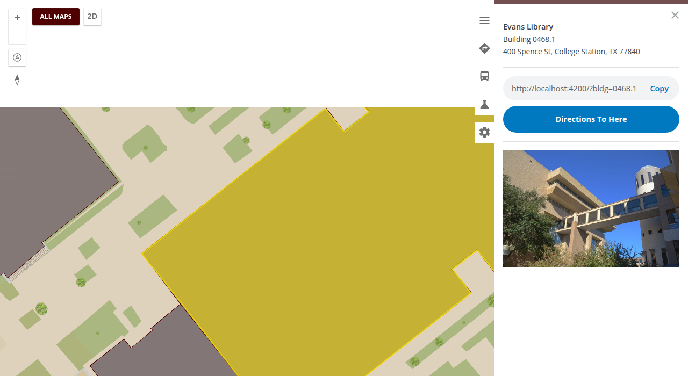 |
| Phone, a result chosen with the keyboard   | 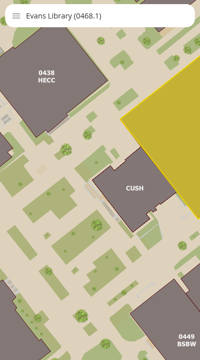     | 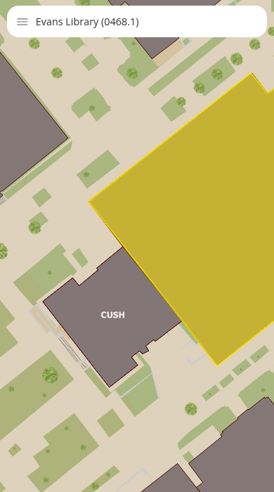   |

### Searching for coordinates typed the wrong way round now answers instead of doing nothing

The map search accepted any two numbers separated by a comma as "latitude, longitude", with no check that they were a
latitude and a longitude at all. So `-96.3, 30.6` - the same point with its halves the wrong way round, which is how a
copy and paste often gives them - was taken as latitude -96.3, which is not a latitude. The search then stopped
looking: it offered nothing, said nothing, and left an error in the browser's console. A visitor saw their typing
ignored, with no way to tell why.

Coordinates are now read in one place, which checks that the latitude is within 90 degrees and the longitude within 180. A pair out of range is not a coordinate, so the text is searched for as text and the visitor gets an answer -
**No results found** - instead of silence. A pair typed the right way round is read as a coordinate exactly as before.
([#3477](https://github.com/TamuGeoInnovation/Tamu.GeoInnovation.js.monorepo/issues/3477))

| Before                                                                                                                                  | After                                                                                                                                       |
| --------------------------------------------------------------------------------------------------------------------------------------- | ------------------------------------------------------------------------------------------------------------------------------------------- |
| 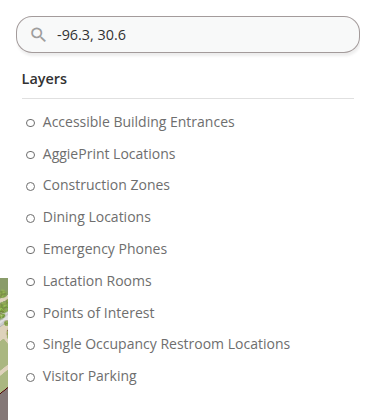 |  |

### AggieMap and the event maps share one markdown popup

AggieMap and the event maps each had their own copy of the two simplest popups: a title and a description, with or
without **Directions To Here**. The copies had drifted apart, so the same kind of feature looked different depending on
which map it was opened from
([#3486](https://github.com/TamuGeoInnovation/Tamu.GeoInnovation.js.monorepo/issues/3486)). There is now one pair,
used by both.

Almost nothing a visitor sees changes, by design:

- On an event map, these popups keep their copy link, which carries the map's builder choices.
  The NSC parking map, which used AggieMap's copy, now has the link too. On the event parking maps that link does not
  yet reopen the lot ([#3673](https://github.com/TamuGeoInnovation/Tamu.GeoInnovation.js.monorepo/issues/3673)).
- On AggieMap, the popup with **Directions To Here** puts the button below a dividing line, as a building's popup does.
- A feature with a blank description no longer leaves an empty space where it would have been.
- The UES Operations map's campus stops are still titled with the stop's name.

| Before                                                                                                                                      | After                                                                                                                  |
| ------------------------------------------------------------------------------------------------------------------------------------------- | ---------------------------------------------------------------------------------------------------------------------- |
|  |  |
|                                 |                          |

### Construction project dates no longer show a day early

Every date in a construction project's popup showed a day early for anyone in Central time
([#3551](https://github.com/TamuGeoInnovation/Tamu.GeoInnovation.js.monorepo/issues/3551)). A project starting on
1 January 2025 read "December 31, 2024". The service stores a date with no time as midnight UTC, which is 6 PM the
evening before in College Station, and the popup showed it as that moment rather than as the date it is.

Popups now show the date itself, on the Construction map and on the Tailgating map, which shows the same projects. It is
the third fault of this kind in a week, after an event's notice that vanished at 7 PM on the day of the event and noon
printed as 12:00 AM. The popups now use the same shared date code that fixed the first of those.

| Before                                                                                                                                     | After                                                                                                                             |
| ------------------------------------------------------------------------------------------------------------------------------------------ | --------------------------------------------------------------------------------------------------------------------------------- |
|  |  |

### Asking drive directions for an accessible visitor space now narrows the lots

When someone without a parking permit asked drive directions for an **accessible visitor space**, the filter that was
meant to narrow the lots matched every one of them, so the request had no effect: the driver was offered lots with no
accessible visitor spaces at all. The option read one setting and filtered on another, which made the query
"accessible visitor spaces of nought or more" - true everywhere.

It now asks for lots that actually have one. Measured against the parking service on 25 November 2026, that is **18
lots of 244**, so 226 lots that could not help are no longer offered.
([#3605](https://github.com/TamuGeoInnovation/Tamu.GeoInnovation.js.monorepo/issues/3605))

No before-and-after images: the difference is in which lots a drive is planned to, not in anything that changes on
screen by itself, and it is checked by the row above and by a test that fails against the unfixed code.

Nothing yet.

## What to test on dev

**The team tests these on dev before a release goes to production.** Dev is
[dev.aggiemap.tamu.edu](https://dev.aggiemap.tamu.edu). Each row is a change on dev and not yet on
production. A pull request with a visible result adds its own row; at release, the rows move into the
dated notes as what was tested, and this table empties.

**Nothing waiting:** the rows moved into the [second 24 November notes](2026-11-24-2.md).

---


| Change | Open this on dev | Look for |
| --- | --- | --- |
| Directions from four more popups ([#602](https://github.com/TamuGeoInnovation/Tamu.GeoInnovation.js.monorepo/issues/602)) | AggieMap dev, `/map/d`: turn on Lactation Rooms, click a room; then the same for Single Occupancy Restroom Locations, Accessible Building Entrances and Visitor Parking | Each popup ends with **Directions To Here**. Pressing it opens the trip planner with the place as the destination; choose a start and a route appears. A building, garage, lot or point of interest popup is unchanged, with its copy link and its Directions. Construction zones still have no Directions |
| Dining addresses ([#954](https://github.com/TamuGeoInnovation/Tamu.GeoInnovation.js.monorepo/issues/954)) | [dev.aggiemap.tamu.edu/map/d](https://dev.aggiemap.tamu.edu/map/d), with **Dining Locations** turned on | Open several locations - Salata, Reynolds and Reynolds Cafe, Sbisa - and the address ends **College Station, TX** on every one, not "College Station, texas" or "College Station, Texas". **Food Truck Row**, which has no state, ends at the city with no trailing comma |
| Keyboard focus on Copy and on search results ([#1001](https://github.com/TamuGeoInnovation/Tamu.GeoInnovation.js.monorepo/issues/1001)) | [dev.aggiemap.tamu.edu/all-maps](https://dev.aggiemap.tamu.edu/all-maps) | Tab to a map's **Copy**: a maroon box is drawn around it. Type `park` in the search and press the down arrow: the highlighted result has a maroon box. Clicking either with the mouse draws no box |
| Date and time pickers: every key of a typed time counts ([#2583](https://github.com/TamuGeoInnovation/Tamu.GeoInnovation.js.monorepo/issues/2583)) | AggieMap: [a trip on dev](https://dev.aggiemap.tamu.edu/map/d/trip?mode=1&stops=30.6150,-96.3500@30.6150,-96.3300), then Leave now, changed to Leave at. GIS Day is not on dev ([#1525](https://github.com/TamuGeoInnovation/Tamu.GeoInnovation.js.monorepo/issues/1525)); on production after release, as an admin: [VGI Competition, Form Designer](https://txgisday.org/admin/competitions/designer) | Open the picker: a date field with a calendar button and a time field with a clock button. Choose a date from the calendar: the picker stays open. Type a time such as 11:30 AM and press Enter: 11:30 is set, not 11:03. In the Designer, the Central-time line under "Submissions stop counting at" shows exactly the time chosen, and Save keeps it. GIS Day event times still open their list of times at once |
| Times at noon and after midnight ([#2643](https://github.com/TamuGeoInnovation/Tamu.GeoInnovation.js.monorepo/issues/2643), [#3464](https://github.com/TamuGeoInnovation/Tamu.GeoInnovation.js.monorepo/issues/3464)) | [dev.aggiemap.tamu.edu/map/d/bus](https://dev.aggiemap.tamu.edu/map/d/bus) and the trip planner | A bus timetable entry for just after midnight reads **12:0x AM**, not 12:0x PM, and sits at the start of the night's times rather than in the middle of the day. A trip step arriving at midday reads **12:xx PM**. Times at any other hour are unchanged |
| Side panel tabs on event and parking maps ([#2758](https://github.com/TamuGeoInnovation/Tamu.GeoInnovation.js.monorepo/issues/2758)) | [Football Tailgating](https://dev.aggiemap.tamu.edu/events/tailgating/map) and [the main map](https://dev.aggiemap.tamu.edu/map), on a desktop | The tailgating map's side panel has the same five tabs as the main map's: Features, Directions, Bus Routes, Experiments and Settings. Bus Routes opens the bus list on the tailgating map. A satellite campus map, such as [Galveston](https://dev.aggiemap.tamu.edu/campus/galveston/map), still shows only Features. With **View as production**, Experiments goes from both |
| April Ring Day is listed ([#2768](https://github.com/TamuGeoInnovation/Tamu.GeoInnovation.js.monorepo/issues/2768)) | [dev.aggiemap.tamu.edu/all-maps/campus-events](https://dev.aggiemap.tamu.edu/all-maps/campus-events) | **April Ring Day** appears in the **Spring** column, between Aggieland Saturday and Big Event. Its two siblings, October and November Ring Day, are still under Fall. The same page with `?as=production` shows it too, because it is no longer hidden from production's listings |
| Empty popup rows left out, and shared links matching a click ([#2816](https://github.com/TamuGeoInnovation/Tamu.GeoInnovation.js.monorepo/issues/2816), [#3536](https://github.com/TamuGeoInnovation/Tamu.GeoInnovation.js.monorepo/issues/3536)) | AggieMap dev: `/transportation/sustainable-transportation/map/d?feature=sustainable-transportation-bike-racks:7057`, then `/operations/construction-map/map/d?feature=construction-map-popup:35375`, then an EV charger such as `?feature=sustainable-transportation-ev-chargers:35` | The bike rack shows its type and Total Capacity and no Notes row (not "Notes: {attributes.BR_Notes}"). The construction project shows its start and end as dates, not long numbers. The EV charger shows all four of its rows, as before. Clicking the same features on the map shows the same |
| Directions in the phone menu ([#3149](https://github.com/TamuGeoInnovation/Tamu.GeoInnovation.js.monorepo/issues/3149)) | [dev.aggiemap.tamu.edu/map/m/sidebar](https://dev.aggiemap.tamu.edu/map/m/sidebar), **on a phone or a phone-sized window** | The menu lists Directions after Bus Routes, and it opens the trip planner at `/map/m/trip` |
| Bus routes on a phone ([#3150](https://github.com/TamuGeoInnovation/Tamu.GeoInnovation.js.monorepo/issues/3150)) | [dev.aggiemap.tamu.edu/map/m/bus](https://dev.aggiemap.tamu.edu/map/m/bus), **on a phone or a phone-sized window** | Tapping a route opens its panel - its name, stops and times - and draws it on the map, with the address becoming `/map/m/bus/<route>`. On a desktop, the bus list works as before |
| The garage search ([#3425](https://github.com/TamuGeoInnovation/Tamu.GeoInnovation.js.monorepo/issues/3425)) | [dev.aggiemap.tamu.edu/map/d](https://dev.aggiemap.tamu.edu/map/d), then search `garage`; then open [?garage=CCG](https://dev.aggiemap.tamu.edu/map/d?garage=CCG) | Each garage is listed **once**, under Parking Garage, and the names carry "Parking" in the middle - "Southside Parking Garage", not "Southside Garage". Building lists only "Teex Itsi Garage & Offices", which has Garage in its name and is not one. The popup names the garage rather than showing an empty heading, and `?garage=CCG` still opens Central Campus Parking Garage |
| Every garage is findable ([#3433](https://github.com/TamuGeoInnovation/Tamu.GeoInnovation.js.monorepo/issues/3433)) | [dev.aggiemap.tamu.edu/map](https://dev.aggiemap.tamu.edu/map) | Type **garage** into the search box. Under **Parking Garage** every garage whose name contains the word is listed, in alphabetical order, rather than five of them. Typing **parking** does the same. Searching for one by name, such as **Southside**, still finds it |
| Event notices on the day of the event ([#3467](https://github.com/TamuGeoInnovation/Tamu.GeoInnovation.js.monorepo/issues/3467)) | [dev.aggiemap.tamu.edu/map](https://dev.aggiemap.tamu.edu/map), on a day an event map is running | The notice for an event happening today is still offered after 7 PM Central, and is gone the following day. Notices auto-dismiss about ten seconds after the page loads, so hover over the panel to hold one while you look |
| Accessible routing stays development-only on a phone ([#3468](https://github.com/TamuGeoInnovation/Tamu.GeoInnovation.js.monorepo/issues/3468)) | AggieMap dev at phone width, `/map/m/trip`, then the same with `?as=production` | On dev, five buttons: walk, bike, car, bus and the accessible icon. As production, four: no accessible icon. On desktop, `/map/d/trip` shows Options on dev only, as before |
| The map search's arrow keys ([#3471](https://github.com/TamuGeoInnovation/Tamu.GeoInnovation.js.monorepo/issues/3471)) | [dev.aggiemap.tamu.edu/map/d](https://dev.aggiemap.tamu.edu/map/d), then [the phone map](https://dev.aggiemap.tamu.edu/map/m) | Type `Evans` in the search. **Down** goes from the box to the first result and stays on the last; **Up** walks back to the box; **Enter** or **Space** chooses one; **Escape** closes the list. The same as before; in the trip planner the arrows stay in the box being typed in |
| Coordinates typed the wrong way round ([#3477](https://github.com/TamuGeoInnovation/Tamu.GeoInnovation.js.monorepo/issues/3477)) | [Aggie Map dev](https://dev.aggiemap.tamu.edu/map/d) | Type `-96.3, 30.6` in **Find Building or Parking** - longitude first, as a copy and paste often gives it. The search answers **No results found for "-96.3, 30.6"**. Before this it showed nothing at all and left an error in the console. Typed the right way round, `30.6, -96.3` is unchanged by this release and still does not place a point ([#3615](https://github.com/TamuGeoInnovation/Tamu.GeoInnovation.js.monorepo/issues/3615)) |
| One markdown popup ([#3486](https://github.com/TamuGeoInnovation/Tamu.GeoInnovation.js.monorepo/issues/3486)) | AggieMap dev, `/map/d`: turn on AggiePrint Locations and click a printer; then Dismount Zones, and click one. Then the New Student Conference parking map on dev, and click a lot. Then the UES Operations map, Bus, Campus Stops | AggiePrint's popup shows the printer's details, then **Directions To Here** below a dividing line. A dismount zone shows its name, unchanged. An NSC lot shows its name and a copy link, as the other event parking maps' lots do. Pasting the link does not yet reopen the lot, on NSC or on those maps ([#3673](https://github.com/TamuGeoInnovation/Tamu.GeoInnovation.js.monorepo/issues/3673)). A campus stop is titled with the stop's name, not "Campus Stops" |
| Construction dates ([#3551](https://github.com/TamuGeoInnovation/Tamu.GeoInnovation.js.monorepo/issues/3551)) | The Construction map on the dev event maps, `/construction-map`: click ARFF Station, by Easterwood Airport. Then any construction project on the Tailgating map | ARFF Station reads **Start Date: January 1, 2025** and **End Date: December 31, 2026**, not December 31, 2024 and December 30, 2026. Every project's dates match the dates Transportation published for it |
| Accessible visitor parking ([#3605](https://github.com/TamuGeoInnovation/Tamu.GeoInnovation.js.monorepo/issues/3605)) | [Aggie Map dev](https://dev.aggiemap.tamu.edu/map/d/trip), Directions, driving | Choose **no parking permit**, then ask for an accessible visitor space, and plan a drive. The lots offered are only ones that have one - 18 of the 244 on campus, among them Central Campus Garage, University Center Garage and Lot 072a. Before this, every lot was offered |

## Work in flight - 24 November

**Read this section, not the ones below it.** They are kept as a record and are out of date.

### AggieMap on 24 November, midday Central: what another machine most needs to know

- **Two releases went out on 24 November.** `61dc13b89` carried three weeks of work and was cleared by the
  `release` tier; `50b125bf5` followed the same afternoon with the remote campuses' new names
  ([#3161](https://github.com/TamuGeoInnovation/Tamu.GeoInnovation.js.monorepo/issues/3161)), cleared by a
  `quick` tier - a departure from the rule that `quick` never clears production, recorded and argued in
  [the second release's notes](2026-11-24-2.md). The paragraph below describes the first of the two. The `release` tier ran against dev on a quiet machine and reported
  **9 failed, 14 flaky, 71 skipped, 1033 passed in 1.4 h**, against 18 failed and 982 passed on the 23rd. The
  numbers and the reading of every failure are in [24 November 2026](2026-11-24.md). The `dev-*` tag, the
  promotion and the `prod-*` tag are the maintainer's.
- **The tier cannot come back green until [#3416](https://github.com/TamuGeoInnovation/Tamu.GeoInnovation.js.monorepo/issues/3416) is fixed.** #3352's basemap scraper check
  flags `NearmapCSBasemap`, whose URL is a literal address rather than a campus constant. It fails in under
  20 ms on every run, load or no load. **It is a fault in the check and visitors see nothing**, but while it
  stands, a genuinely clean release is indistinguishable from a red one. Fix it before the next release tier.
- **Two failures are real on a quiet machine and both predate this release**, failing identically as "never
  finished drawing": indoor-track-parking's layer order on 2 of 3 loads
  ([#3369](https://github.com/TamuGeoInnovation/Tamu.GeoInnovation.js.monorepo/issues/3369)) and break-summer's Lot 100g popup. Timing work, not
  flakiness to retry through.
- **`basemap-requests` ([#3364](https://github.com/TamuGeoInnovation/Tamu.GeoInnovation.js.monorepo/issues/3364)) is load-only and now answered.** It passed on its
  first try with nothing else on the machine. It measures the machine, not the campus features service.
- **Two services had a bad hour during the run, neither of them ours.** The dining API was unreachable now
  and then across the 1.4 hours and passed 9 of 9 when re-run alone; **production's** basemap service answers
  `400` to count queries on three layers at random and refuses records past its 2,000 limit.

### The release cadence is the open decision

[#3411](https://github.com/TamuGeoInnovation/Tamu.GeoInnovation.js.monorepo/issues/3411) carries the maintainer's goal of a branch that is always safe to deploy, and what was
decided on 24 November: `main` becomes a promotion branch moved only by `scripts/tag-build.sh prod`, `master`
is deleted, and **the cadence shortens**. That last part matters most. 236 commits in one release is why the
tier had eighteen failures to triage a day earlier; twenty commits usually passes, and when it does not, the
cause is obvious. "Always deployable" is nearly free at twenty commits and nearly impossible at 236. What the
cadence should be is the maintainer's call; the measurement to watch is failures per release tier.

### The disk, which stopped two machines on 23 and 24 November

An overnight outage on the work machine was Docker filling the disk: **365 worktrees of merged branches** and
**277 volumes for closed issues**, with `docker_data.vhdx` at **991.8 GB**. Removing them and compacting the
disk took it to **296.1 GB** and returned about **696 GB**. Nothing was lost.

- **[`scripts/tidy.sh`](../../scripts/tidy.sh) and the check's own guard are now in ([#3400](https://github.com/TamuGeoInnovation/Tamu.GeoInnovation.js.monorepo/issues/3400), [PR 3407](https://github.com/TamuGeoInnovation/Tamu.GeoInnovation.js.monorepo/pull/3407)).**
  `scripts/check-in-volume.sh` refuses to start below 20 GiB free and sweeps merged worktrees and closed-issue
  volumes when it is below 60, so this cannot build up silently again. `bash scripts/tidy.sh` reports;
  `--yes` removes; `--compact` reclaims the image, and refuses while anything but a database container runs.
- **Every machine has the same creep.** The home machine was measured at 82.4 GiB free with an 853.8 GiB
  image, 331 worktrees and 309 volumes - about two and a half checks from the refusal. Run `tidy.sh` there
  before giving it a batch.
- **A worktree whose longest path exceeds 260 characters cannot be removed** without `core.longpaths`;
  `tidy.sh` names each one it could not remove rather than stopping. The main checkout and any `*-nm` volume
  are never candidates, which is tested.

### What needs the GIS team rather than us

[`docs/gis-service-differences.md`](../gis-service-differences.md) now classifies all 27 development-to-production
service differences: **11 are the GIS team's** (4 schema divergences, 3 broken or empty, 4 permissions) and 16
are not (12 unpublished on development, 4 retired events). `scripts/check-gis-differences.mjs` fails when a
workaround is added to `connections.ts` without its row, so the list cannot go quiet again. Its branch,
`docs/3402-gis-service-differences` ([#3402](https://github.com/TamuGeoInnovation/Tamu.GeoInnovation.js.monorepo/issues/3402)), is pushed and waiting on its full check and
a pull request. The remaining half of that issue is the roughly 23 GIS-related `allowed*Failures` in
`environments.json`, none of which is classified yet.

### What each machine is working on

The machines exchange work on the `work-mailbox` branch; `DIRECTOR.md` there has the rules, and
`tools/roster.sh` prints who is listening. As of 24 November midday: **the lab machine is paused** - a student
is using it, and no director may queue work there until the maintainer lifts it. The laptop is idle after the
release tier and GIS Day's image work. The home machine is clearing its disk.

## Work in flight - 10 November

Nothing in this section has merged into a release yet. It exists because
[`CLAUDE_SETUP.md`](../../CLAUDE_SETUP.md) sends a session on another machine here first, and it is meant to be
read rather than reconstructed. The 30 October section below it is kept as a record and is **out of date**; read
this one.

### GIS Day on production

Updated at every GIS Day rollout, as step 4 of
[Before any deploy](../gisday-migrations.md#before-any-deploy-what-is-in-the-image)
([#3139](https://github.com/TamuGeoInnovation/Tamu.GeoInnovation.js.monorepo/issues/3139)).

| | |
| --- | --- |
| Images, both namespaces (`gisday`, `gisday-ucgis`) | The site and the API both `sha-35bcf80` (`gisday-angular`, `gisday-nest`) |
| The last commit | `35bcf80`, PR 3311 ([#2835](https://github.com/TamuGeoInnovation/Tamu.GeoInnovation.js.monorepo/issues/2835), the release notes collate each entry into its own application's notes). It carries the evening's GIS Day work: PR 3304 ([#2088](https://github.com/TamuGeoInnovation/Tamu.GeoInnovation.js.monorepo/issues/2088), each address calls the API on its own address), PR 3298 ([#2572](https://github.com/TamuGeoInnovation/Tamu.GeoInnovation.js.monorepo/issues/2572), the check-in code leaves the page address), PR 3306 ([#3292](https://github.com/TamuGeoInnovation/Tamu.GeoInnovation.js.monorepo/issues/3292), the Winners dropdowns show the main author first), PR 3310 ([#3309](https://github.com/TamuGeoInnovation/Tamu.GeoInnovation.js.monorepo/issues/3309), the competition pages take their dates from the season), PR 3303 ([#1836](https://github.com/TamuGeoInnovation/Tamu.GeoInnovation.js.monorepo/issues/1836), past years' Sessions pages offer their organizations), PR 3307 ([#3302](https://github.com/TamuGeoInnovation/Tamu.GeoInnovation.js.monorepo/issues/3302), creating the next season no longer fails on an unset deadline), PR 3305 ([#2430](https://github.com/TamuGeoInnovation/Tamu.GeoInnovation.js.monorepo/issues/2430), a season's form sets the automatic review's limits), PR 3308 ([#2363](https://github.com/TamuGeoInnovation/Tamu.GeoInnovation.js.monorepo/issues/2363), tests only), PR 3312 ([#1843](https://github.com/TamuGeoInnovation/Tamu.GeoInnovation.js.monorepo/issues/1843), docs only) and PR 3293 (this table's previous update) |
| Rolled out | 23 November 2026, about 8:51 PM Central, by the maintainer: the migration, then the API, then the site, in both namespaces. Checked against the cluster: both sites and both APIs on `sha-35bcf80`; the three sites and `/api/seasons/active` on txgisday.org, gisday.tamu.edu, tamu.txgisday.org and gisday.ucgis.org answer 200; signed in, an admin page shows its data on txgisday.org and gisday.tamu.edu ([#2088](https://github.com/TamuGeoInnovation/Tamu.GeoInnovation.js.monorepo/issues/2088)'s check) |
| The site before it | `sha-6258350` (23 November, about 5:15 PM Central): the site's rollback target. It still needs `ANGULAR_API_URL` and `ANGULAR_AUTH0_URLS`, so they stay in kubernetes-config until no rollback to it is wanted |
| The API before it | `sha-083a162` (23 November, about 4:30 PM Central): the API's rollback target. It ignores `sessions_filter_backfill` |
| The last migration in it | `TickPastSessionsFilters` (`1795477533912`): ticks Sessions Filter on each past season's organizations that hosted one of its sessions (29 on `gisday-nest-eh`: 8 in 2023, 10 in 2024, 11 in 2025; none on `gisday-ucgis`, which has only 2026), recording each in `sessions_filter_backfill` (dropped later, [#3300](https://github.com/TamuGeoInnovation/Tamu.GeoInnovation.js.monorepo/issues/3300)). Applied with `migrate-prod-1836.ps1 -Apply -NoBackup` on both databases at 8:48 PM, after a clean dry run at 8:47; reports in kubernetes-config `6. GIS Day/migrations/` |

The cluster is the final word:
`kubectl -n gisday get deployment gisday-nest gisday-angular -o custom-columns=NAME:.metadata.name,IMAGE:.spec.template.spec.containers[0].image`,
and the same with `-n gisday-ucgis`. If it disagrees with this table, the table is out of date: correct it.

### AggieMap on 10 November, 2:00 AM Central: what another machine most needs to know

**Dev is cleared, the notes have merged, and the promotion is waiting on the team.** `3254b114e` is tagged **`dev-2026-11-10`** and was cleared
by the release tier on the lab machine: **999 passed, 15 failed, 70 skipped**, about 1.2 hours. Every one of the
15 was traced, and **none of them is in the build** - they are faults in the suite itself, now filed as
[#2776](https://github.com/TamuGeoInnovation/Tamu.GeoInnovation.js.monorepo/issues/2776),
[#2777](https://github.com/TamuGeoInnovation/Tamu.GeoInnovation.js.monorepo/issues/2777),
[#2784](https://github.com/TamuGeoInnovation/Tamu.GeoInnovation.js.monorepo/issues/2784),
[#2797](https://github.com/TamuGeoInnovation/Tamu.GeoInnovation.js.monorepo/issues/2797),
[#2821](https://github.com/TamuGeoInnovation/Tamu.GeoInnovation.js.monorepo/issues/2821),
[#2822](https://github.com/TamuGeoInnovation/Tamu.GeoInnovation.js.monorepo/issues/2822) and
[#2823](https://github.com/TamuGeoInnovation/Tamu.GeoInnovation.js.monorepo/issues/2823). Everything new in the
build passed: routing on production's host, the directions suite, the development-only gates 24 of 24, the click
grid 7 of 7, and the VTBase3 layers clean.

**Production is on `36b962a04`, from 22 October, and the 30 October release never shipped.** The newest
`prod-*` tag is **`prod-2026-10-22`**, and the maintainer confirmed on 10 November that 30 October's
`21e69426e` was cleared and tagged `dev-2026-10-30` but was never promoted. So no tag is missing and nothing
needs tagging late: an absent `prod-2026-10-30` is
[`scripts/tag-build.sh`](../../scripts/tag-build.sh) working as designed
([#1145](https://github.com/TamuGeoInnovation/Tamu.GeoInnovation.js.monorepo/issues/1145)), and [the 30 October
notes](2026-10-30.md) are right to describe what a release contains without asserting it is deployed
([#1094](https://github.com/TamuGeoInnovation/Tamu.GeoInnovation.js.monorepo/issues/1094),
[#1132](https://github.com/TamuGeoInnovation/Tamu.GeoInnovation.js.monorepo/issues/1132)).

**So the next promotion carries nineteen days of work rather than one release.** `3254b114e` contains 30
October's 215 pull requests as well as everything merged since, and nothing a visitor sees has changed since 22
October. Read [the 30 October notes](2026-10-30.md) beside this section before promoting: what they list has
still not reached anybody.

**The click fault is fixed and proven on dev**, and it was the urgent thing for two days. A buildings tile query
that fails returns HTTP 200 with the error in the body, so those features never arrive and the layer never
re-asks: every building in that tile stays unclickable for the whole visit. 76% of main-map loads lost at least
one query. Fixed by moving the source off the abandoned MapServer basemap onto `Hosted/VTBase3`
([#2786](https://github.com/TamuGeoInnovation/Tamu.GeoInnovation.js.monorepo/issues/2786)) and by falling back
when `hasAllFeaturesInView` is `false`
([#2787](https://github.com/TamuGeoInnovation/Tamu.GeoInnovation.js.monorepo/issues/2787)). On dev afterwards:
`hit test found the layer at 8 of 8` on three maps, `buildings queries failed: 0 of 37`. The old service measured
4.7% query failures; the new one 0 of 300 attribute queries and 0 of 200 spatial. **The old MapServer basemap is
abandoned - nothing should point at it.**

### Expected red right now, so nobody opens a duplicate

**`directions.spec`'s popup cases fail on production**, including the nightly run. PR 2819
([#2804](https://github.com/TamuGeoInnovation/Tamu.GeoInnovation.js.monorepo/issues/2804)) has merged, so the
suite now expects directions there, and production has not been deployed since. It clears when the release is
promoted. A failing scheduled run opens a health issue per environment and closes itself when a later run passes,
so one may appear before the deploy.

### Open pull requests, and the order they have to merge in

| | | |
| --- | --- | --- |
| [PR 2825](https://github.com/TamuGeoInnovation/Tamu.GeoInnovation.js.monorepo/pull/2825) | [#2821](https://github.com/TamuGeoInnovation/Tamu.GeoInnovation.js.monorepo/issues/2821), closing [#2777](https://github.com/TamuGeoInnovation/Tamu.GeoInnovation.js.monorepo/issues/2777) with it | Specs take their fixtures from the environment under test |
| [PR 2826](https://github.com/TamuGeoInnovation/Tamu.GeoInnovation.js.monorepo/pull/2826) | [#2776](https://github.com/TamuGeoInnovation/Tamu.GeoInnovation.js.monorepo/issues/2776) | The tailgating kiosk check reads its layers from the application |
| [PR 2827](https://github.com/TamuGeoInnovation/Tamu.GeoInnovation.js.monorepo/pull/2827) | [#2823](https://github.com/TamuGeoInnovation/Tamu.GeoInnovation.js.monorepo/issues/2823) | Recorded builder destinations match the choices their builders offer |
| [PR 2830](https://github.com/TamuGeoInnovation/Tamu.GeoInnovation.js.monorepo/pull/2830) | [#2822](https://github.com/TamuGeoInnovation/Tamu.GeoInnovation.js.monorepo/issues/2822) | The 3D test stops waiting 45 minutes on a click that cannot land: **the release tier goes from 1.2 hours to 27 minutes** |
| [PR 2831](https://github.com/TamuGeoInnovation/Tamu.GeoInnovation.js.monorepo/pull/2831) | [#2824](https://github.com/TamuGeoInnovation/Tamu.GeoInnovation.js.monorepo/issues/2824) | A restricted builder walk keeps every other map's recordings instead of deleting them |
| [PR 2832](https://github.com/TamuGeoInnovation/Tamu.GeoInnovation.js.monorepo/pull/2832) | [#2797](https://github.com/TamuGeoInnovation/Tamu.GeoInnovation.js.monorepo/issues/2797) | Nature Rx's two search sources get their cases, development only |

**None of these is in the 10 November release**; all are post-release by the maintainer's instruction. Two of
them constrain each other, and neither constraint is visible from the diffs:

1. **PR 2827 merges after the production promotion, not before.** It regenerates
   `tools/builder-inventory`'s recorded links, and graduation's now name December 2026. The smoke suite reads
   those recordings for **both** environments, so once they are committed the production run opens the builder on
   `graduation-fall` until production carries
   [#2759](https://github.com/TamuGeoInnovation/Tamu.GeoInnovation.js.monorepo/issues/2759)'s date fix.
2. **PR 2827 and PR 2831 conflict on one line** of `tools/builder-inventory/README.md`. Whichever merges second
   keeps **2831's** row: 2827 adds a warning about `BUILDER_INVENTORY_ONLY` that exists only until 2831 fixes the
   flag.
**PR 2832 closes [#2797](https://github.com/TamuGeoInnovation/Tamu.GeoInnovation.js.monorepo/issues/2797) on
merge.** If the issue should stay open until the production release run confirms the fix, merge it after that run.

### What the promotion is actually waiting on

**The notes have merged and the team has them.** The release notes for this build are
[10 November 2026](2026-11-10.md), merged in
[PR 2837](https://github.com/TamuGeoInnovation/Tamu.GeoInnovation.js.monorepo/pull/2837) at 11:46 AM Central, and
the maintainer has sent that page to the team **to confirm the release should go out**. So the promotion is
blocked on people rather than on a check: there is nothing technical outstanding, and nobody should promote,
re-run a tier or re-cut the notes expecting to unblock it.

Two pull requests got there first and are already merged, so do not wait for them:
[PR 2829](https://github.com/TamuGeoInnovation/Tamu.GeoInnovation.js.monorepo/pull/2829) (this section) and
[PR 2834](https://github.com/TamuGeoInnovation/Tamu.GeoInnovation.js.monorepo/pull/2834) (the notes themselves).

**The notes are split by application, and that split is new.** `2026-11-10.md` is AggieMap's alone and leads with
the three changes a visitor meets: the vector basemap as the only source of lots and buildings, bus routes on, and
routing on. GIS Day's 23 entries from the same commit range are in
[GIS Day, unreleased](gisday-unreleased.md), collecting until a GIS Day release takes them - being in
`3254b114e` is not being deployed, and what GIS Day production runs is the pinned `sha-` tag in the private
cluster repository. The mixing was found by the maintainer in the finished document after it had been shared
([#2836](https://github.com/TamuGeoInnovation/Tamu.GeoInnovation.js.monorepo/issues/2836)); `collate-release-notes.mjs`
still writes every entry into AggieMap's file, so a GIS Day entry has to be moved by hand until
[#2835](https://github.com/TamuGeoInnovation/Tamu.GeoInnovation.js.monorepo/issues/2835) lands.

**If you hand anyone a release-notes link, check what it points at.** An earlier shared link was pinned to a
commit from before the split and showed GIS Day mixed in. Pin to a commit you have read, or use `development`
once the notes have merged.

**`tools/queued.sh` cannot be trusted to list what is waiting for a listener**
([#2838](https://github.com/TamuGeoInnovation/Tamu.GeoInnovation.js.monorepo/issues/2838)). Batch numbers are
reused across the aggiemap, security and gisday tracks, and it matches on the number alone, so an October commit
saying `finished batch 35` hides a batch 35 written in November entirely. Two batches were assigned on 10
November and the queue showed neither of them as queued. Read the listener's `TASKS.md` itself, and say which
track a progress line is about.

### Two traps found on 10 November

**`BUILDER_INVENTORY_ONLY` deletes every map it did not walk**
([#2824](https://github.com/TamuGeoInnovation/Tamu.GeoInnovation.js.monorepo/issues/2824)). Walking one builder
rewrote the baseline from only what it walked: 363 recorded destinations down to 2, exit code 0, no warning. The
flag's one documented purpose is the one that destroys the file. The tool's README says so until it is fixed.

**Vitest truncates a long failure diff to a couple of lines.** A check written for #2823 reported 2 findings and
`expected [ ...(328) ]`; 326 of the 328 were false positives from the check itself, and nothing in the output
said so. If an assertion compares lists, dump the list rather than trusting what is printed.

### What each machine is working on

| Machine | Work |
| --- | --- |
| Director (work machine) | the release, the pull requests above, and the batches |
| `home` listener | [#2758](https://github.com/TamuGeoInnovation/Tamu.GeoInnovation.js.monorepo/issues/2758) - the side panel offers different tabs on the main map and the event maps, which is two sidebar templates maintained separately |
| `work-lab-leila` listener | [#2822](https://github.com/TamuGeoInnovation/Tamu.GeoInnovation.js.monorepo/issues/2822) - the 3D basemap test waits 45 of the release tier's 72 minutes to click a basemap the gallery disables; then [#2824](https://github.com/TamuGeoInnovation/Tamu.GeoInnovation.js.monorepo/issues/2824) and [#2797](https://github.com/TamuGeoInnovation/Tamu.GeoInnovation.js.monorepo/issues/2797) |

### What needs the GIS team rather than us

- [#2796](https://github.com/TamuGeoInnovation/Tamu.GeoInnovation.js.monorepo/issues/2796) - the garages layer.
- [#2794](https://github.com/TamuGeoInnovation/Tamu.GeoInnovation.js.monorepo/issues/2794) - 981 unnumbered rows
  in the buildings layer, which is what `number IS NOT NULL` exists to remove. **Not a fault**: two of us
  measured the rows the filter removes and read it as data loss before measuring the filter.

### Deferred with a reason, not forgotten

[#2758](https://github.com/TamuGeoInnovation/Tamu.GeoInnovation.js.monorepo/issues/2758) (next release, in flight
on home), [#2816](https://github.com/TamuGeoInnovation/Tamu.GeoInnovation.js.monorepo/issues/2816) (empty popup
label, Low, the maintainer's call),
[#2793](https://github.com/TamuGeoInnovation/Tamu.GeoInnovation.js.monorepo/issues/2793) (a Node certificate
question, Medium), [#2784](https://github.com/TamuGeoInnovation/Tamu.GeoInnovation.js.monorepo/issues/2784),
[#2802](https://github.com/TamuGeoInnovation/Tamu.GeoInnovation.js.monorepo/issues/2802), and the four Dependabot
pull requests [#2779](https://github.com/TamuGeoInnovation/Tamu.GeoInnovation.js.monorepo/pull/2779) to
[#2782](https://github.com/TamuGeoInnovation/Tamu.GeoInnovation.js.monorepo/pull/2782), all explicitly after the
release.

## Work in flight - 30 October

Nothing below has merged, so it is not part of a release yet. This section exists because
[`CLAUDE_SETUP.md`](../../CLAUDE_SETUP.md) sends a session on another machine here first, and an empty
file would say the work had stopped.

### AggieMap on 30 October, evening: what another machine most needs to know

**Production is one merge away.** `21e69426e` is tagged **`dev-2026-10-30`** and was cleared by the release
tier: **911 passed, 5 failed, 32 flaky, 70 skipped**, 12:45 to 2:38 PM Central, with every failure accounted
for - two are the week's known dev-only ones (the 3D globe's timeout, the `bldg=0468` popup) and three, with
most of the flakes, are `gis.tamu.edu` refusing about one count query in ten, **which fails the same way on
production**. The sequence from here is [docs/releases/README.md](README.md#cutting-a-release): merge the
notes, promote that commit, tag `prod-2026-10-30`, check production.

**Routing works on development for the first time since March** ([#659](https://github.com/TamuGeoInnovation/Tamu.GeoInnovation.js.monorepo/issues/659), PR 2577). It is
**development only and enforced, not merely intended**: gated on `TestingService.isTesting` and listed in
`DEVELOPMENT_ONLY_SERVICES`, so the production smoke run fails if production ever requests it. `RoutingProPublish/Map`
is the usable service; the folder published on 27 October ([#2454](https://github.com/TamuGeoInnovation/Tamu.GeoInnovation.js.monorepo/issues/2454)) requires a token and
could never have worked from a browser. **Every travel mode is on** - [#2580](https://github.com/TamuGeoInnovation/Tamu.GeoInnovation.js.monorepo/issues/2580), disabling car
and bus, was raised and then dropped on Transportation Services' word.

**One live production fault, and it is the urgent thing: [#2593](https://github.com/TamuGeoInnovation/Tamu.GeoInnovation.js.monorepo/issues/2593).** The Graduation maps draw
**no event parking** on production. The service was republished with its layers split - `/2` is now Road
Closures and Event Parking moved to `/3` - and the definitions still ask `/2` with a `Type <> 'Closure'`
filter, which matches 0 of 2 there while the 15 features sit at `/3`. Road Closures still works by luck. The
fix is green on the home machine with a new check behind it; its pull request follows.

### What is waiting on the maintainer

**Seven pull requests**, all green, and the first five were checked **merged together** (no conflicts, full
affected check exit 0 from a clean `npm ci`, 198 tasks none from cache, 13 builds with budgets):

| | |
| --- | --- |
| [PR 2590](https://github.com/TamuGeoInnovation/Tamu.GeoInnovation.js.monorepo/pull/2590) | These release notes - **gates the production deploy** |
| [PR 2594](https://github.com/TamuGeoInnovation/Tamu.GeoInnovation.js.monorepo/pull/2594) | One per-event game-day refresh switch ([#2581](https://github.com/TamuGeoInnovation/Tamu.GeoInnovation.js.monorepo/issues/2581)) |
| [PR 2595](https://github.com/TamuGeoInnovation/Tamu.GeoInnovation.js.monorepo/pull/2595) | CLAUDE.md: the reuse rule covers definition files ([#2587](https://github.com/TamuGeoInnovation/Tamu.GeoInnovation.js.monorepo/issues/2587)) |
| [PR 2609](https://github.com/TamuGeoInnovation/Tamu.GeoInnovation.js.monorepo/pull/2609) | The two satellite campus tiles retaken ([#2533](https://github.com/TamuGeoInnovation/Tamu.GeoInnovation.js.monorepo/issues/2533)) |
| [PR 2611](https://github.com/TamuGeoInnovation/Tamu.GeoInnovation.js.monorepo/pull/2611) | How the campus tiles are captured ([#2610](https://github.com/TamuGeoInnovation/Tamu.GeoInnovation.js.monorepo/issues/2610)) |
| [PR 2613](https://github.com/TamuGeoInnovation/Tamu.GeoInnovation.js.monorepo/pull/2613) | A greyed travel-mode toggle disabled in fact ([#2586](https://github.com/TamuGeoInnovation/Tamu.GeoInnovation.js.monorepo/issues/2586)) |
| [PR 2579](https://github.com/TamuGeoInnovation/Tamu.GeoInnovation.js.monorepo/pull/2579) | Four unused dependencies removed ([#2564](https://github.com/TamuGeoInnovation/Tamu.GeoInnovation.js.monorepo/issues/2564)) |

**Decisions open with him**, none blocking a merge: the drifted legend swatch ([#2601](https://github.com/TamuGeoInnovation/Tamu.GeoInnovation.js.monorepo/issues/2601)),
PR 2609's zoom and file size, whether "Leave at" should send a `startTime` ([#2608](https://github.com/TamuGeoInnovation/Tamu.GeoInnovation.js.monorepo/issues/2608)),
priorities on the ten audit issues and on [#2607](https://github.com/TamuGeoInnovation/Tamu.GeoInnovation.js.monorepo/issues/2607), the 2026 fall commencement dates, and a
drafted message to the GIS team.

### What needs the GIS team

- **[#2592](https://github.com/TamuGeoInnovation/Tamu.GeoInnovation.js.monorepo/issues/2592)** - the routing network has no `Drive_ADA` or `Bus_ADA`, so accessible bus
  cannot be offered at all **and accessible driving silently returns the ordinary driving route**: planner
  mode 8 serves both "Visitor Accessible" and "Visitor Non-Accessible" and maps to the plain `Drive`.
  Measured: the same trip is 7 min with the accessibility option off and 7 min with it on, while walking
  moves 35 to 36 because `Walk_ADA` exists. The previous network published both ADA drive modes, so this was
  lost in the republish.
- **[#2520](https://github.com/TamuGeoInnovation/Tamu.GeoInnovation.js.monorepo/issues/2520)** - `NewStudentConferenceParking/0` and `SummerBreakParking/0` return their lots
  **with no geometry**, re-checked on 30 October, so nothing draws and no popup can open.
- **[#2607](https://github.com/TamuGeoInnovation/Tamu.GeoInnovation.js.monorepo/issues/2607)** - the Fall Commencement map still offers **December 2025's** ceremony days,
  with labels naming weekdays that are wrong for 2026. Needs the real dates from the university.

### A trap worth knowing about before it costs you an hour

**[#2606](https://github.com/TamuGeoInnovation/Tamu.GeoInnovation.js.monorepo/issues/2606): three athletics maps keep a `ColdLayerSources` list that no service matches and
nothing sends.** Outdoor Track, Indoor Track and Cross Country. Their `sources:` points at a derived
`_DevelopmentLayerSources` list built by `athleticsDevelopmentSource`, **which does not carry
`definitionExpression` through** - so the stale filters and layer indices in the old lists are never
requested.

Measured against the live services, those stale lists look broken: Outdoor Track's filter matches 0 of 5,
Indoor Track asks for a `/3` that returns 404, Cross Country's field no longer exists. **All three maps are
fine.** One of the comments even says "Production still serves the four-layer version", which is no longer
true. **Read `sources:` first, and then the helper's body, before concluding anything from a definition
file** - this cost exactly that mistake on 30 October, publicly, before `sources:` was checked.

### The reuse work, which is a thread rather than one change

The maintainer's standing rule is no one-offs, and it was already in CLAUDE.md and being followed when
game-day refresh turned out to be written **three times**. The gap - its "look first" list named every
shared library and nothing for a behaviour declared in a **definition file** - is [#2587](https://github.com/TamuGeoInnovation/Tamu.GeoInnovation.js.monorepo/issues/2587)
(PR 2595). The sweep for what the gap already let through is [#2591](https://github.com/TamuGeoInnovation/Tamu.GeoInnovation.js.monorepo/issues/2591): **10 issues over about
130 places**, of which [#2604](https://github.com/TamuGeoInnovation/Tamu.GeoInnovation.js.monorepo/issues/2604) is the only one with a live fault (four specs decide their GIS
host with `hostname.includes('dev')` when the correct helper exists and its own comment says why the
substring test is wrong) and [#2601](https://github.com/TamuGeoInnovation/Tamu.GeoInnovation.js.monorepo/issues/2601) the only one a visitor could see (one of three copies of
a legend swatch has drifted).

### AggieMap on 28 October: what another machine most needs to know

**The two baseball faults are fixed.** The GIS team republished production's `BaseballParking_view` on the
morning of 28 October, and it was verified on the live service at 11:40 AM Central:

| Fault | What was wrong | State |
| --- | --- | --- |
| [#2510](https://github.com/TamuGeoInnovation/Tamu.GeoInnovation.js.monorepo/issues/2510) | `/2` declared `objectIdField: objectid_1`, a field it did not have, so **every query returned HTTP 500** | **Fixed.** The layer is `Closures`, its object ID field is `objectid`, and it answers `{"count":3}` |
| [#2522](https://github.com/TamuGeoInnovation/Tamu.GeoInnovation.js.monorepo/issues/2522) | `/0` and `/3` carried `simple` renderers where development's are `uniqueValue`, so every lot drew the same pale blue; the portal item still had three stale overrides | **Fixed.** Both renderers are `uniqueValue` again and the portal item has **no overrides at all**, which is how development has always been configured |

Production was then photographed in both baseball modes: **lots in two colours, symbols drawing, all three
closures present, no console errors.** The five known-failure entries added while they were live were each
confirmed stale by running the specs, and removed in [PR 2547](https://github.com/TamuGeoInnovation/Tamu.GeoInnovation.js.monorepo/pull/2547).

**Those were the only two of their kind.** Every layer of all eleven athletics services was checked for
both faults while they were live: three broken layers for #2500 and one for #2510, all baseball.

**Both checks that would have caught them are now in place** and are the durable result:
[#2511](https://github.com/TamuGeoInnovation/Tamu.GeoInnovation.js.monorepo/issues/2511) asks every layer whether its `objectIdField` and `displayField` exist in its own fields and
whether it answers `where=1=1`; [PR 2504](https://github.com/TamuGeoInnovation/Tamu.GeoInnovation.js.monorepo/pull/2504) makes the front end discard a portal renderer whose
fields its layer lacks, so the *next* republish that leaves a stale override behind degrades to the service
renderer instead of drawing nothing. Neither fault was visible to anything we ran, because the layer checks
skipped builder-gated maps ([#2467](https://github.com/TamuGeoInnovation/Tamu.GeoInnovation.js.monorepo/issues/2467)) - which [PR 2542](https://github.com/TamuGeoInnovation/Tamu.GeoInnovation.js.monorepo/pull/2542) has since fixed on production too.

**Three faults do still need the GIS team**, and none is fixable here:

- [#2520](https://github.com/TamuGeoInnovation/Tamu.GeoInnovation.js.monorepo/issues/2520) - the NSC and Break parking services return their lots **with no geometry**, so neither
  map's popups can ever open;
- [#2529](https://github.com/TamuGeoInnovation/Tamu.GeoInnovation.js.monorepo/issues/2529) - three restroom records carry building numbers that are not buildings;
- [#659](https://github.com/TamuGeoInnovation/Tamu.GeoInnovation.js.monorepo/issues/659) - production's `Routing` folder publishes no services, and on dev routing fails with
  `The table was not found. [Stops]` as soon as directions are requested.

#### The athletics and campus maps moved on 27 October

- **All ten sports read one schema, the development one** ([#2468](https://github.com/TamuGeoInnovation/Tamu.GeoInnovation.js.monorepo/issues/2468), [#2478](https://github.com/TamuGeoInnovation/Tamu.GeoInnovation.js.monorepo/issues/2478),
  [#2489](https://github.com/TamuGeoInnovation/Tamu.GeoInnovation.js.monorepo/issues/2489)), after the GIS team republished the production services to match. Layers the
  development views do not carry were removed from the definitions: accessible lots on baseball, and the
  visitor kiosk, safety-first and team bus layers across the others. **A smoke test outlived one of them**
  and was always red until [PR 2509](https://github.com/TamuGeoInnovation/Tamu.GeoInnovation.js.monorepo/pull/2509).
- **Ten campus maps are listed, all on production** ([#2470](https://github.com/TamuGeoInnovation/Tamu.GeoInnovation.js.monorepo/issues/2470), [#2475](https://github.com/TamuGeoInnovation/Tamu.GeoInnovation.js.monorepo/issues/2475), [#2480](https://github.com/TamuGeoInnovation/Tamu.GeoInnovation.js.monorepo/issues/2480)),
  the newest being HSC College of Dentistry. Only the north-western Dallas site is mapped; the Cooper
  Dental Clinic gets its own map from the same service when the GIS team is ready.

#### The construction symbology: fixed by drawing it ourselves, and sprites are gone

The published sprite is **an opaque tile, not a hatch** - 0 transparent pixels of 810, about half pure
white - so it paints out the ground beneath. That, rather than line spacing, is why it read as a solid
block ([#2459](https://github.com/TamuGeoInnovation/Tamu.GeoInnovation.js.monorepo/issues/2459)).

Three attempts replaced the sprite and each shipped a map that sometimes drew nothing. **`setSpriteSource`
blanks the map when it lands while the view is still building**, measured even with the published sheet
handed back unmodified ([#2487](https://github.com/TamuGeoInnovation/Tamu.GeoInnovation.js.monorepo/issues/2487)). So [PR 2508](https://github.com/TamuGeoInnovation/Tamu.GeoInnovation.js.monorepo/pull/2508) hides the basemap's construction layers
and draws the buildings itself with a CIM hatch, and **deletes the sprite-override mechanism rather than
leaving it behind a flag**. Measured 0 blank loads in 60 across two sessions against a control that blanked
14 of 75.

Its outline is ours too: a vector tile basemap is one layer, so anything added draws entirely above it, and
the hatch broke the building edge until the symbol drew its own.

**Two campus maps still show the pink tile on production** - Fort Worth Law School and Houston Space
Institute ([#2506](https://github.com/TamuGeoInnovation/Tamu.GeoInnovation.js.monorepo/issues/2506)). Their basemaps are not gated by `isTesting`, each names its construction layer
differently, and PR 2508 does not reach them. **"The construction symbology is fixed" is not true until
#2506 is done.**

#### No build tags for either of 27 October's production releases

`scripts/tag-build.sh` was not run, so the newest tags are `dev-2026-10-25` and `prod-2026-10-22`. **The
repository's record says production is on a 22 October commit and it is not.** The build banner cannot
settle it either: it still ships unsubstituted placeholders on both environments, because IIS serves these
and `tokenSubstitute.sh` never runs ([#1306](https://github.com/TamuGeoInnovation/Tamu.GeoInnovation.js.monorepo/issues/1306)). So the commit has to come from the maintainer
before the tags can be pushed.

#### Seven pull requests open and green, checked together

[2501](https://github.com/TamuGeoInnovation/Tamu.GeoInnovation.js.monorepo/pull/2501) campus list sorted, [2502](https://github.com/TamuGeoInnovation/Tamu.GeoInnovation.js.monorepo/pull/2502) a check that fails when the map does not draw,
[2503](https://github.com/TamuGeoInnovation/Tamu.GeoInnovation.js.monorepo/pull/2503) the release note for the reverted hatch removed, [2504](https://github.com/TamuGeoInnovation/Tamu.GeoInnovation.js.monorepo/pull/2504) portal renderers,
[2505](https://github.com/TamuGeoInnovation/Tamu.GeoInnovation.js.monorepo/pull/2505) campus names on a phone, [2508](https://github.com/TamuGeoInnovation/Tamu.GeoInnovation.js.monorepo/pull/2508) the construction hatch, [2509](https://github.com/TamuGeoInnovation/Tamu.GeoInnovation.js.monorepo/pull/2509) the
Indoor Track test. 2504 and 2508 both edit `map.service.ts` and were only ever tested apart, so **all seven
were merged into one branch and checked together**: one release-note conflict, full affected check exit 0.

### Security and vulnerability work has one owner, 23 October

One Claude Code session, on one of the maintainer's machines, does all of the security and vulnerability
work here: dependency audits and security updates ([#2112](https://github.com/TamuGeoInnovation/Tamu.GeoInnovation.js.monorepo/issues/2112)),
the daily package and image scan ([#2118](https://github.com/TamuGeoInnovation/Tamu.GeoInnovation.js.monorepo/issues/2118)),
the security parts of the standing sweep ([#1146](https://github.com/TamuGeoInnovation/Tamu.GeoInnovation.js.monorepo/issues/1146)),
Dependabot, CodeQL and secret-scanning alerts, and anything else whose main purpose is security. Any
other session, on any machine, that finds a security problem files the issue as usual and leaves the
fix to that session. One that needs to change `package.json` or `package-lock.json` for its own work
says so first, so two sessions are never editing the lock file at once. Ask the maintainer which
session it is.

### Visual baselines on the cluster, 25 October

Screenshot sets of every AggieMap map ([`tools/visual-baselines`](../../tools/visual-baselines/README.md)) are now taken on the
cluster, not on one workstation, and every machine sees them at `https://visual-baselines.geoservices.tamu.edu/`, from
Texas A&M networks ([#1533](https://github.com/TamuGeoInnovation/Tamu.GeoInnovation.js.monorepo/issues/1533), closed). The cluster side is in the private cluster configuration
repository, folder `12. Visual Baselines`.

| What | State |
| --- | --- |
| Captures start by themselves ([#2355](https://github.com/TamuGeoInnovation/Tamu.GeoInnovation.js.monorepo/issues/2355), [#2364](https://github.com/TamuGeoInnovation/Tamu.GeoInnovation.js.monorepo/issues/2364)) | Done. A CronJob checks the newest `dev-*` and `prod-*` tags every 15 minutes; about an hour after a tag it captures that release and compares it with the previous set of its kind. Not between 2:30 and 8:30 AM Central (the nightly smoke run), one capture at a time. Any comparison missing, or made before its set finished, is made |
| What changed, as a third column ([#2357](https://github.com/TamuGeoInnovation/Tamu.GeoInnovation.js.monorepo/issues/2357)) | Done: the after shot dimmed, changed pixels in pink |
| A front end for the sets ([#2345](https://github.com/TamuGeoInnovation/Tamu.GeoInnovation.js.monorepo/issues/2345)) | Done: a home page of sets and comparisons, and a gallery per set |
| Maps photographed before they finished; a shot depending on the one before it ([#2346](https://github.com/TamuGeoInnovation/Tamu.GeoInnovation.js.monorepo/issues/2346), [#2347](https://github.com/TamuGeoInnovation/Tamu.GeoInnovation.js.monorepo/issues/2347)) | Fixed in [#2384](https://github.com/TamuGeoInnovation/Tamu.GeoInnovation.js.monorepo/pull/2384), open. Proven red then green on production; the lab checks it on a whole set on 25 October at night (its batch 151) |
| A good capture shown as failed when only the page rebuild after it fails ([#2377](https://github.com/TamuGeoInnovation/Tamu.GeoInnovation.js.monorepo/issues/2377)) | Fixed in the cluster configuration repository's pull request 82, open |
| The first sets | `dev-2026-10-25` (`eab737da7`): 846 of 846 shots, compared with `dev-2026-10-06-4` (838 pages, 822 changed: three weeks of releases, so a first look rather than a verdict). `prod-2026-10-22` was captured on the evening of 25 October, and compared with `prod-2026-10-20` automatically |

Which comparison answers which question: **dev against the previous dev**, before promoting a build; **production against
the previous production**, after a release. Dev against production is rarely useful: the same commit differed on 241 of
848 shots, because the two are built with different settings and use different GIS services.

### The smoke suite, 13 October

| What | State |
| --- | --- |
| Three tiers: quick, release, full ([#1717](https://github.com/TamuGeoInnovation/Tamu.GeoInnovation.js.monorepo/issues/1717)) | Done, in the 13 October release. `run-local.sh development quick` clears a dev build; `release` clears production; `full` is the nightly run |
| Maps reported as "drew but never settled" ([#1716](https://github.com/TamuGeoInnovation/Tamu.GeoInnovation.js.monorepo/issues/1716), High) | Fixed in the 19 October release ([#1901](https://github.com/TamuGeoInnovation/Tamu.GeoInnovation.js.monorepo/pull/1901)): the three map tests that contend for the machine run last, two at a time |
| Whether loading got heavier on 6 October ([#1719](https://github.com/TamuGeoInnovation/Tamu.GeoInnovation.js.monorepo/issues/1719), Medium) | Not started |

### Found on 12 and 13 October, not started

| What | State |
| --- | --- |
| Outdoor Track and Cross Country zoom ([#1727](https://github.com/TamuGeoInnovation/Tamu.GeoInnovation.js.monorepo/issues/1727), High) | Outdoor Track is confirmed fixed by [#1726](https://github.com/TamuGeoInnovation/Tamu.GeoInnovation.js.monorepo/issues/1726). Cross Country has not been looked at |
| Blank pause coming back from 3D to 2D on dev's vector basemap ([#1732](https://github.com/TamuGeoInnovation/Tamu.GeoInnovation.js.monorepo/issues/1732), High) | Measured: under a second on the raster basemap, about four on the vector one |

### Signals and OnPush ([#1455](https://github.com/TamuGeoInnovation/Tamu.GeoInnovation.js.monorepo/issues/1455)), 12 October

The three migrations are in the 12 October release: 216 of 287 inputs, 40 of 44 outputs, 31 of 40 queries.

| Step | State |
| --- | --- |
| What the migrations left ([#1657](https://github.com/TamuGeoInnovation/Tamu.GeoInnovation.js.monorepo/issues/1657)) | done: every decorator input, output and query left is a signal ([#1865](https://github.com/TamuGeoInnovation/Tamu.GeoInnovation.js.monorepo/pull/1865)), in the 19 October release |
| OnPush, the safe libraries ([#1670](https://github.com/TamuGeoInnovation/Tamu.GeoInnovation.js.monorepo/issues/1670)) | UI kits (12) and geoservices (58) are in the 12 October release. AggieMap's ten non-map pages ([#1864](https://github.com/TamuGeoInnovation/Tamu.GeoInnovation.js.monorepo/pull/1864)) are in the 19 October release. GIS Day's wait for the work in flight there to merge |
| OnPush, fields set in subscriptions ([#1671](https://github.com/TamuGeoInnovation/Tamu.GeoInnovation.js.monorepo/issues/1671)) | done: 114 components ([#1874](https://github.com/TamuGeoInnovation/Tamu.GeoInnovation.js.monorepo/pull/1874)), in the 19 October release |
| Interaction tests in the smoke suite ([#1672](https://github.com/TamuGeoInnovation/Tamu.GeoInnovation.js.monorepo/issues/1672)) | done ([#1866](https://github.com/TamuGeoInnovation/Tamu.GeoInnovation.js.monorepo/pull/1866)), in the 19 October release |
| OnPush, the map ([#1673](https://github.com/TamuGeoInnovation/Tamu.GeoInnovation.js.monorepo/issues/1673)) | done: every component AggieMap and UES Operations render, but the modal host ([#1908](https://github.com/TamuGeoInnovation/Tamu.GeoInnovation.js.monorepo/pull/1908)), in the 19 October release. Zoneless followed for AggieMap and UES Operations ([#1948](https://github.com/TamuGeoInnovation/Tamu.GeoInnovation.js.monorepo/pull/1948)), in the same release |

The approach and the risks are written on [#1455](https://github.com/TamuGeoInnovation/Tamu.GeoInnovation.js.monorepo/issues/1455#issuecomment-6118481532). A view that stops
updating fails no compile and no unit test, so every step is checked in a browser.

### A smaller first load ([#1454](https://github.com/TamuGeoInnovation/Tamu.GeoInnovation.js.monorepo/issues/1454))

Done, and in the 12 October release: popups, the All Maps pages, lodash and colornames, the event
definitions loaded after startup, and the trip planner's components. The map page's JavaScript goes from
459 KB to about 330 KB gzipped. Still owed: paint timings for the lodash and trip planner changes, and one
measurement of all of it together, on a quiet machine. Parked until after signals: downloading an event
map's definition only when its map opens ([#1646](https://github.com/TamuGeoInnovation/Tamu.GeoInnovation.js.monorepo/issues/1646)).

### GIS Day

- **Its production site is on an Angular 15 build**, so its next deploy carries every upgrade and refactor
  of 2026 at once. [#1611](https://github.com/TamuGeoInnovation/Tamu.GeoInnovation.js.monorepo/issues/1611) (high) is the test pass on its dev site first.
- **The whole GIS Day stack runs locally** from `scripts/gisday-local.sh`, with sign-in, on a starting
  database kept in the repository that holds nobody's real data. [`docs/gisday-local.md`](../gisday-local.md)
  explains it and `CLAUDE_SETUP.md` Phase 6 is the step-by-step ([#1621](https://github.com/TamuGeoInnovation/Tamu.GeoInnovation.js.monorepo/issues/1621), [#1522](https://github.com/TamuGeoInnovation/Tamu.GeoInnovation.js.monorepo/issues/1522)).
- **A new developer is given nothing**: the API's local settings are a copy of
  `apps/gisday-nest/local.env.sample`, with no secrets, and the API runs without Auth0 management
  credentials, so locally the admin Users page and a user's own profile answer 503 (and with them
  event registration and check-in), while class rosters and competition results show placeholders
  for names and emails
  ([#1759](https://github.com/TamuGeoInnovation/Tamu.GeoInnovation.js.monorepo/issues/1759)). A development tenant with test users, which would make those work too, waits on
  the maintainer creating it ([#1623](https://github.com/TamuGeoInnovation/Tamu.GeoInnovation.js.monorepo/issues/1623), medium).
- **The first schema change since `InitialSchema` is waiting for production**: `AddCheckInZones`, for
  location-based check-in ([#1766](https://github.com/TamuGeoInnovation/Tamu.GeoInnovation.js.monorepo/issues/1766)). It adds one nullable column, so it can run before the
  release that needs it; the step-by-step plan, for the maintainer, is a comment on the issue.
- **No development database exists outside a developer's machine.** [#1511](https://github.com/TamuGeoInnovation/Tamu.GeoInnovation.js.monorepo/issues/1511) (medium) is open for
  that: one on the cluster, then a migration run and reverted there, following
  [`docs/gisday-migrations.md`](../gisday-migrations.md). It is the first step of the dev site
  ([#1525](https://github.com/TamuGeoInnovation/Tamu.GeoInnovation.js.monorepo/issues/1525), high).

**What Angular's standalone migration gets wrong here, so check for it next time:**

- `--mode=standalone-bootstrap` drops `provideZoneChangeDetection()` (the app then runs zoneless), gives
  the `env` token only the `environment` export where the module used `import * as environment` (AggieMap
  then rendered nothing, and only the smoke suite noticed), and loses anything at the top of the deleted
  `app.module.ts`, such as `WebFont.load`. A module with a constructor is left in place with a TODO.
- `--mode=prune-ng-modules` must run over the whole workspace in one pass, and even then leaves imports of
  the modules it deleted in routing modules, unconverted code and specs.
- Every pass leaves relative imports across libraries and components not exported from their library's
  index; both show as lint or `TS2305` errors in the check.
- The production daily smoke run fails its campus and All Maps notification tests until the Ring Day fix
  ships: the hard-coded notice it removes shows on every page from 8 to 10 October.

### The Angular upgrade ([#1218](https://github.com/TamuGeoInnovation/Tamu.GeoInnovation.js.monorepo/issues/1218)), in order

| Order | Step | State |
| --- | --- | --- |
| 1 | Remove `ngcc` ([#1220](https://github.com/TamuGeoInnovation/Tamu.GeoInnovation.js.monorepo/issues/1220)) | done |
| 2 | ArcGIS runtime off 4.23 ([#1219](https://github.com/TamuGeoInnovation/Tamu.GeoInnovation.js.monorepo/issues/1219)) | done: 4.27, in the 5 October release |
| 3 | Angular 15 to 16 ([#1343](https://github.com/TamuGeoInnovation/Tamu.GeoInnovation.js.monorepo/issues/1343)) | done, in the 5 October release |
| 4 | NestJS 9 to 10 ([#1350](https://github.com/TamuGeoInnovation/Tamu.GeoInnovation.js.monorepo/issues/1350)) | done: [#1363](https://github.com/TamuGeoInnovation/Tamu.GeoInnovation.js.monorepo/pull/1363) |
| 5 | ArcGIS type definitions 4.23 to 4.27 ([#1322](https://github.com/TamuGeoInnovation/Tamu.GeoInnovation.js.monorepo/issues/1322)) | done: [#1364](https://github.com/TamuGeoInnovation/Tamu.GeoInnovation.js.monorepo/pull/1364) |
| 6 | Angular 16 to 17 ([#1365](https://github.com/TamuGeoInnovation/Tamu.GeoInnovation.js.monorepo/issues/1365)) | done: [#1370](https://github.com/TamuGeoInnovation/Tamu.GeoInnovation.js.monorepo/pull/1370) |
| 7 | Angular 17 to 18 ([#1371](https://github.com/TamuGeoInnovation/Tamu.GeoInnovation.js.monorepo/issues/1371)) | done: [#1377](https://github.com/TamuGeoInnovation/Tamu.GeoInnovation.js.monorepo/pull/1377) |
| 8 | Node 20.18 to 22.23.3 ([#1376](https://github.com/TamuGeoInnovation/Tamu.GeoInnovation.js.monorepo/issues/1376)) | done: [#1401](https://github.com/TamuGeoInnovation/Tamu.GeoInnovation.js.monorepo/pull/1401) |
| 9 | Angular 18 to 19 ([#1378](https://github.com/TamuGeoInnovation/Tamu.GeoInnovation.js.monorepo/issues/1378)) | done: [#1406](https://github.com/TamuGeoInnovation/Tamu.GeoInnovation.js.monorepo/pull/1406). Steps 2 to 9b are all in the 5 October release |
| 9b | esbuild-based `application` builder ([#1403](https://github.com/TamuGeoInnovation/Tamu.GeoInnovation.js.monorepo/issues/1403)) | done: [#1408](https://github.com/TamuGeoInnovation/Tamu.GeoInnovation.js.monorepo/pull/1408), in the 5 October release |
| 10 | Angular 19 to 22, one major per pull request | done and merged: 20 ([#1451](https://github.com/TamuGeoInnovation/Tamu.GeoInnovation.js.monorepo/pull/1451)), 21 ([#1465](https://github.com/TamuGeoInnovation/Tamu.GeoInnovation.js.monorepo/pull/1465), dev-tagged `dev-2026-10-06`), 22 ([#1471](https://github.com/TamuGeoInnovation/Tamu.GeoInnovation.js.monorepo/pull/1471)), about 1 to 1.5 hours each ([`docs/upgrades/angular.md`](../upgrades/angular.md)). Angular 22 is on production, at 22.2.3 since the 19 October release ([#1925](https://github.com/TamuGeoInnovation/Tamu.GeoInnovation.js.monorepo/pull/1925)) |
| 10b | Faster smoke suite ([#1426](https://github.com/TamuGeoInnovation/Tamu.GeoInnovation.js.monorepo/issues/1426)) | merged ([#1477](https://github.com/TamuGeoInnovation/Tamu.GeoInnovation.js.monorepo/pull/1477)): a release check runs one framing route per map, 6 workers, the ArcGIS library cached; 22 min 44 s on a workstation against about 1 h 50 min. Further cuts: [#1473](https://github.com/TamuGeoInnovation/Tamu.GeoInnovation.js.monorepo/issues/1473) (bus test), [#1427](https://github.com/TamuGeoInnovation/Tamu.GeoInnovation.js.monorepo/issues/1427) (maps) |
| 11 | `esri-loader` to `@arcgis/core` | done: `@arcgis/core` at 4.27 ([#1844](https://github.com/TamuGeoInnovation/Tamu.GeoInnovation.js.monorepo/issues/1844)), stepped to 4.34 one release per commit ([#1845](https://github.com/TamuGeoInnovation/Tamu.GeoInnovation.js.monorepo/issues/1845)), 5.0.19 ([#1859](https://github.com/TamuGeoInnovation/Tamu.GeoInnovation.js.monorepo/issues/1859)) and 5.1.27 ([#1867](https://github.com/TamuGeoInnovation/Tamu.GeoInnovation.js.monorepo/issues/1867)), with RNS Spaces at its service's own scale to get round 5.1's many-points updating; then the maps hosted in Esri's `<arcgis-map>` and `<arcgis-scene>` components in place of `view.ui` ([#1949](https://github.com/TamuGeoInnovation/Tamu.GeoInnovation.js.monorepo/issues/1949), [#1950](https://github.com/TamuGeoInnovation/Tamu.GeoInnovation.js.monorepo/pull/1950)). All on production since `prod-2026-10-20`, at `@arcgis/core` and `@arcgis/map-components` 5.1.27 |
| 12 | Nx 23.2.1 to 23.3.0 ([#1972](https://github.com/TamuGeoInnovation/Tamu.GeoInnovation.js.monorepo/issues/1972)) | done: [#1984](https://github.com/TamuGeoInnovation/Tamu.GeoInnovation.js.monorepo/pull/1984), in the 21 October release. No migrations; nx, every `@nx/*` plugin and the lock only |
| 13 | Vitest 4 to 5 ([#1973](https://github.com/TamuGeoInnovation/Tamu.GeoInnovation.js.monorepo/issues/1973)) | to do |
| 14 | NestJS 10 to 11 ([#1974](https://github.com/TamuGeoInnovation/Tamu.GeoInnovation.js.monorepo/issues/1974)) | done: [#1985](https://github.com/TamuGeoInnovation/Tamu.GeoInnovation.js.monorepo/pull/1985), in the 21 October release, with Express 5, Passport 0.7 and the UES Operations sign-out fix ([#1978](https://github.com/TamuGeoInnovation/Tamu.GeoInnovation.js.monorepo/issues/1978)). Includes GIS Day's servers, by the maintainer's decision; each API gets it with its own deploy |
| 14b | NestJS 11 to 12 ([#1974](https://github.com/TamuGeoInnovation/Tamu.GeoInnovation.js.monorepo/issues/1974)) | to do |
| 15 | TypeScript 7, the native compiler ([#1918](https://github.com/TamuGeoInnovation/Tamu.GeoInnovation.js.monorepo/issues/1918)) | waits on Angular supporting it |
| - | Dead projects ([#1226](https://github.com/TamuGeoInnovation/Tamu.GeoInnovation.js.monorepo/issues/1226)) | VeoRide retired ([#1404](https://github.com/TamuGeoInnovation/Tamu.GeoInnovation.js.monorepo/pull/1404)); the old Ring Day app is removed ([#1236](https://github.com/TamuGeoInnovation/Tamu.GeoInnovation.js.monorepo/issues/1236)); CPA is retired ([#1458](https://github.com/TamuGeoInnovation/Tamu.GeoInnovation.js.monorepo/issues/1458); restore it from the tag `cpa-last` if it is ever needed); the unused projects are listed in the cloud's Batch B report on `cloud-mailbox`, and the Cypress `*-e2e` projects are deleted, with Cypress itself ([#1545](https://github.com/TamuGeoInnovation/Tamu.GeoInnovation.js.monorepo/issues/1545), part of [#1457](https://github.com/TamuGeoInnovation/Tamu.GeoInnovation.js.monorepo/issues/1457)) |
| - | After Angular 22 | standalone ([#1452](https://github.com/TamuGeoInnovation/Tamu.GeoInnovation.js.monorepo/issues/1452)) and no NgModules ([#1569](https://github.com/TamuGeoInnovation/Tamu.GeoInnovation.js.monorepo/issues/1569)): done, in the 12 October release. `inject()` ([#1453](https://github.com/TamuGeoInnovation/Tamu.GeoInnovation.js.monorepo/issues/1453)): done, same release. `@defer` and a smaller first load ([#1454](https://github.com/TamuGeoInnovation/Tamu.GeoInnovation.js.monorepo/issues/1454)): done, in the 12 October release. Signals and OnPush ([#1455](https://github.com/TamuGeoInnovation/Tamu.GeoInnovation.js.monorepo/issues/1455)): mostly done, every decorator input, output and query left is a signal ([#1865](https://github.com/TamuGeoInnovation/Tamu.GeoInnovation.js.monorepo/pull/1865)), in the 19 October release; OnPush as in the table above. Zoneless ([#1478](https://github.com/TamuGeoInnovation/Tamu.GeoInnovation.js.monorepo/issues/1478)) and Vitest ([#1479](https://github.com/TamuGeoInnovation/Tamu.GeoInnovation.js.monorepo/issues/1479)): done for AggieMap and UES Operations ([#1948](https://github.com/TamuGeoInnovation/Tamu.GeoInnovation.js.monorepo/pull/1948)), in the 19 October release; the other apps remain. Next: accessibility rules back on ([#1474](https://github.com/TamuGeoInnovation/Tamu.GeoInnovation.js.monorepo/issues/1474)) |

**A local `nx affected` on a `package.json` change fails on projects that already fail on
`development`.** Every project counts as affected. Measured on 2 October: `cpa-angular` (since
retired, [#1458](https://github.com/TamuGeoInnovation/Tamu.GeoInnovation.js.monorepo/issues/1458)), `ues-recycling-angular`, `signage-angular`, `ues-valves-angular` and `oidc-admin-angular` fail to build
on unchanged `development` (TypeORM and NestJS typings, signage typings, a missing `secrets` file);
NestJS builds fail on missing `ormconfig` files; three NestJS projects fail stale generator specs. CI
excludes all of them. Compare against this list, not the exit code. After any dependency change, prove
the lock file with a clean `npm ci` before pushing (CLAUDE.md, [#1347](https://github.com/TamuGeoInnovation/Tamu.GeoInnovation.js.monorepo/issues/1347)).

### Also open

- **The standalone GIS Day competitions app and API are to be removed** ([#1609](https://github.com/TamuGeoInnovation/Tamu.GeoInnovation.js.monorepo/issues/1609), low): the main GIS Day
  site and API serve everything they did, and nothing builds or deploys them.
- **`gisday-competitions-angular`'s page never answers when served locally** ([#1410](https://github.com/TamuGeoInnovation/Tamu.GeoInnovation.js.monorepo/issues/1410), low);
  CI and Azure exclude the app.
- **Clicking a Ring Day popup throws in `TripPlannerConnectionService.connection`**, on production too
  ([#1411](https://github.com/TamuGeoInnovation/Tamu.GeoInnovation.js.monorepo/issues/1411), medium). The popup still works.
- **The map probe should report popups**, so a test can see one carried between maps ([#1400](https://github.com/TamuGeoInnovation/Tamu.GeoInnovation.js.monorepo/issues/1400),
  medium).
- **The shared flex mixins emit dead vendor prefixes** ([#1340](https://github.com/TamuGeoInnovation/Tamu.GeoInnovation.js.monorepo/issues/1340), low priority), which makes
  reused CSS larger than hand-written.
- **Angular 16's parallel Sass compilation failed once on Azure** with "This file is already being
  loaded", on stylesheets that built cleanly before and since. If it recurs, it becomes its own issue.

### Also open from 1 and 2 October

- **Code Maroon needs an IIS proxy for its feed.** Dev reads a saved copy of the feed until then
  ([#1304](https://github.com/TamuGeoInnovation/Tamu.GeoInnovation.js.monorepo/issues/1304), in the 2 October release). The fix is an IIS URL Rewrite and ARR rule
  with server-side caching, for dev only, to be arranged with the team that manages the server; the
  saved copy is removed once it is in place.
- **The browser console's build banner prints `___BUILD_DATE___` and the other placeholders** instead
  of the build's details ([#1306](https://github.com/TamuGeoInnovation/Tamu.GeoInnovation.js.monorepo/issues/1306), low priority).
- **The old standalone Ring Day app's deployed copy at `/ringday/`** still needs deleting, or redirecting
  to `/events/ring-day`, on dev and production; its code is removed
  ([#1236](https://github.com/TamuGeoInnovation/Tamu.GeoInnovation.js.monorepo/issues/1236)). The old Move-In app's deployed copy at `/movein/` still needs deleting
  ([#1235](https://github.com/TamuGeoInnovation/Tamu.GeoInnovation.js.monorepo/issues/1235)).
- **Every map's starting center and zoom** to be checked against its data ([#1231](https://github.com/TamuGeoInnovation/Tamu.GeoInnovation.js.monorepo/issues/1231)).
- **Signage does not build from its current source** ([#1226](https://github.com/TamuGeoInnovation/Tamu.GeoInnovation.js.monorepo/issues/1226)).

### Waiting on someone else

**Everything waiting on the GIS teams is in one list: [#1745](https://github.com/TamuGeoInnovation/Tamu.GeoInnovation.js.monorepo/issues/1745).** The basemap republished in Web
Mercator and with its tree cutoffs corrected, bus route data on a production server, routing, the
symbology review and the rest, each with its issue and the AggieMap work that follows it.

**Bus route stops are a data fix, not a code fix
([#1174](https://github.com/TamuGeoInnovation/Tamu.GeoInnovation.js.monorepo/issues/1174)).** Five
routes draw no stops - NW0104, NW0305, NW4041, 15R and 47/48 - and two draw the wrong number: 40 has
one extra, 47 two missing. The map matches each stop's `Route` field in the Bus Stops layer
(`TS/Bus_Routes/MapServer/0`) against the route code, and no stop carries those codes. The side panel
still lists their stops, because that comes from separate text fields.

**Megan maintains the bus data.** `bus.spec.ts` records the seven as known failures for dev, so the
nightly run shows each one going green as its data is corrected. Production deliberately has no
entries, so the test holds any bus release until the data is right.

### Read this first if you are picking up elsewhere

**726 screenshots exist only on the work machine.** They are in `test/visual/baselines/builder/`,
untracked and deliberately uncommitted - 363 builder destinations at two viewports, 325MB. They are
the output of a two-hour crawl against dev and can be regenerated with:

```bash
AGGIEMAP_SMOKE_BASE_URL=https://dev.aggiemap.tamu.edu BUILDER_INVENTORY_SHOTS=/some/dir \
  npx playwright test --config=tools/builder-inventory/playwright.config.ts
```

The capture resumes rather than restarts, so an interrupted run costs only what it had not reached.

They are uncommitted on purpose: at 325MB they would more than triple a 153MB repository,
permanently, since git keeps every version. Where they should live is
[#1107](https://github.com/TamuGeoInnovation/Tamu.GeoInnovation.js.monorepo/issues/1107).

### A lesson from this release worth keeping

**A red smoke run is not automatically a code fault.** On the morning of 30 September the scheduled
run was red on both environments: 57 failures on production, one on dev. Every one of them was the
new tests running against builds that predated them - neither environment had been redeployed since
the 29 September release. Checking the deployed bundle settled it in minutes; debugging the
application would have wasted the morning.

Until a build can say which commit it came from
([#1148](https://github.com/TamuGeoInnovation/Tamu.GeoInnovation.js.monorepo/issues/1148)), the smoke
suite tests a URL and cannot know what it verified, so this can happen after any merge that is not
promptly deployed.

### The decision waiting to be made

**[#1107](https://github.com/TamuGeoInnovation/Tamu.GeoInnovation.js.monorepo/issues/1107) - evaluate
Visual Regression Tracker on the cluster** as the home for baseline images, with
[#1119](https://github.com/TamuGeoInnovation/Tamu.GeoInnovation.js.monorepo/issues/1119) to stand it
up. Phase 0 is five decisions that need no VPN: hostname, TLS issuer, image storage, PVC size, and who
can log in.

The contained test is in [#1107](https://github.com/TamuGeoInnovation/Tamu.GeoInnovation.js.monorepo/issues/1107): stand VRT up, point the existing capture at `gameday-parking`'s 14
destinations, and find out whether its Playwright agent - about two years stale, while the server is
current - still works before migrating 726 images.

### Open, none started

| Issue | |
| --- | --- |
| [#1079](https://github.com/TamuGeoInnovation/Tamu.GeoInnovation.js.monorepo/issues/1079) | Visual baselines are stale against dev, and there is one set for all environments |
| [#1082](https://github.com/TamuGeoInnovation/Tamu.GeoInnovation.js.monorepo/issues/1082) | All Maps scrolls sideways on a phone: a copy field with an unbreakable URL widens its card |
| [#1089](https://github.com/TamuGeoInnovation/Tamu.GeoInnovation.js.monorepo/issues/1089) | Full visual suite: a screenshot of every page, including builder paths |
| [#1090](https://github.com/TamuGeoInnovation/Tamu.GeoInnovation.js.monorepo/issues/1090) | Nothing asserts development-only sections stay off production |
| [#1091](https://github.com/TamuGeoInnovation/Tamu.GeoInnovation.js.monorepo/issues/1091) | Layer toggle round-trip: prove a layer returns the map to its original state |
| [#1097](https://github.com/TamuGeoInnovation/Tamu.GeoInnovation.js.monorepo/issues/1097) | Two 2025 events still registered on dev |
| [#1099](https://github.com/TamuGeoInnovation/Tamu.GeoInnovation.js.monorepo/issues/1099) | Ring Day naming: October holds the generic `/events/ring-day` id |
| [#1101](https://github.com/TamuGeoInnovation/Tamu.GeoInnovation.js.monorepo/issues/1101) | Inventory every GIS service, with dev and prod URLs and which maps use them |
| [#1102](https://github.com/TamuGeoInnovation/Tamu.GeoInnovation.js.monorepo/issues/1102) | Dev is hardcoded to the production transportation GIS host by a `TEMP` |
| [#1103](https://github.com/TamuGeoInnovation/Tamu.GeoInnovation.js.monorepo/issues/1103) | No test that a past event shows the "this event has passed" warning |
| [#1104](https://github.com/TamuGeoInnovation/Tamu.GeoInnovation.js.monorepo/issues/1104) | Define an emergency test tier for urgent deploys |
| [#1105](https://github.com/TamuGeoInnovation/Tamu.GeoInnovation.js.monorepo/issues/1105) | Map captures are not byte-reproducible; page captures are |
| [#1123](https://github.com/TamuGeoInnovation/Tamu.GeoInnovation.js.monorepo/issues/1123) | Two unused football entries point at stopped services |
| [#1134](https://github.com/TamuGeoInnovation/Tamu.GeoInnovation.js.monorepo/issues/1134) | Test production's builder-gated maps using the builder inventory |
| [#1137](https://github.com/TamuGeoInnovation/Tamu.GeoInnovation.js.monorepo/issues/1137) | Run a frequent scheduled subset of map function checks and alert on failure |
| [#1140](https://github.com/TamuGeoInnovation/Tamu.GeoInnovation.js.monorepo/issues/1140) | Field names differ between three maps in the latest service data |
| [#1144](https://github.com/TamuGeoInnovation/Tamu.GeoInnovation.js.monorepo/issues/1144) | Release process: which of the remaining options to adopt |
| [#1146](https://github.com/TamuGeoInnovation/Tamu.GeoInnovation.js.monorepo/issues/1146) | Professionalization sweep |
| [#1148](https://github.com/TamuGeoInnovation/Tamu.GeoInnovation.js.monorepo/issues/1148) | A deployed build cannot say which commit it came from |
| [#1156](https://github.com/TamuGeoInnovation/Tamu.GeoInnovation.js.monorepo/issues/1156) | Decide whether to turn Claude's auto memory off, as the C# repository did |
| [#1159](https://github.com/TamuGeoInnovation/Tamu.GeoInnovation.js.monorepo/issues/1159) | Test that every map's side panel tabs open and close |
| [#1160](https://github.com/TamuGeoInnovation/Tamu.GeoInnovation.js.monorepo/issues/1160) | Test that the items inside every map's side panel open and close |
| [#1161](https://github.com/TamuGeoInnovation/Tamu.GeoInnovation.js.monorepo/issues/1161) | Test that an upcoming event's toast appears, opens its map, and stays dismissed |
| [#1169](https://github.com/TamuGeoInnovation/Tamu.GeoInnovation.js.monorepo/issues/1169) | Drive directions' visitor parking query uses a column that no longer exists |
| [#1173](https://github.com/TamuGeoInnovation/Tamu.GeoInnovation.js.monorepo/issues/1173) | Every popup offers a copy link that reopens that map and feature, through shared code |
| [#1174](https://github.com/TamuGeoInnovation/Tamu.GeoInnovation.js.monorepo/issues/1174) | Five bus routes draw no stops (waiting on the data) |

### Worth knowing before touching the visual work

- **Page captures are byte-identical across runs; map captures are not.** Measured three times each.
  So hash comparison works for pages and cannot work for maps, which need pixel tolerance
  ([#1105](https://github.com/TamuGeoInnovation/Tamu.GeoInnovation.js.monorepo/issues/1105)).
- **A local dev server must be reached at `http://localhost:4200`, not `127.0.0.1`.** `TestingService`
  keys on the host containing `dev` or `localhost`, so `127.0.0.1` renders the *production* variant.
  That is deliberate and useful - it is the `local-production` test environment, and the way to capture
  production behaviour before deploying - but it is not what you want for everyday work.
- **The builder inventory is environment-specific** and the smoke suite refuses one captured
  elsewhere. Production has no inventory yet, so its builder maps still skip
  ([#1134](https://github.com/TamuGeoInnovation/Tamu.GeoInnovation.js.monorepo/issues/1134)).
