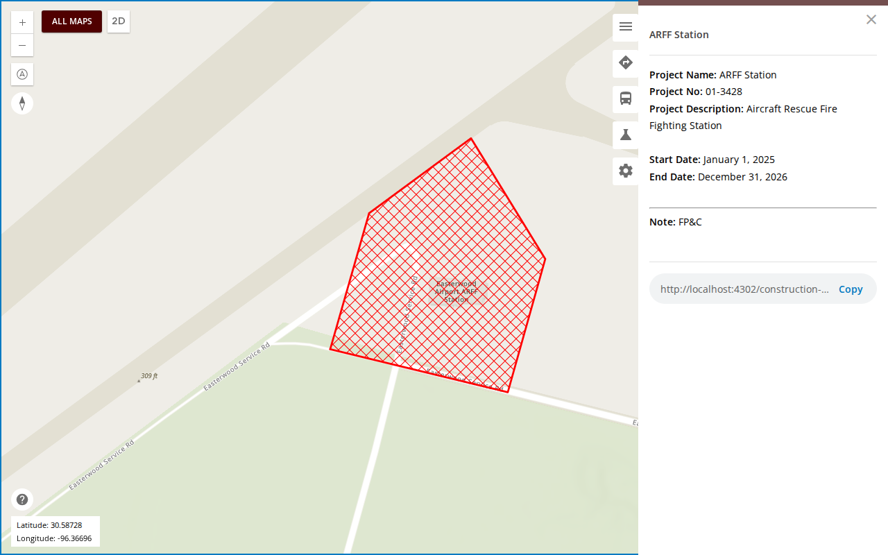

# Home report: batch a51 (aggiemap: #3551, construction popup dates show a day early)

25 November 2026, about 12:50 PM to 1:19 PM Central. **Branch ready:** `fix/3551-construction-popup-dates` on the fork,
at `36af9b75b`: one commit from `origin/development` `2cfb0bc43`, 8 files, +105 −3, images included. There is no
`.pr-body.md` on it; the body is below, with a `Title:` line.

```
Exit 0 (fix/3551-construction-popup-dates, affected).
pre-pr-check: Exit 0 (fix/3551-construction-popup-dates): ready to open.
```

## 1. Shared helper: a new one beside the others, because none of them fits

- **`parseEventDate`** reads a `YYYY-MM-DD` string as local midnight, but passes a **number** straight through. These
  values are numbers: epochs at midnight UTC.
- **`nextEventDate` and `eventHasPassed`** answer "is it over or next", not "which day is this".

So the shared set **was missing this case**: a date-only value stored as a midnight-UTC instant. The new helper is
**`calendarDate(value)`** in `@tamu-gisc/common/utils/date`, beside `parseEventDate`.
- It keeps the value's **UTC** calendar date and returns local midnight on it.
- For a `YYYY-MM-DD` string it defers to `parseEventDate`, so the two cannot disagree.
- It returns `NaN` for a value that is not a date.

`formatDateValue` now formats through it. Nothing in the popup library does its own zone arithmetic.

**The helper's assumption, checked on the service:** all **66** `startdate`/`enddate` values across the **33**
Construction projects are exactly midnight UTC. An epoch that was a real moment late in a Central evening would shift
to the next day under this helper. None exists, and the doc comment says what the helper is for.

## 2. Red first, in Central time

- **The config:** `libs/maps/feature/popup/vitest.config.mts` now sets `process.env.TZ = 'America/Chicago'` before the
  workers start, exactly as `aggiemap-ngx-core`'s does. No environment variable is set in a shell.
- **The failure on today's code**, quoted:

  ```
  -   "endDate": "December 31, 2026",
  -   "startDate": "January 1, 2025",
  +   "endDate": "December 30, 2026",
  +   "startDate": "December 31, 2024",
  ```

- **My first red run is worth knowing about:** the config change had not been written, so the spec ran in **UTC**,
  and **in UTC the date case passed on the broken code**. That is how all three of these were shipped.
  - The spec's first case asserts that midnight UTC is the 31st locally, as a guard that it runs where the fault
    shows. It failed and said so.
  - That guard stays in the spec, so a config that loses the zone fails loudly instead of passing quietly.
- **Green:** `maps-feature-popup` passes 34 of 34, and `common-utils-date` 37 of 37, including three `calendarDate`
  cases. That library already ran in Central time.

## 3. The other `format: 'date'` users

**Still only the Construction fields**: `CONSTRUCTION_PROJECT_FIELDS.startDate` and `.endDate`, searched across `libs`
and `apps`. **Tailgating spreads the same fields**, so its construction projects are fixed too. The release-notes row
asks for one of them to be checked.

## 4-5. Visible: before and after, before captured first

- **Builds:** production `ts-events-angular` builds, served statically. The browser was in America/Chicago, and ARFF
  Station (objectid 35375) was clicked through `view.toScreen`.
- **Before**, built and captured before the fix was on disk: *Start Date: December 31, 2024*, *End Date: December 30,
  2026*.
- **After:** *January 1, 2025* and *December 31, 2026*, which are the issue's expected values.
- **Images** are in `docs/screenshots/3551-construction-popup-dates/`. The PR body's raw links are pinned to `36af9b75b`
  and answer **200**; I checked after pushing.
- **Release notes:** `docs/releases/unreleased/3551-construction-popup-dates.md`, with its *What to test on dev* row.
  `collate-release-notes.mjs --check` reports 29 entries and no problems.

## On the a48 line number, for the record

You checked `trip-planner.service.ts` and found the commented `annotateBusGraphic` case at 1436-1437. At `2cfb0bc43`
it is at **1421-1422**: `git show 2cfb0bc43:libs/maps/feature/trip-planner/src/lib/services/trip-planner.service.ts`
shows both lines there.
- My number came from the trunk, not from my working tree. My edit touched `bus.service.ts`'s imports, not that file's.
- 1436-1437 may be from a newer `development`, or from PR 3653's branch, which edits that service.
- Either way nothing needs changing: the right two lines were removed.

## Pull request body

Title: fix(maps-feature-popup): Construction project dates no longer show a day early

```markdown
<!--
  Every pull request needs an issue behind it. Work on this project is reported to keep it funded,
  and that reporting is built from issues - a pull request with no issue does not appear in it.

  A CI check looks for one of `Closes #N`, `Fixes #N` or `Resolves #N` below. If there is genuinely
  no issue for this, open one first; it takes a minute and it is the whole point.
-->

Closes #3551

## What this changes

Construction project popups showed every date one day early in Central time. ARFF Station, starting 1 January 2025,
read "December 31, 2024".

**Why it happened.** A `format: 'date'` field holds a calendar date, and the service stores it as midnight UTC.
`formatDateValue` formatted that instant in the browser's zone, which in College Station is 6 PM the evening before.

**The fix uses a shared helper.** It is the third fault of this kind this week (#3467, then #2643 and #3464), so this
uses the shared date helpers rather than a correction of its own.
- None of the existing helpers fits:
  - `parseEventDate` reads a `YYYY-MM-DD` string as a local date, but passes an epoch through unchanged, and these
    values are epochs;
  - `nextEventDate` and `eventHasPassed` answer other questions.
- So a new helper sits beside them in `@tamu-gisc/common/utils/date`: `calendarDate`. It keeps a value's UTC
  calendar date and moves it to local midnight, and it defers to `parseEventDate` for a `YYYY-MM-DD` string.
- `formatDateValue` now formats through it.

**Checked first:**
- **Every date on the service is midnight UTC:** all 66 of them, across 33 projects. That is the helper's assumption,
  asked of the service on 25 November 2026.
- **Who else is affected:** the only `format: 'date'` users are `CONSTRUCTION_PROJECT_FIELDS`' `startDate` and
  `endDate`. Tailgating shows the same projects through those fields, so it is fixed too.

## Screenshots

ARFF Station (objectid 35375) on production builds of `development` (before) and this branch (after), with the
browser in America/Chicago:

| Before | After |
| --- | --- |
|  |  |

## Release notes

- [x] Entry added to `docs/releases/unreleased/3551-construction-popup-dates.md`, with screenshots
- [ ] Not user-visible (tests, CI, internal docs), so no entry needed

## How it was verified

- **Red first, in Central time.** `maps-feature-popup`'s vitest config now sets `TZ=America/Chicago`, as
  `aggiemap-ngx-core`'s does for #3467. The new `resolve-popup-data.spec.ts` failed on the unfixed code:

  ```
  -   "endDate": "December 31, 2026",
  -   "startDate": "January 1, 2025",
  +   "endDate": "December 30, 2026",
  +   "startDate": "December 31, 2024",
  ```

  - **The first run went wrong:** the config change had not been written, so the spec ran in UTC, and in UTC the date
    case passed on the broken code. The spec's own guard case, which asserts that midnight UTC is the 31st locally,
    failed instead and showed it. That guard stays.
- **Green:** `maps-feature-popup` 34 of 34, and `common-utils-date` 37 of 37, including three `calendarDate`
  cases, also run in Central time.
- `node scripts/collate-release-notes.mjs --check`: 29 entries, no problems.
- `scripts/check-in-volume.sh fix/3551-construction-popup-dates affected`:

  ```
  Exit 0 (fix/3551-construction-popup-dates, affected).
  ```

- `scripts/pre-pr-check.sh`:

  ```
  pre-pr-check: Exit 0 (fix/3551-construction-popup-dates): ready to open.
  ```

🤖 Generated with [Claude Code](https://claude.com/claude-code)
```

## Questions for the director

None.
