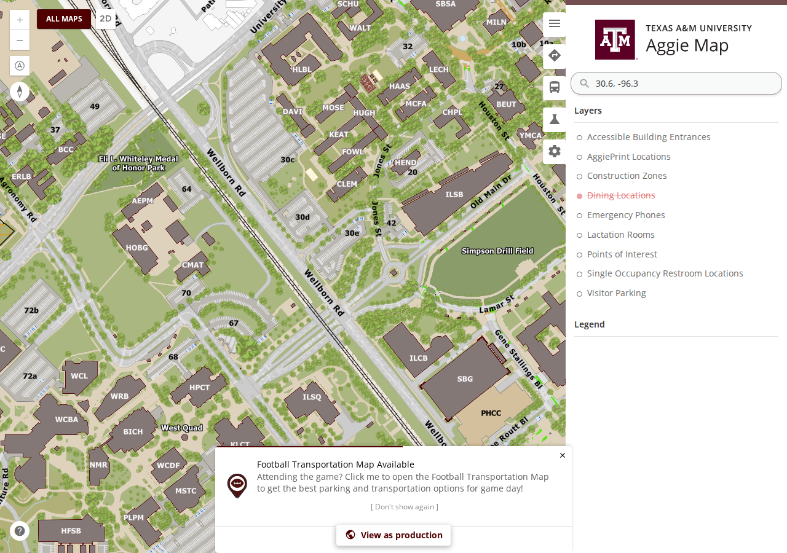
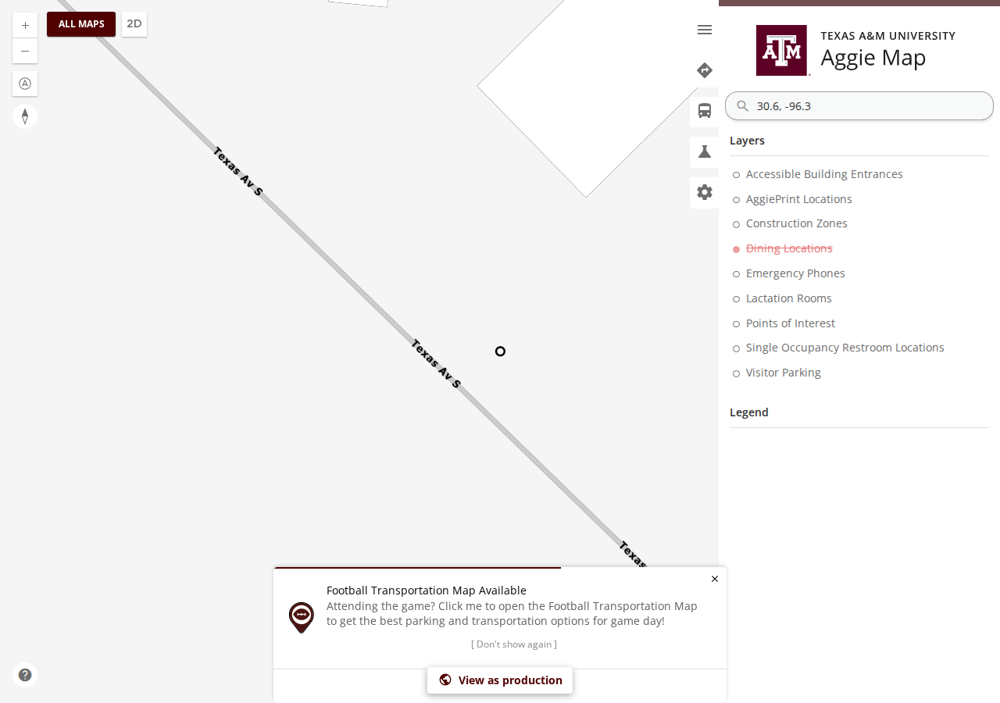
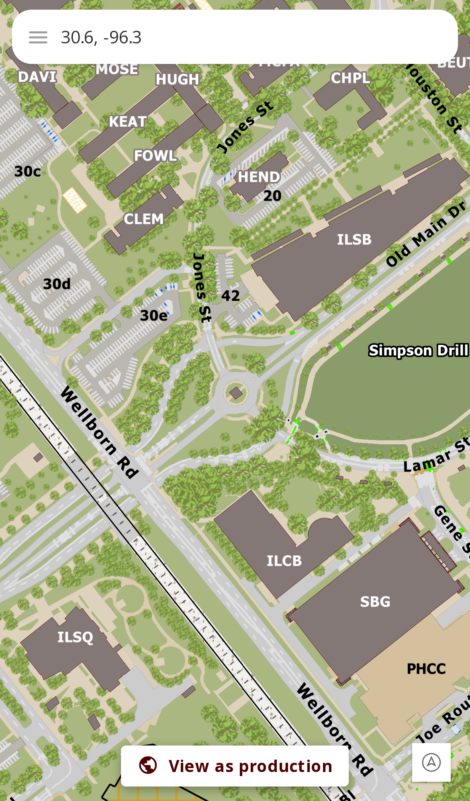
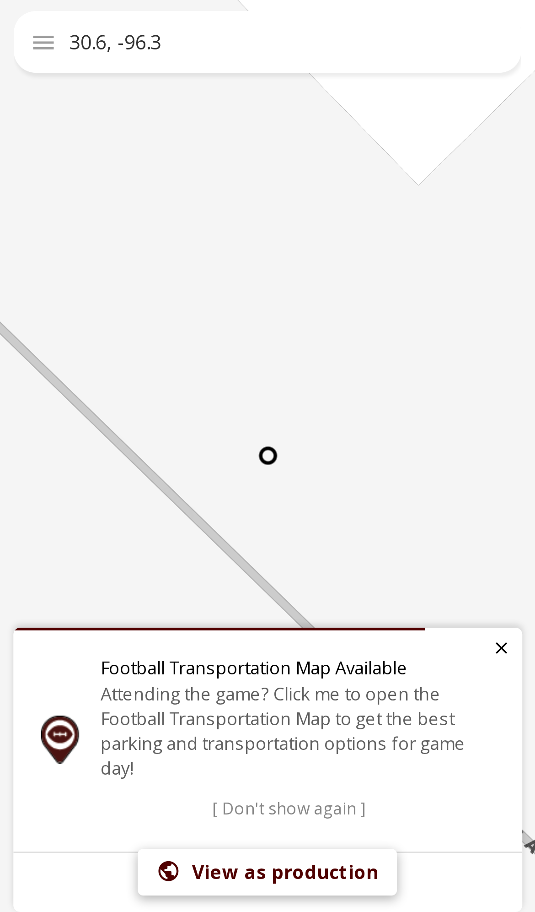
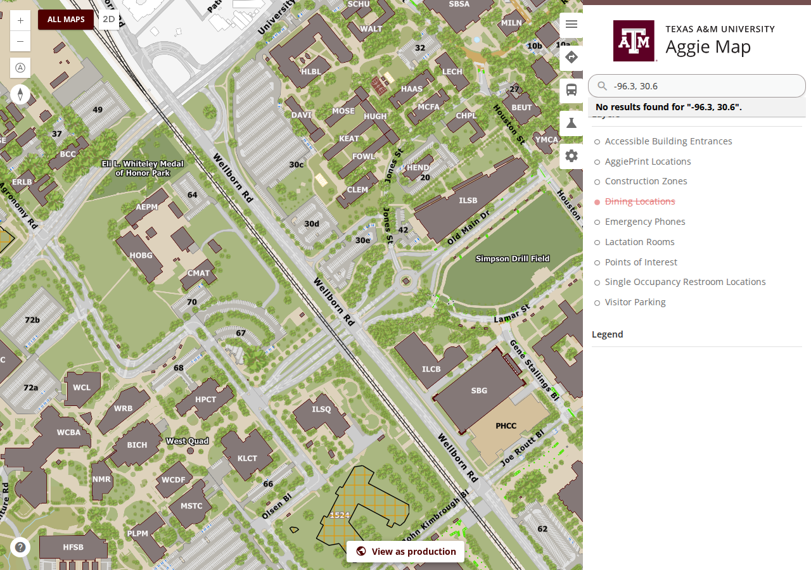

# Batch a67 (#3615, a typed coordinate is never placed), 7:37 PM Central, 26 November

**Branch ready: `fix/3615-coordinate-search` at `9f99c7023`**, on the fork. `.pr-body.md` is not committed; the body is below.

**pre-pr-check's last line:** `pre-pr-check: Exit 1 (fix/3615-coordinate-search). Failed: check-in-volume.sh (lint, test, build, lint.yml's steps). Do not open the pull request yet.`
- That is caused only by lint.yml's `check-parked-code`, which `development` itself fails until PR 3797 merges: the tag `parked/season-day-writes` has no row yet.
- Lint and test passed for 29 projects, and build for 5 with the 4 tasks they depend on. pre-pr-check's own steps passed.
- Re-run both checks once PR 3797 merges, and they should exit 0.

## What I saw
**Reproduced** on a local production build of `development` (`aggiemap-angular:build:production`, served from `dist`, typed key by key in Playwright):
- **`30.6, -96.3` (latitude first):** nothing placed, and `ERROR Error: Could not resolve geometry type. at o.toEsriGraphic` logged twice.
  - The issue also reports "No results found". That appears only when a partial search's empty answer is still on screen, so it depends on typing speed.
- **`-96.3, 30.6` (longitude first):** "No results found", and nothing else. That is a different case from the bug: `parseLatLon` refuses a longitude first by design ("refused, not swapped"), so the text is searched as a name.

## Where the geometry was lost
- `SearchComponent` hands a typed coordinate on as the text itself, at the `// TODO: no any`.
- `TripPoint.from` spread that string into "attributes" keyed by character, and gave it `originGeometry {latitude: 0, longitude: 0}` with no `raw`.
- `toEsriGraphic` reads only `originGeometry.raw`, so it built a graphic from `{}`, and `getGeometryType` threw.
- **The fix:** `TripPoint.from` reads coordinate text with `parseLatLon` and makes a WGS84 point, named by its text, which `normalize` already reads.

**A second cause, also fixed:** the stale "No results found". While typing, `30.6,` was searched as a name and found nothing. When the full coordinate was placed, the component never cleared that result. Placing a coordinate now calls `searchService.clear()`.

## Tests, red first
- `search-result-selection.service.spec.ts`, the gap between the search resolving a coordinate and the map placing it.
  - Red: `Error: Could not resolve geometry type.`, and 0 `selectFeatures` calls.
  - Green: a point at x -96.3, y 30.6, wkid 4326.
- `search.component.spec.ts`.
  - Red: `expected "vi.fn()" to be called at least once`, because `clear` was never called.
  - Green: the results are cleared.
- **Green across the projects:** trip planner 66, search 15, desktop UI 9, phone UI 6.

## Phone
`SearchMobileComponent` extends `SearchComponent`, so it gets both fixes. Captured before and after at iPhone 13 size: before, nothing placed and the same error; after, the point is placed.

## Images and notes
- `docs/screenshots/3615-coordinate-search/`: desktop latitude first, desktop longitude first, and phone latitude first, before and after.
- `docs/releases/unreleased/3615-coordinate-search.md`; `collate-release-notes.mjs --check` reports 38 entries, no problems.
- **After the fix, the console shows only ArcGIS's `view:goto-interrupted`.** It appears when a coordinate typed in two pauses is placed twice and the second zoom replaces the first. It is harmless, and not new: the same double placement threw twice before.

## Potentially parked
None found.

## Questions
None.

## PR body
Title: fix(maps-feature-trip-planner, ui-kits-ngx-search): A coordinate typed into the search is placed on the map

<!--
  Every pull request needs an issue behind it. Work on this project is reported to keep it funded,
  and that reporting is built from issues - a pull request with no issue does not appear in it.

  A CI check looks for one of `Closes #N`, `Fixes #N` or `Resolves #N` below. If there is genuinely
  no issue for this, open one first; it takes a minute and it is the whole point.
-->

Closes #3615

## What this changes

**A coordinate typed into "Find Building or Parking", latitude first (`30.6, -96.3`), is placed on the map.** Two causes, one in each half of the path:

1. **No geometry** (`libs/maps/feature/trip-planner`). `SearchComponent` hands a typed coordinate on as the text itself, at its `// TODO: no any`, and `TripPoint.from` gave text no geometry. So `toEsriGraphic` built a graphic from `{}`, and `getGeometryType` threw `Could not resolve geometry type.` Nothing was placed. A coordinate's text, read with `parseLatLon`, is now a point at that latitude and longitude (WGS84), named by its text as `normalize` already reads it.
2. **A stale "No results found"** (`libs/ui-kits/ngx/search`). While the coordinate was typed, its first part (`30.6,`) was searched as a name and found nothing, and that message stayed under the box after the whole coordinate had been placed. Placing a coordinate now clears the search's results.

**Longitude first (`-96.3, 30.6`) is unchanged.** `parseLatLon` refuses it rather than swapping it, by design, so it is searched as a name and finds nothing. The phone's search (`SearchMobileComponent` extends `SearchComponent`) gets both fixes, and its image is below.

<!-- What a reader needs to know. Why, not only what. -->

## Screenshots

Local production builds (`aggiemap-angular:build:production`) of `development` and this branch, served from `dist`, with the coordinate typed key by key in Playwright.

| | Before | After |
| --- | --- | --- |
| Desktop, `30.6, -96.3` |  |  |
| Phone, `30.6, -96.3` |  |  |
| Desktop, `-96.3, 30.6` (unchanged, by design) |  |  |

Before, the console logged `ERROR Error: Could not resolve geometry type. at o.toEsriGraphic`, twice. After, it logs only ArcGIS's `view:goto-interrupted`, when the second zoom of a coordinate typed in two pauses replaces the first. That is harmless, and not new to this change.

## Release notes

<!--
  Anything with a user-visible result adds its entry to docs/releases/unreleased.md in this pull
  request, with the before/after images above linked from docs/screenshots/<slug>/. Nobody writes
  the notes later. See docs/releases/README.md.
-->

- [x] Entry added to `docs/releases/unreleased.md`, with screenshots
- [ ] Not user-visible (tests, CI, internal docs), so no entry needed

## How it was verified

<!--
  What you actually ran or looked at, and what it said. "Tests pass" is weaker than naming the check
  and its result. If something could not be verified, say so - that is more useful than silence.
-->

- **Reproduced first,** on a local production build of `development`. Latitude first, nothing was placed and the console threw twice. Longitude first, "No results found", by design.
- **Red first, both causes:**
  - `search-result-selection.service.spec.ts`: showing the typed coordinate threw `Could not resolve geometry type.`, and nothing reached the map.
  - `search.component.spec.ts`: the stale results were never cleared.
- **Green:** `maps-feature-trip-planner` 66 tests, `ui-kits-ngx-search` 15, `aggiemap-ngx-ui-desktop` 9, `aggiemap-ngx-ui-mobile` 6.
- `scripts/check-in-volume.sh fix/3615-coordinate-search`: lint and test passed for 29 projects, and build for 5 with the 4 tasks they depend on. **Exit 1 only on `check-parked-code`**, which `development` itself fails until PR 3797 merges: the tag `parked/season-day-writes` has no row yet.
- `node scripts/collate-release-notes.mjs --check`: 38 entries, no problems.

🤖 Generated with [Claude Code](https://claude.com/claude-code)
