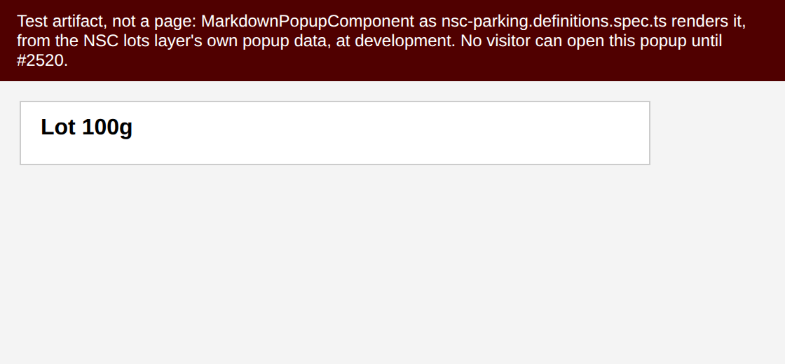
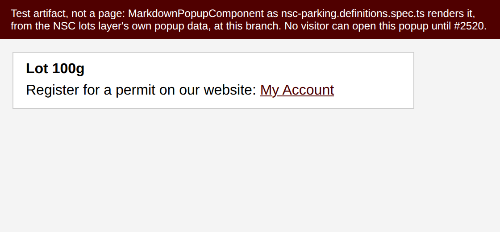

# Batch a69 (#3671, the NSC lots' permit instructions), 7:52 PM Central, 26 November

**Branch ready: `fix/3671-nsc-permit-instructions` at `bfcd92a6f`**, on the fork. `.pr-body.md` is not committed; the body is below, with the `no-visible-change` label, per Q-a69-1 B.

**pre-pr-check's last line:** `pre-pr-check: Exit 1 (fix/3671-nsc-permit-instructions). Failed: check-in-volume.sh (lint, test, build, lint.yml's steps). Do not open the pull request yet.`
- That is caused only by lint.yml's `check-parked-code`, `development`'s own failure until PR 3797 or PR 3805 merges.
- Lint and test passed for 5 projects, and build for 2. pre-pr-check's own steps passed.

## What I found
- **The field is still populated:** all 34 NSC lots on production have non-empty `GIS.TS.Lot_Notes.NewStudentConfN` (queried 26 November, about 7:20 PM). For example, lot SSG: "Register for a permit on our website: My Account…".
- **The popup cannot be reproduced on any environment.** [#2520](https://github.com/TamuGeoInnovation/Tamu.GeoInnovation.js.monorepo/issues/2520) is still true: asked for geometry, the NSC query answers 400 "Failed to execute query", so no click or link opens a lot's popup. That is also why `popup.spec.ts`'s NSC row, which already asserts `/Register for a permit/`, is an allowed failure in every environment. It stays one; the fix does not make it pass.
- A smoke run of `popup.spec` on production died at startup on Docker's file-sharing ENOMEM, before any test. It was not repeated, since the query above answers the question directly.

## The fix and its check
- **One line** in `nsc-parking.definitions.ts`: `notes` becomes `description`.
- **The check, my choice: a spec that renders the popup.** It resolves the NSC lots layer's own `popupData` over a lot, merged as `PopupService` merges it, and renders the layer's own lazily loaded popup component.
  - A definition-only unit test would pass on any key name.
  - The smoke suite cannot click an NSC lot until #2520.
  - Red: `expected 'Lot 100g' to contain 'Register for a permit on our website'`. Green: `ts-events-ngx` 361.
- **Images, per Q-a69-1 B:** `docs/screenshots/3671-nsc-permit-instructions/spec-render-{before,after}.png` are the component's output under test, each captioned in the image itself as a test artifact, not a page. The README there says how they were made, using a throwaway copy of the spec that wrote the rendered HTML to a file, not kept.
- **Release entry:** `docs/releases/unreleased/3671-nsc-permit-instructions.md`, with no images. Its *What to test on dev* row says it cannot be checked until #2520, and why. `collate-release-notes.mjs --check` reports no problems.
- **#3671 and #2520 are linked in the PR body:** "Whoever fixes #2520: re-check that NSC lot popups show 'Register for a permit…'".

## Step 5: a pattern
Four other parking maps give the markdown popup keys it never reads, none with the `cumulative` strategy: motorcycle-parking, maintenance-parking, service-and-loading-zones and media-parking. Filed as [#3808](https://github.com/TamuGeoInnovation/Tamu.GeoInnovation.js.monorepo/issues/3808) (Q-a69-2 A); not changed here.

## Potentially parked
None found.

## Questions
None.

## PR body
Title: fix(ts-events-ngx): The NSC parking map's lot popups carry their permit instructions

<!--
  Every pull request needs an issue behind it. Work on this project is reported to keep it funded,
  and that reporting is built from issues - a pull request with no issue does not appear in it.

  A CI check looks for one of `Closes #N`, `Fixes #N` or `Resolves #N` below. If there is genuinely
  no issue for this, open one first; it takes a minute and it is the whole point.
-->

Closes #3671

## What this changes

**One line:** the New Student Conference parking map's lot popup data maps `GIS.TS.Lot_Notes.NewStudentConfN` to `description`, not `notes`. The markdown popup reads `name` and `description`. Nothing read `notes`, so each lot's permit instructions were fetched and dropped. Every other event parking map maps its lot notes straight to `description` (`break-summer.definitions.ts:62`, for one).

**The field is populated:** all 34 NSC lots on production had non-empty `GIS.TS.Lot_Notes.NewStudentConfN` on 26 November, checked again for this change.

**Waiting behind [#2520](https://github.com/TamuGeoInnovation/Tamu.GeoInnovation.js.monorepo/issues/2520).** The NSC parking service answers no geometry: asked for it, its query fails with "Failed to execute query" (400). So no click and no `?feature=` link opens an NSC lot's popup on any environment. This fix is correct and tested, and the permit text appears the moment #2520 is fixed. **Whoever fixes #2520: re-check that NSC lot popups show "Register for a permit…".**

<!-- What a reader needs to know. Why, not only what. -->

## Screenshots

**`no-visible-change`, honestly:** nothing a visitor can reach changes in this release, because #2520 stops any NSC lot popup from opening. No image of the map is offered, because a composed picture of a popup no visitor can open would show something that does not happen.

**The evidence the fix works is the component under test.** These are test artifacts, not pages: `MarkdownPopupComponent` as `nsc-parking.definitions.spec.ts` renders it, from the layer's own popup data, at `development` and at this branch. Each image says so across its top.

| `development` | This branch |
| --- | --- |
|  |  |

## Release notes

<!--
  Anything with a user-visible result adds its entry to docs/releases/unreleased.md in this pull
  request, with the before/after images above linked from docs/screenshots/<slug>/. Nobody writes
  the notes later. See docs/releases/README.md.
-->

- [x] Entry added to `docs/releases/unreleased.md`, with screenshots
- [ ] Not user-visible (tests, CI, internal docs), so no entry needed

## How it was verified

<!--
  What you actually ran or looked at, and what it said. "Tests pass" is weaker than naming the check
  and its result. If something could not be verified, say so - that is more useful than silence.
-->

- **Red first:** `nsc-parking.definitions.spec.ts` resolves the NSC lots layer's own `popupData` over a lot, merged as `PopupService` merges it, and renders the layer's own lazily loaded popup. On the unfixed code the popup showed only `Lot 100g`. Green: `ts-events-ngx`, 361 tests passed.
- **A unit test of the definition alone would pass on any key name,** which is why the spec renders the popup itself.
- **`popup.spec.ts`'s NSC row stays an allowed failure under #2520.** It already asserts `/Register for a permit/`, but its click cannot reach a lot until #2520 is fixed, so this change does not make it pass, and its known-failure entry is untouched. The new spec proves the fix in the meantime.
- **The same mistake on other maps** (motorcycle-parking, maintenance-parking, service-and-loading-zones, media-parking) is filed as [#3808](https://github.com/TamuGeoInnovation/Tamu.GeoInnovation.js.monorepo/issues/3808), not changed here.
- `scripts/check-in-volume.sh fix/3671-nsc-permit-instructions`: lint and test passed for 5 projects, and build for 2. **Exit 1 only on `check-parked-code`**, which `development` itself fails until PR 3797 or PR 3805 merges.
- `node scripts/collate-release-notes.mjs --check`: no problems. The entry's *What to test on dev* row says it cannot be checked until #2520, and why.

🤖 Generated with [Claude Code](https://claude.com/claude-code)
