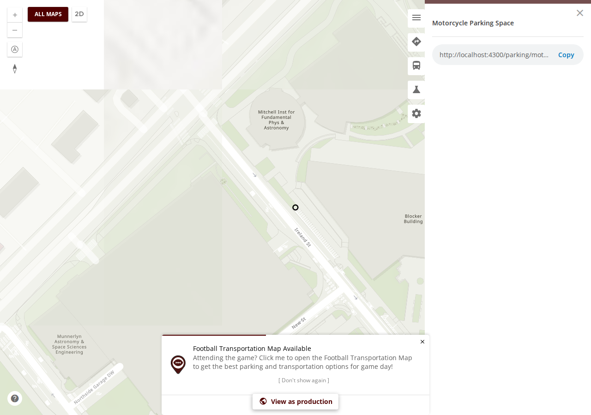
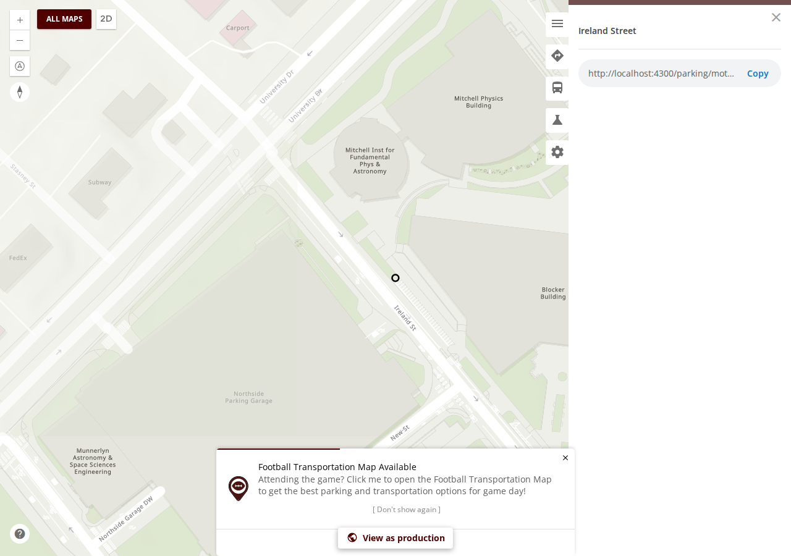
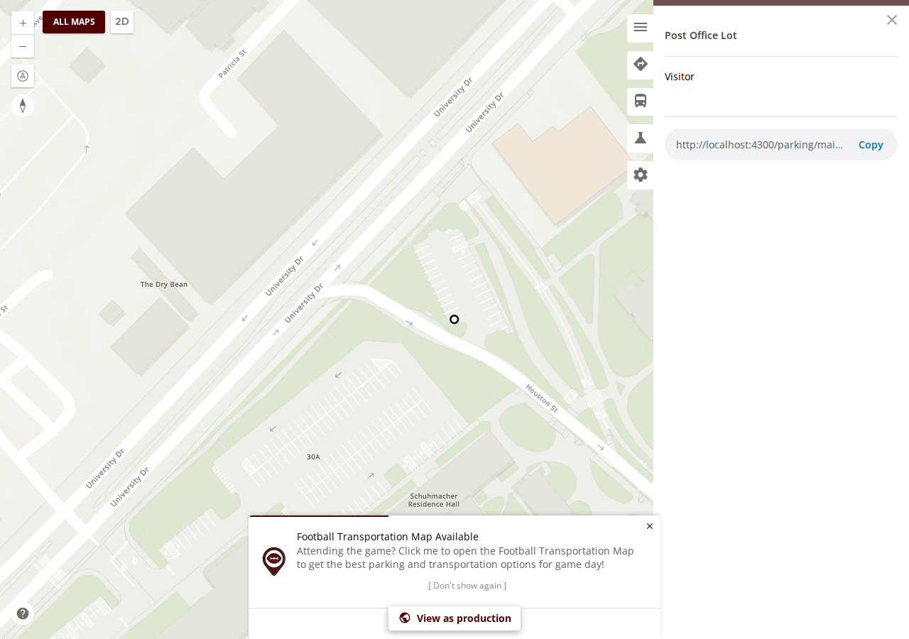
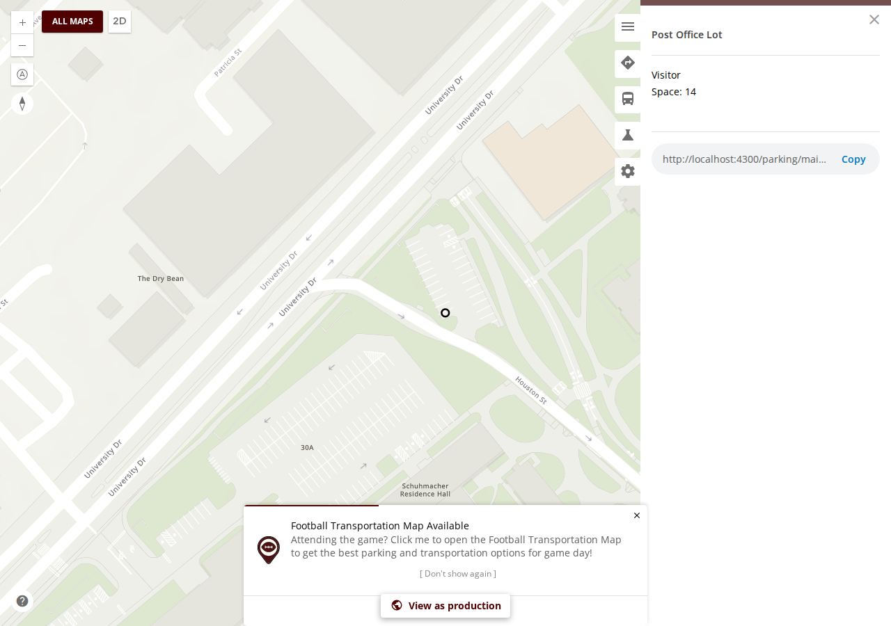
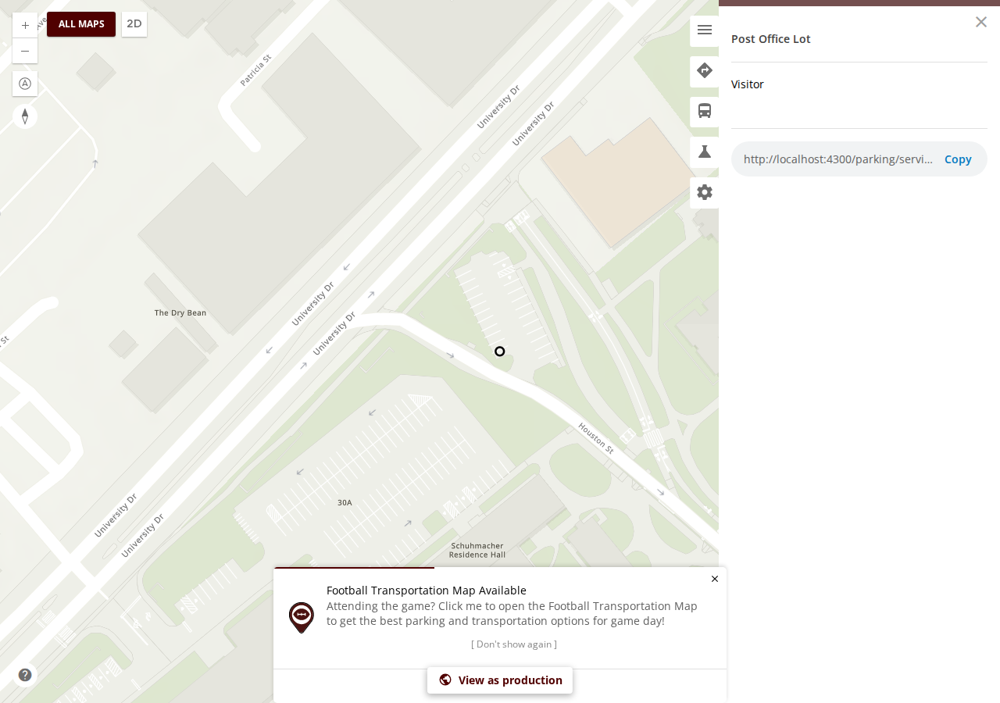
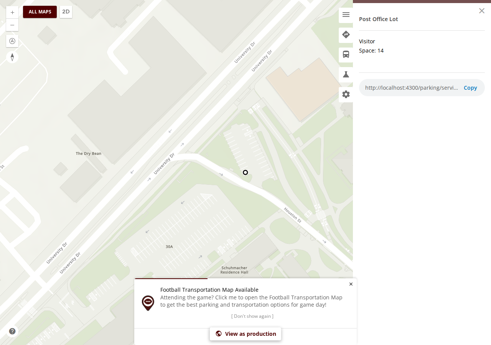
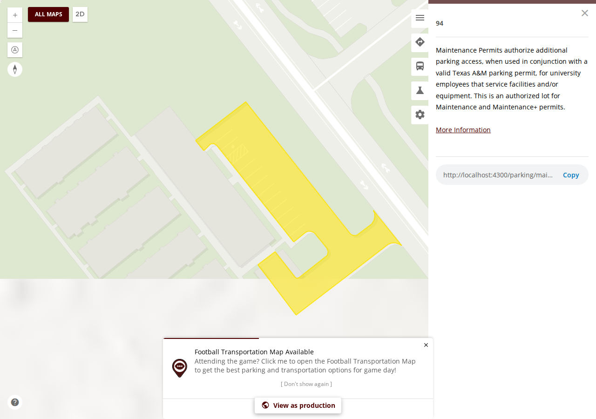
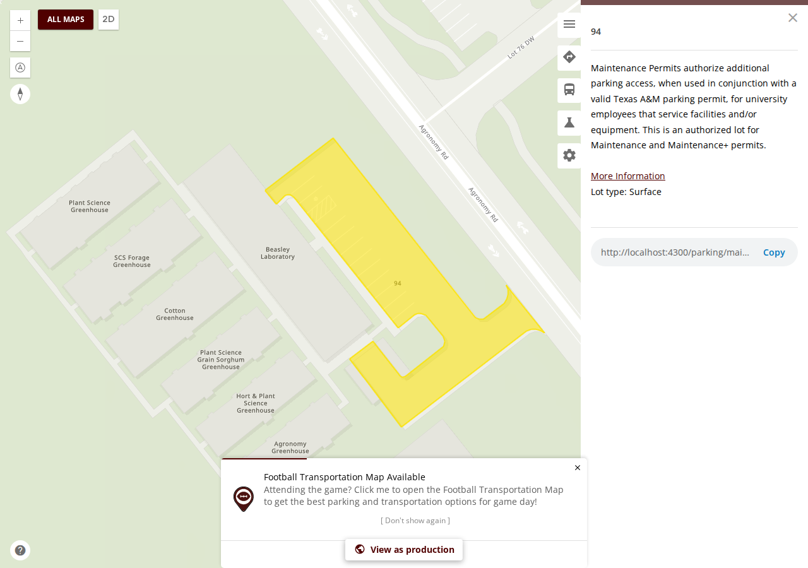
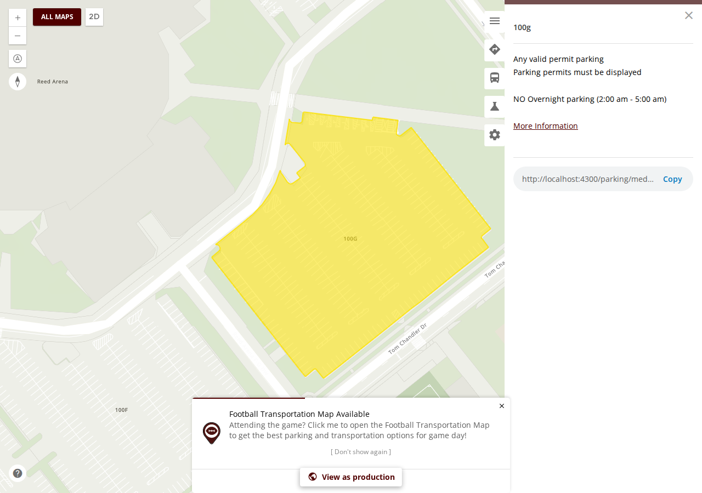
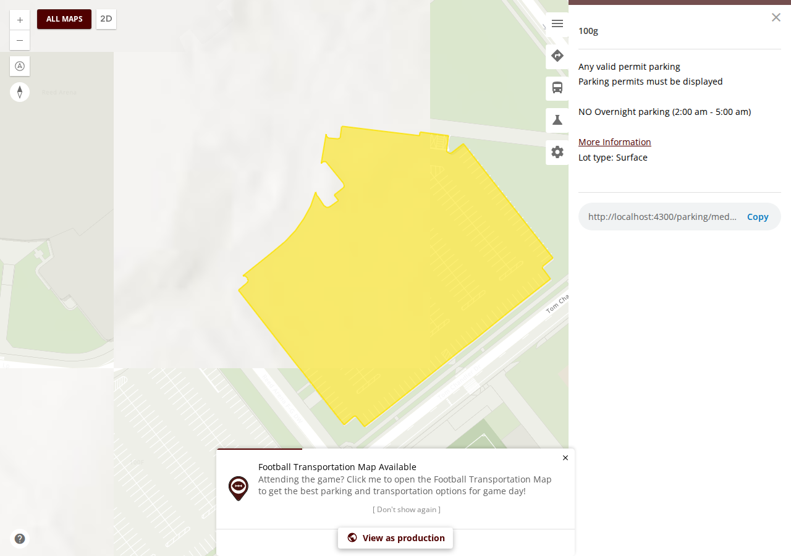

# Batch a70 (#3808, four parking maps' popup keys), 8:19 PM Central, 26 November

**Branch ready: `fix/3808-popup-keys` at `528b6ff59`**, on the fork. `.pr-body.md` is not committed; the body is below.

**pre-pr-check's last line:** `pre-pr-check: Exit 1 (fix/3808-popup-keys). Failed: check-in-volume.sh (lint, test, build, lint.yml's steps). Do not open the pull request yet.`
- That is caused only by `check-parked-code`. Lint and test passed for 5 projects, and build for 2.
- PRs 3797 and 3805 were still open at the time.

## 1. What a visitor sees, per map, before any change
Six layers carry markdown popups across the four maps. Each was opened by its `?feature=` link on a production build of `development`. The images are in `docs/screenshots/3808-popup-keys/before-*`.
- **Motorcycle spaces:** only "Motorcycle Parking Space", the layer's title. No lot name. A real visible bug.
- **Maintenance and service spaces:** "Post Office Lot / Visitor". The space's number (14) is missing.
- **Maintenance and media lots:** name and permit notes; the lot type is missing.
- **Service lots:** name and notes. Correct, and unchanged.
- **None has the #2520 fault:** every layer returns geometry, and every popup opened.

## 2. What each service holds (production, 26 November)
| Layer | Asked | Records | Fields |
| --- | --- | --- | --- |
| motorcycle spaces | `Spc_Type = 'M/C'` (#1897's expression) | 1,016 | LotName 1,016; **Spc_ID_Num 0, Garage_Lvl 0, RNS_Num 0**; Spc_Type and Anno_Type "M/C" |
| maintenance spaces | `1=1` (count queries) | 44,980 | Spc_ID_Num 3,454; RNS_Num 2,427; Garage_Lvl 12,680 |
| service spaces | `1=1` | 44,980 | the same layer data |
| maintenance lots / media lots | `1=1` | 91 / 35 | LotType on all |

- **The empty motorcycle fields are a data question, not a code one.** Their rows are composed but stay hidden while the fields are blank. I filed nothing: whether the GIS team means to fill them in is for you. See Q-a70-1.

## 3. The fix, per map
- **motorcycle:** `cumulative`. `name` is `{attributes.lotName}`; `description` holds the space id, level and RNS number rows, all blank today. It is not a rename, because two slots needed composing.
  - `spaceType` and `notes` stay resolved but unshown: they read "M/C" on every record, which the layer title already says.
- **maintenance and service spaces:** `cumulative`. The type's key moves from `description` to `spaceType`. `description` is the type, then "Space:", "RNS number:" and "Level:" rows.
  - maintenance's `note` (Anno_Type) stays unshown: it repeats the type.
- **maintenance and media lots:** `cumulative`. The notes' key moves from `description` to `notes`. `description` is the notes, then a "Lot type:" row.
- **nsc-parking:** #3671's one line, identically, so the check passes whichever branch merges first.

## 4. The check, red on all four first
`popup-keys.spec.ts`, beside `declared-layers.spec.ts`. On the unfixed definitions it listed all four maps and NSC:
```
"media-parking / media-parking-lots: lotType",
"service-loading / service-parking-spaces: spaceId, rns, garageLevel",
"maintenance-parking / maintenance-parking-spaces: spaceId, rns, garageLevel, note",
"maintenance-parking / maintenance-parking-lots: lotType",
"motorcycle-parking / motorcycle-parking-space: lotName, spaceType, spaceId, garageLevel, rnsNumber, notes",
"nsc-parking / NSC Parking Lots: notes",
```
Green: `ts-events-ngx` 361 tests.

## 5. Images and notes
- Before and after for all six layers are in `docs/screenshots/3808-popup-keys/`, with a README.
- The release entry is `docs/releases/unreleased/3808-popup-keys.md`; `--check` reports no problems.
- Some "after" captures failed on Docker's file-sharing ENOMEM. They were re-taken with the build copied into the container.

## Potentially parked
- motorcycle-parking's `spaceType` and `notes`, and maintenance spaces' `note`, are still fetched but unshown: they repeat the type or the title. Nothing was deleted.

## Seen in passing
- **The maintenance and service spaces layers load all 44,980 campus spaces,** with no `definitionExpression`. That is what made the motorcycle map draw for minutes before #1897. Not measured here, and not in scope.

## Questions
**Q-a70-1:** motorcycle spaces' space id, level and RNS number are blank on all 1,016 records.
- A. ← recommended (the template already shows them the day they're filled in). Leave the rows in place and file nothing; mention it to the GIS team if those details are wanted.
- B. File a data issue for the GIS team now.

## PR body
Title: fix(ts-events-ngx): Four parking maps' popups show the fields they fetch

<!--
  Every pull request needs an issue behind it. Work on this project is reported to keep it funded,
  and that reporting is built from issues - a pull request with no issue does not appear in it.

  A CI check looks for one of `Closes #N`, `Fixes #N` or `Resolves #N` below. If there is genuinely
  no issue for this, open one first; it takes a minute and it is the whole point.
-->

Closes #3808

## What this changes

**Four parking maps fetched details their popups never showed.** The markdown popup reads only `name` and `description`. These maps resolved fields into keys of their own, so visitors never saw them. Each map now composes them into those two keys with the `cumulative` strategy and a template, as the main parking map's lots do. A row whose field is blank is left out.

| Map, layer | Before | After |
| --- | --- | --- |
| Motorcycle Parking, spaces | only the layer's title, "Motorcycle Parking Space" | headed by the space's lot ("Ireland Street"); rows for its id, level and RNS number, blank on every motorcycle space today |
| Maintenance Parking, spaces | lot and type | lot, type, then "Space: 14", RNS number and level where present |
| Service and Loading Zones, spaces | lot and type | the same as maintenance spaces |
| Maintenance Parking, lots; Media Parking, lots | name and permit notes | name, permit notes, then "Lot type: Surface" |

**The order of the work:**
1. **What a visitor saw** was captured first, per map (below).
2. **Every layer returns geometry** (asked of each service on 26 November), so none of these is the no-geometry fault of [#2520](https://github.com/TamuGeoInnovation/Tamu.GeoInnovation.js.monorepo/issues/2520). Each change is one a visitor sees.
3. **The services were asked how many records carry each field.** On motorcycle spaces (asked with the map's own `Spc_Type = 'M/C'`), the space id, level and RNS number are blank on all 1,016, so their rows stay empty until the data is filled in. `Spc_Type` and `Anno_Type` are "M/C" on every one, which the layer's title already says, so they stay resolved but unshown. On the 44,980 spaces the maintenance and service layers draw, 3,454 have a space id, 2,427 an RNS number and 12,680 a level.

**The check:** `popup-keys.spec.ts`, beside `declared-layers.spec.ts`. Every popup data key of a layer with a markdown popup is `name` or `description`, unless the layer declares `cumulative`. On `development` it failed on all four maps, and on the New Student Conference map too, which is [#3671](https://github.com/TamuGeoInnovation/Tamu.GeoInnovation.js.monorepo/issues/3671), so it would have caught #3671.

`nsc-parking.definitions.ts` takes #3671's one line (`fix/3671-nsc-permit-instructions`), identically, so this check passes whichever of the two merges first, and the second merges cleanly.

<!-- What a reader needs to know. Why, not only what. -->

## Screenshots

Opened by each popup's `?feature=` link on local production builds of `development` and this branch, against production's services.

| | Before | After |
| --- | --- | --- |
| Motorcycle space |  |  |
| Maintenance space |  |  |
| Service space |  |  |
| Maintenance lot |  |  |
| Media lot |  |  |

## Release notes

<!--
  Anything with a user-visible result adds its entry to docs/releases/unreleased.md in this pull
  request, with the before/after images above linked from docs/screenshots/<slug>/. Nobody writes
  the notes later. See docs/releases/README.md.
-->

- [x] Entry added to `docs/releases/unreleased.md`, with screenshots
- [ ] Not user-visible (tests, CI, internal docs), so no entry needed

## How it was verified

<!--
  What you actually ran or looked at, and what it said. "Tests pass" is weaker than naming the check
  and its result. If something could not be verified, say so - that is more useful than silence.
-->

- **Red first:** `popup-keys.spec.ts` on the unfixed definitions listed media lots `lotType`; service spaces `spaceId, rns, garageLevel`; maintenance spaces `spaceId, rns, garageLevel, note`; maintenance lots `lotType`; motorcycle spaces `lotName, spaceType, spaceId, garageLevel, rnsNumber, notes`; and NSC lots `notes`. Green: `ts-events-ngx`, 361 tests passed.
- `scripts/check-in-volume.sh fix/3808-popup-keys`: lint and test passed for 5 projects, and build for 2. **Exit 1 only on `check-parked-code`**, which `development` itself fails until PR 3797 or PR 3805 merges.
- `node scripts/collate-release-notes.mjs --check`: no problems.
- `popup.spec.ts`'s allowed failures are untouched.

🤖 Generated with [Claude Code](https://claude.com/claude-code)
