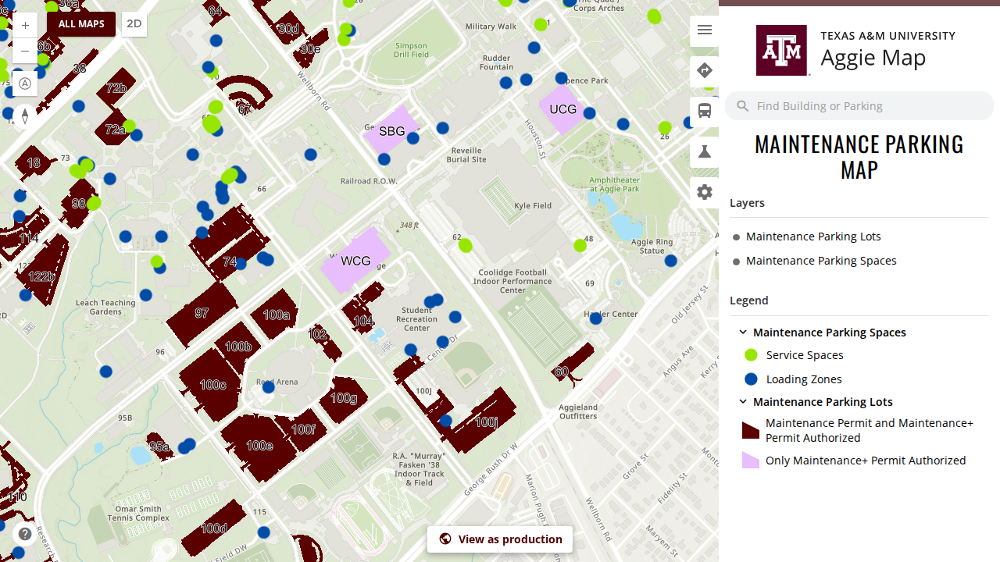
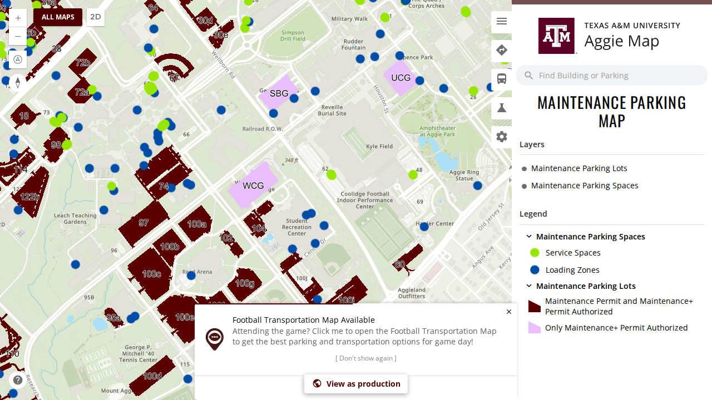
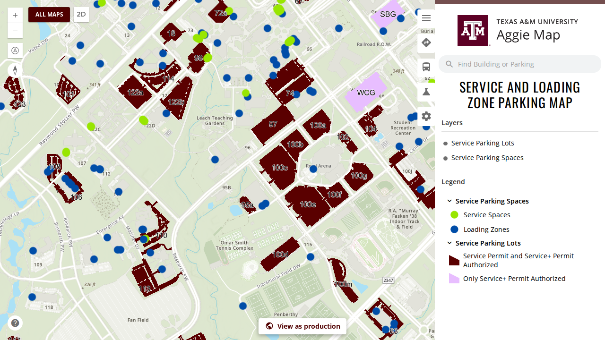
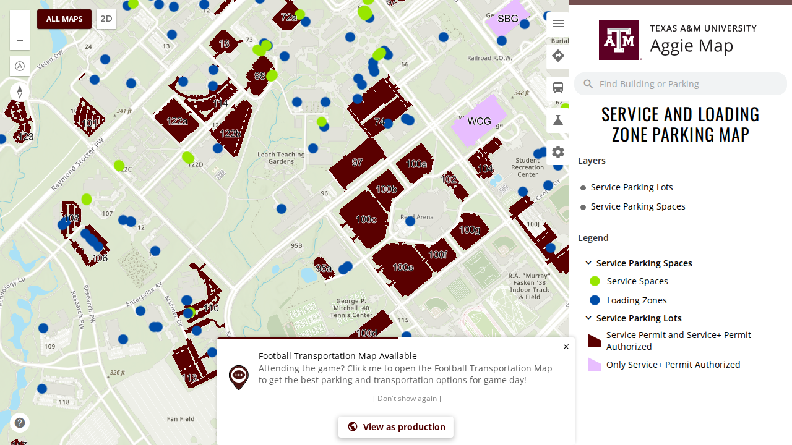

# Batch a71 (#3824, two more maps load all 44,980 spaces), 9:10 PM Central, 26 November

**Branch ready: `fix/3824-parking-space-filters` at `9acd7b3d0`**, on the fork. `.pr-body.md` is not committed; the body is below.

**pre-pr-check's last line:** `pre-pr-check: Exit 1 (fix/3824-parking-space-filters). Failed: check-in-volume.sh (lint, test, build, lint.yml's steps). Do not open the pull request yet.`
- That is caused only by `check-parked-code`. Lint and test passed for 5 projects, and build for 2.
- PRs 3797 and 3805 were still open at the time.

## 1. Measured first
Production builds of `development` (`86c9013d9`) and the change, served locally. Headless Chromium at 1280 by 720, each load in a fresh browser, timed as #1897 timed it. The machine was quiet: CPU at 5% at the start, no other container but an idle mssql.

| | Before (4 loads) | After (4 loads) |
| --- | --- | --- |
| Maintenance Parking, finished drawing | 140.7, 89.0, 90.4, 115.6 s | 19.0, 17.8, 16.3, 22.0 s |
| Service and Loading Zones, finished drawing | 161.6, 107.4, 104.2, 125.8 s | 20.9, 19.2, 18.1, 17.0 s |
| Spaces loaded (probe) | 44,980 | 427 |
| Layers settled | 3.2 to 12.9 s | 3.2 to 3.7 s |

The comparison and what it shows are in `docs/build-times.md`. The checks were not run with `BUILD_TIMES_RECORD=1`: what is being measured here is the maps, not the checks, and the table records it.

## 2. The filter, from the symbology
- **Maintenance and service spaces:** a unique-value renderer on `Spc_Type`, with symbols for `Serv` and `Loading` only and no default symbol. The service holds 44,980 records; 157 are `Serv` and 270 `Loading`, 427 together. Both layers now carry `Spc_Type IN ('Loading', 'Serv')`, sorted as the spec's `drawnWhere` builds it.
- **The images show the same points drawn,** before and after.
- **Media Parking: excluded, after asking.** Its service holds one layer, its 35 lots: a polygon renderer on Media_Lot and LotType, with values "1,Surface" and "1,Garage Visitor". It does not draw from the spaces data.
- **`rns-spaces-layer`** (main map's reserved-space labels, `TS_Main/7`) is on both maps and reported at 44,980 by the probe. It is `visible: false`, so it fetches nothing there. Not changed.

## 3. The check, widened
- `parking-spaces.spec.ts` now reads `space-layers.generated.json`.
- `space-layers.spec.ts` (in `ts-events-ngx`) writes that file from the definitions: every event-map layer drawn from the spaces layer of the four all-spaces services. It finds Accessible, Maintenance, Motorcycle and Service.
- It fails when the definitions change without the file, as `declared-layers.spec.ts` does for the layer lists.
- **Red, on production with the widened spec:** Accessible and Motorcycle passed. Maintenance and Service failed on every try: "Expected: 427, Received: 44980".
- **Green:** this branch's build reports 427 spaces on both layers. The smoke check turns green once the change is deployed.
- The services are still a named list of four. A *new* service publishing the same data would need adding there; any map drawing from the four is found automatically.

## 4–5. Images and notes
- `docs/screenshots/3824-parking-space-filters/`: each map before and after, as it finished drawing, with a README.
- `docs/releases/unreleased/3824-parking-space-filters.md`: its row says to time a fresh load until the map stops redrawing, about 20 s, where it was 90 to 160 s. `--check` reports no problems.
- `docs/testing.md`'s row for the spec now describes every such layer; its count is left alone.

## Potentially parked
None found.

## Questions
None.

## PR body
Title: fix(ts-events-ngx): Maintenance and Service Parking load only the spaces they draw

<!--
  Every pull request needs an issue behind it. Work on this project is reported to keep it funded,
  and that reporting is built from issues - a pull request with no issue does not appear in it.

  A CI check looks for one of `Closes #N`, `Fixes #N` or `Resolves #N` below. If there is genuinely
  no issue for this, open one first; it takes a minute and it is the whole point.
-->

Closes #3824

## What this changes

**Maintenance Parking and Service and Loading Zones load only the spaces they draw.** Each spaces layer draws from a Transportation service holding every parking space on campus, 44,980. Its symbology, a unique-value renderer on `Spc_Type` with no default symbol, has symbols for `Serv` and `Loading` only, which is 427 spaces. The other 44,553 were fetched and never drawn: the #1897 fault, fixed on Accessible and Motorcycle Parking and still live on these two maps. Each layer now carries `definitionExpression: Spc_Type IN ('Loading', 'Serv')`, read from that renderer.

**Every such layer is checked from now on.** `parking-spaces.spec.ts` asked its question of the two maps #1897 fixed, by name, so it never looked at these two. It now reads its maps from `space-layers.generated.json`. `space-layers.spec.ts` in `ts-events-ngx` writes that file from the definitions themselves: every event map layer drawn from the spaces layer of the four services holding every campus space (Accessible, Motorcycle, Maintenance, Loading Zones). It fails when the definitions change without the file, as `declared-layers.spec.ts` does for the layer lists, so a fifth map drawing from those services is checked without anybody adding it.

**Not included:**
- **Media Parking** draws its own 35 lots from its own service, not the spaces.
- **`rns-spaces-layer`,** the main map's reserved-space labels, which the probe also reports at 44,980, is switched off (`visible: false`) and fetches nothing on these maps.

<!-- What a reader needs to know. Why, not only what. -->

## Screenshots

Each image is the map at the moment it finished drawing, from local production builds of `development` and this change, against production's services. The same spaces are drawn; the difference is when the picture could be taken.

| | Before | After |
| --- | --- | --- |
| Maintenance Parking |  |  |
| Service and Loading Zones |  |  |

**Measured** (`docs/build-times.md`, "Maintenance and service parking load only their own spaces"): four cold loads of each map before and after, on a quiet machine, timed as #1897 timed it.
- **Maintenance Parking:** finished drawing in 140.7, 89.0, 90.4 and 115.6 s before; 19.0, 17.8, 16.3 and 22.0 s after.
- **Service and Loading Zones:** 161.6, 107.4, 104.2 and 125.8 s before; 20.9, 19.2, 18.1 and 17.0 s after.
- **Layers settled** in about 3.5 s either way.

## Release notes

<!--
  Anything with a user-visible result adds its entry to docs/releases/unreleased.md in this pull
  request, with the before/after images above linked from docs/screenshots/<slug>/. Nobody writes
  the notes later. See docs/releases/README.md.
-->

- [x] Entry added to `docs/releases/unreleased.md`, with screenshots
- [ ] Not user-visible (tests, CI, internal docs), so no entry needed

## How it was verified

<!--
  What you actually ran or looked at, and what it said. "Tests pass" is weaker than naming the check
  and its result. If something could not be verified, say so - that is more useful than silence.
-->

- **Red first:** the widened `parking-spaces.spec.ts`, run on production with `test/smoke/aggiemap/run-local.sh production one parking-spaces` (production has no filters yet). Accessible and Motorcycle Parking passed. Maintenance Parking and Service and Loading Zones failed on every try: `layer holds spaces its symbology does not draw (Spc_Type IN ('Loading', 'Serv')) … Expected: 427, Received: 44980`.
- **Green:** the map probe on this branch's build reports 427 spaces on both layers, which is the count the spec expects. The spec itself turns green on an environment once this is deployed there.
- `space-layers.spec.ts` writes the four layers. `ts-events-ngx`: 361 tests passed.
- `scripts/check-in-volume.sh fix/3824-parking-space-filters`: lint and test passed for 5 projects, and build for 2. **Exit 1 only on `check-parked-code`**, which `development` itself fails until PR 3797 or PR 3805 merges.
- `docs/testing.md`'s row for `parking-spaces.spec.ts` now describes every such layer. Its count is left alone, as that page asks.

🤖 Generated with [Claude Code](https://claude.com/claude-code)
