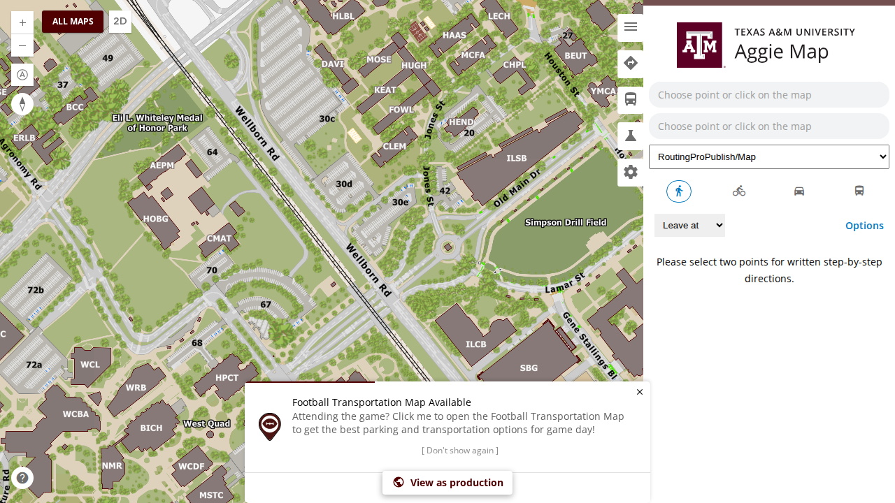
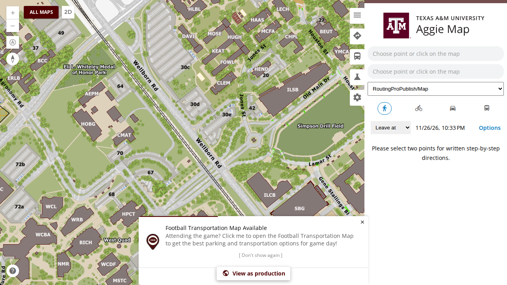
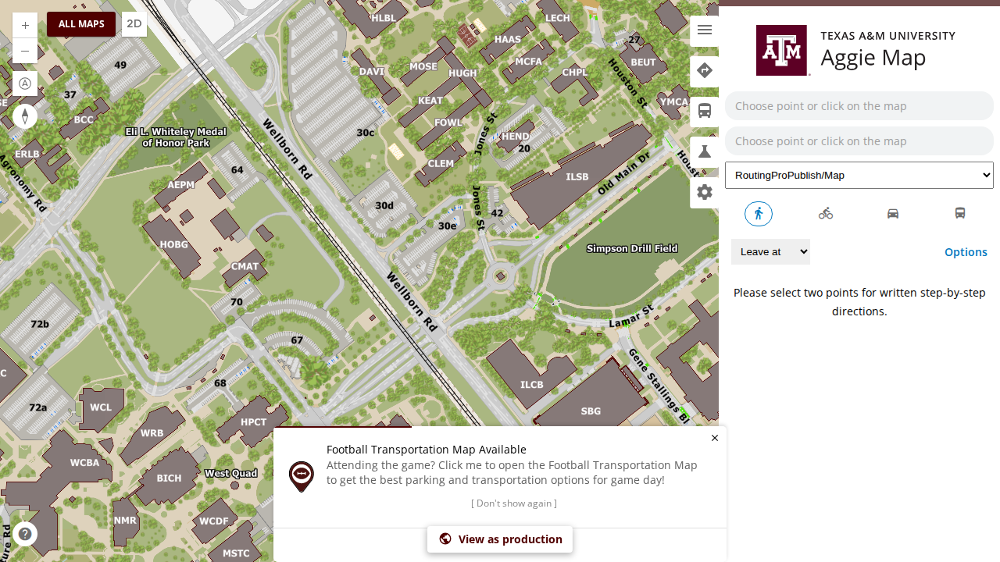
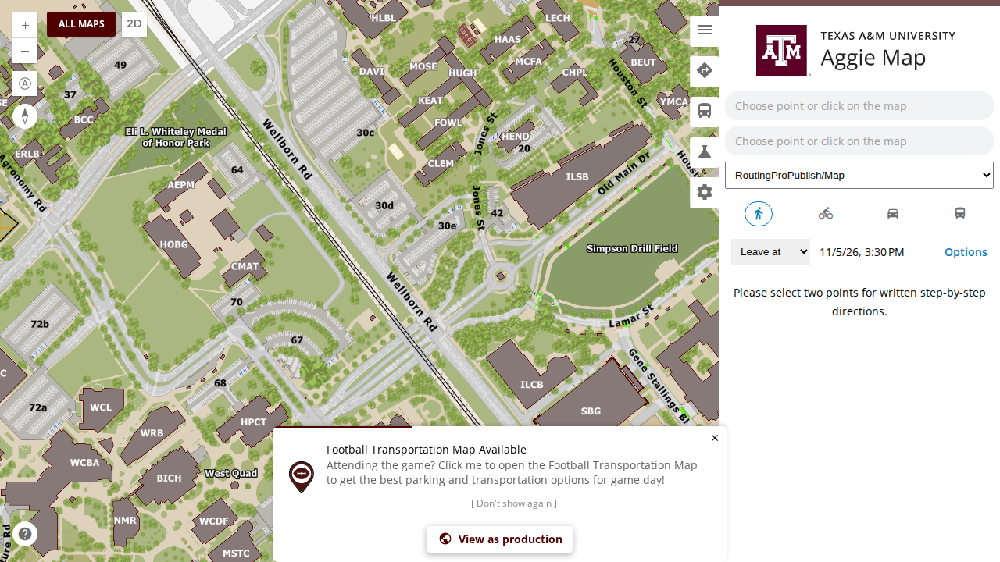

# Batch a75 (#2608, Leave at), 10:51 PM Central, 26 November

**Branch ready: `fix/2608-leave-at` at `f86cbad54`**, on the fork. `.pr-body.md` is not committed; the body is below.

**pre-pr-check's last line:** `pre-pr-check: Exit 0 (fix/2608-leave-at): ready to open.` With PRs 3797 and 3805 merged, nothing is red.

## Re-confirmed on today's development first
I made a local production build of `development` (`58576b44f`), now including #2583's rebuilt picker, and ran it in Playwright:
- **The menu:** choosing "Leave at" drew **no picker** (0 found).
- **The link** `/map/d/trip?time=leave&at=2026-11-05T21:30:00.000Z` drew a picker **0 by 0 px with an empty label**.

#2583 fixed neither, so both halves were fixed.

## Two causes, one per half
1. **The menu:** `<option value="depart">`, while the picker is drawn only for `'leave'`, the word `TimeModeOption` and the link use. The option now says `leave`.
2. **The link:** the picker got milliseconds through `[value]`, and reads anything but a `Date` as no value. It now gets a `Date`, made once per change of the planner's time, or null.

The two halves arrive by different paths: the menu sets the mode, and the link sets both mode and time.

## Tests, red first
In `base.component.spec.ts`:
- **The menu:** red with `expected 'depart' to be 'leave'`.
- **The link:** red with `expected undefined to be 1793914200000`.
- **Two that held before and still hold:** "Leave at" shows as selected for a "leave" link, and "Leave now" removes the picker.
- **Green:** 70 tests.

## Images and notes
- `docs/screenshots/2608-leave-at/`, before and after, menu and link. After: the menu shows the current time; the link shows "11/5/26, 3:30 PM".
- The release entry's row has a dev link with a time. `--check` reports no problems.
- **Check:** `check-in-volume.sh` Exit 0, with lint and test for 14 projects and build for 3.

## Not done, as the issue says
Typing a time commits partial values on the way (`3:3` reads as 3:03), and the solve does not use the chosen time.

## Questions
None.

## PR body
Title: fix(maps-feature-trip-planner): Leave at draws its picker, and a shared link's time fills it

<!--
  Every pull request needs an issue behind it. Work on this project is reported to keep it funded,
  and that reporting is built from issues - a pull request with no issue does not appear in it.

  A CI check looks for one of `Closes #N`, `Fixes #N` or `Resolves #N` below. If there is genuinely
  no issue for this, open one first; it takes a minute and it is the whole point.
-->

Closes #2608

## What this changes

**The trip planner's "Leave at" can be used to choose a time.** Both of #2608's symptoms are still on today's `development`, after #2583's picker rebuild, and they have **two causes, one each**:

1. **Choosing "Leave at" drew no picker.** The option's value was `depart`, and the picker is drawn only for `leave`, the word `TimeModeOption` and a shared link use. The option now says `leave`, which also makes it show as selected.
2. **A shared link with a time drew a blank picker,** 0 by 0 pixels, which cannot be clicked. The picker was handed the time in milliseconds, and it reads anything that is not a `Date` as no value. It now gets a `Date`, made once per change of the planner's time so it is the same object between them, or `null` for none.

The issue's two other notes are untouched and out of scope:
- typing a time commits a partial value on the way;
- the solve does not use the chosen time.

<!-- What a reader needs to know. Why, not only what. -->

## Screenshots

Local production builds of `development` and this branch, in Playwright, in Central time.

| | Before | After |
| --- | --- | --- |
| "Leave at" chosen from the menu |  |  |
| `/map/d/trip?time=leave&at=2026-11-05T21:30:00.000Z` |  |  |

## Release notes

<!--
  Anything with a user-visible result adds its entry to docs/releases/unreleased.md in this pull
  request, with the before/after images above linked from docs/screenshots/<slug>/. Nobody writes
  the notes later. See docs/releases/README.md.
-->

- [x] Entry added to `docs/releases/unreleased.md`, with screenshots
- [ ] Not user-visible (tests, CI, internal docs), so no entry needed

## How it was verified

<!--
  What you actually ran or looked at, and what it said. "Tests pass" is weaker than naming the check
  and its result. If something could not be verified, say so - that is more useful than silence.
-->

- **Reproduced first, on a local production build of today's `development`.** The menu drew no picker (0 found). The link drew one of 0 by 0 pixels with an empty label.
- **Red first, one test per cause,** in `trip-planner-time-picker/containers/base/base.component.spec.ts`:
  - the menu: `expected 'depart' to be 'leave'`;
  - the link: `expected undefined to be 1793914200000`, the picker holding no value.
- **Green:** `maps-feature-trip-planner`, 70 tests passed. On the branch's build, the menu draws a picker with the current time, and the link draws "11/5/26, 3:30 PM".
- `scripts/check-in-volume.sh fix/2608-leave-at`: Exit 0. Lint and test passed for 14 projects, and build for 3.
- `node scripts/collate-release-notes.mjs --check`: no problems.

🤖 Generated with [Claude Code](https://claude.com/claude-code)
