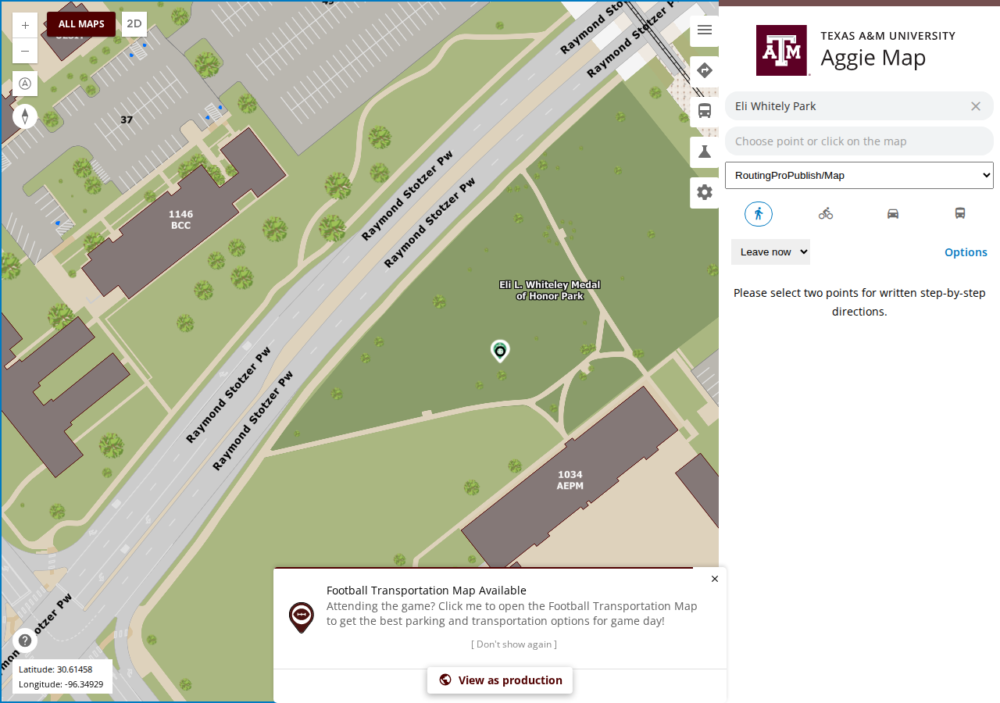
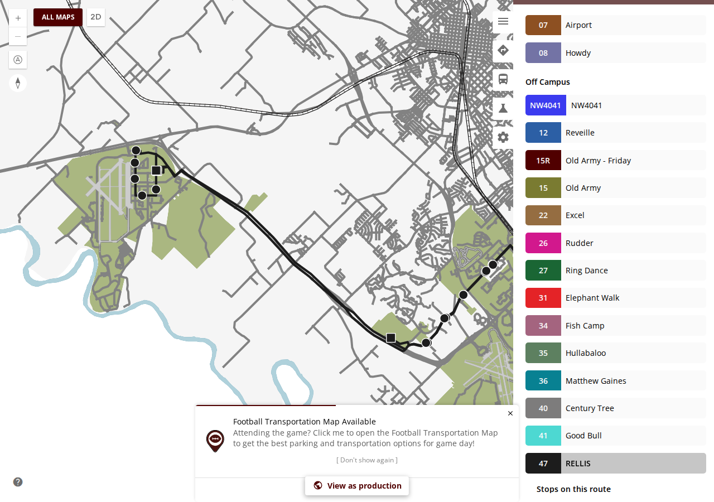
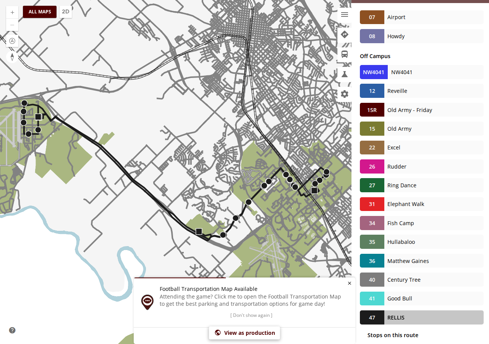
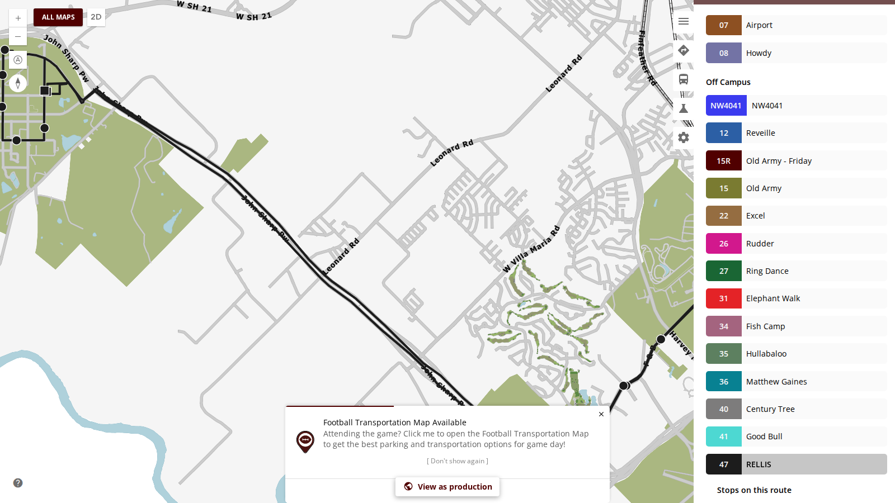
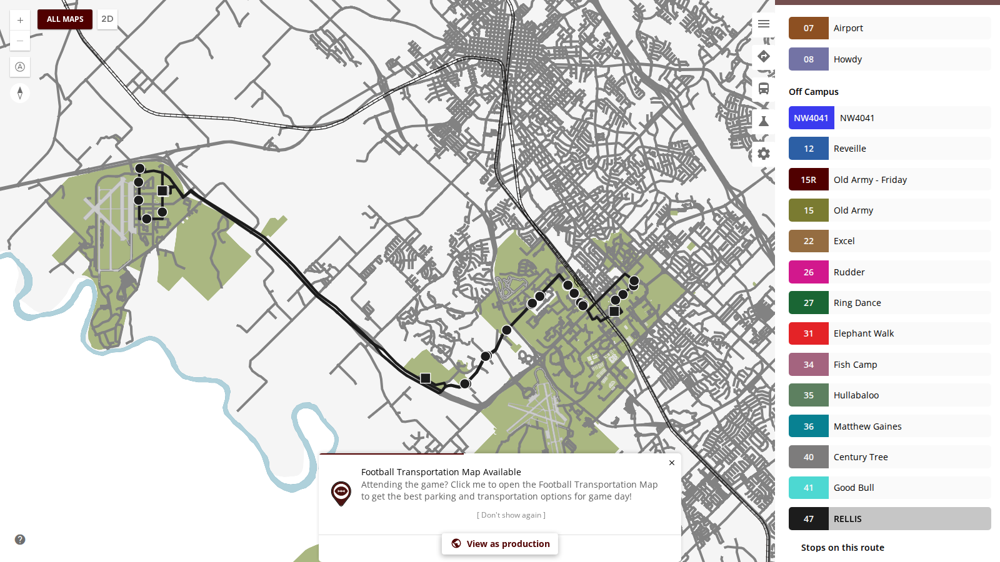

# Batch a77 (#2723 and #2763), 3:25 PM, 27 November Central

**Branches ready, both on the fork; `.pr-body.md` not committed, bodies below:**
- `fix/2723-stop-named-by-place` at `d656b9ed7`. pre-pr-check: `pre-pr-check: Exit 0 (fix/2723-stop-named-by-place): ready to open.`
- `fix/2763-route-fit-clears-panel` at `9f1faab4a`. pre-pr-check: `pre-pr-check: Exit 0 (fix/2763-route-fit-clears-panel): ready to open.`

The two touch the same files (map.service.ts, trip-planner.service.ts, scope.ts, testing.md) and `git merge-tree` merges them cleanly. A check of the two merged together was not run.

## #2723: a stop named by coordinates

- **Reproduced: 24 of 24** loads on dev set `30.6146, -96.3493` for Eli Whitely Park's marker (the lab had 23 of 24). The hit test found `nature-rx-layer` under the click every time. No load got it right, so there was no right path to learn from: the trip planner asked only `buildings-layer`, and Nature Rx names its spaces in `area_name`, which a stop never read.
- **Fix (naming only, routing untouched):** the click asks every visible popup layer through the popup's own `queryPopupLayersAtClick` (#2707), with a new `drawn` option. `MapService.featuresAtPoint` replaces `featuresIntersectingPoint`, whose only caller this was. The stop takes the top-most feature with a name; `featureName` adds `area_name` to `name`, `bldgname` and `lotname`.
- **A side effect, in the issue's direction:** a click on a surface lot (visible by default) now names the lot instead of giving coordinates.
- **Red first:**
  - Unit: `expected '30.6146, -96.3493' to be 'Eli Whitely Park'`.
  - New smoke spec `trip-stop-names.spec.ts`: the marker over 3 loads, then a building on the same loads, and bare ground once. Red 3 of 3 on dev, and on a local build of the unfixed branch.
- **Green:** unit 6 passed; smoke 4 of 4 on a local development build (named on 3 of 3 loads, building named, ground still coordinates).
- **Images and notes:** `docs/screenshots/2723-stop-named-by-place/`, release entry with its row.
- **Check:** check-in-volume Exit 0 (maps-esri, maps-feature-trip-planner, aggiemap-angular).
- Nature Rx is development-only (#2673), so a production build leaves it out and the marker case skips there.

## #2763: a bus route fitted behind the panel

- **Reproduced:** route 47 on dev reached **109 px** behind the panel at 1280 wide and **347 px** at 1600, measured from the line's own vertices.
- **The issue's premise was wrong:** Esri's `goTo` takes no padding; only `view.padding` exists, and setting it for good would move every map's first framing beside the panel. That would be a design change, so I did not make it.
- **Fix, in a shared place:**
  - `MapService.fit` sets the panel's overlap as `view.padding` for the move only, then puts it back and keeps the picture still (`fit.ts`: `coveredEdges`, `goToClearOf`). Proven on dev before writing it: changing padding keeps the center and so moves the map, which is why the center is reset.
  - The aggiemap side panel registers itself with `coverWith`. A closed panel lies off the map and counts for nothing.
- **Same fault elsewhere, so the same fix:** the bus route, the trip planner's route, and `MapService.zoomTo` (a feature chosen from search) all go through `fit`. The other `goTo` calls are not fits.
- **Red first:** new smoke spec `bus-route-fit.spec.ts`, red on dev and on the unfixed local build (117 and 355 px). Green 2 of 2: the line ends at x 857 with the panel at 920, and at 1017 with it at 1240. `bus.spec.ts` all green with it.
- **Unit:** `fit.spec.ts`, 8 passed.
- **Two `directions.spec.ts` failures on the local development build also fail on the unfixed branch, so they are not this change:** the solve goes to the development GIS server, and `/map?busstop=4215` opened no popup. The trip route test (#2843) passed.
- **Images and notes:** `docs/screenshots/2763-route-fit-clears-panel/` at 1280 and 1600, release entry with its row.
- **Check:** check-in-volume Exit 0 (maps-esri, maps-feature-trip-planner, aggiemap-ngx-ui-desktop, aggiemap-angular).

## a72, still waiting

The quiet comparison was not quiet: the branch passed 23 of 23, but development's half failed 4 drawing timeouts while my #2723 reproduction ran beside it. Those are timeouts, not assertions. Development's half needs re-running on an idle machine before a72 can claim "outcomes identical".

## Questions
None. a78 (#1856, #1933) is next unless told otherwise.

## PR body: #2723
Title: fix(maps-feature-trip-planner): A stop set by a map click is named after what was clicked

<!--
  Every pull request needs an issue behind it. Work on this project is reported to keep it funded,
  and that reporting is built from issues - a pull request with no issue does not appear in it.

  A CI check looks for one of `Closes #N`, `Fixes #N` or `Resolves #N` below. If there is genuinely
  no issue for this, open one first; it takes a minute and it is the whole point.
-->

Closes #2723

## What this changes

**A stop set by clicking the map is named after what was clicked.** The trip planner asked only the buildings layer what a click landed on, so a click on anything else fell through to coordinates: Eli Whitely Park's Nature Rx marker set a stop reading `30.6146, -96.3493`, on 24 loads of 24 on dev tonight (the lab measured 23 of 24). The route was always right; only the name was wrong.

As the maintainer decided on the issue, **the clicked feature's own layer first, and coordinates only on bare ground**:

1. **The click asks every visible layer that opens a popup**, through the popup's own click query (`queryPopupLayersAtClick`, #2707) rather than a second way of asking. It gains a `drawn` option: the popup asks only layers still drawing, because a hit test is the truth once they have drawn, while the trip planner needs the feature on every click. `MapService.featuresAtPoint` wraps it and replaces `featuresIntersectingPoint`, whose only caller this was.
2. **The stop takes the top-most feature that has a name.** Nature Rx names its spaces in `area_name`, which a stop did not read; `featureName` reads it with the names a stop already read (`name`, `bldgname`, `lotname`), so a marker over a building is the marker, and a building is still the building.

A side effect, in the same direction: a click on a surface lot, which is visible by default, now names the lot (`lotname`) instead of giving its coordinates.

## Screenshots

<!--
  Required for anything with a visible result - a page, a map, a layer, a legend, a popup. Before and
  after, not just after: a reviewer cannot tell what changed from one image.

  A CI check looks for an image below whenever a template, stylesheet, component or directive
  changes. If the change genuinely has no visible result, apply the `no-visible-change` label rather
  than deleting this section.

  This is not only documentation. The duplicated 150th Anniversary tile (#1055) was found because
  before/after images were being captured for release notes. It read as correct in the diff and was
  obvious in a picture.

  Drag images in here, or commit them and link the raw URL - this repository is public, so raw URLs
  render and do not rot.

  Delete this section if the change has no visible result.
-->

Eli Whitely Park's marker clicked in the trip planner, at 1280 pixels wide:

| Before | After |
| --- | --- |
|  |  |

## Release notes

<!--
  Anything with a user-visible result adds its entry to docs/releases/unreleased.md in this pull
  request, with the before/after images above linked from docs/screenshots/<slug>/. Nobody writes
  the notes later. See docs/releases/README.md.
-->

- [x] Entry added, as `docs/releases/unreleased/2723-stop-named-by-place.md`, with screenshots and its *What to test on dev* row
- [ ] Not user-visible (tests, CI, internal docs), so no entry needed

## How it was verified

<!--
  What you actually ran or looked at, and what it said. "Tests pass" is weaker than naming the check
  and its result. If something could not be verified, say so - that is more useful than silence.
-->

- **Reproduced first, on dev:** clicking Eli Whitely Park's marker set `30.6146, -96.3493` on **24 loads of 24**, with a hit test at the click finding `nature-rx-layer` each time.
- **Red first, two ways:**
  - `trip-planner-core.spec.ts`, a stop made from a Nature Rx feature: `expected '30.6146, -96.3493' to be 'Eli Whitely Park'`.
  - The new smoke spec `trip-stop-names.spec.ts` (the marker on three loads, then a building on the same loads, and bare ground once): red on dev and on a local build of the unfixed branch, the marker failing on 3 of 3 loads with the same coordinates.
- **Green:** the unit spec, 6 passed. The smoke spec on a local development build of this branch: **4 passed**, the marker named on 3 loads of 3, the building named after itself, and bare ground still coordinates.
- `scripts/check-in-volume.sh fix/2723-stop-named-by-place maps-esri,maps-feature-trip-planner,aggiemap-angular`: Exit 0.
- `npx tsc -p test/smoke/aggiemap`: passed.

Nature Rx is development-only (#2673), so the marker-and-building case is skipped on production; the bare-ground case runs everywhere.

🤖 Generated with [Claude Code](https://claude.com/claude-code)

## PR body: #2763
Title: fix(maps-esri): A fitted bus route, trip or feature finishes clear of the side panel

<!--
  Every pull request needs an issue behind it. Work on this project is reported to keep it funded,
  and that reporting is built from issues - a pull request with no issue does not appear in it.

  A CI check looks for one of `Closes #N`, `Fixes #N` or `Resolves #N` below. If there is genuinely
  no issue for this, open one first; it takes a minute and it is the whole point.
-->

Closes #2763

## What this changes

**A fitted bus route finishes clear of the side panel.** The map runs the full width of the page and the side panel lies over its right side, but a fit used the whole view, so a long route's far end finished underneath it. Route 47 to RELLIS lost its campus end: 109 pixels of it at 1280 wide and 347 at 1600, measured on dev.

**Esri's `goTo` has no padding of its own**, whatever the issue supposed; only `view.padding` does, and setting that for good would also move every map's first framing beside the panel. So the fix sets it for the move only:

1. **`MapService.fit(target, options)`** goes to a target in the part of the map nothing lies over. It reads how far each registered element reaches into the map at that moment (`coveredEdges`), sets that as `view.padding` for the move, and puts the padding back after it, setting the center to the point that was in the middle of the screen so the picture does not move (`goToClearOf`, in `libs/maps/esri/src/lib/services/map/fit.ts`). An interrupted move still puts it back, and of overlapping moves only the last does.
2. **The side panel registers itself** with `MapService.coverWith` (`AggiemapSidebarComponent`). Its place is read at each fit, so a panel slid out of view, which lies off the map, leaves the whole map to fit into.
3. **Every fit to a route or a feature goes through it, as asked**: the bus route (`BusService.toggleMapRoute`), the trip planner's route, and `MapService.zoomTo`, which frames a feature chosen from search. The other `goTo` calls are not fits (the compass's rotation, the location button's centering on a point) or are on a page with no side panel (the polygon editor).

## Screenshots

<!--
  Required for anything with a visible result - a page, a map, a layer, a legend, a popup. Before and
  after, not just after: a reviewer cannot tell what changed from one image.

  A CI check looks for an image below whenever a template, stylesheet, component or directive
  changes. If the change genuinely has no visible result, apply the `no-visible-change` label rather
  than deleting this section.

  This is not only documentation. The duplicated 150th Anniversary tile (#1055) was found because
  before/after images were being captured for release notes. It read as correct in the diff and was
  obvious in a picture.

  Drag images in here, or commit them and link the raw URL - this repository is public, so raw URLs
  render and do not rot.

  Delete this section if the change has no visible result.
-->

Route 47 chosen on `/map/d/bus`:

| Width | Before | After |
| --- | --- | --- |
| 1280 |  |  |
| 1600 |  |  |

## Release notes

<!--
  Anything with a user-visible result adds its entry to docs/releases/unreleased.md in this pull
  request, with the before/after images above linked from docs/screenshots/<slug>/. Nobody writes
  the notes later. See docs/releases/README.md.
-->

- [x] Entry added, as `docs/releases/unreleased/2763-route-fit-clears-panel.md`, with screenshots and its *What to test on dev* row
- [ ] Not user-visible (tests, CI, internal docs), so no entry needed

## How it was verified

<!--
  What you actually ran or looked at, and what it said. "Tests pass" is weaker than naming the check
  and its result. If something could not be verified, say so - that is more useful than silence.
-->

- **Reproduced first, on dev:** route 47's line reached 109 pixels behind the panel at 1280 wide and 347 at 1600, measured from its own vertices with `view.toScreen`.
- **Red first:** the new smoke spec `bus-route-fit.spec.ts` (route 47 at 1280 and 1600, the line's right-most vertex against the panel's left edge) failed on dev and on a local build of the unfixed branch: `reaches x 1037, 117 pixels behind the side panel at x 920`, and `x 1595, 355 pixels behind ... at x 1240`.
- **Green** on a local development build of this branch: 2 passed; the line ends at x 857 with the panel at 920, and at 1017 with it at 1240. `bus.spec.ts` passed with it, every route and both maps.
- **Unit:** `fit.spec.ts`, 8 passed: the covered edges (a panel on either side, one slid off the map, one above or below it, none) and the move (padding during it, put back after it and after an interrupted one, the center kept).
- `directions.spec.ts` on the same local build: 2 failures, both **also failing on the unfixed branch** in the same setup, so not this change: the solve goes to the development GIS server from a development build at localhost, and `/map?busstop=4215` opened no popup. The trip planner's own route test (#2843) passed.
- `scripts/check-in-volume.sh fix/2763-route-fit-clears-panel maps-esri,maps-feature-trip-planner,aggiemap-ngx-ui-desktop,aggiemap-angular`: Exit 0.
- `npx tsc -p test/smoke/aggiemap`: passed.

🤖 Generated with [Claude Code](https://claude.com/claude-code)
