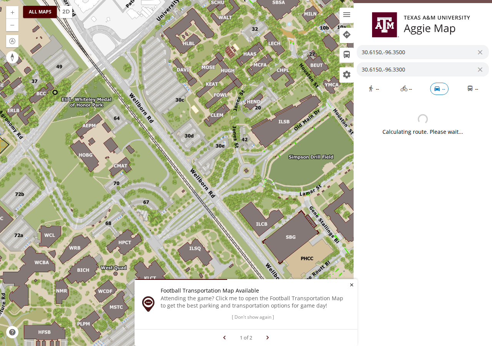
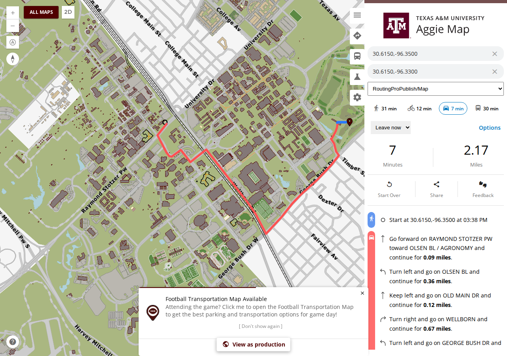

# Batch a78 (#1856, #1933), 4:03 PM Central, 27 November

**Branch ready: `fix/3875-mode-3-never-finishes` at `b398e1188`**, on the fork. `.pr-body.md` is not committed; the body is below.
**pre-pr-check's last line:** `pre-pr-check: Exit 0 (fix/3875-mode-3-never-finishes): ready to open.`

## #1856: not reproduced and closed; its path turned up a new bug, #3875

- **The path is reachable** by a link with `mode=3` (drive with a parking pass). No control turns that mode on, since the parking options component is on no page, but a link does.
- **#1856's own fault can't happen:** the centroid read has gone through `centroidFromPolygonGeometry` since #1854 (merged 18 October), and that handles plain JSON. Closed with this evidence.
- **What does happen there, filed as #3875** (Bug, `bug`, Texas A&M Aggiemap, In Progress; **Priority not set: I'd suggest High**):
  - Symptom: `/map/d/trip?stops=30.6150,-96.3500@30.6150,-96.3300&mode=3` never finishes, on production and dev. The panel stays at "Calculating route. Please wait..." and no solve is sent.
  - Cause: the permit starts `undefined`, which passed a `!== ''` test. So the lots were asked for `FAC_CODE = undefined`, the query failed, and `centroids[nearest].geometry` threw.
- **Fix:**
  - Look for a lot only with a permit chosen (`permitChosen`).
  - With no lot, leave the stops as they are (`nearestLot` answers `undefined`).
  - The lot step is now a pure function in `trip-planner-parking-stop.ts`, so the plain-JSON-lots test #1856 asked for exists there.
- **Red first:** a new test in `directions.spec.ts` failed on production (no summary in 120 s, no solve sent). Green in 5.9 s on a local build, with every solve sent with 2 stops. Unit: 4 passed.
- **Images and notes:** `docs/screenshots/3875-mode-3-finishes/` and a release entry with its row.
- **Check:** check-in-volume Exit 0 after merging today's development.

## #1933: not reproduced and closed, already fixed by #2259

- No TypeError on `/map/d?bldg=0468`: 3 of 3 loads clean on production, 3 of 3 on dev.
- The empty-Routing-folder case was handled by #2259 (closed 24 October), and the unit test #1933 asked for is in `trip-planner-connection.service.spec.ts`.

## Your strict-null fixes to a77

Seen, and thanks: from now on, new code in map.service.ts uses `currentView`. Your commits are not on the fork branches (still `d656b9ed7` and `9f1faab4a` there), so I left both alone. I had also merged development into my local `fix/2763-route-fit-clears-panel`, resolved the conflict with #3864 using `currentView`, and got check Exit 0, but I have **not pushed** it, so as not to collide with yours. #3875 touches nothing in map.service.ts and merges cleanly with #2723.

## Questions
None. The Priority of #3875 is yours to set (suggested High).

## PR body
Title: fix(maps-feature-trip-planner): A trip link in mode 3 finishes as a drive

<!--
  Every pull request needs an issue behind it. Work on this project is reported to keep it funded,
  and that reporting is built from issues - a pull request with no issue does not appear in it.

  A CI check looks for one of `Closes #N`, `Fixes #N` or `Resolves #N` below. If there is genuinely
  no issue for this, open one first; it takes a minute and it is the whole point.
-->

Closes #3875

## What this changes

**A trip link in mode 3, driving with a parking pass, finishes.** It sat at "Calculating route. Please wait..." for good, on production and dev: no solve was sent, and the console showed `TypeError: Cannot read properties of undefined (reading 'geometry')`.

Mode 3 adds the nearest lot the visitor's permit allows as a stop. The branch ran when `parking_pass_permit !== ''`, but the permit starts as `undefined` and nothing in the app sets it, because the parking options component is placed on no page. So `?mode=3` looked for lots with no permit. The lots were asked for `FAC_CODE = undefined`, the query failed, and `centroids[nearest].geometry` threw.

- **The lot is looked for only with a permit chosen** (`permitChosen`). Without one, the trip is the drive between the given stops.
- **No lot found leaves the stops as they are** instead of throwing (`nearestLot` answers `undefined`).
- The lot step moved into `trip-planner-parking-stop.ts`, beside the door-choice helpers, so it can be tested without the service. It reads the lots' plain-JSON rings through `centroidFromPolygonGeometry`, as before.

Found while checking #1856, which is closed: its centroid read was already fixed by #1854, and this test of the branch with plain-JSON lots is the coverage it asked for.

## Screenshots

<!--
  Required for anything with a visible result - a page, a map, a layer, a legend, a popup. Before and
  after, not just after: a reviewer cannot tell what changed from one image.

  A CI check looks for an image below whenever a template, stylesheet, component or directive
  changes. If the change genuinely has no visible result, apply the `no-visible-change` label rather
  than deleting this section.

  This is not only documentation. The duplicated 150th Anniversary tile (#1055) was found because
  before/after images were being captured for release notes. It read as correct in the diff and was
  obvious in a picture.

  Drag images in here, or commit them and link the raw URL - this repository is public, so raw URLs
  render and do not rot.

  Delete this section if the change has no visible result.
-->

`/map/d/trip?stops=30.6150,-96.3500@30.6150,-96.3300&mode=3`:

| Before (production) | After (this branch) |
| --- | --- |
|  |  |

## Release notes

<!--
  Anything with a user-visible result adds its entry to docs/releases/unreleased.md in this pull
  request, with the before/after images above linked from docs/screenshots/<slug>/. Nobody writes
  the notes later. See docs/releases/README.md.
-->

- [x] Entry added, as `docs/releases/unreleased/3875-mode-3-finishes.md`, with screenshots and its *What to test on dev* row
- [ ] Not user-visible (tests, CI, internal docs), so no entry needed

## How it was verified

<!--
  What you actually ran or looked at, and what it said. "Tests pass" is weaker than naming the check
  and its result. If something could not be verified, say so - that is more useful than silence.
-->

- **Reproduced** on production and dev, 27 November 2026: the link never finished, and the lots query was `GIS.TS.ParkingLots.FAC_CODE = undefined`, which the service answered "Failed to execute query."
- **Red first:** a new test in `directions.spec.ts`, "a trip link in mode 3, with no permit chosen, finishes as a drive between its stops (#3875)". It failed on production: no route summary in 120 seconds, and no solve sent.
- **Green** on a local development build of this branch, in 5.9 seconds. Every solve was sent with the link's 2 stops.
- **Unit:** `trip-planner-parking-stop.spec.ts`, 4 passed: no permit (undefined, null, empty, blank), a chosen permit, no lots, and the nearest of two plain-JSON lots at its centre.
- `scripts/check-in-volume.sh fix/3875-mode-3-never-finishes maps-feature-trip-planner,aggiemap-angular`: Exit 0, after merging today's `development`.
- `npx tsc -p test/smoke/aggiemap`: passed.
- **One check with a different result here:** "the trip planner returns a route between two campus points (#2804)" fails on a local development build with or without this change, because that build routes on the development GIS server.

🤖 Generated with [Claude Code](https://claude.com/claude-code)
