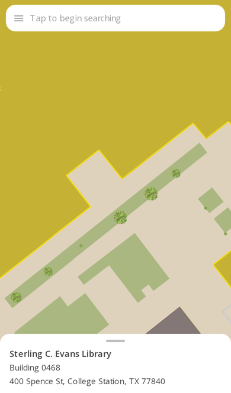
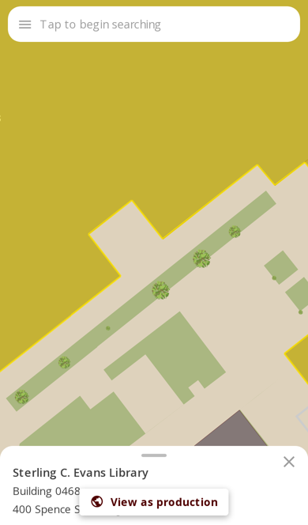
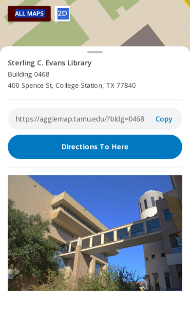
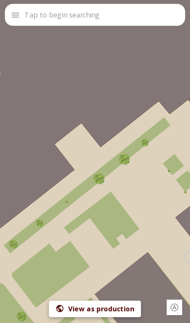
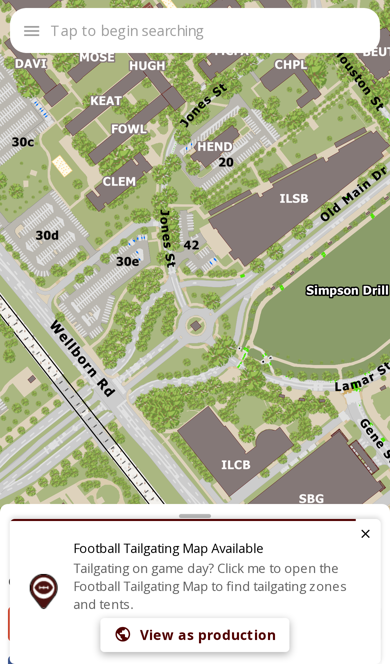
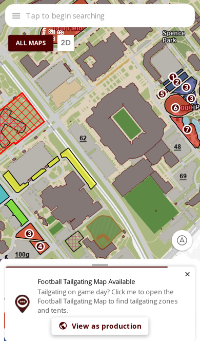

# Batch a79 (the phone cluster: #1439, #1440, #2997), 7:31 PM Central, 27 November

**Branches ready, on the fork; `.pr-body.md` not committed, bodies below:**
- `fix/1439-phone-sheet-dismiss` at `be88f8f77`: `pre-pr-check: Exit 0 (fix/1439-phone-sheet-dismiss): ready to open.`
- `fix/2997-event-map-bus-link` at `747e39223`: `pre-pr-check: Exit 0 (fix/2997-event-map-bus-link): ready to open.`
- **#1440: no branch.** It needs no fix of its own once #1439 lands; the evidence is on the issue (below).

The two branches merge cleanly together. I first had them both appending a scope entry at the end of `FEATURES`, which conflicted, so #2997's now sits beside the selection entry.

## #1439: the handle is made true, and a close control added

- **Reproduced on production at phone size:** no close control, and a 300 px drag on the handle left the sheet exactly where it was. Escape and a tap on bare map did close it, but a phone has no Escape, and a tap on a building opens that building.
- **Both, as the issue asks, and why:** the handle already advertised the gesture, so making it true was the point. A close control is still needed, because a drag alone cannot be done with a single tap (WCAG 2.2, 2.5.7).
- **The fixes, in the shared `DragDirective`:**
  - At its resting place, a sheet now follows the finger down. Letting go 64 px or more down emits a new `dismissed` output, which the building's sheet answers by closing; less springs back. The bus sheets don't listen and behave as before.
  - The close control is the desktop popup's own markup (title, label, keyboard), styled by the shared popup partial the sheet already imports.
  - Each directive now handles only drags of its own element. `interact('.draggable')` is one object shared by every sheet on the page, so every directive heard every drag, and with dismissal a pull on the bus list would have closed a building's sheet.
  - **A fault my own change caused, found by the local run:** the close control gives a hidden sheet text, which the directive read as "showing". It measured a sheet with no box and threw, and no building's sheet opened at all. The directive now measures only a drawn sheet.
- **Red first** on production: the close-control and drag tests failed, and the nudge test passed, as it should.
- **Green** locally: `phone-sheet.spec.ts` 3 passed. `mobile.spec.ts` and `bus.spec.ts` 52 passed, with #71's expected failure.
- **check-in-volume:** Exit 0.
- **Not checked:** a real phone's touch. Playwright drives it with a pointer on a touch-enabled viewport.

## #1440: acceptable once #1439 lands, so not fixed separately (commented on the issue, not closed)

Measured on local builds at iPhone 13 size, with the notices closed, by asking the page what lies at the GPS button's centre:
- **development:** the sheet stays open after a 200 px pull, and GPS stays covered;
- **#1439's branch:** the sheet closes and **GPS is reachable**.

What remains is that GPS is covered **while** the sheet is open. That's ordinary for a sheet that now closes with one tap or one pull. Moving the controls wouldn't help: the sheet rises to cover most of a phone screen when a building's details are long, so no corner stays clear.

**I commented instead of closing**, because production still has the fault until #1439 merges. **It can close with that pull request.** The comment carries the before and after images.

## #2997: one shared phone route list, as the desktop has, and relative links

- **Reproduced** on dev and production: Bus Routes from the tailgating map's phone menu landed on `/map/m/bus`.
- **Two more of the same, found while fixing it:** the menu's Directions went to `/map/m/trip` (the main map's), and a route page's back arrow went to `map/m/bus`.
- **Decision:** the desktop solved this in #2758 with one shared route list, `sidebarRoutes`. So the phone now has `mobileRoutes(legend)`, the `m` children for every map, where only the legend differs. The main map and event maps use it, replacing two hand-kept copies. The menu's items are relative (`../bus`, `../trip`), as its other items were, and the back arrow uses `..`. A relative link alone would have opened nothing on an event map, since they had no phone bus route.
- **A fault my own change caused:** my first back arrow, `../bus`, went to `…/m/bus/bus`. Found by checking by hand, fixed with `..`, and now asserted by the test.
- **Red first:** on dev both tests failed (`Received: "/map/m/bus"`, `"/map/m/trip"`). On production Bus Routes failed; production's menu has no Directions yet (#3507), so that case waits on `skipUntilDeployed('#3507')`, added to `deployed-changes.json`.
- **Green** locally: both pass, including route 01 and back. `mobile.spec.ts` and `bus.spec.ts`: 51 passed, with #71's expected failure.
- **check-in-volume:** Exit 0.

## Worth knowing
- #71's expected-failure comment in `mobile.spec.ts` says "the phone's popup has no close control". After #1439 that is no longer true. #71 is about the search box's clear control, so the test stays marked, but its comment will read wrong once #1439 merges.
- My earlier #3875 merged as PR 3884.
- Dead code: none found.

## Questions
None.

## PR body: #1439
Title: fix(ui-kits-ngx-interactions-draggable): A building's sheet on a phone can be closed

<!--
  Every pull request needs an issue behind it. Work on this project is reported to keep it funded,
  and that reporting is built from issues - a pull request with no issue does not appear in it.

  A CI check looks for one of `Closes #N`, `Fixes #N` or `Resolves #N` below. If there is genuinely
  no issue for this, open one first; it takes a minute and it is the whole point.
-->

Closes #1439

## What this changes

**On a phone, a building's sheet can be closed: by pulling its handle down, and by a close control.** As #1439 asks, it has both. The handle was already drawn and invited the gesture, so making it true was the point rather than adding a control beside it. A drag alone cannot be done with a single tap, though (WCAG 2.2, 2.5.7), so the close control is needed as well.

Reproduced on production at phone size on 27 November 2026:
- the sheet had no close control;
- a 300 pixel drag on its handle left it where it was.

Tapping bare map above it and Escape did close it. But a phone has no Escape, a tap on a building opens that building, and the sheet covers about 85% of the screen.

**The changes** (the shared `DragDirective`, used by every phone sheet):
1. **The handle.** At its resting place, a sheet now follows the finger down instead of being held and the drag stopped. Letting go 64 pixels or more down emits a new `dismissed` output; less springs back. The building's sheet answers `dismissed` by closing. The bus sheets don't listen, so they behave as before.
2. **The close control.** The building's sheet has the desktop popup's own close control (title, label, keyboard), styled by the shared popup partial it already imported.
3. **Each directive handles only its own element.** `interact('.draggable')` is one object shared by every sheet on the page, so every directive heard every sheet's drag. With the new dismiss, a pull on the bus list would have closed a building's sheet.
4. **A sheet is measured once it is drawn.** The directive took "has text" to mean "is showing", and the close control gives a hidden sheet text. It then measured a sheet with no box and threw, and no building's sheet opened at all. The local smoke run caught this.

#1440 (the sheet covering GPS) needs no change of its own once this lands; see the report.

## Screenshots

<!--
  Required for anything with a visible result - a page, a map, a layer, a legend, a popup. Before and
  after, not just after: a reviewer cannot tell what changed from one image.

  A CI check looks for an image below whenever a template, stylesheet, component or directive
  changes. If the change genuinely has no visible result, apply the `no-visible-change` label rather
  than deleting this section.

  This is not only documentation. The duplicated 150th Anniversary tile (#1055) was found because
  before/after images were being captured for release notes. It read as correct in the diff and was
  obvious in a picture.

  Drag images in here, or commit them and link the raw URL - this repository is public, so raw URLs
  render and do not rot.

  Delete this section if the change has no visible result.
-->

On a phone, `/map/m?bldg=0468`. Before: production. After: a local build of this branch.

| | Before | After |
| --- | --- | --- |
| Open |  |  |
| After pulling the handle down 200 to 300 px |  |  |

## Release notes

<!--
  Anything with a user-visible result adds its entry to docs/releases/unreleased.md in this pull
  request, with the before/after images above linked from docs/screenshots/<slug>/. Nobody writes
  the notes later. See docs/releases/README.md.
-->

- [x] Entry added, as `docs/releases/unreleased/1439-phone-sheet-dismiss.md`, with screenshots and its *What to test on dev* row
- [ ] Not user-visible (tests, CI, internal docs), so no entry needed

## How it was verified

<!--
  What you actually ran or looked at, and what it said. "Tests pass" is weaker than naming the check
  and its result. If something could not be verified, say so - that is more useful than silence.
-->

- **Red first:** the new `phone-sheet.spec.ts` ran against production: "by its close control" failed (`the sheet has no close control`), "by dragging its handle down" failed (`did not close the sheet`), and "stays open when the handle is only nudged" passed, as it should.
- **Green** on a local development build of this branch: `phone-sheet.spec.ts` 3 passed. `mobile.spec.ts` and `bus.spec.ts` (every bus route and both bus sheets) passed with it: 52 passed. One expected failure, #71's `test.fail`, failed where #71 says.
- **GPS, on local builds at iPhone 13 size,** with the notices closed first: on `development` the sheet stayed open after a 200 px pull and GPS stayed covered. On this branch the sheet closed and GPS was reachable.
- `scripts/check-in-volume.sh fix/1439-phone-sheet-dismiss ui-kits-ngx-interactions-draggable,maps-feature-popup,aggiemap-angular`: Exit 0, after merging today's `development`.
- `npx tsc -p test/smoke/aggiemap` and `node scripts/collate-release-notes.mjs --check`: passed.
- **Not checked:** a real phone's touch. The tests drive the drag with Playwright's pointer on a touch-enabled phone viewport, and interact.js handles touch and mouse through the same pointer events.

🤖 Generated with [Claude Code](https://claude.com/claude-code)

## PR body: #2997
Title: fix(aggiemap-ngx-ui-mobile): The phone menu's Bus Routes and Directions stay on the event map

<!--
  Every pull request needs an issue behind it. Work on this project is reported to keep it funded,
  and that reporting is built from issues - a pull request with no issue does not appear in it.

  A CI check looks for one of `Closes #N`, `Fixes #N` or `Resolves #N` below. If there is genuinely
  no issue for this, open one first; it takes a minute and it is the whole point.
-->

Closes #2997

## What this changes

**On a phone, an event map's Bus Routes and Directions stay on that map.** The phone menu (`MainMobileSidebarComponent`) is one component on every map, but two of its items were absolute addresses:
- **Bus Routes** was `/map/m/bus`. The event maps had no phone bus route, so on the tailgating map it threw the visitor onto the main campus map.
- **Directions** was `/map/m/trip`, the main map's trip planner, though the event maps have their own (found while testing this).
- **A route page's back arrow** was `map/m/bus`, so it also left the event map.

**Chosen: one shared phone route list, as the desktop has, with relative links.** Not a relative link alone, which would have opened nothing on an event map, and not a bus route added to the event maps by hand, which is the drift #2758 removed from the desktop. #2758 gave every map's desktop panel one route list, `sidebarRoutes`. The phone now has `mobileRoutes(legend)` in `aggiemap-ngx-ui-mobile`: the `m` children, bus and route pages included, where only the legend differs between maps. The main map and the event maps use it, which removes their two hand-kept copies. The menu's two items are relative (`../bus`, `../trip`), as its Legend, Layers and Basemap already were, and a route page goes back with `..`.

On an event map, the phone's bus list draws with the map's own `BusService`, which the event map component already provides for the desktop panel (#2758).

## Screenshots

<!--
  Required for anything with a visible result - a page, a map, a layer, a legend, a popup. Before and
  after, not just after: a reviewer cannot tell what changed from one image.

  A CI check looks for an image below whenever a template, stylesheet, component or directive
  changes. If the change genuinely has no visible result, apply the `no-visible-change` label rather
  than deleting this section.

  This is not only documentation. The duplicated 150th Anniversary tile (#1055) was found because
  before/after images were being captured for release notes. It read as correct in the diff and was
  obvious in a picture.

  Drag images in here, or commit them and link the raw URL - this repository is public, so raw URLs
  render and do not rot.

  Delete this section if the change has no visible result.
-->

On a phone, the tailgating map's menu, then **Bus Routes**. Before: dev. After: a local build of this branch. The toasts are the map's game-day notices.

| Before: `/map/m/bus`, the main campus map | After: `/events/tailgating/map/m/bus` |
| --- | --- |
|  |  |

## Release notes

<!--
  Anything with a user-visible result adds its entry to docs/releases/unreleased.md in this pull
  request, with the before/after images above linked from docs/screenshots/<slug>/. Nobody writes
  the notes later. See docs/releases/README.md.
-->

- [x] Entry added, as `docs/releases/unreleased/2997-event-map-bus-link.md`, with screenshots and its *What to test on dev* row
- [ ] Not user-visible (tests, CI, internal docs), so no entry needed

## How it was verified

<!--
  What you actually ran or looked at, and what it said. "Tests pass" is weaker than naming the check
  and its result. If something could not be verified, say so - that is more useful than silence.
-->

- **Red first:** two new tests in `mobile.spec.ts` ("keeps the visitor on the map when Bus Routes / Directions is chosen from its menu (#2997)").
  - On dev, both failed: `Expected: "/events/tailgating/map/m/bus"`, `Received: "/map/m/bus"`, and the same for `/m/trip`.
  - On production, Bus Routes failed the same way. Production's menu has no Directions yet (#3507), so that case waits on `skipUntilDeployed('#3507')`, added to `deployed-changes.json`.
- **Green** on a local development build of this branch: both pass. The Bus Routes case also chooses route 01 (`…/m/bus/01`) and taps Back (`…/m/bus`). All of `mobile.spec.ts` and `bus.spec.ts`: 51 passed, with #71's expected failure where #71 says.
- **The main map** still opens `/map/m/bus`, checked by hand on the same build.
- My own back arrow first went to `…/m/bus/bus` (`../bus` from `bus/:route`). Found by that check, fixed with `..`, and now asserted by the test.
- `scripts/check-in-volume.sh fix/2997-event-map-bus-link aggiemap-ngx-ui-mobile,aggiemap-ngx-core,ts-events-ngx,aggiemap-angular`: Exit 0, after merging today's `development`.
- `npx tsc -p test/smoke/aggiemap` and `node scripts/collate-release-notes.mjs --check`: passed.

🤖 Generated with [Claude Code](https://claude.com/claude-code)
