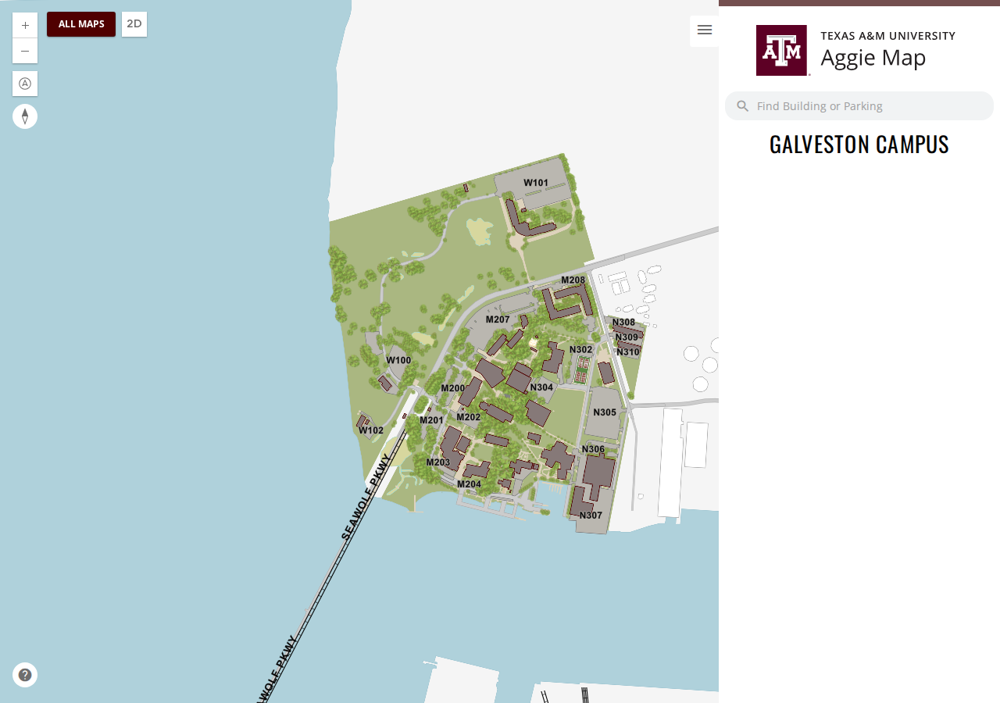
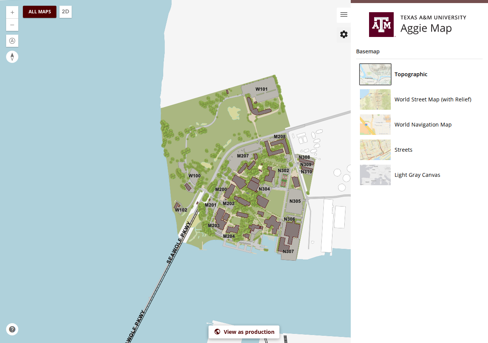
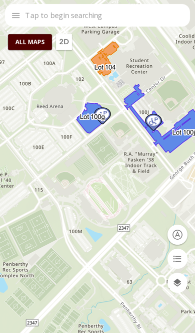
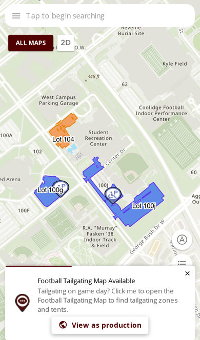
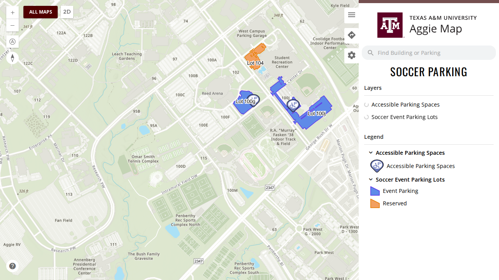
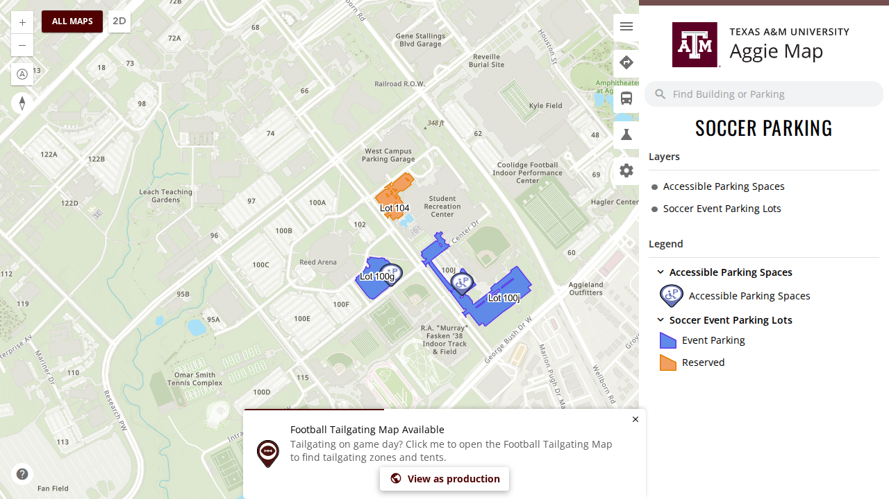

# Batch a80 (the framing cluster: #1250, #1727, #1501), 10:14 PM Central, 27 November

**Branches ready, on the fork; `.pr-body.md` not committed, bodies below:**
- `fix/1250-campus-map-gear` at `6a0db4c9f`: `pre-pr-check: Exit 0 (fix/1250-campus-map-gear): ready to open.`
- `fix/1501-soccer-parking-framing` at `ef6bc028c`: `pre-pr-check: Exit 0 (fix/1501-soccer-parking-framing): ready to open.`
- **#1727: no branch.** It doesn't reproduce, so it is closed with the evidence (below).

The two branches merge cleanly together.

## #1250: the gear on every campus map, offering only basemaps that draw there

- **Reproduced on production:** all 11 `/campus/` maps show only Features.
- **What the gear would have opened, the check you asked for:** the gallery always offered College Station's own basemaps too: Aggieland, its dated rasters, and Nearmap's "Aerial Imagery". They draw nothing on another campus, so a gear alone would have been the #1910 trap.
- **Fix:**
  - `sidebarTabs: ['features', 'settings']` for satellite campuses;
  - `BasemapGalleryService` takes an optional `BASEMAP_GALLERY_OPTIONS { collegeStation }`, read when the gallery is made, which the event map routes provide from the map's definition (`false` for a `satellite-campus`).
- **Result:** Galveston's gallery lists Topographic, World Street Map (with Relief), World Navigation Map, Streets and Light Gray Canvas. The main map's is unchanged (Aggieland, the rasters, Aerial Imagery).
- **Red first:** the new `campus-basemaps.spec.ts` (one test per discovered campus map) failed 11 of 11 on production. Green: 22 passed with `campus-layers.spec.ts`.
- **Found by the check:** the 10 satellite-campus definition snapshots recorded `['features']`, so I updated them.
- **Framing:** no zoom or centre changed, so no baseline effect.

## #1727: not reproduced, closed as fixed by #1726

- **Measured on production at the baseline's 1280 × 720:** Outdoor Track and Cross Country, each with no saved basemap and with a dated one saved (`aggie_basemap_raster_2026_05`, still published; `aggie_basemap_raster_2025_01`, never published).
- **Result:** all six opened exactly at their baseline (zoom 16, baseline centre) on a drawn basemap. A dated id now resolves through `basemapForSavedId` (#1726).
- **Closed** with that table, as the issue's own step 2 says. Nothing to point at for the dated basemap: #1726 already handles it.

## #1501: Soccer Parking fixed; 25 maps counted, not fixed

- **The cause:** Soccer's `mapCenter` was Outdoor Track's exactly, about 250 m south-west of its lots. On production, Lot 100j ran 30 px off a phone's map (red on the phone). On a desktop the lots were in view but in the top-right corner, so the desktop test passed before the fix too.
- **Derived from the lots' own extent,** as the layer answers it on production: centre `[-96.34268, 30.60593]`. Zoom 16 kept, since at 17 the lots would not fit a 375 px phone. The derivation is in a comment beside the numbers.
- **The new check:** `layer-in-view.spec.ts` requires a named layer's extent inside the clear map (beside the panel on a desktop, the whole map on a phone). Red on production (phone), green locally (2 passed). It has one case; it is the same measurement the count used.
- **Images:** phone and desktop, before and after, with a release entry.

### The framing baseline: how I propose to handle it

Refresh it **after this reaches production**, as part of that release (`UPDATE_FRAMING_BASELINE=1 test/smoke/aggiemap/run-local.sh production`). It is not refreshed on the branch. Until then, `framing.spec.ts` on dev reports `/parking/soccer-parking` at its new centre, and the *What to test on dev* row says so. The spec has no "pending change" mechanism; adding one is a choice for you, and not needed for one map.

### The count (step 7)

I measured one route per map from the framing baseline (63 maps; one, `/events/live-at-the-station`, which is retired, did not load) on **production**, at 1280 × 720 and on an iPhone 13. Each layer a map draws of its own (any layer the main map doesn't also draw) was asked for its extent and placed on the screen.

- **59 of 62 maps** have at least one of their own layers not wholly in view. Most such layers are **bigger than the clear map at the declared zoom**: campus-wide permit lots, routes reaching off campus, all of Move-In's points. No centre could show one of those at that zoom, so they are a question of zoom (or of accepting it), not a framing slip.
- **25 maps** have a layer that **would fit at the declared zoom if the centre moved**, which is #1501's case: 16 of them on a desktop, and 9 only on a phone.

| Map | Desktop (1280 x 720) | Phone (iPhone 13) |
| --- | --- | --- |
| `/events/150th-kickoff` | `150th-kickoff-parking` | - |
| `/events/beef-cattle-vendor` | `beef-cattle-no-parking-zones` | - |
| `/events/family-weekend-2026` | - | `family-weekend-friday-parking-lots` |
| `/events/fire-school` | `fire-school-parking-lots` | `fire-school-road-closures` |
| `/events/fish-camp` | `fish-camp-departure-routes` | `fish-camp-departure-routes` |
| `/events/gameday-parking` | `football-micromobility-parking` | `football-bike-dismount-zones`, `football-micromobility-parking` |
| `/events/games-of-texas` | - | `games-of-texas-road-closures`, `games-of-texas-points-of-interest` |
| `/events/gis-day` | `gis-day-garages` | `gis-day-csg`, `gis-day-msc-rudder` |
| `/events/hs-graduation-2026` | `hs-graduation-traffic-advisories` | `hs-graduation-traffic-advisories` |
| `/events/kickoff-at-kyle` | `kickoff-at-kyle-parking` | - |
| `/events/mens-basketball` | - | `mens-basketball-symbols`, `mens-basketball-gates` |
| `/events/move-out` | `Move-Out Allowed Street Parking` | - |
| `/events/ms150` | `ms150-parking-lots` | `ms150-avp-parking` |
| `/events/muster` | `muster-traffic-flow` | - |
| `/events/phys-eng-fest` | `phys-eng-festival-westbound-bus-route`, `phys-eng-festival-westbound-pedestrian-path`, `phys-eng-festival-westbound-bus-dropoff` | `phys-eng-festival-westbound-bus-route`, `phys-eng-festival-westbound-pedestrian-path`, `phys-eng-festival-westbound-bus-dropoff`, `phys-eng-festival-eastbound-pedestrian-path`, `phys-eng-festival-eastbound-bus-dropoff` |
| `/events/t-camp` | - | `t-camp-entry-route`, `t-camp-campus-locations` |
| `/events/womens-basketball` | - | `womens-basketball-parking-lots` |
| `/operations/construction-map` | `planned-construction-map-popup`, `planned-construction-area` | - |
| `/parking/baseball-parking` | `baseball-accessible-shuttles`, `baseball-accessible-symbols` | - |
| `/parking/cross-country-parking` | `cross-country-parking-lots` | `cross-country-parking-lots` |
| `/parking/indoor-track-parking` | - | `indoor-track-parking-lots` |
| `/parking/soccer-parking` | - | `soccer-parking-lots` |
| `/parking/softball-parking` | - | `softball-parking-accessible-parking` |
| `/parking/sustainable-transportation` | `sustainable-transportation-bike-fix-stations` | - |
| `/parking/tennis-parking` | - | `tennis-parking-lots` |

**Caveat:** an extent includes every feature a layer answers for, so one far outlier makes a layer look cut off; I didn't check each. Builder maps were measured at one destination only.

## Other things noticed

- `soccer-parking.definitions.ts`'s comment says "Production still serves the four-layer version". It no longer does: production's view now has the same two layers as dev, and every environment reads the two-layer sources (#2453). This is a stale comment only; production works (layers 0 and 1 load).
- Dead code: none found.

## Questions

**Q-a80-1: what should #1501's pull request close?** CI needs a closing reference. #1501 says "many maps", and the count shows 25 that recentring would fix.

1. A ← recommended: this PR closes #1501, and you file one new issue for the other 24 maps with the count table above as its scope. The umbrella then becomes a concrete list.
2. B: #1501 stays open as the umbrella, a Soccer-only issue is filed, and this PR closes that instead (its body changes one line).

## PR body: #1250

Title: fix(ts-events-ngx): Every campus map can change its basemap, to one that draws there

<!--
  Every pull request needs an issue behind it. Work on this project is reported to keep it funded,
  and that reporting is built from issues - a pull request with no issue does not appear in it.

  A CI check looks for one of `Closes #N`, `Fixes #N` or `Resolves #N` below. If there is genuinely
  no issue for this, open one first; it takes a minute and it is the whole point.
-->

Closes #1250

## What this changes

**Every satellite campus map can change its basemap, and is offered only basemaps that draw there.**

- **The gear.** The campus maps declared `sidebarTabs: ['features']`, so their side panel had only the menu and their basemap could not be changed. They now declare `['features', 'settings']`, like every other map. Reproduced on production on all 11 campus maps.
- **What it opens.** On its own, the gear would have been worse than no gear, as #1910 warns. The gallery always offered College Station's own basemaps, the Aggieland campus tiles and Nearmap's College Station imagery, which draw nothing on another campus. `BasemapGalleryService` now takes an optional `BASEMAP_GALLERY_OPTIONS { collegeStation }`, read when the gallery is made. The event maps provide it from the map's definition: `false` for a `satellite-campus`. A campus map's gallery then lists the five world basemaps, Topographic through Light Gray Canvas. The main map's gallery is unchanged.
- **Snapshots.** The ten satellite-campus definition snapshots record the new tab.

## Screenshots

<!--
  Required for anything with a visible result - a page, a map, a layer, a legend, a popup. Before and
  after, not just after: a reviewer cannot tell what changed from one image.

  A CI check looks for an image below whenever a template, stylesheet, component or directive
  changes. If the change genuinely has no visible result, apply the `no-visible-change` label rather
  than deleting this section.

  This is not only documentation. The duplicated 150th Anniversary tile (#1055) was found because
  before/after images were being captured for release notes. It read as correct in the diff and was
  obvious in a picture.

  Drag images in here, or commit them and link the raw URL - this repository is public, so raw URLs
  render and do not rot.

  Delete this section if the change has no visible result.
-->

`/campus/galveston` at 1280 pixels. Before: production. After: a local build of this branch, the gear opened.

| Before | After |
| --- | --- |
|  |  |

## Release notes

<!--
  Anything with a user-visible result adds its entry to docs/releases/unreleased.md in this pull
  request, with the before/after images above linked from docs/screenshots/<slug>/. Nobody writes
  the notes later. See docs/releases/README.md.
-->

- [x] Entry added, as `docs/releases/unreleased/1250-campus-map-gear.md`, with screenshots and its *What to test on dev* row
- [ ] Not user-visible (tests, CI, internal docs), so no entry needed

## How it was verified

<!--
  What you actually ran or looked at, and what it said. "Tests pass" is weaker than naming the check
  and its result. If something could not be verified, say so - that is more useful than silence.
-->

- **Red first:** the new `campus-basemaps.spec.ts`, one test per `/campus/` map the suite discovers (11), failed on production on every one: `has no Settings tab, so its basemap cannot be changed`.
- **Green** on a local development build of this branch: with `campus-layers.spec.ts`, 22 passed.
- **By hand on the same build:**
  - Galveston's tabs are Features and Settings, and its gallery lists Topographic, World Street Map (with Relief), World Navigation Map, Streets and Light Gray Canvas.
  - The main map's gallery still lists Aggieland (and dev's raster versions) and Aerial Imagery.
- `scripts/check-in-volume.sh fix/1250-campus-map-gear maps-feature-basemap,ts-events-ngx,aggiemap-angular`: Exit 0, after merging today's `development`. The first run failed `satellite-campuses.spec.ts` on the snapshots' old `sidebarTabs`, now updated.
- **Framing is not affected:** no map's zoom or centre changed, so `framing-baseline.json` needs no refresh.

🤖 Generated with [Claude Code](https://claude.com/claude-code)

## PR body: #1501

Title: fix(ts-events-ngx): Soccer Parking opens centred on its lots

<!--
  Every pull request needs an issue behind it. Work on this project is reported to keep it funded,
  and that reporting is built from issues - a pull request with no issue does not appear in it.

  A CI check looks for one of `Closes #N`, `Fixes #N` or `Resolves #N` below. If there is genuinely
  no issue for this, open one first; it takes a minute and it is the whole point.
-->

Closes #1501

## What this changes

**Soccer Parking opens centred on its lots.** This is #1501's named example, and only that map: the other maps it means are counted, not fixed (see the count below).

**The cause:** its declared `mapCenter`, `[-96.34454, 30.60338]`, is Outdoor Track Parking's exactly, about 250 metres south-west of Soccer's own lots. On production:
- on a phone, Lot 100j ran 30 pixels off the right of the map;
- on a desktop, the three lots sat pressed into the top right.

**Derived, not picked:**
- The new centre, `[-96.34268, 30.60593]`, is the centre of the lots' own extent, as the Soccer Event Parking Lots layer answers it on production: `-96.34548` to `-96.33988`, `30.60385` to `30.60802`.
- The zoom stays at 16. There the lots are about 260 by 230 pixels, clear of a 375-pixel phone; at 17 they would not be.
- The derivation is in a comment beside the numbers.

**A check that a map opens with its own layer in view**, `layer-in-view.spec.ts`. It asks the layer for its extent in the view's reference, puts its corners on the screen with `view.toScreen`, and requires them inside the part of the map nothing covers: beside the side panel on a desktop, and the whole map on a phone. It has one case, Soccer Parking's lots. The count below used the same measurement, so other maps can be added as they are fixed.

### The framing baseline: refresh after production

`framing.spec.ts` compares every map's opening framing with `framing-baseline.json`, captured from production. Once this reaches dev, that spec reports `/parking/soccer-parking` at its new centre until production has it too. **Proposed: the baseline is refreshed from production after this release reaches it** (`UPDATE_FRAMING_BASELINE=1 test/smoke/aggiemap/run-local.sh production`), as part of that release. It is not refreshed on this branch, since that would record a framing production does not serve. The release entry's *What to test on dev* row says so.

## Screenshots

<!--
  Required for anything with a visible result - a page, a map, a layer, a legend, a popup. Before and
  after, not just after: a reviewer cannot tell what changed from one image.

  A CI check looks for an image below whenever a template, stylesheet, component or directive
  changes. If the change genuinely has no visible result, apply the `no-visible-change` label rather
  than deleting this section.

  This is not only documentation. The duplicated 150th Anniversary tile (#1055) was found because
  before/after images were being captured for release notes. It read as correct in the diff and was
  obvious in a picture.

  Drag images in here, or commit them and link the raw URL - this repository is public, so raw URLs
  render and do not rot.

  Delete this section if the change has no visible result.
-->

`/parking/soccer-parking`. Before: production. After: a local build of this branch.

| | Before | After |
| --- | --- | --- |
| Phone (iPhone 13) |  |  |
| Desktop (1280 x 720) |  |  |

## Release notes

<!--
  Anything with a user-visible result adds its entry to docs/releases/unreleased.md in this pull
  request, with the before/after images above linked from docs/screenshots/<slug>/. Nobody writes
  the notes later. See docs/releases/README.md.
-->

- [x] Entry added, as `docs/releases/unreleased/1501-soccer-parking-framing.md`, with screenshots and its *What to test on dev* row
- [ ] Not user-visible (tests, CI, internal docs), so no entry needed

## How it was verified

<!--
  What you actually ran or looked at, and what it said. "Tests pass" is weaker than naming the check
  and its result. If something could not be verified, say so - that is more useful than silence.
-->

- **Red first,** on production:
  - phone: failed, `soccer-parking-lots from x 144 to 405 ... but the clear map is x 0 to 375`;
  - desktop: passed. The lots were in view there, only off-centre.
- **Green** on a local development build of this branch: 2 passed.
- `scripts/check-in-volume.sh fix/1501-soccer-parking-framing ts-events-ngx,aggiemap-angular`: Exit 0, after merging today's `development`.
- `npx tsc -p test/smoke/aggiemap` and `node scripts/collate-release-notes.mjs --check`: passed.
- **Not run:** `framing.spec.ts`, which is expected to report this map's new centre until the baseline is refreshed after production (above).

🤖 Generated with [Claude Code](https://claude.com/claude-code)
