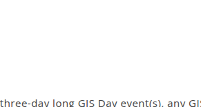
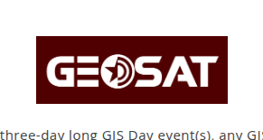

<!--
  Every pull request needs an issue behind it. Work on this project is reported to keep it funded,
  and that reporting is built from issues - a pull request with no issue does not appear in it.

  A CI check looks for one of `Closes #N`, `Fixes #N` or `Resolves #N` below. If there is genuinely
  no issue for this, open one first; it takes a minute and it is the whole point.
-->

Closes #3337

## What this changes

<!-- What a reader needs to know. Why, not only what. -->

The Light Pole Challenge page's GEOSAT logo was invisible. The logo is white on a transparent background (77 % of its pixels are see-through), and its maroon backing was written as `background-color: '#500000'`: a quoted string, not a colour, which the browser drops. So the logo was white on a white page. It is now `$aggie-maroon`, imported as the neighbouring GIS Day pages import it (`libs/gisday/sass/variables`).

**The Lighting page has the same rule and is left alone**: its template has no `img#geosat` (it shows the Geography and GeoInnovation logos), so the rule styles nothing, and changing it would look like a fix while changing nothing. Whether to delete it is the maintainer's call. The two identical stylesheets are the duplication the reuse rule warns about; this does not refactor them.

## Screenshots

The Light Pole Challenge, `/competitions/lightpole`, at 1280, before and after:

| Before | After |
| --- | --- |
|  |  |

## Release notes

<!--
  Anything with a user-visible result adds its entry to docs/releases/unreleased.md in this pull
  request, with the before/after images above linked from docs/screenshots/<slug>/. Nobody writes
  the notes later. See docs/releases/README.md.
-->

- [x] Entry added to `docs/releases/unreleased.md`, with screenshots: `docs/releases/unreleased/3337-geosat-logo.md` (`app: gisday`)
- [ ] Not user-visible (tests, CI, internal docs), so no entry needed

## How it was verified

<!--
  What you actually ran or looked at, and what it said. "Tests pass" is weaker than naming the check
  and its result. If something could not be verified, say so - that is more useful than silence.
-->

- **Proved worth fixing first**, on GIS Day local: `img#geosat` renders on Light Pole (212 x 75 px, on screen), its computed background was `rgba(0, 0, 0, 0)`, and with the intended maroon injected the logo appeared. On Lighting the element does not exist.
- **After the fix**: the computed background is `rgb(80, 0, 0)`, and the logo shows, as in the image above.
- `node scripts/collate-release-notes.mjs --check`: no problems.
- `CHECK_PARALLEL=1 scripts/pre-pr-check.sh fix/3337-quoted-background '<this title>' <this body> gisday-platform-ngx-core,gisday-angular`, which runs `scripts/check-in-volume.sh` for both (its own line: `Exit 0 (fix/3337-quoted-background, gisday-platform-ngx-core,gisday-angular)`): `pre-pr-check: Exit 0 (fix/3337-quoted-background): ready to open.`

🤖 Generated with [Claude Code](https://claude.com/claude-code)
